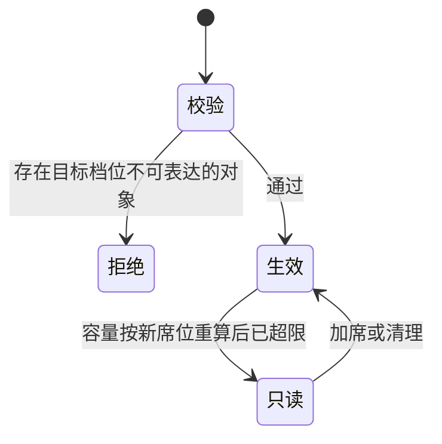

# 17 · 档位授权与容量计费（Edition & Capacity）· 系统架构设计（通用）

版本：v1.4.0
日期：2026-11-10
状态：**设计稿**。档位判定、改档与到期降级已落地，实现状态与运营操作见 `23-租户档位-交付与运营手册-v1.0.md`；
席位与容量派生、SaaS 计量、本地版许可证仍未实现。
取代：`archive/17-档位授权与激活动作-架构设计-v1.3.md`
拆分：本稿只写 **SaaS 与本地版共用的规则**；两套产品各自特有的部分见 `18-本地版` / `19-SaaS版`。

## 0. 相对 v1.3 的实质变更

| # | 项 | v1.3 | v1.4（本稿） |
|---|---|---|---|
| 1 | 最低年费 | 专业 1.2 万、商业 2.4 万/年 | **取消**，纯按席位计价 |
| 2 | 年付折扣 | 基础版 8 折，其余未定 | **三档统一"付 10 用 12"**（83.3%） |
| 3 | 容量 | 仅"由席位数决定"，无派生规则 | **每席固定容量**，租户上限 = 席位数 × 每席容量 |
| 4 | 单文件上限 | 全租户统一 10GB | **按档位分层**：1 / 5 / 10 GB |
| 5 | 基础版门槛 | 无 | **上限 20 席** |
| 6 | SaaS 计量口径 | 当前有效文件字节 | **blob 去重后字节，含版本历史与回收站** |
| 7 | 产品形态 | 一套代码两种激活方式 | **两套独立仓库、两个发行物**，不允许混用 |
| 8 | 价格/容量参数 | 硬编码 + 评审 | **运营台可配**，只影响新激活 |

v1.3 中仍然有效的部分全部保留：档位整体授予、密级"同一把尺子"、降档先校验、到期降档不停服、fail-closed、全量审计。

---

## 1. 产品形态：两套独立产品

**硬约束**：同一套实例不允许既是本地部署又是 SaaS。授权来源、计量口径、数据集合三者不得交叉。

| 维度 | SaaS 版 | 本地版 |
|---|---|---|
| 代码 | 独立仓库（当前仓库） | 从当前仓库 fork 后裁剪 |
| 发行物 | 多租户服务，含平台运营台 | 单租户服务，无平台运营台 |
| 授权来源 | 平台数据库改档 | 离线导入 Ed25519 许可证 |
| 租户模型 | 多租户，共享实例 | 单租户（`tenant` 表固定一行） |
| 计量口径 | blob 去重（含版本、回收站） | 当前有效文件字节（不含版本、回收站） |
| 预览/编辑 | 平台统一部署 OnlyOffice | 客户环境自建 OnlyOffice，**可选**，缺失时降级 |
| 数据迁移 | 不提供本地 → SaaS 的工具（两套产品数据不互通） | 同左 |

取舍说明：选"两个仓库"而非"一个仓库两个发行物"，代价是公共缺陷要修两遍、功能会随时间漂移。缓解手段是固定一份**共享规范**（本文档的 §2、§3、§4、§7 即为规范），两边实现都必须满足同一组不变量（§9），并由同一套对拍用例校验。

---

## 2. 档位模型

档位是**代码内置枚举**，不是运营可新增的记录。

| 档位 `edition` | 名称 | 密级等级集 | AD/LDAP | 邮件外发 | 自定义域名 | 媒体转码 |
|---|---|---|---|---|---|---|
| `basic` | 基础版 | **无**（对象密级恒 0） | 无 | 无 | 无 | 按配额 |
| `professional` | 专业版 | **3 档：0 公开 / 3 秘密 / 4 机密** | 有 | 有 | 无 | 按配额 |
| `business` | 商业版 | **7 档：0..6** | 有 | 有 | 有 | 按配额 |

**能力矩阵编译进代码**（`editionMatrix`），只允许评审修改。运营可以改价格、容量、席位上下限、有效期，但**不能改"这一档含哪些能力"** —— 否则同一档位在不同客户处含义不同，报价单与客服话术必然打架。

配额与能力解耦：能力回答"能不能用"（403 `FEATURE_NOT_ENABLED`），配额回答"能用多少"（超限进只读或 429）。

---

## 3. 密级：同一把尺子

存储刻度不可改：`node.classification` / `space.classification` 为 `smallint 0..6`，语义固定，只允许改显示名。

| level | 0 | 1 | 2 | 3 | 4 | 5 | 6 |
|---|---|---|---|---|---|---|---|
| 名称 | 公开 | 内部 | 敏感 | 秘密 | 机密 | 绝密 | 核心 |

档位只裁剪**写入口允许值**，`authz` 的数值比较判定完全不改：

- 基础版：隐藏密级 UI，写入恒 0，MAC 恒通过；
- 专业版：只允许写 `{0, 3, 4}`；
- 商业版：`{0..6}`。

不做"三档压缩存储"（专业版存 0/1/2 再迁移成 0/3/4）。原因：迁移期间并发写入必然错位，且 level 2 在七档里是「敏感」、在压缩映射里是「机密」，**漏迁即降密且无人察觉**。

降档前必须校验：商业 → 专业，若存在 `1/2/5/6` 的对象则拒绝并给出清单；任何档 → 基础，若存在 `>0` 的对象则拒绝。

> 实现提示：专业版 level 0 的显示名建议改为「非密」，否则客户会把"内部"文件标成"公开"。

---

## 4. 容量模型

### 4.1 派生公式

```
租户容量上限(bytes) = 购买席位数 × 每席容量(GB) × 10^9
```

容量只跟**购买席位数**走，不跟在册账号数走。三个理由：

1. 容量与订单一致，不会因为员工离职而突然超限；
2. 顺带规避 AD 同步把 `Administrator`、`Guest` 等内置账号算进来的问题；
3. 客户能自己算清楚"我买了 20 席就是 400GB"。

### 4.2 档位参数

| 档位 | 单价（元/席/月） | 起订 | 席位上限 | 每席容量 | 单文件上限 | 回收站保留 | 版本保留 |
|---|---|---|---|---|---|---|---|
| 基础 | 5 | 5 席 | **20 席** | 10 GB | **1 GB** | **7 天（固定）** | **3 个（固定）** |
| 专业 | 10 | 10 席 | 无（500 席以上定制） | 20 GB | **5 GB** | **30 天（固定）** | **10 个（固定）** |
| 商业 | 20 | 10 席 | 无（500 席以上定制） | 50 GB | **10 GB** | **1–90 天（租户可配，默认 30）** | **50 个（可配 10–50）** |

对应容量：

| 席位数 | 基础版 | 专业版 | 商业版 |
|---:|---|---|---|
| 5 | 50 GB | — | — |
| 10 | 100 GB | 200 GB | 500 GB |
| 20 | 200 GB | 400 GB | 1 TB |
| 50 | — | 1 TB | 2.5 TB |
| 100 | — | 2 TB | 5 TB |
| 200 | — | 4 TB | 10 TB |
| 500 | — | 10 TB | 25 TB |

### 4.3 单位

统一用 **GB = 10^9 字节**，不用 GiB。理由：客户看到"50GB"时的心理预期与云厂商计费口径一致；用 GiB 会让"50GB"变成 53.7GB，宣传与实测对不上。

### 4.4 单文件上限

基础版 1GB 是有意的约束：5 席基础版总容量仅 50GB，若允许单文件 10GB，一个文件就吃掉 20%，客户会在第一周就超限。落地点是租户策略里已有的 `maxUploadMB`（1024 / 5120 / 10240），无需新增字段。

### 4.5 单一实现

`席位 → 容量字节` 只能有一个函数（`capacityBytes(edition, seats)`）。SaaS 改档、本地版许可证激活、运营台预览报价，全部调用它。禁止两端各写一套，否则半年内必然出现"SaaS 客户 200GB、本地客户 100GB"的对账事故。

---

## 5. 超限状态机

### 5.1 四个状态

| 状态 | 判定 | 行为 |
|---|---|---|
| `ok` | 已用 ≤ 上限 × 90% | 正常 |
| `warning` | 上限 × 90% < 已用 ≤ 上限 | 正常写入，界面提示并通知租户拥有者 |
| `grace` | 已用 > 上限，且超限未满 30 天 | 正常写入，每日告警 |
| `readonly` | 已用 > 上限，且超限已满 30 天 | **禁止上传、新建版本、新建分享**；下载、浏览、删除、清空回收站全部正常 |

`readonly` 不是"停服"：客户永远能取走数据和清理空间，这是数据安全底线。

### 5.2 转移

```
ok ──> warning ──> grace ──(30天)──> readonly
 ^          ^          |                  |
 └──────────┴──────────┴──────────────────┘
        已用回落到上限以内（清理、扩容、加席）
```

超限计时从**首次越线**开始，不是从"进入 grace 的那天"开始；清空回收站导致回落后重新计时。

### 5.3 只升不降

合同期内席位**只升不降**，减席仅在续费时生效。原因：否则会出现"月初买 100 席存 2TB，月中降到 10 席"的套利。

减席后若已用超新上限 → 直接进 `readonly`，数据**永久保留、永不删除**，客户可随时加席恢复。

### 5.4 降档



降档不是"先降再报错"，而是**先校验、不通过则整体拒绝**，返回影响清单（对象名、密级、路径）。

### 5.5 到期（仅本地版）

许可证到期 → 30 天宽限（仍按原档位运行，界面持续提示）→ 降为基础版 + 保留全部数据。降档后容量按**已购席位 × 10GB**（基础版每席容量）重算，可能立即超限进入 `readonly`；数据不删，客户加席或清理后自动恢复。

---

## 6. 计量口径

两套产品口径不同，这是 fork 之后的既定差异，不是缺陷。

### 6.1 SaaS：blob 去重（含版本、含回收站）

```
已用 = SUM(blob.size_bytes) WHERE tenant_id = ? AND 未被 GC
```

`blob` 表是内容寻址的（`UNIQUE(tenant_id, sha256, size_bytes)`），同一内容在一个租户内只存一份。因此该口径天然具备三个性质：

- **版本历史自动计入**：旧版本仍引用 blob，blob 未删即占容量；
- **回收站自动计入**：软删除的 node 仍引用 blob，清空回收站且 GC 后才释放；
- **同一内容只算一次**：一份 1GB 文件存 5 个版本、复制到 3 个目录，仍只算 1GB。

这是对客户最友好的口径，也是唯一与磁盘成本一致的口径。

**实现变更**（相对现状）：

| 项 | 现状（`0022_metering.sql`） | SaaS 目标 |
|---|---|---|
| 触发器 | `node_usage_sync`（BEFORE INSERT/UPDATE/DELETE ON node） | `blob_usage_sync`（AFTER INSERT/DELETE ON blob） |
| 计入条件 | `kind='file' AND deleted_at IS NULL` | blob 行存在即计入 |
| 软删除 | 立即减账本 | **不减**（blob 仍在） |
| 释放时机 | 软删除即释放 | 回收站清空 + blob GC 后释放 |

风险与对策：`blob.ref_count` 必须可靠维护，否则账本会漂。上线前核对 `ref_count` 的维护点，并加**每日对账任务**（重算 `SUM(blob.size_bytes)` 与 `tenant_usage.storage_bytes` 比对，偏差 >1% 告警）。

**迁移影响**：切换口径当天，所有存量租户的已用量会从"当前文件字节"跳到"含版本+回收站"，可能一次性越线。上线前必须出一张《口径切换影响评估表》（每租户：旧值 / 新值 / 上限 / 是否越线），对越线租户提前扩容或给 30 天宽限，不能一键切完让客户集体进只读。

### 6.2 本地版：当前有效文件

保持现状口径：只计未删除 `node` 的当前版本大小，不含历史版本与回收站。本地客户自购磁盘，容量上限是**授权限制**而非物理限制，从严没有收益。

### 6.3 归属分类（仅 SaaS，明细页用）

一个 blob 可能被多处引用，归属必须**互斥且完备**，保证"三类之和 = 总量"（差额为 0 是对账单测的硬断言）：

| 优先级 | 归属 | 判定 |
|---:|---|---|
| 1 | 当前文件 | 被任一未删除 node 的 `current_version_id` 引用 |
| 2 | 回收站 | 未被第 1 类引用，但被任一 `deleted_at IS NOT NULL` 的 node 引用 |
| 3 | 版本历史 | 未被前两类引用，仅被非当前版本引用 |
| 4 | 待回收 | 无任何引用（GC 队列中） |

其他维度（按空间、按文件类型、按密级、按上传人）**只对"当前文件"部分成立**，且一个 blob 若跨空间/跨密级引用，按"引用它的未删除 node 中最早创建的那个"归属。这一点必须在界面上写明，否则客户会拿"按空间之和"去对总量。

### 6.4 明细页

租户拥有者（owner）与租户管理员可见，入口 `GET /v1/tenant/usage/breakdown`：

- 顶部：已用 / 上限 / 百分比 / 状态（ok / warning / grace / readonly）/ 剩余天数；
- 第一层（必现，互斥完备）：当前文件、版本历史、回收站、待回收；
- 第二层（仅对当前文件）：按空间 / 按类型 / 按密级 / 按上传人 / 按最近访问时间；
- 支持导出 CSV（财务与资产盘点用）。

聚合数据按小时快照落 `storage_breakdown_hourly`，不在请求路径上扫 `blob` 全表（百万级文件实时聚合会拖垮库）。

---

## 7. 定价体系

### 7.1 规则

```
月费(n) = Σ 段内席位数 × 该段单价
段 k 覆盖 [(k-1)×20+1, k×20] 席
段 k 单价 = 单价 × max(0.70, 0.98^(k-1))
年费 = 月费 × 10          # 付 10 个月，用 12 个月
```

- 三档统一"付 10 用 12"，不再有单独的 8 折；
- 阶梯为**分段累进**：折扣只作用于落在该段的人数，不是整体打折；
- 触底：`0.98^18 = 0.695 < 0.70`，故第 19 段（361 席起）即触底；
- 无最低年费、无平台费、无容量加购包。

### 7.2 价格与容量

| 席位数 | 基础版 年费 / 容量 | 专业版 年费 / 容量 | 商业版 年费 / 容量 |
|---:|---|---|---|
| 5 | 250 元 / 50GB | — | — |
| 10 | 500 元 / 100GB | 1,000 元 / 200GB | 2,000 元 / 500GB |
| 20 | 1,000 元 / 200GB | 2,000 元 / 400GB | 4,000 元 / 1TB |
| 30 | — | 2,980 元 / 600GB | 5,960 元 / 1.5TB |
| 50 | — | 4,920 元 / 1TB | 9,841 元 / 2.5TB |
| 100 | — | 9,608 元 / 2TB | 19,216 元 / 5TB |
| 200 | — | 18,293 元 / 4TB | 36,585 元 / 10TB |
| 360 | — | 30,486 元 / 7.2TB | 60,973 元 / 18TB |
| 500 | — | 40,286 元 / 10TB | 80,573 元 / 25TB |

三个结构性事实（有意为之，非缺陷）：

1. **基础版 20 席（1,000 元 / 200GB）与专业版 10 席（1,000 元 / 200GB）同价同容量**。差别是"20 人无合规功能"与"10 人有密级 + AD"。功能也是价值，两条路线各有客群。
2. **商业版容量是专业版 2.5 倍、价格 2 倍**，容量性价比更高，符合往高档引导的意图。
3. 500 席以上不进公开阶梯，走定制报价（可含多年期、SLA、私有化实施费）。

### 7.3 对拍单测期望值（实现必须逐行通过）

| n | 档位 | 月费(元) | 年费(元) |
|---:|---|---:|---:|
| 5 | basic | 25.00 | 250.00 |
| 10 | basic | 50.00 | 500.00 |
| 20 | basic | 100.00 | 1,000.00 |
| 10 | professional | 100.00 | 1,000.00 |
| 20 | professional | 200.00 | 2,000.00 |
| 30 | professional | 298.00 | 2,980.00 |
| 50 | professional | 492.04 | 4,920.40 |
| 100 | professional | 960.79 | 9,607.92 |
| 200 | professional | 1,829.27 | 18,292.72 |
| 360 | professional | 3,048.65 | 30,486.47 |
| 500 | professional | 4,028.65 | 40,286.47 |
| 10 | business | 200.00 | 2,000.00 |
| 50 | business | 984.08 | 9,840.80 |
| 100 | business | 1,921.58 | 19,215.84 |

单测必须同时断言四条不变量，对 1–1200 席逐人校验：

1. **无倒挂**：`年费(n+1) ≥ 年费(n)`，严格成立；
2. **档位自洽**：同人数 `年费(basic) < 年费(professional) < 年费(business)`；
3. **边际为正**：触底后 `年费(n+1) - 年费(n) = 70 元`（专业）/ `140 元`（商业），恒为正；
4. **年付优于月付**：`年费(n) < 月费(n) × 12`，恒成立。

### 7.4 与 v1.3 的差异说明

v1.3 用"整体打折"（`n × 单价 × 0.98^k`），29 个 20 人边界里 16 个出现"加人少付钱"（如 359→360 少 26.5 元）。本稿改分段累进后倒挂归零，代价是同规则下略多收：360 席由 2,520 涨到 3,048.65 元/月（+21%）。这是修账单错误的必要成本。

---

## 8. 档位参数可配置

### 8.1 可配与不可配的边界

| 类别 | 内容 | 谁改 |
|---|---|---|
| **能力矩阵** | 每档含哪些能力、密级可选集、回收站保留期（7/30/上限 90） | 代码，仅评审 |
| **商务参数** | 单价、起订席、席位上限、每席容量、单文件上限、版本保留数、阶梯步长/系数/下限、年付月数 | **运营台，可配** |
| **租户设置** | 商业版的回收站保留天数（1..90）、商业版的版本保留数（10..50） | 租户管理员，可配 |

理由：能力变更会改变合同语义，必须走版本；价格与容量是市场行为，运营必须能当天调。

### 8.2 数据模型

```sql
create table edition_params (
  edition            text primary key check (edition in ('basic','professional','business')),
  price_per_seat_month numeric(10,2) not null,
  min_seats          int not null,
  max_seats          int,                 -- null = 不设上限
  storage_gb_per_seat int not null,
  max_upload_mb      int not null,
  version_keep       int not null default 10,
  tier_step          int not null default 20,
  tier_factor        numeric(5,4) not null default 0.98,
  tier_floor         numeric(5,4) not null default 0.70,
  annual_months      int not null default 10,
  updated_by         text not null,
  updated_at         timestamptz not null default now(),
  effective_from     timestamptz not null default now()
);
```

变更写 `edition_params_history`（只追加，含前后值），并落审计。

### 8.3 生效规则

- **只影响新激活 / 续费**：改参数不触碰存量租户；
- 存量同步必须显式操作（运营台"同步到存量"按钮），逐租户生成新的授权记录并审计，支持先预览影响（哪些租户会因此超限）；
- 单租户覆盖：允许，写入 `tenant_entitlement`（带原因与 `expires_at`），优先级高于档位参数，低于全局熔断；
- 参数合法性校验：`max_seats ≥ min_seats`、`tier_floor ∈ (0,1]`、`annual_months ∈ [1,12]`、每席容量 > 0，非法直接拒绝保存。

---

## 9. 不变量（两套产品都必须满足）

1. 容量上限只有一个派生实现，SaaS 与本地版结果一致（同档同席位同容量）。
2. 档位只决定能力集与参数，不改变既有数据语义；跨档升级零迁移。
3. 降档必须先通过数据兼容性校验，不通过则整体拒绝并给清单。
4. 未激活/到期 = 降为基础版 + 数据保留，不停服、不删数据。
5. 超限永不删数据，最严只到 `readonly`。
6. 授权读取失败 = 拒绝（503），不允许 fail-open。
7. SaaS 明细页各分类之和 = 计费总量，差额恒为 0。
8. 参数变更不追溯存量，除非显式同步。
9. 激活、改档、参数变更、例外授权全部落审计，含前后值与操作人。
10. 已发出的外部分享不因档位或超限状态变化而失效。
11. 删除保留期按档位（7 / 30 / 1–90 天），降档不追溯已删除对象的 `purge_after`；彻底删除必须可审计、可定位到具体对象。

---

## 10. 关键取舍

| # | 取舍 | 选择 | 理由 | 代价 |
|---|---|---|---|---|
| 1 | 一套代码两种激活 vs 两套产品 | **两套仓库、两个发行物** | 授权来源、计量口径、数据集合三者不可交叉，混在一套里迟早出对账事故 | 公共缺陷修两遍，功能会漂移 |
| 2 | SaaS 计量：逻辑字节 vs blob 去重 | **blob 去重** | 与磁盘成本一致；同内容多版本不重复收；客户无法反驳 | 计量触发点要从 node 迁到 blob，需核对 ref_count |
| 3 | 版本/回收站是否计入 | **SaaS 计入，本地版不计** | SaaS 有真实存储成本；本地客户自购磁盘 | 两套口径不同，客服需按产品分别解释 |
| 4 | 超限行为：拒绝 vs 只读 | **30 天宽限后只读** | 拒绝写入会让客户"传不进也删不掉"，投诉率高 | 需要应用层只读闸门（已有 `tenant_gate`） |
| 5 | 减席：随时 vs 仅续费 | **仅续费，只升不降** | 杜绝"月中降席"套利 | 客户临时缩编需等到续费 |
| 6 | 容量：只随席位 vs 可加购 | **只随席位** | 规则简单、报价无歧义 | 人少盘大的客户会流失，需靠定制单兜住 |
| 7 | 价格：硬编码 vs 可配 | **商务参数可配、能力硬编码** | 市场要快，合同语义要稳 | 配置错误会直接影响收入，需双人复核 |

---

## 11. 落地阶段

| 阶段 | 内容 | 验收 | 回滚 |
|---|---|---|---|
| **P0** | `edition_params` 表 + `capacityBytes()` + `requireCapability`（恒返回 business） | 行为零变化，容量计算单测通过 | 删包装器 |
| **P1** | 定价引擎（分段累进 + 付10用12）+ 对拍单测 + 运营台参数页 | §7.3 全表通过，四条不变量逐人校验通过 | 恢复默认参数 |
| **P2** | SaaS 计量改 blob 口径 + 明细页 + 对账任务 | 分类之和 = 总量；每日对账偏差 < 1% | 保留旧触发器，按开关切换 |
| **P3** | 口径切换影响评估 + 越线租户扩容/宽限 | 无租户因切换被误置为只读 | 延后切换 |
| **P4** | 超限状态机（warning/grace/readonly）+ 通知 | 越线 30 天后准确进只读，清理后自动恢复 | 关闭只读闸门 |

**P2 的前置动作**：上线前先跑一次全量评估，输出每租户 `旧口径 / 新口径 / 上限 / 差值`，对越线租户逐个定处理方案。这一步不能省，否则切换当天会有客户集体进只读。

---

## 12. 待确认

1. 明细页第二层维度是否四项全做（空间/类型/密级/上传人），还是先做空间+类型。
2. `storage_breakdown_hourly` 快照保留多久（建议 90 天）。
3. 500 席以上定制报价是否仍受"每席容量"约束（建议不受，按项目谈）。
