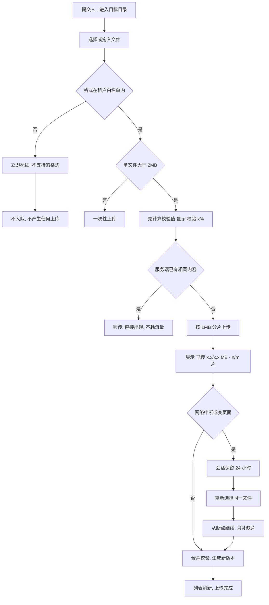
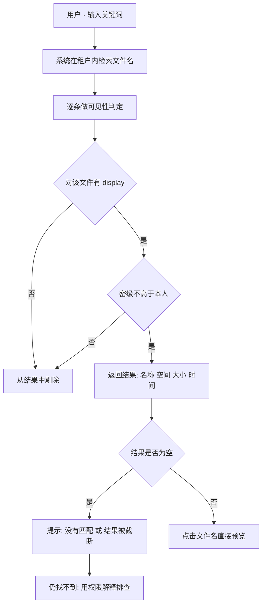
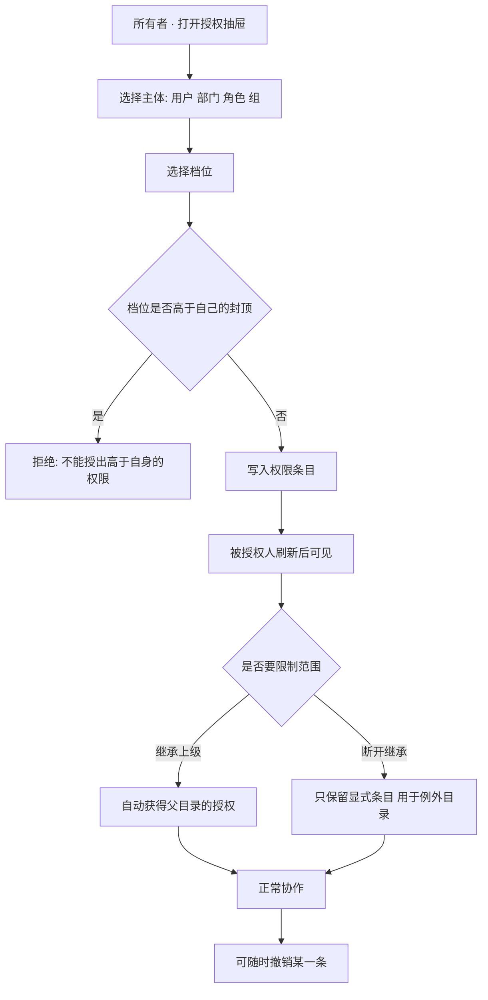
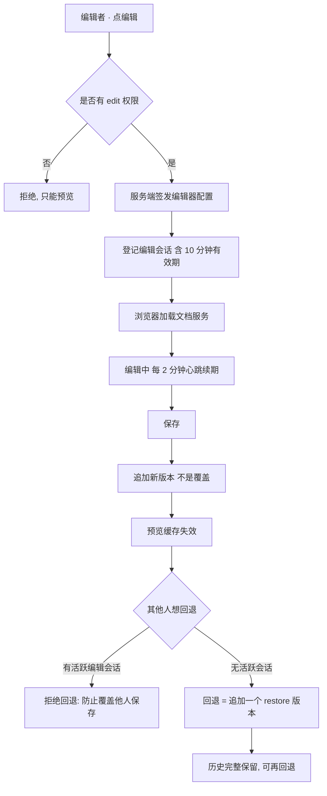
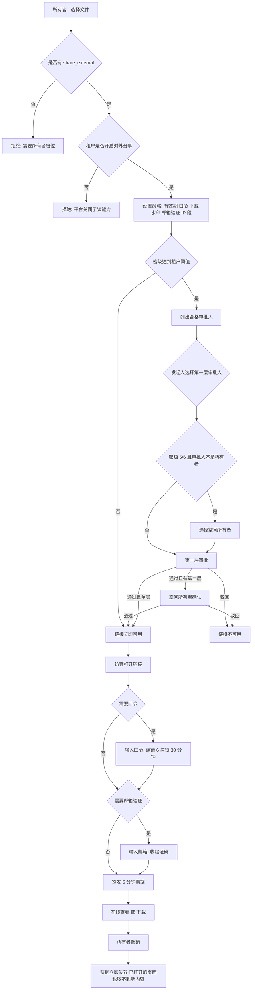
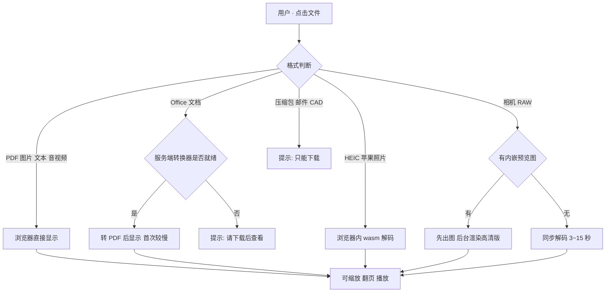
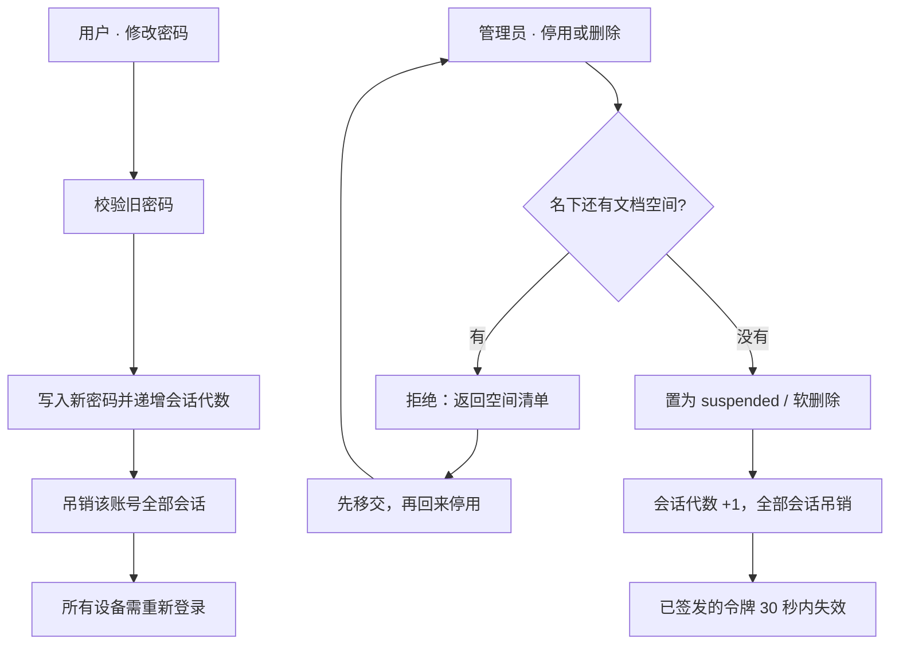
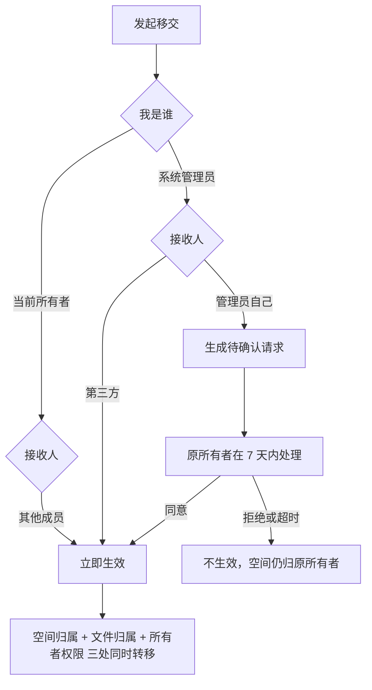

# NeuroDMS 用户手册 · 场景操作

版本：V1.3.0
适用对象：所有登录用户（含外部协作者）
配套文档：`30-用户手册-角色能力`、`31-管理员手册`

**本版变更（V1.3.0）**

| 变更 | 位置 |
|---|---|
| 外发审批改为**发起人指定审批人**；候选人由服务端枚举 | 场景 5 |
| 5/6 级文件外发新增**空间所有者第二层确认**；多层时弹窗选择 | 场景 5 |
| 无合格审批人时禁止建链（不再产生死链） | 场景 5 |

| 变更 | 位置 |
|---|---|
| 新增「工作台」场景：登录后的第一屏是什么、待办从哪来 | 场景 0 |
| 外发审批的入口补充独立页 `/approvals`（不只有管理台） | 场景 5 |
| 停用/删除账号改为**系统强制先移交**（不是"建议"）；新增空间移交流程与"管理员转给自己需确认" | 场景 7 |

---

## 0. 开始之前：四个必须知道的概念

不理解这四个词，后面每个页面都会看得别扭。

| 概念 | 一句话解释 | 在哪里体现 |
|---|---|---|
| **空间** | 文件的顶层容器，类似"项目盘"。每个人有自己的个人空间，团队空间由管理员或所有者创建 | 左侧空间列表 |
| **权限档位** | 不是"角色"，而是**你对某一个对象**能做什么。同一份文件，你对它是编辑者，对隔壁文件可能只是查看者 | 授权抽屉里的六个档位 |
| **密级** | 内容本身的敏感等级，`公开 → 内部 → 敏感 → 秘密 → 机密 → 绝密 → 核心`。**它先于权限生效**：密级不够，给了权限也打不开 | 文件属性、上传时选择 |
| **外链 / 票据** | 发给组织外的人用的临时通道。链接本身是长期凭证，实际取文件用的是一张 5 分钟票据 | 分享抽屉、`/s/{token}` 页面 |

**五个可用权限档位**（从左到右能力递增）：

| 档位 | 能做什么 | 典型给谁 |
|---|---|---|
| 查看者 | 看到、在线预览 | 只读旁听的人 |
| 贡献者 | + 下载、打印、上传 | 往目录里交材料的人 |
| 编辑者 | + 在线编辑、复制、改名 | 一起改文档的同事 |
| 管理者 | + 移动、删除、内部分享、版本管理 | 项目负责人 |
| 所有者 | 全部能力，**并且可以给别人授权** | 空间/文件的负责人 |

> 后端另保留了「评论者」档位但界面未开放，当前请用「查看者」。

**一条贯穿全系统的规则**：*能力不够时，系统宁可说"不存在"，也不告诉你"你没权限"*。所以你看到 404 很多时候是权限问题，不一定是文件没了。用「权限解释」（见场景 2）能看清卡在哪一步。

---

## 场景 0：登录后的第一屏（工作台）

**适用角色**：所有登录用户
**入口**：登录后自动进入 `/home`；任何时候点左上角产品名「NeuroDMS」也能回到这里

工作台不是"又一个首页"，它按**你下一刻要做什么**排了顺序：

| 区块 | 回答的问题 | 什么时候出现 |
|---|---|---|
| 等你处理 | 有没有事必须由我拍板（移交确认、外发审批） | 有待办才出现 |
| 职责视图 | 作为管理员，我该关注哪些数字（仅管理角色） | 有管理角色 |
| 关键数字 | 我能进几个空间、占了多少存储、最近打开过几个 | 有内容或待办 |
| 最近打开 | 我上次在弄的那份文件在哪 | 有访问记录 |
| 我的空间 | 从哪进、容量还剩多少 | 有可见空间 |

| # | 谁 | 做什么 | 注意 |
|---|---|---|---|
| 1 | 所有人 | 先看「等你处理」 | 有红色/黄色提示条就是必须你处理的，别人替不了 |
| 2 | 所有人 | 点「最近打开」的卡片直接预览 | 新页签打开，不影响当前页面；记录来自你自己的审计日志，同事看不到 |
| 3 | 所有人 | 点空间卡片进空间根目录 | 卡片上显示所有者与最近更新时间 |
| 4 | 管理员 | 「职责视图」里的橙色/红色提示优先处理 | 提示的是"资产没人管"，不是"文件多不多"；点进去到空间台账 |
| 5 | 管理员 | 看不到任何空间是正常的 | 管理角色管配置，不自动获得内容权限；需要看某空间要找所有者授权 |

**为什么管理员的空间数是 0**：系统管理员、安全管理员、审计管理员都不自动拥有内容权限。
工作台会把个人区换成一行说明，而不是显示一排 0 让人误以为系统是空的。

---

## 场景 1：把文件存进来

**适用角色**：贡献者及以上
**入口**：空间 → 进入目标目录 → 「上传」或直接拖拽



| # | 谁 | 做什么 | 注意 |
|---|---|---|---|
| 1 | 提交人 | 进入目标目录再上传 | 上传落在**当前目录**。在根目录上传想放进子文件夹，需要先双击进目录 |
| 2 | 系统 | 选完文件的瞬间校验格式 | 不合规会立刻标红并不入队。这是租户管理员配的白名单，改不了就找管理员 |
| 3 | 系统 | 大于 2MB 先算 SHA-256 | 这一步没有网络流量，只显示「校验 x%」。**不是卡住**，大文件可能要几十秒 |
| 4 | 系统 | 命中相同内容即"秒传" | 同一份文件第二次上传几乎瞬时完成，且不重复占容量 |
| 5 | 系统 | 分片上传，每片 1MB | 进度按"片完成"推进。1MB 在慢速上行下约 10 秒一格，数字不动就是真的没在动 |
| 6 | 提交人 | 中断后**重新选择同一个文件** | 服务端按"内容+目标目录+文件名"复用 24 小时内的会话。改文件名会变成新会话，等于从头传 |
| 7 | 提交人 | 需要停掉时点「取消」 | 取消**不会**删服务端已收的分片，重选同一文件可续传 |

**三个常见误会**

- **"上传完但列表里看不到"**：多数是同名文件被覆盖成了新版本。点该文件 → 版本 → 看有没有 v2。系统对同名文件是**追加版本**，不是产生两个条目。
- **"别人上传同名的，把我的覆盖了"**：同上，旧内容在历史版本里，可回退（场景 4）。
- **"提示超过 20MB 不让传"**：这不是系统的硬限制，而是租户策略 `maxUploadMB`。管理员可调，见管理手册。

---

## 场景 2：找到一份记不清名字的文件

**适用角色**：所有登录用户
**入口**：顶部搜索框 / 空间内逐级浏览



| # | 谁 | 做什么 | 注意 |
|---|---|---|---|
| 1 | 用户 | 输入文件名片段即可 | 只搜**文件名**，不搜正文内容。正文检索不在当前版本能力内 |
| 2 | 系统 | 逐条判可见性 | 所以"搜不到"可能是没权限，不是不存在。换一个有权限的账号试试能确认 |
| 3 | 用户 | 点文件名 | 在列表里点文件名＝点「预览」，新开页签，不打断当前列表 |
| 4 | 用户 | 空间名可点 | 点工具栏上的空间名，直接回到该空间根目录，不用逐级退 |
| 5 | 用户 | 拿不准为什么打不开 | 用「权限解释」看分步结论（见下） |

**权限解释怎么读**

判定按固定顺序执行，卡在哪一步会明说：

```
租户 → 主体有效 → 对象存在 → 密级 → 显式拒绝 → 允许集合 → 条件 → 结果
```

常见结论对照：

| 结论 | 真实含义 | 该找谁 |
|---|---|---|
| `TENANT_MISMATCH` | 链接或账号属于另一个租户 | 确认登录的租户是否正确 |
| `SESSION_INVALID` | 会话被吊销（改密/停用/登出） | 重新登录 |
| `CLASSIFICATION_DENIED` | 你的密级低于文件密级 | 安全管理员调整密级或申请人 |
| `EXPLICIT_DENY` | 有一条明确的拒绝条目 | 对象所有者 |
| `NO_ALLOW` | 没有任何条目给你这个权限 | 所有者授权 |
| `CONDITION_NOT_MET` | 条件不满足（如要求 MFA、指定网段） | 按条件补齐 |

---

## 场景 3：和同事一起看/改一份文件

**适用角色**：所有者（授权）、被授权人（协作）
**入口**：文件行右侧「授权」/ 分享抽屉里的「内部分享」



| # | 谁 | 做什么 | 注意 |
|---|---|---|---|
| 1 | 所有者 | 授权时优先选**部门/角色/组** | 给组授权一次，比给十个人各授一次更好维护；人员变动自动生效 |
| 2 | 所有者 | 授权可设到期时间 | 临时协作建议设到期，避免"忘了收回" |
| 3 | 所有者 | 需要"这个子目录例外"时断开继承 | 断开后会生成祖先条目的快照。**快照不能单独删**，要先恢复继承 |
| 4 | 所有者 | 撤销授权 | 不能移除最后一个所有者——否则对象会变成没人能管 |
| 5 | 被授权人 | 权限变更后刷新页面 | 权限是每次请求实时判定的，不需要重新登录 |
| 6 | 所有人 | 部门授权含下级部门 | 给"研发部"授权，研发部下面所有子部门成员都会被覆盖到 |

**内部分享 vs 直接授权**

两者最终都落到同一张权限表，区别只是入口：内部分享是"按档位批量授给一批人"的快捷方式，不产生链接。**能内部分享 ≠ 能外发**：前者要 `share_internal`（管理者档位起），后者要 `share_external`（仅所有者）。

---

## 场景 4：在线编辑与版本回退

**适用角色**：编辑者及以上（编辑）、管理者及以上（版本管理）
**入口**：文件行「编辑」、版本抽屉



| # | 谁 | 做什么 | 注意 |
|---|---|---|---|
| 1 | 编辑者 | 首次打开编辑器要等 5~15 秒 | 加载链路是"签发配置 → 下载组件 → 文档服务打开文档"，页面会显示已等待秒数 |
| 2 | 编辑者 | 长文档编辑期间不要关页面 | 关掉后会话 10 分钟过期，别人就能回退；重新打开即续上 |
| 3 | 管理者 | 回退前确认没人在编辑 | 抽屉会提示"N 个编辑会话进行中"。强行回退会覆盖对方保存的内容，所以系统直接拒绝 |
| 4 | 管理者 | 回退后告诉同事 | 回退是**追加新版本**，不是"时间倒流"：对方手里的旧页面再保存仍会产生更新的版本 |
| 5 | 管理者 | 历史版本可单独下载 | 下载历史版本同样需要 `download` 权限，只有预览权限的人下不了 |

**为什么回退不是"删除后面的版本"**：审计要求"任何时刻的内容都可追溯"。删版本等于销毁证据，所以回退永远向前追加。

---

## 场景 5：把文件发给组织外的人

**适用角色**：所有者（发起）、安全管理员（审批）、外部访客（接收）
**入口**：文件行「分享」→ 生成链接；访客打开 `/s/{token}`；审批人从工作台待办或 `/approvals` 进入



| # | 谁 | 做什么 | 注意 |
|---|---|---|---|
| 1 | 所有者 | 优先设**有效期** | 不带有效期的链接等于永久开放。默认建议 7 天 |
| 2 | 所有者 | 只读交付就关掉「允许下载」 | 关闭后访客能在浏览器里看，但下不了原文件；Office 类会转成 PDF 展示 |
| 3 | 所有者 | 涉密内容打开「水印」 | 水印上带"链接 + 来源网段 + 时间"，截图外流时可定位到具体那条链接 |
| 4 | 所有者 | 需要知道"是谁在看"就开「邮箱验证」 | 访客必须收验证码才能进。可配邮箱白名单，限定只发给某些域名 |
| 5 | 所有者 | 口令要**另行走一条通道**告诉对方 | 系统不会把口令写进邮件。链接和口令同在一封邮件里，等于没有口令 |
| 6 | 发起人 | 在分享面板选择审批人 | 密级达到阈值时必须选。候选人只包含"有管理权限、密级够、不是你本人"的人；选完由服务端复核 |
| 7 | 发起人 | 5/6 级文件再选空间所有者 | 审批人不是所有者时才需要；多个所有者时选一位。两层一次选完，按顺序流转 |
| 8 | 审批人 | 在工作台「等你处理」或 `/approvals` 审批 | 列表里只出现"当前轮到你"的链接；第一层通过后转给所有者，不会重复出现 |
| 9 | 访客 | 打开链接后 5 分钟内有效 | 票据过期刷新页面即可重新兑换，不需要重新找分享人要链接 |
| 10 | 所有者 | 撤销后立即生效 | 撤销会连带吊销所有已发出的票据。已经下载到本地的文件收不回来——这是所有方案的共同边界 |
| 11 | 所有者 | 换设备/换网络可能被拒 | 票据绑定来源网段（IPv4 /24、IPv6 /64）。同一办公网内换电脑没问题，换到 4G 网络需要重新打开链接 |

**空间级外链的额外限制**（重要）

对"整个空间"生成外链时，系统会先检查空间内有没有**你自己也看不到**的内容：

- 有更高密级的文件 → 拒绝，提示改为分享具体文件/目录；
- 有显式拒绝的条目（说明子树里做过例外配置）→ 同样拒绝。

这不是刁难：空间级外链等于把整棵子树开放给匿名访客，一旦里面有例外，就会绕过那条例外。

**审批：你选谁批，5/6 级还要所有者确认**

密级达到租户阈值（默认「秘密」）时，分享面板会出现「审批人」选择：系统先算出所有合格审批人（对该文件有管理权限、密级不低于文件、不是你本人），列成清单由你选择。服务端会复核，不在清单里的人选会被拒绝。

为什么由发起人指定：审批要落到具体的人，否则多条链接同时在等，没人知道该谁处理。但"能选"不等于"能挑软的"——候选人由权限与密级决定，自批永远被拒。

5 级（机密）与 6 级（绝密）再加一层：如果第一层审批人不是文件所在空间的拥有者，还需要该空间拥有者确认。两层在同一次分享里选完，提交后按顺序流转：

| 层级 | 谁 | 什么时候 |
|---|---|---|
| 第一层 | 你选的审批人 | 提交后立即 |
| 第二层 | 空间拥有者 | 仅 5/6 级，且第一层审批人不是所有者 |

空间有多个拥有者时，面板会让你选一位。你本人就是所有者时不再要求第二层——否则会变成"自己审批自己"。

审批人必须同时满足三个条件：

| 条件 | 说明 |
|---|---|
| 对该文件有管理权限 | 空间「管理者」或「所有者」档位，或在文件上单独授过管理权限 |
| 密级不低于该文件 | 密级先于权限，看不到的文件批不了 |
| 不是发起人 | 系统不允许自批，会提示"请由他人复核" |

**在哪批**：工作台「等你处理」或 `/approvals`。列表只显示"当前轮到你"的链接；第一层通过后，这条会从第一层审批人的列表消失，转到所有者名下。通过后链接立即可用（有两层时，要等第二层也通过）。

**管理角色不等于审批权**：系统管理员、安全管理员管的是配置，不自动获得文件的内容权限。所以"我是管理员为什么看不到待审批"是正常现象——缺的是对象级管理权限，不是角色。

**没人能批怎么办**（会发生在权限集中在一个人手里的空间）：

1. 系统在**创建前**就会拦住：没有合格审批人时，面板提示"没有其他人能审批"并禁用提交，不会再生成一条永远打不开的链接；
2. 解决方式：到「文件 → 该空间 → 权限」给一位同事授「管理者」，并确认他的密级不低于这份文件；
3. 5/6 级文件如果没有密级足够的其他所有者，也可以把第一层审批人改为空间所有者本人（此时只需一层）；
4. 或者把文件密级降到阈值以下（走降密审批），之后新建的链接不再需要审批——**已经 pending 的链接不会自动放行**，需要重建。

**没有通知**：待审批不会主动提醒任何人。需要线下约定"谁每天看一次外发审批"，或者把审批人拉进交付流程。第二层转给所有者时同样不推送，建议发起人事先口头告知。

---

## 场景 6：查看各种格式的文件

**适用角色**：查看者及以上
**入口**：点文件名，或文件行「预览」



| 格式 | 首次打开 | 之后 | 注意 |
|---|---|---|---|
| PDF / 图片 / 文本 | 立即 | 立即 | — |
| Word / Excel / PPT | 3~15 秒 | 百毫秒级 | 页面会显示「正在转换」与已等待秒数；**只有首次慢** |
| HEIC（iPhone 照片） | 10~20 秒 | 10~20 秒 | 在浏览器内解码，期间页面不卡但图未出；超过 6000 万像素会提示下载 |
| 相机 RAW（CR2/NEF/DNG 等） | 3~15 秒 | 秒开 | 有内嵌预览图的机型先出图再换高清；索尼 ARW、佳能 CR3 未做完整验证 |
| 视频 | 后台转码 | 就绪后秒开 | 转码未完成时接口返回"准备中"，前端轮询 |
| 压缩包 / 邮件 / CAD / HTML | — | — | 只能下载。HTML 刻意不给在线渲染（同源渲染有安全风险） |

**"为什么这个格式不能预览"**：管理台「系统设置 → 允许上传的格式」里，每个格式右侧有徽标：`可预览` / `可预览 · 转码` / `不可预览`。徽标由服务端按当前实例能力计算，不是写死的。

---

## 场景 7：账号、密码与工作交接

**适用角色**：所有用户（改密/自助注销）、空间所有者（发起移交）、原所有者（确认移交）、系统管理员（停用/删除/代转）
**入口**：右上角账号菜单、文件页标题右侧「移交」、管理台「成员与角色」「空间台账」、工作台「等你处理」

### 7.1 改密、停用与离职



| # | 谁 | 做什么 | 注意 |
|---|---|---|---|
| 1 | 用户 | 改密码后所有设备会被踢下线 | 这是有意的：账号被盗时，改密必须能收回已有凭证 |
| 2 | 用户 | 连续输错 5 次会被锁 30 分钟 | 锁定按账号计，不是按 IP。锁定期内即使密码正确也拒绝 |
| 3 | 管理员 | 停用/删除前**系统会检查名下空间** | 只要他还拥有空间，操作会被直接拒绝并列出空间名。这不是提示，是硬约束：停用后他登不进来，空间就没人管了 |
| 4 | 管理员 | 看到拒绝时，先去「空间台账」把空间移交出去 | 移交完成后再点停用即可通过；不想移交就不能停用 |
| 5 | 管理员 | 只是账号被盗、需要立刻踢下线 | 用「重置口令」，它会立即吊销全部会话，但账号仍可登录，不会让空间失去负责人 |
| 6 | 管理员 | 停用立即生效、删除是软删除 | 令牌在 30 秒内失效；软删除保留 30 天，期间审计与回收站仍可追溯 |
| 7 | 用户 | 外部协作者默认强制二次验证 | 外部账号创建时 `mfa_required` 自动为真，收不到验证码则无法登录（fail-closed） |

### 7.2 空间移交：谁能发起、怎么生效



**一条移交会同时改三样东西**：空间归谁、空间里原属于他的文件归谁、谁能管理这个空间。
任何一处没改，都会出现"名字换了、权限没换"的更糟状态，所以它是整笔完成的。

| # | 谁 | 做什么 | 注意 |
|---|---|---|---|
| 1 | 空间所有者 | 文件页标题右侧点「移交」，选接收人 | 接收人必须是本租户**可登录**的成员，且密级不低于空间密级 |
| 2 | 空间所有者 | 移交后自己不再是所有者 | 这个动作不可撤销；对方可以再移交给别人 |
| 3 | 系统管理员 | 管理台「空间台账」对任一空间点「移交」 | 转给**第三方**立即生效（代离职人员交接，无利益冲突） |
| 4 | 系统管理员 | 想把空间转给**自己**时，必须原所有者确认 | 界面会提示"需要原所有者同意"；对方在工作台「等你处理」点同意后才生效，7 天不处理自动失效 |
| 5 | 原所有者 | 在待办里看到"某人请求移交给他自己" | 同意前请确认这是你要的；拒绝后对方需要重新发起 |
| 6 | 任何人 | 原所有者已停用/删除时 | 这种空间不能转给管理员自己（没人能确认），只能转给第三方 |
| 7 | 用户 | 账号注销（自助） | 必须先选接收人，系统会把空间、文件、权限条目整体交接，并撤销你创建的外发链接 |

**为什么管理员转给自己要别人同意**：管理员能看到所有账号，如果不设这道闸，他可以把任何员工的空间收进自己名下再读里面的文件。

---

## 8. 常见问题速查

| 现象 | 最可能的原因 | 处理 |
|---|---|---|
| 点文件提示"不存在" | 权限不足被当作不存在 | 用权限解释确认，找所有者授权 |
| 上传进度长时间不动 | 慢速上行 + 1MB 分片，约 10 秒一格 | 看「x.x MB / n 片」是否在变；不变再重选文件续传 |
| 停用账号被拒绝 | 该账号名下还有空间 | 按弹层里的清单先去「空间台账」移交，再回来停用 |
| 移交提交后没生效 | 管理员转给自己的请求要原所有者确认 | 对方在工作台「等你处理」点同意；7 天内不处理自动失效 |
| 移交时提示"接收人密级不足" | 空间密级高于对方密级 | 先给对方提密，或改选密级更高的人 |
| 工作台没有任何空间 | 你是管理角色，或还没被授权 | 管理角色不自动获得内容权限；找空间所有者授权 |
| 大文件上传到 99% 卡住 | 正在合并与校验 | 等 1~2 分钟；中断后重选可续传 |
| 预览一直转圈 | Office 首次转换 / HEIC 解码 | 看提示里的"已等待 N 秒"；超过 60 秒刷新重试 |
| 分享链接打不开 | 过期 / 撤销 / 待审批 / 口令错 6 次被锁 | 让分享人看链接状态；锁定需等 30 分钟 |
| 换了网络后链接失效 | 票据绑定来源网段 | 重新打开链接即可 |
| 编辑时提示"有编辑会话" | 有人正在编辑，回退被保护性拒绝 | 等对方关闭或 10 分钟无心跳后重试 |
| 授权后对方仍打不开 | 密级不够 / 有显式拒绝 / 缓存未刷新 | 看权限解释的具体步骤 |
