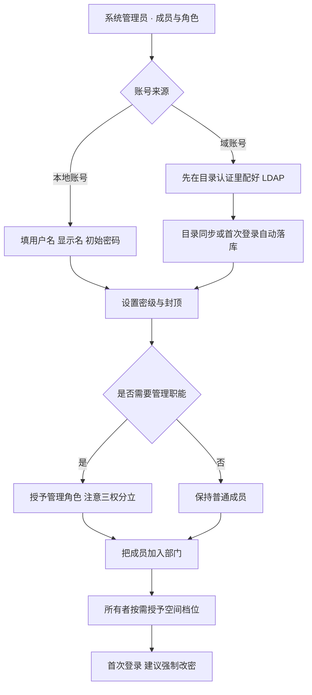

# NeuroDMS 管理员手册 · 租户与系统配置

版本：V1.3.0
适用对象：系统管理员、安全管理员、审计管理员、实施与运维
配套文档：`29-用户手册-场景操作`、`30-用户手册-角色能力`、`28-安全合规审计`

修订记录：
- V1.0.0 首版
- V1.1.0 新增 §9.1「能力开关：全局、放量、租户覆盖」——放量 0% 与总开关开启的
  组合此前在界面上显示为"已开启"，导致平台运营无法解释"功能全部不可用"；
  同步补充读不到开关时的 fail-closed 行为
- V1.2.0 重写 §6 外发审批：补上管理台「外发审批」入口、审批人三条件、单人空间的
  死链风险与处理；记录"审批提交必 500"的审计 result 约束缺陷（已修）
- V1.3.0 新增 §6「空间台账与所有权移交」：停用/删除前的强制校验、三种移交组合、
  管理员转自己需原所有者确认、空间台账的口径与告警；外发审批补 `/approvals` 独立入口
  （非管理员的审批人也要能进）；运维章指向 `37-版本发布-V1.0.0-与回退手册`

> 本手册只写**会被系统真正读取**的参数。界面上存在但不生效的开关，一律不写——那属于缺陷，不是功能。

---

## 1. 开始之前：三个管理角色的边界

| 角色 | 能进哪些页签 | 关键边界 |
|---|---|---|
| 系统管理员 `sysadmin` | 概览、成员与角色、操作日志、系统设置、目录认证 | **看不到文件内容**；改不了密级与审计 |
| 安全管理员 `secadmin` | 密级定义、标签策略、降密审批、操作日志 | 建不了号、改不了系统参数 |
| 审计管理员 `auditor` | 审计日志（只读） | 任何写操作都不可用 |

三者的冲突组合（如 sysadmin + auditor）会被**运行期**拒绝：持有冲突角色的账号，所有管理接口返回 403 并写审计。详见 `30-用户手册-角色能力` §5。

管理台地址：`/admin/{tab}`。页签按角色动态渲染，地址与页签一一对应，可直接收藏或转发给同角色同事。

---

## 2. 新成员入职：标准流程



| 步骤 | 谁 | 注意 |
|---|---|---|
| 建号 | 系统管理员 | 初始密码请走独立通道告知；`MinPasswordLen` 当前为 12 |
| 定密级 | 系统管理员 | 用户密级是**上限**：高于此密级的文件对他一律不可见，给再多权限也没用 |
| 定封顶 | 系统管理员 | `ceiling` 决定他能授出的最高档位。默认最高档；要限制"部门管理员只能授查看者"，必须在这里降 |
| 授角色 | 系统管理员 | 冲突组合会被拒；一旦配错，该账号管理能力立刻冻结，需尽快改回 |
| 归档部门 | 系统管理员 | 部门是**树**：给父部门授权会自动覆盖所有子部门成员 |
| 授权空间 | 空间所有者 | 管理员不给内容权限——这是刻意的职责分离 |

**外部协作者**：创建时 `mfa_required` 自动为真，必须有可用邮箱，否则登不上（fail-closed）。

**成员离职**：不要直接停用或删除。系统会先拦下来，要求把他名下的空间移交出去——
完整流程与三种移交组合见 §6。

---

## 3. 系统设置：每个参数的真实含义

入口：管理台 → 系统设置。以下 5 个参数**写入即生效**，不需要重启。

### 3.1 外链默认有效期 `shareDefaultExpireDays`

| 项 | 值 |
|---|---|
| 含义 | 创建外链时建议的默认天数 |
| 取值 | 0 = 不过期；正整数 = 天数 |
| 默认 | 7 |
| 影响 | 只影响**新建**链接的默认值。存量链接的策略在创建时已快照，改这个不会让已发出的链接提前失效 |
| 建议 | 保持 7。设为 0（永久）会让链接变成长期敞口，且撤销依赖人工记得 |

### 3.2 单文件上传上限 `maxUploadMB`

| 项 | 值 |
|---|---|
| 含义 | 单个文件允许的最大体积 |
| 取值 | 0 = 按档位默认；正整数 = MB |
| 默认 | 按档位：基础 1024 / 专业 5120 / 商业 10240 |
| 影响 | 超过即拒绝（413），**分片上传的每个分片不受此限制**，整体仍受此限制 |
| 注意 | 调大之前先确认磁盘余量与备份窗口。10GB 的单文件会让备份与迁移成本上一个台阶 |

### 3.3 日志保留期 `auditRetentionDays`

| 项 | 值 |
|---|---|
| 含义 | 操作日志与审计事件的保留天数，决定清理任务删到哪一天 |
| 取值 | 30 ~ 3650；0 落成 730 |
| 默认 | 730（2 年） |
| 影响 | **缩短后不可恢复**。删除的是已被日结锚点覆盖的数据，锚点仍能证明"那段时间存在过"，但明细没了 |
| 建议 | 合规场景按监管要求设（常见 180 天 / 2 年 / 10 年三档）。缩短前先导出 |

### 3.4 上传超时 `uploadTimeoutSeconds`

| 项 | 值 |
|---|---|
| 含义 | 单个上传请求允许的最长读取时长 |
| 取值 | 60 ~ 3600；0 落成 300 |
| 默认 | 300（5 分钟） |
| 影响 | 约束的是**每一片**，不是整个文件。片大小 1MB，250Kbps 上行约 32 秒/片，300 秒余量充足 |
| 调小的风险 | 移动网络下大文件会频繁中断。中断可续传，但用户体感差 |
| 调大的风险 | 慢速连接会长期占用一个连接。防大包靠 `maxUploadMB` 与配额，不靠这个值 |

> 历史教训：这个值曾经写死 60 秒，导致 iPhone 照片（4MB）在慢速上行下必然失败，而错误却显示"请使用 multipart/form-data"，把人引向格式问题。现在按租户可配，且超时会明确提示"可重试，大文件会从断点继续"。

### 3.5 允许上传的格式 `allowedExts`

| 项 | 值 |
|---|---|
| 含义 | 白名单，小写带点（如 `.pdf`） |
| 取值 | `null` = 不限制；数组 = 只允许这些 |
| 默认 | 不限制 |
| 生效点 | **前端选完文件的一瞬间**判一次（不合规直接标红、不入队）；后端单文件与分片初始化各判一次（415） |
| 界面 | 8 个分组共 101 种格式，支持组内全选、一键不限；每个格式右侧标 `可预览` / `可预览 · 转码` / `不可预览` |
| 重要 | 这是**入口约束，不是安全边界**。危险扩展名与可执行魔数另有独立拦截，两者不可互相替代 |

> 徽标由服务端按当前实例真实能力计算（LibreOffice 是否就绪、转码是否启用）。如果某台部署没装转换器，Office 格式会自动变成"不可预览"——不会给你一个必然失败的承诺。

### 3.6 当前**不可**在界面配置的参数（重要）

以下参数写在代码里（`auth.DefaultConfig()`），**数据库与界面都不读**，改需改代码重新构建：

| 参数 | 当前值 | 含义 |
|---|---|---|
| `AccessTTL` | 15 分钟 | 访问令牌有效期 |
| `RefreshTTL` | 30 天 | 刷新令牌有效期 |
| `MaxFailed` | 5 次 | 连续登录失败锁定阈值 |
| `LockDuration` | 30 分钟 | 锁定时长 |
| `MinPasswordLen` | 12 | 口令最小长度 |

这属于**已知缺口**：`auth.Config` 的注释写着"全部来自系统设置（不允许写死在代码里）"，但实现没有接上。需要按客户合规要求调整时，只能改代码——请在实施评估阶段就确认这三个值是否需要差异。

另有两个**只在数据库里**的配置，界面未暴露：

```sql
-- 外发审批阈值：达到该密级的分享强制走审批（默认 3 = 秘密）
UPDATE tenant SET share_approval_min_class = 3 WHERE slug = 'demo';

-- 每文件保留的历史版本数（默认按档位，上限 50）
-- 由租户策略 versionKeep 承载，界面暂未提供输入框
```

---

## 4. 密级与标签策略

入口：管理台 → 密级定义 / 标签策略（仅安全管理员）。

### 4.1 七个密级

| 等级 | 默认名称 | 默认含义 | 典型使用 |
|---|---|---|---|
| 0 | 公开 | 可在组织外自由传播 | 宣传资料 |
| 1 | 内部 | 仅组织内成员可见 | 内部通知 |
| 2 | 敏感 | 仅相关部门可见 | 部门数据 |
| 3 | 秘密 | 仅项目成员，外发需审批 | 项目文档 |
| 4 | 机密 | 仅授权人员，外发需审批并留痕 | 财务、合同 |
| 5 | 绝密 | 仅指定人员，禁止外发 | 并购、核心技术 |
| 6 | 核心 | 最高保护，禁止任何形式外发 | 董事会材料 |

**只能改名称与描述，等级数值固定。** 改数值会让历史数据的语义整体翻转——昨天标记"秘密"的文件会突然变成"公开"。系统刻意不给这个入口。

### 4.2 密级的两个作用点

1. **准入**：用户密级 < 文件密级 → 一律拒绝，与 ACL 无关。这是强制访问控制（MAC），**先于**权限判定；
2. **外发上界**：外链取内容时校验 `节点密级 ≤ 发起人创建时的密级快照`。所以"先分享再提密"不能绕过。

### 4.3 标签策略

给带某标签的文件设一个**最低密级下限**。效果是"只收紧，不放松"：文件可以比下限更高，不能更低。

用途：让分类/打标流程自动兜住密级，避免依赖人工每次记得选。

### 4.4 降密

普通用户**不能**直接把密级改低（会返回 `NEED_APPROVAL`）。流程是：

```
用户在文件上提交降密申请 → 安全管理员在「降密审批」通过/驳回 → 通过后密级下调
```

升密不需要审批（收紧方向不设障）。

---

## 5. 目录认证与单点登录

入口：管理台 → 目录认证（仅系统管理员）。

### 5.1 LDAP / AD

| 项 | 说明 |
|---|---|
| 作用域 | **每租户一份**，不同租户可以接各自的域 |
| 认证方式 | 域账号口令**永不在本地校验**。本地不存它的散列，避免"改密后本地旧散列仍然正确" |
| 同步 | 支持手动/定时同步；同步进来的账号走表默认值（`ceiling=6`） |
| 失败处理 | 目录不可达时不计数、不锁定，避免一次域控维护把全员锁死 |

**同名账号**：同一租户允许本地账号与域账号同名（如 `zhangsan` 与 `zhangsan@corp`）。登录时若出现歧义，系统默认取本地账号——这是为了升级兼容，不是安全判断。

### 5.2 SSO 断言（反向代理注入头）

| 项 | 要求 |
|---|---|
| 共享密钥 | **必填**。只靠来源网段不够：同一 docker 网络里任何容器都能发请求 |
| 可信网段 | **必填**，且拒绝 `0.0.0.0/0`（等于信任全世界） |
| 断言头 | 可自定义，但禁止用 `Authorization`、`Cookie`、`X-Forwarded-For` 这类客户端可控的头 |
| 判定依据 | 用**TCP 直连对端**判断是否受信代理，不用改写后的客户端 IP |

配错任一项，`Enabled=false` 并带原因，接口自然不可用（fail-closed），不会出现"配错但还在跑"。

### 5.3 客户端 IP 与可信代理

外链 IP 白名单、票据绑定、审计里的来源 IP、水印页脚，全都依赖"真实客户端 IP"。

必须配置 `DOCVAULT_TRUST_PROXY_CIDRS` 为你的反向代理/隧道出口网段。**不配**时系统一律使用 TCP 对端地址——如果前面有代理，所有访问会看起来来自同一个内网 IP，后果是：

- 外链 IP 白名单要么全拦、要么全放；
- 审计里的 IP 失去取证价值；
- 水印上的 IP 是错的。

这不是理论风险：审计里如果出现大量同一个 `172.x` 地址，就是这个配置没做对。

---

## 6. 空间台账与所有权移交

### 6.1 为什么需要这一章

空间的可达性靠授权条目。如果某个空间只有所有者本人的一条授权，那么这个人
**一停用或离职，空间就再也没人能打开**——管理员也看不到它，因为管理角色不具备内容权限。
本仓库上线前实测：12 个空间里 11 个是这种"单点可达"状态。

所以系统对"停用/删除账号"设了硬约束，并提供了专门的移交入口。

### 6.2 停用或删除前：系统强制检查名下空间

| 操作 | 有空间时的结果 | 说明 |
|---|---|---|
| 停用账号 | **409 `OWNS_SPACES`**，返回空间清单 | 账号状态不变；清单里带"是否仅他可达"标记 |
| 删除账号 | 同上 | 删除比停用更彻底，且没有继任者参数，直接删会制造孤儿空间 |
| 重置口令 | 不受影响 | 只是账号被盗时的应急手段：立即吊销全部会话，不让空间失去负责人 |

检查在**同一事务内、对空间行加锁**之后执行，不是"先查一下再改"。原因：不加锁时，
另一笔事务可以在"检查通过"和"停用生效"之间给他新建一个空间，检查就白做了。

界面表现：成员页点「停用」会弹出清单，逐条列出空间名与"仅他可达"标记，并给两个出口——
「去空间台账移交」和「改用重置口令」。

### 6.3 三种移交组合

| 发起人 | 接收人 | 生效方式 | 审计 |
|---|---|---|---|
| 空间当前所有者 | 任意可用成员 | 立即生效 | `space.transfer` mode=owner |
| 系统管理员（非所有者） | 第三方 | 立即生效 | `space.transfer` mode=admin |
| 系统管理员（非所有者） | 自己 | **生成待确认请求**，原所有者 7 天内同意后生效 | `space.transfer.request` + `.approve` |

**为什么"转给自己"要别人同意**：管理员能看到所有账号。不设这道闸，他可以把任何员工的
空间收进自己名下，然后读里面的文件。这道闸不是为了防外部攻击，是防内部越权。

其他约束（服务端强制）：

- 接收人必须**在职**（未停用、未过期、未删除），且不是原所有者；
- 接收人密级 ≥ 空间密级——否则转过去他自己也打不开，等于换个方式制造孤儿；
- 接收人在该空间上有**显式拒绝**时拒绝移交，提示先解除（不静默清 deny）；
- 同一空间同时只能有一条待确认请求；
- 原所有者已停用/删除时，管理员**不能**转给自己（没人能确认），只能转给第三方。

### 6.4 一次移交改三处

| 位置 | 含义 |
|---|---|
| `space.owner_id` | 空间归谁（台账、列表的"所有者"） |
| `node.owner_id` | 空间内**原本属于原所有者**的文件归谁（列表"归属"列） |
| 空间根的 owner ACE | 真正决定能不能进得去 |

三处必须同事务完成。只改前两处会出现"名字换了、权限没换"——比不移交更糟。
其他成员的文件归属、node 级别的单独授权、空间密级都不受影响。

### 6.5 空间台账

管理台 →「空间台账」（仅系统管理员）。列：空间名、所有者、授权条目数、最近活动、状态、移交。

| 状态标记 | 含义 | 该做什么 |
|---|---|---|
| 已共享 | 除所有者外还有其他用户/部门/角色/组授权 | 正常 |
| 仅所有者 | 除所有者外没有任何授权 | 建议补一份部门/角色授权，或安排移交 |
| 待确认 | 有一条管理员转给自己的请求在等原所有者 | 等对方处理，7 天后自动失效 |
| 账号不可用 | 所有者已停用或删除 | 立即移交给可用成员（转第三方无需确认） |

顶部汇总"共 N 个空间，其中 M 个仅所有者可达"；当存在"所有者已不可用且无其他授权"的空间时，
会给红色告警条——这类空间现在**没人能打开**，只能由管理员转给第三方恢复。

台账只显示元数据，**点不进内容**：管配置，不管内容。

---

## 7. 外发审批

### 7.1 什么时候需要审批

两个触发条件，满足任一即进入 `pending`：

1. 创建链接时显式勾选「需要审批」；
2. 对象密级 ≥ 租户阈值 `share_approval_min_class`（默认 3 = 秘密）。

创建时**不需要选审批人**：谁是审批人由权限决定，不是由发起人指派。这是刻意的——
如果发起人能挑审批人，他总会挑最容易通过的那个。

### 7.2 谁在审批：三个条件同时满足

| 条件 | 说明 |
|---|---|
| 对该对象有 `manage_acl` | 空间「管理者」或「所有者」档位，或在文件/目录上单独授予过管理权限 |
| 密级 ≥ 文件密级 | 密级先于权限：看不到的文件不可能审批 |
| 不是发起人本人 | 自批返回 403 `SELF_APPROVAL_DENIED` |

**入口有两个**：工作台「等你处理」的待办，或直接访问 `/approvals`。
这一页**不要求管理角色**——判据是对象级 `manage_acl`，空间所有者、被授权的管理者都可能有。
管理台「外发审批」是同一份列表，供管理员集中处理。

**管理角色不等于审批权**。系统管理员、安全管理员管的是配置（成员、密级定义、策略），
不自动获得内容权限。所以"我是管理员，为什么看不到待审批"是正常现象——缺的是对象级
`manage_acl`，不是角色。

**单人空间的死链风险**：如果某个空间的权限只在发起人一个人手里（个人项目、单人负责
的目录很常见），三个条件无法同时满足，链接会**永远停在审批中**。系统在创建时返回
`approverCount`，为 0 时分享面板会直接提示"当前没有其他人能审批"，避免发起人空等。

### 7.3 审批人从哪里操作

三个入口，看到的是同一份列表：

1. 工作台「等你处理」里的待办（最直接，登录就能看见）；
2. 直接访问 `/approvals`——**任何登录用户都可访问**，不要求管理角色；
3. 管理台 → **外发审批**（`/admin/share-approvals`），系统管理员与安全管理员可见。

第 2 条是关键：审批判据是对象级 `manage_acl`，而空间所有者通常不是管理员。
如果只有管理台有入口，这些人收到待办也点不进去，审批链会在最关键的一步断掉。

列表只显示"你有权处置"的链接：服务端逐条按上表三个条件判定，没有权限的链接不会出现，
所以不会出现"列出来却点不动"。每行给出文件、密级、发起人、提交时间、链接有效期，
可「通过」或「驳回」。

通过后链接**立即可用**，无需重新创建；驳回后发起人需要重新建链。
两种结果都写审计（`share.approve`，结果 ok，`detail.decision` 记录 approved/rejected）。

### 7.4 无人可批时怎么办

两条路，按业务选：

1. **给同事授权**（推荐）：发起人 → 文件 → 该空间 → 权限 → 添加成员 → 档位选「管理者」。
   该同事的密级也要 ≥ 文件密级。
2. **降低文件密级**：走降密审批（管理台 → 降密审批），降到阈值以下后新链接不再需要审批。
   已经 pending 的链接不会因此自动放行，需要重新创建。

> 如果这种情况反复出现，说明阈值（默认 3）对本租户偏低，或空间权限过度集中在单人手里。
> 前者调 `share_approval_min_class`，后者应治理授权结构——不要用"关掉审批"来解决。

### 7.5 当前约束（需知）

- **没有通知**：待审批不会主动提醒任何人，发起人与审批人都要靠"自己去看列表"。外发邮件
  只发给收件人，不发给审批人。流程上需要约定"谁每天看一次外发审批"。
- **一人一票，不能改判**：通过或驳回之后不能再改，只能重新建链。
- **审计写不进就拒绝操作**：审批先改状态、再写审计；审计失败返回 500 并提示。此前的
  缺陷是审计 `result` 写了 `approved`（不在 `ok/denied/error` 约束内），导致**审批一提交
  就 500，而状态其实已改**——现已修正为 `ok` + `detail.decision`。

### 7.6 空间级外链的额外闸门

对空间生成外链时，若空间内存在：**密级高于发起人的节点**，或**带显式拒绝条目的节点**，直接拒绝（403 `SPACE_NOT_SHAREABLE`）。

这道闸门是刻意的：空间级外链面向匿名访客，子树的任何例外都会被绕过。遇到这个提示，正确做法是改为分享具体文件/目录，而不是让管理员去删例外配置。

---

## 8. 品牌与域名

入口：管理台 → 系统设置（品牌部分）。

| 能力 | 说明 |
|---|---|
| 系统名称 / Logo | 影响登录页与页头；会写审计 |
| 自定义域名 | 商业版能力；需在平台侧配置证书与域名校验 |

品牌配置不影响任何权限判定——它只是展示层。

---

## 9. 审计与证据

入口：管理台 → 审计日志（仅审计管理员）、操作日志（管理角色）。

| 类型 | 内容 | 谁能看 |
|---|---|---|
| 操作日志 | 业务流水：谁在什么时候对什么做了什么，结果如何 | 三个管理角色 |
| 审计事件 | 全量事件，含**被拒绝**的越权尝试、登录失败、审批结论 | 仅审计管理员 |
| 完整性校验 | 哈希链校验，判断记录是否被篡改 | 仅审计管理员 |
| 证据包 | 导出 CSV 供内审/外审 | 仅审计管理员 |

**关键设计**：关键操作的审计写入失败时，**操作本身会被拒绝**。宁可让用户重试，也不留"做了但没记录"的空洞。

导证据包时注意：导出行为本身也会写审计（"谁导出了什么范围"），这是可核查性的一部分。

---

## 10. 平台运营台（仅 SaaS 形态）

入口：`/platform/{tab}`，账号在 `platform_user` 表，与租户账号完全分离。

| 页签 | 能做什么 | 不能做什么 |
|---|---|---|
| 租户 | 新建、停用、逻辑删除、改档位、配额、**按租户开关能力** | 不能读租户文件内容 |
| 用量与对账 | 存储、API 调用、导出对账单 | 不能改租户业务数据 |
| 灰度开关 | 平台默认值与放量比例（**全局**） | 关闭只影响**新建**，存量链接不受影响 |
| 平台账号 | 建号、改密、停用 | — |
| 平台审计 | 平台侧操作留痕 | — |

### 9.1 能力开关：全局、放量、租户覆盖（三级）

这是一处**最容易互相误解**的配置，2026-11 有过一次真实事故：平台把 `share.external`
的放量从 100 调到 0（总开关仍是"开启"），运营台显示"已开启"，而所有租户创建外链
都收到"未开启对外分享能力，请联系平台运营"——运营进去看，每个开关都是开启的，
找不到任何关闭动作。

**求值顺序（固定，不可调换）**：

```
租户覆盖（tenant_feature） > 全局总开关（default_enabled） > 放量（rollout_percent）
```

| 组合 | 实际结果 | 界面显示（现已修正） |
|---|---|---|
| 总开关 开 + 放量 100% | 全部租户开启 | 已开启 |
| 总开关 开 + 放量 25% | 约 25% 租户开启（按租户 ID 稳定分桶） | 已开启（放量 25%） |
| **总开关 开 + 放量 0%** | **全部租户关闭** | **已暂停**（并显示提示条） |
| 总开关 关 + 放量任意 | 除租户覆盖外全部关闭 | 已关闭 |
| 有租户覆盖 | **覆盖值优先**，与全局无关 | 本租户单独设置 |

> 放量 0% 是"暂停"而不是"没配"：它表达"功能已发布但当前不对任何租户开放"。
> 因此界面不再把这种组合显示成"已开启"——那是这次事故的直接原因。

**给单个客户开通（最常用）**：

1. 运营台 →「租户」→ 点租户名 → 抽屉里找到「**能力开关**」；
2. 每一行显示：能力说明、`code`、当前取值来源（跟随平台默认 / 平台放量 N% / 本租户单独设置）；
3. 点「开通」写入租户覆盖；点「恢复默认」删除覆盖、回到平台策略。

这一步只改这一个租户，不动全局放量。合规交付里最常见的就是
"平台默认全关，按合同逐个开"。

**生效时间**：开关有 30 秒缓存，改完 30 秒内全实例一致。急等不及可重启服务，
但正常场景不必。

**留痕**：全局改动写 `platform.flag.set`，租户覆盖写 `platform.flag.override`
（清除覆盖写 `platform.flag.override.clear`），都带操作人与新旧值，在「平台审计」可查。

**四个开关的实际作用点**：

| 开关 | 关闭后的行为 |
|---|---|
| `share.external` | 新建外链被拒（403 `FEATURE_DISABLED`），**已存在的链接按原样继续** |
| `share.email_verify` | 新建链接不再要求访客邮箱验证；存量链接不变 |
| `media.transcode` | 不再启动新转码；**已转码的产物仍可播放**（不会让历史视频集体失效） |
| `branding.custom_domain` | 禁止新增/变更域名绑定；已绑定的继续服务 |

**读不到开关时一律按"关闭"处理**（fail-closed）。这是刻意的：这些开关的用途正是
合规关闭，数据库抖动一下就把对外分享自动放开，是最不能接受的失败方向。表现为
请求返回 503「能力暂时不可用，请稍后重试」，而不是静默放行。

**停用租户的连锁反应**：该租户所有用户的会话立即失效（不必等令牌过期），登录被拒，接口返回只读/拒绝。恢复后不需要用户重新配置，但需要重新登录。

**档位差异**（影响可配置范围）：

| 项 | 基础版 | 专业版 | 商业版 |
|---|---|---|---|
| 密级 | 仅 0 | 0/3/4 | 全部 0–6 |
| 域账号（AD） | — | ✓ | ✓ |
| 邮件外发 | — | ✓ | ✓ |
| 自定义域名 | — | — | ✓ |
| 版本保留 | 3 | 10 | 50 |
| 单文件上限 | 1 GB | 5 GB | 10 GB |
| 席位上限 | 20 | 不限 | 不限 |
| 每席位容量 | 10 GB | 20 GB | 50 GB |

**到期与宽限**：到期后进入 30 天宽限期（能力保持），宽限期结束后降为基础版，但界面仍显示"原为专业版"，避免用户以为数据丢了。

---

## 11. 运维：备份、升级、回滚

> 版本标识、镜像标签、数据库 dump 与四种回退路径，见 `37-版本发布-V1.0.0-与回退手册`。
> 本章只讲日常动作；发布与回退以那一份为准。

### 10.1 发布前必做

```bash
# 1) 备份数据库
docker exec docvault-postgres sh -c \
  'pg_dump -U docvault -d docvault -Fc -f /tmp/ndms-$(date +%Y%m%d).dump'
docker cp docvault-postgres:/tmp/ndms-$(date +%Y%m%d).dump docker/data/backup/
```

### 10.2 发布

```bash
docker compose build server && docker compose up -d server
```

启动时自动执行迁移，并做两项自检：

- **RLS 覆盖自检**：带 `tenant_id` 的表若缺行级隔离，**拒绝启动**；
- **权限模型告警**：连接角色是超级用户时提示"请求路径不得直接使用连接池"。

### 10.3 铁律：镜像与迁移必须同批

- 旧镜像 + 新库：可能因新增列/函数缺失而报错；
- 新镜像 + 旧库：启动时自动迁移，正常；
- **单独回滚镜像而不回滚库**：如果迁移删过东西，会坏。

迁移文件的纪律：已有函数改签名要 `DROP + CREATE`，返回列只在末尾追加。这样旧镜像回滚到新库时仍能跑。

### 10.4 后台任务

| 任务 | 频率 | 做什么 |
|---|---|---|
| 清理过期上传会话 | 每 6 小时（启动先跑一次） | 删 24 小时未完成的会话与磁盘分片 |
| 清理口令尝试记录 | 每 6 小时 | 删 30 天前且已解锁的记录 |
| 日志/审计清理 | 按保留期 | 删超过 `auditRetentionDays` 的明细（锚点保留） |
| 版本清理 | 每次在线保存后 | 按 `versionKeep` 删超出数量的旧版本 |

### 10.5 回滚

```bash
docker compose down server
# 恢复上一版镜像 tag
docker compose up -d server
# 若该版本对应的迁移不可逆，再恢复数据库备份
docker exec -i docvault-postgres pg_restore -U docvault -d docvault --clean < backup.dump
```

---

## 12. 故障排查

| 现象 | 最可能的原因 | 处理 |
|---|---|---|
| 所有上传都失败，日志 `status=400 dur_ms=60000` | 读超时被写死（旧版本） | 升级到支持 `uploadTimeoutSeconds` 的版本 |
| 审计里来源 IP 全是同一个内网地址 | 未配置可信代理网段 | 配 `DOCVAULT_TRUST_PROXY_CIDRS` |
| 外链 IP 白名单"要么全拦要么全放" | 同上 | 同上 |
| Office 预览全部 500 | 未装 LibreOffice / 转换器不可用 | 查启动日志；格式徽标会显示"不可预览" |
| HEIC 预览空白且控制台只有 `CompileError` | CSP 未放行 wasm | 确认响应头含 `'wasm-unsafe-eval'` |
| 上传进度不动 | 慢速上行 + 1MB 分片 | 属正常；看"x.x MB / n 片"是否推进 |
| 管理接口全部 403 且日志有 `SEPARATION_VIOLATION` | 角色组合冲突 | 移除冲突角色之一 |
| 分享链接显示"审批中"且长期不动 | 没有满足三条件的审批人 | 见 §7.2；空间只有发起人一个人时需先授权他人 manage_acl |
| 迁移失败导致无法启动 | 迁移与镜像不匹配 / 手工改过表结构 | 恢复备份后按顺序重跑；不要手工改表 |

---

## 13. 已知限制与待补项

按影响面排序，实施前请据此做预期管理。

| 项 | 影响 | 建议 |
|---|---|---|
| 外发审批无通知、不能改判 | 待审批要靠人主动看列表；通过/驳回后不可撤销 | 流程上指定"每天看一次"的审批人；驳回后重建链接 |
| 空间移交请求同样无通知 | 管理员转给自己的请求只在原所有者打开工作台时出现 | 发起后口头/邮件告知对方；7 天未处理自动失效 |
| 工作台「最近打开」不含在线编辑器打开的文件 | 只覆盖预览/下载/上传/改名/回退版本 | 需要精确追溯用审计日志 |
| 认证参数（会话时长/锁定阈值/口令长度）硬编码 | 无法按客户合规要求调整 | 实施评估时确认；需要则改代码 |
| 外发审批阈值只在数据库 | 无法在界面调整 | 用 SQL；变更写审计（当前需手工记录） |
| 索尼 ARW / 佳能 CR3 未完整验证 | 部分新机型可能解不出预览 | 有样张时单独验证；失败会提示下载，不会误报成功 |
| 空间外链只拦"显式拒绝"，不拦"该子树无任何授权" | 极端配置下仍可能多开放 | 遵循"空间级外链只用于全公开内容"的使用约定 |
| 全文检索只搜文件名 | 搜不到正文 | 用规范的命名与目录结构 |
| 视频转码无进度百分比 | 只能轮询"准备中" | 大视频提前转码或提示用户等待 |
