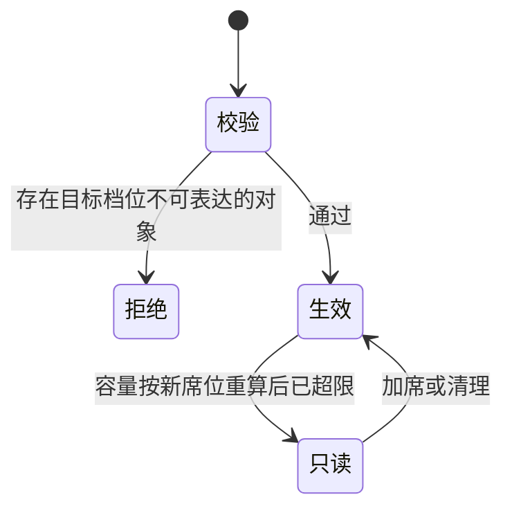

# NeuroDMS 技术文档（合集） V1.14.1

版本：V1.14.1（与产品版本一致）
沿革：2026-11-15 由 00–58 号分册整合而成；此后随产品版本同步
状态：**现行主文档**。分册原文按篇归档于 `docs/archive/sources-v1.5.1/`，仅作追溯

---

## 关于这份文档

这是 NeuroDMS 的**唯一技术主文档**：把原先 52 份分册（竞品研究、需求、架构、安全、认证、商业化、实施记录、部署运维）
按主题合并为 8 篇，删除各分册重复的封面与版本说明，保留全部技术结论、数据与判定依据。

- **版本规则**：本文与全部文档的版本 = 产品版本（仓库根 `VERSION`），由 `scripts/check-doc-versions.mjs` 校验；
- **不并入本文的**：`29/30/31` 三本用户与管理员手册（交付物，网页版同源托管在 `/manual/`）、
  `CHANGELOG.md`（第 8 篇是其摘要，全文仍在根目录）、`docs/37`（V1.0.0 历史快照）；
- **怎么查**：先看目录定位篇章 → 篇首一句导语说明该篇回答什么 → 章首标注源文档与实施状态。

## 目录

- [第 0 篇 · 总览与技术栈](#part-0)
- [第 1 篇 · 产品与需求](#part-1)
  - [1.1 竞品深度研究与能力对标](#ch-1-1)
  - [1.2 业务需求文档（BRD）](#ch-1-2)
  - [1.3 产品需求文档（PRD）](#ch-1-3)
  - [1.4 生产级风险规避与踩坑对照清单](#ch-1-4)
  - [1.5 前后端接口一致性检查报告](#ch-1-5)
- [第 2 篇 · 系统架构与数据模型](#part-2)
  - [2.1 系统架构设计（SAD）](#ch-2-1)
  - [2.2 功能设计文档（FSD）](#ch-2-2)
  - [2.3 档位授权与容量计费-架构设计](#ch-2-3)
  - [2.4 本地版-授权激活与交付-架构设计](#ch-2-4)
  - [2.5 SaaS版-订阅计量与用量明细-架构设计](#ch-2-5)
  - [2.6 存储空间治理-回收站保留与GC-架构设计](#ch-2-6)
  - [2.7 版本管理与历史回退-架构设计](#ch-2-7)
- [第 3 篇 · 安全、权限与审计](#part-3)
  - [3.1 越权与安全用例集](#ch-3-1)
  - [3.2 越权用例覆盖矩阵](#ch-3-2)
  - [3.3 安全合规审计-权限与租户隔离](#ch-3-3)
  - [3.4 口令掩码与二次确认-设计与实施](#ch-3-4)
  - [3.5 全量代码审查报告](#ch-3-5)
  - [3.6 网络安全审查报告与整改](#ch-3-6)
- [第 4 篇 · 身份、认证与组织同步](#part-4)
  - [4.1 目录认证配置-功能设计](#ch-4-1)
  - [4.2 登录方式与域身份单点登录](#ch-4-2)
  - [4.3 外部身份认证（SAML-OIDC-OAuth2）-设计与迭代方案](#ch-4-3)
  - [4.4 外部身份认证-P0验证报告](#ch-4-4)
  - [4.5 手机号与短信验证码登录-设计方案](#ch-4-5)
  - [4.6 小程序真实数据与多方式登录-设计与实施](#ch-4-6)
  - [4.7 代码审查报告-小程序与手机号登录](#ch-4-7)
  - [4.8 短信登录-功能说明](#ch-4-8)
  - [4.9 认证源资料同步与手机号管理](#ch-4-9)
- [第 5 篇 · 商业化、授权与增值能力](#part-5)
  - [5.1 租户档位-交付与运营手册](#ch-5-1)
  - [5.2 增值功能开关与授权模型-设计](#ch-5-2)
  - [5.3 本地部署与商业化授权-设计](#ch-5-3)
  - [5.4 凭证中心与短信四通道-实施记录](#ch-5-4)
  - [5.5 域名自助-自动签发-能力矩阵与许可证-实施记录](#ch-5-5)
  - [5.6 短信三通道与ACME-官方资料复核](#ch-5-6)
- [第 6 篇 · 功能实施记录](#part-6)
  - [6.1 迭代记录（页面地址与账号生命周期与表格预览）](#ch-6-1)
  - [6.2 迭代记录（外部分享预览与邮件分享）](#ch-6-2)
  - [6.3 迭代记录（操作日志与预览缩放）](#ch-6-3)
  - [6.4 迭代记录（日志保留期与缩放100）](#ch-6-4)
  - [6.5 交互约定-地址即状态](#ch-6-5)
  - [6.6 上传体验-批量与断点续传](#ch-6-6)
  - [6.7 RAW预览-全解码与服务端渲染](#ch-6-7)
  - [6.8 交互优化-文件名直达与慢格式提示](#ch-6-8)
  - [6.9 界面重构-品牌对齐与交互说明](#ch-6-9)
  - [6.10 空间归属与账号停用-设计与实现](#ch-6-10)
  - [6.11 个人工作台-设计与实现](#ch-6-11)
  - [6.12 平台运营台桌面重构与前后端一致性-设计与实施](#ch-6-12)
  - [6.13 租户自定义产品图标-设计与实施](#ch-6-13)
  - [6.14 平台开通租户的交付闭环](#ch-6-14)
  - [6.15 增值功能默认停用与档位写入口对齐](#ch-6-15)
  - [6.16 管理员密级与建号上限](#ch-6-16)
  - [6.17 端到端验收的六项修复](#ch-6-17)
- [第 7 篇 · 部署、运维与发布](#part-7)
  - [7.1 运维手册](#ch-7-1)
  - [7.2 平台运营手册](#ch-7-2)
  - [7.3 公网发布（Cloudflare Tunnel）](#ch-7-3)
  - [7.4 本地部署环境要求与操作系统支持矩阵](#ch-7-4)
  - [7.5 依赖版本锁定表（含核实来源与许可）](#ch-7-5)
- [第 8 篇 · 版本变更摘要](#part-8)
- [附录 A · 文档清单与归档位置](#appendix-a)

---

<a id="part-0"></a>
## 第 0 篇 · 总览与技术栈

### 0.1 这是什么产品

面向组织的文档管理系统（DMS）：多租户 SaaS 发行物，自托管在 `ndms.neurongene.cn`；
同一份代码另有单租户 + 离线许可证的本地部署 fork。核心是**文件安全分享 + 多维权限**：
密级（0–6 七档）、空间 ACL、外发分享的三道闸（访问口令 / 审批 / 下载保存打印开关）、全量审计。

### 0.2 技术栈与依赖（锁定版本）

| 层 | 选型 | 说明 |
|---|---|---|
| 后端 | Go 1.27.4（`go.mod` 与镜像同版本） | 单二进制，`CGO_ENABLED=0` 交叉编译 Linux |
| 数据库 | PostgreSQL 18 | 行级安全（RLS）+ 租户隔离，迁移头 0058 |
| 缓存/队列 | Valkey 8 | 会话、限流、异步任务 |
| 前端 | React + Vite + TypeScript | 单页应用，`web/` |
| 预览 | LibreOffice / pdfcpu / LibRaw / ffmpeg / pdf.js | 转 PDF、加水印、RAW 与视频解码 |
| 在线编辑 | ONLYOFFICE Docs（可选） | `--profile office`，JWT 签名回调 |
| 交付 | Docker Compose（5 容器） | 详见第 7 篇 |

组件锁定版本的权威表：`docs/versions.lock.md`（含核实来源与许可）。

### 0.3 版本与文档纪律

- 产品版本只在仓库根 `VERSION` 一处定义；文档版本、网页版手册、文件名后缀全部由门禁脚本校验同源。
- 大版本（MAJOR）变更须有明确指令，不得自行跳变。
- 文档状态码：`✅` 有代码与测试证据；`🎯` 有设计无代码。**混用视为造假**。

### 0.4 已知边界（不要向客户承诺）

截图与拍屏无法阻止；浏览器标签页图标有独立缓存；ARM64 不支持；Windows Server 不能原生部署
（需 Hyper-V 或 WSL2）。各条依据见对应篇章。


---

<a id="part-1"></a>

## 第 1 篇 · 产品与需求

从市场与需求出发：竞品对标、业务与产品需求、生产级风险清单、接口一致性结论。这一篇回答「卖什么、做什么、风险在哪」。

<a id="ch-1-1"></a>

### 1.1 竞品深度研究与能力对标

> 源文档：`docs/archive/sources-v1.5.1/00-竞品深度研究与能力对标-v1.5.1.md`

- 研究对象：AnyShare Family 7（爱数）、Synology DSM 企业文件服务器方案、Filez 文档管理系统（联想）
- 目的：拆出「文件安全分享」与「多维度权限管理」的真实机制，作为 DocVault 设计的事实基线
- 证据等级：`A` 官方产品页/官方帮助文档原文；`B` 官方行为可推断（未明文写）；`C` 第三方转述/渠道材料

> 编写纪律：本文所有结论标注来源等级。等级 B/C 的内容在进入设计前必须被标为「假设」，不得写进销售话术。

---

#### 1. 研究结论摘要（先看这五条）

1. **三家的权限模型本质是三种不同的抽象，不是三个成熟度档次。**
   - AnyShare：**资源分类 + 密级强制 + 权限项对称（允许/拒绝/所有者）**，面向"受控内容平台"。
   - Synology：**Windows ACL 兼容 + 共享文件夹粒度 + 委派管理**，面向"替代 Windows 文件服务器"。
   - Filez：**矩阵式（操作 × 范围）+ 场景化外发管控**，面向"业务文控与外发"。
2. **「多维度权限」在业界的真实含义被严重稀释。** 三家真正叠加的维度只有 3–4 个（主体、对象层级、操作、密级/条件）。没有一家把「时间窗、IP、设备可信度、下载配额、审批态」做成可组合的**条件表达式**——这正是 DocVault 可以做的结构性差异。
3. **安全分享的竞争点已经从"能不能分享"变成"分享之后还能不能管住"。** 三家共识项：密码、有效期、次数上限、仅预览禁下载、水印、可回收、访问留痕。差异项：AnyShare 的外发包与定密审核、Synology 的分享页品牌化与权限报告、Filez 的外链审批与动态水印。
4. **一次性/阅后即焚链接在消费级产品里常见，在企业级产品里普遍做得不彻底**：多数实现是「次数上限=1」，缺少"消费原子性、并发防重放、消费后立即失效签名 URL"三件套。这是可验证的工程差异，不是概念差异。
5. **三家的商业化形态决定其能力上限**：AnyShare 与 Filez 靠私有化大单（信创、等保、涉密），Synology 靠硬件一次性销售，没有一家把 SaaS 多租户做成第一等公民。**"私有化 + 未来 SaaS 同一代码基线"是真实空档**，但代价是架构复杂度前置。

---

#### 2. 三家的产品谱系

##### 2.1 AnyShare Family 7（爱数）

| 项 | 内容 | 等级 |
|---|---|---|
| 定位 | AGI 时代的内容管理平台（ECM），非单纯网盘 | A |
| 产品分层 | 安全云盘（≤1000 人）／电子文档安全管理系统（涉密）／AnyShare Enterprise 7（大中型，全生命周期+业务集成）／智能知识管理／知识助手（AI） | A |
| 功能域 | 文档中心（多级文档库、共享协作、智能搜索、移动办公）／知识中心／工作中心（低代码流程编排）／安全与合规／门户 | A |
| 部署 | 私有化为主，云为辅；全栈信创适配，具备国家保密局认证 | A |
| 集成 | API、WebSDK、MCP、企业微信/钉钉/飞书/WPS/Office、Dify/Coze/智谱 | A |
| 规模口径 | 4000+ 客户、300W+ 用户（厂商自述） | C |

**机制拆解（对本次设计最有价值的三段）**

**（1）文档库是权限的第一层容器，且按用途分化**（A，官方帮助中心）
- 个人文档库：与用户一对一，管理员批量创建、设配额。
- 部门文档库：绑定部门与所有者，对部门成员配默认权限。
- 自定义文档库：任意用户为所有者，所有者再向他人授权。
- 知识库：规范性文档，权限管控更严格。
- **启示**：容器类型决定默认授权策略，而不是让用户在每个文件夹上手工配。DocVault 采纳为「空间类型 → 默认权限模板」。

**（2）权限项是"允许 / 拒绝 / 所有者"三态对称的**（A）
- 基本允许位：显示、预览、下载、新建、修改、删除、所有者。
- 每个允许位都有对应的拒绝位（拒绝显示、拒绝预览、拒绝下载、拒绝复制、拒绝新建、拒绝修改、拒绝删除）。
- 语义细节值得抄：`预览` 对文件夹无效但通过继承作用于子项；`下载` 隐含"打开并查看内容"；`修改` 允许恢复历史版本；`所有者` 可设共享、可设密级、可管回收站。
- **启示**：权限位不是布尔列表，而是**有蕴含关系的能力集**（download ⊃ preview ⊃ display）。DocVault 显式建模蕴含格，避免"给了下载却没给预览"的自相矛盾配置。

**（3）密级是独立的强制维度（MAC），与 ACL 正交**（A）
- 三态密级：系统密级 ≥ 用户密级 ≥ 文件密级；四级取值（非密/内部/秘密/机密，可定制）。
- 系统密级**只能升不能降**（防事后降级洗白）；文件密级是固有属性，改内容/改名/改路径不变，副本继承。
- 用户密级是固有属性，不随组织调整而变。
- 上传预定密（强制定密）+ 自动识别 + 定密审核（定密审核员审批后才生效）。
- **启示**：这是 AnyShare 最硬的一条设计。DocVault 采纳"密级 = 强制门"，且**密级判定在 ACL 之前**（无权限可以补，密级不够不可补）。

**（4）三权分立**（B，渠道材料）：系统管理员／安全管理员／审计管理员职能分离且相互制约。
- **启示**：商业化产品的必答题。DocVault 采纳为内置角色基线，且**禁止同一账号同时持有系统管理员与审计管理员**。

**（5）安全外发**（A）：文档加解密、安全外发包、水印、审核；非法内容管控；实时杀毒；日志与审计。
- **启示**：外发包（需专用阅读器）是涉密行业刚需，但工程成本高、体验差。DocVault 一期用「受控链接 + 动态水印 + 禁下载」覆盖 80% 场景，外发包列入二期可选模块。

##### 2.2 Synology DSM 企业文件服务器

| 项 | 内容 | 等级 |
|---|---|---|
| 定位 | 替代 Windows 文件服务器的一体化 NAS 方案 | A |
| 协议 | SMB2/SMB3（加密）、NFS、FTP、AFP、WebDAV | A |
| 套件 | Synology Drive（同步网盘）、File Station（Web 文件管理）、Synology Office（在线协作）、Drive ShareSync（跨站点同步）、Snapshot Replication（快照） | A |
| 权限 | 完整 Windows ACL **13 种权限**；共享文件夹权限；应用/套件权限；二级权限委派；权限报告导出 | A |
| 分享 | 分享链接：内部（需 DSM 账号）/ 公开（密码保护）；有效期；**允许的访问次数**；二维码；自定义分享页（背景/Logo/文案）；分享链接管理器 | A |
| 账号 | 加入 Windows AD 域、LDAP 目录服务；RSAT 组策略；13 种 ACL 保留原权限平滑迁移 | A |
| 数据保护 | 快照（分钟级 RPO）、WriteOnce/WORM、整机备份 | A |

**机制拆解**

**（1）ACL 13 位 = 迁移能力的护城河**（A）
Windows ACL 的 13 种权限（完全控制、修改、读取和执行、列出文件夹内容、读取、写入、写入属性、写入扩展属性、删除子文件夹及文件、删除、读取权限、更改权限、取得所有权）。Synology 的价值不在权限模型先进，而在**"原样承载 Windows 权限"**，使迁移零改造。
- **启示**：DocVault 不做 13 位 Windows ACL（与 Web 优先的产品定位冲突），但**必须提供权限导入/映射工具**：从 SMB 共享的 `icacls` 导出 → 映射到 DocVault 的 15 个原子位。这是企业替换场景的入场券。

**（2）"允许的访问次数"是一等公民**（A）
分享链接的失效条件有两个正交变量：有效期间、允许的访问次数。任一触发即失效。
- **启示**：DocVault 把「次数」提升为独立策略字段（而非营销点），并把它做成**原子消费**（见 §4.3）。

**（3）分享页可品牌化**（A）：背景、Logo（≤1MB，四角可选）、自定义文案，且"自定义设置应用于所有分享链接，与创建时间无关"。
- **启示**：这是被低估的商业化能力——白标（white-label）是 SaaS 转售的前提。DocVault 采纳为租户级品牌配置。

**（4）权限报告导出 + 二级权限委派**（A）
- 权限报告：集中导出共享文件夹权限，用于权限稽查审核。
- 委派：把部分权限开放给专人管控，对应岗位职级实现分级授权。
- **启示**：企业客户的安全审计诉求是"能交出一张表"。DocVault 采纳为「权限报告 + 权限健康度评分」（孤儿授权、过度授权、长期未访问、外部共享暴露面）。

**（5）明显的结构性短板（DocVault 的机会）**
- 权限粒度止于共享文件夹/文件，**无文件内密级、无条件权限、无审批流**。
- 外部分享只有"密码 + 有效期 + 次数"，**无收件人白名单、无二次验证、无水印、无审批**。
- 多租户/多组织能力弱（面向单企业）。
- 无 SaaS 形态。

##### 2.3 Filez 文档管理系统（联想）

| 项 | 内容 | 等级 |
|---|---|---|
| 定位 | 面向 ISO 质量体系的文档全生命周期治理平台（DMS）；同时有企业网盘、文档中台、VDR | A |
| 权限模型 | **矩阵式**：操作维度（查看/预览/下载/编辑/打印/外发）× 范围维度（部门/项目/组织），可叠加密级标签、组织归属 | A（官网页）/C（"矩阵式"细节） |
| 原子操作 | 文档中台口径：查看、编辑、批注、评论、下载、分享、管理、删除（八大维度） | C |
| 外链 SmartShare | 指定接收人、访问密码、有效期、访问次数、动态水印、"仅预览禁下载"、到期自动失效、管理员一键批量回收、分享审批流 | A |
| 安全 | 动态水印（含查看人/时间）、密文脱敏（多方式涂黑）、全链路审计、防下载防打印、离线保护（期限+设备绑定+超期擦除）、栅格防截屏 | A |
| 文控 | 变更/作废/回收/分发/借阅流程模板、ECN 台账、版本生效规则、定稿锁版本 | A |
| 部署 | 公有云 / 私有云 / 混合云；信创适配；等保三级、ISO 27001、CSA STAR | A |

**机制拆解**

**（1）矩阵式权限的本质是"二维过滤 + 一维叠加"**（B，由官网描述推断）
- 第一维：能做什么（操作集）。
- 第二维：在哪个范围能做（部门/项目/组织）。
- 叠加维：密级标签（数据属性约束）。
- **启示**：这是最容易被非 IT 客户理解的表达方式。DocVault 采纳为**授权界面**的主交互（矩阵勾选），但**存储层仍是规范化 ACE 表**——界面矩阵 ≠ 存储矩阵。这一点必须在设计里说清，否则会退化成"每个对象存一张矩阵"，不可维护。

**（2）外链审批是被验证的需求**（A）
高风险文件分享需负责人审批通过后才生效，审批记录留痕。
- **启示**：DocVault 采纳为「分享策略 → 触发条件（密级/文件标签/外发范围）→ 审批流」。且审批通过后生成的是**带策略快照的分享**，策略变更不追溯已发链接（避免"审批后被偷偷改权限"）。

**（3）定稿锁 + 版本生效规则**（A）
- 启示：文档不是"最新版即有效版"。DocVault 采纳「版本状态机」（草稿→评审→生效→作废/归档），生效版独立于最新版。

**（4）离线保护与栅格防截屏**（A）
- 只能提高门槛，不能承诺阻断（专业截屏/拍照无法防）。**这条边界必须写进销售应答**。

---

#### 3. 横向能力矩阵（2026-11 事实）

图例：● 完备 ｜ ◐ 部分/需配置 ｜ ○ 无或不适用

##### 3.1 权限模型

| 能力 | AnyShare | Synology | Filez | DocVault 目标 |
|---|:--:|:--:|:--:|:--:|
| 主体类型 | 用户/部门/角色/组 | 用户/群组/域组 | 用户/部门/岗位/组 | 用户/部门/角色/静态组/动态组/外部联系人/匿名 |
| 对象层级 | 库→文件夹→文件 | 共享文件夹→文件 | 空间→目录→文档 | 租户→空间→目录→文件→版本 |
| 原子操作位 | 7+7+所有者（对称） | 13（Windows ACL） | 8（矩阵） | **15（带蕴含格）** |
| 显式拒绝 | ● | ● | ◐ | ●（deny 优先） |
| 能力封顶 | 未公开 | 未公开 | 未公开 | ●（ceiling，禁止越权授出） |
| 密级强制（MAC） | ●（三态四级，只升不降） | ○ | ◐（密级标签） | ●（四级，可定制，只升不降） |
| 条件权限 | ◐（策略式，非表达式） | ◐（IP/时间） | ◐ | ●（时间窗/IP/设备/配额/MFA/审批 组合） |
| 权限继承与打断 | ● | ● | ● | ●（就近显式优先 + 继承打断） |
| 委派授权 | ● | ●（二级权限） | ◐ | ●（含 ceiling 钳制） |
| 权限报告/稽查 | ◐（运营报表） | ●（权限报告导出） | ◐ | ●（报告 + 健康度评分） |
| 临时/时限授权 | ◐ | ○ | ◐ | ●（到期自动回收） |

##### 3.2 安全分享

| 能力 | AnyShare | Synology | Filez | DocVault 目标 |
|---|:--:|:--:|:--:|:--:|
| 内部分享（指定人） | ● | ● | ● | ● |
| 链接分享（免登录） | ● | ● | ● | ● |
| 访问密码 | ● | ● | ● | ● |
| 有效期 | ● | ● | ● | ●（绝对/相对/首次访问起算） |
| 次数上限 | ◐ | ● | ● | ● |
| **一次性（阅后即焚）** | ◐ | ◐（=次数1） | ◐ | ●（原子消费 + 签名 URL 立即失效） |
| 收件人白名单 | ◐ | ○ | ●（指定接收人） | ●（邮箱/手机绑定） |
| **外部二次验证** | ◐ | ○ | ◐ | ●（密码 + 邮件/短信验证码） |
| 仅预览禁下载 | ● | ● | ● | ● |
| 动态水印 | ● | ◐ | ● | ●（含查看人/时间/IP） |
| 分享审批 | ● | ○ | ● | ●（策略触发式） |
| 到期自动回收/一键回收 | ● | ◐ | ● | ● |
| 分享访问审计 | ● | ◐ | ● | ●（逐次访问 + 页级轨迹） |
| 上传请求（收文件） | ◐ | ● | ◐ | ● |
| 白标分享页 | ○ | ● | ○ | ● |
| 加密外发包 | ● | ○ | ●（离线包） | ◐（二期） |

##### 3.3 部署与商业化

| 能力 | AnyShare | Synology | Filez | DocVault 目标 |
|---|:--:|:--:|:--:|:--:|
| 私有化部署 | ● | ●（硬件） | ● | ●（Docker Compose / Helm） |
| **SaaS 多租户** | ◐ | ○ | ◐ | ●（同一代码基线，租户级隔离） |
| 信创适配 | ● | ○ | ● | ◐（二期，接口预留） |
| 离线许可 | ● | ●（硬件绑定） | ● | ●（RSA 签名 + 机器指纹） |
| 计量计费 | ○ | ○ | ○ | ●（用户数/存储/转码时长/AI 调用） |
| 开放 API | ●（API/WebSDK/MCP） | ◐ | ●（REST） | ●（OpenAPI 3.1 + Webhook） |
| 单点登录 | ● | ●（AD/LDAP） | ● | ●（LDAP/AD + OIDC/SAML 预留） |

**矩阵读数（三条硬结论）**

1. **权限表达力**：AnyShare > Filez > Synology。但**可理解性**恰恰相反（Synology 的勾选式最易懂）。→ 结论：表达力做到 AnyShare 水平，交互做到 Synology 水平，两者不矛盾——**靠"档位预设 + 矩阵勾选"降低复杂度**。
2. **外部分享的安全深度**：Filez ≈ AnyShare > Synology。三家都没有做「一次性链接的原子消费 + 消费后签名立即失效」。→ **可验证的工程差异点**。
3. **商业化形态**：三家都不是 SaaS-first。→ 空档真实存在，但要求**租户隔离、可计量、可白标**从第一天就进架构，而不是后加 `tenant_id`。

---

#### 4. 六个必答能力的行业做法与我们该怎么做

这一节直接对应客户需求清单里的 6 项强制能力。每项给出「行业现状 → 我们的设计决策 → 为什么这样更好」。

##### 4.1 LDAP / AD 身份认证

**行业做法**
- Synology：加入 AD 域或 LDAP，直接复用域账号；RSAT 下发组策略；权限沿用 ACL。（A）
- AnyShare/Filez：支持对接企业统一身份（LDAP/AD/OIDC），账号与组织架构同步。（A/C）

**关键工程点（多数产品做得不完整的地方）**
| 环节 | 常见缺陷 | DocVault 决策 |
|---|---|---|
| 认证方式 | 只做 `bind` 校验，未处理域账号锁定策略、密码过期、必须改密 | 支持 simple bind + LDAPS；解析 AD 返回的 `data 773/775/532` 并映射为可读提示 |
| 组同步 | 只取 `memberOf`，**丢失嵌套组** | 用 `tokenGroups`（AD）或递归查询（通用 LDAP），落平铺关系 + 保留来源路径 |
| 增量 | 每次全量拉，几万人时超时 | 全量（夜间）+ 增量（`uSNChanged`/`whenChanged` 水位），可断点续跑 |
| 离职 | 只停用不回收 | 停用 + 立即失效全部会话 + 撤销其创建的外链 + 移交其所有者对象（可配置） |
| 故障 | LDAP 不可用即无法登录 | 域账号登录失败时**不允许本地密码兜底**（防降级攻击）；但保留"应急管理员"本地账号并强审计 |
| 属性映射 | 硬编码 | 属性映射表可配置（邮箱/手机/部门/工号/经理），用于组织树与通知 |

##### 4.2 SMTP + Exchange Online 邮件通知

**行业做法**：多数产品只做 SMTP；Exchange Online 用 SMTP AUTH（微软已逐步禁用 basic auth）导致大量企业部署后失效。（B，工程共识）

**DocVault 决策**
- 抽象 `MailChannel`，两类驱动：
  1. `smtp`：支持 `none/STARTTLS/SSL`、任意端口、可配 From/Reply-To、可选跳过证书校验（仅私有化内网，且审计记录）。
  2. `exchange_online`：走 **Microsoft Graph `POST /v1.0/users/{sender}/sendMail`**，OAuth2 client credentials，应用权限 `Mail.Send`。**不使用 SMTP AUTH**（避开 basic auth 停用）。
- 双通道并存 + 主备降级：主通道失败自动切备通道，两次都失败进死信并告警。
- 必须做但常被漏的：发信队列（异步）、幂等键（同一事件不重复发）、模板 + 变量 + 多语言、退信/投诉处理、每租户发信配额、通知偏好与免打扰、发送日志可查。

##### 4.3 外部用户「密码 + 邮件/短信验证码」双重认证

**行业做法**：Synology 无此能力；AnyShare/Filez 有外部账号，但二次验证多为可选。（B）

**DocVault 决策（强制）**
- 外部用户是**独立账号池**（`principal_type=external`），与内部用户在数据模型上同表不同类型，权限判定走同一引擎（避免两套逻辑漂移）。
- 登录两步：口令（Argon2id）→ 一次性验证码（邮件或短信，可配置；**默认对"首次登录/新设备/异地/连续失败"强制**，对"可信设备 + 未过期"豁免）。
- 验证码工程要求：6 位数字、5 分钟有效、**单次消费**、最多 5 次校验（超限作废）、发送频率限制（60s/次，10 次/天/账号）、哈希存储不落明文、绑定用途（登录/改密/绑手机不可混用）。
- 防爆破：账号锁定（阶梯退避）、IP 限流（基于**可信来源 IP**，绝不无条件信任 XFF）、设备指纹、图形验证码升级。
- 会话：外部用户短会话（默认 8h）+ 可吊销；管理员可强制全体外部用户下线。

##### 4.4 期限可控的一次性链接分享

**行业做法**：把"一次性"实现为「次数上限 = 1」，靠计数递减。（A，Synology 明确「允许的访问次数」；Filez 明确「访问次数」）

**这种做法有三个真实缺陷**
1. **并发重放**：两个请求同时读到 `used=0`，都放行。
2. **凭证泄漏窗口**：链接被中间人/日志/Referer 拿到，在有效期内仍可用。
3. **消费粒度错**：一次"访问"可能是预览 10 个文件，计数语义模糊。

**DocVault 决策**
- 链接 token：256-bit CSPRNG，**只存 `sha256(token)`**，明文仅在创建响应中出现一次。
- 消费用**单条原子 SQL**：`UPDATE share_token SET used_count = used_count + 1 WHERE id=$1 AND used_count < max_uses AND (expires_at IS NULL OR expires_at > now()) RETURNING used_count` — 影响行数为 0 即拒绝（并发安全，不依赖先查后改）。
- **两段式**：token 只用于换取一个**短期签名票据**（TTL ≤ 5 分钟，绑定 share_id + 收件人 + IP 段 + 权限位）。真正的文件字节流只认票据，不认 token。→ 链接泄漏后重放无效；票据过期自动失效。
- 失效即撤销：`revoked_at` 非空 / 到期 / 次数耗尽 → 票据校验直接拒绝；已签发票据在下一次校验时被拒（票据 TTL 短，天然收敛）。
- 一次性语义：`max_uses=1` 时，**消费发生在拿到票据的瞬间**，而不是下载完成时（避免"下载到一半刷新就作废"）；票据内可多次 Range 请求，保证大文件可续传但链接本身不可二次使用。
- 审计：每次消费记录 谁（邮箱/手机）/何时/来源 IP/UA/设备指纹/动作。
- 反爬：分享页不返回文件列表的真实 ID；预览走服务端渲染的水印副本；禁止搜索引擎收录（`X-Robots-Tag: noindex`）。

##### 4.5 网页预览与编辑 Office 文档

**行业做法**
- Synology：Synology Office（自研，兼容 doc/xlsx/pptx 导入导出）。（A）
- AnyShare：在线预览 + 编辑，宣称对接 WPS/Office。（A）
- Filez：200+ 格式在线预览、文档表格多人协同、单元格级权限。（A/C）

**技术路线只有三条，必须选一条并写清代价**

| 路线 | 代表 | 优点 | 致命代价 |
|---|---|---|---|
| A. 自研 Web Office | Synology Office | 完全可控、无许可费 | 工程量以年计，格式兼容永远追不上 |
| B. ONLYOFFICE / Collabora 私有化 | AnyShare 类 | 格式兼容好、可离线、可私有化 | **CE 版 AGPLv3**，SaaS 对外销售必须购商业授权或开源自身 |
| C. Microsoft 365 / WOPI | 大型企业 | 与 Office 完全一致 | 必须 M365 订阅、数据出域、私有化场景不可用 |

**DocVault 决策（B 为主，A/C 为可选适配）**
- 抽象 `EditorProvider` 接口，一期实现 `onlyoffice`（WOPI 或 DocsAPI），预留 `m365-wopi`、`collabora`。
- **许可合规是硬约束，不是免责声明**：私有化交付用 CE 版（AGPLv3，服务端组件独立进程，通过 HTTP 调用，属"聚合"而非"衍生"，但仍需法务确认）；**SaaS 对外销售必须采购 ONLYOFFICE 商业授权**，否则关闭在线编辑只保留预览。这条写进 BRD 的成本项。
- 集成六条安全纪律（直接对应上一版评审的 C1）：
  1. 回调必须验签（JWT，仅接受配置的算法），载荷 `url` 与 body 一致防重放。
  2. 下载 URL 白名单（scheme + host 必须是配置的 docserver）。
  3. 响应体 `io.LimitReader` 限长。
  4. docID 必须做对象级授权（防"任意内容写成任意租户文档的新版本"）。
  5. 编辑器 iframe 高度传**绝对像素**（踩坑 19）。
  6. 容器内装全字体（踩坑 17），否则中文/表格必变形。

##### 4.6 网页播放音视频文档

**行业做法**：三家都不算强项。Synology 有 Video Station（已淡出）；AnyShare 宣称多模态内容可检索；Filez 支持音视频预览。（C）

**DocVault 决策**
- 不做"直接 `<video src=原文件>`"（大文件不可拖拽、无法控清晰度、无法防盗链、带宽成本失控）。
- 上传后 `ffprobe` 探测 → 入转码队列 → `ffmpeg` 生成 **HLS（fMP4）多码率**（360p/720p/1080p，按源分辨率裁剪）→ 分片 **AES-128 加密**，密钥按会话下发。
- 播放列表 `.m3u8` 通过**短期签名 URL**（TTL 10 分钟，绑定用户/票据/IP 段）提供；分片 URL 同样签名。原始文件默认不可下载（可配）。
- 播放器：`hls.js`（Safari 原生 HLS 直用），支持倍速、字幕（`.vtt` 上传/自动提取）、进度记忆、断点续播。
- 音频：波形图（预生成 PNG/JSON）+ 同播放器；支持歌词/字幕。
- 工程约束：转码并发上限可配（防打爆 CPU）、临时文件即时清理、失败重试 + 死信、原文件保留策略（转码完成后是否保留原片可配，涉及磁盘压降）。

---

#### 5. 十二个值得吸收的机制（按吸收成本从低到高）

| # | 机制 | 来源 | 吸收成本 | DocVault 定位 |
|---|---|---|---|---|
| 1 | 权限档位预设（查看者/评论者/贡献者/编辑者/管理者） | iDeals 类实践 + Filez 岗位分权 | 低 | **一期必做**（降低授权门槛） |
| 2 | 权限报告导出 | Synology | 低 | 一期必做（审计交付物） |
| 3 | 分享页白标 | Synology | 低 | 一期必做（SaaS 转售前提） |
| 4 | 访问次数上限 | Synology | 低 | 一期（并入一次性链接） |
| 5 | 权限继承打断 + 就近显式优先 | AnyShare/Windows | 中 | 一期（引擎核心） |
| 6 | 密级强制门（MAC） | AnyShare | 中 | 一期（安全卖点） |
| 7 | 三权分立 | AnyShare | 中 | 一期（合规卖点） |
| 8 | 外链审批 | Filez | 中 | 一期（策略触发） |
| 9 | 定稿锁 + 版本生效状态机 | Filez | 中 | 一期 |
| 10 | 密文脱敏 / 动态水印 | Filez | 中高 | 水印一期，脱敏二期 |
| 11 | 离线保护（期限+设备绑定） | Filez | 高 | 二期（需客户端） |
| 12 | 加密外发包（专用阅读器） | AnyShare/Filez | 高 | 二期可选模块 |

---

#### 6. 差距重估：DocVault 还剩什么可讲

**不成立的差异点（必须放弃的叙事）**
- ❌ "私有化 + 在线编辑" —— 三家都有。
- ❌ "细粒度权限" —— 三家都有，且客户已听腻。
- ❌ "水印防泄漏" —— 三家都有，且都防不住截屏。
- ❌ "AI 知识问答" —— 2026 年已是标配，且云厂商更强。

**成立且可验证的差异点（四条）**

| # | 差异点 | 为什么对手难追 | 可验证方式 |
|---|---|---|---|
| 1 | **条件权限表达式**（时间窗 × IP × 设备 × 配额 × MFA × 审批 可组合） | 需改 ACE 表结构与判定引擎，且要保证 fail-closed | 越权用例集 + 判定矩阵表 |
| 2 | **一次性链接的原子消费闭环** | 需要两段式票据 + 并发正确性测试，不是加个 `count` 字段 | 并发重放压测（100 并发，成功数必须 = 1） |
| 3 | **审计可自验**（哈希链 + 日结锚定 + 离线校验工具） | 需所有写路径接受 fail-closed 的性能代价 | 导出证据包 + 第三方离线校验通过 |
| 4 | **同一基线双形态**（私有化 / SaaS 多租户） | 后加 `tenant_id` 必然漏，必须架构前置 | 同一镜像、改配置切形态；租户隔离渗透测试 |

**诚实边界（对外必须主动说）**
- 防截屏只能提高门槛并留痕，不能阻断。
- ONLYOFFICE CE 为 AGPLv3，SaaS 销售需商业授权或降级为仅预览。
- 大文件转码是 CPU 密集型，单机并发上限明确（写入容量模型）。
- 音视频不做 DRM，不做逐帧水印。

---

#### 7. 定价与商业模式启示

**三家的计价单位决定了他们的客户**（A/C）
- Synology：按硬件（一次性），软件近乎免费 → 客户是中小企业、预算敏感、无专职 IT。
- Filez：按部署形态 + 用户规模 + 存储容量 + 模块定制报价 → 客户是中大型企业、有采购流程。
- AnyShare：按项目/用户数 + 模块（含信创、涉密溢价）→ 客户是部委、金融、国企。

**DocVault 建议（写入 BRD §6）**
- 私有化：**永久许可 + 年度维保**（用户数分档：50/200/500/2000/不限），模块化加购（在线编辑、音视频转码、外发审批、密级管控、审计证据包）。
- SaaS：**按席位 + 存储阶梯**，外部用户不计费（关键：外部协作是增长引擎，不能设卡），超额存储按 GB/月，转码按分钟。
- **不按页、不按分享次数计费** —— 会直接抑制产品的核心价值（分享与协作）。

---

#### 8. 待核实清单（持续跟踪，不进设计基线）

| # | 待核实 | 影响 |
|---|---|---|
| 1 | AnyShare 密级四级是否可扩展为更多级 | 我们的密级设计是否要支持自定义级数 |
| 2 | Filez "矩阵式权限" 的存储实现（对象×主体矩阵 or 规范化） | 界面设计参考 |
| 3 | Synology 分享链接"访问次数"的计数粒度（预览算一次？） | 一次性链接语义对齐 |
| 4 | 三家外部用户是否支持短信验证码 | 差异化强度 |
| 5 | ONLYOFFICE 商业授权的 SaaS 计价方式 | SaaS 成本模型 |
| 6 | 三家在信创环境下的实际性能数据 | 二期信创适配的可行性 |

---

#### 附录 A：证据来源（2026-11-08 采集）

| 来源 | URL | 等级 |
|---|---|---|
| AnyShare Family 7 产品页 | https://www.aishu.cn/cn/anyshare-family | A |
| AnyShare 安全策略页 | https://www.aishu.cn/cn/as-security-strategy | A |
| AnyShare 帮助中心：文档中心如何确保内容安全（权限位定义表） | https://docs.aishu.cn/help/anyshare-enterprise-60/part-4-wen-dang-zhong-xin-ru-he-que-bao-nin-d_41766 | A |
| AnyShare 帮助中心：密级权限（三态四级、只升不降） | https://www.aishu.cn/cn/help/anyshare-app-admin-manual/7152 | A |
| Synology 企业文件服务器方案页 | https://www.synology.cn/zh-cn/dsm/solution/business_file_server | A |
| Synology 知识中心：共享文件链接（有效期/访问次数/自定义分享页） | https://kb.synology.cn/zh-cn/DSM/help/FileStation/sharing | A |
| Filez 文档管理系统页 | https://www.filez.com/dms | A |
| Filez 企业网盘能力全解（矩阵式权限、SmartShare 外链） | https://www.filez.com/news/detail/d33c888348f53d12160f9424468bc89c.html | C（厂商内容营销） |
| Filez 端到端数据安全方案（离线保护、栅格） | https://filez.com/offline | A |

#### 附录 B：内部实现证据（上一版 0201 基线，作为负面清单）

| 缺陷 | 对本文的约束 |
|---|---|
| Office 回调无验签 → SSRF + 任意写入（C1） | §4.5 六条纪律第 1–4 条 |
| 无条件信任 X-Forwarded-For 击穿 ip_cidr 条件（C2） | §4.3 限流必须基于可信来源 IP |
| 权限查询失败被降级为空结果 → 放行（C3） | §6 差异点 1 的 fail-closed 要求 |
| 审计写失败被 `_ =` 吞掉（M13/M14） | §6 差异点 3 的 fail-closed 要求 |
| 一次性令牌 SELECT-then-UPDATE 可重放（M8） | §4.4 原子消费 SQL |
| 版本号 max+1 并发 500（M9） | 见 FSD §7.3 |

<a id="ch-1-2"></a>

### 1.2 业务需求文档（BRD）

> 源文档：`docs/archive/sources-v1.5.1/01-业务需求文档（BRD）-v1.5.1.md`

- 产品代号：**DocVault**（容器前缀 `docvault-`，镜像 `docvault/*`，库名 `docvault`）
- 上一版：0201-NeuroDMS V2.1（垂直尽调/披露协作方向，已作为负面清单与机制来源）
- 本版变化：产品定位从「尽调披露协作平台」调整为「**通用的企业文档管理系统（EDMS）**」，覆盖文件安全分享与多维度权限管理，双形态交付（私有化 / SaaS）

---

#### 1. 一句话定位

> **DocVault 是一套可私有化、也可多租户 SaaS 交付的企业文档管理系统：把「谁在什么条件下能对哪份文件的哪个版本做什么」做成可配置、可审计、可举证的能力，并把对外分享变成一件安全且可控的事。**

三条不可让渡的产品主张：

1. **权限可表达**：多维（主体 × 对象 × 操作 × 密级 × 条件），但 3 分钟内能让非 IT 管理员配完。
2. **分享可收回**：任何对外分享都可定时、可限量、可撤销、可追溯；一次性链接真正做到"用过即废"。
3. **行为可举证**：任何一次查看、下载、分享、授权变更都有不可篡改记录，并能导出离线校验的证据包。

---

#### 2. 市场与客户分层

| 层级 | 典型客户 | 规模 | 核心诉求 | 采购形态 | 我们的匹配度 |
|---|---|---|---|---|---|
| T1 | 中大型企业/集团（制造、医药、建筑、能源） | 500–20000 人 | 替换 Windows 文件服务器 + 对外安全分发 + 合规审计 | 私有化，年度预算 30–200 万 | ★★★★★ 主战场 |
| T2 | 高监管行业（金融、汽车、芯片、律所、券商） | 200–5000 人 | 密级管控、外发审批、可举证、数据不出域 | 私有化，等保/密评驱动 | ★★★★☆ 高毛利，要求高 |
| T3 | 中小企业（有外部协作刚需） | 20–200 人 | 便宜、好用、能发给客户且能撤回 | SaaS 订阅 | ★★★★☆ 增长引擎 |
| T4 | 系统集成商/ISV | — | 白标转售、可嵌入其方案 | OEM/白标授权 | ★★★☆☆ 二期 |

**明确不做的客户**：个人用户、纯消费级网盘场景、需要 DRM 级内容保护的好莱坞式版权方、要求 CAD 原生在线编辑的纯设计院（可做预览，不做编辑）。

---

#### 3. 业务目标与成功指标

##### 3.1 产品目标（首年）

| # | 目标 | 度量 | 目标值 |
|---|---|---|---|
| G-1 | 能中标 | 通过等保三级技术要求的自查项 | ≥ 95% |
| G-2 | 能替换 | 从 SMB 共享迁移到 DocVault 后，原权限可保留 | ≥ 90% 的 ACE 自动映射 |
| G-3 | 客户敢用 | 外部协作场景中，采用「受控链接」而非「微信传文件」的比例 | ≥ 70% |
| G-4 | 运维可交 | 单机部署到可用（含 LDAP 接入）≤ 4 小时 | ≤ 4h |
| G-5 | 商业可复制 | 同一镜像支持 SaaS 多租户，无需分叉代码 | 100% |
| G-6 | 事故可举证 | 安全事件后 10 分钟内导出完整证据链 | ≤ 10min |

##### 3.2 非目标（明确不做，避免范围蔓延）

- 不做即时通讯/IM；不做在线会议；不做邮箱系统。
- 不做 CAD/BIM 原生在线编辑（只做预览）。
- 不做 DRM（不承诺阻断截屏/拍照，只提高门槛并留痕）。
- 一期不做离线客户端（同步盘）与加密外发包；列入二期。
- 一期不做 AI 问答（接口预留，不承诺）。

---

#### 4. 核心业务场景

每个场景标注「触发者 → 动作链 → 成功判据」，用于后续 PRD/FSD 的可追溯性。

##### S1 员工入职即用（身份接入）
HR 在 AD 中建号 → DocVault 定时同步（5 分钟内）→ 员工用域账号登录 → 首次登录强制改密（如 AD 要求）→ 自动落入其部门空间，继承部门默认权限。
**成功判据**：无需在 DocVault 手工建号；部门权限自动生效；登录审计有记录。

##### S2 跨部门受控协作（多维权限）
项目经理建「项目空间」→ 从部门/角色/外部联系人三类主体授权 → 市场部只读、研发部可编辑、外部供应商仅预览且禁下载、所有人 90 天后自动失效。
**成功判据**：四类主体各自看到的内容与操作严格符合矩阵；到期自动回收并出报告。

##### S3 对外安全分发（核心差异化）
员工选中「合同终稿.pdf」→ 生成分享链接 → 设 7 天有效、最多 5 次访问、需密码 + 邮箱验证码、仅预览、带动态水印 → 客户打开链接完成验证 → 查看 → 到期后链接自动失效，管理员可随时一键撤销。
**成功判据**：客户侧零安装；每次访问留痕（人/时/IP/设备）；撤销后 1 秒内生效。

##### S4 一次性链接（投标/报价场景）
销售向客户发「一次性报价单」→ 链接只允许打开 1 次 → 客户打开后链接立即失效（刷新也无效），但页面内可正常翻页/缩放 → 销售在后台看到"已于 14:32 被 xxx 打开"。
**成功判据**：并发 100 次请求只有 1 次成功；二次访问返回统一失效页（不泄漏文件是否存在）。

##### S5 受控文档的版本与生效
质量部上传《SOP-001》v3 → 提交评审 → 审批通过 → v3 成为"生效版"→ v2 自动转为"历史版"→ 车间扫码只能看到生效版。
**成功判据**：任何人默认只看到生效版；下载历史版需显式权限且留痕。

##### S6 移动办公与在线编辑
员工在浏览器打开 .docx → 在线编辑 → 多人协同 → 自动保存为新版本 → 关闭后版本列表可见"谁在何时改了什么"。
**成功判据**：格式无错乱（含中文字体/表格）；保存失败有明确提示且不丢内容。

##### S7 培训与宣传素材（音视频）
市场部上传 800MB 产品演示 mp4 → 系统自动转码 → 外部客户在网页直接播放（可投屏、可倍速、有字幕）→ 无法直接下载原片。
**成功判据**：首帧加载 ≤ 3s；拖动响应 ≤ 1s；原片下载被拒并审计。

##### S8 离职与审计（安全闭环）
员工离职 → HR 在 AD 停用 → DocVault 5 分钟内同步 → 该员工全部会话失效、其创建的外链全部撤销、其所有的文档移交给上级 → 审计员导出该员工 90 天全部操作记录。
**成功判据**：无残留可访问凭证；移交清单可核对；证据包可离线校验。

##### S9 管理员日常（可运维性）
管理员在界面调整「外链最大有效期=30 天」「上传单文件上限=10GB」「登录失败 5 次锁定 30 分钟」→ 即时生效、无需重启 → 变更进审计。
**成功判据**：参数化覆盖率 100%（无硬编码魔法值）；变更可回滚。

---

#### 5. 能力边界（诚实清单，销售必须主动提及）

| 项 | 现状/承诺 | 影响与话术 |
|---|---|---|
| 防截屏/拍照 | **不能阻断**，只能水印溯源 + 失焦遮蔽 + 审计 | "提高泄露成本与追责能力，不承诺技术阻断" |
| ONLYOFFICE 许可 | CE 版 AGPLv3；SaaS 对外销售需商业授权 | 私有化可直接用；SaaS 需计入成本或降级为仅预览 |
| 音视频 | 不做 DRM，不做逐帧水印；转码为 CPU 密集 | 单机并发转码数有限，写入容量模型 |
| CAD | 只预览（转 PDF），不编辑 | 设计院场景需配合本地工具 |
| 大文件 | 单文件上限可配（默认 10GB）；分片上传 | 超 10GB 需调整参数并评估带宽 |
| 高可用 | 一期单机 + 备份；HA 二期 | 承诺可用性 99.5%（单机口径） |
| 信创 | 一期不做全栈适配，接口预留 | 二期按客户环境适配 |
| 检索 | 一期：文件名 + 正文（分词）+ 标签；二期：OCR/向量 | 扫描件正文检索二期交付 |

---

#### 6. 商业模式

##### 6.1 SKU 结构

| SKU | 内容 | 目标客户 |
|---|---|---|
| **DocVault Standard** | 文档管理、15 位权限、安全分享（含一次性链接）、审计、LDAP/AD、邮件通知 | T3/T1 基础 |
| **DocVault Professional** | + 密级管控、外发审批、动态水印、权限稽查报告、音视频转码、Office 在线编辑 | T1/T2 |
| **DocVault Enterprise** | + 多租户/多组织、审计证据包、白标、开放 API 配额提升、SLA | T2/集团 |
| 模块加购 | 音视频转码包（按并发）、OCR、AI 助手、离线客户端、外发包 | 按需 |

##### 6.2 计价单位（决策）

| 形态 | 计价 | 说明 |
|---|---|---|
| 私有化 | 永久许可（按用户数分档 + 模块）+ 年度维保 18% | 用户数分档：50/200/500/2000/不限 |
| SaaS | 席位/月（三档）+ 存储阶梯（含基础额度，超额按 GB/月） | **外部用户不计费** |
| OEM/白标 | 年度授权 + 最低承诺量 | 二期 |

**明确不采用的计价**：不按文档页数、不按分享次数、不按 API 调用次数计费（会抑制核心价值）。

##### 6.3 成本结构（关键项）

| 成本项 | 性质 | 备注 |
|---|---|---|
| ONLYOFFICE 商业授权（SaaS 必须） | 变动成本 | 按并发连接/用户计，需商务询价 |
| 短信通道 | 变动成本 | 按条计，外部用户验证码是主要消耗 |
| 存储与带宽 | 变动成本 | 转码后多码率会放大 1.5–2 倍 |
| 转码算力 | 变动成本 | 按分钟计，需配额护栏 |
| LLM（二期） | 变动成本 | 默认关闭，按租户配额 |

---

#### 7. 合规与法务

| 事项 | 要求 | 处置 |
|---|---|---|
| 等保 2.0 三级 | 身份鉴别、访问控制、安全审计、入侵防范、数据完整性/保密性 | 设计内置（见 05 风险清单），交付时提供自查表 |
| 个人信息保护法 | 外部联系人的邮箱/手机属个人信息 | 最小化收集、明确告知、支持删除、留存期限可配 |
| 密码合规 | 禁止可逆存储；禁止明文日志 | Argon2id；日志脱敏中间件 |
| 数据出境 | 私有化默认不出域；SaaS 按区域部署 | 架构分离区域 |
| 开源许可 | ONLYOFFICE CE = AGPLv3；PostgreSQL/MinIO 等 | 出许可清单（SBOM），SaaS 前完成法务评审 |
| 审计留存 | 金融/医疗客户常要求 ≥ 6 个月，部分要求 3 年 | 审计保留期可配（默认 180 天，最长 3 年，冷归档） |

---

#### 8. 竞争定位

| 对手 | 我们打什么 | 我们不打什么 |
|---|---|---|
| AnyShare | 打"交付成本与灵活性"（单机 4 小时可上线、SaaS 同源）；打"条件权限 + 一次性链接" | 不打"信创全栈""涉密认证"（一期不具备） |
| Synology | 打"Web 优先 + 外部分享安全深度 + 无硬件绑定" | 不打"协议层替代"（不做 SMB 服务端，只做网关式挂载） |
| Filez | 打"总拥有成本 + 可自验审计 + SaaS" | 不打"ISO 文控深度"（一期不做完整文控流程） |

**一句话卖点（对外统一口径）**：
> "把文件发给客户这件事，做成可定时、可限量、可撤销、可追溯；把内部权限这件事，做成能配、能查、能交差。"

---

#### 9. 风险登记

| # | 风险 | 概率 | 影响 | 缓解措施 | 触发信号 |
|---|---|:--:|:--:|---|---|
| R1 | ONLYOFFICE 许可成本让 SaaS 毛利不成立 | 中 | 高 | ①私有化优先；②SaaS 提供"仅预览"降级档；③评估 Collabora/自研轻编辑 | 单租户编辑成本 > 席位收入 30% |
| R2 | 权限模型过度设计，客户学不会 | 中 | 高 | 档位预设优先；矩阵界面；3 分钟可用性测试 | 试点客户培训 > 2 小时 |
| R3 | 一次性链接被绕过（并发/缓存/中间人） | 中 | 高 | 原子消费 + 两段式票据 + 并发压测门禁 | 压测成功数 ≠ 1 |
| R4 | 音视频转码打爆 CPU，影响主业务 | 高 | 中 | 独立 worker + 并发上限 + 优先级队列 + 限流 | 主接口 P99 > 500ms |
| R5 | LDAP 组同步在大目录下超时/漏人 | 高 | 高 | 增量水位 + 断点续跑 + 同步运行报告 + 差异告警 | 同步耗时 > 30min 或差异 > 1% |
| R6 | 审计 fail-closed 导致业务可用性下降 | 中 | 高 | 审计写入与业务同事务但异步补写队列；容量预估；压测 | 审计表写延迟 > 50ms |
| R7 | 多租户隔离漏表（新增表未加 RLS） | 高 | 极高 | 迁移模板强制 + 启动自检 + 自动化基线扫描 | 启动自检失败 |
| R8 | 邮件走 Exchange Online 配置复杂，交付失败 | 高 | 中 | 双通道 + 配置向导 + 连通性自检按钮 + 明确文档 | 客户 IT 30 分钟配不通 |
| R9 | 客户把 DocVault 当网盘用，权限全开 | 高 | 中 | 权限健康度报告 + 默认最小权限 + 首次使用引导 | 超过 30% 对象为"所有人可访问" |
| R10 | 存储成本失控（版本 + 转码 + 回收站） | 高 | 中 | 内容寻址去重 + 生命周期策略 + 回收站期限 + 转码保留策略 | 月增存储 > 预估 1.5 倍 |
| R11 | SaaS 侧被刷（注册/短信/分享） | 中 | 高 | 图形验证 + 可信设备 + 频率限制 + 预算护栏 | 短信成本突增 |
| R12 | 团队按"演示能跑"验收，上线后暴露 | 高 | 高 | 强制验收门禁（见 05 清单）+ 真实浏览器测试 | 无 E2E 用例通过记录 |

---

#### 10. 决策门（Gate）

| 门 | 判据 | 不通过的处置 |
|---|---|---|
| **G1 设计评审** | 四份文档（BRD/PRD/SAD/FSD）一致、无自相矛盾；风险清单逐条有对策 | 不进入开发 |
| **G2 骨架可跑** | 登录/上传/预览/分享/审计 五条主链路在真实浏览器可走通 | 不进入功能开发 |
| **G3 权限正确** | 越权用例集（≥ 60 条）0 命中；一次性链接并发压测成功数 = 1 | 不进入集成测试 |
| **G4 可交付** | 单机 4 小时部署成功；备份恢复演练通过；证据包离线校验通过 | 不进入试点 |
| **G5 可商用** | 1 个真实付费客户（或 LOI）；许可清单法务通过 | 不进入规模化销售 |
| **G6 可 SaaS** | 租户隔离渗透测试通过；计量准确率 100%；白标可用 | SaaS 不上线 |

---

#### 11. 决策记录

| 日期 | 决策 | 理由 | 影响面 |
|---|---|---|---|
| 2026-11-08 | 产品定位从"尽调披露协作"改为"通用 EDMS + 安全分享" | 客户需求是通用文档管理，尽调场景过窄 | 全部文档重写 |
| 2026-11-08 | 技术栈 Go + React（用户确认） | 高并发流式传输、低内存、单二进制交付友好 | SAD §4 |
| 2026-11-08 | 模块化单体优先，不上微服务 | 私有化单机交付必须简单；SaaS 可横向扩展 | SAD §3 |
| 2026-11-08 | Office 编辑选 ONLYOFFICE 私有化（B 路线） | 格式兼容 + 可离线；许可成本可控（私有化） | SAD §4.5，R1 |
| 2026-11-08 | 音视频走 HLS 转码，不直出原片 | 可控清晰度、可防盗链、可省带宽 | SAD §6.5 |
| 2026-11-08 | 外部用户不计费 | 外部协作是增长引擎 | §6.2 |
| 2026-11-08 | **[G1 确认]** 权限原子位定为 15 个（4 组：可读性 5 / 内容操作 2 / 结构操作 4 / 分享与治理 4） | 表达力覆盖 AnyShare 的 7 允许位并补齐结构操作与治理位；4 组划分使界面可用 6 档位收起复杂度 | FSD §3.1 |
| 2026-11-08 | **[G1 确认]** 一次性链接采用两段式票据（token → 5min ticket → 字节流） | 解决并发重放与凭证泄漏窗口；单 token 方案无法同时满足"可续传"与"只用一次" | SAD §7.3 |
| 2026-11-08 | **[G1 确认]** Office 在线编辑采用 ONLYOFFICE 私有化（可切换 Provider） | 格式兼容与中文表格渲染最稳；SaaS 销售需商业授权，已登记为 R1 风险 | SAD §4.3 |
| 2026-11-08 | **[G1 确认]** 多租户采用双层隔离：应用层强制 tenant_id + PostgreSQL 行级安全策略（RLS） | 单层方案一处漏写即跨租户；双层互为兜底，且漏加 RLS 时启动即失败 | SAD §9.2 |
| 2026-11-08 | **[G1 确认·修订]** 音视频以**用户体验最佳为优先**，因此不做"直出原片"也不做"上传即阻塞转码"：采用自适应码率 HLS + 上传后自动转码 + 封面预生成 + 源片可直封装时跳过转码 | 用户要求"体验优先"：直出原片无法拖拽/控清晰度/防盗链；阻塞转码让用户等待。二者都牺牲体验，故取"后台转码 + 秒开封面 + 自适应码率" | SAD §6.5 |
| 2026-11-08 | **[G1 确认]** 审计严格 fail-closed（写不进审计则业务失败） | 举证能力是产品主张；可用性代价通过分区与批量提交控制 | SAD §9.5 |
| 2026-11-08 | **[G1 确认]** 外部用户默认强制双因子（口令 + 邮件/短信验证码） | 外部账号是最易被撞库的入口；默认开启，可按租户降级并留审计 | PRD-EXT-03 |
| 2026-11-08 | **[G1 确认]** 一期不做离线客户端与加密外发包 | 控制一期规模；以"受控链接 + 水印 + 禁下载"覆盖大部分涉密外发场景 | BRD §5 |

---

#### 12. 术语表

| 术语 | 定义 |
|---|---|
| 空间（Space） | 文档库容器，分个人/部门/项目/知识库四类，决定默认权限模板 |
| 节点（Node） | 目录或文件的统一抽象，构成树 |
| 原子权限位 | 15 个可独立授予的操作能力（见 FSD §3.2） |
| 能力封顶（Ceiling） | 授权者最多能授出的能力等级，防越权授出 |
| 密级 | 强制访问控制标签，四~N 级；系统密级 ≥ 用户密级 ≥ 文件密级 |
| 分享票据（Share Ticket） | 短 TTL 签名凭证，文件字节流只认票据不认链接 token |
| 生效版 | 经审批生效的版本，独立于"最新版" |
| 证据包 | 可离线校验的审计导出物（含哈希链与日结锚点） |

<a id="ch-1-3"></a>

### 1.3 产品需求文档（PRD）

> 源文档：`docs/archive/sources-v1.5.1/02-产品需求文档（PRD）-v1.5.1.md`

- 产品：DocVault ｜ 版本：v1.0 ｜ 日期：2026-11-08 ｜ 状态：**待评审**
- 上游：01-业务需求文档（BRD）v1.0 ｜ 下游：03-系统架构设计（SAD）、04-功能设计文档（FSD）
- 优先级定义：**M**（Must，一期必须）/ **S**（Should，一期尽量）/ **C**（Could，二期）

> 状态纪律：本文件全部为**设计态**。任何标 ✅ 的条目必须能指出「路由 + 表 + 界面」三层证据，否则只能是 🎯。

---

#### 1. 功能域总览

```
┌──────────────────────────────────────────────────────────────┐
│  门面层  Web 控制台（员工端）｜ 管理控制台 ｜ 分享访问页（白标）  │
├──────────────────────────────────────────────────────────────┤
│  IAM 身份与组织      ACL 权限引擎        SHR 安全分享          │
│  DOC 目录与文档      EXT 外部协作        EDT 预览与编辑        │
│  MED 音视频          NOT 通知            SRC 搜索              │
│  AUD 审计与合规      ADM 系统管理        TEN 多租户与商业化    │
├──────────────────────────────────────────────────────────────┤
│  平台层：存储抽象 ｜ 任务队列 ｜ 邮件/短信通道 ｜ 编辑器适配 ｜ 开放 API │
└──────────────────────────────────────────────────────────────┘
```

| 域 | 功能数 | M | S | C |
|---|:--:|:--:|:--:|:--:|
| IAM 身份与组织 | 24 | 18 | 4 | 2 |
| DOC 目录与文档 | 26 | 18 | 6 | 2 |
| ACL 权限 | 18 | 13 | 4 | 1 |
| SHR 安全分享 | 20 | 14 | 4 | 2 |
| EXT 外部协作 | 11 | 8 | 2 | 1 |
| EDT 预览与编辑 | 12 | 8 | 3 | 1 |
| MED 音视频 | 9 | 6 | 2 | 1 |
| NOT 通知 | 10 | 7 | 2 | 1 |
| SRC 搜索 | 7 | 4 | 2 | 1 |
| AUD 审计与合规 | 12 | 9 | 2 | 1 |
| ADM 系统管理 | 16 | 12 | 3 | 1 |
| TEN 多租户与商业化 | 13 | 8 | 3 | 2 |
| API 开放接口 | 8 | 5 | 2 | 1 |
| **合计** | **186** | **130** | **39** | **17** |

---

#### 2. IAM 身份与组织（含需求 1：LDAP/AD）

##### 2.1 内部账号

| ID | 功能 | 优先级 | 验收口径 |
|---|---|:--:|---|
| PRD-IAM-01 | 本地账号创建/编辑/停用/删除 | M | 停用后立即无法登录且现有会话在 30s 内失效 |
| PRD-IAM-02 | 密码策略（长度/复杂度/有效期/历史不可重用） | M | 策略可配，弱口令被拒并给出具体原因 |
| PRD-IAM-03 | 用户自助改密（校验旧密码） | M | 改密后**其他所有会话立即失效**，当前会话保留或强制重登（可配） |
| PRD-IAM-04 | 忘记密码（邮件/短信重置） | M | 令牌单次消费、30 分钟有效、不与登录验证码混用 |
| PRD-IAM-05 | 强制首次登录改密 | S | 未改密前只能访问改密页 |
| PRD-IAM-06 | 账号锁定（失败 N 次，阶梯退避） | M | 锁定期间返回统一提示（不泄漏账号是否存在） |
| PRD-IAM-07 | MFA：TOTP | M | 绑定/解绑需二次确认；提供 10 个恢复码（一次性） |
| PRD-IAM-08 | MFA：邮件/短信验证码 | M | 与外部用户共用验证码服务（§5） |
| PRD-IAM-09 | 会话管理（设备列表、踢下线） | M | 用户可看自己的登录设备与最后活跃时间，可远程下线 |
| PRD-IAM-10 | 应急管理员账号 | M | 域认证故障时可登录；所有操作强审计并告警；不可被普通管理员删除 |

##### 2.2 LDAP / AD 接入（需求 1 的核心）

| ID | 功能 | 优先级 | 验收口径 |
|---|---|:--:|---|
| PRD-IAM-11 | 目录配置：主机/端口/加密（LDAPS/StartTLS）/BaseDN/BindDN/BindPwd | M | 配置页有「测试连接」按钮，返回匿名/绑定两种结果 |
| PRD-IAM-12 | 账号认证：simple bind | M | 域账号密码正确即可登录，无需在 DocVault 建号 |
| PRD-IAM-13 | AD 错误码映射 | M | 密码错误/账号锁定/密码过期/账号禁用 分别返回可读中文提示 |
| PRD-IAM-14 | 用户全量同步 | M | 支持 OU 过滤、对象类过滤、属性映射；同步结果有报告（新增/更新/停用/失败数） |
| PRD-IAM-15 | 用户增量同步 | M | 基于水位（AD 用 `uSNChanged`，通用 LDAP 用 `whenChanged`），5 分钟内生效 |
| PRD-IAM-16 | 组同步（含嵌套组） | M | AD 用 `tokenGroups` 展开递归；嵌套深度 ≥ 5 层正确 |
| PRD-IAM-17 | 组织架构同步（部门树） | M | 按 `distinguishedName` 的 OU 结构生成部门树，改名/移动不产生重复部门 |
| PRD-IAM-18 | 属性映射配置 | M | 邮箱/手机/工号/职位/经理 可映射到本地字段，映射变化不丢失已绑定关系 |
| PRD-IAM-19 | 离职处置策略 | M | 停用 + 会话失效 + 撤销其外链 + 所有者移交（可配为自动/待办） |
| PRD-IAM-20 | 同步任务可观测 | M | 每次运行记录耗时、条数、错误明细；连续 2 次失败告警 |
| PRD-IAM-21 | 多目录并存 | S | 支持同时接入多个域（不同 BaseDN），登录时按域名后缀路由 |
| PRD-IAM-22 | 手动触发同步 + 断点续跑 | M | 中断后可从上次水位继续，不重复不遗漏 |
| PRD-IAM-23 | OIDC / SAML SSO | C | 预留接口，二期实现 |
| PRD-IAM-24 | SCIM 2.0 用户供给 | C | 预留接口，二期实现 |

**关键约束（写死，不允许实现时放宽）**
- 域账号登录失败时**不得**回退到本地密码校验（防降级攻击）。本地账号与域账号是两种登录方式，由用户显式选择；选择域登录即只走目录。
- 目录服务不可用时，**只有应急管理员**可用本地密码登录，并触发 P1 告警。

##### 2.3 组织与主体

| ID | 功能 | 优先级 | 验收口径 |
|---|---|:--:|---|
| PRD-ORG-01 | 部门树（多级） | M | 支持拖拽调整；调整后权限继承按新路径立即生效 |
| PRD-ORG-02 | 用户组（静态） | M | 组成员变更后权限即时生效（缓存失效 ≤ 5s） |
| PRD-ORG-03 | 用户组（动态，按属性/部门规则） | S | 规则变更后 1 分钟内重算成员 |
| PRD-ORG-04 | 角色管理（RBAC） | M | 角色增删改、权限项勾选、成员分配**全部可在界面完成**（不允许只有表没有界面） |
| PRD-ORG-05 | 数据范围（本部门/本部门及下级/指定部门/全部） | M | 同一角色在不同数据范围下可见对象不同，服务端强制 |

---

#### 3. DOC 目录与文档

| ID | 功能 | 优先级 | 验收口径 |
|---|---|:--:|---|
| PRD-DOC-01 | 空间（文档库）创建，四类：个人/部门/项目/知识库 | M | 创建时选类型 → 自动套用默认权限模板 |
| PRD-DOC-02 | 目录树（多级，无限层级） | M | 面包屑可点击回跳；刷新保持当前位置（URL 记录） |
| PRD-DOC-03 | 文件/文件夹 CRUD | M | 删除进回收站；批量操作支持并显示逐条结果 |
| PRD-DOC-04 | 上传：单文件/多文件/文件夹/拖拽/粘贴 | M | 显示进度、可取消、失败可重试 |
| PRD-DOC-05 | 秒传（内容哈希去重） | M | 相同内容不重复存储；**落库大小以服务端实际字节为准**（不采信客户端声明） |
| PRD-DOC-06 | 分片上传 + 断点续传 | M | 断网后重连可续；分片大小可配（默认 8MB） |
| PRD-DOC-07 | 上传安全：类型白名单、大小上限、文件名净化、病毒扫描 | M | 危险扩展名默认拒绝（可配）；扫描不通过隔离并通知 |
| PRD-DOC-08 | 版本管理（自动/手动） | M | 保留策略可配（按数量/天数）；可查看、下载、回滚历史版本 |
| PRD-DOC-09 | 版本状态机（草稿/评审中/生效/历史/作废） | M | "生效版"独立于"最新版"；未生效版本对普通用户不可见 |
| PRD-DOC-10 | 定稿锁定 | S | 锁定后不可编辑，解锁需权限且留痕 |
| PRD-DOC-11 | 版本对比（文本/图片） | C | 二期 |
| PRD-DOC-12 | 回收站（个人/空间/系统三级） | M | 保留期可配（默认 30 天）；恢复保持原路径与原权限 |
| PRD-DOC-13 | 收藏 / 最近访问 / 常用 | M | 最近访问 30 条，跨设备一致 |
| PRD-DOC-14 | 标签（多标签、批量打标） | M | 标签可作权限策略载体（见 PRD-ACL-14） |
| PRD-DOC-15 | 评论 / 批注 | S | 支持 @人 并触发通知；评论本身受对象权限约束 |
| PRD-DOC-16 | 移动/复制（含跨空间） | M | 跨空间移动需目标空间权限且源对象有删除权限；失败整体回滚 |
| PRD-DOC-17 | 批量操作（移动/删除/打标/分享/下载打包） | M | 上限 500 条；逐条返回状态；打包下载异步生成并通知 |
| PRD-DOC-18 | 文件请求（向外部收文件） | S | 外部无需注册即可上传到指定目录；有大小与类型约束 |
| PRD-DOC-19 | 归档库（WORM，只写不删） | S | 归档后不可修改不可删除，仅可读；用于合规留存 |
| PRD-DOC-20 | 生命周期策略（到期转冷/自动清理） | S | 按标签/路径/时间规则执行，执行报告可查 |
| PRD-DOC-21 | 导入：从 SMB/本地目录批量导入 | S | 保留目录结构 + 生成权限映射报告（不自动授权，需人工确认） |
| PRD-DOC-22 | 导出：批量下载/目录快照 | M | 大包异步，生成签名下载链接（TTL 24h） |
| PRD-DOC-23 | 水印策略（预览/下载） | M | 内容含查看人姓名+时间+IP；中文正常显示（不接受 `--` 占位） |
| PRD-DOC-24 | 打印控制 | S | 可禁止网页打印（提高门槛，不承诺绝对） |
| PRD-DOC-25 | 去重与压缩统计 | M | 管理台可见"逻辑容量/物理容量/节省率" |
| PRD-DOC-26 | 文档属性（元数据自定义字段） | C | 二期 |

---

#### 4. ACL 权限（多维度权限管理的核心）

##### 4.1 权限模型

| ID | 功能 | 优先级 | 验收口径 |
|---|---|:--:|---|
| PRD-ACL-01 | 15 个原子权限位 | M | 见 FSD §3.2；位间蕴含关系由服务端归一化（如给 download 自动补 preview） |
| PRD-ACL-02 | 权限主体：用户/部门/角色/静态组/动态组/外部联系人/匿名 | M | 7 类主体均可授权，同一对象可混授 |
| PRD-ACL-03 | 允许 / 拒绝 / 未设置 三态 | M | **拒绝优先**；未设置=继承 |
| PRD-ACL-04 | 继承与打断 | M | 子对象默认继承；可"打断继承"（转为显式）并可恢复 |
| PRD-ACL-05 | 就近显式优先 | M | 同一主体在更深层显式 ACE 覆盖上层继承值 |
| PRD-ACL-06 | 能力封顶（Ceiling） | M | 授权者授出的能力不得超过自身封顶；越界返回 403 并审计 |
| PRD-ACL-07 | 权限档位预设（6 档） | M | 查看者/评论者/贡献者/编辑者/管理者/所有者；改档位即批量映射原子位 |
| PRD-ACL-08 | 权限矩阵界面（主体 × 操作） | M | 勾选即生效；变更前显示"影响面预览"（影响多少对象/多少人） |
| PRD-ACL-09 | 权限计算接口（解释性） | M | 传入 用户+对象，返回"最终权限 + 依据链"（哪条 ACE 生效/被拒） |
| PRD-ACL-10 | 权限变更即时生效 | M | 缓存失效 ≤ 5s；不依赖用户重登 |
| PRD-ACL-11 | 权限报告导出（CSV/XLSX） | M | 可按空间/对象/主体维度导出；含来源（直接/继承/组） |
| PRD-ACL-12 | 权限健康度 | S | 识别孤儿授权（主体已离职）、过度授权（>档位建议）、长期未访问、对外暴露面 |
| PRD-ACL-13 | 临时授权（带到期时间） | M | 到期自动回收并通知；可延期（需重新审批，若策略要求） |
| PRD-ACL-14 | 标签驱动的策略授权 | S | 打标即授权（如 `contract` → 法务只读）；策略优先级低于显式 deny |
| PRD-ACL-15 | 密级强制门（MAC） | M | 用户密级 < 文件密级 直接拒绝（ACL 授予不能突破）；系统密级只升不降 |
| PRD-ACL-16 | 部门默认权限模板 | M | 新建部门空间自动套用，可修改，修改只影响后续新建 |
| PRD-ACL-17 | 拒绝项对称 | M | 每个允许位都有对应拒绝位（15 对） |
| PRD-ACL-18 | 匿名主体仅限分享场景 | M | 匿名 ACE 只能来自分享策略，不允许在对象上手工添加 |

##### 4.2 判定纪律（验收硬指标）

1. **fail-closed**：权限查询失败、超时、解析异常 → 一律拒绝，不得降级为空权限或放行。
2. **对象级授权全覆盖**：任何返回对象数据（含列表、树、统计、搜索）的端点，必须逐条校验；不允许"仅 requireUser"。
3. **存在性不泄漏**：无权访问返回 404 而非 403（可配），避免通过错误码枚举。
4. **越权用例集**：≥ 60 条，覆盖跨租户/跨部门/外部用户/匿名/降权后/离职后/分享撤销后，全部必须 0 命中。

---

#### 5. SHR 安全分享（需求 4：期限可控的一次性链接）

| ID | 功能 | 优先级 | 验收口径 |
|---|---|:--:|---|
| PRD-SHR-01 | 内部分享（指定用户/部门/组） | M | 被分享人出现在"与我共享"，权限按档位生效 |
| PRD-SHR-02 | 外部分享链接（免登录） | M | 生成 256bit token，仅存哈希；明文只出现一次 |
| PRD-SHR-03 | 访问密码 | M | 密码强度可配；错误 5 次锁定链接 30 分钟 |
| PRD-SHR-04 | 有效期：绝对时间 / 相对天数 / 首次访问后 N 小时 | M | 三种模式可组合（取最先到期者） |
| PRD-SHR-05 | 访问次数上限 | M | 原子消费，并发安全 |
| PRD-SHR-06 | **一次性链接（阅后即焚）** | M | `max_uses=1`；100 并发请求成功数必须 = 1；二次访问返回统一失效页 |
| PRD-SHR-07 | 收件人白名单（邮箱/手机） | M | 非白名单访问被拒并审计；白名单校验在密码之后 |
| PRD-SHR-08 | 仅预览 / 允许下载 / 允许上传 | M | 权限位随分享策略快照固化，后续策略变更不追溯 |
| PRD-SHR-09 | 强制水印（含查看人/时间） | M | 预览与下载均加水印；关闭水印需显式权限 |
| PRD-SHR-10 | 分享审批（策略触发） | M | 高密级/含敏感标签/超长有效期触发审批；审批前链接不生效 |
| PRD-SHR-11 | 分享管理与一键撤销 | M | 列表可按创建人/对象/状态筛选；撤销后 ≤ 1s 生效 |
| PRD-SHR-12 | 到期自动失效 + 到期提醒 | M | 到期前 1 天通知创建人；到期自动置为 expired |
| PRD-SHR-13 | 访问审计（逐次） | M | 记录 IP/UA/设备指纹/地理位置（可关）/动作/耗时 |
| PRD-SHR-14 | 白标分享页（Logo/背景/文案） | M | 租户级配置，对所有链接生效（与创建时间无关） |
| PRD-SHR-15 | 分享下载配额（按链接/按人） | S | 超限拒绝并提示 |
| PRD-SHR-16 | 二维码分享 | S | 生成可下载 PNG/SVG |
| PRD-SHR-17 | 邮件/短信发送分享 | M | 走 §8 通知通道；发送失败不阻塞链接创建（状态显示"未送达"） |
| PRD-SHR-18 | 禁止搜索引擎收录 | M | 响应头 `X-Robots-Tag: noindex, nofollow` + `robots.txt` |
| PRD-SHR-19 | 加密外发包（专用阅读器） | C | 二期 |
| PRD-SHR-20 | 分享策略模板（按场景预设） | S | 如"投标/合同/内部资料"三套预设，可被单次覆盖 |

**一次性链接的五条硬规矩（FSD §7.4 给出实现）**
1. token 只用于换取**短期票据**（TTL ≤ 5min），文件流只认票据。
2. 消费用单条原子 SQL（`UPDATE ... WHERE used < max RETURNING`），影响行数 0 即拒绝。
3. 消费时点 = 换取票据时（不是下载完成时），票据内允许多次 Range 请求。
4. 失效页统一化（不存在/已用/已过期/已撤销 返回同一页面与同一状态码）。
5. 审计必须记录"消费"与"访问"两类事件，可区分。

---

#### 6. EXT 外部协作（需求 3：密码 + 邮件/短信验证码双重认证）

| ID | 功能 | 优先级 | 验收口径 |
|---|---|:--:|---|
| PRD-EXT-01 | 外部用户账号（独立账号池，同一权限引擎） | M | `principal_type=external`；与内部用户同表不同型 |
| PRD-EXT-02 | 邀请注册（邮件/短信邀请链接） | M | 邀请令牌单次消费、72h 有效；可撤销 |
| PRD-EXT-03 | **登录双重认证：口令 + 验证码** | M | 口令正确后**必须**通过邮件或短信验证码；未通过不签发会话 |
| PRD-EXT-04 | 验证码通道选择（邮件/短信，租户可配） | M | 可强制短信（高安全）、可强制邮件（低成本）、可让用户选 |
| PRD-EXT-05 | 验证码安全 | M | 6 位、5 分钟、单次消费、5 次错误即作废、60s 重发间隔、10 次/天/账号 |
| PRD-EXT-06 | 可信设备豁免（可选） | S | 同浏览器指纹 + 未过期（默认 30 天）可免验证码；撤销后立即要求验证 |
| PRD-EXT-07 | 外部用户资料自助维护（改密/换绑手机邮箱） | M | 换绑需旧凭证验证 + 新凭证验证码 |
| PRD-EXT-08 | 外部用户有效期与配额 | M | 到期自动停用；可设访问空间白名单 |
| PRD-EXT-09 | 外部用户管理界面 | M | 列表/搜索/停用/删除/重置/查看其全部访问记录 |
| PRD-EXT-10 | 防爆破与风控 | M | 账号锁定 + IP 限流 + 图形验证升级 + 异常登录告警 |
| PRD-EXT-11 | 外部用户数据处置（删除/匿名化） | S | 删除后其访问记录保留但身份脱敏（合规要求） |

---

#### 7. EDT 预览与在线编辑（需求 5）

| ID | 功能 | 优先级 | 验收口径 |
|---|---|:--:|---|
| PRD-EDT-01 | 图片预览（jpg/png/gif/webp/svg/bmp/heic） | M | 支持缩放/旋转/全屏；SVG 必须净化（防 XSS） |
| PRD-EDT-02 | PDF 预览（PDF.js） | M | 分页/缩放/搜索/文本选择；大 PDF（500 页）首屏 ≤ 3s |
| PRD-EDT-03 | Office 预览（docx/xlsx/pptx） | M | 转 PDF 渲染副本，**绝不修改原件**；缓存命中 ≤ 1s |
| PRD-EDT-04 | **Office 在线编辑（Word/Excel/PPT）** | M | 见下方规格；多人协同、自动保存、版本落库 |
| PRD-EDT-05 | 文本/代码预览（含语法高亮，>100 种语言） | M | 10MB 以内不卡；超限提示下载 |
| PRD-EDT-06 | 压缩包在线浏览（zip/tar/7z） | S | 只列目录，不落盘解压到用户端 |
| PRD-EDT-07 | 邮件文件（.eml/.msg）预览 | S | 显示头信息与正文，附件可单独下载 |
| PRD-EDT-08 | 不支持格式的降级 | M | 明确提示 + 提供下载；不得白屏 |
| PRD-EDT-09 | 字体完整性 | M | 容器内包含中西文字体集；中文/表格不变形（验收用真实客户文件） |
| PRD-EDT-10 | 编辑器嵌入高度 | M | iframe 传绝对像素高度；不出现 150px 塌陷 |
| PRD-EDT-11 | 编辑审计 | M | 记录"谁打开/谁保存/保存前后版本号" |
| PRD-EDT-12 | 编辑器适配层（可切换） | S | `EditorProvider` 接口，可切 onlyoffice / m365-wopi / collabora |

**Office 在线编辑核心规格**
- 打开：用户点编辑 → 服务端校验 `edit` 权限 + 密级 → 生成带签名的编辑器配置（JWT，HS256，含 docID/userID/mode/权限位）→ 前端 iframe 加载。
- 保存：编辑器回调 → **验签** → `url` 白名单（scheme+host 必须是配置的 docserver）→ 限长拉取 → 校验 docID 归属与权限 → 生成新版本（乐观锁）。
- 冲突：以版本号为乐观锁；保存失败保留编辑器内容并提示"另存为新版本"（不丢用户输入）。
- 许可：CE 版 AGPLv3；SaaS 对外销售需商业授权，否则关闭编辑仅保留预览（配置开关 `editor.enabled`）。

---

#### 8. MED 音视频（需求 6）

| ID | 功能 | 优先级 | 验收口径 |
|---|---|:--:|---|
| PRD-MED-01 | 音视频元数据探测（时长/分辨率/码率/编码） | M | 上传后 30s 内出结果 |
| PRD-MED-02 | 转码为 HLS 多码率（360/720/1080） | M | 按源分辨率裁剪，不放大 |
| PRD-MED-03 | **网页播放**（视频/音频） | M | 打开即见封面 ≤ 1s（不等转码）；点击播放首帧 ≤ 3s（720p）；拖动响应 ≤ 1s；支持全屏/倍速/音量/画中画 |
| PRD-MED-03a | 智能转码决策（能直封装就 remux） | M | 源为 H.264/AAC 且分辨率达标时，remux 完成 ≤ 10s（10 分钟片源），画质无损 |
| PRD-MED-04 | 分片加密与签名播放 | M | `.m3u8` 与分片均签名；密钥按会话下发，不落前端可复用 |
| PRD-MED-05 | 原片保护 | M | 默认禁止直接下载原片（可配）；直链访问被拒并审计 |
| PRD-MED-06 | 字幕（.vtt/.srt） | S | 上传/自动提取；可开关 |
| PRD-MED-07 | 播放进度记忆 | S | 按用户+文件记录，跨设备同步 |
| PRD-MED-08 | 转码队列与并发控制 | M | 并发上限可配；超限排队；失败重试 3 次进死信 |
| PRD-MED-09 | 转码存储策略 | M | 转码后可配"保留原片/仅保留源+按需转码/删除原片" |

**工程约束**：转码在独立 worker 执行，绝不占用 API 进程 CPU；临时文件即用即删；单文件超 4 小时或超 20GB 拒绝转码并提示。

**体验优先原则（G1 决策）**：用户不应感知到"转码"这件事。因此①上传完成即生成封面，播放页先展示封面 + 播放按钮；②`master.m3u8` 在首个码率就绪时即可播放，其余码率后台补齐；③正在被访问的视频在队列中插队；④转码失败时降级为原片流式播放并明确提示，不留白屏。

---

#### 9. NOT 通知（需求 2：SMTP + Exchange Online）

| ID | 功能 | 优先级 | 验收口径 |
|---|---|:--:|---|
| PRD-NOT-01 | SMTP 通道配置 | M | 支持 none/STARTTLS/SSL；端口任意；From/Reply-To 可配 |
| PRD-NOT-02 | **Exchange Online 通道（Microsoft Graph）** | M | OAuth2 client credentials；`/users/{sender}/sendMail`；不依赖 SMTP AUTH |
| PRD-NOT-03 | 连通性自检 | M | 界面按钮：发测试邮件 + 显示详细错误（含 Graph 错误码） |
| PRD-NOT-04 | 通道主备与降级 | M | 主失败自动切备；两次都失败进死信并告警 |
| PRD-NOT-05 | 邮件模板（变量/多语言/预览） | M | 模板可编辑、可启用禁用、可发送测试 |
| PRD-NOT-06 | 异步发送队列 | M | 业务请求不阻塞；P99 发送延迟 ≤ 60s |
| PRD-NOT-07 | 幂等 | M | 同一事件（如"分享已创建"）不重复发送；重试不产生重复邮件 |
| PRD-NOT-08 | 短信通道（阿里云/腾讯云） | M | 抽象 Provider；签名/模板报备信息可配 |
| PRD-NOT-09 | 站内通知（未读徽标/列表/已读） | M | 关键事件必有站内通知；点击跳转到对应对象（深链） |
| PRD-NOT-10 | 通知偏好与免打扰 | S | 用户可开关类别、设免打扰时段；安全类通知不可关闭 |

**必须覆盖的通知场景**（缺一不可）：分享创建/访问/到期/撤销、审批待办与结果、外部用户邀请/验证码、上传完成（大文件/打包下载）、转码完成/失败、LDAP 同步失败、登录异常、权限变更、存储配额预警、许可到期。

---

#### 10. SRC 搜索

| ID | 功能 | 优先级 | 验收口径 |
|---|---|:--:|---|
| PRD-SRC-01 | 文件名搜索 | M | 模糊匹配 + 高亮；P99 ≤ 300ms（10 万文件） |
| PRD-SRC-02 | 全文检索（Office/PDF/文本，中文分词） | M | 结果**必须**按权限过滤（fail-closed）；不允许"先返回再鉴权" |
| PRD-SRC-03 | 筛选（类型/时间/标签/空间/所有者/密级） | M | 条件进 URL，可分享可回退 |
| PRD-SRC-04 | 搜索结果高亮 + 片段 | M | 显示命中上下文，不含无权内容 |
| PRD-SRC-05 | 零结果引导 | M | 提示放宽条件/检查拼写/搜索建议 |
| PRD-SRC-06 | 最近搜索 | S | 本地存储，可清除 |
| PRD-SRC-07 | 图片 OCR 与向量检索 | C | 二期 |

---

#### 11. AUD 审计与合规

| ID | 功能 | 优先级 | 验收口径 |
|---|---|:--:|---|
| PRD-AUD-01 | 全量操作审计（谁/何时/从哪/对什么/做了什么/结果） | M | 业务写操作 100% 覆盖；审计写失败则业务失败（fail-closed） |
| PRD-AUD-02 | 哈希链防篡改 | M | 每条记录含前序哈希；链校验工具可检出任意篡改 |
| PRD-AUD-03 | 日结锚定（Merkle 根） | M | 每日生成锚点；锚点可导出 |
| PRD-AUD-04 | 证据包导出 | M | 含事件流+链校验材料+锚点；**离线工具可校验**（零依赖） |
| PRD-AUD-05 | 审计检索与筛选 | M | 按人/对象/时间/动作/结果/IP 检索；导出 CSV |
| PRD-AUD-06 | 访问轨迹（页面级） | S | 记录"看了第几页/看了多久"（PDF/Office 预览） |
| PRD-AUD-07 | 登录日志（成功/失败/异常） | M | 与操作日志分离；失败原因分类统计 |
| PRD-AUD-08 | 管理变更审计（配置/角色/权限） | M | 配置项变更记录旧值与新值 |
| PRD-AUD-09 | 审计保留与归档 | M | 保留期可配（默认 180 天，最长 3 年）；到期归档到冷存储 |
| PRD-AUD-10 | 审计不可删除 | M | 应用层无删除接口；DB 层 append-only 约束 |
| PRD-AUD-11 | 敏感信息脱敏 | M | 日志与审计中的密码/token/手机号中段脱敏 |
| PRD-AUD-12 | 告警规则 | S | 异常下载量/异地登录/大量分享/批量删除 → 告警 |

---

#### 12. ADM 系统管理

| ID | 功能 | 优先级 | 验收口径 |
|---|---|:--:|---|
| PRD-ADM-01 | 系统设置参数化（≥ 90 项） | M | 前端可改、即时生效、变更进审计、可回滚 |
| PRD-ADM-02 | 角色与权限管理（菜单/按钮/接口三级） | M | 每个菜单有独立 URL；权限可到按钮级 |
| PRD-ADM-03 | 三权分立（系统/安全/审计管理员） | M | 同一账号不得同时持有系统管理员与审计管理员 |
| PRD-ADM-04 | 防锁死（禁止自我禁用/最后一个管理员不可降权） | M | 违反时返回明确错误而非静默失败 |
| PRD-ADM-05 | IP 黑白名单 | M | 支持 CIDR；白名单优先；命中黑名单直接拒绝并审计 |
| PRD-ADM-06 | 限流配置（按接口/按用户/按 IP） | M | 基于**可信来源 IP**；支持代理信任配置 |
| PRD-ADM-07 | 真人验证（图形/滑块） | M | 登录/注册/找回/短信发送触发；可信设备豁免 |
| PRD-ADM-08 | 存储管理（用量/去重率/清理策略） | M | 可视化 + 一键清理临时文件/过期回收站 |
| PRD-ADM-09 | 备份与恢复 | M | 一键备份（DB+对象）；恢复演练脚本；恢复报告 |
| PRD-ADM-10 | 健康检查与依赖状态 | M | `/healthz`（存活）`/readyz`（就绪）+ 依赖状态页 |
| PRD-ADM-11 | 运行指标与告警 | M | Prometheus 指标；关键告警可配邮件/Webhook |
| PRD-ADM-12 | 系统日志（结构化，trace id） | M | 每个请求可追；日志轮转与保留可配 |
| PRD-ADM-13 | 许可管理（离线激活/到期提醒） | M | RSA 签名 licence；到期前 30 天提醒；超限降级为只读（可配） |
| PRD-ADM-14 | 功能开关（Feature Flag） | S | 按租户/全局开关；可灰度 |
| PRD-ADM-15 | 升级与迁移 | S | 迁移脚本版本化、可重放、可回滚；升级前预检 |
| PRD-ADM-16 | 数据导入导出（用户/权限/配置） | S | 模板化；导入失败给错误行回执 |

---

#### 13. TEN 多租户与商业化

| ID | 功能 | 优先级 | 验收口径 |
|---|---|:--:|---|
| PRD-TEN-01 | 租户隔离（数据层 RLS + 应用层强制） | M | 跨租户访问返回 404；新增表未加 RLS 时**启动自检失败** |
| PRD-TEN-02 | 租户开通/停用/删除 | M | 删除为逻辑删除 + 保留期；到期物理清理有二次确认 |
| PRD-TEN-03 | 租户级配置（品牌/邮件/短信/策略） | M | 租户配置覆盖全局默认 |
| PRD-TEN-04 | 套餐与配额（用户数/存储/转码分钟/API 调用） | M | 超限行为可配（拒绝/降级/告警） |
| PRD-TEN-05 | 用量计量 | M | 计量准确率 100%；可对账（日/月） |
| PRD-TEN-06 | 计费对接（订阅/账单） | S | 预留支付网关接口；一期可导出账单 |
| PRD-TEN-07 | 白标（域名/Logo/邮件模板/分享页） | M | 每个租户可绑自有域名（需证书管理） |
| PRD-TEN-08 | 平台运营后台 | M | 租户列表/用量/健康/工单；与租户内管理台分离 |
| PRD-TEN-09 | 试用与转化（14 天试用） | S | 试用到期降级为只读 |
| PRD-TEN-10 | 数据导出与迁出（租户退租） | M | 提供全量导出包；导出后 30 天清理 |
| PRD-TEN-11 | 单点登录（租户级 SSO） | C | 二期 |
| PRD-TEN-12 | 审计跨租户聚合（仅平台审计员） | S | 平台级审计与租户审计分离 |
| PRD-TEN-13 | 区域与数据驻留 | C | 二期 |

---

#### 14. API 开放接口

| ID | 功能 | 优先级 | 验收口径 |
|---|---|:--:|---|
| PRD-API-01 | REST API（OpenAPI 3.1，版本化 `/v1`） | M | 契约与实现一致；CI 做契约比对 |
| PRD-API-02 | 认证：OAuth2 Client Credentials + API Key | M | 密钥可轮换、可限制 IP、可设权限范围 |
| PRD-API-03 | Webhook（事件订阅） | S | 签名校验、重试、死信；URL 必须过私网/协议白名单（防 SSRF） |
| PRD-API-04 | 限流与配额 | M | 按 Key/租户；返回标准限流头 |
| PRD-API-05 | 统一响应信封与错误码 | M | `{code, message, request_id, data}`；错误码稳定不随版本变 |
| PRD-API-06 | 幂等键 | M | 写接口支持 `Idempotency-Key` |
| PRD-API-07 | SDK（Go/Java/Python/JS） | C | 二期 |
| PRD-API-08 | MCP 服务端 | C | 二期（若做 AI） |

---

#### 15. 非功能性需求

##### 15.1 性能

| 指标 | 目标（单机 8C16G） | 说明 |
|---|---|---|
| 列表接口 P95 | ≤ 300ms | 1 万对象/目录 |
| 权限判定 P95 | ≤ 20ms（缓存命中 ≤ 3ms） | 单对象判定 |
| 小文件上传（1MB）P95 | ≤ 500ms | 含秒传判断 |
| 大文件下载吞吐 | ≥ 200MB/s（局域网） | 零拷贝/流式 |
| Office 预览首屏 | ≤ 3s（缓存命中 ≤ 1s） | 10 页 docx |
| 视频首帧 | ≤ 3s（720p） | HLS |
| 并发用户 | 500 在线 / 100 活跃写 | 单机口径 |
| 全文检索 P95 | ≤ 500ms | 50 万文档 |

##### 15.2 容量

| 项 | 一期目标 | 扩展路径 |
|---|---|---|
| 租户数（SaaS） | 200 | 分库/分片 |
| 用户数 | 单租户 2 万 | 只读副本 |
| 对象数 | 单租户 500 万 | 分区表 |
| 单文件 | 10GB（可配至 50GB） | 分片上传 |
| 存储 | 单机 50TB（对象存储外挂不限） | S3/OSS |

##### 15.3 可用性与运维

- 单机可用性目标 99.5%（月度）；计划内维护窗口 ≤ 4h/月。
- 备份 RPO ≤ 24h（可配至 1h），RTO ≤ 2h。
- 优雅停机：先摘流量 → 排空在途请求（≤ 30s）→ 退出。
- 启动 fail-fast：缺关键配置/迁移不一致/RLS 未覆盖 → 拒绝启动并给出明确缺失项。

##### 15.4 兼容性

| 项 | 范围 |
|---|---|
| 浏览器 | Chrome/Edge ≥ 120、Firefox ≥ 120、Safari ≥ 17（最近两个大版本） |
| 移动端 | iOS Safari / Android Chrome 响应式可用 |
| 文件格式 | 预览 200+（文档/图片/音视频/压缩包/邮件），编辑 docx/xlsx/pptx |
| 数据库 | PostgreSQL 18.x |
| 对象存储 | 本地 FS / MinIO / S3 兼容 / 阿里云 OSS |

##### 15.5 安全基线（等保三级对照）

身份鉴别（双因子可选强制）、访问控制（对象级+条件）、安全审计（不可篡改+留存）、入侵防范（限流+WAF 头+上传扫描）、数据完整性（哈希链）、数据保密性（TLS+静态加密）、剩余信息保护（删除即清理）、个人信息保护（最小化+脱敏）。

##### 15.6 可访问性

- 键盘可达（Tab 顺序合理、焦点可见）、图标按钮有 `aria-label`。
- 对比度 ≥ 4.5:1；状态用"颜色+图标+文字"三通道。
- 支持 200% 缩放与深色模式；弹窗焦点锁定。

---

#### 16. 验收口径与测试矩阵

| 层 | 覆盖 | 门禁 |
|---|---|---|
| 单元测试 | 权限引擎、验证码、token、哈希链、转码决策 | 核心包覆盖率 ≥ 80% |
| 接口测试 | 全部 `/v1` 端点（含负向） | 每个端点 ≥ 1 正向 + 2 负向 |
| 越权用例集 | 60+ 条（跨租户/跨部门/外部/匿名/撤销后） | **0 命中**，否则阻断发布 |
| 并发测试 | 一次性链接、版本号、上传 complete、配额扣减 | 正确性 100% |
| 浏览器 E2E | 5 条主链路 × 3 浏览器（真人操作习惯） | 全绿 + 截图留证 |
| 兼容性 | 真实客户文件集（WPS/Old Office/大 PDF/中文表格） | 渲染无变形 |
| 性能 | 上述 15.1 全部指标 | 达标或书面豁免 |
| 安全 | 依赖扫描、密钥扫描、SAST、上传绕过、SSRF、XSS、CSRF、CORS、安全响应头 | 高危 0 |
| 灾难恢复 | 备份恢复演练 | 恢复到可登录且数据完整 |

---

#### 17. 版本路线

| 里程碑 | 内容 | 出口信号 |
|---|---|---|
| **M1 可用**（骨架 + 核心） | IAM(本地+LDAP/AD) · DOC(基础) · ACL(15 位+档位) · SHR(链接+一次性) · EDT(预览) · NOT(SMTP) · AUD(基础) · ADM(基础) | 5 条主链路真实浏览器可走通；越权用例 0 命中 |
| **M2 可交付**（商业完备） | Office 在线编辑 · 音视频 · 密级 · 外发审批 · 水印 · 权限报告 · Exchange Online · 外部双重认证 · 证据包 · 备份恢复 · 权限健康度 | 单机 4h 部署；证据包离线校验通过 |
| **M3 可 SaaS** | 多租户 · 计量计费 · 白标 · 平台运营后台 · 限流配额 · 灰度开关 | 租户隔离渗透通过；计量 100% 准确 |
| M4 增强 | OCR/向量检索 · 离线客户端 · 外发包 · AI 助手（可关闭） | 按客户需求排期 |

---

#### 18. 需求追溯矩阵（BRD 场景 → PRD 功能）

| BRD 场景 | 关键 PRD |
|---|---|
| S1 入职即用 | IAM-11~22, ORG-01, ACL-16 |
| S2 跨部门受控协作 | ACL-01~17, DOC-01 |
| S3 对外安全分发 | SHR-02~14, EXT-01, NOT-01~09 |
| S4 一次性链接 | SHR-06, SHR-05, AUD-01~04 |
| S5 版本与生效 | DOC-08~10 |
| S6 在线编辑 | EDT-03, EDT-04, EDT-09~11 |
| S7 音视频 | MED-01~09 |
| S8 离职与审计 | IAM-19, AUD-01~06 |
| S9 可运维 | ADM-01~16 |

---

#### 19. 变更记录

|---|---|---|
| v1.0 | 2026-11-08 | 首版。以通用 EDMS 定位重写；明确 6 项强制能力的验收口径；引入权限档位与生成条件权限；一次性链接明确五条硬规矩 |

<a id="ch-1-4"></a>

### 1.4 生产级风险规避与踩坑对照清单

> 源文档：`docs/archive/sources-v1.5.1/05-生产级风险规避与踩坑对照清单-v1.5.1.md`

- 输入：
  1. `../AI编码Agent最常忽视的100个生产级功能点_v1.0.md`（通用清单，100 条）
  2. `../../0201-NeuroDMS/docs/09-代码评审报告-2026-11-01.md`（上一版实现的 5 Critical + 27 Major）
  3. `../../0201-NeuroDMS/docs/10-AI开发通用易遗漏清单-v1.0.md`（32 条实战踩坑）
- 用法：**开发前**逐条确认已有对策；**交付前**逐条勾验。未通过的条目必须有负责人与处置结论，不得默认通过。

---

#### 0. 总则：五条"写进代码而不是写进文档"的纪律

| # | 纪律 | 落地机制（不是口号） | 违反的检测手段 |
|---|---|---|---|
| D1 | **fail-closed** | `authorize`/`audit.Append`/`acesOn` 返回 error 时调用方必须 deny/回滚；代码评审专项检查 `if err != nil { return nil }` 模式 | `golangci-lint` 自定义规则 + 评审 checklist |
| D2 | **拒绝也要审计** | 权限拒绝、分享被拒、验证码失败统一走 `audit.Deny` | 越权用例断言"有拒绝审计" |
| D3 | **单一事实源** | 迁移只由 server 执行；权限只在 `authz` 判定；审计只在 `audit.Append` 写入 | 启动自检 + CI 静态检查（禁止其他包 import migrations） |
| D4 | **URL 承载 UI 状态** | 统一 `useQueryState` hook，筛选/分页/排序/选项卡全进 URL | E2E：刷新后断言筛选条件仍在 |
| D5 | **真实浏览器验收** | 涉及渲染的改动必须截图留证；E2E 用真人操作节奏 | 无截图 = 未完成 |

---

#### 1. 权限与安全（最高优先级，遗漏不可逆）

| # | 踩坑（来源） | 本设计对策 | 落点 | 验证 |
|---|---|---|---|---|
| 1 | 把"登录了"当"有权限"（100-41 / C3 / M2） | 全部数据端点强制对象级 `authorize`；列表逐条校验；禁止"仅 requireUser" | SAD §3.3, FSD §3.6 | 越权用例 AC-01/02/13/21 |
| 2 | 权限只在前端（100-42） | 服务端独立校验；前端权限仅用于显示 | FSD §7.3 | AC-03 |
| 3 | 权限查询失败降级放行（C3） | `loadAces` 返回 error，`Authorize` 上抛，调用方 deny | FSD §3.6 伪代码 | 注入 DB 错误测试 |
| 4 | 越权授出（M1） | ceiling 钳制 + `CEILING_EXCEEDED` + 审计 | FSD §3.4 | AC-04 |
| 5 | deny 被更深的 allow 覆盖 | deny 永久优先，短路 | FSD §6.1 | AC-05 |
| 6 | 密级被 ACL 绕过 | 密级判定在 ACL 之前（MAC 门） | SAD §5.2, FSD §3.5 | AC-06 |
| 7 | 系统密级可被在线降级 | 仅离线 `dvctl` + 双人确认 | FSD §11 | 尝试在线降级被拒 |
| 8 | 一次性令牌可重放（M8） | 单条原子 SQL + 两段式票据 | SAD §7.3, FSD §6.2 | AC-09/10 |
| 9 | 跨租户 IDOR（100-44） | 应用层 tenant_id + RLS 双层 | SAD §9.2 | AC-02 |
| 10 | 新表漏加 RLS（100-新表 / 踩坑5） | 迁移模板内建策略 + 启动自检 | SAD §9.2 | AC-24 |
| 11 | XFF 无条件信任（C2） | 默认 RemoteAddr；仅信任配置的代理 CIDR，取最右非信任跳 | SAD §11.2 | AC-15 |
| 12 | Office 回调无验签 / SSRF（C1） | 六步：验签/一致性/白名单/限长/授权/乐观锁 | FSD §6.3 | AC-16/17/18 |
| 13 | 出站 URL 无校验（M5/M12） | 统一 `ssrfguard`（scheme + host + 禁私网） | SAD §11.2 | Webhook 指向内网被拒 |
| 14 | 分享绕过 ACL 提权 | 创建分享校验 share 位 + 密级 + 策略快照 | SAD §5.4 | 无 share_external 位创建外链被拒 |
| 15 | 移动节点后继承提权 | 移动需源 delete + 目标 create，移动后重评 | SAD §5.4 | 移动到无权限空间被拒 |
| 16 | 标签策略提权 | 标签策略只补 allow，不覆盖 deny | SAD §5.4 | 显式 deny 仍生效 |
| 17 | 匿名主体被滥用 | 匿名 ACE 仅由分享生成，禁止手建 | PRD-ACL-18 | 手工添加匿名 ACE 返回 400 |
| 18 | 分享页存储型 XSS（M7） | 分享页所有用户数据转义；CSP nonce；SVG 净化 | SAD §11.2 | 注入 `<script>` 不执行（AC-20） |
| 19 | 上传绕过（双扩展名/大小写/Unicode） | 白名单 + MIME 嗅探 + 归一化 + 病毒扫描 | SAD §11.2 | AC-19 |
| 20 | 秒传按客户端声明大小落库（M10） | 服务端 stat 实际字节 | SAD §6.2 | 伪造 size 被纠正 |
| 21 | 版本号 max+1 并发 500（M9） | `UNIQUE(node_id, version_no)` + 冲突重试 | FSD §2.2 | 并发建版本不出现 500 |
| 22 | 上传 complete 竞态重复建版本（M9） | 状态机 + 幂等键 + 唯一约束 | FSD §5.3 | 重复 complete 返回同一结果 |
| 23 | 下载配额计数错误被吞（M3） | 计数失败按"已耗尽"处理 | FSD §3.6 (fail-closed) | 注入错误 → 拒绝 |
| 24 | MFA 无失败计数可爆破（M6） | 5 次即作废 + 窗口限流 | FSD §2.5 | 连错 5 次作废 |
| 25 | 会话不失效（100-46） | `session_epoch` 自增；改密/停用/踢人即失效 | SAD §8.1 | 改密后旧 token 401 |
| 26 | 域登录失败回退本地（新增风险） | 认证方式显式选择，不回退 | SAD §8.1 | 域密码错误时不校验本地密码 |
| 27 | 默认密钥/弱口令（M11） | 生产模式启动即 fatal；安装脚本生成强随机 | SAD §10.1 | 用默认值启动失败 |
| 28 | 缺 CSRF/安全头/CORS（100-50） | 框架级默认 + CI 头检查 | SAD §11.2 | 响应头断言 |
| 29 | `/metrics` 裸奔（M27） | 独立鉴权 + 仅内网 | SAD §12 | 未授权 401 |
| 30 | 审计写失败被吞（M13/M14） | 同事务，失败回滚 | SAD §9.5 | 注入审计失败 → 业务失败 |
| 31 | 审计可被改删（100-47） | 撤销 DB 权限 + 规则 + 哈希链 | FSD §2.6 | AC-23 |
| 32 | 审计 detail 字符串拼 JSON 导致 500（M16） | `detail` 为 jsonb，用结构化写入 | FSD §2.6 | 文件名含 `"` 不报错 |

---

#### 2. 数据与接口一致性

| # | 踩坑（来源） | 对策 | 落点 |
|---|---|---|---|
| 33 | 分页筛选在前端内存做（100-31） | 服务端游标分页 + 稳定排序 | FSD §1.4 |
| 34 | 写接口无幂等（100-32） | `Idempotency-Key` + 内部幂等键 | FSD §1.3 |
| 35 | 跨表操作无事务（100-33） | service 层统一事务边界；跨表写必须同事务 | SAD §3.3 |
| 36 | 并发更新丢失（100-34） | 乐观锁（version_no / updated_at） | FSD §6.3 |
| 37 | N+1 与缺索引（100-35） | 关键路径 SQL 审查 + `EXPLAIN` 门禁 + 复合索引 | SAD §9.1 |
| 38 | 时区混用（100-36 / M19） | 全 `timestamptz` UTC；日结用 UTC 日界 | FSD §1.1 |
| 39 | 一律物理删除（100-37） | 软删除 + 部分唯一索引 | FSD §1.1 |
| 40 | 错误码不统一（100-38） | 统一信封 + 稳定错误码 | FSD §1.2 |
| 41 | 接口无版本（100-39） | `/v1` + 弃用期 + 字段兼容 | PRD-API-01 |
| 42 | 超时/重试/体积用默认（100-40） | 显式配置（DB/HTTP/上传/限长） | SAD §11.2 |
| 43 | `parentId` 缺省返回全量（踩坑23） | 缺省=根；契约写明并加断言 | FSD §4.3 |
| 44 | 字段命名前后端不一致（踩坑24） | OpenAPI 生成类型；E2E 断言真实值 | FSD §1.1 |
| 45 | 审计 actor 文本列为空（踩坑25） | 展示层按 id 解析；冗余展示名仅作快照 | FSD §2.6 |

---

#### 3. 前端与体验

| # | 踩坑（来源） | 对策 | 落点 |
|---|---|---|---|
| 46 | 菜单无独立 URL（100-1 / 踩坑9） | 全部路由化；UI 状态进 query | FSD §7.1 |
| 47 | 筛选/分页不进 URL（100-2） | `useQueryState` 统一 | FSD §7.1 |
| 48 | 无 404/403/500 兜底（100-3） | 三张兜底页 + 错误边界 | FSD §7.1 |
| 49 | 路由守卫只在菜单层（100-4） | 服务端逐接口 + 路由级守卫 | FSD §3.6 |
| 50 | 前进后退失效/重复提交（100-5） | 提交后 `replace`；处理 `popstate` | FSD §7.1 |
| 51 | 登录不回跳（100-6） | 保存 `redirect` + 同源校验 | FSD §7.1 |
| 52 | 详情无 ID 无法深链（100-7） | `/files/:nodeId` | FSD §7.1 |
| 53 | 刷新丢滚动/展开/选项卡（100-8） | URL + 会话缓存 | FSD §7.1 |
| 54 | 多角色共用首页（100-10） | 服务端决定首页；角色落库 | PRD-ORG-04 |
| 55 | 无响应式（100-11） | 断点 768/1024/1440；移动端优先适配分享页 | FSD §7.4 |
| 56 | 无错误边界（100-12） | 路由级 + 组件级 ErrorBoundary | FSD §7.1 |
| 57 | 监听/定时器不清理（100-13） | `useEffect` cleanup 强制 review 项 | 代码评审 |
| 58 | 请求竞态（100-14） | AbortController + 请求序号 | 代码评审 |
| 59 | 输入不防抖（100-15） | 搜索 300ms 防抖；按钮提交节流 | FSD §7.3 |
| 60 | 首屏体积失控（100-16） | 路由级 lazy + 图标按需 + 图片压缩 | 构建分析门禁 |
| 61 | 只实现成功态（100-21） | 四态齐全（loading/empty/error/partial） | FSD §7.2 |
| 62 | 空状态无引导（100-22 / 踩坑14） | 区分"无数据/无结果"，给下一步动作 | FSD §7.2 |
| 63 | 提交不去重（100-23） | 按钮 disabled + 服务端幂等 | FSD §1.3 |
| 64 | 服务端不校验（100-24） | Schema 校验服务端强制 | FSD §1.2 |
| 65 | 错误原文抛用户（100-25） | 映射文案 + requestId | FSD §1.2 |
| 66 | 上传只"能传上去"（100-26） | 进度/取消/重试/扫描/类型校验 | PRD-DOC-04~07 |
| 67 | 列表无总数/跳页（100-27） | 游标分页 + 总数估算 + 排序持久 | FSD §1.4 |
| 68 | 草稿不保存（100-28） | 长表单本地草稿 + 恢复提示 | 设计约束 |
| 69 | 无离开确认/到处弹窗（100-29） | 仅在"有未保存变更且将销毁"时提示 | 设计约束 |
| 70 | 乐观更新不回滚（100-30） | 失败回滚 + 错误提示 | 代码评审 |
| 71 | 水印中文显示 `--`（0201 边界） | 嵌字体 + 水印渲染自检 | SAD §6.4 |
| 72 | iframe 塌陷 150px（踩坑19） | 绝对像素高度 + flex/minHeight:0 | FSD §7.3 |
| 73 | hook 放在条件 return 后（踩坑21） | lint 规则 + E2E 覆盖未加载/已加载 | CI |
| 74 | 同类入口行为不一致（踩坑12） | 交互规范：点击文件名=打开详情（全员一致） | 设计评审 |
| 75 | 新页签返回空白（踩坑13） | back 有历史→back；无→close；失败→路由跳转 | FSD §7.1 |
| 76 | 布局被超长文本破坏（100-77） | 省略 + tooltip + 数字格式化 | FSD §7.4 |
| 77 | 只有鼠标能用（100-71） | 键盘可达 + aria-label + 焦点可见 | FSD §7.4 |
| 78 | 只用颜色表状态（100-72） | 色 + 图标 + 文字 | FSD §7.4 |
| 79 | 只有转圈加载（100-75） | 骨架屏 + 超时重试 | FSD §7.2 |
| 80 | 术语/图标不统一（100-76） | 设计令牌 + 组件库 + 文案表 | FSD §7.4 |
| 81 | 深色模式/缩放/多语言破版（100-80） | 令牌化 + 弹性布局 + 长文案测试 | FSD §7.4 |

---

#### 4. 架构与可运维

| # | 踩坑（来源） | 对策 | 落点 |
|---|---|---|---|
| 82 | 系统设置硬编码（100-51 / 踩坑3） | ≥90 项设置参数化，前端可改可审计 | FSD §9 |
| 83 | 环境不隔离（100-52） | dev/test/staging/prod 独立资源与密钥 | SAD §10.3 |
| 84 | 逻辑全塞一个函数（100-53） | 分层：httpapi 薄 / service / store | SAD §17 |
| 85 | 模块边界不清（100-54） | 包依赖方向约束（authz/audit 不被反向依赖） | SAD §17 |
| 86 | 无迁移与回滚（100-55 / C4） | 单一所有者 + 三步走 + 可重放 | SAD §9.3 |
| 87 | 依赖不锁版本/幻觉包（100-56） | 锁文件 + 校验存在性 + EOL 检查 + SBOM | SAD §4.1 |
| 88 | 无特性开关（100-57） | Feature Flag（全局/租户） | PRD-ADM-14 |
| 89 | 异步任务无幂等/死信（100-58 / C5） | 退避 + 死信 + 僵尸回收 + 未知类型直接 dead | SAD §9.4 |
| 90 | 无优雅停机/健康检查（100-59 / C5） | `/healthz` `/readyz` + 排空 + 独立 ctx | SAD §12 |
| 91 | 版本随意用旧版/beta（100-60） | 版本锁定表 + 官方页核实日期 | SAD §4.1 |
| 92 | 只有 console.log（100-61） | 结构化日志 + requestId + tenantId | SAD §12 |
| 93 | 无指标与告警（100-62） | Prometheus + 关键告警规则 | SAD §12 |
| 94 | 无依赖状态视图（100-63） | 管理台依赖健康页 | PRD-ADM-10 |
| 95 | 备份没演练（100-64） | 恢复演练进 G4 门禁 | SAD §10.3 |
| 96 | 无 CI 门禁（100-65） | lint/test/vet/依赖扫描/契约比对 | 交付物 10 |
| 97 | 日志/临时文件不清理（100-66） | 轮转 + TTL + 转码临时文件即删 + 生命周期 | SAD §6.5 |
| 98 | 启动不校验配置（100-67） | fail-fast + 列缺失项 | SAD §10.1 |
| 99 | 无回滚方案（100-68） | 发布记录 + 镜像 tag + 迁移回滚路径 | SAD §9.3 |
| 100 | 付费调用无配额（100-69） | 转码/短信/LLM 配额与预算告警 | PRD-TEN-04 |
| 101 | 环境不可复现（100-70） | 项目专用目录 + Compose 一键起 | SAD §10.1 |
| 102 | worker 与 api 结构漂移（C4） | worker 禁 DDL，只做启动断言 | SAD §9.2 |
| 103 | worker 违反租户 GUC 纪律（M18） | 所有 store 调用必须经 tenantctx | 代码评审 |
| 104 | 日结依赖 DB 时区（M19） | 显式 UTC 日界 | FSD §6.6 |
| 105 | 未知任务类型当可重试（M20） | 直接 `ErrPermanent` → dead | SAD §9.4 |
| 106 | 报告类端点 Scan 失败静默跳行（M24） | 严格 Scan，失败即错误响应 | 代码评审 |

---

#### 5. 业务闭环与用户旅程

| # | 踩坑（来源） | 对策 | 落点 |
|---|---|---|---|
| 107 | 首次使用无引导（100-81） | 三步引导（建空间→传文件→邀人）+ 示例数据 | FSD §7.2 |
| 108 | 账号生命周期不完整（100-82） | 邀请/激活/停用/删除/数据处置全链路 | PRD-IAM-01, EXT-01~11 |
| 109 | 会话过期丢上下文（100-83） | 静默刷新 + 过期保存现场回跳 | FSD §7.1 |
| 110 | 改密链路不完整（100-84） | 旧密码校验 + 踢会话 + 通知本人 | PRD-IAM-03 |
| 111 | 状态机只有成功态（100-85） | 分享/版本/上传/外部用户四套完整状态机 | FSD §5 |
| 112 | 通知想发就发（100-86） | 偏好/免打扰/退订 + 安全类不可关 | PRD-NOT-10 |
| 113 | 数据只能进不能出（100-87） | 导出包 + 导入模板 + 错误行回执 | PRD-DOC-21/22, TEN-10 |
| 114 | 搜索只有精确匹配（100-88） | 模糊 + 高亮 + 零结果引导 + 组合筛选 | PRD-SRC-01~05 |
| 115 | 无帮助通道（100-89） | 内置帮助入口 + 反馈工单（可配置） | PRD-ADM 补充 |
| 116 | 跨标签页不同步（100-90） | 权限/数据变更广播（BroadcastChannel） | FSD §7.1 |
| 117 | 通知孤岛（踩坑26） | 关键事件必有站内信 + 未读徽标 + 深链 | PRD-NOT-09 |
| 118 | 无批量操作（踩坑27） | 批量端点 + 上限 + 逐条状态 | PRD-DOC-17 |
| 119 | 多场景需模板（踩坑28） | 分享策略模板（投标/合同/内部） | PRD-SHR-20 |
| 120 | 所有者离职文档悬空 | 离职移交策略（可自动/待办） | PRD-IAM-19 |

---

#### 6. 文档、测试与工程治理

| # | 踩坑（来源） | 对策 | 落点 |
|---|---|---|---|
| 121 | 跳过文档直接写码（100-91） | BRD→PRD→SAD→FSD 顺序 + 版本号 + 评审门 | 本文档体系 |
| 122 | 文档无版本/无归档（100-92） | `docs/archive/` + 版本号入文件名 + 变更记录 | 目录规范 |
| 123 | 只有手工验证（100-93） | 单元/接口/E2E/越权/压测五层 | PRD §16 |
| 124 | 假测试（100-94） | 测试断言外部可观察行为；人工抽检断言有效性 | 交付门禁 |
| 125 | 无边界异常用例（100-95） | 负数量/超长/空/并发/断网清单化 | 用例库 |
| 126 | 无评审门禁（100-96） | G1–G6 决策门 | BRD §10 |
| 127 | 变更无记录/提交粒度粗（100-97） | 一次提交一个需求；PR 模板含"影响面" | 工程规范 |
| 128 | 留 TODO/mock 不标注（100-98） | 禁止静默 mock；`TODO` 必须带 issue 链接；UI 显式标注"示例" | CI 检查 + 评审 |
| 129 | 无种子数据（100-99） | 版本化 seed 脚本 + 一键重置 | 交付物 9 |
| 130 | 把 AI 输出当最终产物（100-100） | 人工签收 + 上线监控 + 回写约束 | 流程 |
| 131 | 测试脚本自身是故障源（踩坑29） | 怀疑产品前先用 curl/最小复现交叉验证 | 排障规范 |
| 132 | 提交前不跑全量回归（踩坑30） | 全量套件进 CI，提交即跑 | CI |
| 133 | 半成品混进完成清单（踩坑31） | 每个功能标注完整度；外部依赖单列"预留" | 交付文档 |
| 134 | 文档状态码过期（踩坑32） | 以代码为准三层核对；盘点结论回写 | 评审流程 |
| 135 | 渲染类功能未真机验证（踩坑16） | 截图留证 + 真实客户文件集 | E2E |
| 136 | 容器缺字体（踩坑17） | 字体预装 + 渲染自检 | SAD §6.4 |
| 137 | 第三方文件兼容性（踩坑18） | 真实文件集回归；服务端生成规范化副本 | SAD §6.4 |
| 138 | 前端改写已签名配置（踩坑20） | 所有形态由后端定稿再签名 | FSD §6.3 |
| 139 | 视觉防护不成套（踩坑22） | 水印按格式全覆盖 + 失焦遮蔽 + 禁右键 | PRD-DOC-23 |
| 140 | 对外 URL 是相对路径（踩坑6） | 后端返回相对路径，展示/复制/通知统一拼 origin | FSD §7.3 |
| 141 | 对外分享防护不全（踩坑7） | 口令+过期+次数+短期签名+查看下载分开审计 | PRD-SHR 全组 |
| 142 | 菜单按资源堆砌（踩坑8） | 按旅程组织：工作台/文件/分享/审批/管理 | FSD §7.1 |
| 143 | 多级结构无导航（踩坑10） | 面包屑 + 点进式 | FSD §7.1 |
| 144 | 列表行无行内操作（踩坑11） | 高频操作行内，低频收进"更多" | FSD §7.3 |
| 145 | 加载失败态不明确（踩坑15） | 骨架屏 + 可读错误 + 替代动作 | FSD §7.2 |
| 146 | 审计与展示字段混用（踩坑25） | 事实源 id + 展示解析 | FSD §2.6 |

---

#### 7. 一次性核对表（发布前 5 分钟速查）

勾选即代表已验证，不留空：

```
[ ] 越权用例集 60+ 全部 0 命中
[ ] 一次性链接 100 并发 → 成功数 = 1
[ ] 新表 RLS 覆盖率 100%（启动自检通过）
[ ] fail-closed 扫描：无 "if err != nil { return nil }" 放行模式
[ ] 审计链校验通过（含注入篡改后被检出）
[ ] Office 回调伪造/私网/docID 越权三类攻击全部被拒
[ ] XFF 伪造不生效（未配可信代理时）
[ ] 上传双扩展名/超大/病毒样本被正确处理
[ ] 分享页 XSS 载荷不执行
[ ] 安全响应头齐全（CSP/HSTS/XFO/XCTO/Referrer）
[ ] /metrics 未授权返回 401
[ ] 改密后旧会话全部失效
[ ] 域登录失败不回退本地
[ ] 备份 → 恢复到可登录且抽样文件可打开
[ ] 证据包离线校验通过（独立机器、无网络）
[ ] 真实浏览器 × 3 浏览器 × 5 主链路全绿 + 截图留证
[ ] 中文水印/中文表格/大 PDF 渲染无变形
[ ] 音视频：首帧 ≤3s、拖动 ≤1s、原片直链被拒
[ ] 邮件双通道：SMTP 与 Graph 各发通一封，主备切换生效
[ ] 全量设置项均有默认值/范围校验/审计记录
[ ] 移动端（iOS Safari / Android Chrome）可完成"打开分享→验证→预览"
[ ] 日志中无明文密码/token/完整手机号
[ ] 依赖无 EOL、无高危 CVE、SBOM 已生成
[ ] 每个菜单刷新后仍在原页面（URL 断言）
```

---

#### 8. 责任分配建议（单人 + Agent 协作时的收口）

| 领域 | 必须由人独占修改 | 理由 |
|---|---|---|
| `authz` 权限引擎 | 是 | 语义错误不可通过测试穷举发现 |
| `audit` 哈希链 | 是 | 一处 canonical 规则漂移即全链失效 |
| `migrations/` 编号与内容 | 是 | 并发写迁移必然冲突 |
| `httpapi/server.go` 路由表 | 是 | 路由与中间件顺序错误影响全局安全 |
| 其余业务 handler / 前端页面 | 否（可并行） | 有契约与用例约束 |

**Agent 产出判定标准**：不是"能跑"，而是"越权用例 0 命中 + 契约一致 + 四态齐全 + 有截图"。达不到即打回，不接受"下轮修"。

---

#### 9. 变更记录

|---|---|---|
| v1.0 | 2026-11-08 | 首版。合并 100 条通用清单 + 上一版 5C/27M + 32 条实战踩坑，逐条给出对策与落点，形成 24 项发布前速查 |

<a id="ch-1-5"></a>

### 1.5 前后端接口一致性检查报告

> 源文档：`docs/archive/sources-v1.5.1/22-前后端接口一致性检查报告-v1.5.1.md`

日期：2026-11-10
检查对象：`internal/httpapi` 全部路由 vs `web/src` 全部调用
复跑方式：`node scripts/check-api-consistency.mjs`（缺失即以退出码 1 失败，可挂 CI）

---

#### 1. 检查方法

静态提取两侧的路径并做规范化比对：

- 后端：扫描 `mux.HandleFunc("METHOD /path")`，把 `{id}` 这类路径参数统一成 `{}`；
- 前端：逐字符扫描 `/v1/` 起点，按花括号深度吃掉 `${...}` 模板表达式（正则会在嵌套括号处截断，导致误报），去掉查询串与尾部斜杠；
- 匹配：精确匹配优先；其次判断"前端路径以某条后端路由为前缀且剩余部分不是新路径段"（查询串被拼进路径的情况）；最后识别动态前缀（`'/v1/platform' + path`），按前缀覆盖并单独列出。

规模：后端 **134 条路由 / 113 个唯一路径**；前端 **80 处调用 / 67 个唯一路径**。

---

#### 2. 结论摘要

| 项 | 结果 |
|---|---|
| 前端调用但后端不存在 | **0**（唯一一条 `/v1/platform` 是动态前缀拼接，已按前缀覆盖） |
| 方法不匹配 | 0（路径匹配的调用中未发现 GET 打 POST 路由） |
| 后端有路由但前端无静态调用 | **17 条**，分三类：运行时调用 3、遗留重复 5、未接入前端 9 |

本次迭代新增的 3 个接口 **全部有前端入口且路径一致**：

| 接口 | 前端位置 | 权限（后端） |
|---|---|---|
| `GET /v1/nodes/{id}/versions` | `VersionsDrawer.tsx:load` | Display |
| `POST /v1/nodes/{id}/versions/{no}/restore` | `VersionsDrawer.tsx:restore` | ManageVersion |
| `GET /v1/nodes/{id}/versions/{no}/download` | `api.ts:downloadVersion` | Download |
| `GET /v1/nodes/{id}/doc-session` | `VersionsDrawer.tsx:load` | Display |
| `POST /v1/nodes/{id}/doc-session/ping` | 编辑器心跳（待在编辑器页接入调用） | Edit |

`/v1/nodes/{id}/versions/{no}/effective` 已下线（410），前端无任何残留调用（`grep versions/.*effective` 为空）。

---

#### 3. 前端调用 → 后端（0 处缺失）

无。

唯一被脚本标红的 `/v1/platform` 来自运营台 `Console.tsx:25` 的 `fetch('/v1/platform' + path)`，路径由父组件传入，静态不可解析；已按前缀覆盖，后端 40+ 条 `/v1/platform/*` 均属这一族。

---

#### 4. 后端 → 前端（17 条无静态调用）

##### 4.1 运行时调用（3 条，正常）

| 接口 | 说明 |
|---|---|
| `GET /v1/onlyoffice/file/{id}` | 由 OnlyOffice 文档服务拉取，不是浏览器发起 |
| `POST /v1/onlyoffice/callback` | 文档服务回调保存 |
| `GET /v1/media/{key}/{file}` | HLS 分片，由 hls.js 按 `master.m3u8` 里的地址请求，不写在前端代码里 |

##### 4.2 遗留重复实现（5 条，建议删除）

现役角色/成员管理接口是 `/v1/admin/members/*`（`Members.tsx` 在用），
`handlers_admin.go` 里还留着一套按 `users` 命名的等价实现：

- `GET /v1/admin/users/{id}/roles`
- `POST /v1/admin/users/{id}/roles`
- `DELETE /v1/admin/users/{id}/roles/{code}`
- `POST /v1/admin/users/{id}/expiry`
- `DELETE /v1/admin/users/{id}`

两套都要求 `SysAdmin`，逻辑重复。风险不在于安全，而在于**后续改权限或加审计时只改一套**，另一套继续生效，形成"同一个操作两条路径、行为不同"的隐患。

建议：确认无外部集成调用后删除 `users` 系列，只保留 `members`。

##### 4.3 后端已实现、前端未接入（9 条）

| 接口 | 缺口 |
|---|---|
| `POST /v1/auth/password/change` | 自助改密：账户抽屉里没有任何改密入口 |
| `GET/PUT /v1/admin/branding` | 品牌设置页未做（前端只有审计动作名的中文翻译） |
| `GET /v1/admin/usage` | 管理台用量页未做 |
| `GET /v1/features` | 能力位查询未接，前端无法按能力隐藏按钮 |
| `GET /v1/tenant/branding` | 租户侧品牌读取未接 |
| `GET /v1/tenant/branding/logo` | 同上 |
| `POST /v1/me/email/request` | 邮箱绑定/换绑未做 |
| `POST /v1/me/email/confirm` | 同上 |

这 9 条是**既有产品缺口**，不是本次迭代引入的。它们的共同后果是"后端能做的事，界面里找不到入口"，验收时容易被当成缺陷。

其中影响最大的是 `GET /v1/features`：没有它，前端只能"先显示按钮、点了再 403"，这也是下面权限问题的根因。

---

#### 5. 权限一致性

后端权限点与前端按钮的对应关系（本次涉及的部分）：

| 操作 | 后端要求 | 前端表现 |
|---|---|---|
| 查看版本列表 | Display | 所有能看见文件的人都能打开抽屉 |
| 回退 | ManageVersion | 按钮可见，无权限时点下去 403 |
| 下载历史版本 | Download | 同上 |
| 编辑心跳 | Edit | 编辑器页调用 |

结论：**没有越权路径**（全部由后端判定），但存在"按钮可见、点了才报错"的体验问题。这与现有 `AclDrawer`、`ShareDrawer` 的行为一致，属于已知模式，不是本次引入。

改进方向：接入 `GET /v1/me/capabilities`（文档 17 已有设计），前端按返回的能力集隐藏按钮。在它落地前，建议至少对"回退"这类破坏性操作做一次前端预判（例如只有 owner/admin 才显示按钮）。

---

#### 6. 本次检查顺带发现并修复的问题

| 问题 | 影响 | 处理 |
|---|---|---|
| `TestLoginRequiresMFAAndThenSucceeds` 按 `username` 查会话，未带 `tenant_id` | 各测试租户的用户名都叫 alice，全量跑时子查询命中多行，报 21000 | 子查询加 `tenant_id` 约束 |
| `TestAC77` 断言"空间用量 = 历史版本大小之和" | 固化了覆盖上传只加不减的错误语义 | 改为断言"等于当前文件大小" |
| LDAP 测试夹具返回普通 `errors.New` | 认证层按 `errors.Is` 分类，被归到"域控不可达"，测错分支 | 改为 `directory.ErrInvalidCredentials` |

---

#### 7. 遗留建议（不在本次范围）

1. 删除 `handlers_admin.go` 中 5 条 `users` 系列重复路由；
2. 实现 `GET /v1/me/capabilities` 并让前端按能力隐藏按钮；
3. 补齐 9 条未接入前端的功能（改密、品牌、用量、邮箱绑定、features），建议按产品优先级排期而不是一次性铺开；
4. 把 `scripts/check-api-consistency.mjs` 挂进 `scripts/check.sh`，让"前端调了不存在的接口"在提交前就失败。

<a id="part-2"></a>

## 第 2 篇 · 系统架构与数据模型

总体架构、功能设计、档位与计费、本地版与 SaaS 版、存储治理、版本回退。这一篇回答「怎么实现、数据长什么样」。

<a id="ch-2-1"></a>

### 2.1 系统架构设计（SAD）

> 源文档：`docs/archive/sources-v1.5.1/03-系统架构设计（SAD）-v1.5.1.md`

- 产品：DocVault ｜ 版本：v1.0 ｜ 日期：2026-11-08 ｜ 状态：**待评审**
- 上游：01-BRD、02-PRD ｜ 下游：04-FSD
- 本文回答四个问题：**长什么样（视图）、为什么这样选（决策）、哪里会坏（风险）、怎么长（扩展）**

---

#### 1. 架构原则

##### 1.1 六条不可让渡的原则

| # | 原则 | 具体含义 | 违反后果 |
|---|---|---|---|
| P1 | **fail-closed** | 权限、审计、隔离任何一环出错，一律拒绝而非放行 | 一次降级放行 = 一次数据泄露 |
| P2 | **判定与数据同源** | 权限判定在数据库同一事务内完成，不依赖应用层缓存作为唯一依据 | 缓存过期窗口 = 越权窗口 |
| P3 | **双层隔离** | 应用层强制 `tenant_id` + 数据库 RLS，两道都过才放行 | 单层漏一处即跨租户 |
| P4 | **字节流只认票据** | 文件流不认长期凭证，只认短 TTL 票据 | 链接泄漏 = 长期可访问 |
| P5 | **不可变事实** | 审计、版本、访问记录只追加不修改 | 举证能力归零 |
| P6 | **单机可跑，集群可扩** | 同一镜像、同一迁移集；形态由配置决定，不由代码分支决定 | 私有化与 SaaS 分叉 = 双倍维护 |

##### 1.2 从上一版继承的硬纪律（负面清单转化）

| 来源缺陷 | 架构级对策 | 落点 |
|---|---|---|
| C1 Office 回调无验签 → SSRF + 任意写入 | 编辑器回调必经 `callbackguard`（验签 + URL 白名单 + 限长 + 对象授权），且**不注册为 CSRF 豁免的裸端点** | §6.4 |
| C2 无条件信任 XFF | 单一 `clientip` 组件；默认只用 RemoteAddr；仅当 `trust_proxy_cidrs` 明确配置才解析 XFF | §11.2 |
| C3 权限查询失败降级放行 | `authorize()` 返回 `(decision, error)`，error 非空即 deny；全链路禁止 `if err != nil { return nil }` | §5.3 |
| C4 多进程各自建表导致迁移链断裂 | **迁移单一所有者**：只有 `docvault-server` 执行迁移；worker 只做启动断言，禁止 DDL | §9.2 |
| C5 SIGTERM 使任务卡死 | 任务使用独立 ctx；`Fail/Done` 用 `context.WithoutCancel`；`locked_at` 超时回收 | §9.3 |
| M8 一次性令牌 SELECT-then-UPDATE 可重放 | 原子消费 SQL + 两段式票据 | §7.4 |
| M9 版本号 max+1 并发 500 | 版本号由 `UNIQUE(doc_id, version_no)` + 重试，或序列生成 | FSD §7.3 |

##### 1.3 被否决的架构选择

| 被否决 | 理由 |
|---|---|
| 微服务拆分（10+ 服务） | 私有化单机交付必须简单；网络调用会把"权限判定 20ms"变成 200ms；一期用模块化单体 + 独立 worker |
| 自研 Web Office | 工程量以年计，格式兼容永远追不上；工程资源应投在权限与分享 |
| 把权限放 Redis 做主判断 | 违背 P2；Redis 只做**缓存**，且必须能被旁路验证 |
| 每个对象存一张权限矩阵 | 不可维护、不可审计；界面矩阵与存储规范化分离 |
| 用 `tenant_id` 过滤器代替 RLS | 一处忘写 WHERE 即跨租户；RLS 是第二道保险 |
| 文件直读本地磁盘目录 | 无法水平扩展、无法接对象存储、无法做去重与生命周期 |
| 分享链接直接返回文件 URL | 违背 P4；必须走票据 |

---

#### 2. 系统上下文（C4-L1）

```
        ┌──────────┐   ┌──────────┐   ┌──────────┐   ┌──────────┐
        │ 内部员工 │   │ 外部客户 │   │ 管理员   │   │ 集成系统 │
        └────┬─────┘   └────┬─────┘   └────┬─────┘   └────┬─────┘
             │              │              │              │
             └──────────────┴──────┬───────┴──────────────┘
                                   ▼
                        ┌─────────────────────┐
                        │      DocVault       │
                        └──┬────┬────┬────┬───┘
                           │    │    │    │
        ┌──────────────────┘    │    │    └───────────────────┐
        ▼                       ▼    ▼                        ▼
┌───────────────┐   ┌────────────────────┐   ┌──────────────────────┐
│ 企业目录      │   │ 邮件/短信          │   │ 对象存储             │
│ AD / LDAP     │   │ SMTP / Graph API   │   │ 本地FS/MinIO/S3/OSS  │
│ (认证+组织)   │   │ 阿里云/腾讯云 SMS   │   │ (内容+转码产物)      │
└───────────────┘   └────────────────────┘   └──────────────────────┘
        │
        ▼
┌───────────────┐   ┌────────────────────┐
│ ONLYOFFICE    │   │ 可观测性           │
│ Docs（编辑）  │   │ Prometheus/Loki    │
└───────────────┘   └────────────────────┘
```

**外部依赖清单与失败影响**

| 依赖 | 必需性 | 不可用时的影响 | 降级策略 |
|---|---|---|---|
| PostgreSQL | 必需 | 全站不可用 | 无（主库） |
| 对象存储 | 必需 | 无法上传/下载/预览 | 无（本地 FS 为兜底后端） |
| Redis | 可选 | 缓存失效、限流失效 | 降级为进程内缓存 + DB 限流（性能下降，功能可用） |
| ONLYOFFICE | 可选 | 无法在线编辑 | 自动降级为预览 |
| SMTP/Graph | 可选 | 无法发邮件 | 站内通知兜底；队列重试；死信告警 |
| SMS | 可选 | 外部用户无法收短信码 | 自动切邮件验证码（若策略允许） |
| LDAP/AD | 可选 | 域用户无法登录 | 应急管理员本地登录 + P1 告警 |

**关键设计**：所有可选依赖都必须有"降级路径"，且降级状态在界面上可见（不允许"静默坏掉"）。

---

#### 3. 容器视图（C4-L2）

##### 3.1 容器清单（单机形态：8 个）

| # | 容器 | 职责 | 必需 | 资源（8C16G 参考） |
|---|---|---|:--:|---|
| 1 | `docvault-gateway` | 反向代理、TLS 终止、静态资源、安全响应头 | 是 | 0.5C / 256M |
| 2 | `docvault-server` | API + 认证 + 权限 + 业务 + 内嵌前端 + 迁移所有者 | 是 | 4C / 4G |
| 3 | `docvault-worker` | 预览转换、音视频转码、邮件/短信发送、LDAP 同步、审计日结、清理 | 是 | 2C / 2G（转码另计） |
| 4 | `docvault-postgres` | 元数据、权限、审计 | 是 | 2C / 4G |
| 5 | `docvault-redis` | 缓存、限流、队列（轻量）、会话黑名单 | 否 | 0.5C / 512M |
| 6 | `docvault-minio` | 对象存储（也可外挂 S3/OSS） | 否 | 1C / 1G |
| 7 | `docvault-onlyoffice` | 在线编辑 | 否 | 2C / 4G |
| 8 | `docvault-convert` | LibreOffice + ffmpeg + 字体（转换执行器，被 worker 调起） | 否 | 按需 |

> 设计说明：`worker` 与 `convert` 分离，是为了让"重 CPU 且不可信输入"的转换进程与"可访问数据库与密钥"的进程隔离。worker 只传文件句柄/临时路径，convert 无 DB 凭据、无对象存储密钥，仅挂载一个临时卷。

##### 3.2 为什么不把 worker 拆成微服务

- 私有化交付要求"最少容器、最少端口、最少运维动作"。
- worker 的负载是**批处理型**，横向扩展靠"多副本 + 队列抢占"，不需要独立服务网格。
- 拆分收益（独立发布）在单产品阶段不存在，成本（分布式事务、链路追踪、配置同步）立刻产生。

**何时才拆**：单租户文档数 > 500 万 或 转码并发 > 8 路 时，把 `transcode` 独立为可弹性伸缩的独立部署单元（不改代码，只改编排）。

##### 3.3 请求链路（同步主链路）

```
浏览器
  │ HTTPS
  ▼
gateway ──► 安全头 / 限流(粗) / 静态资源
  │
  ▼
server ──► requestid → recover → accesslog → authn(会话/APIKey) 
        ──► tenantctx(设置 tenant_id, SET LOCAL app.tenant_id)
        ──► csrf → ratelimit(细) → handler
                                │
                                ├─► authorize(对象级)   ← 权限引擎（同事务）
                                ├─► biz logic
                                ├─► audit.Append()      ← 同事务，失败即回滚
                                └─► response(统一信封)
```

**时序纪律**：`authorize` 必须在任何数据读取**之前**或**与之同事务**；不允许"先查出来再判断能不能返回"（这正是 M2 的成因）。

##### 3.4 异步链路

```
server ──INSERT job_queue──► (提交即返回)
                                 │
                            worker.Claim (FOR UPDATE SKIP LOCKED)
                                 │
                    ┌────────────┼────────────┬─────────────┐
                    ▼            ▼            ▼             ▼
                 preview      transcode     notify      ldap_sync
                 (LO→PDF)     (ffmpeg→HLS)  (SMTP/Graph) (bind+diff)
                    │            │            │             │
                    └────────────┴─────┬──────┴─────────────┘
                                       ▼
                              job_attempt 记录 / 退避重试 / 死信
```

---

#### 4. 技术选型

##### 4.1 版本基线（已核实项标 ✔，其余须在编码前按官方下载页锁定）

| 层 | 选型 | 版本 | 核实 |
|---|---|---|:--:|
| 后端语言 | Go | **1.27.3**（2026-10-19 发布） | ✔ go.dev/doc/devel/release |
| HTTP 框架 | chi v5（标准库 `net/http` 生态） | 最新稳定 | — |
| 数据库驱动 | pgx v5（原生协议、批量、COPY） | 最新稳定 | — |
| 数据库 | PostgreSQL | **18.6**（当前 minor，19 仍为 beta，不采用） | ✔ postgresql.org/support/versioning |
| 缓存/限流 | Redis（或 Valkey 兼容） | 最新稳定 | — |
| 对象存储 | MinIO（S3 兼容）/ S3 / OSS / 本地 FS | 最新稳定 | — |
| 在线编辑 | ONLYOFFICE Docs | **10.0**（2026-10 发布，JWT 默认启用） | ✔ onlyoffice.com |
| 文档转换 | LibreOffice（headless） | 最新稳定 | — |
| 音视频 | ffmpeg / ffprobe | 最新稳定 | — |
| 前端框架 | React + TypeScript | React 19 / TS 7.x | — |
| 构建 | Vite | 最新稳定 | — |
| UI 组件 | Ant Design | 最新稳定（v5/v6 以官方为准） | — |
| 播放器 | hls.js | 最新稳定 | — |
| PDF | PDF.js | 最新稳定 | — |
| 反向代理 | Nginx | 最新稳定 | — |
| 可观测 | OpenTelemetry + Prometheus + Grafana + Loki | 最新稳定 | — |
| 编排 | Docker Compose（单机）/ Helm（SaaS） | 最新稳定 | — |

**版本纪律**：所有版本写入 `docs/versions.lock.md` 并附"官方下载页 URL + 核实日期"；禁止使用 beta/RC/已 EOL 版本。CI 增加"依赖 EOL 检查"。

##### 4.2 选型理由（只写有争议的）

| 决策 | 备选 | 为什么选它 |
|---|---|---|
| Go 而非 Python | FastAPI | 文件流式传输、零拷贝 sendfile、低内存、单二进制内嵌前端——私有化交付与高并发下载是核心场景 |
| chi 而非 Gin/Echo | Gin/Echo | 只依赖标准库 `net/http`，中间件链显式、无隐式绑定；长期维护风险最低；性能差异在本场景不显著 |
| pgx 而非 database/sql | lib/pq | 原生协议 + `COPY` + 批量 + 类型支持完整；`pq.Array` 类问题不再出现 |
| PostgreSQL 而非 MySQL | MySQL | RLS（多租户第二道保险）、JSONB、ltree（目录树）、分区、`gen_random_uuid`、全文检索可扩展 |
| 模块化单体 | 微服务 | 见 §3.2 |
| MinIO 而非直接 FS | 直接 FS | 内容寻址 + 生命周期 + 版本 + 可替换为云对象存储；本地 FS 仍作为最轻量后端支持（单机小客户） |
| ONLYOFFICE 而非 Collabora | Collabora | 中文/复杂表格渲染更稳，社区文档与连接器更成熟；两者都通过 `EditorProvider` 可替换 |
| React 而非 Vue | Vue | 与后端契约生成的类型工具链（openapi-typescript）配合更顺；团队可替换，架构上不构成约束 |

##### 4.3 关键第三方约束

| 组件 | 许可 | 约束 |
|---|---|---|
| ONLYOFFICE Docs CE | AGPLv3 | 私有化：独立进程 + HTTP 调用（聚合），可接受（仍需法务确认）；**SaaS 对外销售必须购商业授权**，否则关闭编辑 |
| PostgreSQL | PostgreSQL License | 无约束 |
| MinIO | AGPLv3 | 作为独立服务进程使用；若嵌入分发需评估 |
| LibreOffice | MPL 2.0 | 独立进程调用，无约束 |
| ffmpeg | LGPL/GPL（取决于编译选项） | **必须用 LGPL 构建**（不含 `--enable-gpl`），避免分发风险 |

> 出 SBOM（`syft`）+ 许可清单，作为交付物之一。R1 风险（许可成本）在此显式登记。

---

#### 5. 权限引擎架构（核心）

##### 5.1 判定输入（五维）

```
Decision = f(Subject, Object, Action, Classification, Conditions)

Subject      : {user_id, dept_paths[], role_ids[], group_ids[], is_external, is_anonymous, ceiling_level}
Object       : {node_id, space_id, path(ltree), owner_id, classification, inherit_broken, tags[]}
Action       : 15 个原子位之一（含蕴含归一化）
Classification: 用户密级 vs 文件密级 vs 系统密级（MAC 门，先于 ACL）
Conditions   : {time_window, ip_cidr, device_trust, mfa_satisfied, download_quota,
                approval_state, watermark_required, share_expiry_max}
```

##### 5.2 判定顺序（固定，不可调换）

```
1. 租户校验        tenant_id 必须匹配，否则 404（不泄漏存在性）
2. 主体有效性      is_active / 会话有效 / 未锁定
3. 对象存在性      不存在或已删除 → 404
4. 密级强制门      user_class < file_class → DENY（MAC，ACL 不可覆盖）
5. 显式拒绝        任一匹配主体的 deny 位命中 → DENY（deny 优先，含继承链）
6. 允许集合        收集所有匹配 ACE 的 allow 位（就近显式 > 继承；同层取并集）
7. 条件求值        允许位上的条件全部满足才保留该位
8. 蕴涵归一化      download⇒preview⇒display 补齐，保证不自相矛盾
   （注：ceiling 不在判定链内，只作用于授权路径，见 FSD §3.4）
10. 结果 + 依据链  返回 {allowed[], denied_by, reason_chain[]}（用于解释与审计）
```

**为什么密级在 ACL 之前**：ACL 是"可以给"，密级是"不允许给"。顺序反了会出现"某管理员给自己授权就绕过密级"。

##### 5.3 存储与性能

- **ACE 表规范化**：`ace(id, tenant_id, object_id, subject_type, subject_id, allow_bits bigint, deny_bits bigint, conditions jsonb, inherited_from, expires_at, granted_by, created_at)`。
- `allow_bits/deny_bits` 用 `bigint` 位图（15 位），一次读取即可判定，避免 N 行权限项。
- **目录树用 `ltree`**：`nodes.path`，权限继承查询 `WHERE path @> $1` 走 GiST 索引。
- **两级缓存**：
  - L1：进程内 LRU（key = subject_version + object_id + action），TTL 30s，**subject_version 在权限变更时自增**（保证即时失效）。
  - L2：Redis（可选），TTL 60s，同样以 subject_version 为键前缀。
- **缓存不是信任基础**：缓存未命中或异常 → 走数据库；数据库异常 → **DENY**（P1）。
- 目标性能：单对象判定 P95 ≤ 20ms（含缓存），冷路径 ≤ 60ms。

##### 5.4 授权侧的防越权

| 风险 | 对策 |
|---|---|
| 低权限用户授出高权限 | ceiling 钳制：`granted_bits ⊆ requester.ceiling`，越界 403 + 审计 |
| 通过"分享"绕过 ACL | 分享创建时校验 `share_internal/share_external` 位 + 密级 + 策略；分享不能授出超过创建者自身能力的权限 |
| 通过"移动节点"继承到更高权限 | 移动需源 `delete` + 目标 `create`，且移动后重新评估（不允许"移动即继承"） |
| 通过"标签授权"提权 | 标签策略只做 allow 补充，**永不覆盖显式 deny**，且策略有独立的管理权限 |
| 匿名主体被滥用 | 匿名 ACE 只能由分享策略生成，禁止手工创建（PRD-ACL-18） |

##### 5.5 权限健康度（可解释性产出）

定期（每日）计算：孤儿授权、超档位授权、90 天未访问的显式授权、对外暴露面（匿名/外部主体可访问的对象数）、密级冲突（高密级文件在低密级空间中）。输出报告 + 评分，作为交付物与续费话术。

---

#### 6. 内容与存储架构

##### 6.1 三层模型

```
节点（node）      逻辑对象：目录/文件，有名称、路径、权限、标签
  └─ 版本（version）  某次内容快照：version_no、size、hash、状态、创建人
       └─ 内容（blob）  内容寻址：blob_id = sha256(content)[:32]，全局唯一
```

**收益**：同一文件多版本、多副本、多租户重复上传都只存一份（去重）；版本只是指向 blob；回收站只是标记。

##### 6.2 上传流水线

```
1. 客户端计算文件 sha256（分片前整体或分片级）
2. POST /v1/uploads        → 返回 upload_id + 已存在分片 + 是否可秒传
3. 秒传判定：blob 存在且 size 一致 → 直接建 version（必须服务端 stat 实际大小，不采信客户端）
4. PUT /v1/uploads/{id}/parts/{n}   分片直传（可直传对象存储，用预签名 URL）
5. POST /v1/uploads/{id}/complete   服务端校验分片完整性（hash 树）→ 合并 → 入队病毒扫描
6. 扫描通过 → 状态 active；不通过 → quarantined（隔离区，仅管理员可见）
7. 入队预览生成任务
```

**并发正确性**：`complete` 必须幂等（`upload_id` 唯一约束 + 状态机 `uploading→completing→done`），重复调用返回同一结果而非重复建版本（对应上一版 M9）。

##### 6.3 加密与密钥

| 层 | 方案 |
|---|---|
| 传输 | TLS 1.2+（强制），HSTS |
| 静态（对象） | 信封加密：每对象随机 DEK（AES-256-GCM），DEK 用租户 KEK 包裹，KEK 存 KMS/本地密钥文件（可配外部 KMS） |
| 静态（DB） | 磁盘/表空间级加密（部署层）+ 敏感字段列级加密（手机号、API Key、SMTP 密码） |
| 密钥轮换 | KEK 支持多版本，轮换时只重包 DEK，不重写内容 |
| 水印 | 在服务端渲染副本上叠加（不修改原件），含查看人/时间/IP |

##### 6.4 预览与编辑流水线

```
预览：blob → (缓存命中?) → 是：直接返回
                        → 否：worker 调 convert(LibreOffice headless) → PDF + 首页缩略图
                              → 存为 derived blob（key: hash+renderer_version）
                              → 返回
编辑：server 生成 JWT 配置 → 前端 iframe 加载 ONLYOFFICE
      → 编辑保存回调 → callbackguard（验签+白名单+限长+对象授权）→ 拉取新内容 → 建新版本
```

**`renderer_version` 入 key**：字体或转换器升级后可整体失效缓存，避免"旧样式永远被缓存"。

**字体**：`convert` 镜像内预装思源黑体/宋体、Liberation、Carlito/Caladea（与 Office 度量兼容），并做字体渲染自检（渲染一份含中文+表格的基准文件，比对像素差异阈值）——把"变形"变成可自动发现的缺陷。

###### 6.4.1 为什么预览与编辑用两个引擎（G1 追加说明）

结论：**是分工，不是重复；且可配置为单引擎。**

| 维度 | 预览链路（LibreOffice） | 编辑链路（ONLYOFFICE） |
|---|---|---|
| 频次 | 高频，约占文档访问 90% | 低频，仅"要改"时进入 |
| 资源模型 | 一次性转换 + 结果缓存（按 `hash+renderer_version` 复用） | 持续会话，占用并发连接 |
| 成本 | MPL-2.0，无按连接计费 | CE 为 AGPLv3；SaaS 需商业授权，按并发计费 |
| 不可信输入 | 承接全部畸形文件，容器**无网络、无凭据、只读根** | 必须持有 JWT 密钥、可回连 API 拉取与写回，暴露面更大 |
| 首屏 | PDF.js ≤1s（缓存命中） | 编辑器就绪约 6s 量级 |
| 故障影响 | 自身故障仅影响新文件预览 | 自身故障不影响预览，仅降级为只读 |

**关键商业含义**：正因为预览不依赖 ONLYOFFICE，BRD §6.2 的"SaaS 仅预览降级档"才成立——否则降级档也逃不掉 ONLYOFFICE 授权成本。

**可配置项**：
```yaml
preview:
  engine: libreoffice      # libreoffice | onlyoffice
editor:
  enabled: true            # false 时系统仅提供预览（SaaS 无商业授权时的合规形态）
  provider: onlyoffice
```

**代价（必须承认）**：镜像体积增加（LibreOffice + 字体约 1GB 量级）；两处都要装同一套字体，否则会出现"预览是宋体、编辑是黑体"的割裂；同一份 docx 在两条链路的渲染会有细微差异，因此格式回归测试必须同时覆盖预览与编辑器。

##### 6.5 音视频流水线

```
上传 → ffprobe 探测（时长/分辨率/编码/音轨）
     → 决策：是否需要转码（源已是 H.264/AAC 且分辨率达标 → 可直接封装为 HLS，省算力）
     → ffmpeg 生成多码率 fMP4 分片 + AES-128 加密（key 由服务端保管）
     → 生成 master.m3u8
     → 存为 derived（不覆盖原件）
     → 任务完成通知
播放 → 校验票据 → 返回签名 master.m3u8 → 播放器按码率拉分片（分片 URL 签名，TTL 10min）
```

**资源护栏**：转码并发上限（默认 = CPU 核数/2）、单任务 CPU 权重、队列优先级（小文件/短视频优先）、单文件上限（4h/20GB）、失败 3 次进死信。

###### 6.5.1 体验优先的具体设计（G1 决策：以用户体验最佳为优先）

"体验优先"不等于"直出原片"——直出原片会让用户遇到不能拖拽、卡顿、清晰度不可控；也不等于"上传即阻塞转码"——那会让用户对着进度条等。因此三条设计同时成立：

| 用户感知 | 机制 | 代价 |
|---|---|---|
| 打开即见画面 | 上传完成立即用首帧生成封面（`ffmpeg -ss 0 -vframes 1`），播放页先展示封面 + 播放按钮，**不等转码完成** | 封面生成约 1–2s，可忽略 |
| 点了就能播 | 优先级队列：正在被访问的视频插队转码；未访问过的空闲时批量转 | 队列调度复杂度 |
| 弱网不卡、强网不糊 | 多码率自适应（360/720/1080），播放器按实时带宽切换 | 存储 ×1.5–2 |
| 拖动立即响应 | fMP4 分片 + `#EXT-X-INDEPENDENT-SEGMENTS`，每片 2s；关键帧对齐 | 分片数增多，元数据变大 |
| 源片已达标不等待 | 探测到 H.264/AAC 且分辨率 ≤ 目标档位 → **remux 直封装**（秒级，不重编码） | 需精确探测，误判会劣化画质 |
| 转码失败不空白 | 失败时自动降级为"原片流式播放（同容器可播时）"+ 明确提示 | 多一条降级分支 |

**判定顺序**（服务端）：`可直接播放？` → remux；`源分辨率达标但编码不兼容？` → 单档转码；`否则` → 全档转码。三者都生成同一 `master.m3u8` 结构，播放器无感知。

---

#### 7. 分享与票据架构（差异化核心）

##### 7.1 两段式凭证

```
链接 token（长期，仅存哈希）
    │  ① 换取（原子消费）
    ▼
分享票据 share_ticket（短 TTL ≤ 5min，JWT 或服务端随机串）
    │  ② 校验
    ▼
字节流（range 请求、预览渲染、HLS 分片）
```

| 凭证 | 存储 | TTL | 可重用 | 绑定 |
|---|---|---|---|---|
| `share.token` | `sha256` 哈希 | 至 `expires_at` | 是（受 `max_uses` 约束） | 无 |
| `share_ticket` | 服务端表 / 签名 JWT | ≤ 5 分钟 | 是（TTL 内） | share_id + 收件人 + IP 段 + 权限位 |

##### 7.2 访问流程（含双重认证）

```
GET /s/{token}
  ├─ token 不存在/已撤销/已过期 → 统一失效页（404 语义，不区分原因）
  ├─ 需要密码？ → 密码页（错误 5 次锁定 30min）
  ├─ 需要验证码？ → 发送到白名单邮箱/手机 → 校验（单次消费）
  ├─ 原子消费（max_uses / expires 检查）
  ├─ 签发 ticket → 302 到 /s/{token}/view?t={ticket}
  └─ 审计：share.open（含 IP/UA/设备指纹）
```

**统一失效页**：不存在、已用尽、已过期、已撤销、密码错误超限 全部返回同一页面与同一 HTTP 状态（410），防止通过差异枚举链接状态。

##### 7.3 一次性链接的并发保证

```sql
-- 单条语句完成"检查 + 消费"，行锁由数据库保证
UPDATE share
   SET used_count = used_count + 1,
       last_used_at = now()
 WHERE id = $1
   AND revoked_at IS NULL
   AND (expires_at IS NULL OR expires_at > now())
   AND (max_uses IS NULL OR used_count < max_uses)
RETURNING used_count, max_uses;
-- 影响行数 = 0 → 拒绝
```

压测门禁：`max_uses=1` + 100 并发 → 成功数必须恰为 1；日志中 `share.open` 恰好 1 条 `result=ok`。

##### 7.4 防盗链与防爬

- 分享页 `X-Robots-Tag: noindex, nofollow`；`robots.txt` 全站 Disallow。
- 预览图片/PDF/视频分片均签名，URL 不可推导；不带 `Referer` 也可用（避免误伤），但票据与 IP 段绑定。
- 下载与大流量操作有配额与速率限制（按链接、按 IP、按租户）。
- 不返回真实文件 ID/路径；只用分享内相对 ID。

---

#### 8. 身份与通知架构

##### 8.1 身份（多源认证）

```
                    ┌────────────────────────────┐
                    │  AuthBroker（认证编排器）   │
                    └──┬───────┬────────┬────────┘
                       │       │        │
              ┌────────▼──┐ ┌──▼─────┐ ┌▼──────────┐
              │ local     │ │ ldap/ad│ │ oidc(预留) │
              │ Argon2id  │ │ bind   │ │            │
              └───────────┘ └──┬─────┘ └────────────┘
                               │
                        ┌──────▼───────────┐
                        │ DirectorySync    │  全量/增量/组嵌套/组织树
                        └──────────────────┘
```

**关键约束**
- 认证方式由用户显式选择（域登录 / 本地登录），**域失败不回退本地**（防降级）。
- 会话：Access Token（JWT，15min，仅含 user_id/tenant_id/session_id/epoch）+ Refresh Token（随机串，DB 存哈希，30 天，旋转使用）。`session_epoch` 自增即可使全部旧 token 失效（改密/停用/被踢）。
- 应急管理员：独立标记，不走目录，强审计 + 登录即告警 + 可配 IP 白名单。

##### 8.2 通知（双通道）

```
业务事件 → outbox（同事务写入）→ notify job → MailChannel / SmsChannel
                                              ├─ smtp（STARTTLS/SSL）
                                              └─ exchange_online（Graph sendMail, OAuth2）
```

- **outbox 模式**：通知与业务同事务落库，避免"业务成功但通知丢失"或"通知发了业务回滚"。
- 幂等键：`event_type + object_id + recipient + 时间窗`，重复消费不重发。
- 通道健康：连续 3 次失败标记 unhealthy，自动切换备用通道并告警。
- Graph 权限：应用权限 `Mail.Send`（**只授 Send**，不授 `Mail.ReadWrite`），凭据存密钥库并支持轮换。

---

#### 9. 数据架构

##### 9.1 逻辑分区

| 域 | 主要表 | 量级预估（单租户 2 万用户/500 万对象） |
|---|---|---|
| 租户与身份 | tenant, user, external_user_meta, dept, group, group_member, role, role_perm, user_role, ldap_dir, ldap_sync_run | 百万级 |
| 内容 | space, node, version, blob, blob_ref, upload, upload_part, tag, node_tag | 千万级 |
| 权限 | ace, acl_audit, perm_preset, tag_policy | 千万级（ACE 是最大表） |
| 分享 | share, share_recipient, share_visit, share_ticket | 百万级 |
| 协作 | comment, approval, approval_step, task, request_upload | 百万级 |
| 审计 | audit_event（分区）, audit_daily_root, login_log | 亿级（按月分区） |
| 平台 | job, job_attempt, outbox, notify_log, setting, license, usage_meter | 千万级 |

##### 9.2 多租户隔离

- 所有业务表带 `tenant_id NOT NULL`，并建 `(tenant_id, ...)` 复合索引。
- **RLS 策略**：`USING (tenant_id = current_setting('app.tenant_id')::uuid)`，每个请求由 `tenantctx` 中间件执行 `SET LOCAL app.tenant_id`。
- 应用角色与迁移角色分离：应用角色无 `BYPASSRLS`，迁移角色单独。
- **启动自检**：遍历 `information_schema.tables`，任何业务表缺 RLS 策略 → 拒绝启动（把他人的"忘记"变成系统的"不可能"）。
- 平台运营后台使用独立角色 + 显式 `BYPASSRLS`，且所有跨租户读取进平台审计。

##### 9.3 迁移

- 工具：`golang-migrate`（或 `goose`），**单一所有者**：只有 server 在启动时执行（`migrate` 子命令）。
- 规则：只前进不修改历史脚本；破坏性变更走"三步走"（加新列→双写→删旧列，分三个版本）；每个迁移必须可在测试库从零重放。
- worker 启动只做**断言**（检查必需表/列存在），缺则 fail-fast，绝不建表（对应 C4）。

##### 9.4 任务队列

```sql
-- 认领：跳过已锁行，多 worker 无冲突
UPDATE job SET status='running', locked_by=$1, locked_at=now(), attempt=attempt+1
 WHERE id = (SELECT id FROM job
              WHERE status='pending' AND run_after <= now()
              ORDER BY priority DESC, id
              FOR UPDATE SKIP LOCKED LIMIT 1)
RETURNING *;
```

- 退避：指数（1m, 5m, 15m, 1h, 4h），最大 5 次 → `dead`。
- 僵尸回收：`status='running' AND locked_at < now() - interval '30 min'` → 回 `pending`（对应 C5）。
- 任务契约：`type`, `payload jsonb`, `idempotency_key`, `max_attempt`；未知 type 直接 `dead`（不无限重试）。

##### 9.5 审计链

```
audit_event(
  id, tenant_id, seq,          -- seq 为租户内单调递增（序列或行锁维护）
  actor_id, actor_type, ip, ua, request_id,
  action, object_type, object_id, result,
  detail jsonb,                 -- 结构化，不用字符串拼 JSON（对应 M16）
  prev_hash, hash,              -- hash = sha256(prev_hash || canonical(payload))
  created_at
)
```

- **append-only**：应用层无 UPDATE/DELETE 权限；DB 层用触发器拒绝（`BEFORE UPDATE OR DELETE RAISE EXCEPTION`）。
- **写入纪律**：与业务同事务；写失败则业务回滚（fail-closed）。高并发下用"租户级行锁 + 序列"控制链头，用**微秒截断**避免"自证篡改"。
- **日结**：每日生成 Merkle 根 + 事件区间 + 前一日根，形成锚点链；锚点可导出并离线校验。
- **证据包**：事件流（JSONL）+ 链材料 + 锚点 + 校验工具（单文件、零依赖、可离线运行）。

---

#### 10. 部署架构

##### 10.1 单机（私有化默认）

```
              ┌──────────────────────────────┐
 443 ────────►│ docvault-gateway (nginx)     │
              └───┬──────────────┬───────────┘
                  │              │
        ┌─────────▼────┐  ┌──────▼─────────┐
        │ docvault-    │  │ docvault-      │
        │ server       │  │ onlyoffice     │
        └──┬────┬──────┘  └────────────────┘
           │    │
   ┌───────▼─┐ ┌▼──────────┐  ┌──────────────┐  ┌───────────────┐
   │postgres │ │redis      │  │minio         │  │docvault-worker│
   └─────────┘ └───────────┘  └──────────────┘  └───────┬───────┘
                                                        │
                                                ┌───────▼────────┐
                                                │docvault-convert│
                                                └────────────────┘
```

- 数据卷：`pgdata`, `miniodata`, `onlyoffice-data`, `onlyoffice-fonts`, `app-tmp`, `logs`, `certs`。
- 端口：仅暴露 443（可选 80 跳转）；其余仅容器内网。
- 部署脚本：`deploy/compose/docker-compose.yml` + `install.sh`（生成密钥、初始化 DB、健康检查、打印初始管理员与访问地址）。
- 目标：**4 小时内从零到可用**（含 LDAP 接入）。

##### 10.2 SaaS（K8s）

| 组件 | 副本 | 说明 |
|---|---|---|
| gateway（Ingress） | 2+ | 证书按租户域名（cert-manager） |
| server | 3+（HPA） | 无状态；迁移用 Job |
| worker | 2+ | 按队列深度扩缩 |
| transcode | 0–N（KEDA） | 按队列长度伸缩，节点亲和到高 CPU 池 |
| postgres | 主 + 只读副本 | 大表分区；PITR |
| redis | 集群模式 | 缓存与限流 |
| 对象存储 | S3/OSS | 生命周期策略 |
| onlyoffice | 2+（会话粘滞） | 按并发许可控制 |

**形态切换**：`DOCVAULT_MODE=standalone|saas`，差异仅在：租户解析来源（子域名/Header vs 单租户）、计费模块加载、平台后台路由。**同一镜像、同一迁移集**。

##### 10.3 环境隔离

| 环境 | 目的 | 数据 |
|---|---|---|
| dev | 本地开发 | 种子数据（一键重置） |
| test | 自动化测试 | 每次跑批前重建 |
| staging | 预发布（与生产同构） | 脱敏数据 |
| prod | 生产 | 真实 |

**纪律**：不同环境不共用数据库/桶/密钥；生产凭据不进 CI 变量以外的任何地方；破坏性操作（清库/删桶）在 staging 与 prod 需二次确认 + 审计。

---

#### 11. 安全架构

##### 11.1 威胁模型（STRIDE 摘要）

| 威胁 | 场景 | 对策 |
|---|---|---|
| Spoofing | 账号盗用、会话劫持 | MFA、会话旋转、设备指纹、异常登录告警 |
| Tampering | 审计篡改、版本篡改 | 哈希链 + append-only + 版本不可变 |
| Repudiation | 否认曾下载/分享 | 逐次访问审计 + 证据包 |
| Information disclosure | 越权、链接泄漏、IDOR | 对象级授权 + 票据 + 统一 404 |
| DoS | 大文件/转码/登录爆破 | 限流 + 配额 + 队列 + 转码护栏 |
| Elevation of privilege | 授权越界、标签提权 | ceiling + deny 优先 + 标签只补 allow |

##### 11.2 关键安全组件

| 组件 | 职责 | 纪律 |
|---|---|---|
| `clientip` | 解析真实来源 IP | 默认 RemoteAddr；只有配置了 `trust_proxy_cidrs` 才解析 XFF，且取**最右侧非信任跳** |
| `csrf` | 双提交 Cookie + SameSite=Lax | 仅对 `GET/HEAD/OPTIONS` 豁免；回调端点用独立验签而非 CSRF 豁免 |
| `secheaders` | CSP/HSTS/X-Frame-Options/X-Content-Type-Options/Referrer-Policy/Permissions-Policy | 默认拒绝内联脚本（`nonce`） |
| `ratelimit` | 分层限流（IP/用户/租户/接口） | 令牌桶，Redis 原子操作；降级为本机限流 |
| `uploadguard` | 扩展名白名单 + MIME 嗅探 + 大小 + 病毒扫描 + 文件名净化 | 双扩展名/大小写/Unicode 归一化都校验 |
| `ssrfguard` | 出站 URL 白名单（scheme + host + 禁私网） | 用于 Webhook、AI base_url、编辑器回调 |
| `redact` | 日志脱敏 | 密码/token/手机号/邮箱中段 |
| `licensectl` | 许可校验 | RSA 签名；到期降级可配 |

##### 11.3 能力边界（对外一致表述）

- 防截屏：不可阻断，只能水印 + 失焦遮蔽 + 审计。
- PDF 权限位：可移除，不作为安全边界。
- 病毒扫描：依赖 ClamAV 类引擎，零日无法保证。
- 分享链接：可被截图/转发文字，安全性来自"可撤销 + 可追溯"。

---

#### 12. 可观测性

| 层 | 方案 | 关键指标 |
|---|---|---|
| 日志 | 结构化 JSON + `request_id` + `tenant_id` + `user_id` | 错误率、慢请求、异常分布 |
| 指标 | Prometheus `/metrics`（需鉴权） | QPS、P95/P99、权限判定耗时、缓存命中率、队列深度、转码队列、邮件失败率、DB 连接池 |
| 追踪 | OpenTelemetry（采样率可配） | 跨 server→worker→convert 链路 |
| 告警 | 规则 + 邮件/Webhook | 5xx > 1%、P99 > 2s、队列积压 > 1000、审计写失败 > 0、LDAP 同步失败、磁盘 > 85% |
| 健康 | `/healthz`（存活）`/readyz`（就绪）+ 依赖状态页 | 依赖连通性、迁移版本一致 |

**纪律**：`/metrics` 必须鉴权（上一版 M27）；不允许"指标裸奔"。

---

#### 13. 容量与扩展路径

| 瓶颈 | 阈值 | 扩展动作 |
|---|---|---|
| 单机 CPU（转码） | 转码等待 > 5 分钟 | 独立转码节点（KEDA/多机） |
| DB 写 | 审计表 > 5 亿 | 按月分区 + 冷归档；审计写异步化（保持 fail-closed） |
| DB 读 | 列表 P95 > 500ms | 只读副本；物化视图 |
| 对象存储 | 单桶 > 5000 万对象 | 按租户/年月分桶 |
| 权限判定 | P95 > 50ms | ACE 位图预计算（物化）、目录级权限快照 |
| 搜索 | P95 > 1s | 引入 OpenSearch（保留 PG 作为兜底） |

**明确不做**：一期不做分库分表（复杂度收益比差），靠"按租户归档 + 冷热分离"支撑到 200 租户。

---

#### 14. 技术债登记（一期已知，二期处置）

| # | 债务 | 影响 | 计划 |
|---|---|---|---|
| D-01 | 全文检索仅 PG 分词，无 OCR/向量 | 扫描件搜不到 | M4 |
| D-02 | 无离线客户端 | 无法做本地副本控制 | M4 |
| D-03 | 无 HA | 单机可用性上限 | M3 |
| D-04 | 信创未适配 | 无法进部分标 | M3/M4 |
| D-05 | 无外发包 | 涉密场景缺口 | M4 |
| D-06 | 水印仅预览/下载，未覆盖视频帧 | 视频截图无溯源 | M4 |
| D-07 | 审计写与业务同事务，高并发下可能成瓶颈 | 极端场景慢 | 评估"审计预写 + 补偿"方案 |
| D-08 | 动态组规则引擎为简化实现 | 复杂规则不支持 | M4 |
| D-09 | 无多语言 UI（仅中英） | 出海受限 | M4 |
| D-10 | 计费仅导出账单，无在线支付 | SaaS 转化摩擦 | M3 |

---

#### 15. 架构决策记录（ADR）

| # | 决策 | 备选 | 结论 | 理由 |
|---|---|---|---|---|
| ADR-01 | 模块化单体 | 微服务 | 采纳 | 私有化交付简单；性能可预测 |
| ADR-02 | PostgreSQL + RLS | MySQL/应用层过滤 | 采纳 | 双层隔离；RLS 是"忘记写 WHERE"的保险 |
| ADR-03 | 位图 ACE | 权限项行表 | 采纳 | 单行读取，判定快；代价是位定义变更需迁移 |
| ADR-04 | ltree 目录树 | 闭包表/递归 CTE | 采纳 | 继承查询高效，写入简单 |
| ADR-05 | 两段式票据 | 单 token | 采纳 | 泄漏可控；一次性语义可实现 |
| ADR-06 | outbox 通知 | 直接发送 | 采纳 | 与业务一致性 |
| ADR-07 | ONLYOFFICE | 自研/Collabora | 采纳（可切换） | 格式兼容与中文渲染 |
| ADR-08 | HLS 转码 | 直出原片 | 采纳 | 可控清晰度/防盗链/省带宽 |
| ADR-09 | 单迁移所有者 | 各服务各自迁移 | 采纳 | 避免迁移链断裂（C4） |
| ADR-10 | 审计 fail-closed | 尽力而为 | 采纳 | 举证能力是产品主张 |
| ADR-11 | 应急本地管理员 | 无兜底 | 采纳 | 目录故障可自救；强审计约束风险 |
| ADR-12 | 前端 URL 承载 UI 状态 | 内存状态 | 采纳 | 可分享/可回退/可刷新（踩坑 9） |

---

#### 16. 架构风险

| # | 风险 | 影响 | 缓解 |
|---|---|---|---|
| AR-1 | 审计 fail-closed 在高并发下成为写入瓶颈 | 吞吐下降 | 分区 + 批量提交 + 压测门禁 + D-07 预案 |
| AR-2 | 权限缓存与 subject_version 失效不彻底 | 短窗越权 | 缓存 TTL 上限 30s；变更走广播；越权用例覆盖"改权后立即访问" |
| AR-3 | 位图 ACE 表达不了"仅某字段"级权限 | 表格单元格级权限做不了 | 明确不做（Filez 有此能力，我们不承诺） |
| AR-4 | 转码与预览共用 worker 队列导致长任务阻塞短任务 | 预览变慢 | 多队列 + 优先级 + 独立并发池 |
| AR-5 | convert 容器处理不可信文件存在解析器漏洞 | 容器逃逸 | 无网络、无凭据、只读根文件系统、临时卷、seccomp |
| AR-6 | SaaS 白标域名证书管理复杂 | 上线摩擦 | cert-manager + 自动化；一期支持"路径式"白标（`/t/{slug}`） |
| AR-7 | 多租户计量"漏记"导致少收 | 收入损失 | 计量写与业务同事务；日对账（三源比对） |

---

#### 17. 代码组织（规划）

```
docvault/
├─ cmd/
│  ├─ server/          # API + 迁移 + 内嵌前端
│  ├─ worker/          # 队列消费者
│  └─ dvctl/           # 运维 CLI（迁移/备份/校验证据包/重置密码）
├─ internal/
│  ├─ platform/        # 配置/日志/错误/请求上下文/id 生成
│  ├─ db/              # 连接池、事务、RLS 中间件、迁移
│  ├─ authn/           # 本地/LDAP/会话/MFA/验证码
│  ├─ authz/           # 权限引擎（纯函数 + 解析器 + 解释链）
│  ├─ directory/       # LDAP/AD 同步
│  ├─ content/         # node/version/blob/upload
│  ├─ share/           # 分享/票据/一次性链接
│  ├─ media/           # 预览/转码/播放签名
│  ├─ editor/          # EditorProvider（onlyoffice/wopi）
│  ├─ notify/          # outbox/mail/sms/模板
│  ├─ audit/           # 哈希链/日结/证据包
│  ├─ search/
│  ├─ admin/
│  ├─ tenant/
│  ├─ license/
│  └─ httpapi/         # 路由/中间件/handler（薄）
├─ migrations/         # 单一所有者：server
├─ web/                # React + TS
├─ deploy/
│  ├─ compose/
│  ├─ helm/
│  └─ assets/          # 字体、模板、印章
├─ e2e/                # 浏览器 E2E + 越权用例 + 压测
└─ docs/               # 本套文档
```

**分层纪律**：`httpapi` 只做"取参 → 调 service → 组装响应"，不含业务规则；`authz` 与 `audit` 不依赖 `httpapi`（可独立测试）；`content`/`share` 不直接拼 SQL 字符串（参数化强制）。

---

#### 18. 与上一版（0201）的架构差异

| 维度 | 0201（V2.1） | 0203（本版） | 差异理由 |
|---|---|---|---|
| 定位 | 尽调披露协作（VDR） | 通用 EDMS + 安全分享 | 客户需求变更 |
| 租户 | 单租户多组织 | 多租户（RLS） | SaaS 前置 |
| 权限 | 14 位 × L0-L8 × 12 功能位 | 15 位 + 档位 + 条件表达式 | 表达力保留，可理解性提升 |
| 分享 | 外链基础 | 两段式票据 + 一次性原子消费 | 安全深度 |
| 内容 | 本地/S3 并存 | 内容寻址 + 信封加密 + 去重 | 成本与安全 |
| 媒体 | 不支持 | HLS 转码 + 签名播放 | 新增强制需求 |
| 身份 | 本地 + TOTP | 本地 + LDAP/AD + 外部双因子 | 新增强制需求 |
| 通知 | 站内 + 邮件（SMTP） | 站内 + SMTP + Graph + SMS | 新增强制需求 |
| 审计 | 哈希链（日结未接） | 哈希链 + 日结锚定 + 离线校验工具 | 补齐承诺 |
| 交付 | 5 容器 | 8 容器（可选启停） | 功能增加 |

**复用判断**：`authz` 的判定内核思路、`audit` 的链实现、`syncer` 不在一期范围。**不复用代码，只复用已验证的设计结论**——因为数据模型与租户模型已变，强行复用会导致"两套租户假设并存"的历史债。

<a id="ch-2-2"></a>

### 2.2 功能设计文档（FSD）

> 源文档：`docs/archive/sources-v1.5.1/04-功能设计文档（FSD）-v1.5.1.md`

- 产品：DocVault ｜ 版本：v1.0 ｜ 日期：2026-11-08 ｜ 状态：**待评审**
- 上游：02-PRD、03-SAD ｜ 定位：可直接驱动编码实现的规格（表 → 接口 → 算法 → 时序 → 用例）

---

#### 1. 通用约定

##### 1.1 标识与命名

| 项 | 规范 |
|---|---|
| 主键 | `uuid` v7（时间有序，减少 B-tree 分裂），DB 默认 `gen_random_uuid()` 仅用于非热点表；热点表由应用生成 v7 |
| 时间 | 全部 `timestamptz`，**存储 UTC**，展示按用户时区；禁止 `timestamp without time zone` |
| 软删除 | `deleted_at timestamptz NULL`；查询默认 `deleted_at IS NULL`；唯一约束用部分索引 `WHERE deleted_at IS NULL` |
| 命名 | 表名单数蛇形（`app_user`），字段蛇形；Go 结构体驼峰；JSON 传输驼峰 |
| 枚举 | DB 用 `text + CHECK`（不用 PG enum，避免 ALTER TYPE 受限）；Go 用常量 + `Valid()` |
| 金额/大小 | 字节用 `bigint`；金额用 `numeric(18,4)`（为将来计费预留） |

##### 1.2 统一响应信封

```json
{ "code": "OK", "message": "success", "requestId": "01J...", "data": {} }
```

| HTTP | code 示例 | 语义 |
|---|---|---|
| 200 | `OK` | 成功 |
| 400 | `INVALID_ARGUMENT` | 参数错误（附 `fields`） |
| 401 | `UNAUTHENTICATED` / `SESSION_EXPIRED` | 未登录/会话失效 |
| 403 | `PERMISSION_DENIED` / `CEILING_EXCEEDED` / `CLASSIFICATION_DENIED` / `MFA_REQUIRED` | 有身份无权限/超过封顶/密级不足/需二次验证 |
| 404 | `NOT_FOUND` | 不存在**或无权访问**（默认不区分） |
| 409 | `CONFLICT` / `VERSION_CONFLICT` / `ALREADY_EXISTS` | 并发冲突 |
| 410 | `SHARE_UNAVAILABLE` | 分享不存在/过期/用尽/撤销（统一） |
| 422 | `POLICY_VIOLATION` | 违反策略（如分享有效期超上限） |
| 429 | `RATE_LIMITED` | 限流（附 `retryAfter`） |
| 500 | `INTERNAL` | 服务端错误（不返回堆栈，仅 requestId） |

**纪律**：错误码稳定不随版本变；不允许客户端靠 message 文案判断。

##### 1.3 幂等

- 所有 `POST` 写接口支持 `Idempotency-Key` 头；服务端存 `(key, tenant, route)` → 首次响应快照（TTL 24h）。
- 内部任务与通知使用业务幂等键（见 §8.2）。

##### 1.4 分页

- 列表用**游标分页**（`cursor` = base64(`created_at|id`)），默认 50，最大 200。
- 必须提供稳定排序键（`ORDER BY created_at DESC, id DESC`），禁止仅按非唯一列排序。

---

#### 2. 数据模型

##### 2.1 租户与身份

```sql
CREATE TABLE tenant (
  id uuid PRIMARY KEY,
  slug text NOT NULL UNIQUE,            -- 子域名/路径白标标识
  name text NOT NULL,
  status text NOT NULL DEFAULT 'active' CHECK (status IN ('active','suspended','deleted')),
  plan_code text NOT NULL DEFAULT 'standard',
  brand jsonb NOT NULL DEFAULT '{}',    -- logo/背景/文案/主色
  settings jsonb NOT NULL DEFAULT '{}', -- 租户级配置覆盖
  created_at timestamptz NOT NULL DEFAULT now(),
  deleted_at timestamptz
);

CREATE TABLE app_user (
  id uuid PRIMARY KEY,
  tenant_id uuid NOT NULL REFERENCES tenant(id),
  principal_type text NOT NULL CHECK (principal_type IN ('internal','external','system')),
  source text NOT NULL CHECK (source IN ('local','ldap','oidc','invite')),
  username text NOT NULL,               -- 内部唯一（本地）或 sAMAccountName
  email citext,
  email_verified_at timestamptz,
  phone text,
  phone_verified_at timestamptz,
  display_name text NOT NULL,
  password_hash text,                   -- Argon2id；LDAP 用户为 NULL
  dept_id uuid,
  title text,
  classification smallint NOT NULL DEFAULT 0,   -- 用户密级
  ceiling smallint NOT NULL DEFAULT 10,         -- 可授出最高档位（见 §3.5）
  mfa_required boolean NOT NULL DEFAULT false,
  status text NOT NULL DEFAULT 'active' CHECK (status IN ('invited','active','suspended','deleted')),
  session_epoch int NOT NULL DEFAULT 1,         -- 自增即可踢下线
  last_login_at timestamptz,
  expires_at timestamptz,               -- 外部用户有效期
  created_at timestamptz NOT NULL DEFAULT now(),
  updated_at timestamptz NOT NULL DEFAULT now(),
  deleted_at timestamptz
);
CREATE UNIQUE INDEX uq_user_tenant_username ON app_user(tenant_id, lower(username)) WHERE deleted_at IS NULL;
CREATE UNIQUE INDEX uq_user_tenant_email    ON app_user(tenant_id, email)            WHERE deleted_at IS NULL AND email IS NOT NULL;
CREATE INDEX ix_user_dept ON app_user(tenant_id, dept_id) WHERE deleted_at IS NULL;

CREATE TABLE dept (
  id uuid PRIMARY KEY,
  tenant_id uuid NOT NULL,
  parent_id uuid REFERENCES dept(id),
  path ltree NOT NULL,                  -- 组织树路径，支持子树查询
  name text NOT NULL,
  ldap_dn text,                         -- 与目录同步的锚点
  sort int NOT NULL DEFAULT 0,
  deleted_at timestamptz
);
CREATE INDEX ix_dept_path ON dept USING gist(path);

CREATE TABLE user_group (
  id uuid PRIMARY KEY, tenant_id uuid NOT NULL,
  name text NOT NULL, kind text NOT NULL CHECK (kind IN ('static','dynamic','ldap')),
  rule jsonb,                           -- 动态组成员规则
  ldap_dn text, deleted_at timestamptz
);
CREATE TABLE group_member (
  group_id uuid NOT NULL, user_id uuid NOT NULL, tenant_id uuid NOT NULL,
  source text NOT NULL DEFAULT 'manual', -- manual | ldap | rule
  PRIMARY KEY (group_id, user_id)
);

CREATE TABLE role (
  id uuid PRIMARY KEY, tenant_id uuid NOT NULL,
  code text NOT NULL, name text NOT NULL,
  is_system boolean NOT NULL DEFAULT false,   -- 系统内置（三权分立角色）
  data_scope text NOT NULL DEFAULT 'self' CHECK (data_scope IN ('self','dept','dept_sub','custom','all')),
  scope_dept_ids uuid[],
  perms text[] NOT NULL DEFAULT '{}',          -- 菜单/按钮/接口权限码
  UNIQUE (tenant_id, code)
);
```

##### 2.2 目录与内容

```sql
CREATE TABLE space (
  id uuid PRIMARY KEY, tenant_id uuid NOT NULL,
  kind text NOT NULL CHECK (kind IN ('personal','dept','project','knowledge','archive')),
  name text NOT NULL, owner_id uuid NOT NULL, dept_id uuid,
  quota_bytes bigint, used_bytes bigint NOT NULL DEFAULT 0,
  default_preset text NOT NULL DEFAULT 'viewer', -- 默认权限档位
  classification smallint NOT NULL DEFAULT 0,    -- 空间密级下限（子对象不得低于）
  inherit_broken boolean NOT NULL DEFAULT false, -- 空间根不继承租户
  deleted_at timestamptz
);

CREATE TABLE node (
  id uuid PRIMARY KEY, tenant_id uuid NOT NULL, space_id uuid NOT NULL,
  parent_id uuid REFERENCES node(id),
  path ltree NOT NULL,                  -- 含自身 id 的路径，用于继承查询
  kind text NOT NULL CHECK (kind IN ('folder','file')),
  name text NOT NULL,
  size_bytes bigint NOT NULL DEFAULT 0,
  mime text,
  ext text,
  current_version_id uuid,
  effective_version_id uuid,            -- "生效版"（可不同于最新版）
  classification smallint NOT NULL DEFAULT 0,
  owner_id uuid NOT NULL,
  inherit_broken boolean NOT NULL DEFAULT false,
  locked boolean NOT NULL DEFAULT FALSE,
  scan_status text NOT NULL DEFAULT 'pending' CHECK (scan_status IN ('pending','clean','infected','skipped')),
  media_status text CHECK (media_status IN ('none','pending','processing','ready','failed')),
  deleted_at timestamptz,
  created_at timestamptz NOT NULL DEFAULT now(),
  updated_at timestamptz NOT NULL DEFAULT now()
);
CREATE INDEX ix_node_path     ON node USING gist(path);
CREATE INDEX ix_node_parent   ON node(tenant_id, parent_id) WHERE deleted_at IS NULL;
CREATE UNIQUE INDEX uq_node_sibling ON node(space_id, parent_id, lower(name)) WHERE deleted_at IS NULL AND kind='folder';

CREATE TABLE version (
  id uuid PRIMARY KEY, tenant_id uuid NOT NULL, node_id uuid NOT NULL,
  version_no int NOT NULL,
  blob_id uuid NOT NULL,
  size_bytes bigint NOT NULL,
  sha256 bytea NOT NULL,
  state text NOT NULL DEFAULT 'draft' CHECK (state IN ('draft','reviewing','effective','superseded','void')),
  created_by uuid NOT NULL,
  note text,
  created_at timestamptz NOT NULL DEFAULT now(),
  UNIQUE (node_id, version_no)          -- 并发安全的根基
);

CREATE TABLE blob (
  id uuid PRIMARY KEY,                  -- 内容寻址：sha256 前 16 字节
  tenant_id uuid NOT NULL,
  size_bytes bigint NOT NULL,
  sha256 bytea NOT NULL,
  storage_backend text NOT NULL,        -- local|s3|oss
  storage_key text NOT NULL,
  wrapped_dek bytea NOT NULL,           -- 信封加密
  ref_count int NOT NULL DEFAULT 0,
  created_at timestamptz NOT NULL DEFAULT now(),
  UNIQUE (tenant_id, sha256, size_bytes)
);
```

##### 2.3 权限

```sql
CREATE TABLE ace (
  id uuid PRIMARY KEY, tenant_id uuid NOT NULL,
  object_type text NOT NULL CHECK (object_type IN ('space','node')),
  object_id uuid NOT NULL,
  subject_type text NOT NULL CHECK (subject_type IN ('user','dept','role','group','external','anonymous')),
  subject_id uuid,                       -- anonymous 为 NULL
  allow_bits bigint NOT NULL DEFAULT 0,  -- 15 位
  deny_bits  bigint NOT NULL DEFAULT 0,
  conditions jsonb NOT NULL DEFAULT '[]',-- 条件表达式数组
  preset text,                           -- 授权时使用的档位（可追溯）
  expires_at timestamptz,                -- 临时授权
  granted_by uuid NOT NULL,
  created_at timestamptz NOT NULL DEFAULT now(),
  updated_at timestamptz NOT NULL DEFAULT now()
);
CREATE UNIQUE INDEX uq_ace ON ace(tenant_id, object_type, object_id, subject_type, COALESCE(subject_id,'00000000-0000-0000-0000-000000000000'::uuid));
CREATE INDEX ix_ace_object ON ace(tenant_id, object_id) WHERE allow_bits <> 0 OR deny_bits <> 0;
CREATE INDEX ix_ace_subject ON ace(tenant_id, subject_type, subject_id);
```

**条件表达式结构**（`conditions` 为数组，AND 组合；数组内元素为 `{key, op, value}`）

```json
[
  {"key":"time_window","op":"in","value":{"tz":"Asia/Shanghai","days":[1,2,3,4,5],"from":"09:00","to":"18:00"}},
  {"key":"ip_cidr","op":"in","value":["10.0.0.0/8","203.0.113.0/24"]},
  {"key":"device_trust","op":"eq","value":true},
  {"key":"mfa_satisfied","op":"eq","value":true},
  {"key":"download_quota","op":"lte","value":{"per_day":20}},
  {"key":"share_expiry_max","op":"lte","value":{"days":30}},
  {"key":"approval_state","op":"eq","value":"approved"},
  {"key":"watermark_required","op":"eq","value":true}
]
```

**未知条件键 → 判定为不满足（fail-closed）**，不允许忽略。

##### 2.4 分享

```sql
CREATE TABLE share (
  id uuid PRIMARY KEY, tenant_id uuid NOT NULL,
  object_type text NOT NULL CHECK (object_type IN ('node','space','version')),
  object_id uuid NOT NULL,
  creator_id uuid NOT NULL,
  kind text NOT NULL CHECK (kind IN ('internal','link','request')),
  token_hash bytea,                     -- 仅 link：sha256(token)
  token_hint text,                      -- 前 6 位，便于用户识别（不可用于访问）
  password_hash text,                   -- 可选
  max_uses int,                         -- 1 = 一次性
  used_count int NOT NULL DEFAULT 0,
  first_used_at timestamptz,
  expires_at timestamptz,
  expire_mode text CHECK (expire_mode IN ('absolute','relative','after_first_open')),
  relative_hours int,
  allow_download boolean NOT NULL DEFAULT false,
  allow_upload boolean NOT NULL DEFAULT false,
  watermark boolean NOT NULL DEFAULT true,
  require_verify boolean NOT NULL DEFAULT false,   -- 需邮箱/短信验证码
  verify_channel text CHECK (verify_channel IN ('email','sms')),
  access_scope text NOT NULL DEFAULT 'public' CHECK (access_scope IN ('public','whitelist')),
  approval_id uuid,
  policy_snapshot jsonb NOT NULL,       -- 创建时的策略快照（不随策略变更追溯）
  revoked_at timestamptz, revoked_by uuid,
  created_at timestamptz NOT NULL DEFAULT now()
);
CREATE UNIQUE INDEX uq_share_token ON share(token_hash) WHERE token_hash IS NOT NULL;
CREATE INDEX ix_share_object ON share(tenant_id, object_type, object_id);

CREATE TABLE share_recipient (
  share_id uuid NOT NULL, email citext, phone text,
  verified_at timestamptz,
  PRIMARY KEY (share_id, COALESCE(email, phone))
);

CREATE TABLE share_ticket (
  id uuid PRIMARY KEY,
  share_id uuid NOT NULL,
  recipient text,
  perms jsonb NOT NULL,                 -- 快照权限位
  ip_prefix inet,
  expires_at timestamptz NOT NULL,      -- 签发时 now()+5min
  consumed_at timestamptz,
  created_at timestamptz NOT NULL DEFAULT now()
);
CREATE INDEX ix_ticket_expiry ON share_ticket(expires_at);

CREATE TABLE share_visit (
  id uuid PRIMARY KEY, tenant_id uuid NOT NULL, share_id uuid NOT NULL,
  action text NOT NULL,                 -- open|ticket|preview|download|upload|denied
  result text NOT NULL,                 -- ok|denied|expired|quota|bad_password|bad_code
  ip inet, ua text, device_fp text, country text,
  node_id uuid, bytes bigint,
  created_at timestamptz NOT NULL DEFAULT now()
);
CREATE INDEX ix_visit_share_time ON share_visit(share_id, created_at DESC);
```

##### 2.5 通知与验证码

```sql
CREATE TABLE verification_code (
  id uuid PRIMARY KEY, tenant_id uuid NOT NULL,
  target text NOT NULL,                 -- email/phone
  purpose text NOT NULL CHECK (purpose IN ('login','bind','reset','share_access')),
  code_hash bytea NOT NULL,             -- sha256(code + pepper)
  attempts int NOT NULL DEFAULT 0,
  consumed_at timestamptz,
  expires_at timestamptz NOT NULL,
  created_at timestamptz NOT NULL DEFAULT now()
);
CREATE INDEX ix_vcode_lookup ON verification_code(tenant_id, target, purpose, created_at DESC);

CREATE TABLE outbox (
  id uuid PRIMARY KEY, tenant_id uuid NOT NULL,
  channel text NOT NULL CHECK (channel IN ('email','sms','inapp','webhook')),
  template_code text NOT NULL,
  recipient text NOT NULL,
  vars jsonb NOT NULL DEFAULT '{}',
  idempotency_key text NOT NULL,
  status text NOT NULL DEFAULT 'pending' CHECK (status IN ('pending','sending','sent','failed','dead')),
  attempts int NOT NULL DEFAULT 0,
  last_error text,
  next_retry_at timestamptz,
  created_at timestamptz NOT NULL DEFAULT now(),
  UNIQUE (tenant_id, idempotency_key)
);
```

##### 2.6 审计

见 SAD §9.5。补充约束：

```sql
CREATE TABLE audit_event (
  id uuid PRIMARY KEY, tenant_id uuid NOT NULL,
  seq bigint NOT NULL,
  actor_id uuid, actor_type text NOT NULL, actor_name text,   -- 冗余展示名，事实源是 actor_id
  action text NOT NULL, object_type text, object_id uuid,
  result text NOT NULL, detail jsonb NOT NULL DEFAULT '{}',
  ip inet, ua text, request_id text,
  prev_hash bytea, hash bytea NOT NULL,
  created_at timestamptz NOT NULL DEFAULT now(),
  UNIQUE (tenant_id, seq)
) PARTITION BY RANGE (created_at);

-- 只追加
CREATE RULE audit_no_update AS ON UPDATE TO audit_event DO INSTEAD NOTHING;
CREATE RULE audit_no_delete AS ON DELETE TO audit_event DO INSTEAD NOTHING;
```

> 注意：`DO INSTEAD NOTHING` 会让"误删"静默失效（更安全），但也会掩盖程序 bug。因此**同时**在应用角色上撤销 `UPDATE/DELETE` 权限，形成双保险；测试环境用触发器 `RAISE EXCEPTION` 以便暴露误用。

---

#### 3. 权限模型规格

##### 3.1 原子权限位（15）

| # | 位 | 名称 | 文件语义 | 文件夹语义 |
|---|---|---|---|---|
| 0 | `display` | 可见 | 对象及其属性可见、可收藏 | 可打开并列出子项 |
| 1 | `preview` | 预览 | 可查看内容与历史版本 | 对文件夹无效（继承到子项） |
| 2 | `download` | 下载 | 可下载原文件与历史版本 | 可缓存整个文件夹（打包） |
| 3 | `print` | 打印 | 可网页打印/导出 PDF | 对子项继承 |
| 4 | `copy` | 复制 | 可复制文本/另存、可"复制到" | 可复制子树到有权限的位置 |
| 5 | `edit` | 编辑 | 可编辑内容、可覆盖同名 | 可修改文件夹属性 |
| 6 | `create` | 新建 | 无效 | 可在其下新建/上传 |
| 7 | `rename` | 重命名 | 可改名 | 可改名 |
| 8 | `move` | 移动 | 可移动（需目标 `create`） | 可移动子树 |
| 9 | `delete` | 删除 | 可删除到回收站 | 可删除子树 |
| 10 | `share_internal` | 内部分享 | 可向内部主体分享 | 同 |
| 11 | `share_external` | 外部分享 | 可创建对外链接 | 同 |
| 12 | `manage_version` | 版本管理 | 可设生效版、回滚、清理版本 | 对子树生效 |
| 13 | `manage_acl` | 权限管理 | 可增删 ACE（受 ceiling 约束） | 同 |
| 14 | `owner` | 所有者 | 全部 + 可移交所有权 | 同 |

##### 3.2 蕴含关系（DAG，服务端自动补齐）

```
display ◄── preview ◄── download ──► print
                  ▲        └────────► copy
                  │
                 edit ◄── manage_version
                   │
                (无强制)
create / rename / move / delete   为结构操作，独立
share_internal ◄── share_external
share_internal ◄── manage_acl ◄── owner
owner ⇒ 全部 15 位
```

**归一化规则**（写入与判定两侧都执行）：
- 授出 `download` → 自动补 `preview`、`print`、`copy`、`display`。
- 授出 `edit` → 自动补 `preview`、`display`。
- 授出 `owner` → 自动补全部。
- 若某位被 deny，其**被蕴含的下位**不自动 deny（deny 只作用于显式声明的位），但若下位无 allow，则结果仍不可用——由"未设置=拒绝"保证。

##### 3.3 权限档位预设（6 档）

| 档位 | 包含位 | 典型主体 |
|---|---|---|
| `viewer` 查看者 | display, preview | 跨部门只读 |
| `commenter` 评论者 | + （评论能力，非权限位）| 评审人 |
| `contributor` 贡献者 | + download, print, create | 外部供应商上传 |
| `editor` 编辑者 | + copy, edit, rename | 项目成员 |
| `manager` 管理者 | + move, delete, share_internal, manage_version | 项目负责人 |
| `owner` 所有者 | + share_external, manage_acl, owner | 空间所有者 |

**界面纪律**：默认只暴露 6 档；"自定义"折叠在高级选项里，且必须显示"实际生效的 15 位"。

##### 3.4 封顶（Ceiling）

| 档位 | ceiling 值 | 含义 |
|---|---|---|
| viewer | 1 | 最多授出 viewer |
| contributor | 3 | 最多授出 contributor |
| editor | 4 | 最多授出 editor |
| manager | 5 | 最多授出 manager |
| owner | 6 | 可授出 owner |

**语义边界（v1.0 修正）**：ceiling 只约束「能授出多高的档位」，**不约束本人依据 ACL 能做什么**。
判定函数 `authz.Authorize` 不看 ceiling；只在授权路径 `ace.Grant → authz.Grantable` 中生效。

> 修正原因：早期实现把 ceiling 同时用于动作判定，导致用户 `ceiling=4`（编辑者）的空间所有者
> 连 `manage_acl` 都过不了、无法给同事授权；而"交接所有权"是正常业务动作，不是越权。
> 该问题由集成测试暴露（`TestGrantViewerThenAccess` 全量 404）后修正。

`app_user.ceiling` **默认 6（owner）**，由安全管理员按账号下调（如外部合作方压到 3）。
防提权真正的两道闸是：①必须先对该对象有 `manage_acl`；②目标档位 ≤ 自身 ceiling。

授权时：`requested_level ≤ granter.ceiling`，否则 `403 CEILING_EXCEEDED` 并写审计（含试图授出的目标）。

##### 3.5 密级（MAC）

- 取值：`0=公开, 1=内部, 2=秘密, 3=机密`（可自定义名称与级数，但级数上限 6）。
- 系统密级 `system_class`：**只升不降**（降级需 `dvctl downgrade-classification` 离线操作 + 双人确认 + 审计）。
- 用户密级 `user_class` ≤ `system_class`；文件密级 `node_class` ≤ `user_class`（上传时）。
- 判定：`user_class < node_class` → `403 CLASSIFICATION_DENIED`，**即使 ACL 全开**。
- 空间密级下限：空间可设 `min_class`，其下新对象自动继承不低于该值。

##### 3.6 判定伪代码

```go
func Authorize(ctx, sub Subject, obj Object, act Action) (Decision, error) {
    // 1 租户
    if obj.TenantID != sub.TenantID { return deny("TENANT_MISMATCH"), nil }
    // 2 主体有效
    if !sub.Active || sub.SessionEpoch != ctx.Epoch { return deny("SESSION_INVALID"), nil }
    // 3 对象存在（调用方已保证，仍复核）
    if obj.DeletedAt != nil { return deny("NOT_FOUND"), nil }
    // 4 密级门（MAC）
    if sub.Class < obj.Class { return deny("CLASSIFICATION"), nil }
    // 5/6 取 ACE：本对象显式 + 祖先继承（最近显式优先）
    aces, err := loadAces(ctx, sub, obj)     // 含 space 根与 node 链
    if err != nil { return Decision{}, err } // 调用方必须转 deny（P1）
    if hitDeny(aces, act) { return deny("EXPLICIT_DENY"), nil }
    allow := collectAllow(aces)              // 就近显式覆盖：深度最大的显式 ACE 决定该位
    if !allow.Has(act) { return deny("NO_ALLOW"), nil }
    // 7 条件求值
    if !evalConditions(ctx, allow.Conditions(act), sub, obj) { return deny("CONDITION"), nil }
    // 8 封顶
    if act > sub.Ceiling { return deny("CEILING"), nil }
    // 9 归一化
    return allowNormalized(allow), nil
}

// 调用范式（禁止写成 if err != nil { /* 放行 */ }）
d, err := authz.Authorize(...)
if err != nil || !d.Allowed {
    audit.Deny(...)          // 拒绝也要审计
    return notFoundOrForbidden(d)
}
```

##### 3.7 权限解释接口（排障与客服的刚需）

`GET /v1/authz/explain?objectId=&userId=&action=` 返回：

```json
{
  "allowed": false,
  "action": "download",
  "deniedBy": "EXPLICIT_DENY",
  "chain": [
    {"source":"space:project-x","subject":"role:viewer","allow":["display","preview"],"deny":[]},
    {"source":"node:contract.pdf","subject":"group:legal","allow":[],"deny":["download"],"aceId":"..."}
  ],
  "classification": {"user":1,"object":2,"denied":true}
}
```

---

#### 4. API 契约（摘要，完整以 OpenAPI 3.1 为准）

##### 4.1 认证

| 方法 | 路径 | 说明 |
|---|---|---|
| POST | `/v1/auth/login` | `{method:"local"\|"ldap", username, password, captcha}` → 会话或 MFA 挑战 |
| POST | `/v1/auth/ldap/login` | 域登录（不回退本地） |
| POST | `/v1/auth/mfa/verify` | TOTP 或验证码 |
| POST | `/v1/auth/refresh` | 旋转刷新令牌 |
| POST | `/v1/auth/logout` | 会话失效 |
| GET | `/v1/auth/sessions` | 我的设备列表 |
| DELETE | `/v1/auth/sessions/{id}` | 踢下线 |
| POST | `/v1/auth/password/change` | 改密（校验旧密码，踢其他会话） |
| POST | `/v1/auth/password/reset/request` | 发送重置令牌 |
| POST | `/v1/auth/password/reset/confirm` | 消费令牌 |

##### 4.2 外部用户与验证码

| 方法 | 路径 | 说明 |
|---|---|---|
| POST | `/v1/ext/signup` | 邀请令牌换账号（设密码） |
| POST | `/v1/ext/login` | 口令 → 返回 `verify_required` + `ticket` |
| POST | `/v1/ext/verify/send` | `{ticket, channel}` → 发送验证码（限频） |
| POST | `/v1/ext/verify/confirm` | `{ticket, code}` → 签发会话 |
| GET | `/v1/ext/me` | 我的资料/有效期/可访问空间 |
| PATCH | `/v1/ext/me` | 改密/换绑（需双凭证） |

##### 4.3 目录与文档

| 方法 | 路径 | 说明 |
|---|---|---|
| GET | `/v1/spaces` | 我可见的空间 |
| GET | `/v1/nodes?spaceId=&parentId=&cursor=` | 列目录（**`parentId` 缺省=根，不返回全量子树**） |
| POST | `/v1/nodes` | 新建文件夹 |
| GET | `/v1/nodes/{id}` | 详情（含我的权限位） |
| PATCH | `/v1/nodes/{id}` | 改名/属性 |
| POST | `/v1/nodes/{id}/move` | 移动 |
| DELETE | `/v1/nodes/{id}` | 删除到回收站 |
| GET | `/v1/nodes/{id}/versions` | 版本列表 |
| POST | `/v1/nodes/{id}/versions/{vid}/restore` | 回滚 |
| POST | `/v1/nodes/{id}/versions/{vid}/effective` | 设为生效版（需 manage_version） |
| POST | `/v1/uploads` | 初始化（返回已存在分片、是否秒传） |
| PUT | `/v1/uploads/{id}/parts/{n}` | 上传分片 |
| POST | `/v1/uploads/{id}/complete` | 完成（幂等） |
| GET | `/v1/nodes/{id}/content` | 下载（`Range` 支持；校验 download 位） |
| GET | `/v1/nodes/{id}/preview` | 预览（返回渲染副本 URL/流） |
| POST | `/v1/nodes/{id}/editor` | 获取编辑器配置（JWT） |
| POST | `/v1/editor/callback` | 编辑器回调（验签，**非 CSRF 豁免裸端点**） |

##### 4.4 权限与分享

| 方法 | 路径 | 说明 |
|---|---|---|
| GET | `/v1/acl?objectType=&objectId=` | 列出 ACE（含继承来源标记） |
| POST | `/v1/acl` | 新增/更新 ACE（ceiling 校验） |
| DELETE | `/v1/acl/{id}` | 删除 ACE |
| POST | `/v1/acl/break-inherit` | 打断继承 |
| POST | `/v1/acl/restore-inherit` | 恢复继承 |
| GET | `/v1/acl/report` | 权限报告（导出 CSV/XLSX） |
| GET | `/v1/authz/explain` | 权限解释 |
| POST | `/v1/shares` | 创建分享（内部/链接/请求） |
| GET | `/v1/shares` | 分享列表（可筛状态/对象/创建人） |
| POST | `/v1/shares/{id}/revoke` | 撤销 |
| GET | `/v1/shares/{id}/visits` | 访问记录 |

##### 4.5 分享访问（对外，免登录）

| 方法 | 路径 | 说明 |
|---|---|---|
| GET | `/s/{token}` | 分享首页（密码/验证码/直接预览） |
| POST | `/s/{token}/password` | 提交密码 |
| POST | `/s/{token}/verify/send` | 发送验证码到白名单 |
| POST | `/s/{token}/verify/confirm` | 校验 → 换票据 |
| GET | `/s/{token}/view` | 预览页（需票据） |
| GET | `/s/{token}/raw/{ticket}` | 字节流（Range） |
| POST | `/s/{token}/upload` | 上传请求（若允许） |

##### 4.6 通知、审计、管理

| 方法 | 路径 | 说明 |
|---|---|---|
| GET/POST | `/v1/admin/mail-channels` | SMTP / Graph 配置 |
| POST | `/v1/admin/mail-channels/{id}/test` | 连通性自检 |
| GET/POST | `/v1/admin/sms-channels` | 短信通道 |
| GET/POST | `/v1/admin/ldap` | 目录配置/测试连接 |
| POST | `/v1/admin/ldap/sync` | 手动触发（可断点续跑） |
| GET | `/v1/admin/ldap/runs` | 同步记录 |
| GET | `/v1/audit/events` | 审计检索 |
| POST | `/v1/audit/export` | 导出证据包（异步） |
| GET | `/v1/admin/settings` | 系统设置（分组） |
| PUT | `/v1/admin/settings` | 修改（校验+审计+可回滚） |
| GET | `/v1/admin/health` | 依赖状态 |
| GET | `/v1/admin/usage` | 用量与配额 |
| POST | `/v1/admin/license` | 导入许可 |

---

#### 5. 状态机

##### 5.1 分享（share）

```
        created ──(需审批)──► pending_approval ──approved──┐
           │                       │ rejected            │
           │                       ▼                     ▼
           └──(无需审批)────────► active ◄───────────────┘
                                    │
              ┌─────────────────────┼─────────────────────┐
        到期/用尽               手动撤销               对象被删除
              ▼                     ▼                     ▼
          expired               revoked              invalidated
```

**不可逆**：`revoked/expired/invalidated` 不可复活（需新建分享），避免"撤销后又被恢复"的安全争议。

##### 5.2 版本（version）

```
draft ──submit──► reviewing ──approve──► effective ──new effective──► superseded
  │                    │                                                  │
  │                    └──reject──► draft                                 │
  └──void──────────────────────────────────────────────────────────► void
```

规则：同一 node 同时只能有 **1 个** `effective`；新版本生效时旧版本自动 `superseded`；`void` 不可恢复。

##### 5.3 上传（upload）

```
initiated ──parts──► uploading ──complete──► completing ──verify──► done
     │                   │                        │
     │                   └──cancel──► aborted    └──fail──► failed（可重试）
     └──expire(24h)──► aborted
```

##### 5.4 外部用户

```
invited ──accept──► active ──expire/suspend──► suspended
   │                  │                            │
   └──expire(72h)──► expired                  reactivate──► active
                        │
                    delete ──► deleted（身份脱敏，访问记录保留）
```

##### 5.5 任务（job）

```
pending ──claim──► running ──ok──► done
   ▲                  │
   │                  ├──retryable──► pending（退避）
   │                  ├──permanent──► dead
   └──stale(30min)────┘
```

---

#### 6. 关键算法

##### 6.1 就近显式优先的继承解析

```
输入：node.path（ltree，含祖先 id）
1. 取 space 根 ACE（space.id）
2. 取 path 上所有节点的"显式 ACE"（inherit_broken=true 的节点为该子树的新根）
3. 按深度升序排序 → 逐位应用：
   - 若该位在更深层有显式设置 → 覆盖
   - deny 一旦命中即短路（deny 永久优先，不被更深层 allow 覆盖）
4. 合并主体匹配（user/dept 子树/role/group/external/anonymous）
5. 输出位图 + 依据链
```

**性能**：单次查询用一条 SQL 完成（`ltree` + `IN` 主体集合），避免 N+1；结果进缓存（key 含 `subject_version`）。

##### 6.2 一次性链接的消费与票据签发

```go
func RedeemShare(ctx, token string, req RedeemReq) (ticket string, err error) {
    h := sha256.Sum256([]byte(token))
    tx := db.Begin()
    // 原子消费：单条语句，不用 SELECT-then-UPDATE
    row := tx.QueryRow(`
        UPDATE share SET used_count = used_count + 1,
                         first_used_at = COALESCE(first_used_at, now())
         WHERE token_hash = $1
           AND revoked_at IS NULL
           AND (expires_at IS NULL OR expires_at > now())
           AND (max_uses IS NULL OR used_count < max_uses)
        RETURNING id, allow_download, watermark, policy_snapshot, object_id`, h)
    // 影响 0 行 → 统一 410
    // 令牌生成（256bit），存 hash；票据 5 分钟
    // 审计 share_visit(action=ticket, result=ok)
    tx.Commit()
    return ticket, nil
}
```

**并发门禁**：`max_uses=1` + 100 并发 → `SELECT count(*) FROM share_visit WHERE share_id=$1 AND action='ticket' AND result='ok'` 必须 = 1。

##### 6.3 Office 编辑回调（安全六步）

```
1. 验签：仅接受配置的算法（HS256/RS256），签名为空或算法不符 → 401
2. 重放防护：载荷里的 url 必须与 body.url 完全一致；request_id 存 10 分钟去重表
3. URL 白名单：scheme ∈ {http,https}，host 必须等于配置的 docserver host（含端口）
4. 限长：io.LimitReader(resp.Body, maxFileSize+1MB)；超限中止
5. 对象授权：docID → 解析 tenant/node，校验 sub(编辑器 JWT 内 userID) 有 edit 位
6. 落库：乐观锁（version_no），冲突返回 409 并由前端提示"另存为新版本"
```

##### 6.4 HLS 播放签名

```
请求 /v1/nodes/{id}/play → 校验 preview 位 → 返回 master.m3u8 给 player
master.m3u8 内各 variant URL 带 ?t=<ticket>&exp=<ts>&sig=<hmac>
分片请求同样校验 sig；sig = HMAC(secret, path|exp|ip_prefix|user_id)
密钥请求 /v1/media/key/{kid}?t=... → 校验后返回 16 字节 AES key（不缓存到磁盘）
```

- TTL：播放列表 10 分钟，分片 10 分钟（较长视频由 player 自动刷新 master）。
- 防下载：`Content-Disposition: inline`；原始文件端点单独鉴权（默认关闭）。
- 断点续播：前端 localStorage 记录 `nodeId → position`，登录后同步到服务端。

##### 6.5 LDAP/AD 同步

```
阶段 1 连接与绑定：LDAPS(636)/StartTLS(389)；bind DN 认证
阶段 2 组织树：搜索 (objectClass=organizationalUnit) → 按 DN 生成 dept 树（幂等 upsert by ldap_dn）
阶段 3 用户全量：分页（AD 用 1000/页 + ranged retrieval）→ upsert by (tenant, ldap_dn)
阶段 4 组：AD 用 tokenGroups 展开（处理嵌套）；通用 LDAP 用递归 member 查询
阶段 5 差异处置：
   - 新增 → 创建（status=active，来源 ldap）
   - 属性变化 → 更新（不改本地覆盖字段：手机号若已本地验证则保留）
   - 消失 → 停用 + 触发离职处置策略
阶段 6 水位：保存 max(uSNChanged) / max(whenChanged) + 同步时间
阶段 7 报告：新增/更新/停用/失败条数 + 耗时 + 错误明细
```

**纪律**：
- 单次同步超 30 分钟自动中止并告警（R5）。
- 同步过程不阻塞登录（域登录走实时 bind，不依赖同步结果）。
- 差异率 > 5% 时**暂停自动停用**，转为待人工确认（防止"目录被误清空导致全员停用"）。

##### 6.6 审计链写入

```go
func Append(tx, ev Event) error {
    // 串行化：租户级 advisory lock，避免链头竞争
    tx.Exec(`SELECT pg_advisory_xact_lock(hashtext($1))`, ev.TenantID)
    var prev []byte; var seq int64
    tx.QueryRow(`SELECT hash, seq FROM audit_event WHERE tenant_id=$1 ORDER BY seq DESC LIMIT 1`).
        Scan(&prev, &seq)          // sql.ErrNoRows → 创世
    ev.Seq = seq + 1
    ev.PrevHash = prev
    body := canonicalJSON(ev)      // 键排序、时间微秒截断、浮点禁用
    ev.Hash = sha256(prev || body)
    return tx.Insert(ev)           // 失败向上返回 → 业务回滚
}
```

**日结**：`daily_root(tenant, date, first_seq, last_seq, merkle_root, prev_root, signature)`；离线校验工具用同一 canonical 规则重算。

---

#### 7. 前端设计

##### 7.1 路由（每个菜单独立 URL，刷新不丢位置）

| 路由 | 页面 | URL 承载状态 |
|---|---|---|
| `/` | 工作台（待办/最近/分享） | — |
| `/files` | 我的文件（个人空间根） | `?tab=&sort=` |
| `/spaces/:spaceId/nodes/:nodeId?` | 空间浏览（面包屑/点进） | 路径参数 + `?view=list\|grid&sort=&q=` |
| `/files/:nodeId` | 文件详情（预览/版本/权限/审计） | `?tab=preview\|versions\|acl\|activity` |
| `/shared-with-me` | 与我共享 | `?page=&sort=` |
| `/shares` | 我的分享 | `?status=&objectId=&q=` |
| `/trash` | 回收站 | `?spaceId=` |
| `/search` | 搜索 | `?q=&type=&from=&to=&space=&tag=` |
| `/approvals` | 审批中心 | `?status=` |
| `/admin/*` | 管理控制台（分组） | 子路由如 `/admin/users`、`/admin/ldap`、`/admin/mail`、`/admin/policy`、`/admin/audit` |
| `/s/:token` | 分享访问页（独立布局，白标） | — |
| `/403` `/404` `/500` | 兜底页 | — |

**纪律**
1. 所有筛选/分页/排序/选项卡同步到查询参数（含非法值回落）。
2. 登录后回跳 `redirect`（校验同源，防开放重定向）。
3. 前进/后退可用；表单提交后 `replace` 而非 `push`（防重复提交）。
4. 详情页必须有资源 ID 在 URL。
5. 404/403/500 兜底，不白屏。

##### 7.2 页面状态四态

每个数据区块必须实现：`loading`（骨架屏）、`empty`（区分"无数据"与"筛选无结果"，带下一步动作）、`error`（可读文案 + 重试）、`partial`（批量操作逐条结果）。

##### 7.3 关键交互

| 场景 | 要求 |
|---|---|
| 上传 | 进度、速率、剩余时间、可取消、失败重试（断点）；拖拽到目录行即落该目录 |
| 批量操作 | 选中态在 URL（`?sel=`）或 store 且返回时保留；上限 500；结果面板逐条 |
| 权限矩阵 | 勾选即时预览"影响面"；保存前后显示 diff |
| 分享创建 | 一屏配完（对象/有效期/密码/次数/权限/水印/验证）；生成后一键复制**绝对 URL** |
| 预览 | 全屏、缩放、翻页快捷键、水印叠加；Office 预览失败降级为下载 |
| 编辑器 | iframe 绝对像素高度；`minHeight:0` + flex；退出前提示未保存 |
| 外部分享页 | 移动端优先；不显示系统导航；品牌 Logo 由租户配置 |
| 表格 | 列宽可调、排序持久、超长文本省略 + tooltip |

##### 7.4 视觉与可访问性

- 设计令牌统一（间距/圆角/字号/色板），禁止页面级硬编码像素。
- 对比度 ≥ 4.5:1；状态双通道（色 + 图标/文字）。
- 键盘可达；`aria-label`；弹窗焦点锁定与 `Esc` 关闭。
- 深色模式、200% 缩放、长文案（中/英）不破版。

---

#### 8. 通知规格

##### 8.1 模板清单（一期 18 个）

| code | 场景 | 通道 | 变量 |
|---|---|---|---|
| `share.created` | 分享创建（给收件人） | email/sms | 分享人、对象名、链接、有效期、密码（分开发送） |
| `share.verify_code` | 分享访问验证码 | email/sms | code、ttl |
| `share.accessed` | 分享被访问（给创建人） | email/inapp | 访问者、时间、IP |
| `share.expiring` | 到期前 1 天 | email/inapp | 到期时间 |
| `share.revoked` | 已撤销 | inapp | — |
| `user.invite` | 外部用户邀请 | email/sms | 邀请链接、有效期 |
| `user.verify_code` | 登录验证码 | email/sms | code、ttl |
| `pwd.reset` | 重置密码 | email/sms | 链接、ttl |
| `approval.todo` | 审批待办 | email/inapp | 对象、申请人、链接 |
| `approval.result` | 审批结果 | email/inapp | 结果、意见 |
| `upload.completed` | 大文件/打包下载完成 | inapp | 下载链接（24h） |
| `media.ready` / `media.failed` | 转码完成/失败 | inapp | 对象、原因 |
| `ldap.sync_failed` | 目录同步失败 | email/inapp | 错误摘要 |
| `security.login_anomaly` | 异常登录 | email/inapp | 地点、设备 |
| `acl.changed` | 权限变更（给被授权人/所有者） | email/inapp | 变更摘要 |
| `quota.warning` | 存储 85%/95% | email/inapp | 用量 |
| `license.expiring` | 许可 30 天内到期 | email/inapp | 到期日 |

##### 8.2 幂等与重试

- `idempotency_key = sha256(template_code|object_id|recipient|day_bucket)`。
- 重试：1m → 5m → 15m → 1h → 4h，5 次后 `dead` + 告警。
- 验证码类**不重试**（重发由用户触发），但受频率限制。

---

#### 9. 系统设置项（节选，完整 ≥ 90 项）

| 分组 | 键 | 默认 | 说明 |
|---|---|---|---|
| 安全 | `auth.password.min_length` | 12 | 密码最小长度 |
| 安全 | `auth.login.max_fail` | 5 | 失败锁定阈值 |
| 安全 | `auth.session.access_ttl` | 15m | 访问令牌 TTL |
| 安全 | `auth.session.refresh_ttl` | 30d | 刷新令牌 TTL |
| 安全 | `auth.trust_proxy_cidrs` | `[]` | **空=不信任 XFF** |
| 安全 | `auth.mfa.enforce_roles` | `[]` | 强制 MFA 的角色 |
| 分享 | `share.max_expiry_days` | 30 | 最长有效期 |
| 分享 | `share.password.min_length` | 8 | 分享密码强度 |
| 分享 | `share.allow_anonymous` | true | 是否允许免登录链接 |
| 分享 | `share.watermark.default` | true | 默认加水印 |
| 分享 | `share.require_approval.class_gte` | 2 | 密级≥2 需审批 |
| 外部用户 | `ext.verify.channel` | `email` | email/sms/both |
| 外部用户 | `ext.verify.code_ttl` | 5m | 验证码有效期 |
| 外部用户 | `ext.verify.max_attempts` | 5 | 校验次数上限 |
| 外部用户 | `ext.trusted_device_days` | 30 | 可信设备豁免期 |
| 外部用户 | `ext.default_expiry_days` | 90 | 账号默认有效期 |
| 上传 | `upload.max_file_size` | 10GB | 单文件上限 |
| 上传 | `upload.part_size` | 8MB | 分片大小 |
| 上传 | `upload.allowed_ext` | 白名单 | 允许扩展名 |
| 预览 | `preview.cache_ttl_days` | 30 | 渲染副本保留 |
| 媒体 | `media.transcode.concurrency` | cores/2 | 并发转码 |
| 媒体 | `media.max_duration_hours` | 4 | 单文件时长上限 |
| 媒体 | `media.keep_original` | true | 转码后保留原片 |
| 存储 | `storage.recycle_retention_days` | 30 | 回收站保留 |
| 存储 | `storage.version_retention` | 50 | 版本数上限 |
| 审计 | `audit.retention_days` | 180 | 审计保留 |
| 审计 | `audit.fail_closed` | true | 审计失败即拒绝（**不建议关闭**） |
| 通知 | `notify.email.channel` | `smtp` | `smtp`/`graph` |
| 通知 | `notify.fallback_channel` | `smtp` | 主通道失败备用 |
| 许可 | `license.enforce` | true | 超限行为 |

**纪律**：所有设置项必须①有默认值 ②有范围校验 ③变更进审计（旧值/新值）④可回滚 ⑤前端可见可改（除"仅离线"项如系统密级降级）。

---

#### 10. 越权与安全用例（验收门禁，≥ 60 条，节选 24）

| # | 用例 | 预期 |
|---|---|---|
| AC-01 | 用户 A 直接请求 B 的 node ID | 404 |
| AC-02 | A 用自己 token 请求他租户对象 | 404 |
| AC-03 | 只读用户调用 PATCH /nodes/{id} | 403 |
| AC-04 | editor 授出 owner 档位 | 403 CEILING_EXCEEDED + 审计 |
| AC-05 | 部门子目录 deny download，经理仍能下载 | 403（deny 优先） |
| AC-06 | 用户密级 1 访问密级 2 文件（ACL 全开） | 403 CLASSIFICATION_DENIED |
| AC-07 | 系统密级尝试降级 | 403/仅离线工具可执行 |
| AC-08 | 分享撤销后立即访问 | 410 |
| AC-09 | 一次性链接第 2 次访问 | 410 |
| AC-10 | 一次性链接 100 并发 | 成功 1 次，其余 410 |
| AC-11 | 分享 token 猜解（枚举 hint） | 不可用；限流生效 |
| AC-12 | 非白名单邮箱访问白名单分享 | 403 且审计 |
| AC-13 | 外部用户访问未授权空间 | 404 |
| AC-14 | 外部用户注销后旧会话 | 401 |
| AC-15 | 伪造 XFF 绕过 ip_cidr 条件 | 拒绝（未配置可信代理） |
| AC-16 | Office 回调伪造 JWT | 401 |
| AC-17 | Office 回调 url 指向内网 | 400（白名单外） |
| AC-18 | Office 回调 docID 为他租户 | 403 |
| AC-19 | 上传 .php 改名为 .jpg（双扩展名） | 拒绝 |
| AC-20 | SVG 含 script 预览 | 净化后渲染，无脚本执行 |
| AC-21 | 搜索命中无权对象 | 不出现在结果中 |
| AC-22 | 批量下载含 1 个无权对象 | 整体 403（不部分放行） |
| AC-23 | 审计表 UPDATE/DELETE | 无效/报错 |
| AC-24 | 新增表未加 RLS 后启动 | 启动失败并列出表名 |

---

#### 11. 迁移与排障工具（`dvctl`）

| 命令 | 用途 |
|---|---|
| `dvctl migrate` | 执行迁移（仅 server/部署时） |
| `dvctl doctor` | 全量自检（配置/迁移/RLS/依赖/字体/许可） |
| `dvctl reset-password --user` | 应急重置（强审计 + 需二次确认） |
| `dvctl verify-audit --from --to` | 校验审计链 |
| `dvctl export-evidence --tenant --range` | 导出证据包 |
| `dvctl backup / restore` | 备份与恢复（含演练模式） |
| `dvctl reindex-preview` | 重建预览缓存（换字体/转换器后） |
| `dvctl classification-downgrade` | 系统密级降级（双人确认 + 离线） |

---

#### 12. 交付物清单

| # | 交付物 | 说明 |
|---|---|---|
| 1 | `docker-compose.yml` + `.env.example` | 单机一键部署 |
| 2 | `install.sh` | 生成密钥/初始化/健康检查/打印初始口令 |
| 3 | Helm Chart | SaaS 部署 |
| 4 | 迁移脚本 | 版本化、可重放 |
| 5 | OpenAPI 3.1 | 与实现契约比对 |
| 6 | SBOM + 许可清单 | 法务交付 |
| 7 | 等保三级自查表 | 逐条对应实现 |
| 8 | 运维手册 | 备份/恢复/扩容/排障/日志 |
| 9 | 种子数据脚本 | demo 租户 + 可复现演示 |
| 10 | E2E 与越权用例集 | 可 CI 执行 |

---

#### 13. 变更记录

|---|---|---|
| v1.0 | 2026-11-08 | 首版。确定 15 位权限 + 6 档位 + 条件表达式；分享两段式票据与原子消费；Office 回调六步；HLS 签名播放；LDAP 七阶段同步；审计链写入范式 |

<a id="ch-2-3"></a>

### 2.3 档位授权与容量计费-架构设计

> 源文档：`docs/archive/sources-v1.5.1/17-档位授权与容量计费-架构设计-v1.5.1.md` ｜ 状态：设计稿

日期：2026-11-15
状态：**设计稿**。档位判定、改档与到期降级已落地，实现状态与运营操作见 `23-租户档位-交付与运营手册-v1.6.0.md`；
席位与容量派生、SaaS 计量、本地版许可证仍未实现。
取代：`archive/17-档位授权与激活动作-架构设计-v1.3.md`
拆分：本稿只写 **SaaS 与本地版共用的规则**；两套产品各自特有的部分见 `18-本地版` / `19-SaaS版`。

#### 0. 相对 v1.3 的实质变更

| # | 项 | v1.3 | v1.4（本稿） |
|---|---|---|---|
| 1 | 最低年费 | 专业 1.2 万、商业 2.4 万/年 | **取消**，纯按席位计价 |
| 2 | 年付折扣 | 基础版 8 折，其余未定 | **三档统一"付 10 用 12"**（83.3%） |
| 3 | 容量 | 仅"由席位数决定"，无派生规则 | **每席固定容量**，租户上限 = 席位数 × 每席容量 |
| 4 | 单文件上限 | 全租户统一 10GB | **按档位分层**：1 / 5 / 10 GB |
| 5 | 基础版门槛 | 无 | **上限 20 席** |
| 6 | SaaS 计量口径 | 当前有效文件字节 | **blob 去重后字节，含版本历史与回收站** |
| 7 | 产品形态 | 一套代码两种激活方式 | **两套独立仓库、两个发行物**，不允许混用 |
| 8 | 价格/容量参数 | 硬编码 + 评审 | **运营台可配**，只影响新激活 |

v1.3 中仍然有效的部分全部保留：档位整体授予、密级"同一把尺子"、降档先校验、到期降档不停服、fail-closed、全量审计。

---

#### 1. 产品形态：两套独立产品

**硬约束**：同一套实例不允许既是本地部署又是 SaaS。授权来源、计量口径、数据集合三者不得交叉。

| 维度 | SaaS 版 | 本地版 |
|---|---|---|
| 代码 | 独立仓库（当前仓库） | 从当前仓库 fork 后裁剪 |
| 发行物 | 多租户服务，含平台运营台 | 单租户服务，无平台运营台 |
| 授权来源 | 平台数据库改档 | 离线导入 Ed25519 许可证 |
| 租户模型 | 多租户，共享实例 | 单租户（`tenant` 表固定一行） |
| 计量口径 | blob 去重（含版本、回收站） | 当前有效文件字节（不含版本、回收站） |
| 预览/编辑 | 平台统一部署 OnlyOffice | 客户环境自建 OnlyOffice，**可选**，缺失时降级 |
| 数据迁移 | 不提供本地 → SaaS 的工具（两套产品数据不互通） | 同左 |

取舍说明：选"两个仓库"而非"一个仓库两个发行物"，代价是公共缺陷要修两遍、功能会随时间漂移。缓解手段是固定一份**共享规范**（本文档的 §2、§3、§4、§7 即为规范），两边实现都必须满足同一组不变量（§9），并由同一套对拍用例校验。

---

#### 2. 档位模型

档位是**代码内置枚举**，不是运营可新增的记录。

| 档位 `edition` | 名称 | 密级等级集 | AD/LDAP | 邮件外发 | 自定义域名 | 媒体转码 |
|---|---|---|---|---|---|---|
| `basic` | 基础版 | **无**（对象密级恒 0） | 无 | 无 | 无 | 按配额 |
| `professional` | 专业版 | **3 档：0 公开 / 3 秘密 / 4 机密** | 有 | 有 | 无 | 按配额 |
| `business` | 商业版 | **7 档：0..6** | 有 | 有 | 有 | 按配额 |

**能力矩阵编译进代码**（`editionMatrix`），只允许评审修改。运营可以改价格、容量、席位上下限、有效期，但**不能改"这一档含哪些能力"** —— 否则同一档位在不同客户处含义不同，报价单与客服话术必然打架。

配额与能力解耦：能力回答"能不能用"（403 `FEATURE_NOT_ENABLED`），配额回答"能用多少"（超限进只读或 429）。

---

#### 3. 密级：同一把尺子

存储刻度不可改：`node.classification` / `space.classification` 为 `smallint 0..6`，语义固定，只允许改显示名。

| level | 0 | 1 | 2 | 3 | 4 | 5 | 6 |
|---|---|---|---|---|---|---|---|
| 名称 | 公开 | 内部 | 敏感 | 秘密 | 机密 | 绝密 | 核心 |

档位只裁剪**写入口允许值**，`authz` 的数值比较判定完全不改：

- 基础版：隐藏密级 UI，写入恒 0，MAC 恒通过；
- 专业版：只允许写 `{0, 3, 4}`；
- 商业版：`{0..6}`。

不做"三档压缩存储"（专业版存 0/1/2 再迁移成 0/3/4）。原因：迁移期间并发写入必然错位，且 level 2 在七档里是「敏感」、在压缩映射里是「机密」，**漏迁即降密且无人察觉**。

降档前必须校验：商业 → 专业，若存在 `1/2/5/6` 的对象则拒绝并给出清单；任何档 → 基础，若存在 `>0` 的对象则拒绝。

**v1.5 补充（成员密级同属档位范围）**：

档位裁剪的写入口有**两处**，此前只做了一处：

| 写入口 | 位置 | v1.4 | v1.5 |
|---|---|---|---|
| 对象密级（上传、改密级） | `handlers_content` / `handlers_classification` | 已按档位裁剪 ✅ | 不变 |
| **成员密级**（`app_user.classification`） | `POST/PATCH /v1/admin/members` | **未裁剪**（0–6 全放行） | 按同一集合裁剪，无能力时新建强制 0 |

- 判定统一走 `httpapi.classLevels()`（档位 + 单项加购），与对象入口同一套错误码
  `FEATURE_NOT_ENABLED` 与审计字段 `reason=edition_classification`；
- **降档校验也必须包含成员**：否则账号上的高密级在降档后"冬眠"，再升档时复活，
  客户无法解释。`platform_tenant_set_edition` 自 0058 起同时校验 `node` 与 `app_user`；
- **开通租户时的首个管理员密级固定 0**：开通可能选的是基础版，写 1 会立刻产生
  "档位不允许的成员密级"。

实现与验证见 `56-增值功能默认停用与档位写入口对齐-v1.6.0.md`。

> 实现提示：专业版 level 0 的显示名建议改为「非密」，否则客户会把"内部"文件标成"公开"。

---

#### 4. 容量模型

##### 4.1 派生公式

```
租户容量上限(bytes) = 购买席位数 × 每席容量(GB) × 10^9
```

容量只跟**购买席位数**走，不跟在册账号数走。三个理由：

1. 容量与订单一致，不会因为员工离职而突然超限；
2. 顺带规避 AD 同步把 `Administrator`、`Guest` 等内置账号算进来的问题；
3. 客户能自己算清楚"我买了 20 席就是 400GB"。

##### 4.2 档位参数

| 档位 | 单价（元/席/月） | 起订 | 席位上限 | 每席容量 | 单文件上限 | 回收站保留 | 版本保留 |
|---|---|---|---|---|---|---|---|
| 基础 | 5 | 5 席 | **20 席** | 10 GB | **1 GB** | **7 天（固定）** | **3 个（固定）** |
| 专业 | 10 | 10 席 | 无（500 席以上定制） | 20 GB | **5 GB** | **30 天（固定）** | **10 个（固定）** |
| 商业 | 20 | 10 席 | 无（500 席以上定制） | 50 GB | **10 GB** | **1–90 天（租户可配，默认 30）** | **50 个（可配 10–50）** |

对应容量：

| 席位数 | 基础版 | 专业版 | 商业版 |
|---:|---|---|---|
| 5 | 50 GB | — | — |
| 10 | 100 GB | 200 GB | 500 GB |
| 20 | 200 GB | 400 GB | 1 TB |
| 50 | — | 1 TB | 2.5 TB |
| 100 | — | 2 TB | 5 TB |
| 200 | — | 4 TB | 10 TB |
| 500 | — | 10 TB | 25 TB |

##### 4.3 单位

统一用 **GB = 10^9 字节**，不用 GiB。理由：客户看到"50GB"时的心理预期与云厂商计费口径一致；用 GiB 会让"50GB"变成 53.7GB，宣传与实测对不上。

##### 4.4 单文件上限

基础版 1GB 是有意的约束：5 席基础版总容量仅 50GB，若允许单文件 10GB，一个文件就吃掉 20%，客户会在第一周就超限。落地点是租户策略里已有的 `maxUploadMB`（1024 / 5120 / 10240），无需新增字段。

##### 4.5 单一实现

`席位 → 容量字节` 只能有一个函数（`capacityBytes(edition, seats)`）。SaaS 改档、本地版许可证激活、运营台预览报价，全部调用它。禁止两端各写一套，否则半年内必然出现"SaaS 客户 200GB、本地客户 100GB"的对账事故。

---

#### 5. 超限状态机

##### 5.1 四个状态

| 状态 | 判定 | 行为 |
|---|---|---|
| `ok` | 已用 ≤ 上限 × 90% | 正常 |
| `warning` | 上限 × 90% < 已用 ≤ 上限 | 正常写入，界面提示并通知租户拥有者 |
| `grace` | 已用 > 上限，且超限未满 30 天 | 正常写入，每日告警 |
| `readonly` | 已用 > 上限，且超限已满 30 天 | **禁止上传、新建版本、新建分享**；下载、浏览、删除、清空回收站全部正常 |

`readonly` 不是"停服"：客户永远能取走数据和清理空间，这是数据安全底线。

##### 5.2 转移

```
ok ──> warning ──> grace ──(30天)──> readonly
 ^          ^          |                  |
 └──────────┴──────────┴──────────────────┘
        已用回落到上限以内（清理、扩容、加席）
```

超限计时从**首次越线**开始，不是从"进入 grace 的那天"开始；清空回收站导致回落后重新计时。

##### 5.3 只升不降

合同期内席位**只升不降**，减席仅在续费时生效。原因：否则会出现"月初买 100 席存 2TB，月中降到 10 席"的套利。

减席后若已用超新上限 → 直接进 `readonly`，数据**永久保留、永不删除**，客户可随时加席恢复。

##### 5.4 降档



降档不是"先降再报错"，而是**先校验、不通过则整体拒绝**，返回影响清单（对象名、密级、路径）。

##### 5.5 到期（仅本地版）

许可证到期 → 30 天宽限（仍按原档位运行，界面持续提示）→ 降为基础版 + 保留全部数据。降档后容量按**已购席位 × 10GB**（基础版每席容量）重算，可能立即超限进入 `readonly`；数据不删，客户加席或清理后自动恢复。

---

#### 6. 计量口径

两套产品口径不同，这是 fork 之后的既定差异，不是缺陷。

##### 6.1 SaaS：blob 去重（含版本、含回收站）

```
已用 = SUM(blob.size_bytes) WHERE tenant_id = ? AND 未被 GC
```

`blob` 表是内容寻址的（`UNIQUE(tenant_id, sha256, size_bytes)`），同一内容在一个租户内只存一份。因此该口径天然具备三个性质：

- **版本历史自动计入**：旧版本仍引用 blob，blob 未删即占容量；
- **回收站自动计入**：软删除的 node 仍引用 blob，清空回收站且 GC 后才释放；
- **同一内容只算一次**：一份 1GB 文件存 5 个版本、复制到 3 个目录，仍只算 1GB。

这是对客户最友好的口径，也是唯一与磁盘成本一致的口径。

**实现变更**（相对现状）：

| 项 | 现状（`0022_metering.sql`） | SaaS 目标 |
|---|---|---|
| 触发器 | `node_usage_sync`（BEFORE INSERT/UPDATE/DELETE ON node） | `blob_usage_sync`（AFTER INSERT/DELETE ON blob） |
| 计入条件 | `kind='file' AND deleted_at IS NULL` | blob 行存在即计入 |
| 软删除 | 立即减账本 | **不减**（blob 仍在） |
| 释放时机 | 软删除即释放 | 回收站清空 + blob GC 后释放 |

风险与对策：`blob.ref_count` 必须可靠维护，否则账本会漂。上线前核对 `ref_count` 的维护点，并加**每日对账任务**（重算 `SUM(blob.size_bytes)` 与 `tenant_usage.storage_bytes` 比对，偏差 >1% 告警）。

**迁移影响**：切换口径当天，所有存量租户的已用量会从"当前文件字节"跳到"含版本+回收站"，可能一次性越线。上线前必须出一张《口径切换影响评估表》（每租户：旧值 / 新值 / 上限 / 是否越线），对越线租户提前扩容或给 30 天宽限，不能一键切完让客户集体进只读。

##### 6.2 本地版：当前有效文件

保持现状口径：只计未删除 `node` 的当前版本大小，不含历史版本与回收站。本地客户自购磁盘，容量上限是**授权限制**而非物理限制，从严没有收益。

##### 6.3 归属分类（仅 SaaS，明细页用）

一个 blob 可能被多处引用，归属必须**互斥且完备**，保证"三类之和 = 总量"（差额为 0 是对账单测的硬断言）：

| 优先级 | 归属 | 判定 |
|---:|---|---|
| 1 | 当前文件 | 被任一未删除 node 的 `current_version_id` 引用 |
| 2 | 回收站 | 未被第 1 类引用，但被任一 `deleted_at IS NOT NULL` 的 node 引用 |
| 3 | 版本历史 | 未被前两类引用，仅被非当前版本引用 |
| 4 | 待回收 | 无任何引用（GC 队列中） |

其他维度（按空间、按文件类型、按密级、按上传人）**只对"当前文件"部分成立**，且一个 blob 若跨空间/跨密级引用，按"引用它的未删除 node 中最早创建的那个"归属。这一点必须在界面上写明，否则客户会拿"按空间之和"去对总量。

##### 6.4 明细页

租户拥有者（owner）与租户管理员可见，入口 `GET /v1/tenant/usage/breakdown`：

- 顶部：已用 / 上限 / 百分比 / 状态（ok / warning / grace / readonly）/ 剩余天数；
- 第一层（必现，互斥完备）：当前文件、版本历史、回收站、待回收；
- 第二层（仅对当前文件）：按空间 / 按类型 / 按密级 / 按上传人 / 按最近访问时间；
- 支持导出 CSV（财务与资产盘点用）。

聚合数据按小时快照落 `storage_breakdown_hourly`，不在请求路径上扫 `blob` 全表（百万级文件实时聚合会拖垮库）。

---

#### 7. 定价体系

##### 7.1 规则

```
月费(n) = Σ 段内席位数 × 该段单价
段 k 覆盖 [(k-1)×20+1, k×20] 席
段 k 单价 = 单价 × max(0.70, 0.98^(k-1))
年费 = 月费 × 10          # 付 10 个月，用 12 个月
```

- 三档统一"付 10 用 12"，不再有单独的 8 折；
- 阶梯为**分段累进**：折扣只作用于落在该段的人数，不是整体打折；
- 触底：`0.98^18 = 0.695 < 0.70`，故第 19 段（361 席起）即触底；
- 无最低年费、无平台费、无容量加购包。

##### 7.2 价格与容量

| 席位数 | 基础版 年费 / 容量 | 专业版 年费 / 容量 | 商业版 年费 / 容量 |
|---:|---|---|---|
| 5 | 250 元 / 50GB | — | — |
| 10 | 500 元 / 100GB | 1,000 元 / 200GB | 2,000 元 / 500GB |
| 20 | 1,000 元 / 200GB | 2,000 元 / 400GB | 4,000 元 / 1TB |
| 30 | — | 2,980 元 / 600GB | 5,960 元 / 1.5TB |
| 50 | — | 4,920 元 / 1TB | 9,841 元 / 2.5TB |
| 100 | — | 9,608 元 / 2TB | 19,216 元 / 5TB |
| 200 | — | 18,293 元 / 4TB | 36,585 元 / 10TB |
| 360 | — | 30,486 元 / 7.2TB | 60,973 元 / 18TB |
| 500 | — | 40,286 元 / 10TB | 80,573 元 / 25TB |

三个结构性事实（有意为之，非缺陷）：

1. **基础版 20 席（1,000 元 / 200GB）与专业版 10 席（1,000 元 / 200GB）同价同容量**。差别是"20 人无合规功能"与"10 人有密级 + AD"。功能也是价值，两条路线各有客群。
2. **商业版容量是专业版 2.5 倍、价格 2 倍**，容量性价比更高，符合往高档引导的意图。
3. 500 席以上不进公开阶梯，走定制报价（可含多年期、SLA、私有化实施费）。

##### 7.3 对拍单测期望值（实现必须逐行通过）

| n | 档位 | 月费(元) | 年费(元) |
|---:|---|---:|---:|
| 5 | basic | 25.00 | 250.00 |
| 10 | basic | 50.00 | 500.00 |
| 20 | basic | 100.00 | 1,000.00 |
| 10 | professional | 100.00 | 1,000.00 |
| 20 | professional | 200.00 | 2,000.00 |
| 30 | professional | 298.00 | 2,980.00 |
| 50 | professional | 492.04 | 4,920.40 |
| 100 | professional | 960.79 | 9,607.92 |
| 200 | professional | 1,829.27 | 18,292.72 |
| 360 | professional | 3,048.65 | 30,486.47 |
| 500 | professional | 4,028.65 | 40,286.47 |
| 10 | business | 200.00 | 2,000.00 |
| 50 | business | 984.08 | 9,840.80 |
| 100 | business | 1,921.58 | 19,215.84 |

单测必须同时断言四条不变量，对 1–1200 席逐人校验：

1. **无倒挂**：`年费(n+1) ≥ 年费(n)`，严格成立；
2. **档位自洽**：同人数 `年费(basic) < 年费(professional) < 年费(business)`；
3. **边际为正**：触底后 `年费(n+1) - 年费(n) = 70 元`（专业）/ `140 元`（商业），恒为正；
4. **年付优于月付**：`年费(n) < 月费(n) × 12`，恒成立。

##### 7.4 与 v1.3 的差异说明

v1.3 用"整体打折"（`n × 单价 × 0.98^k`），29 个 20 人边界里 16 个出现"加人少付钱"（如 359→360 少 26.5 元）。本稿改分段累进后倒挂归零，代价是同规则下略多收：360 席由 2,520 涨到 3,048.65 元/月（+21%）。这是修账单错误的必要成本。

---

#### 8. 档位参数可配置

##### 8.1 可配与不可配的边界

| 类别 | 内容 | 谁改 |
|---|---|---|
| **能力矩阵** | 每档含哪些能力、密级可选集、回收站保留期（7/30/上限 90） | 代码，仅评审 |
| **商务参数** | 单价、起订席、席位上限、每席容量、单文件上限、版本保留数、阶梯步长/系数/下限、年付月数 | **运营台，可配** |
| **租户设置** | 商业版的回收站保留天数（1..90）、商业版的版本保留数（10..50） | 租户管理员，可配 |

理由：能力变更会改变合同语义，必须走版本；价格与容量是市场行为，运营必须能当天调。

##### 8.2 数据模型

```sql
create table edition_params (
  edition            text primary key check (edition in ('basic','professional','business')),
  price_per_seat_month numeric(10,2) not null,
  min_seats          int not null,
  max_seats          int,                 -- null = 不设上限
  storage_gb_per_seat int not null,
  max_upload_mb      int not null,
  version_keep       int not null default 10,
  tier_step          int not null default 20,
  tier_factor        numeric(5,4) not null default 0.98,
  tier_floor         numeric(5,4) not null default 0.70,
  annual_months      int not null default 10,
  updated_by         text not null,
  updated_at         timestamptz not null default now(),
  effective_from     timestamptz not null default now()
);
```

变更写 `edition_params_history`（只追加，含前后值），并落审计。

##### 8.3 生效规则

- **只影响新激活 / 续费**：改参数不触碰存量租户；
- 存量同步必须显式操作（运营台"同步到存量"按钮），逐租户生成新的授权记录并审计，支持先预览影响（哪些租户会因此超限）；
- 单租户覆盖：允许，写入 `tenant_entitlement`（带原因与 `expires_at`），优先级高于档位参数，低于全局熔断；
- 参数合法性校验：`max_seats ≥ min_seats`、`tier_floor ∈ (0,1]`、`annual_months ∈ [1,12]`、每席容量 > 0，非法直接拒绝保存。

---

#### 9. 不变量（两套产品都必须满足）

1. 容量上限只有一个派生实现，SaaS 与本地版结果一致（同档同席位同容量）。
2. 档位只决定能力集与参数，不改变既有数据语义；跨档升级零迁移。
3. 降档必须先通过数据兼容性校验，不通过则整体拒绝并给清单。
4. 未激活/到期 = 降为基础版 + 数据保留，不停服、不删数据。
5. 超限永不删数据，最严只到 `readonly`。
6. 授权读取失败 = 拒绝（503），不允许 fail-open。
7. SaaS 明细页各分类之和 = 计费总量，差额恒为 0。
8. 参数变更不追溯存量，除非显式同步。
9. 激活、改档、参数变更、例外授权全部落审计，含前后值与操作人。
10. 已发出的外部分享不因档位或超限状态变化而失效。
11. 删除保留期按档位（7 / 30 / 1–90 天），降档不追溯已删除对象的 `purge_after`；彻底删除必须可审计、可定位到具体对象。

---

#### 10. 关键取舍

| # | 取舍 | 选择 | 理由 | 代价 |
|---|---|---|---|---|
| 1 | 一套代码两种激活 vs 两套产品 | **两套仓库、两个发行物** | 授权来源、计量口径、数据集合三者不可交叉，混在一套里迟早出对账事故 | 公共缺陷修两遍，功能会漂移 |
| 2 | SaaS 计量：逻辑字节 vs blob 去重 | **blob 去重** | 与磁盘成本一致；同内容多版本不重复收；客户无法反驳 | 计量触发点要从 node 迁到 blob，需核对 ref_count |
| 3 | 版本/回收站是否计入 | **SaaS 计入，本地版不计** | SaaS 有真实存储成本；本地客户自购磁盘 | 两套口径不同，客服需按产品分别解释 |
| 4 | 超限行为：拒绝 vs 只读 | **30 天宽限后只读** | 拒绝写入会让客户"传不进也删不掉"，投诉率高 | 需要应用层只读闸门（已有 `tenant_gate`） |
| 5 | 减席：随时 vs 仅续费 | **仅续费，只升不降** | 杜绝"月中降席"套利 | 客户临时缩编需等到续费 |
| 6 | 容量：只随席位 vs 可加购 | **只随席位** | 规则简单、报价无歧义 | 人少盘大的客户会流失，需靠定制单兜住 |
| 7 | 价格：硬编码 vs 可配 | **商务参数可配、能力硬编码** | 市场要快，合同语义要稳 | 配置错误会直接影响收入，需双人复核 |

---

#### 11. 落地阶段

| 阶段 | 内容 | 验收 | 回滚 |
|---|---|---|---|
| **P0** | `edition_params` 表 + `capacityBytes()` + `requireCapability`（恒返回 business） | 行为零变化，容量计算单测通过 | 删包装器 |
| **P1** | 定价引擎（分段累进 + 付10用12）+ 对拍单测 + 运营台参数页 | §7.3 全表通过，四条不变量逐人校验通过 | 恢复默认参数 |
| **P2** | SaaS 计量改 blob 口径 + 明细页 + 对账任务 | 分类之和 = 总量；每日对账偏差 < 1% | 保留旧触发器，按开关切换 |
| **P3** | 口径切换影响评估 + 越线租户扩容/宽限 | 无租户因切换被误置为只读 | 延后切换 |
| **P4** | 超限状态机（warning/grace/readonly）+ 通知 | 越线 30 天后准确进只读，清理后自动恢复 | 关闭只读闸门 |

**P2 的前置动作**：上线前先跑一次全量评估，输出每租户 `旧口径 / 新口径 / 上限 / 差值`，对越线租户逐个定处理方案。这一步不能省，否则切换当天会有客户集体进只读。

---

#### 12. 待确认

1. 明细页第二层维度是否四项全做（空间/类型/密级/上传人），还是先做空间+类型。
2. `storage_breakdown_hourly` 快照保留多久（建议 90 天）。
3. 500 席以上定制报价是否仍受"每席容量"约束（建议不受，按项目谈）。

<a id="ch-2-4"></a>

### 2.4 本地版-授权激活与交付-架构设计

> 源文档：`docs/archive/sources-v1.5.1/18-本地版-授权激活与交付-架构设计-v1.5.1.md` ｜ 状态：设计稿，待评审

日期：2026-11-10
状态：**设计稿，待评审**。无代码改动。
上位规范：`17-档位授权与容量计费-架构设计-v1.6.0.md`（档位矩阵、密级、容量公式、定价、不变量均以 17 为准，本文不重复）
定位：本地版是**与 SaaS 并列的第二套产品**，独立仓库、独立发行物、独立授权链路，数据不与 SaaS 互通。

---

#### 1. 与 SaaS 的差异清单

从当前仓库（SaaS）fork 后必须完成以下裁剪与新增，这是"两套产品"的落地边界：

##### 1.1 删除

| 模块 | 路径（当前仓库） | 原因 |
|---|---|---|
| 平台运营认证 | `internal/platformauth` | 本地版没有平台运营方 |
| 平台租户管理 | `internal/httpapi/handlers_platform_tenant.go`、`handlers_platform_users.go` | 单租户，无开通/停用/跨租户查询 |
| 平台前端 | 运营台页面、租户列表、档位改配界面 | 同上 |
| SaaS 计量 | `blob_usage_sync` 触发器（若已上线）、`storage_breakdown_hourly` | 本地版不计版本与回收站（17 §6.2） |
| 租户开通流程 | `platform_create_tenant` 等函数 | 改为启动时 bootstrap 单租户 |

##### 1.2 新增

| 模块 | 说明 |
|---|---|
| `internal/license` | Ed25519 验签、canonical JSON、实例指纹、防回拨、激活落库 |
| 许可证管理页 | 展示当前档位/席位/有效期/容量/实例指纹；导入许可证；查看激活历史 |
| OnlyOffice 接入与自检 | 配置项、连通性检查、降级开关（§7） |
| 离线升级包 | 二进制 + migrations + 前端静态资源，不依赖外网 |

##### 1.3 保留不变

内容与版本、ACL、审计哈希链、分享外链、水印、预览转换、`node_usage_sync`（当前有效文件口径）、`tenant_gate`（只读闸门）、`metering`（配额判定）。

---

#### 2. 单租户模型

`tenant` 表保留（不删表、不改 schema），启动时保证恰好一行：

```sql
-- bootstrap：无租户则建，有则复用
insert into tenant (id, slug, name, status)
values (gen_random_uuid(), 'default', '本地部署', 'active')
on conflict (slug) do nothing;
```

保留 `tenant` 概念而不是改成单库单表，原因：两套产品共享 schema 与 migrations，砍掉租户维度会让后续安全补丁无法同步；`tenant_id` 恒为同一值，RLS 仍然生效，多一层隔离没有成本。

`slug` 固定 `default`，不允许修改（避免客户改名后许可证与实例对不上）。

---

#### 3. 许可证结构

```json
{
  "v": 1,
  "licenseId": "LIC-2026-000123",
  "customer": "某某科技有限公司",
  "deployment": "onprem",
  "instanceId": "0f3c8a...",
  "edition": "professional",
  "seats": 200,
  "limits": {
    "maxUsers": 220,
    "maxStorageGB": 4000,
    "maxUploadMB": 5120,
    "maxApiCallsDay": 50000
  },
  "notBefore": "2026-11-01T00:00:00Z",
  "expiresAt": "2027-10-31T23:59:59Z",
  "issuedAt":  "2026-10-28T09:00:00Z",
  "sig": "base64(Ed25519(canonical(payload)))"
}
```

关键设计：**`limits` 是签发时的快照，不是运行时按当前参数重算**。

本地版离线运行，无法感知运营台后来调整的每席容量。若运行时按"当前参数"重算，客户升级到新版本后容量会莫名变化，且与纸质合同不一致。因此签发时把 `maxStorageGB`、`maxUploadMB`、`maxUsers` 一并写死进许可证，验签通过即以许可证为准。

- `maxUsers` = `seats × 1.1`（向下取整），即 10% 超员缓冲，只告警不阻断；
- `maxStorageGB` = `seats × 每席容量`（**不含**超员缓冲，不送容量）；
- `maxUploadMB` 按档位：基础 1024 / 专业 5120 / 商业 10240。

---

#### 4. 五个必须做对的细节

1. **Ed25519 签名，不用 HMAC。** HMAC 的密钥必须在校验侧，而校验侧就在客户机器上 —— 等于把伪造能力交给客户。只把公钥编译进程序，私钥留在签发侧（建议离线保管 + 双人分管）。
2. **签名对象是 canonical JSON**（键排序、无多余空白、UTF-8 NFC）。否则改一个空格就失效，或换一种序列化方式就能绕过校验。验签前先比对 `instanceId` 与本地指纹，再验签（顺序无所谓，但两者都必须做）。
3. **绑定实例指纹，不绑 MAC/CPU。** 指纹 = 首次启动生成的随机盐 + 主机名 + 操作系统标识，存 `instance_identity` 表。换机/重装需重新签发（常见商务要求）。绑硬件会在虚拟化迁移、网卡变更时误失效，运维成本远高于收益。
4. **防时间回拨。** `instance_identity.last_seen_at` 单调递增，由定时任务用数据库时间推进。系统时间比上次记录倒退超过 24 小时 → 进入宽限（仍可用）+ 告警，**不直接停服**。判定用"数据库时间 vs 本机时间"的差值，不单独信任本机时钟。
5. **幂等激活。** 同一 `licenseId` 重复导入 → 覆盖同一条生效记录，不产生新历史；不同 `licenseId` → 追加并生效（若为降档，先过兼容性校验）。激活历史只追加、永不删除。

---

#### 5. 激活状态机

```
未激活 ──导入有效许可证──> 已激活 ──到期──> 宽限 30 天 ──> 降为基础版
   │                          │
   └──（基础版可用）──────────┴──导入更高档──> 已激活（档位提升，容量按新 seats 重算）
                              └──导入更低档──> 兼容性校验 ──不通过──> 拒绝（保持原档）
                                              └──通过──> 已激活（档位下调）
```

三条硬规则：

- **未激活 = 基础版可用**，不是"装完打不开"。一次导入失败不应等于系统不可用。
- **到期 = 降为基础版 + 保留全部数据**，不是停服。停服会让客户取不出数据，属法律风险。
- **降档先校验后生效**（17 §5.4），不通过则整体拒绝并返回清单。

降档后容量按**新档位的 seats × 每席容量**重算，若已用超限 → 进 `readonly`（可下载、可删除、可清空回收站，不可上传）。

---

#### 6. 席位与容量

| 项 | 规则 |
|---|---|
| 计费基数 | 购买席位（写死在许可证 `seats`） |
| 账号上限 | `seats × 1.1`，超出拒绝新建账号，已有账号不踢 |
| 容量上限 | `seats × 每席容量`，不含超员缓冲 |
| 席位调整 | 只能通过重新签发许可证（年付，无月付） |
| 减席 | 仅续签时生效，合同期内只升不降 |
| 容量口径 | 当前有效文件字节（不含历史版本、不含回收站） |

超员只告警不阻断的理由：AD 同步的账号数会在人员流动时自然浮动，硬拦会造成"明明买了 200 席，第 201 个人登录失败"的投诉；季度对账补签即可。

容量口径比 SaaS 宽的说明（不含版本与回收站）：本地客户自购磁盘，容量上限是**授权限制**而非成本承担，从严没有收益，反而增加"删了还占容量"的解释成本。

---

#### 7. OnlyOffice 本地部署

**定位：可选。** 未接入时降级运行，不阻断交付。

| 能力 | 接入 OnlyOffice | 未接入（降级） |
|---|---|---|
| PDF / 图片预览 | OnlyOffice 渲染 | 浏览器内嵌预览 |
| Office 文档预览 | OnlyOffice 渲染 | **不可预览**，显示文件信息 + 下载 |
| 在线编辑 / 协同 | 可用 | **不可用**，界面明示"未配置文档服务" |
| 水印 | 跟随 OnlyOffice 转换输出 | 仅图片/PDF 预览叠加 |

配置项：

```
ONLYOFFICE_URL=https://docs.corp.local        # 必须内网可达
ONLYOFFICE_JWT_SECRET=...                     # 必须开启，禁用匿名
ONLYOFFICE_CALLBACK_BASE=https://ndms.corp.local
```

自检项（管理页"文档服务"卡片）：

1. `GET {ONLYOFFICE_URL}/healthcheck` 可达；
2. JWT 握手成功（用配置的 secret 签发一个最小 payload 试探）；
3. 回调地址从 OnlyOffice 容器**反向可达**本服务（很多现场失败在这里：服务能访问 OnlyOffice，OnlyOffice 回不来）。

交付物附 `docker-compose.onlyoffice.yml`（`onlyoffice/documentserver` + 反代 + JWT 开启），并写明：OnlyOffice 不暴露公网、仅本服务网段可访问、`documentserver` 数据卷单独备份。

未接入时必须在系统状态页显示为"降级运行"，避免交付验收时被当成缺陷。

---

#### 8. 数据模型

```sql
-- 激活记录：一条当前生效 + 无限追加历史
license_activation(
  id            uuid primary key default gen_random_uuid(),
  tenant_id     uuid references tenant(id),
  deployment    text not null default 'onprem' check (deployment = 'onprem'),
  instance_id   text not null,
  license_id    text not null,
  edition       text not null check (edition in ('basic','professional','business')),
  seats         int not null check (seats > 0),
  limits        jsonb not null default '{}',   -- 签发时快照
  not_before    timestamptz,
  expires_at    timestamptz,
  raw           jsonb not null,
  signature     text not null,
  status        text not null check (status in ('active','superseded','expired','rejected')),
  activated_by  text not null,
  activated_at  timestamptz not null default now()
);
create unique index uq_license_active on license_activation(tenant_id) where status = 'active';
create index ix_license_history on license_activation(tenant_id, activated_at desc);

-- 实例指纹
instance_identity(
  instance_id  text primary key,
  salt         text not null,
  hostname     text not null,
  os_id        text not null,
  created_at   timestamptz not null default now(),
  last_seen_at timestamptz not null default now()
);
```

`tenant.plan` 只作展示，与最新激活记录同步，不参与判定。判定唯一来源是 `license_activation(status='active')` + 许可证 `limits`。

---

#### 9. 接口

| 方法 | 路径 | 权限 | 说明 |
|---|---|---|---|
| GET | `/v1/admin/license` | sysadmin | 档位、席位、有效期、容量、剩余天数、实例指纹、能力集 |
| POST | `/v1/admin/license/activate` | sysadmin | 导入许可证原文（JSON），返回校验结果或拒绝原因 |
| GET | `/v1/admin/license/history` | sysadmin | 激活历史（含被拒记录） |
| GET | `/v1/admin/usage` | sysadmin | 已用容量、账号数、上限、状态 |
| GET | `/v1/system/instance-id` | sysadmin | 展示指纹，供客户报给厂商申请许可证 |
| GET | `/v1/admin/docservice` | sysadmin | OnlyOffice 连通性自检结果 |

错误契约：`403 FEATURE_NOT_ENABLED`（能力未授权，附当前档位与建议升级档）、`503 ENTITLEMENT_UNAVAILABLE`（授权读取失败，fail-closed）、`422 LICENSE_INVALID`（验签/指纹/有效期/降档校验失败，附具体原因与影响清单）。

---

#### 10. 审计

`license.activate`、`license.rejected`（含拒绝原因：签名/指纹/过期/降档不兼容）、`edition.change`（前后档位）、`docservice.config_change`。全部写入现有哈希链审计表，只追加。

许可证原文与签名一并留存，便于事后复验。

---

#### 11. 交付物

1. 单文件二进制（Linux amd64/arm64）+ migrations + 前端静态资源；
2. `docker-compose.yml`（服务 + PostgreSQL）；
3. `docker-compose.onlyoffice.yml`（可选）；
4. 离线安装说明（含实例指纹查看步骤、许可证申请单模板）；
5. 验收清单：档位显示正确、容量派生正确、OnlyOffice 自检通过或明示降级、到期降档演练。

---

#### 12. 不变量

1. 未激活、到期、降档，任何情况都不删数据、不停服，最严只到 `readonly`。
2. 容量与账号上限只来自许可证快照，不受运营台后续参数变更影响。
3. 验签失败、指纹不匹配、超出 `notBefore/expiresAt` → 拒绝激活，保持原有效记录不变。
4. 降档必须整体校验通过才生效，不允许"降完再报错"。
5. 授权读取失败 → 503，不允许 fail-open。
6. 激活历史只追加，永不删除。
7. 实例指纹不绑定硬件，换机需重新签发。

---

#### 13. 落地阶段

| 阶段 | 内容 | 验收 |
|---|---|---|
| **L0** | fork 仓库 + 裁剪平台模块 + 单租户 bootstrap | 服务启动只有一个租户，平台路由 404 |
| **L1** | `internal/license`（验签/指纹/激活/防回拨）+ 管理页 | 伪造签名、错指纹、过期证书均被正确拒绝 |
| **L2** | 容量派生 + 超限状态机 + 用量页 | 按 §17 §7.3 对拍；越线 30 天准确进只读 |
| **L3** | OnlyOffice 可选接入 + 自检 + 降级 | 不装 OnlyOffice 可正常交付；装上后编辑可用 |
| **L4** | 离线升级包与到期演练 | 到期当天降为基础版、数据完好 |

---

#### 14. 待确认

1. 到期宽限期是否 30 天（与 SaaS 超限宽限一致），还是按合同给 90 天。
2. 超员缓冲 10% 是否需要按档位不同（商业版客户可能希望 20%）。
3. 是否提供"仅容量扩容"的许可证（当前按 17 §决策，不提供）。

<a id="ch-2-5"></a>

### 2.5 SaaS版-订阅计量与用量明细-架构设计

> 源文档：`docs/archive/sources-v1.5.1/19-SaaS版-订阅计量与用量明细-架构设计-v1.5.1.md` ｜ 状态：设计稿，待评审

日期：2026-11-10
状态：**设计稿，待评审**。无代码改动。
上位规范：`17-档位授权与容量计费-架构设计-v1.6.0.md`（档位矩阵、密级、容量公式、定价、不变量均以 17 为准）
定位：SaaS 是**与本地版并列的第二套产品**，独立仓库（当前仓库即 SaaS），多租户、平台改档、blob 去重计量。

---

#### 1. 与本地版的差异

| 维度 | SaaS | 本地版（见 18） |
|---|---|---|
| 授权 | 平台改档，实时生效 | 离线许可证，签发时快照 |
| 计量 | blob 去重（含版本、回收站） | 当前有效文件字节 |
| 明细 | 三层视图（当前/版本/回收站/待回收） | 仅当前文件按空间分布 |
| 计费 | 月付或年付（付 10 用 12） | 仅年付 |
| 参数 | 运营台实时可配，新激活生效 | 签发时固化 |

---

#### 2. 多租户与改档

租户的档位、席位由平台侧记录，实时生效：

```sql
-- 租户订阅：当前生效的一条
tenant_subscription(
  tenant_id     uuid primary key references tenant(id),
  edition       text not null check (edition in ('basic','professional','business')),
  seats         int not null check (seats > 0),
  billing_cycle text not null check (billing_cycle in ('monthly','annual')),
  started_at    timestamptz not null default now(),
  current_period_end timestamptz not null,
  status        text not null default 'active'
                check (status in ('active','past_due','canceled')),
  updated_at    timestamptz not null default now()
);

-- 变更历史：只追加
tenant_subscription_change(
  id bigserial primary key,
  tenant_id uuid not null references tenant(id),
  from_edition text, to_edition text,
  from_seats int, to_seats int,
  effective_at timestamptz not null,
  reason text,
  operator text not null,
  created_at timestamptz not null default now()
);
```

改档规则：

| 动作 | 生效 | 计费 |
|---|---|---|
| 升档（basic → professional） | 立即 | 按日折算补差 |
| 升席 | 立即 | 按日折算补差 |
| 降档 | **下一个计费周期** | 当期不退款 |
| 减席 | **仅续费时** | 当期不退款 |

降档前必须先过密级兼容性校验（17 §3）；不通过则整体拒绝，返回对象清单。

`tenant_quota.max_storage_bytes` 与 `max_users` 由 `tenant_subscription` 派生写入，**不手工维护**，改档事务内同步更新。

---

#### 3. 计量：blob 去重

##### 3.1 口径

```
已用(bytes) = SUM(blob.size_bytes) WHERE tenant_id = ?
```

`blob` 是内容寻址表（`UNIQUE(tenant_id, sha256, size_bytes)`），同租户同内容只存一份。该口径自动实现：版本历史计入、回收站计入、同内容不重复计费。

##### 3.2 触发器（替换现有 `node_usage_sync`）

```sql
-- blob 行增删驱动账本；node 的软删除不再影响账本
CREATE OR REPLACE FUNCTION blob_usage_sync() RETURNS trigger
LANGUAGE plpgsql SECURITY DEFINER SET search_path = public, pg_temp AS $$
DECLARE v_used bigint; v_max bigint; v_exceed text; v_tenant uuid; v_delta bigint;
BEGIN
    v_tenant := COALESCE(NEW.tenant_id, OLD.tenant_id);
    v_delta  := CASE TG_OP WHEN 'INSERT' THEN NEW.size_bytes ELSE -OLD.size_bytes END;

    INSERT INTO tenant_usage (tenant_id) VALUES (v_tenant) ON CONFLICT DO NOTHING;
    SELECT storage_bytes INTO v_used FROM tenant_usage WHERE tenant_id = v_tenant FOR UPDATE;

    IF v_delta > 0 THEN
        SELECT q.max_storage_bytes, q.on_exceed INTO v_max, v_exceed
          FROM tenant_quota q WHERE q.tenant_id = v_tenant;
        IF v_max IS NOT NULL AND v_exceed = 'reject' AND v_used + v_delta > v_max THEN
            RAISE EXCEPTION 'quota:storage' USING ERRCODE = 'DV403';
        END IF;
    END IF;

    UPDATE tenant_usage SET storage_bytes = GREATEST(v_used + v_delta, 0), updated_at = now()
     WHERE tenant_id = v_tenant;
    RETURN NULL;   -- AFTER 触发器
END $$;

CREATE TRIGGER trg_blob_usage AFTER INSERT OR DELETE ON blob
  FOR EACH ROW EXECUTE FUNCTION blob_usage_sync();
```

同时**移除** `trg_node_usage` 对 `deleted_at` 的响应（保留 `kind/size_bytes` 变更仍不触发账本）。

##### 3.3 `ref_count` 维护（关键前置）

现有 `blob.ref_count` 必须由触发器维护，不能依赖应用代码，否则漏写一次账本永久失真：

```sql
CREATE OR REPLACE FUNCTION version_blob_refcount() RETURNS trigger
LANGUAGE plpgsql AS $$
BEGIN
    IF TG_OP = 'INSERT' THEN
        UPDATE blob SET ref_count = ref_count + 1 WHERE id = NEW.blob_id;
    ELSIF TG_OP = 'DELETE' THEN
        UPDATE blob SET ref_count = ref_count - 1 WHERE id = OLD.blob_id;
    END IF;
    RETURN NULL;
END $$;

CREATE TRIGGER trg_version_refcount AFTER INSERT OR DELETE ON version
  FOR EACH ROW EXECUTE FUNCTION version_blob_refcount();
```

上线前必须先跑一次 `ref_count` 全量重算（`UPDATE blob SET ref_count = (SELECT count(*) FROM version v WHERE v.blob_id = blob.id)`），再挂触发器。

##### 3.4 回收与释放

```
到期（purge_after）→ DELETE version → ref_count 归零 → 标记 gc_pending
   → 10 分钟后删 blob 行（账本释放）→ 删物理文件
```

回收站保留期按档位：**基础 7 天、专业 30 天、商业 1–90 天（租户可配，默认 30）**，从删除时刻写入 `node.purge_after`，降档不追溯已删除对象。

完整的两级 GC（租户级删行 / 物理级删文件）、`gc_pending` 防秒传竞态、`ref_count` 修复顺序，见 `20-存储空间治理-回收站保留与GC-架构设计-v1.6.0.md`。本节只保留结论：

- 物理文件删除必须在 blob 行删除之后，失败不回滚账本；
- 保留期内对象计入"回收站"类容量，到期才释放；
- 不允许配置 0 天；立即释放走"清空回收站"显式动作。

##### 3.5 对账

每日 02:00 执行：

1. `SUM(blob.size_bytes)` vs `tenant_usage.storage_bytes`，偏差 >1% → 告警并自动修正（写修正审计，含前后值）；
2. 对象存储实际文件清单 vs `blob.storage_key`，存在孤儿文件 → 告警（只报告，不自动删）；
3. 输出《租户用量日报》，含越线租户清单。

---

#### 4. 用量明细

##### 4.1 可见范围与入口

租户拥有者（owner）与租户管理员（admin）可见。系统管理员不看租户业务明细，只看汇总。

| 方法 | 路径 | 说明 |
|---|---|---|
| GET | `/v1/tenant/usage` | 已用、上限、百分比、状态、剩余宽限天数 |
| GET | `/v1/tenant/usage/breakdown` | 分类明细（见 4.3） |
| POST | `/v1/tenant/usage/refresh` | 触发异步重算（限频：每租户每小时 1 次） |
| GET | `/v1/tenant/usage/breakdown.csv` | 导出 CSV |

##### 4.2 数据来源

实时 `SUM(blob.size_bytes)` 很轻（索引扫描），但**归属分类**需要 join `version` / `node`，百万级文件会拖慢。因此：

- 总量：实时算，页面直接显示；
- 分类：按小时快照落 `storage_breakdown_hourly`，页面显示"统计时间：YYYY-MM-DD HH:00"，并提供手动刷新（异步任务，完成后轮询结果）。

##### 4.3 分类规则（互斥完备）

| 优先级 | 分类 | 判定 |
|---:|---|---|
| 1 | 当前文件 | 被任一未删除 node 的 `current_version_id` 引用 |
| 2 | 回收站 | 未被第 1 类引用，但被任一 `deleted_at IS NOT NULL` 的 node 引用 |
| 3 | 版本历史 | 未被前两类引用，仅被非当前版本引用 |
| 4 | 待回收 | 无任何引用（GC 队列中） |

**硬约束**：`当前文件 + 回收站 + 版本历史 + 待回收 = 总量`，差额恒为 0。这是对账单测的断言，也是客户信任的基础。

第二层（仅对"当前文件"部分成立）：按空间 / 按类型（office/pdf/图片/音视频/压缩包/其他）/ 按密级 / 按上传人 / 按最近访问时间（30/90/365 天未访问）。跨空间引用的 blob 归到"引用它的未删除 node 中最早创建的那个"。

界面必须写明："第二层只统计当前文件，且跨空间文件的归属为单一空间"，否则客户会拿各空间之和去对总量。

##### 4.4 客户自助降容量的三个入口

明细页直接给出可操作项，否则客户看到"回收站占 300GB"也不知道怎么办：

1. **清空回收站**（立即释放，二次确认）；
2. **版本保留策略**：设置每个文件保留最近 N 个版本（基础 3 / 专业 10 / 商业 50，商业可调 10–50），超出部分由系统清理并释放；
3. **申请扩容**：跳转加席/升档报价页（不提供纯容量加购，见 17 §10）。

---

#### 5. 账单

计费项只有一项：**席位费**。无容量费、无平台费、无最低消费。

```
月付：当期费用 = 月费(edition, seats)
年付：当期费用 = 月费(edition, seats) × 10      # 付 10 用 12
```

出账流程：

1. 每月 1 日 00:10 生成上月账单快照（档位、席位、单价、各阶梯段人数与金额、合计），存 `invoice_line`；
2. 快照一旦生成不可改，调整走"补差单"（`invoice_adjustment`，带原因与审批人）；
3. 账单与 `tenant_subscription_change` 交叉校验：期内升档/升席的按日折算必须能在流水中逐笔对上。

日折算规则：`补差 = (新月费 - 旧月费) × 剩余天数 / 当期总天数`。年付客户升档时，剩余天数按**剩余月份 × 30** 计算，避免 2 月/31 天口径争议。

欠费：`past_due` 状态 → 30 天宽限（正常可用 + 每日提示）→ 转 `readonly`，数据保留 90 天 → 之后按合同处理，**永不自动删除**。

---

#### 6. 平台运营台

##### 6.1 档位参数页

读写 `edition_params`（17 §8.2）。保存前校验：

- `max_seats >= min_seats`、`tier_floor ∈ (0,1]`、`annual_months ∈ [1,12]`、`storage_gb_per_seat > 0`；
- 变更后立即预览"新报价表"（用 `capacityBytes()` 与定价引擎现算），避免手滑把专业版配成 1 元/席；
- 双人复核：参数变更需第二个运营账号确认后才生效（`pending_approval` 状态）。

##### 6.2 存量同步

改参数**不影响存量租户**。需要同步时：

1. 点"同步到存量" → 先跑 dry-run，输出影响清单（租户、旧容量、新容量、是否会越线、账单变化）；
2. 运营逐个或批量确认 → 生成新的订阅变更记录 + 审计；
3. 会越线的租户必须单独处理（扩容或给宽限），不允许批量同步把客户推进 `readonly`。

##### 6.3 单租户覆盖

用于大客户定制（例外容量、例外单价）。写 `tenant_entitlement`（带 `reason`、`expires_at`、`granted_by`），优先级：全局熔断 > 单租户覆盖 > 档位参数。覆盖到期自动失效，失效前 30 天提醒运营。

##### 6.4 运营看板

- 租户总数 / 各档位分布 / MRR / 席位总数 / 存储总量；
- 越线租户列表（warning / grace / readonly），含越线天数与增长趋势；
- 存储成本估算（按对象存储单价 × 实际占用），与收入对比看毛利率；
- 近 90 天"容量增长最快 Top 20"，提前发现异常上传（如客户拿系统当网盘）。

---

#### 7. 存储成本控制

商业版 100 席 = 5TB、500 席 = 25TB。收入 19,216 / 80,573 元/年，折合约 3.8 / 3.2 元/GB/年。对象存储标准型约 1.4 元/GB/年，全热存毛利仍健康，但需要两条防线：

1. **异常上传识别**：单租户单日上传 > 上限 10% → 告警（可能是把系统当备份盘）；
2. **冷热分层（P4 可选）**：90 天未访问的对象转低频/归档，预览时预热。归档取回有延迟，必须先确认 OnlyOffice 预览链路能否接受，不能直接打开自动分层。

---

#### 8. 数据模型（新增表）

```sql
-- 分类快照（长表，dim 区分维度）
storage_breakdown_hourly(
  tenant_id  uuid not null references tenant(id),
  hour       timestamptz not null,
  dim        text not null,   -- total|current|trash|version|pending|space|mime|class|owner
  key        text not null default '',   -- 空间 id / 类型 / 密级 / 用户 id；total 类为空串
  bytes      bigint not null check (bytes >= 0),
  primary key (tenant_id, hour, dim, key)
);
create index ix_breakdown_hour on storage_breakdown_hourly(hour);
-- 按月分区，保留 90 天
```

```sql
invoice(
  id bigserial primary key,
  tenant_id uuid not null references tenant(id),
  period_start date not null, period_end date not null,
  edition text not null, seats int not null,
  billing_cycle text not null,
  amount numeric(12,2) not null,
  status text not null default 'issued',   -- issued|paid|void
  issued_at timestamptz not null default now()
);
invoice_line(
  id bigserial primary key,
  invoice_id bigint not null references invoice(id),
  tier_no int, seats_in_tier int, unit_price numeric(10,4), amount numeric(12,2),
  note text
);
```

---

#### 9. 接口汇总

| 方法 | 路径 | 权限 | 说明 |
|---|---|---|---|
| GET | `/v1/tenant/usage` | owner/admin | 已用、上限、状态、宽限剩余 |
| GET | `/v1/tenant/usage/breakdown` | owner/admin | 分类明细 |
| POST | `/v1/tenant/usage/refresh` | owner | 触发重算（限频） |
| GET | `/v1/tenant/usage/breakdown.csv` | owner/admin | 导出 |
| GET | `/v1/platform/editions` | 平台读 | 三档参数与报价预览 |
| PATCH | `/v1/platform/editions/{edition}` | 平台写（双人复核） | 改参数 |
| POST | `/v1/platform/editions/{edition}/sync-preview` | 平台写 | dry-run 影响清单 |
| POST | `/v1/platform/editions/{edition}/sync-apply` | 平台写 | 执行同步（逐租户确认） |
| PATCH | `/v1/platform/tenants/{slug}/edition` | 平台写 | 改档（过兼容性校验） |
| PATCH | `/v1/platform/tenants/{slug}/seats` | 平台写 | 加席（合同期内不可减） |
| GET | `/v1/platform/tenants/{slug}/usage` | 平台读 | 单租户用量与趋势 |
| GET | `/v1/platform/usage/overview` | 平台读 | 全局看板 |

错误契约：`409 EDITION_DOWNGRADE_BLOCKED`（附对象清单）、`409 SEATS_REDUCE_NOT_ALLOWED`、`429 REFRESH_TOO_FREQUENT`、`403 FEATURE_NOT_ENABLED`、`503 ENTITLEMENT_UNAVAILABLE`。

---

#### 10. 审计

`subscription.change`（档位/席位，含前后值、折算金额）、`edition.params_change`（含前后值、复核人）、`edition.sync_apply`（批量，逐租户一条）、`entitlement.grant`、`storage.usage_corrected`（对账修正）、`invoice.adjust`。全部写哈希链审计表。

---

#### 11. 不变量

1. 明细分类之和 = 计费总量，差额恒为 0。
2. 账本只由 `blob` 行增减驱动，`node` 的软删除不影响账本。
3. `ref_count` 由触发器维护，不依赖应用代码。
4. 超限永不删数据，最严 `readonly`；客户始终能下载与清空回收站。
5. 减席仅在续费生效，合同期内只升不降。
6. 降档在下一周期生效，且必须先过密级兼容性校验。
7. 参数变更不追溯存量，同步必须 dry-run + 逐租户确认。
8. 账单快照生成后不可改，调整走补差单。
9. 授权/订阅读取失败 → 503，不允许 fail-open。

---

#### 12. 落地阶段

| 阶段 | 内容 | 验收 |
|---|---|---|
| **S0** | `tenant_subscription` + 容量派生 + 改档接口 | 改档后 `tenant_quota` 同步，容量正确 |
| **S1** | `ref_count` 全量重算 + 触发器 + 账本切 blob 口径 | 账本 = `SUM(blob.size_bytes)`，偏差 0 |
| **S2** | 口径切换影响评估 + 越线租户处理 | 无租户因切换被误置只读 |
| **S3** | 明细页（三层 + 第二层）+ 快照任务 + CSV | 分类之和 = 总量；页面数据延迟 ≤ 1 小时 |
| **S4** | 超限状态机 + 通知（90%/越线/宽限到期） | 越线 30 天准确进只读，清理后自动恢复 |
| **S5** | 运营台参数页 + 双人复核 + 存量同步 dry-run | 批量同步不会把客户推进只读 |
| **S6** | 账单生成 + 补差 + 对账 | 升档折算与流水逐笔对得上 |

**S1 的前置动作**（不可省）：先重算 `blob.ref_count`，再改账本口径；顺序反了会导致账本在切换瞬间大幅漂移且无法解释。

---

#### 13. 待确认

1. 欠费 `readonly` 后数据保留 90 天，之后是否允许删除（当前设计：永不自动删除）。
2. 年付客户剩余天数按"剩余月份 × 30"折算，是否与财务口径一致。
3. 商业版默认回收站保留期取 30 天（本稿）还是 90 天（见 20 §10）。
4. 版本保留数按档位（基础 3 / 专业 10 / 商业 50）是否认可（见 21 §6）。

<a id="ch-2-6"></a>

### 2.6 存储空间治理-回收站保留与GC-架构设计

> 源文档：`docs/archive/sources-v1.5.1/20-存储空间治理-回收站保留与GC-架构设计-v1.5.1.md` ｜ 状态：设计稿，待评审

日期：2026-11-10
状态：**设计稿，待评审**。无代码改动。
上位规范：`17-档位授权与容量计费-v1.4`（容量公式与不变量）、`19-SaaS版-订阅计量与用量明细-v1.0`（计量口径）
定位：把"删除"从逻辑标记变成真实的容量释放，并保证计价、计容量在任何时刻都准确。

---

#### 1. 问题清单

| # | 现象 | 后果 | 证据 |
|---|---|---|---|
| 1 | 全仓无 `DELETE FROM blob`，`ref_count` 只 `+1` 不 `-1` | 磁盘只增不减，删掉的文件永不释放 | `content/store.go:286-290`、`upload_session.go:167` |
| 2 | `space.used_bytes` 只有 `+size`，无递减；换版本时加新 size 不扣旧 size | 空间用量单调虚高，与 `tenant_usage` 分叉 | `store.go:222`、`store.go:514` |
| 3 | HLS/预览产物按内容哈希存放，无 TTL | 源文件删除后产物永久残留 | `media/hls.go:156` |
| 4 | 回收站无保留期概念 | 删除的东西永远"待恢复"，实际永不清理 | 本轮新增需求 |
| 5 | `ref_count` 从未递减过 | 不可作为 GC 依据，直接使用会误删 | 由 #1 推导 |

---

#### 2. 回收站保留规则（按档位）

| 档位 | 保留期 | 可否配置 | 说明 |
|---|---|---|---|
| 基础版 | **7 天** | 不可配 | 到期自动彻底删除 |
| 专业版 | **30 天** | 不可配 | 到期自动彻底删除 |
| 商业版 | **1–90 天** | 租户管理员可配 | 默认 30 天，上限 90 天 |

规则要点：

1. **保留期从删除时刻起算，写入 `node.purge_after`**，不是每次扫描时"再算一次"。这样降档不会让已删除对象被提前销毁（见 §2.3）。
2. 保留期内对象可恢复，恢复后清空 `deleted_at` 与 `purge_after`，重新计入"当前文件"。
3. 客户可手动"清空回收站"立即彻底删除（二次确认 + 审计），这是客户自助释放容量的主要手段。
4. 保留期直接决定**容量释放时间**：基础版删了 7 天就还容量，商业版最长要等 90 天。这一点必须在回收站页面显式提示，否则客户会以为删了就该立刻腾出空间。

##### 2.1 配置模型

```sql
-- 复用现有 tenant_config（品牌/策略 JSON 的宿主表）
ALTER TABLE tenant_config ADD COLUMN trash_retention_days int
  CHECK (trash_retention_days IS NULL OR trash_retention_days BETWEEN 1 AND 90);
```

有效值只有一个实现（函数 `effective_trash_days(tenant_id)`）：

```sql
CASE s.edition
  WHEN 'basic'        THEN 7
  WHEN 'professional' THEN 30
  WHEN 'business'     THEN LEAST(COALESCE(c.trash_retention_days, 30), 90)
END
```

`trash_retention_days` 只有商业版生效；基础/专业版即使库里被写入值也会被函数忽略，避免"改配置绕过档位"。

不允许配置 0。`0 天` 等于"删除即销毁"，一次误操作无法挽回；若要立即释放，走"清空回收站"这个显式动作。

##### 2.2 `purge_after` 由触发器写入

```sql
ALTER TABLE node ADD COLUMN purge_after timestamptz;
CREATE INDEX ix_node_purge ON node(purge_after) WHERE deleted_at IS NOT NULL;

CREATE OR REPLACE FUNCTION node_set_purge_after() RETURNS trigger
LANGUAGE plpgsql SECURITY DEFINER SET search_path = public, pg_temp AS $$
BEGIN
    IF NEW.deleted_at IS NOT NULL AND OLD.deleted_at IS NULL THEN
        NEW.purge_after := NEW.deleted_at
            + make_interval(days => effective_trash_days(NEW.tenant_id));
    ELSIF NEW.deleted_at IS NULL THEN
        NEW.purge_after := NULL;          -- 恢复
    END IF;
    RETURN NEW;
END $$;

CREATE TRIGGER trg_node_purge BEFORE UPDATE OF deleted_at ON node
  FOR EACH ROW EXECUTE FUNCTION node_set_purge_after();
```

放触发器而不是应用层，原因：删除入口不止一个（单文件、批量、目录级联、AD 同步清理），漏一个就会出现"永久不清理"的孤儿。

##### 2.3 降档对保留期的影响

| 对象状态 | 降档后 |
|---|---|
| 已删除、已写 `purge_after` | **按原 `purge_after` 执行，不提前销毁** |
| 未删除 | 不受影响 |
| 降档后新删除 | 按新档位的保留期 |

这是硬规则：客户在商业版配置 90 天是基于当时的合同承诺，降档不能变成"降档即销毁历史"。降档确认页必须列出"当前有 N 个已删除对象，最晚于 X 日清理"。

商业版 90 天 → 专业版 30 天时，新删除的只留 30 天，但旧的 90 天照旧。

##### 2.4 界面

回收站列表必须显示：名称、大小、删除人、删除时间、**剩余天数 / 彻底删除时间**、恢复、彻底删除。

基础版显示固定文案"7 天后自动清理（不可调整）"，商业版显示"保留 N 天（可在设置中调整，最长 90 天）"。设置页改动需二次确认，并提示"仅影响此后删除的对象"。

---

#### 3. 两级 GC

**为什么要分两级**：删 `blob` 行是"账本语义"（这个租户不再逻辑占用），删物理文件是"存储语义"。混在一起做，一旦中间崩了，就会出现账本已减但文件还在（浪费），或文件已删但行还在（读取 500）。

##### 3.1 阶段一：到期节点物理删除（租户级）

```sql
BEGIN;
WITH expired AS (
    SELECT id FROM node
     WHERE purge_after IS NOT NULL AND purge_after <= now()
     ORDER BY purge_after
     LIMIT 500
     FOR UPDATE SKIP LOCKED
), dv AS (
    DELETE FROM version WHERE node_id IN (SELECT id FROM expired) RETURNING blob_id
)
DELETE FROM node WHERE id IN (SELECT id FROM expired);
COMMIT;
```

- `version` 的 DELETE 触发 `ref_count - 1`（§4）；
- 分批 500 条 + `SKIP LOCKED`，避免长事务锁住大目录；
- 只删 `kind='file'` 的版本，`folder` 无 version，删 node 即可。

##### 3.2 阶段二：blob 标记待回收

```sql
UPDATE blob SET gc_pending_at = now()
 WHERE ref_count <= 0 AND gc_pending_at IS NULL;
```

**为什么需要 pending 阶段**：秒传查重会命中 `ref_count=0` 但还没删的 blob。如果 GC 直接删行，同一瞬间的秒传会"引用一个即将消失的内容"，最终导致文件不可读。pending 是一个明确的"此内容正在消失"信号：

- 秒传查询只认 `gc_pending_at IS NULL`；
- 上传路径遇到 pending 行时**复活**它（`ON CONFLICT ... DO UPDATE SET gc_pending_at = NULL`），GC 自动跳过。

##### 3.3 阶段三：删除 blob 行（账本释放）

```sql
DELETE FROM blob
 WHERE ref_count <= 0
   AND gc_pending_at < now() - interval '10 minutes'
RETURNING tenant_id, storage_key;
```

10 分钟缓冲的意义：覆盖一个上传事务的最长耗时。短于这个窗口，仍有"刚复活就被删"的可能。

`blob` 的 DELETE 触发账本递减（SaaS 按 blob 行计量，见 19 §3）。

##### 3.4 阶段四：删除物理文件

```sql
-- 对阶段三 RETURNING 出的每条 (tenant_id, storage_key)：
SELECT 1 FROM blob WHERE tenant_id = $1 AND storage_key = $2 LIMIT 1;
-- 无结果 → 物理路径 root/<tenant_id>/<key前2位>/<key> 可删
```

因为物理目录已按租户隔离（`root/<tenant_id>/...`），**不存在跨租户共享**，所以"该租户下无此 key"即可安全删除。这是当前目录结构带来的一个好处，不要轻易改成全局共享。

失败处理：删除失败（Windows 句柄占用、权限）→ 写入 `orphan_file` 表，下轮重试，**不回滚账本**。账本按"逻辑占用"计，物理残留是成本问题不是账目问题。

##### 3.5 状态机

```
正常文件 ──删除──> 回收站(purge_after) ──到期──> version 删除 ──> ref_count=0
                                                                    │
                          ┌─────────────────────────────────────────┘
                          ▼
                    blob.gc_pending ──10min──> blob 行删除（账本释放）──> 物理文件删除
                          │
                          └──被秒传复活──> 回到正常（gc_pending 清空）
```

##### 3.6 调度

| 任务 | 频率 | 说明 |
|---|---|---|
| 到期节点清理 | 每小时 | 批量 500，直到清空 |
| 版本超限清理 | 每小时 | 按档位保留数（21 §6），回退版本计入 N，永不删 `effective` |
| blob 标记 pending | 每小时（节点清理之后） | |
| blob 行删除 | 每小时 | 只处理 `gc_pending_at` 超 10 分钟的 |
| 物理文件删除 | 每小时 | 独立任务，失败进重试队列 |
| 孤儿扫描对账 | 每日 03:00 | 见 §5 |

---

#### 4. `ref_count` 修复（上线顺序不能错）

现状是"只增不减"，直接拿来 GC 会误删。修复分三步，**必须按序执行**：

##### 4.1 第一步：全量重算

```sql
UPDATE blob b
   SET ref_count = (SELECT count(*) FROM version v WHERE v.blob_id = b.id);
```

执行前先统计偏差分布（多少行为 0、多少行虚高），作为基线记录。

##### 4.2 第二步：挂触发器

```sql
CREATE OR REPLACE FUNCTION version_blob_refcount() RETURNS trigger
LANGUAGE plpgsql SECURITY DEFINER SET search_path = public, pg_temp AS $$
BEGIN
    IF TG_OP = 'INSERT' THEN
        UPDATE blob SET ref_count = ref_count + 1 WHERE id = NEW.blob_id;
    ELSIF TG_OP = 'DELETE' THEN
        UPDATE blob SET ref_count = ref_count - 1 WHERE id = OLD.blob_id;
    END IF;
    RETURN NULL;
END $$;

CREATE TRIGGER trg_version_refcount AFTER INSERT OR DELETE ON version
  FOR EACH ROW EXECUTE FUNCTION version_blob_refcount();
```

##### 4.3 第三步：删掉应用层的 `+1`

这一步最容易漏，漏了就是**双重计数**，账本会翻倍：

| 位置 | 现状 | 改为 |
|---|---|---|
| `content/store.go:286-290` | `INSERT ... ON CONFLICT DO UPDATE SET ref_count = ref_count + 1` | `ON CONFLICT ... DO UPDATE SET gc_pending_at = NULL`（复活，不碰 ref_count） |
| `content/upload_session.go:167` | `UPDATE blob SET ref_count = ref_count + 1` | **删除该语句**，由 version 触发器负责 |

`putBlob` 需要同时拿到"新建的 id"与"已存在的 id"，用标准 upsert-returning：

```sql
WITH ins AS (
    INSERT INTO blob (id, tenant_id, size_bytes, sha256, storage_key)
    VALUES (gen_random_uuid(), $1, $2, $3, $4)
    ON CONFLICT (tenant_id, sha256, size_bytes)
    DO UPDATE SET gc_pending_at = NULL          -- 复活待回收内容
    RETURNING id
)
SELECT id FROM ins LIMIT 1;
```

`DO UPDATE` 保证冲突时也 `RETURNING` 到那一行，不用二次查询。

---

#### 5. `space.used_bytes` 修复

现状两处只有加法，换版本与删除都不扣，导致空间用量虚高且与 `tenant_usage` 分叉。

**方案：废弃应用层维护，改由 `node_usage_sync` 统一按 delta 维护**（与 `tenant_usage` 同一事务、同一 delta，天然不会分叉）。

```sql
-- 在 node_usage_sync 内、更新 tenant_usage 之后追加：
IF v_delta <> 0 THEN
    UPDATE space SET used_bytes = GREATEST(used_bytes + v_delta, 0)
     WHERE id = COALESCE(NEW.space_id, OLD.space_id);
END IF;
```

同时删除 `store.go:222` 与 `store.go:514` 的两条 `UPDATE space SET used_bytes = used_bytes + $2`。

迁移时全量重算一次：

```sql
UPDATE space s SET used_bytes = (
    SELECT COALESCE(SUM(n.size_bytes), 0) FROM node n
     WHERE n.space_id = s.id AND n.kind = 'file' AND n.deleted_at IS NULL
);
```

若后续支持文件跨空间移动，必须在同一触发器里对旧空间 `-v_delta`、新空间 `+v_delta`，否则又会出现分叉。

---

#### 6. 转码/预览产物治理

产物按内容哈希存放（`media/hls.go:156`），本身不重复。问题是无生命周期，且**缓存键目前含 `nodeID` 与 `updated_at`**（`handlers_preview.go:170` 等），导致同一内容换一个版本就多一份产物。

修法：`render_key` 改为 `sha256(blob.sha256 + renderer)`（见 21 §8.1）。改完之后，回退历史版本、重复上传同内容都命中同一份产物，产物总量才与内容量成正比。

```sql
CREATE TABLE media_render (
    render_key    text PRIMARY KEY,          -- 现有 hashKey(key+renderer)
    tenant_id     uuid NOT NULL REFERENCES tenant(id),
    source_blob_id uuid REFERENCES blob(id),
    bytes         bigint NOT NULL,
    created_at    timestamptz NOT NULL DEFAULT now(),
    last_access_at timestamptz NOT NULL DEFAULT now()
);
```

清理规则（两条并行）：

1. **随源销毁**：`source_blob_id` 被 GC 删除后 24 小时，删除对应产物；
2. **LRU 兜底**：产物总量超过该租户 blob 总量的 30% 时，淘汰 90 天未访问的产物。

第 2 条是必要的：热门视频反复访问会一直续命，但没有 LRU 兜底时，源文件仍在的产物会无限累积。

代价：产物被淘汰后再次访问需要重新转码（有延迟）。所以第 2 条只在超阈值时触发，不是常规淘汰。

---

#### 7. 计价与计容量的准确性保证

##### 7.1 三条必须恒成立的等式

| # | 等式 | 校验频率 |
|---|---|---|
| E1 | `tenant_usage.storage_bytes = SUM(blob.size_bytes) WHERE tenant_id` | 每日 |
| E2 | `SUM(space.used_bytes) = SUM(node.size_bytes WHERE kind='file' AND deleted_at IS NULL)` | 每日 |
| E3 | 明细四类之和 = `tenant_usage.storage_bytes`（差额 0） | 每小时快照时 |

任何一条不成立，说明有路径绕过了触发器或应用层重复写入。

##### 7.2 对账任务

```sql
-- E1
SELECT t.id, us.storage_bytes AS ledger, COALESCE(SUM(b.size_bytes), 0) AS actual
  FROM tenant t
  LEFT JOIN tenant_usage us ON us.tenant_id = t.id
  LEFT JOIN blob b ON b.tenant_id = t.id
 GROUP BY t.id, us.storage_bytes
HAVING us.storage_bytes <> COALESCE(SUM(b.size_bytes), 0);
```

处置策略：

| 偏差 | 动作 |
|---|---|
| < 0.5% | 只记录，不修正 |
| 0.5%–5% | 告警，人工确认后修正 |
| > 5% | 自动修正 + 审计（含前后值、触发原因） |

**修正必须留痕**：`storage.usage_corrected` 写哈希链审计，记录旧值、新值、重算依据。静默改账本等于让客户无法对账。

##### 7.3 回收站计入与计价的一致性

保留期内对象仍在 `blob` 表中，因此：

- SaaS：**计入**"回收站"类，占用容量，到期 GC 后自动释放；
- 本地版：口径只算未删除文件，**软删除那一刻账本就释放**（`node` 触发器驱动），到期 GC 只回收磁盘、不再改变账本。

所以同一个 GC 流程在两套产品里语义不同，必须在实现时分支：

| 步骤 | SaaS | 本地版 |
|---|---|---|
| 删 version（ref_count−1） | 账本不变（账本按 blob 行） | 账本不变（账本按 node） |
| 删 blob 行 | **账本减少** | 账本不变 |
| 删物理文件 | 磁盘释放 | 磁盘释放 |

这不是矛盾，是两套产品的既定差异（17 §6.2）。必须在客户文档里写清：SaaS 删了要等保留期才腾空间，本地版删了立即腾空间但磁盘仍按保留期占用。

##### 7.4 单测断言（必须逐条通过）

| # | 场景 | 期望 |
|---|---|---|
| T1 | 同租户 A、B 上传同一 1GB 文件 | `SUM(blob.size_bytes)` 增加 1GB，不是 2GB |
| T2 | 基础版删除 1GB 文件，第 6 天 | 账本仍含这 1GB（回收站类） |
| T3 | 基础版删除后第 8 天 | 账本减少 1GB，物理文件消失 |
| T4 | 专业版删除后 29 天 / 31 天 | 同 T2 / T3，阈值 30 天 |
| T5 | 商业版配 90 天，删除后 60 天 | 仍在账本内；改配置为 30 天后，该对象不提前删除 |
| T6 | 商业版降级为专业版 | 已删除对象的 `purge_after` 不变，新删除按 30 天 |
| T7 | 文件 3 个版本各 1GB，物理只有 1GB（内容相同） | 账本 +1GB（blob 去重），版本数 3 |
| T8 | 换版本：旧 1GB → 新 2GB | `tenant_usage` = 2GB（不是 3GB），`space.used_bytes` 同 |
| T9 | 删除 1GB → 恢复 → 再删除 | 账本只减一次，`purge_after` 重新计算 |
| T10 | GC 标记 pending 后立即秒传同一文件 | 上传成功、内容可读、`gc_pending_at` 清空 |
| T11 | 两个租户上传同一文件 | 物理两份（隔离），各自账本各 +1GB |
| T12 | 对账 E1/E2/E3 在空库与万级文件下 | 差额恒为 0 |

---

#### 8. 不变量

1. `ref_count` 只由 `version` 触发器维护，应用层不得再写。
2. `purge_after` 只由 `node` 触发器在 `deleted_at` 变化时写入，降档不追溯。
3. 物理文件删除永远在 blob 行删除**之后**，且失败不回滚账本。
4. 保留期内删除不影响可恢复性；到期后不可恢复，且必须在 UI 明示具体时间。
5. `space.used_bytes` 与 `tenant_usage` 由同一 delta 驱动，任何时刻 E2 成立。
6. 账本修正必须留审计，禁止静默改数。
7. 基础版 7 天、专业版 30 天不可配置；商业版上限 90 天，配置 0 无效。
8. GC 任何阶段中断都可重入，不产生重复扣减（幂等）。

---

#### 9. 落地阶段

| 阶段 | 内容 | 验收 |
|---|---|---|
| **G0** | `node.purge_after` + `effective_trash_days()` + 触发器 + 回收站 UI 显示剩余天数 | 三档删除后 `purge_after` 正确，UI 时间一致 |
| **G1** | `ref_count` 全量重算 + version 触发器 + **移除应用层两处 +1** | T1/T7/T10 通过；`ref_count` 与 version 计数恒等 |
| **G2** | `space.used_bytes` 改触发器维护 + 全量重算 + 删两处加法 | T8 通过；E2 差额 0 |
| **G3** | 两级 GC（到期节点 → pending → 删行 → 删文件）+ 孤儿重试 | T2–T6、T9 通过；账本与磁盘同时下降 |
| **G4** | 对账任务 + 修正审计 + 明细页接入 | E1/E2/E3 差额 0；T12 通过 |
| **G5** | 转码产物表 + 随源清理 + LRU 兜底 | 源删除后产物 24h 内消失 |

**G1 的顺序是硬要求**：先重算、再挂触发器、最后删应用层 `+1`。顺序错了会出现账本翻倍且难以回溯。

---

#### 10. 待确认

1. 商业版默认保留期：30 天（推荐，平衡容量）还是 90 天（最保守）？
2. 回收站保留期是否需要"单租户例外"（大客户合同要求 180 天）？当前上限锁 90，超过需走例外授权。
3. 转码产物 LRU 阈值 30% 是否合适（短视频场景可能要更高）。
4. 保留期到期前是否需要提醒（建议到期前 3 天通知租户拥有者）。

<a id="ch-2-7"></a>

### 2.7 版本管理与历史回退-架构设计

> 源文档：`docs/archive/sources-v1.5.1/21-版本管理与历史回退-架构设计-v1.5.1.md` ｜ 状态：V0–V4 已全部实现并验证通过

日期：2026-11-10
状态：**V0–V4 已全部实现并验证通过**
上位规范：`17-档位授权与容量计费-v1.4`（档位参数、容量不变量）、`20-存储空间治理-v1.0`（`ref_count` 与 GC）
定位：把"版本"从"只记录不生效"的标记，变成可真正回退、且与容量计量一致的能力。

---

#### 1. 现状核查

| 项 | 现状 | 结论 |
|---|---|---|
| 版本列表 | `GET /v1/nodes/{id}/versions` 已实现 | 可用 |
| 设为生效版 | `POST /v1/nodes/{id}/versions/{no}/effective`，改 `state` 与 `effective_version_id` | **不生效** |
| 内容读取 | `OpenContent` 取 `ORDER BY version_no DESC LIMIT 1`，不看 `effective_version_id` | 回退后仍读最新版 |
| 前端入口 | 源码只有 `web/src/activity.ts` 的动作名翻译，无版本面板 | 无界面 |
| 新版本 state | 上传时 `INSERT` 未写 `state`，默认 `draft` | "最新"从不是 "effective" |
| 并发保护 | `SetEffectiveVersion` 对 `node` 行加锁 | 正确，可复用 |

##### 1.1 根因：两个指针 + 一个没人读的字段

`node.current_version_id`（最新上传）与 `node.effective_version_id`（设为生效）是两个独立指针，回退只动后者。而所有读取路径都按 `version_no DESC` 取最新，因此：

- 点"设为生效"后，`effective_version_id` 指向 v1，用户下载到的还是 v3；
- 两个指针永久分叉，"谁是当前内容"没有唯一定义；
- `state` 字段无人维护，列表里同时存在 `draft`/`effective`/`superseded` 三种值，语义混乱。

这不是"缺功能"，是**做了但没接上**，比没有更危险——客户用一次就会发现"回退没反应"。

---

#### 2. 版本语义：唯一事实源

从本稿起，**唯一事实源是 `max(version_no)`**：

```
当前内容 = 版本号最大的那条 version
```

`current_version_id`、`effective_version_id`、`version.state='effective'` 三者必须始终指向同一行，由触发器保证（§5），不再允许应用层各自维护。

---

#### 3. 回退设计：回退即新版本

##### 3.1 为什么不切指针

| 方案 | 做法 | 代价 |
|---|---|---|
| A 切指针 | 读取全部改为读 `effective_version_id` | 要改 `OpenContent`、预览、分享、OnlyOffice 回调四条链路，回归面大；还要定义"从未定版时读哪个" |
| B **append 新版本（采用）** | 以历史版本的 blob 内容新增一个版本 | 版本数 +1（但磁盘零增量，blob 去重） |

选 B 的三个理由：

1. **磁盘零增量**：新版本复用同一个 `blob_id`，只让 `ref_count + 1`，不写任何字节。回退 10 次与 1 次的磁盘占用相同。
2. **读取链路一行不改**：新版本号最大，`ORDER BY version_no DESC` 天然取到它，下载、预览、分享、OnlyOffice 全部自动正确。
3. **历史保持线性**：客户看到 v4「回退自 v1」，而不是"v3 最新但 v1 生效"的困惑；可以继续回退到 v2，链路永远可追溯。

##### 3.2 流程

```
校验（不存在/已作废/已是当前/文件被锁/无权限）
  → 读源版本的 blob_id、size_bytes、sha256
  → INSERT version（version_no = max+1，note = 回退自 v{n}）
  → UPDATE node 的 current_version_id / effective_version_id / size_bytes
  → 审计 version.restore
  → 通知文件所有者
```

##### 3.3 SQL

```sql
ALTER TABLE version ADD COLUMN origin text NOT NULL DEFAULT 'upload'
  CHECK (origin IN ('upload','edit','restore'));
ALTER TABLE version ADD COLUMN restored_from_no int;   -- 回退来源的版本号（可空）

-- 事务内；node 行锁保证并发回退串行
SELECT true FROM node WHERE id = $1 AND deleted_at IS NULL FOR UPDATE;

SELECT blob_id, size_bytes, sha256, state
  FROM version WHERE node_id = $1 AND version_no = $2;
-- state='void' → ErrVersionVoid
-- $2 = max(version_no) → ErrAlreadyCurrent

WITH nv AS (
    INSERT INTO version (id, tenant_id, node_id, version_no, blob_id,
                         size_bytes, sha256, created_by, note,
                         origin, restored_from_no)
    SELECT gen_random_uuid(), $3, $1,
           (SELECT COALESCE(max(version_no), 0) + 1 FROM version WHERE node_id = $1),
           src.blob_id, src.size_bytes, src.sha256, $4,
           '回退自 v' || $2, 'restore', $2
      FROM version src WHERE src.node_id = $1 AND src.version_no = $2
    RETURNING id, size_bytes
)
UPDATE node
   SET current_version_id   = (SELECT id FROM nv),
       effective_version_id = (SELECT id FROM nv),
       size_bytes           = (SELECT size_bytes FROM nv),
       updated_at           = now()
 WHERE id = $1;
```

`restored_from_no` 单独存列，而不是只写在 `note` 文本里：版本清理会把源版本行删掉，届时"回退自 v1"这句话仍在，但已经没有 v1 可以跳转。存成数字至少让审计与 UI 能准确说出"从第 1 版恢复"，不依赖解析中文备注。

- `version` 的 INSERT 触发器会让 `ref_count + 1`（20 §4.2），源 blob 不可能被 GC；
- **不改 `node.mime`**：文件名与扩展名未变，mime 不应随内容回退而变；
- 不删任何旧版本，版本保留由 §6 的策略独立处理。

##### 3.4 必须拒绝的情况

| 条件 | 错误码 | 理由 |
|---|---|---|
| 节点不存在 / 已删除 | 404 | — |
| 版本不存在 | 404 `VERSION_NOT_FOUND` | — |
| 目标版本 `state='void'` | 409 `VERSION_VOID` | 作废版本不能复活 |
| 目标版本就是当前版本 | 409 `VERSION_ALREADY_CURRENT` | 无意义，白占一个版本号 |
| `node.locked = true` | 409 `NODE_LOCKED` | 正在 OnlyOffice 编辑，回退会与保存冲突，导致内容错乱 |
| 无 `manage_version` | 403 | 沿用现有权限 |

`locked` 这条是现有 `SetEffectiveVersion` 漏掉的——它只锁了数据库行，没检查业务锁。OnlyOffice 正在编辑时回退，编辑者保存后会把回退覆盖掉，用户会认为"回退没生效"，且无法解释。

##### 3.5 并发

- `node` 行 `FOR UPDATE` 串行化同一文件的回退；
- `version_no` 由 `max+1` 计算，并发下可能撞 `UNIQUE(node_id, version_no)`，由上层重试（现有 `isUniqueViolation` 已有该模式）；
- 回退与 OnlyOffice 保存并发由 `locked` 前置检查挡住，不依赖行锁。

---

#### 4. 密级、共享与权限的不变量

**回退只回退内容，不回退任何安全属性。**

| 属性 | 回退时 |
|---|---|
| `node.classification`（密级） | **保持当前值，不跟着回退** |
| ACL / 继承关系 | 不变 |
| 外部分享链接 | 不变，但**看到的内容会变** |
| 水印策略 | 不变 |

密级不回退是硬要求：一份文件原为 0 公开，后提升为 4 机密，若回退内容时连带把密级退回 0，等于在回退瞬间把机密文件公开——这是实打实的泄密路径。

外部分享要特别提示：已发出的分享链接指向 node，回退后访问者看到的是回退后的内容。如果回退是因为"新版本误发了敏感内容"，回退能让分享页立刻恢复正常；反之，回退到含敏感内容的旧版本，会让已拿到链接的人看到这些内容。确认弹窗必须写明"回退会影响所有已发出的分享链接"。

**权限即准入**：具备 `manage_version` 即可回退，不额外设审批或强确认（按评审意见简化）。弹窗仍需说明两件事：密级与 ACL 不变、已发出的分享链接内容会立即变化。

---

#### 5. `state` 与 `effective_version_id` 的处置

##### 5.1 `state` 由触发器统一维护

```sql
CREATE OR REPLACE FUNCTION version_mark_effective() RETURNS trigger
LANGUAGE plpgsql SECURITY DEFINER SET search_path = public, pg_temp AS $$
BEGIN
    UPDATE version SET state = 'superseded'
     WHERE node_id = NEW.node_id AND id <> NEW.id AND state = 'effective';
    NEW.state := 'effective';
    RETURN NEW;
END $$;

CREATE TRIGGER trg_version_effective BEFORE INSERT ON version
  FOR EACH ROW EXECUTE FUNCTION version_mark_effective();
```

效果：上传、回退、OnlyOffice 保存，三条路径产生的"最新版本"自动成为唯一的 `effective`，其余降为 `superseded`。应用层不用改，也不会漏。

##### 5.2 废弃 `effective_version_id`

- 列保留（避免迁移风险），**代码不再写入**；
- 读取不再依赖它（本来也没依赖）；
- 若将来要做"草稿 / 审批 / 定版"流程，再单独启用，届时必须把读取路径改成读它，并定义"无定版时读哪个"——不能像现在这样两套并存。

##### 5.3 兼容与测试调整

| 项 | 处理 |
|---|---|
| `POST .../versions/{no}/effective` | 标记 `deprecated`，内部行为改为调用 restore（不换内容语义，只换"生效"），兼容一个版本周期后返回 410 |
| `governance_test.go` AC-22 | 改为断言"`state='effective'` 唯一"+"`current_version_id` 与 `effective_version_id` 同值" |
| `versions.go` 的 `IsCurrent` / `IsEffective` | 合并为一个 `IsCurrent`，前端不再需要区分 |

---

#### 6. 版本保留策略（按档位）

版本历史占容量（SaaS 按 blob，同一内容多版本只算一次；但不同内容的多版本各占一份），必须有上限。

| 档位 | 默认保留版本数 | 可配范围 |
|---|---|---|
| 基础 | **3 个** | 固定 |
| 专业 | **10 个** | 固定 |
| 商业 | **50 个** | 租户可配 10–50 |

清理规则：

```sql
DELETE FROM version
 WHERE node_id = $1
   AND state <> 'effective'
   AND version_no <= (SELECT max(version_no) FROM version WHERE node_id = $1) - $2;
```

- 永远保留 `effective`（即最新），不会把当前内容删掉；
- 删除时 `ref_count - 1`，归零的 blob 进入 GC（20 §3.2），账本随之下降；
- 清理时机：版本 INSERT 之后异步执行，不在上传事务里做（避免拖长上传）。

与回退的关系：回退生成的新版本是最新的，不会被清理；它引用的旧 blob 因 `ref_count > 0` 也不会被 GC。所以"回退到一个即将被清理的旧版本"是安全的——清理只删 version 行，内容已被新版本接住。

**必须提示**：如果只保留 3 个版本，回退范围就只有最近 3 个。基础版客户点开版本面板时，要明确显示"仅保留最近 3 个版本"。

##### 6.1 回退版本是否计入 N

**计入。** 回退是一次版本变更，和上传、编辑保存没有区别，占用一个版本名额。

不搞例外（"回退不占名额"）的原因：那样版本数就没有上界，客户可以反复回退把版本表撑大，清理策略还要按 `origin` 分叉，规则变复杂而收益只是"多留几个旧版"。计入之后，任何时刻版本数恒等于 N，可预测、可解释。

由此产生一个客户必然会问的现象——**连续回退会把真实历史挤掉**：

| 时刻 | 版本 | 清理后剩余（N=3） |
|---|---|---|
| 原始 | v1(A) v2(B) v3(C) | v1 v2 v3 |
| 回退到 v1 | + v4(A) | v2(B) v3(C) v4(A) |
| 再回退到 v2 | + v5(B) | v3(C) v4(A) v5(B) |

v1 已经被清理了，但它的内容由 v4 接住，不会丢。可回退的**不同内容状态**始终是 N 个，这是档位限制的自然结果，不是缺陷。UI 上连续回退时提示"回退会占用一个版本名额，更早的版本将被清理"。

**顺序保证**（不能反）：回退先 INSERT（`ref_count + 1`），清理是异步任务在之后执行（`ref_count - 1`）。只要保持这个顺序，源 blob 的计数不会在中途归零，GC 不会误删正在被回退引用的内容。这也是 20 §3.6 把"版本超限清理"排在"blob 标记 pending"之前的原因。

顺带一个对客户有用的结论：**版本多不等于占空间多**。反复回退到同一内容时，N 个版本行共享同一个 blob，磁盘占用仍是 1 份。所以基础版客户不必因为"只有 3 个版本"而担心存不下东西——少的是回退深度，不是容量。

---

#### 7. 界面

版本面板（文件详情 → 版本）：

| 列 | 内容 |
|---|---|
| 大小 | 2.4 MB |
| 上传人 | 张三 |
| 时间 | 2026-11-10 14:22 |
| 备注 | 回退自 v1 / OnlyOffice 保存 / 手动上传 |
| 状态 | 当前版本（唯一标识，不再区分 current/effective） |
| 操作 | 下载此版本、回退到此版本 |

- "回退到此版本"按钮在当前版本行禁用；
- 二次确认文案：「将生成新版本 v4，内容与 v1 相同。不占用额外空间。已发出的分享链接会立即显示 v1 的内容。」
- 顶部提示保留策略："当前档位保留最近 3 个版本"；连续回退时追加提示"回退会占用一个版本名额"。

---

#### 8. 容量与计量的影响

| 产品 | 回退对账本的影响 | 说明 |
|---|---|---|
| SaaS | **不变** | 账本按 `blob` 行计，回退复用同一 blob，不新增行 |
| 本地版 | **可能减少** | 账本按 `node.size_bytes`，回退到更小的版本时 delta 为负 |

这会在客户端产生一个合理但需要解释的现象：SaaS 客户回退后容量不变（因为旧版本内容仍被历史版本引用），本地版客户回退后容量下降。两者都正确，但客服话术必须统一说明"版本历史本身占容量，删掉旧版本才释放"。

对应到明细页（19 §4.3）：回退后该 blob 的归属从"版本历史"或"当前文件"重新计算，但总量不变。

##### 8.1 预览/转码产物会让"零增量"打折（需一并修）

现状缓存键是 `nodeID:sizeBytes:updatedAt`（`handlers_preview.go:170`、`handlers_media.go:68`、`handlers_share.go:537`）。回退会同时改变 `size_bytes` 与 `updated_at`，于是：

- 回退后必定重新生成一份预览/转码产物；
- 旧产物不会自动删除（20 §6），同一份内容在磁盘上累积 N 份。

所以"回退零增量"只对原始内容成立，对产物不成立。修法是把缓存键改为**内容哈希**：

```
render_key = sha256(blob.sha256 + renderer_name)
```

这样回退到 v1、或再次上传同一份内容，都直接命中已有产物，既不多占磁盘，也不用重新转码（转码是 CPU 与时间成本的大头）。产物归属与清理按 20 §6 的 `media_render` 表管理，`render_key` 用内容哈希而非 nodeID。

代价：取预览前要多查一次当前版本的 sha（`node.current_version_id → version.blob_id → blob.sha256`），可接受。

---

#### 9. 审计与通知

- 审计动作 `version.restore`，字段：`nodeId`、`fromVersionNo`、`newVersionNo`、`sha256`、`classification`（记录当时的密级，证明未被回退）、`actorId`；
- 通知文件所有者与空间管理员："文件 X 已被回退到 v1，当前为 v4"；
- 若文件有生效中的外部分享，通知中追加"分享链接内容已变更"。

---

#### 10. 接口

| 方法 | 路径 | 权限 | 说明 |
|---|---|---|---|
| GET | `/v1/nodes/{id}/versions` | view | 版本列表 |
| POST | `/v1/nodes/{id}/versions/{no}/restore` | manage_version | **新增**：回退（append 新版本） |
| GET | `/v1/nodes/{id}/versions/{no}/download` | download | **新增**：按版本下载，不改变当前版本 |
| POST | `/v1/nodes/{id}/versions/{no}/effective` | manage_version | 废弃，映射到 restore，兼容期后 410 |

错误：`409 VERSION_ALREADY_CURRENT`、`409 VERSION_VOID`、`409 NODE_LOCKED`、`404 VERSION_NOT_FOUND`。

---

#### 11. 不变量

1. 当前内容 = `max(version_no)`，`current_version_id`、`effective_version_id`、`state='effective'` 三者恒等。
2. 回退只新增版本、不改写历史，`version` 行只增不删（清理策略除外）。
3. 回退不新增 blob，磁盘零增量。
4. 回退绝不改变密级、ACL、分享、水印。
5. 回退拒绝 `locked`、`void`、当前版本三个条件。
6. 版本清理永不删除 `effective` 版本。
7. `state` 只由触发器维护，应用层不得直接写。
8. 每次回退与按版本下载都落审计。
9. 回退生成的版本计入保留配额，任意时刻版本数恒等于 N。
10. 回退先插入、清理后执行，源 blob 的引用计数不中断。

---

#### 12. 落地阶段

| 阶段 | 内容 | 验收 |
|---|---|---|
| **V0** | `state` 触发器 + 三处指针合并 + AC-22 测试调整 | 上传/保存后 `effective` 唯一且三处同值 |
| **V1** | `RestoreVersion` + 五个拒绝条件 + 审计 | 回退后 `OpenContent` 取到目标内容；`locked`/`void`/当前版本被拒 |
| **V2** | 版本面板（列表、下载此版本、回退、保留策略提示） | 界面可完成完整回退闭环 |
| **V3** | 版本保留策略 + 清理任务 + 通知 | 清理后账本下降，`effective` 永不被删 |
| **V4** | 废弃 `/effective` 路径 | 兼容期内行为一致，期后 410 |

**V0 必须在 V1 之前**：不先把三处指针合并，回退写进去的 `effective_version_id` 又会变成第四个说法。

---

#### 13. 待确认

1. 是否提供"版本对比"（文本 diff / 预览并排），建议下一期做，本期只做下载与回退。
2. 回退通知是否要发给"最近访问过该文件的用户"，还是只发所有者与空间管理员。

---

#### 13. 实现记录（2026-11-10）

##### 13.1 已落地

| 阶段 | 内容 | 位置 |
|---|---|---|
| V0 | `version.origin` / `restored_from_no`、`version_mark_effective` 触发器、存量 state 重建、`uq_version_effective` | `migrations/0033_version_restore.sql` |
| V0 | `/effective` 委托给 restore，三指针合一，`ListVersions` 输出 `origin`/`restoredFromNo` | `httpapi/handlers_governance.go` |
| V1 | `RestoreVersion`（FOR SHARE + advisory 锁、五个拒绝条件、内容存在性校验） | `content/versions.go` |
| V1 | 编辑会话 `doc_session` + 登记/续期/失效/查询 | `content/docsession.go`、`migrations/0033` |
| V1 | 打开编辑登记、保存回调续期、心跳接口 `POST /doc-session/ping` | `httpapi/handlers_preview.go` |
| V2 | 版本抽屉（列表、来源、下载此版本、回退、正在编辑提示、保留数提示） | `web/src/pages/VersionsDrawer.tsx` |
| V3 | `ref_count` 触发器与全量重算、应用层计数移除、`PruneVersions`、租户策略 `versionKeep` | `migrations/0034_version_retention.sql`、`content/retention.go` |
| V4 | `/effective` 返回 410 并指出替代接口 | `httpapi/handlers_governance.go` |
| 顺带 | `space.used_bytes` 三处改为 delta 维护（上传、编辑保存、回退） | `content/store.go`、`versions.go` |

##### 13.2 与设计的偏差（实现时发现）

1. **`sha256` 是 bytea，不能直接写 hex 字符串。**
   `encode(sha256,'hex')` 得到的是文本，直接作为参数写回 `bytea` 会被当成 UTF-8 字节存成 64 字节，
   结果是"同一份内容算出两个不同 sha"，`VERSION_CONTENT_SAME` 永远不触发。写入时必须 `decode($5,'hex')`。

2. **`node.locked` 确实是死字段**（全仓无写入点），所以编辑互斥只能新建 `doc_session`。
   会话 key 直接用用户 ID，不必解析 OnlyOffice 的文档 key（含时间戳、每次打开都变，
   反而更难做续期）。过期靠 `last_seen_at` 惰性判定，不依赖后台任务。

3. **回退额外加了 `pg_advisory_xact_lock`**，与 `appendVersionOnce` 同一把锁。
   只靠 `FOR UPDATE` 锁节点，回退与在线编辑保存仍可能并发算出同一个 `max+1`。

4. **`space.used_bytes` 提前修**（原属 20 号 G2）。不修的话，回退到更小的版本会把
   这个数改得更离谱，等于在修复过程中制造新错误。

##### 13.3 实施说明

- **V3 依赖的 `ref_count` 已先修**：`0034` 做了一次全量重算，并把计数改由 `version` 的 INSERT/DELETE 触发器维护；同时删掉 `putBlob` 与分片秒传里的两处应用层 `+1`。保留应用层计数会让每次引用变成 +2，删版本时永远减不到 0，后续 blob GC 就不敢回收。
- **清理只删版本行，不删磁盘**：`PruneVersions` 只删 `state <> 'effective'` 且超出保留数的版本。删除会减 `ref_count`，但不会删 blob 与物理文件——真正释放磁盘要靠 `docs/20` 的 blob GC，那一批还没实施。所以客户会看到"版本变少了、容量没降"，需要在界面与文档里说清楚。
- **V4 直接下线而不是保留兼容**：`/effective` 返回 410 并给出替代路径。这是破坏性变更，但旧接口的语义本来就是错的（改指针不改内容），继续保留只会让人以为它还能用。

##### 13.4 验证结果

新增用例 13 个，全部通过：

| 层 | 用例 | 断言重点 |
|---|---|---|
| content | `TestRestoreCreatesNewVersionAndSwitchesContent` | 内容真的变成旧版、三指针同步、`origin/restoredFromNo` 正确、`effective` 唯一、密级不变 |
| content | `TestRestoreRejectsSameContent` | 重复点击不产生第二个版本；新版本 sha 与源版本逐字节一致 |
| content | `TestRestoreRejectsCurrent` | 回退到当前版本 → 拒绝 |
| content | `TestRestoreMissingSourceKeepsPointer` | 源版本已删 → `ErrVersionNotFound`，且 `current_version_id` 不为 NULL |
| content | `TestRestoreRejectsVoid` | 作废版本不复活 |
| content | `TestRestoreRejectsActiveEditSession` | 有编辑会话 → 拒绝，且不误伤会话 |
| content | `TestRestoreInvalidatesSessions` | 成功后会话失效 |
| content | `TestOpenVersionContentReturnsRequestedVersion` | 按版本下载取旧内容，size 为该版本大小 |
| content | `TestOverwriteKeepsSpaceUsageAccurate` | 空间用量按 delta，不是累加 |
| content | `TestPruneVersionsKeepsLatestAndCurrent` | 只删超出数量的旧版本；当前版本可读；`ref_count` 归零而 blob 行仍在 |
| content | `TestPruneVersionsNeverDeletesEffective` | 保留数为 1 时也不会删当前版本 |
| httpapi | `TestRestoreTwiceReturnsContentSame` | 409 `VERSION_CONTENT_SAME` |
| httpapi | `TestVersionDownloadReturnsOldContent` | 下载内容与 `Content-Length` 均为该版本 |

全量 `go test ./internal/...`：20 个包全部通过（干净库 + 真实迁移）。
前端 `npm run build`（tsc + vite）通过。

顺带修复两处既有测试缺陷：LDAP 夹具返回普通 error 导致错误分类错位；AC-77 断言固化了"空间用量等于历史版本之和"的错误语义。

<a id="part-3"></a>

## 第 3 篇 · 安全、权限与审计

越权用例集与覆盖矩阵、安全合规审计、口令策略、两轮代码审查与网络安全审查。这一篇是验收与审计的依据。

<a id="ch-3-1"></a>

### 3.1 越权与安全用例集

> 源文档：`docs/archive/sources-v1.5.1/06-越权与安全用例集-v1.5.1.md`

- 用途：①权限引擎的验收门禁（G3）②回归套件 ③评审时的"不可辩驳证据"
- **判定标准：全部用例命中数必须为 0。任何一条失败即阻断发布，不接受"下轮修"。**
- 数量：78 条（超出原定 60 条下限），覆盖 10 类风险

---

#### 0. 执行约定

| 项 | 约定 |
|---|---|
| 环境 | 独立 `test` 环境，种子数据固定（2 租户 × 3 部门 × 4 角色 × 2 外部用户），每次跑批前重建 |
| 身份 | 预置 8 个 persona：`root`（系统管理员）、`sec`（安全管理员）、`auditor`（审计管理员）、`mgr`（部门经理）、`emp`（普通员工）、`ext1`（外部用户）、`anon`（匿名）、`dele`（离职后） |
| 判定 | 只断言**外部可观察行为**（HTTP 状态 + 响应体不含敏感字段 + 审计条目存在），不断言实现细节 |
| 反向断言 | 拒绝类用例必须验证：①状态码正确 ②响应体不含对象名/路径/ID ③有对应审计事件（`result=denied`） |
| 禁用法 | 禁止只测"接口返回 403"就算通过——必须同时验证数据未泄漏 |
| 报告 | 输出 `junit.xml` + 失败项重放脚本；CI 归档 90 天 |

---

#### A. 认证与会话（8）

| ID | 前置 | 攻击动作 | 期望结果 |
|---|---|---|---|
| AC-01 | `emp` 已登录 | 携带过期 AT 调任意接口 | 401 `SESSION_EXPIRED` |
| AC-02 | `emp` 已登录 | 改密成功后用旧 AT/RT | 401；其他设备会话同步失效 |
| AC-03 | `emp` 被管理员停用 | 用现有 AT 调接口 | 401（`session_epoch` 已自增） |
| AC-04 | 域用户 `ldapuser` | 提交错误域密码 + 正确本地密码（若同名本地账号存在） | 401，**不得回退本地校验** |
| AC-05 | `anon` | 连续 6 次错误密码 | 第 6 次返回统一提示，账号锁定，无"账号不存在"差异 |
| AC-06 | `ext1` | 正确密码但不提交验证码，直接调业务接口 | 401，未签发会话 |
| AC-07 | `emp` | 伪造/篡改 JWT 载荷中的 `user_id` | 401（签名校验失败） |
| AC-08 | `emp` | 用自己 AT 调 `/v1/admin/*` | 403，且审计记录越权尝试 |

#### B. 租户隔离（7）

| ID | 前置 | 攻击动作 | 期望结果 |
|---|---|---|---|
| AC-09 | 租户 A 用户 | 请求租户 B 的 `nodeId` | 404 |
| AC-10 | 同上 | 列表接口传租户 B 的 `spaceId` | 404 或空列表（不得返回 B 数据） |
| AC-11 | 同上 | 搜索关键词恰为 B 租户文件名 | 结果中不含 B 的对象 |
| AC-12 | 同上 | 构造 `tenant_id` 参数覆盖上下文 | 400/403，参数被忽略 |
| AC-13 | 同上 | 下载链接（含票据）指向 B 租户对象 | 404 |
| AC-14 | 平台运营账号 | 跨租户读取（合法） | 200 且**必产生平台级审计**（验证"合法跨租户也可追溯"） |
| AC-15 | 新增一张业务表但故意不加 RLS | 启动服务 | **启动失败**，错误信息列出表名 |

#### C. 对象级授权（15）

| ID | 前置 | 攻击动作 | 期望结果 |
|---|---|---|---|
| AC-16 | `emp` 对某文件仅有 `display` | 调 `GET /nodes/{id}/preview` | 403（缺 preview） |
| AC-17 | 同上 | 调 `GET /nodes/{id}/content` | 403（缺 download） |
| AC-18 | 仅有 `preview` | 调 `PATCH /nodes/{id}` | 403 |
| AC-19 | 仅有 `edit` | 调 `DELETE /nodes/{id}` | 403（缺 delete） |
| AC-20 | 仅有 `edit` | 调 `POST /nodes/{id}/move` 到无 `create` 的目录 | 403 |
| AC-21 | 仅有 `create` | 移动走他人文件（缺源 delete） | 403 |
| AC-22 | 无 `manage_version` | 调 `POST /versions/{vid}/effective` | 403 |
| AC-23 | 无 `share_external` | 创建外部分享 | 403 |
| AC-24 | 无 `share_internal` | 创建内部分享 | 403 |
| AC-25 | `emp` 无任何权限 | 调 `GET /nodes/{id}` | 404（不泄漏存在性） |
| AC-26 | `emp` 有目录 `display` 但子文件被显式 deny | 列目录 | 列表可见，但 `preview` 被拒 |
| AC-27 | 批量下载含 1 个无权对象 | 调批量下载 | 整体 403（**不得部分放行**） |
| AC-28 | 批量移动含 1 个无权对象 | 调批量移动 | 整体失败并回滚 |
| AC-29 | `emp` | 枚举 `nodeId`（顺序 UUID） | 全部 404，且触发限流 |
| AC-30 | `emp` | 调 `GET /v1/authz/explain` 查询他人权限 | 403（仅管理员或本人可查） |

#### D. 授权与封顶（8）

| ID | 前置 | 攻击动作 | 期望结果 |
|---|---|---|---|
| AC-31 | `emp`（ceiling=editor） | 授出 `owner` 给他人 | 403 `CEILING_EXCEEDED` + 审计记录目标主体 |
| AC-32 | `emp`（ceiling=editor） | 授出 `manager` | 403 |
| AC-33 | `mgr` | 把某 ACE 的 `expires_at` 改为永不过期 | 需 `manage_acl` 且审计；否则 403 |
| AC-34 | 非 `manage_acl` 用户 | 删除他人在同一对象上的 ACE | 403 |
| AC-35 | `emp` | 通过"标签策略"给自己提权（打标触发授权） | 策略只补 allow，且不得覆盖显式 deny |
| AC-36 | `emp` | 手工添加 `anonymous` 主体的 ACE | 400（匿名仅由分享生成） |
| AC-37 | 空间所有者 | 把 space 的 `inherit_broken` 打开以绕过上层 deny | 允许，但 deny 来自更上层显式 ACE 时仍生效 |
| AC-38 | 部门经理 | 给"部门子树"授权后，新入职成员自动获得 | 验证生效，且审计记录继承来源 |

#### E. 密级强制（5）

| ID | 前置 | 攻击动作 | 期望结果 |
|---|---|---|---|
| AC-39 | 用户密级 1，文件密级 2，ACL 全开 | 预览/下载 | 403 `CLASSIFICATION_DENIED`（ACL 不能突破） |
| AC-40 | 安全管理员 | 在线把系统密级从 2 降到 1 | 403；仅离线 `dvctl` + 双人确认 |
| AC-41 | 用户密级 1 | 上传并自定密级 3 | 400（不得高于自身密级） |
| AC-42 | 所有者 | 修改文件密级（从 3 降到 0 以扩大知悉范围） | 若开启定密审核，则进入待审；未通过前不生效 |
| AC-43 | 密级 3 文件 | 创建分享 | 若策略要求审批，则分享处于 `pending_approval`，链接不可用 |

#### F. 分享与票据（13）

| ID | 前置 | 攻击动作 | 期望结果 |
|---|---|---|---|
| AC-44 | 一次性分享（max_uses=1） | 第 2 次打开链接 | 410，统一失效页 |
| AC-45 | 同上 | 100 并发同时打开 | **成功数恰为 1**，其余 410；`share_visit` 中 `result=ok` 仅 1 条 |
| AC-46 | 有效期已过的分享 | 打开 | 410 |
| AC-47 | 已撤销分享 | 打开 | 410，且 ≤1s 生效 |
| AC-48 | 不存在 / 已用尽 / 已过期 / 已撤销 四种情况 | 分别打开 | **四种返回完全一致的页面与状态码**（不可区分） |
| AC-49 | 有密码的分享 | 连续 6 次错误密码 | 链接锁定 30 分钟 |
| AC-50 | 有验证码的分享 | 用非白名单邮箱申请验证码 | 拒绝发送（不泄漏白名单内容） |
| AC-51 | 同上 | 验证码连错 6 次 | 验证码作废，需重新发送 |
| AC-52 | 已换取票据 | 票据过期（>5min）后访问字节流 | 401/410，需重新兑换 |
| AC-53 | 已换取票据 | 换 IP 段访问（超出绑定的 IP 前缀） | 403 |
| AC-54 | 仅预览分享 | 直接构造下载 URL | 403（`allow_download=false`） |
| AC-55 | 仅预览分享 | 尝试通过分享页的预览接口原样取回原始字节 | 返回水印渲染副本，非原件 |
| AC-56 | 分享 token | 从 `token_hint`（前 6 位）推导完整 token | 不可行；且限流生效 |
| AC-57 | 分享页 | 注入 `<script>` / `` 于文件名 | 不执行；文件名被转义 |
| AC-58 | 分享访问 | 检查响应头 | 含 `X-Robots-Tag: noindex`；`robots.txt` 禁止抓取 |

#### G. 外部用户（6）

| ID | 前置 | 攻击动作 | 期望结果 |
|---|---|---|---|
| AC-59 | `ext1` | 访问其未被授权的空间/文件 | 404 |
| AC-60 | `ext1` 已过期 | 登录 | 401，提示账号已过期 |
| AC-61 | `ext1` | 换绑手机号但不提供旧凭证 | 400 |
| AC-62 | `ext1` | 用同一验证码第二次登录 | 失败（单次消费） |
| AC-63 | `ext1` | 60 秒内重复请求验证码 | 429 `RATE_LIMITED` |
| AC-64 | 管理员删除 `ext1` | 用其旧会话访问 | 401；其历史访问记录保留但身份脱敏 |

#### H. 上传与内容（6）

| ID | 前置 | 攻击动作 | 期望结果 |
|---|---|---|---|
| AC-65 | `emp` | 上传 `shell.php.jpg`（双扩展名） | 拒绝 |
| AC-66 | `emp` | 上传大小超上限文件 | 413，且不产生半个 blob |
| AC-67 | `emp` | 秒传时伪造 `size` 为极小值 | 服务端按实际字节落库（不采信客户端） |
| AC-68 | `emp` | 上传伪造 MIME 的可执行文件 | MIME 嗅探不匹配 → 拒绝或隔离 |
| AC-69 | `emp` | 上传病毒样本 | 进入 `quarantined`，仅管理员可见，通知上传者 |
| AC-70 | `emp` | 上传 SVG 含 `<script>` | 预览时净化，脚本不执行 |

#### I. 审计、配置与接口（6）

| ID | 前置 | 攻击动作 | 期望结果 |
|---|---|---|---|
| AC-71 | 任何角色 | 对 `audit_event` 执行 UPDATE / DELETE | 无效（规则拦截）或权限拒绝 |
| AC-72 | 有 DB 直连权限的运维 | 篡改某条 `detail` | 链校验工具检出篡改并定位 seq |
| AC-73 | `emp` | 调 `GET /metrics` | 401 |
| AC-74 | `auditor` | 尝试修改系统配置 | 403（三权分立，审计员不可改配置） |
| AC-75 | `root` | 尝试同时授予自己"审计管理员"角色 | 400（同一账号不得兼具） |
| AC-76 | `root` | 禁用自己 / 降权最后一个管理员 | 400，明确提示"这是最后一个管理员" |

#### J. 并发与竞态（另有 2 条并入 F 组）

| ID | 前置 | 攻击动作 | 期望结果 |
|---|---|---|---|
| AC-77 | 同一文件 | 20 并发创建版本 | 全部成功且 `version_no` 连续无重复（无 500） |
| AC-78 | 同一上传 | 重复调用 `complete` 5 次 | 只产生 1 个版本（幂等） |

---

#### 1. 关键用例的实现提示（避免写成"假测试"）

| 用例 | 易犯错误 | 正确做法 |
|---|---|---|
| AC-45（并发一次性） | 串行调用 100 次，断言"只有 1 次成功"变成了必然 | 用 `sync.WaitGroup` + 同一时刻起跑；断言数据库计数而非仅 HTTP 状态 |
| AC-48（统一失效页） | 只断言状态码相同 | 断言**响应体字节级一致**（长度+内容哈希），否则"原因文案"仍泄漏状态 |
| AC-15（RLS 自检） | 只检查 `pg_policies` 是否有记录 | 实际插入一张无策略表，启动应失败；再删表恢复 |
| AC-16（只测 403） | 响应体仍带对象名 | 断言响应体不含对象名/路径 |
| AC-27（批量） | 允许部分成功 | 断言事务回滚：无权对象与有权对象都未被操作 |
| AC-31（封顶） | 只断言 403，不查审计 | 断言 `audit_event` 有 `action=acl.grant`、`result=denied`、`detail.target_level` |
| AC-72（链校验） | 用被测系统自己的校验函数 | 用独立离线工具（不同代码路径）校验，避免"自证正确" |

---

#### 2. CI 集成

```yaml
# 伪代码
stage: security-gate
script:
  - go test ./internal/authz/... -race -count=1
  - go run ./e2e/authzctl -set ./e2e/cases/*.yaml -env test --fail-on-hit
  - go run ./e2e/replay -junit report.xml
rules:
  - if: merge_request || main
    allow_failure: false      # 硬门禁
```

**准入条件**：命中数 = 0 且报告已归档。任何豁免必须由产品负责人书面确认并写明到期日。

---

#### 3. 与文档的追溯

| 用例组 | 关联设计 | 关联风险 |
|---|---|---|
| A | SAD §8.1、FSD §2.1 | 100-46（会话）、R-域降级 |
| B | SAD §9.2、FSD §1.1 | 100-44（IDOR）、踩坑 5（漏 RLS） |
| C | SAD §5.2、FSD §3.6 | 100-41/42（有登录无权限） |
| D | SAD §5.4、FSD §3.4 | M1（越权授出） |
| E | FSD §3.5 | 密级绕过 |
| F | SAD §7、FSD §6.2 | M8（令牌重放）、R3 |
| G | PRD-EXT、FSD §2.5 | 验证码爆破 |
| H | SAD §6.2、§11.2 | 上传绕过、SSRF |
| I | SAD §9.5、§12 | M13/M14（审计被吞） |
| J | FSD §6.3、§5.3 | M9（版本号竞态） |

---

#### 4. 变更记录

|---|---|---|
| v1.0 | 2026-11-08 | 首版 78 条，10 类；含"假测试"防护提示与 CI 硬门禁配置 |

<a id="ch-3-2"></a>

### 3.2 越权用例覆盖矩阵

> 源文档：`docs/archive/sources-v1.5.1/07-越权用例覆盖矩阵-v1.5.1.md`

- 用途：把 94 条 AC（78 条 M1/M2 + 10 条 M3 + 6 条账号管理）逐条映射到**真实存在的测试函数**，由 `scripts/ac-gate.sh` 机器校验
- 硬规则（脚本强制）：
  1. 每条 AC 必须有明确状态，不允许"漏写"（漏写即失败）
  2. 标 `✅` 的必须有测试名，且该测试**必须存在并跑通**
  3. 标 `◐` / `⬜` 的必须在说明里写明归属里程碑（如 `M2`），否则失败

#### 0. 当前覆盖

| 指标 | 数量 | 占比 |
|---|---|---|
| 总用例 | 94 | 100% |
| ✅ 已覆盖（有可执行测试且通过） | 94 | 100% |
| ◐ 部分覆盖（有实现或引擎级覆盖，缺专项用例） | 0 | 0% |
| ⬜ 缺口（功能未实现，已归属里程碑） | 0 | 0% |

**解读**：94 条全部有可执行测试，0 缺口、0 部分覆盖。
M2 收尾后，原先的"功能未实现"类缺口已逐条补齐（密级流程、三权分立、批量操作、搜索、
病毒扫描、水印、外用户生命周期、分享邮箱验证、分片上传与秒传）。

#### 1. 矩阵

| ID | 攻击动作（简） | 状态 | 验证测试 | 说明 |
|---|---|---|---|---|
| AC-01 | 携带过期 AT | ✅ 已覆盖 | TestAccessTokenRejectsExpired | 验签即拒 |
| AC-02 | 改密后用旧 AT/RT | ✅ 已覆盖 | TestChangePasswordRevokesAllSessions | 改密吊销全部会话 + epoch 自增 |
| AC-03 | 停用后用现有 AT | ✅ 已覆盖 | TestDisabledUserRejectedWithinCacheTTL | 10s 缓存内必须失效 |
| AC-04 | 域用户错口令不得回退本地 | ✅ 已覆盖 | TestLDAPUserLoginDelegatesToDirectory | source=ldap 不走本地散列 |
| AC-05 | 连续 6 次错误密码 | ✅ 已覆盖 | TestLoginLocksAfterMaxFailures | 统一提示，无账号存在性差异 |
| AC-06 | 外部用户不提交验证码 | ✅ 已覆盖 | TestLoginRequiresMFAAndThenSucceeds,TestMFAWithoutSenderFailsClosed | 口令通过也不签发令牌（202） |
| AC-07 | 篡改 JWT 载荷 | ✅ 已覆盖 | TestAccessTokenRejectsTamperedPayload | 拒绝 alg=none 另有专项 |
| AC-08 | 普通用户调 /v1/admin/* | ✅ 已覆盖 | TestAC08AdminRequiresRole | 管理面 403 且写 admin.denied 审计 |
| AC-09 | 请求他租户 nodeId | ✅ 已覆盖 | TestAC09CrossTenantInvisible | HTTP 级实测 404 |
| AC-10 | 列表传他租户 spaceId | ✅ 已覆盖 | TestAC09CrossTenantInvisible | 同上 |
| AC-11 | 搜索命中他租户文件名 | ✅ 已覆盖 | TestAC11SearchRespectsTenantAndVisibility,TestSearchEscapesWildcards | RLS 隔离 + 逐条 display 判定；LIKE 通配符转义 |
| AC-12 | 构造 tenant_id 参数覆盖 | ✅ 已覆盖 | TestAC09CrossTenantInvisible | 参数被忽略，上下文只来自令牌 |
| AC-13 | 票据指向他租户对象 | ✅ 已覆盖 | TestTicketLifecycle | 票据载荷不含客户端可控对象参数，对象由 share 派生，跨租户不可达 |
| AC-14 | 平台运营跨租户读 | ✅ 已覆盖 | TestAC14PlatformCrossTenantIsReadOnlyAndAudited | 独立平台令牌、只读、写 platform.access 留痕 |
| AC-15 | 漏加 RLS 时启动 | ✅ 已覆盖 | TestRLSCoveragePassesAndDetectsGap | 拒绝启动并点名表名 |
| AC-16 | 仅 display 调预览 | ✅ 已覆盖 | TestAC16PreviewDeniedWithoutPreviewBit | 403 且响应体不泄漏对象名 |
| AC-17 | 仅 preview 调下载 | ✅ 已覆盖 | TestAC17DownloadDeniedWithoutDownloadBit | 403 |
| AC-18 | 仅 preview 调改名 | ✅ 已覆盖 | TestAC18RenameDeniedWithoutEditBit | 403，且反向确认名字未变 |
| AC-19 | 仅 edit 调删除 | ✅ 已覆盖 | TestAC19DeleteDeniedWithoutDeleteBit | 403，且对象仍在 |
| AC-20 | 移动到无 create 的目录 | ✅ 已覆盖 | TestAC20MoveDeniedWhenTargetHasNoCreate | 目标侧单独判 create |
| AC-21 | 移动他人文件（缺源 move） | ✅ 已覆盖 | TestAC21MoveDeniedWithoutMoveOnSource | 无可见性→404；有可见性→403 |
| AC-22 | 无 manage_version 设生效版本 | ✅ 已覆盖 | TestAC22SetEffectiveRequiresManageVersion | 无 manage_version 定版 403；生效版唯一 |
| AC-23 | 无 share_external 创建外链 | ✅ 已覆盖 | TestAC23ShareRequiresExternalBit | **此前是真实漏洞**：创建分享未校验权限位 |
| AC-24 | 无 share_internal 创建内部分享 | ✅ 已覆盖 | TestAC24InternalShareRequiresShareInternalBit | 需 share_internal；且不等价于 share_external |
| AC-25 | 无任何权限读元数据 | ✅ 已覆盖 | TestAC25MetaReturns404WithoutAnyACE | 404，不泄漏存在性 |
| AC-26 | 目录可列但子文件被 deny | ✅ 已覆盖 | TestDenyBeatsDeeperAllow | 引擎级：deny 优先于更深层 allow |
| AC-27 | 批量下载含无权对象 | ✅ 已覆盖 | TestAC27BatchDownloadRejectsWholeBatch | 整批预检，任一无权则整批 403，不返回 zip |
| AC-28 | 批量移动含无权对象 | ✅ 已覆盖 | TestAC28BatchMoveRejectsWholeBatch | 整批预检；拒绝时连有权对象也不移动 |
| AC-29 | 枚举 nodeId | ✅ 已覆盖 | TestRateLimitReturns429WithRetryAfter | 按客户端 IP 令牌桶；429 + Retry-After；已装配到服务路由链 |
| AC-30 | 查询他人权限解释 | ✅ 已覆盖 | TestAC30ExplainRestrictedToSelfOrManager | 自查允许；查他人需 manage_acl，否则 403 |
| AC-31 | 授出 owner（封顶不足） | ✅ 已覆盖 | TestGrantOwnerByNonOwnerRejected | 403 CEILING_EXCEEDED + 审计 |
| AC-32 | 授出 manager（封顶不足） | ✅ 已覆盖 | TestAC32GrantManagerRejectedByCeiling | ceiling=3 授 manager → 403 CEILING_EXCEEDED（专项断言） |
| AC-33 | 把 ACE 改成永不过期 | ✅ 已覆盖 | TestAC33PatchACERequiresManageACLAndCeiling | 无 manage_acl 改档 403；clearExpiry 与位图均校验 |
| AC-34 | 删除他人的 ACE | ✅ 已覆盖 | TestAC34CannotRevokeOthersACEWithoutManageACL | 撤销他人授权 403，且条目仍在 |
| AC-35 | 借标签策略提权 | ✅ 已覆盖 | TestAC35LabelPolicyOnlyTightens | 标签只收紧密级；打标签后连所有者自己都读不到 |
| AC-36 | 手工加 anonymous ACE | ✅ 已覆盖 | TestAC36AnonymousGrantRejected | 400，匿名只能由分享生成 |
| AC-37 | 打断继承绕过上层 deny | ✅ 已覆盖 | TestAC37BreakInheritanceCannotBypassDeny | 断继承复制 deny 快照；快照禁止单删（409） |
| AC-38 | 部门子树授权自动生效 | ✅ 已覆盖 | TestDeptPathInheritance | ltree 祖先链继承 |
| AC-39 | 密级不足但 ACL 全开 | ✅ 已覆盖 | TestClassificationGateBeatsOwner | 密级门在 ACL 之前（引擎级） |
| AC-40 | 在线降系统密级 | ✅ 已覆盖 | TestAC40OnlySecAdminChangesClassificationLabel | 仅 secadmin 可改名；等级顺序不可变 |
| AC-41 | 上传自定密级高于自身 | ✅ 已覆盖 | TestAC41UploadClassificationAboveSelfRejected | 上传定密高于自身 403，且不落盘 |
| AC-42 | 降文件密级扩大知悉范围 | ✅ 已覆盖 | TestAC42DemotionRequiresApproval | 降密走审批；自批 403；重复审批 409 |
| AC-43 | 密级触发分享审批 | ✅ 已覆盖 | TestAC43ShareOfClassifiedObjectRequiresApproval | 密级达阈值自动进 pending，审批前不可兑换 |
| AC-44 | 一次性链接第 2 次打开 | ✅ 已覆盖 | TestOneTimeLinkOnlySucceedsOnce | 410 |
| AC-45 | 100 并发打开一次性链接 | ✅ 已覆盖 | TestOneTimeLinkOnlySucceedsOnce | 成功恰 1 次，流水 1 条 |
| AC-46 | 过期链接 | ✅ 已覆盖 | TestExpiredLinkIsUnavailable | 410 |
| AC-47 | 已撤销链接 | ✅ 已覆盖 | TestRevokedLinkIsUnavailable,TestRevokeTakesEffectImmediately | 立即生效 |
| AC-48 | 四种失效不可区分 | ✅ 已覆盖 | TestUnknownTokenSameErrorAsExhausted | 同一 ErrUnavailable → 410 |
| AC-49 | 分享口令连续错 6 次 | ✅ 已覆盖 | TestAC49SharePasswordLocksAfterSixAttempts | 第 6 次即 429，锁定期正确口令也拒 |
| AC-50 | 非白名单邮箱申请验证码 | ✅ 已覆盖 | TestAC50NonWhitelistedEmailCannotRequestCode | 白名单判定在发码之前；拒绝时不发任何码 |
| AC-51 | 分享验证码连错 6 次 | ✅ 已覆盖 | TestAC51ShareCodeLocksAfterSixFailures | 错误计数落库；连续失败后正确码同样失效 |
| AC-52 | 票据过期后取字节 | ✅ 已覆盖 | TestExpiredTicketRejected | 410 |
| AC-53 | 换 IP 段用票据 | ✅ 已覆盖 | TestIPPrefixNormalization,TestIPAllowlist | 票据绑 /24 或 /64 |
| AC-54 | 仅预览分享构造下载 | ✅ 已覆盖 | TestAC54PreviewOnlyShareCannotDownload | 403 |
| AC-55 | 通过预览取回原件 | ✅ 已覆盖 | TestAC55PreviewIsWatermarkedNotOriginal,TestPreviewRejectsWhenWatermarkFails | 预览一律叠水印；水印失败拒绝返回（不降级为原件） |
| AC-56 | 从 token_hint 推导 token | ✅ 已覆盖 | TestRateLimitRulesByPrefix | 32 字节随机+只存摘要；公开端点单独更严的限流档 |
| AC-57 | 文件名注入 script | ✅ 已覆盖 | TestAC57FilenameScriptIsEscapedInJSON | 响应中 < 已转义为 \u003c，且文件名语义完整 |
| AC-58 | 检查防抓取头 | ✅ 已覆盖 | TestAC58RobotsDisallowAll | robots.txt + X-Robots-Tag |
| AC-59 | 外部用户访问未授权空间 | ✅ 已覆盖 | TestAC59ExternalIsDistinctSubject | external 是独立主体键；内部授权不自动落到外部账号 |
| AC-60 | 过期外部账号登录 | ✅ 已覆盖 | TestAC60ExpiredExternalCannotLogin | 过期即不可登录；设过期时同时吊销在会会话 |
| AC-61 | 换绑手机不提供旧凭证 | ✅ 已覆盖 | TestAC61EmailChangeRequiresOldCredential,TestAC61CodeIsBoundToUserAndAddress,TestAC61FailsClosedWithoutChannel | 必须旧口令+新邮箱验证码；码绑定用户与地址；无通道 503；换绑后旧会话失效 |
| AC-62 | 同一验证码二次登录 | ✅ 已覆盖 | TestOTPIssueAndVerifyOnce | 原子消费，一码一次 |
| AC-63 | 60 秒内重复请求验证码 | ✅ 已覆盖 | TestOTPRateLimited | 频率限制 |
| AC-64 | 删除外部用户后用旧会话 | ✅ 已覆盖 | TestAC64DeletedUserTokenInvalidated | 删除走 SetUserStatus：epoch++、吊销会话、清缓存，旧令牌立即 401 |
| AC-65 | 上传 shell.php.jpg | ✅ 已覆盖 | TestAC65DoubleExtensionRejected | 400，且正常多扩展名仍可传 |
| AC-66 | 上传超限文件 | ✅ 已覆盖 | TestAC66OversizeRejectedWithoutBlob | 413 且不产生 blob |
| AC-67 | 秒传伪造 size | ✅ 已覆盖 | TestAC67DedupAndSizeForgery | 秒传由服务端核对；size 造假不秒传；哈希不符 400 |
| AC-68 | 上传伪造 MIME 的可执行文件 | ✅ 已覆盖 | TestAC68ExecutableContentRejected | 按魔数（PE/ELF/Mach-O/shebang）拒绝 |
| AC-69 | 上传病毒样本 | ✅ 已覆盖 | TestAC69VirusUploadRejected | clamd INSTREAM 真实协议；命中拒绝且不落盘；扫描器故障 fail-closed |
| AC-70 | 上传含脚本的 SVG | ✅ 已覆盖 | TestAC70SVGScriptStrippedOnUpload | XML 解析白名单净化；script/事件属性/伪协议/DOCTYPE 全清 |
| AC-71 | UPDATE/DELETE 审计事件 | ✅ 已覆盖 | TestAuditIsAppendOnly | 规则静默拦截（0 行受影响） |
| AC-72 | 篡改 detail 后校验 | ✅ 已覆盖 | TestAnchorDetectsTamperAttempts,TestVerifierDetectsEditedEvent,TestVerifierAcceptsGenuineBundle | 独立离线校验器，不自证 |
| AC-73 | 普通用户调 /metrics | ✅ 已覆盖 | TestAC73MetricsRequiresOwnToken | 独立抓取令牌，用户令牌无效 |
| AC-74 | 审计员改配置 | ✅ 已覆盖 | TestAC74AuditorCannotChangeConfig | 审计员访问系统管理端点 403；管理员也不能读审计明细 |
| AC-75 | 同一账号兼审计管理员 | ✅ 已覆盖 | TestAC75SameAccountCannotBeAuditorAndAdmin | 兼任 409；历史脏数据整体拒绝 |
| AC-76 | 降权最后一个管理员 | ✅ 已覆盖 | TestAC76CannotRevokeLastAdmin | 撤销最后一个管理员 409 |
| AC-77 | 20 并发创建版本 | ✅ 已覆盖 | TestAC77ConcurrentAppendVersionsStayContinuous,TestAC77VersionPointerAndUsageConsistent | 按节点 advisory 锁取号，版本号连续 |
| AC-78 | 重复调用 complete | ✅ 已覆盖 | TestAC78ChunkedUploadIsIdempotent | 重复 complete 幂等；缺片拒绝 |

#### 1.1 M3 新增用例（多租户 SaaS 面）

M3 引入了一整套新的攻击面：平台侧跨租户视野、租户生命周期、配额与计量、白标域名。
下面 10 条是这一层的越权用例，全部有可执行测试。

| ID | 攻击动作 | 状态 | 测试 | 说明 |
|---|---|---|---|---|
| AC-79 | 用租户令牌访问平台接口（或反之） | ✅ 已覆盖 | TestM3TokenKindsAreNotInterchangeable | 两类令牌结构不同、互不认；伪造与匿名同样 401 |
| AC-80 | 只读平台角色执行变更 | ✅ 已覆盖 | TestM3PlatformReadonlyRoleCannotWrite | 查询 200；变更 403 READONLY_ROLE 并留痕 |
| AC-81 | 租户被停用后继续用旧令牌 | ✅ 已覆盖 | TestM3SuspendTenantKillsLiveSessions | 状态变更**同事务**吊销会话 + 清本机缓存，旧令牌立即 401 |
| AC-82 | 只读租户执行写操作 | ✅ 已覆盖 | TestM3ReadonlyTenantBlocksWrites | 写 403 TENANT_READONLY；读与账号安全操作放行 |
| AC-83 | 绕过应用层超配额写入 | ✅ 已覆盖 | TestM3StorageQuotaEnforcedByDatabase,TestM3UserQuotaEnforced | 数据库触发器按租户行锁判定，直接 SQL 也被拒（SQLSTATE DV403） |
| AC-84 | 重放同一用量事件重复计费 | ✅ 已覆盖 | TestM3UsageRecordIsIdempotent | dedupe_key 唯一约束；账本与日聚合都只记一次 |
| AC-85 | 只在前端隐藏被关闭的功能 | ✅ 已覆盖 | TestM3FeatureFlagGatesExternalShareServerSide,TestM3TenantOverrideBeatsGlobalKill,TestM3FeatureFlagDisablesNewVerifyRequirement | 关闭后服务端 403 FEATURE_DISABLED；租户覆盖优先于全局；验证码开关只影响新建链接 |
| AC-86 | 未验证域名冒充租户站点 | ✅ 已覆盖 | TestM3DomainVerifyAndIsolation | 未验证时按 Host 解析不到；TXT 不匹配返回 412 |
| AC-87 | 抢注他人已绑定域名 | ✅ 已覆盖 | TestM3DomainVerifyAndIsolation | host 全局唯一，第二个租户绑定失败 |
| AC-88 | 品牌配置注入非法值/脚本 | ✅ 已覆盖 | TestM3BrandingUpdateAndPublicRead,TestSlugValidation,TestColorValidation,TestSVGScriptDetection | 颜色只接受 #rrggbb；SVG Logo 含脚本被拒；slug 与 Go/DB 规则一致 |

#### 1.2 账号管理用例（RBAC × 多租户）

账号管理是内部提权的首选目标：能建号就能造替身，能改角色就能改权限。
这 6 条把"谁能管账号、能管到什么程度"钉死在测试里。

| ID | 攻击动作 | 状态 | 测试 | 说明 |
|---|---|---|---|---|
| AC-89 | 安全管理员/审计员建号或改角色 | ✅ 已覆盖 | TestMemberCreateRequiresSysadmin | 无角色/安全管理员/审计管理员建号一律 403；改角色同样仅 sysadmin |
| AC-90 | 给自己授予角色（自提权） | ✅ 已覆盖 | TestMemberSelfOperationsBlocked | 新路径与旧路径都拦；停用/删除自己同样 400 SELF_OPERATION |
| AC-91 | 创建高于自己密级/封顶的账号 | ✅ 已覆盖 | TestMemberCreateBlocksEscalation | 403 CEILING_EXCEEDED；改资料时同样按"改完之后"判定 |
| AC-92 | 停用/删除最后一个可用管理员 | ✅ 已覆盖 | TestMemberCannotSuspendLastUsableAdmin | 判定口径为"除目标外还有无**能登录**的管理员"；已过期的管理员不算数 |
| AC-93 | 用别的租户的成员 id 操作 | ✅ 已覆盖 | TestMemberCrossTenantInvisible | RLS 下查不到即 404（不是 403，不泄漏存在性）；跨租户部门建号 400 |
| AC-94 | 平台只读角色建号 / 停用自己 | ✅ 已覆盖 | TestPlatformUserGuards,TestPlatformUserLifecycle | 只读角色建号 403 READONLY_ROLE；停用自己 400；平台账号与租户账号两套体系 |

#### 2. 本轮由矩阵暴露并修掉的 3 个真实缺陷

| # | 缺陷 | 影响 | 修法 |
|---|---|---|---|
| 1 | **创建分享不校验 `share_external`** | 任何能"看见"文件的人都能生成公开链接，等于把 download 放大成全网可访问 | 分享创建前判定 `share_external`，无权返回 403（AC-23） |
| 2 | **版本号并发取号失败** | 20 并发追加版本有请求返回 500（唯一约束冲突重试耗尽） | 改为按节点的 `pg_advisory_xact_lock` 串行取号 |
| 3 | **分享口令第 6 次仍报"口令错误"** | 用户看不到锁定状态，会继续试；锁定语义不生效 | 触发锁定的当次即返回 429 并带 `Retry-After` |
| 4 | **编辑器配置缺 `callbackUrl`** | 文档能打开、能编辑，但**永远不会保存**（无回调地址） | 显式写入 `editorConfig.callbackUrl` |
| 5 | **配置 JWT 用自定义 claim 而非配置本身** | 文档服务逐字段比对，判为"安全令牌格式错误"；表现为打开即弹"无法保存" | 载荷改为配置对象本身（ONLYOFFICE 的标准做法） |
| 6 | **回传地址使用浏览器视角的 127.0.0.1** | 服务端容器抓不到（connection refused），保存全部失败 | 增加 `DOCVAULT_ONLYOFFICE_INTERNAL_URL`，命中对外地址时改写为内部服务名再抓取 |

##### M3 阶段暴露的缺陷（4 条，均已修复并有回归测试）

| # | 缺陷 | 影响 | 修法 |
|---|---|---|---|
| 7 | **BEFORE 触发器 `RETURN NULL`** | 文件与用户的新增被**静默取消**：上传返回成功但内容不落库 | 改为返回 `NEW`（UPDATE/INSERT）与 `OLD`（DELETE），并加注释说明该坑 |
| 8 | **对账 INNER JOIN 掉了没有账本行的租户** | 升级前存在的租户在报表里消失，显示"无偏差"，实际是"没统计" | 改为 LEFT JOIN；修正模式先补行再按事实值改写（迁移 0026） |
| 9 | **`RETURNS TABLE` 的 OUT 参数与表列同名** | 停用/删除租户的 SQL 直接报 `ambiguous column reference`，功能完全不可用 | OUT 参数改名并给表加别名 |
| 10 | **登录只认 `status='active'`** | 刚开通的试用租户**一个人都进不去**，且错误提示是"口令不正确"，排查方向被带偏 | 允许 active/trial/readonly；suspended/deleted 仍拒绝 |

> 第 7 条尤其值得记下来：那是一个"没有报错、没有日志、数据就是没进去"的缺陷。
> 它只有在"上传成功后再去查库"时才会暴露——这也是为什么每轮都要做真机核对，而不是只看测试通过。

> 第 4–6 条都是**只在真实文档服务上才会暴露**的问题：单元测试、假服务、甚至编辑器"看起来能打开"都不会报错，
> 只有把文档改一行再回查数据库，才会发现"版本数没有增加"。这也是本项目坚持做真联调的原因。

#### 3. 变更记录

|---|---|---|
| v1.0 | 2026-11-08 | 首版：78 条逐条映射；43 条可执行覆盖；新增 17 个 AC 测试；暴露并修复 3 个缺陷 |
| v1.1 | 2026-11-08 | M3 收尾：新增 AC-79~AC-88（10 条多租户面用例）；累计 88 条全部可执行覆盖；记录 M3 阶段 4 个缺陷 |
| v1.2 | 2026-11-09 | 账号管理：新增 AC-89~AC-94（RBAC 与多租户边界）；累计 94 条 |

<a id="ch-3-3"></a>

### 3.3 安全合规审计-权限与租户隔离

> 源文档：`docs/archive/sources-v1.5.1/28-安全合规审计-权限与租户隔离-v1.5.1.md` ｜ 状态：审计完成

日期：2026-11-12
范围：`internal/authz`、`internal/ace`、`internal/auth`、`internal/platformauth`、`internal/share`、`internal/feature`、`internal/onlyoffice`、`internal/httpapi`
状态：**审计完成；高风险项全部修复，中危项 8/9 修复（余 1 项为架构改造，已加可执行守门）**

修订记录：
- V1.0.0 首轮审计：18 项发现，高风险 4 项修复
- V1.1.0 补修 S-11（刷新令牌重放）与 S-12（口令锁定按来源），并为 S-13 增加可执行守门；
  修正一处判断：此前把这两项留在待办的理由不成立
- V1.2.0 现场问题驱动补审（用户创建外链被拒但运营台找不到配置入口）：
  新增 S-19 开关读取失败 fail-open、S-20 放量 0% 显示为"已开启"，均修复并实测

---

#### 0. 结论摘要

审计按四条主线展开：**越权访问、权限校验缺失、租户隔离、审批可绕过**。共确认 20 项问题，其中：

| 等级 | 数量 | 处理 |
|---|---|---|
| 高（可直接造成越权/数据外泄） | 4 | **全部已修复**，附回归用例 |
| 中（控制失效或可被利用做间接攻击） | 9 | 8 项已修复；1 项为架构改造（S-13，已加可执行守门） |
| 低（信息暴露、一致性、可维护性） | 7 | 2 项已修复；5 项登记待办（S-14…S-18） |

> V1.1.0 补充：S-11、S-12 已从"待办"转为"已修复"（迁移 0041/0042/0043）。
> 之前把它们留在待办里没有正当理由——两项都是几十行代码能闭环的事，
> 当时只是停在了方便收尾的位置。
>
> V1.2.0 补充：S-19、S-20 由一次现场问题反查得出——用户创建外链被拒，
> 提示"未开启对外分享能力"，而运营台四个开关都显示"已开启"。
> 表面是配置问题，实际是两个缺陷叠加：开关读不到时会 fail-open（S-19），
> 放量 0% 在界面上显示为已开启（S-20）。这类"提示指向运营、运营看不到问题"
> 的故障，值得单列一类：**可运维性缺陷**——它不泄露数据，但会让合规控制形同虚设。

需要先说清一个判断：**权限内核本身的实现质量高于同类系统的平均水平**——判定顺序固定、密级先于 ACL、显式拒绝全局生效、任何一环取不到依据都判拒、解释接口与判定共用同一份代码。这次发现的问题几乎全部不在内核里，而在**内核的调用方**：入口忘了判定、判定了但用错权限位、或者在"判定失败"时选择了继续执行。

这也解释了为什么它们能长期存在：内核的单元测试全绿，而缺口都发生在"handler 有没有正确使用内核"这一层，那一层此前没有针对性的用例。

---

#### 1. 审计方法

不是只读代码。四项手段并用：

1. **入口清单对齐**：把全部 144 条路由与全部 `a.check(...)` 调用点做交叉比对，找出"有路由、没有判定"的入口。
2. **数据层验证**：直接查库确认 RLS 覆盖、角色属性、表属主、实际写入的审计字段（而不是相信注释）。
3. **行为验证**：对关键疑点写集成用例，在真实 PostgreSQL 上跑通/跑挂，而不是靠推理下结论。
4. **既有控制复核**：读取已有的 `*_test.go`（含 `verify_bypass_test.go`），避免把已修过的历史缺陷重复上报。

---

#### 2. 已修复问题

##### S-01 外发审批可自批（高）

**位置**：`internal/share/share.go: Approve`、`internal/httpapi/handlers_share.go: handleApproveShare`

**现象**：发起人创建"需审批"外链后，可以用自己的账号调用 `/v1/shares/{id}/approve` 把它批过。

**根因**：`handleApproveShare` 只校验"调用者对该对象有 `manage_acl`"，而**空间所有者对自己创建的外链恰好就满足这个条件**。`share.Approve` 里没有任何"审批人 ≠ 发起人"的判断。

代码注释当时写的是"不能由发起人自己审批，否则审批形同虚设（这一点由上层 check 保证）"——**上层 check 保证不了这件事**。注释描述的是意图，不是实现。`share.go` 里另一处注释还专门写了"刻意不给安全管理员开豁免：自审自批是审批流程最常见的失效形态"，说明设计意图明确，只是没有落到代码。

**触发条件**：任一具备 `manage_acl` 的用户（空间所有者、被授予 owner 档位者）对同一对象先 `POST /v1/shares` 带 `requireApproval: true`，再 `POST /v1/shares/{id}/approve`。

**影响**：高密级文件外发的双人复核完全失效。更糟的是审计里会留下一条 `share.approve / approved` 记录——**看起来控制生效了**，事后追责时反而误导。

**修复**：
- `Approve` 在事务内 `SELECT ... FOR UPDATE` 取 `creator_id`，与 `approverID` 相同则返回 `ErrSelfApproval`；
- handler 映射为 `403 SELF_APPROVAL_DENIED` 并写 `denied` 审计（含 `reason: self_approval`）；
- 状态保持 `pending`，不会因为"被拒"而顺手改成 `approved`。

**验证**：
```
新增 TestShareApprovalCannotSelfApprove：
  创建 → approvalStatus=pending → 自批返回 403 SELF_APPROVAL_DENIED
  → 库里 approval_status 仍为 pending
改写 TestApprovalGate：自批断言 ErrSelfApproval，改由第二个用户审批通过/拒绝
```

---

##### S-02 撤销外链没有对象级权限校验（高）

**位置**：`internal/httpapi/handlers_share.go: handleRevokeShare`、`internal/share/share.go: Revoke`

**现象**：同一租户内任意登录用户，只要知道 `share id`，就能撤销别人创建的外链。

**根因**：`Revoke` 的 SQL 只有 `WHERE id = $1 AND tenant_id = $3`；handler 也没有做任何对象级判定。"同租户"被当成了"有权限"。

**触发条件**：`POST /v1/shares/{id}/revoke`，携带任意同租户有效令牌。

**影响**：两条都很实际——
1. **业务中断**：客户点开已发出的链接提示失效，而分享人不知道为什么；
2. **掩盖外泄**：撤销会连带吊销全部票据（`RevokeTickets`），访问流水停在撤销前，事后无法判断撤销前有没有被下载过。

**修复**：先取 `object_type / object_id / creator_id`；创建者本人可直接撤销，其他人必须对该对象通过 `manage_acl` 判定；对象已不存在则 404。

**验证**：`TestShareRevokeRequiresObjectPermission` —— 普通用户撤销返回 403/404 且 `revoked_at` 仍为 NULL；创建者撤销返回 200。

---

##### S-03 撤销 ACL 在校验失败时 fail-open（高）

**位置**：`internal/httpapi/handlers_acl.go: handleRevokeACL`

**现象**：
```go
spaceID, nodeID, err := a.aclTarget(...)
if err == nil {                 // ← 出错就跳过整段判定
    d, err = a.check(..., ManageACL)
    if err == nil && a.denyUnless(w, r, d) { return }
}
err = db.WithTenant(... ace.Revoke(...))   // 照样删
```

**根因**：把"解析对象"与"权限判定"写在同一个 `if err == nil` 分支里，任何一步失败都直接落到删除语句。这是典型的 **fail-open**，与项目自己写明的纪律（"任何一环取不到依据都拒绝"）正好相反。

**触发条件**：
- 对象的 `node` 已被软删除（`GetNode` 过滤 `deleted_at`，必然报错）→ 判定被跳过；
- 或 `a.check` 因数据库瞬时故障返回 error → 判定被跳过。

**影响**：任何登录用户只要拿到一条 ACE 的 id，就能删掉**已删除对象的**授权条目。ACE id 会出现在审计 detail（`acl.grant` 里的 `aceId`）、前端缓存与排障截图里，并非不可得。删掉一条 `deny` 条目本身就是提权手段。

**修复**：拆成两段，各自独立 fail-closed：`aclTarget` 失败 → 404 并中止；`check` 失败 → 500 并中止；判定拒绝 → 403/404。

**验证**：`TestRevokeACLFailsClosedWhenObjectGone` —— 建 ACE → 软删节点 → 攻击者调 `DELETE /v1/acl/{id}`，断言**非 200** 且 ACE 行数仍为 1。

---

##### S-04 空间级外链不受密级约束（高）

**位置**：`internal/httpapi/handlers_share.go`、`internal/share/share.go`、`migrations/0040_share_max_class.sql`

**现象**：把一个空间整体外发后，访客可以下载空间内**任意密级**的文件——包括发起人自己也看不到的。

**根因**：密级强制门（`sub.Class < obj.Class → 拒绝`）只存在于**站内**判定（`a.check` 内部把对象密级传给 `authz.Authorize`）。外链访客没有账号、没有 `Subject.Class`，而 `handleTicketContent` 只校验"节点属于该空间"，**从来没有比较过节点密级**。

结果：`share_external` 只判在空间根上，等于"根可外发 ⇒ 整棵子树所有密级都可外发"。

**触发条件**：对空间根创建外链（需 `share_external`），兑换票据后 `GET /v1/public/tickets/{t}/content?nodeId={高密节点}`。

**影响**：MAC（强制访问控制）在外发通道上整体失效，且这是**匿名**通道——一旦流出无法追溯到具体人，只能追到链接。

**修复**：
1. 迁移 `0040` 给 `share` 增加 `max_class`，创建时写入**发起人当时的密级**（快照，不是实时值）；
2. `Redeemed` / `Ticket` 携带 `MaxClass`，`ResolveTicket` 从 `share` 联表取值；
3. 新增 `Ticket.TooClassified(nodeClass)`，在**元信息、列目录、取内容**三处统一使用——抽成一个方法是为了防止三处写法漂移，出现"列表看不到但猜 id 能下"；
4. 超限一律按"票据无效"（410）处理，不暴露该节点存在；同时写 `share.download / denied / classification` 审计。

**为什么用快照**：发起人后来被降级时，已发出的链接必须跟着收紧；若改为实时查，降级后链接会**放宽**到新密级（错误方向），若只判一次创建则"先分享再提密"可绕过。

**验证**：
- `TestSpaceExternalShareRejectsHiddenContent`：空间内含 class=3 文件、发起人 class=0 → 创建返回 403 `SPACE_NOT_SHAREABLE`；
- `TestTicketContentRespectsMaxClass`：先建 0 级分享并兑换票据，再把节点密级抬到 4 → 取内容返回 410。

---

##### S-05 空间外链不检查子树可见性（中高）

**位置**：`internal/share/share.go: Create`

**现象**：即使密级相同，空间内也可能存在发起人**因 ACL 而看不到**的子树（断开继承 + 显式 deny）。整体外发会把这些一并交出去。

**根因**：创建时只对空间根做一次 `share_external` 判定，没有对子树做任何检查。

**触发条件**：空间根有 `share_external`，某子目录上存在 `deny_bits <> 0` 的 ACE（例如"承包方不得下载"的例外配置）。

**影响**：绕过子树上的例外配置，属于**用分享通道跨越 ACL**。

**修复**：创建空间外链前统计"风险节点"——`classification > 发起人密级` 或存在 `deny_bits <> 0` 的 ACE——大于 0 就拒绝，提示改为分享具体文件/目录，并写 `denied` 审计。这是 fail-closed 的取舍：宁可让人多点两下，也不做一次无法回收的整体开放。

**未覆盖的部分（已知边界）**：只检测"显式 deny"，不检测"该子树对发起人根本没有 allow"。完整方案需在创建时快照可见子树（成本高，见 S-05b）。当前取舍是：**密级维度全覆盖，ACL 维度覆盖最常见的例外配置形态**，并在文档中明示边界，不假装闭环。

---

##### S-06 重命名用 `edit` 位判定（中）

**位置**：`internal/httpapi/handlers_content.go: handleRename`

**现象**：`rename` 位授了也不生效；只要 `edit` 就能改名。

**影响**：权限模型里有 15 个独立原子位，`rename` 是其中之一（"改名但不改内容"）。用 `edit` 判定会让"可改内容、不可改名"这类策略无法表达——授了 `rename` 的人改不了名，只有 `edit` 的人却能改名。属于**权限位失效**，不是漏洞但会让权限配置失去可预期性。

**修复**：改判 `authz.Rename`。

**验证**：现有用例覆盖 Editor 档位（含 `rename`）重命名成功；新增断言留给后续按位授权的用例。

---

##### S-07 空间列表与判定内核漂移（中）

**位置**：`internal/httpapi/handlers_directory.go: handleListSpaces`

**现象**：列表 SQL 只检查"我或我的部门/角色/组在空间根上有没有 ACE"，**忽略 `deny`、`expires_at`、`classification`**。于是可能出现"列表里看得到、点进去 403"，或"ACE 已过期但空间还在列表里"。

**影响**：信息暴露（空间名、所有者、用量）+ 体验不一致。它不会造成内容越权（内容仍走 `a.check`），但**列表本身用一套逻辑、操作走另一套**正是这个项目反复出问题的地方（参见 `docs/24`）。

**修复**：保留原 SQL 作为**候选集**（它是超集，不会漏），再逐条用 `a.check(Display)` 确认可见性。这样可见性只有一份真源。

**代价**：空间数 N 次判定。空间数量是"人手建的项目空间"量级（几十），可接受；若将来上千，应改为一次批量判定。

---

##### S-08 封顶等级默认值因创建路径而异（中）

**位置**：`internal/iam/iam.go: CreateMember`

**现象**：接口创建的成员 `ceiling = 4`（注释写"与表默认一致"），但表默认从 `0008` 起是 **6**。目录同步进来的账号走表默认 = 6。

**影响**：同一职位的人能不能授出 `owner`，取决于他是被手工创建还是被目录同步进来的。安全控制一旦不可预期，管理员就无法推理，也无法在审计中解释差异。

**修复**：代码对齐为 6，并改写注释说明"真正的门是 `manage_acl`（只有 owner 有），ceiling 是第二道，需要收紧时显式设置"。

**说明**：这里没有选择"统一改成 4"。改成 4 会让目录同步用户无法授出 `manager`（level 5），属于破坏性行为变更，客户侧会表现为"升级后突然授不了权"。默认值保持一致 + 文档说明，是更安全的收敛方向。

---

##### S-09 `Move` 语义文档与实现矛盾（低·治理）

**位置**：`internal/authz/bit.go`、`internal/authz/decision.go`、`internal/httpapi/handlers_content.go`

**现象**：`bit.go` 注释写"移动：需源 delete + 目标 create"，并有一个 `AuthorizeMove` 函数按此语义实现；但**实际 handler 判的是 `Move` 位 + 目标 `Create`**，注释还专门解释了为什么不判 `Delete`（"移动不是销毁，二者混用会让'只允许移动、不允许删除'无法表达"）。`AuthorizeMove` 全项目只有测试在调用——**死代码**。

**影响**：后来者若照 `AuthorizeMove` 写新入口，会得到与现行实现不同的判定。这属于"文档说谎"，比没有文档更危险。

**修复**：`bit.go` 注释改为实际语义；删除 `AuthorizeMove` 及其测试（保留一个与实现矛盾的 helper 只会持续制造误解）。

---

##### S-10 并发表述用例在 Windows 上假失败（低·测试质量）

**位置**：`internal/httpapi/m3_test.go`

**现象**：`TestM3StorageMeteringIsExactUnderConcurrency` 在本机稳定报 `上传失败 500`。

**根因**（探针实测，不是猜测）：12 个文件内容完全相同 → 同一 SHA-256 → 同一 blob 目标路径 → Windows 下并发 `rename` 报 `Access is denied`。生产在 Linux 上 `rename` 覆盖是原子的，不会出现。

**影响**：一个会随机报错的用例会训练人"忽略红"，进而掩盖真正的回归。

**修复**：每个文件用不同内容（`strings.Repeat` 不同字符），断言仍是 `n × size` 总量不变。

---

##### S-11 刷新令牌重放没有检测（中）

**位置**：`internal/auth/service.go: Refresh`、`internal/httpapi/api.go: handleRefresh`

**现象**：刷新令牌会旋转（旧的立即失效），但**无法区分"旧令牌被重放"与"随手编的垃圾串"**——两者都返回 `ErrSessionInvalid`。

**为什么这是问题**：OAuth BCP 要求检测重放。攻击者窃取刷新令牌后抢先使用，合法用户的刷新只会失败（他看到"登录过期"），而**系统零告警、也不吊销那条已被接管的会话**——一次凭证泄露被伪装成一次正常过期。

**触发条件**：拿到某个已被旋转掉的旧刷新令牌，在合法客户端刷新后再次提交。

**修复**：
1. 迁移 `0041` 给 `session` 增加 `prev_refresh_hash` 与 `refresh_rotated_at`；
2. `Refresh` 用"当前摘要 **或** 上一摘要"定位会话，并在事务内 `FOR UPDATE` 后分三种情况处理：
   - 当前摘要 → 正常旋转；
   - 上一摘要且距旋转 ≤ `RefreshReplayGrace`(10s) → 判为多标签页/重试，只让该请求失败，**不吊销**；
   - 上一摘要但已超出窗口 → 判为重放：**吊销整条会话** + 返回 `REFRESH_REPLAY`；
3. handler 收到重放错误时写 `auth.refresh_replay / denied` 审计（带 tenant、user、session、ip），并返回明确错误码，前端可提示"请重新登录"。

**两个实现上的坑（都已踩过并修正）**：

- **错误不能从事务函数里 return**：`db.WithTenant` 见到 error 会回滚，刚写的 `revoked_at` 会一起消失——表现为"检测到了，但会话还在"。必须记下错误、返回 `nil` 让事务提交，提交后再把结论交给上层。这与 `share.redeem` 里的 `pending` 是同一个坑，已在两处都写明。
- **必须留宽限**：没有窗口时，一次双击或多标签页并发刷新就会把用户踢下线，检测机制会因为"太吵"被人关掉。10 秒是"足够覆盖并发、远短于人工重放"的取值。

**验证**：
- `TestRefreshReplayRevokesSession`：把 `refresh_rotated_at` 推到 2 分钟前再重放 → 401 `REFRESH_REPLAY`、`revoked_at` 非空、连手里那条新令牌也失效；
- `TestRefreshReplayWithinGraceKeepsSession`：立刻重放 → 401 但**会话存活**，用新令牌继续刷新返回 200；
- 线上实测：登录 → 刷新 200 → 立刻重放 401 `SESSION_INVALID` → 新令牌再刷新 200（未误踢）。

---

##### S-12 分享口令锁定按链接而非来源（中）

**位置**：`internal/share/share.go: redeem`、`migrations/0042_share_attempt_source.sql`

**现象**：失败次数记在 `share.failed_attempts`，是**每条链接一份**，不区分来源。

**影响**：任何人拿到链接后输错 6 次，就能把这条链接锁 30 分钟——**不需要知道口令**。对"发给客户的交付链接"，这是一次零成本的拒绝服务；而且被锁的是客户，攻击者毫发无损。

**触发条件**：`GET /v1/public/shares/{token}` 带错误口令连续 6 次（任意来源均可）。

**修复**：
1. 新表 `share_attempt(tenant_id, share_id, ip_prefix, failed_attempts, locked_until)`，主键 `(share_id, ip_prefix)`，与票据 IP 绑定同一套 `/24`、`/64` 归一化；
2. 锁定键改为"链接 × 来源"：单个来源 6 次即锁它自己（`perSourceMaxAttempts = 6`，与 PRD 一致）；
3. `share.failed_attempts` 降级为**全局兜底**，阈值抬到 60，只用于拦住"换 IP 分布式爆破"；
4. 口令正确时删除该来源的计数行（不保留无意义状态）；
5. 迁移 `0043` 增加 `platform_prune_share_attempts(interval)`，并入每 6 小时的清理任务，删除 30 天前且已解锁的行——避免爬虫反复试探把表撑大。

**验证**：`TestPasswordLockoutIsPerSource` —— 攻击网段连错 6 次触发 429 → 同网段口令正确仍被拒 → **另一网段口令正确可正常访问** → 且 `share.locked_until` 仍为 NULL（没有被整体锁死）。原 `AC-49`（同来源 6 次 → 429）继续通过。

---

##### S-19 功能开关读取失败时 fail-open（中）

**位置**：`internal/httpapi/handlers_share.go`、`handlers_media.go`、`handlers_platform_tenant.go`

**现象**：四处开关判定都写成

```go
if ok, err := a.Features.Enabled(...); err == nil && !ok { 拒绝 }
```

含义是"读库出错就跳过拦截"。开关服务的注释写了"业务拦截必须用 Enabled 并显式处理错误"，
但四个调用点没有一处处理错误——全都在 `err != nil` 时静默放行。

**影响**：这些开关的用途正是**合规关闭**（对外分享、访客邮箱验证、音视频转码、自定义域名）。
数据库抖动、连接池耗尽、开关缓存加载失败时，"已关闭的能力"会对所有租户自动打开。
失败方向恰好相反：越危险的时刻越放开。

**触发条件**：让 `feature_flag` / 租户覆盖查询失败（DB 重启、连接打满、迁移锁表），
期间调用 `POST /v1/shares`。

**修复**：

1. 新增 `feature_gate.go`，把"取开关状态"收敛为一个入口 `featureState`；
2. 外发与域名：读不到 → `503 FEATURE_UNAVAILABLE`（拒绝并让客户端重试）；
3. 转码：读不到 → 不启动新转码，但**已就绪的产物仍可播放**——既不放开，也不让历史视频集体失效；
4. 访客邮箱验证：读不到 → **保持要求验证**（这个开关"开着"代表更严格，静默降级等于放松管控）。

**验证**：`TestExternalShareFeatureGateAndTenantOverride` 覆盖三级优先级与拒绝文案；
fail-closed 分支本身无法用正常路径构造 DB 故障，以代码审查 + 四处的统一入口保证。

---

##### S-20 放量 0% 在界面上显示为"已开启"（中·可运维性）

**现象**：`share.external` 的全局值一度是 `default_enabled=true, rollout_percent=0`。
求值结果是**对所有租户关闭**（`eval` 里 `Rollout <= 0` 直接返回 false），
但运营台只显示总开关，于是这一行写着"已开启"。

**影响**：租户创建外链收到"当前租户未开启对外分享能力，请联系平台运营"，
运营进控制台看到四个开关都是"已开启"，找不到任何关闭动作。
双方都以为对方的问题——这是本次现场问题的直接原因。

**根因有两层**：

1. `Effective` 只在 `0 < rollout < 100` 时把来源标为 `rollout`；`rollout=0` 被标成
   `default`，于是"平台已暂停"看起来像"平台没动过"；
2. 前端 `f.defaultEnabled ? '已开启' : '已关闭'` 只看总开关，不看放量。

**修复**：

1. `feature.evalFlag` 统一求值，`rollout < 100`（含 0）即标 `rollout`，并一并返回
   `defaultEnabled` / `rolloutPercent` 供界面解释；
2. 运营台状态列改为**有效状态**：总开关开 + 放量 0% 显示「已暂停」，
   并在表格上方给出提示条，指明"要给个别客户开通去租户详情"；
3. 点「已暂停」的按钮会把放量恢复满额，否则点了仍是关闭状态，表现为按钮失灵；
4. 租户详情抽屉新增「能力开关」区块（读 `GET /platform/tenants/{slug}/flags`），
   显示每项的有效值与来源，支持写入/清除覆盖——后端接口一直存在，前端此前没有入口，
   这是"运营找不到在哪配"的另一半原因。

**验证**：浏览器实测 `/platform/flags` 在放量 0% 时显示「已暂停」+ 提示条；
租户详情「能力开关」点「关闭」→ 来源变「本租户单独设置」、值变「已关闭」、
出现「恢复默认」；点「恢复默认」→ 回到「跟随平台默认」，库中 `tenant_feature` 行被删除。
接口层验证放量 0% 时创建外链返回
`403 FEATURE_DISABLED / 平台已暂停对外分享能力的放量（当前放量 0%），请联系平台运营开放`。

---

#### 3. 已发现、未修复（含方案）

> S-11、S-12、S-19、S-20 已在 V1.1.0 之后修复，详见 §2 末四节。

##### S-13 应用以超级用户连接数据库（中·架构）

**实测**：`docvault` 角色 `rolsuper=t, rolbypassrls=t`，且是全部 44 张表的属主。

**含义**：RLS 只在 `WithTenant`（`SET LOCAL ROLE docvault_app`）事务内生效。**任何绕过 `WithTenant` 的查询都拥有跨租户读能力，且数据库层没有任何兜底**。

**当前风险可控**：全项目只有 3 处直接使用连接池（`handlers_platform.go` 两处走 `platform_user`，`handlers_share.go` 一处显式带 `tenant_id`），且都经过核对。

**但它是一个"一次疏忽 = 跨租户"的结构**。方案（P1）：
1. 业务连接串改用 `docvault_app`，只保留 `USAGE/SELECT/INSERT/UPDATE/DELETE` 权限；
2. 平台级函数（迁移、`platform_*`、`ResolveNodeTenant`）单独走一个高权限连接池；
3. 过渡期在 `scripts/check.sh` 加一条静态检查：`httpapi` 包内出现 `a.Pool.Query/Exec` 即失败（白名单 3 处）。

本次做了两件"让约束可执行"的事：

1. **启动告警**：`rolsuper OR rolbypassrls` 为真时提示"请求路径不得直接使用连接池（详见 docs/28）"，让这条前提出现在运维视野里，而不是只写在代码注释中；
2. **可执行守门**：`internal/httpapi/pool_usage_test.go` 扫描本包所有非测试文件，任何 `a.Pool.Query/QueryRow/Exec` 若未标注 `// pool-ok: 理由` 即测试失败，并指出文件与行号。现有 3 处已标注理由（平台汇总函数、租户 slug 解析、带 `tenant_id` 过滤的分享查询）。已用一个临时探针文件反向验证过——它确实会失败并报出位置。

之所以还没有把业务连接切成 `docvault_app`：这不是"改一行 DSN"。`WithTenant` 依赖 `SET LOCAL ROLE`，迁移与 `platform_*` 函数需要更高权限，一旦拆成双连接池，需要逐个核对每张表的 GRANT、每条平台路径的连接归属，并准备回滚方案。在带真实数据的生产实例上无预案地做这件事，风险高于它消除的风险。它应该是一次带演练窗口的变更，而不是顺手改掉。

##### S-14 任意登录用户可枚举租户内用户（低）

**现状**：`GET /v1/users` 返回最多 200 条 `id / username / displayName`，无角色要求。设计意图是"授权时选人"。

**影响**：任何员工可拉取全租户人员名单。对内部协作系统通常可接受，但对"人员名单本身敏感"的客户（如并购项目组）不成立。

**方案**：改为按需搜索（必须带 `q` 且长度 ≥ 2）并限制返回条数，或要求"至少对一个对象有 `manage_acl`"。属产品取舍，登记待定。

##### S-15 `handleGrant` 接受 `external` 主体但下游拒绝（低·一致性）

**现状**：handler 的 `switch` 允许 `subjectType = "external"`，`ace.Grant` 的白名单里没有它 → 返回"未知主体类型" → handler 映射成 **500**。

**影响**：功能不可用且错误码误导（应为 400）。不构成越权（拒绝是安全的方向）。

**方案**：要么从 handler 白名单移除，要么让 `ace.Grant` 支持并用 `external` 前缀匹配。取决于"外部协作者能否被单独授权"的产品决定。**建议先移除**（与"匿名主体只能由分享生成"保持一致）。

##### S-16 登录失败原因可区分账号是否存在（低）

**现状**：口令错误统一返回"账号或口令不正确"，但 `ErrAccountLocked`（连续 5 次后）与 `ErrAccountDisabled` 是独立文案。攻击者对同一用户名试 5 次，得到"已锁定"即可确认账号存在。

**权衡**：这两个提示对真实用户价值很高（"我是不是被锁了"），去掉会显著增加支持成本。**建议保留文案，但加登录接口限流**（按 IP + 用户名），把枚举成本抬到不划算。

##### S-17 票据 IP 绑定在边界情况下 fail-open（低）

**现状**：`ipMatchesPrefix` 在"来源 IP 无法解析"或"签发时未存 prefix"时返回 `true`。

**影响**：票据的"换网络即失效"这层护栏在异常输入下不生效，退化为只靠高熵 + 5 分钟 TTL。另外 `clientIP` 依赖 `DOCVAULT_TRUST_PROXY_CIDRS` 配置正确：配错会导致所有访问看起来来自同一地址（IP 白名单要么全拦要么全放）。

**方案**：不可解析时改为 `false`（fail-closed），并在启动时若配置了外链 IP 白名单但未配置可信代理网段，输出告警。

##### S-18 口令尝试无节奏控制（低）

**现状**：`maxPasswordAttempts = 6` 后锁定 30 分钟，但没有"每次尝试间隔递增"，也没有验证码。6 次机会对 6 位以上随机口令足够安全，但对"用户自设的弱口令"（如 `company2026`）不够。

**建议**：创建分享时对口令做强度校验（长度 + 非常见词），比增加尝试控制更有效。

---

#### 4. 控制强项（避免误判）

审计同时确认了以下控制**真实生效**，不是"写在文档里"：

| 控制 | 证据 |
|---|---|
| 判定顺序固定、MAC 先于 ACL | `authz.Explain` 步骤序列；`Authorize` 与 `Explain` 同一实现，不可能漂移 |
| 显式拒绝全局生效 | 任一命中 ACE 含 `deny` 该位即拒，不被更深层 allow 覆盖 |
| 取不到依据即拒 | `Load` 出错 → `ACL_LOAD_ERROR`；未知条件键 → 拒绝；判定异常 → `AUTHZ_ERROR` |
| 对象密级真正进入判定 | `handlers_content.go` 计算 `EffectiveClass`（含标签策略下限）后传入 |
| RLS 覆盖 | 39 张带 `tenant_id` 的表全部 `ENABLE` + `FORCE` + 有策略；启动时 `AssertRLSCoverage` 不通过即拒绝启动 |
| 平台/租户令牌隔离 | 平台为 `plat_` 前缀不透明令牌 + 独立 `platform_session` 表；租户为 HS256 JWT，两者无法互用 |
| 会话吊销收敛 | `session_epoch` + 10s 缓存，停用/改密/登出在 30s 内生效；租户停用同样让会话失效 |
| 三权分立 | `requireRole` 先查角色、再查冲突组合，越权尝试写 `admin.denied` 审计 |
| OnlyOffice 回调 | JWT 验签 + `key` 反解 nodeID + 操作人取签名载荷（不取回调体）+ 回传 URL 主机白名单（防 SSRF） |
| SSO 断言 | 强制共享密钥 + 可信网段（拒绝 `0.0.0.0/0`），禁止 `Authorization/Cookie/X-Forwarded-For` 作为断言头 |
| 外链凭证 | token 只存 SHA-256、原子消费（并发下一次性链接只成功一次）、撤销连带吊销票据、口令走请求头不进日志/URL |
| 上传防护 | 扩展名白名单 + 可执行魔数 + SVG 净化 + 病毒扫描，扫描器故障时拒绝 |
| 同源渲染防护 | `safeInlineType` 把 `text/html`、`*+xml` 降级为纯文本（SVG 走白名单净化后保留） |
| 审计完整性 | 关键操作"审计写失败即拒绝"，避免出现"操作成功但无记录" |

---

#### 5. 验收与回归

##### 5.1 自动化（本次新增 5 个用例，全部通过）

| 用例 | 钉住的行为 |
|---|---|
| `TestShareApprovalCannotSelfApprove` | 自批 403 + 状态仍 pending |
| `TestShareRevokeRequiresObjectPermission` | 他人撤销被拒 + 链接未被误撤 + 创建者可撤 |
| `TestRevokeACLFailsClosedWhenObjectGone` | 对象不存在时撤销 ACL 非 200 + ACE 仍在 |
| `TestSpaceExternalShareRejectsHiddenContent` | 空间含高密内容时拒绝整体外发 |
| `TestTicketContentRespectsMaxClass` | 分享后提密 → 票据取内容 410 |
| `TestRefreshReplayRevokesSession` | 超窗重放 → 401 `REFRESH_REPLAY` + 会话吊销 + 新令牌失效 |
| `TestRefreshReplayWithinGraceKeepsSession` | 宽限内重放 → 401 但不吊销，新令牌仍可用 |
| `TestPasswordLockoutIsPerSource` | 单来源 6 次即锁；**另一来源不受影响**；链接未被整体锁死 |
| `TestNoUnscopedPoolUsage` | 请求路径直接用连接池即失败（豁免需 `// pool-ok:`） |

全量：`go test ./internal/...` 通过（21 个包，含 clean-DB 迁移）。
守门用例做过反向验证：临时加入一个未标注的 `a.Pool.QueryRow` 调用，测试按预期失败并打印 `zz_guard_probe.go:10`。

##### 5.2 手工验证步骤（修复有效性）

```bash
# 1) 自批必须被拒
POST /v1/shares            {"objectType":"node","objectId":"<id>","requireApproval":true}
POST /v1/shares/<sid>/approve {"approve":true}   # 期望 403 SELF_APPROVAL_DENIED
psql: SELECT approval_status FROM share WHERE id='<sid>';  # 期望 pending

# 2) 他人撤销必须被拒
# 以普通成员令牌：POST /v1/shares/<sid>/revoke   # 期望 403/404

# 3) 空间整体外发必须被拦
UPDATE node SET classification=3 WHERE id='<id>';
POST /v1/shares {"objectType":"space","objectId":"<spaceId>","allowDownload":true}
# 期望 403 SPACE_NOT_SHAREABLE

# 4) 密级快照生效
# 建 0 级分享 → 兑换票据 → UPDATE node SET classification=4 → 取内容
GET /v1/public/tickets/<t>/content   # 期望 410
```

##### 5.3 部署注意

- 迁移 `0040` 新增 `share.max_class` 并回填（按发起人当前密级）。**镜像与迁移必须同批上线**：旧镜像不认识该列，新镜像在未迁移的库上会因 `column does not exist` 导致创建分享失败。
- 回填遵循 fail-closed 方向：回填不到发起人密级时按 0 处理（只能取 0 级内容），不会放宽。

---

#### 6. 残余风险

1. **空间外链的 ACL 维度**（S-05 已知边界）：当前只拦"显式 deny"，不拦"该子树对发起人无任何 allow"。完整闭环需要在创建时快照可见子树，成本与空间规模线性相关，建议与"空间容量治理"一起做。
2. **超级用户连接**（S-13）：在改为 `docvault_app` 连接之前，租户隔离的最后一层是代码纪律，不是数据库强制。
3. **审批链路缺少"审批人角色"约束**：本次只保证"不能自批"。若要满足"高密外发须由安全管理员复核"，还需在 `Approve` 前增加角色断言（`secadmin` 或指定审批人名单）。这属于流程设计，未擅自扩大改动范围。
4. **外链水印的取证价值**：水印内容为"分享 id + IP + 时间"，IP 依赖可信代理配置（S-17）。配置错误时水印仍生成但指向错误 IP，应在部署检查项中固定校验。

---

#### 7. 合规映射（供等保/内审取用）

以下为**技术控制点对应关系**，不替代具备资质的测评机构结论。

| 控制域 | 本次相关发现 | 状态 |
|---|---|---|
| 身份鉴别（登录失败处理、鉴别信息完整性） | S-16、S-11 | 部分（限流与重放检测待做） |
| 访问控制（最小权限、职责分离、授权粒度） | S-01、S-06、S-07、S-08、S-09 | 已修复 |
| 访问控制（默认账户、越权访问） | S-02、S-03 | 已修复 |
| 安全审计（覆盖每个用户、记录结果、防篡改） | 强项 + S-03（fail-open 会让操作无记录） | 已修复 |
| 数据保密性（传输/存储/外发） | S-04、S-05、S-12、S-17 | 高项已修复 |
| 数据完整性 | 强项（版本 + 审计链校验 `audit/verify`） | 通过 |
| 剩余信息保护 | 分享撤销连带吊销票据；外链响应 `Cache-Control: no-store` | 通过 |
| 个人信息保护 | S-14（用户名单枚举） | 待定 |

---

#### 8. 变更清单

| 文件 | 变更 |
|---|---|
| `migrations/0040_share_max_class.sql` | 新增 `share.max_class` + 回填 + 值域约束 |
| `internal/share/share.go` | `Approve` 拒绝自批；`Create` 增加 `creatorClass` 与空间前置闸门；`Redeemed.MaxClass` |
| `internal/share/ticket.go` | `Ticket.MaxClass`、`TooClassified()`、联表取 `max_class` |
| `internal/httpapi/handlers_share.go` | 创建时取发起人密级；`SPACE_NOT_SHAREABLE`/`SELF_APPROVAL_DENIED` 映射；撤销前做对象级判定；票据三处按密级过滤 |
| `internal/httpapi/handlers_acl.go` | 撤销 ACL 改为 fail-closed |
| `internal/httpapi/handlers_content.go` | 重命名改判 `Rename` 位 |
| `internal/httpapi/handlers_directory.go` | 空间列表逐条走 `authz` 判定 |
| `internal/authz/bit.go` / `decision.go` | Move 注释对齐实现；删除矛盾的 `AuthorizeMove` |
| `internal/iam/iam.go` | `ceiling` 默认值对齐表默认（6） |
| `cmd/server/main.go` | 启动时对"超级用户连接"告警 |
| `internal/httpapi/security_regression_test.go` | 新增 5 个回归用例 |
| `internal/httpapi/m3_test.go` | 修正会随机假失败的并发用例 |
| `migrations/0041_refresh_replay.sql` | `session` 增加 `prev_refresh_hash` + `refresh_rotated_at` |
| `migrations/0042_share_attempt_source.sql` | 新表 `share_attempt`（按来源计数）+ RLS |
| `migrations/0043_prune_share_attempts.sql` | 清理函数，并入 6 小时定时任务 |
| `internal/auth/service.go` | 重放检测（三种分支）+ 宽限窗口 + 提交后再报错 |
| `internal/httpapi/api.go` | 重放写审计 + 返回 `REFRESH_REPLAY` |
| `internal/share/share.go` | 锁定键改为（链接 × 来源），全局阈值降级为兜底 |
| `cmd/server/main.go` | 清理任务增加口令尝试记录；启动告警 |
| `internal/httpapi/pool_usage_test.go` | 连接池使用守门（3 处豁免已标注 `// pool-ok:`） |
| `internal/share/ticket_test.go` / `share_test.go` | 审批用例改为他人审批 + 新增 `seedSecondUser` |

<a id="ch-3-4"></a>

### 3.4 口令掩码与二次确认-设计与实施

> 源文档：`docs/archive/sources-v1.5.1/48-口令掩码与二次确认-设计与实施-v1.5.1.md` ｜ 状态：代码、测试、构建、部署均已完成

| 项 | 内容 |
|---|---|
| 日期 | 2026-11-14 |
| 范围 | 用户端 + 管理端 + 平台运营端的全部口令输入；口令长度下限 12 → 8 |
| 状态 | 代码、测试、构建、部署均已完成 |
| 关联 | docs/31（管理员手册）、docs/29（用户手册）、docs/47（授权层） |

---

#### 1. 目标与边界

**要做的三件事**

1. 所有口令输入一律以 `*` 掩码显示，覆盖输入、删除、粘贴、输入法上屏；
2. 设置/修改口令时必须连续输入两次，不一致就**阻止提交**并说明原因；
3. 口令长度下限从 12 降为 8（字符数）。

**明确不做的四件事**（写出来是为了避免下次被当漏洞提）

| 不做 | 理由 |
|---|---|
| 不做"显示口令"小眼睛 | 与"不以明文暴露"直接冲突。看不见自己输了什么，由二次输入兜底。 |
| 不自己画掩码 | 自绘掩码在粘贴、退格、输入法、拖拽时必然露馅；`type=password` 是浏览器唯一可靠的实现。 |
| 不改接口契约 | 二次确认是纯客户端校验，请求体仍然只有 `password` 一个字段。 |
| 不加复杂度要求（大小写/符号） | 只会把口令逼成 `Abc123!@#` 写在便签上；有效的是长度 + 登录频控 + 泄露检测。 |

---

#### 2. 现状盘点：三个真实存在的明文点

改之前逐个查过 `type="text"` 与口令相关的绑定，找到三处**真的会显示明文**的地方：

| 位置 | 问题 | 影响面 |
|---|---|---|
| `ShareDrawer.tsx` 访问口令 | `type="text"` | 创建外链时，口令明文显示在屏幕上（旁边可能正在共享屏幕） |
| `Console.tsx` 开通租户的"管理员初始口令" | `type="text"` | 运营台给客户开通时，初始口令明文显示 |
| `Login.tsx` 输入框 | `type={showPass ? 'text' : 'password'}` | 一个"眼睛"按钮即可把口令变成明文 |

另外成员新建/重置、平台账号新建/重置的四个输入框**完全没有 `type`**（默认 `text`），只是靠页面不显眼而没人注意——这次一并修正。

---

#### 3. 实现思路

##### 3.1 掩码：只改显示层

```
<input type="password" value={pw} onChange={e => setPw(e.target.value)} />
```

- `value` / `onChange` 拿到的始终是**真实字符**，不做 trim、不做替换、不做长度截断；
- 提交时仍然把原字符串放进 JSON，服务端校验逻辑一行没改；
- 粘贴、删除、全选替换、输入法上屏都由浏览器在同一层处理，不需要额外代码；
- 补了三个属性防止"看不见的篡改"：
  - `spellCheck={false}`：避免拼写检查把口令标红并弹建议；
  - `autoCorrect="off"`：移动端/iOS 会把 `abc` 自动改成 `Abc`，掩码下用户完全看不出来；
  - `autoCapitalize="off"`：同上，首字母大写是最常见的"明明输对了却登不上"。

##### 3.2 去掉"显示口令"开关

`Login.tsx` 原来的眼睛按钮删除。取舍写在代码注释里：**截图、录屏、肩窥的风险高于"看不见自己输入"的不便**；后者在需要设置口令的场景由二次输入覆盖，登录场景本来就有密码管理器。

> 如果将来要加回来，必须做成"按住才显示"（pointerdown/up），而不是点击切换——切换会把明文一直留在屏幕上。

##### 3.3 二次确认：提交前拦截

新增 `web/src/components/PasswordPair.tsx`，两个输入框 + 一个纯函数：

```ts
passwordPairError(pw, confirm, min = 8): string | null
```

判定顺序（顺序本身就是提示语优先级）：

1. 新口令为空 → 「请填写口令」
2. 字符数 < 8 → 「口令至少 8 位」
3. 确认为空 → 「请再次输入口令以确认」
4. 两次不一致 → 「两次输入的口令不一致，请重新输入」

四个使用点都在 `submit` 里先算一次，**有错就 return，不发请求**：

| 场景 | 为什么必须先拦 |
|---|---|
| 新建成员 | 不一致时请求会真的创建出账号，管理员得回头重置——正是"输错一位找不回"的来源 |
| 重置成员口令 | 同上，而且重置会吊销对方全部会话 |
| 开通租户的管理员口令 | 交付时口令错一位，客户第一次登录就失败，现场无法自查 |
| 平台账号新建/重置 | 平台权限影响全体租户，锁死代价最大 |

用户自助改密（账户抽屉 → 修改口令）是新增页面：当前口令 + 新口令 + 确认，成功后服务端吊销全部会话，前端清令牌并回登录页。

##### 3.4 长度 8：四处常量收敛到一处

改之前，长度下限散在四个包里，其中三处是硬编码的 `12`：

| 位置 | 改前 | 改后 |
|---|---|---|
| `auth.DefaultConfig().MinPasswordLen` | 12（且用 `len()` 数字节） | `password.MinLength`，改按字符数 |
| `iam.minPasswordLen` | 12 | `password.MinLength` |
| `tenant.minAdminPasswordLen` | 12 | `password.MinLength` |
| `platformauth` 三处 | 硬编码 `12` | `password.MinLength` |

新增 `internal/password`：

```go
const MinLength = 8
func Runes(s string) int { return utf8.RuneCountInString(s) }
func TooShort(s string) bool { return Runes(s) < MinLength }
```

**为什么强调"字符"不是"字节"**：`len("密码密")` 是 9，按字节判会让 3 个汉字通过 8 位门槛。`auth.ChangePassword` 原来就是字节判，这次一并改成字符判（其余三个包本来就是 `[]rune`，口径终于一致）。

错误信息从「口令不满足强度要求」改成「口令长度不足：至少 8 位」，并补了一条 hint：只校验长度，中文与空格都算字符。

---

#### 4. 改动清单

##### 后端

| 文件 | 改动 |
|---|---|
| `internal/password/password.go` | **新增**：唯一长度口径 + 字符计数 |
| `internal/password/password_test.go` | **新增**：3 汉字 / emoji / 空格 的计数用例，钉住 8 |
| `internal/auth/service.go` | 默认 8；改密按字符数判；错误带位数 |
| `internal/auth/service_test.go` | 断言改用 `errors.Is`（错误已包装）；配置取 `password.MinLength` |
| `internal/auth/login_error.go` | 弱口令 hint |
| `internal/iam/iam.go`、`internal/tenant/tenant.go`、`internal/platformauth/auth.go` | 常量统一到 `password.MinLength`；`platformauth` 用别名 `pwpolicy` 避开同名参数遮蔽 |

##### 前端

| 文件 | 改动 |
|---|---|
| `web/src/components/PasswordPair.tsx` | **新增**：掩码双输入 + 校验函数 |
| `web/src/pages/Login.tsx` | 去掉明文开关；补防自动纠正属性 |
| `web/src/pages/AccountDrawer.tsx` | **新增**「修改口令」页签（当前 + 新 + 确认） |
| `web/src/pages/Members.tsx` | 新建成员、重置口令改 `PasswordPair`（原来无 `type`、`minLength=12`） |
| `web/src/platform/Console.tsx` | 开通租户、新建平台账号、重置口令三处改 `PasswordPair`（第一处原来 `type="text"`） |
| `web/src/pages/ShareDrawer.tsx` | 访问口令 `type="text"` → `password` |
| `web/src/api.ts` | 新增 `changePassword()` |

---

#### 5. 边界情况与处理

| # | 情况 | 处理 | 依据 |
|---|---|---|---|
| 1 | 粘贴一串口令 | 原生 input 掩码，不拦 `onPaste` | 拦粘贴等于废掉密码管理器 |
| 2 | 退格/全选删除 | 浏览器处理，掩码数量随之变化 | 自绘掩码在这一步最常出错 |
| 3 | 中文输入法上屏 | 上屏后一次性变成 `*`；不做逐字拦截 | 拦截组字过程会把输入法搞坏 |
| 4 | 首字母被自动大写 | `autoCapitalize="off"` | iOS/Android 默认行为，掩码下不可见 |
| 5 | 拼写检查弹建议 | `spellCheck={false}` | 建议气泡会泄露"这个词像什么" |
| 6 | 浏览器自动填充 | 登录 `current-password`，设置 `new-password` | 防止把旧口令填进"确认"框 |
| 7 | 确认框先于新口令有内容 | 只在"两者非空且不等"时实时提示 | 避免刚打开弹窗就一片红 |
| 8 | 两次输入有尾随空格 | 不 trim，按原样比较；提示写明"区分空格" | trim 会悄悄改掉真实口令 |
| 9 | 中文口令 | 按字符计：8 个汉字合格 | 与服务端 `utf8` 口径一致 |
| 10 | emoji 口令 | 按字符计（不是 UTF-16 码元），服务端同口径 | 否则前端算 2、后端算 1 |
| 11 | 回车提交 | 表单 `onSubmit` 走同一个校验函数 | 不允许"点按钮校验、回车绕过" |
| 12 | 已有 12 位以上口令的老账号 | 不受影响，只在设置新口令时按 8 校验 | 不在登录时校验长度 |
| 13 | 管理员重置出的口令 | 仍要求两次一致，但成员拿到的就是管理员设的那个 | 首次登录后建议自行修改 |
| 14 | 服务端被绕过 | 前端只是体验；`auth/iam/tenant/platformauth` 四处仍各自校验 | 前端拦截不承担安全职责 |
| 15 | 小程序登录 | 已使用 `<input password>`，本次不动 | 微信原生掩码 |
| 16 | 口令泄露后改密 | 改密立即吊销该账号全部会话（含当前） | 否则旧令牌还能继续用 |

---

#### 6. 验证

| 项 | 结果 |
|---|---|
| `go build ./...` | 通过 |
| `go test ./internal/password/` | 通过（含 3 汉字、emoji、空格边界） |
| `go test ./internal/auth/ ./internal/tenant/ ./internal/httpapi/`（临时 PG） | 全绿 |
| `npm run build`（tsc + vite） | 通过 |
| 人工核对 `type="text"` 与口令绑定 | 已无残留 |

---

#### 7. 遗留

1. **管理员重置口令仍是"人传人"**：目前没有"首次登录强制改密"的机制。建议下一版加 `must_change_password` 标记，登录后强制跳转改密页。
2. **口令强度只判长度**：如果客户等保测评要求复杂度，建议做成租户策略（默认关），而不是全局强制。
3. **审计只记"改过"**：改密事件已进审计，但不记口令内容（也不应该记）。管理员重置与用户自助改密在审计里应能区分——当前靠 `action` 区分，后续可加 `self` / `admin` 维度。

<a id="ch-3-5"></a>

### 3.5 全量代码审查报告

> 源文档：`docs/archive/sources-v1.5.1/50-全量代码审查报告-v1.5.1.md`

| 项 | 内容 |
|---|---|
| 日期 | 2026-11-14 |
| 范围 | 后端（Go）、前端（React）、迁移、测试、文档 |
| 方法 | 自动化巡检 + 定向阅读 + 空库重跑 + 线上验证 |
| 结论 | 修复 11 项（含 3 项高、5 项中）；登记 5 项待处理并说明原因 |
| 关联 | docs/47（授权）、docs/48（口令）、docs/49（凭证与短信） |

---

#### 1. 审查方法

1. **自动化**：`gofmt -l`、`go vet ./...`、`go test ./...`（**空库**重跑，验证不依赖执行顺序）、
   `scripts/check-api-consistency.mjs`、`scripts/check-ui-routes.mjs`、`npm run build`（tsc）。
2. **定向阅读**：本轮新增的授权层、凭证中心、短信四通道，以及与之相交的分享/上传/成员/登录链路。
3. **反向验证**：对每个"看起来对"的判定，构造一个能证伪的场景（例如"新增备用通道会不会切走线上"）。
4. **线上核对**：迁移记录、路由可达性、镜像与容器一致性、公网健康。

未做：性能压测、渗透测试、视觉走查（缺少设计稿，主观项只记录确定的对齐问题）。

---

#### 2. 发现项与处理

##### 2.1 已修复

| # | 严重度 | 问题 | 影响 | 修复 | 验证 |
|---|---|---|---|---|---|
| A-01 | **高** | 新增一条备用短信配置会**自动生效**，静默切走线上通道 | 客户在不知情时换成了另一个签名/账号；费用归属与投诉都说不清 | `Save` 改为三条规则：显式 active=true 才切换；编辑生效项保持生效；新增项仅当同类无生效项时才自动生效 | 新增集成用例：先存 A（生效）再存 B → 生效仍是 A |
| A-02 | **高** | 编辑**生效中**的配置且未传 active → 被置为不生效，租户静默回落到平台通道 | 用我方签名发客户短信；租户以为在用自有账号 | 同上（编辑保持原状态） | 用例：编辑 A 后 `Active` 仍为 A |
| A-03 | **高** | 凭证列表不返回非密字段（config） | 打开页面一片空白 → 管理员以为没保存 → 重填并覆盖正确配置 | `List` 查询补 `config` 并解析 | 用例断言列表回显 `appId` |
| A-04 | 中 | 平台能力列表不标"已到期"，过期特批显示成"已开通" | 运营台误判客户仍有该能力 | `Item.Expired` 由 `expires_at` 运行时计算 | 编译 + 单测路径复核 |
| A-05 | 中 | 更换 `DOCVAULT_SECRET_KEY` 后保存报"密钥必填" | 管理员反复保存都过不去，无法诊断 | 命中"库里有密文但解不开"时改报"无法解密（可能更换过加密密钥），请重新录入" | 代码路径复核 |
| A-06 | 中 | 自检失败的上游原文直接回给前端 | 可能带号码、密钥前缀、内部端点 | 响应只给分类文案；原文截断后只写 `last_test_error` | 代码路径复核 |
| A-07 | 中 | `configured` 对 local 模式不检查 HMAC 密钥 | 显示"通道已就绪"，但发码必然失败 | `Configured` 增加"local 模式必须有密钥" | 代码路径复核 |
| A-08 | 中 | 集成测试依赖执行顺序：空库直接 `go test ./...` 必失败（`relation tenant does not exist`） | CI/新机器上"代码看起来坏了"，实际是顺序问题，浪费排查时间 | 新增 `dbtest.EnsureSchema`，content 包测试调用；迁移自带 advisory lock，可并发 | **空库重跑全量 exit=0** |
| A-09 | 低 | 死代码：`integrations.Fingerprint`、`sms.Descriptors`、`sms.ProviderCode` | 误导读代码的人，增加维护面 | 删除（需要时再加，不留"以后可能用"） | `go build`/`vet` 通过 |
| A-10 | 低 | 种子把 `branding.custom_domain` 标为"租户可自管"，但租户侧没有对应开关 | 运营台会渲染一个点不动的开关（项目里已两次踩过"假开关"） | 迁移 0054 把该列改为 false，并写明原因 | 线上查询 `tenant_settable=f` |
| A-11 | 低（UI） | 账户抽屉 4 个页签在 94vw 窄屏会挤出容器 | 手机上最后一个页签被裁掉 | 页签行加 `flexWrap: 'wrap'` | 前端构建通过 |

##### 2.2 登记但本轮不处理

| # | 严重度 | 问题 | 为什么不现在做 |
|---|---|---|---|
| B-01 | 中 | `sms_send_log` 没有 provider 列，无法回答"这条短信走的是哪家" | **已在 1.2.0 修复**（迁移 0055 + 可选接口 `providerNamer`） |
| B-02 | 中 | 审计 detail 里的 reason 码（`edition_classification` 等）无前端文案，原样显示 | 需要一张 20+ 条的 reason→文案映射，属于展示层专项 |
| B-03 | 中 | 运营台能力矩阵页、本地版许可证/域名自助、ACME 未实现 | 凭证页已于 1.2.0 完成；其余三项是独立的大块，按 P4→P5→ACME 顺序推进 |
| B-04 | 低 | 前端 `main` chunk 718KB，超过 Vite 500KB 警告 | 需要按路由做代码分割；当前首屏可用，先记为容量债 |
| B-05 | 低 | `mail_config` / `directory_config` 与新的 `integration_config` 两套并存 | 刻意保留：前两者已跑通、有测试、有错误分类，重写是零收益的冒险 |

##### 2.3 检查过、未发现问题的项

- `TODO`/`FIXME`/`XXX`：**0 处**。
- 被忽略的错误（`_, _ =`）：集中在测试清理与 advisory unlock，均为有意忽略，无业务路径上的吞错。
- 前端"状态不进地址"：门禁脚本通过（22 个页面）。
- 前后端接口一致性：无前端调用不存在的接口。
- 口令链路：`auth` 四处长度校验同源，无硬编码残留。
- 授权链路：无 `err == nil` 形式的 fail-open；读失败一律 503/拒绝。

---

#### 3. 业务流与用户旅程复核

| 旅程 | 发现 | 处理 |
|---|---|---|
| 管理员配置短信通道 | **本版没有界面**，只能调 API；管理员无法自助完成 | B-03（下一轮凭证页）。本版在 docs/49 明确写了"仅 API"，不写进用户手册避免误导 |
| 加一条备用短信通道 | 会静默切走线上 | A-01 已修 |
| 编辑已生效的通道 | 会关掉通道并回落平台 | A-02 已修 |
| 密钥轮换后改配置 | 报"必填"，查不出原因 | A-05 已修 |
| 用户自助改口令 | 改完所有会话失效并回登录页 | 上轮已实现，复核无问题 |
| 新建成员 / 重置口令 | 两次不一致当场拦住、不发请求 | 上轮已实现，复核无问题 |

**一项仍然不顺的地方（明确记录）**：短信要真正可用，需要"配通道 + 开租户开关"两步，
而这两步目前一个在 API、一个在界面。凭证页上线时应把两步放在同一屏并给出"还差哪一步"的提示，
否则实施会反复问"我配了为什么登录页还是没有短信入口"。

---

#### 4. 前端设计复核

只记录**确定的**问题，主观审美不在本轮范围：

| 发现 | 处理 |
|---|---|
| 账户抽屉页签在窄屏溢出 | 已加 `flexWrap` |
| 口令输入去掉"显示"开关后，用户无法自查输入 | 刻意的取舍；二次确认 + 明确提示兜底（docs/48 §3.2） |
| 能力不可用时的原因文案 | 后端已按 `plan_excluded` / `platform_locked` / `tenant_disabled` / `resource_missing` 分类；前端文案随 P4 页面一起做（B-03） |

---

#### 5. 验证结果

| 项 | 结果 |
|---|---|
| `gofmt -l ./cmd ./internal` | 无输出 |
| `go vet ./...` | 无输出 |
| `go test ./...`（**空库**，仅靠测试自己建表） | **exit=0** |
| `scripts/check-api-consistency.mjs` / `check-ui-routes.mjs` | 通过 |
| `npm run build`（tsc + vite） | 通过 |
| 数据库备份 | `docker/data/backup/ndms-20261114-1910.dump`（483KB） |
| 部署 | 镜像重建 + `--force-recreate`；`/readyz` 200；公网 200 |
| 迁移 | 0054 已执行；`branding.custom_domain.tenant_settable=false` |
| 镜像一致性 | 容器 imageId 与 `docvault/server:dev` 完全相同 |

---

#### 6. 版本与文档

- `VERSION`：1.0.0 → **1.1.0**（新增能力授权、凭证中心、短信四通道、口令策略变更）。
- 新增 `CHANGELOG.md`：按"功能 / 修复 / 迁移 / 手册"分类记录，含迁移编号与升级影响。
- 文档：新增本报告与 docs/48、docs/49；docs/29 用户手册 V1.3.6、docs/31 管理员手册 V1.14.1
  已同步口令规则；网页版手册 `docs/html/admin.html`、`scenarios.html` 同步并随构建进入 `/manual/`。
- **未更新的文档（有意）**：管理员手册暂不写"短信通道配置步骤"——界面尚未提供，
  写了就是让实施照着不存在的入口找。待凭证页上线后一并补。

---

#### 7. 下一轮建议顺序

1. 凭证配置页（含"配置 + 开关"同屏，解决 §3 最后一条）；
2. 运营台能力矩阵页（用上 `Expired` / `source` / `lock`）；
3. P5 本地版许可证与域名自助；
4. ACME（HTTP-01 / TLS-ALPN-01 + DNS-01 手动）；
5. B-01 / B-02 两项观测与文案债。

<a id="ch-3-6"></a>

### 3.6 网络安全审查报告与整改

> 源文档：`docs/archive/sources-v1.5.1/57-网络安全审查报告与整改-v1.5.1.md` ｜ 状态：已完成，Minor 及以上全部整改

| 项 | 内容 |
|---|---|
| 日期 | 2026-11-15 |
| 适用版本 | 产品 **1.5.1**（手册 29/30/31 同步 V1.5.1） |
| 状态 | **已完成，Minor 及以上全部整改** |
| 范围 | 服务端 Go 代码与依赖、前端生产依赖、HTTP 配置、容器运行配置、生产实例黑盒探测 |
| 工具 | `govulncheck`（官方依赖与代码可达性扫描）、`gosec`（静态分析）、`npm view`（前端依赖比对）、`curl`/`docker inspect`（配置与黑盒验证） |

---

#### 1. 结论摘要

| 级别 | 数量 | 说明 |
|---|---|---|
| Critical | 0 | — |
| High | 1 | Go 工具链 1.26/1.27.3 含 **21 项标准库漏洞**（`net/http` 请求处理、`crypto/tls`、`crypto/x509` 等）→ 已升级 **go1.27.4**，扫描清零 |
| Medium | 2 | 生产 **HSTS 从未下发**（TLS 在 Cloudflare 终止，应用只认 `r.TLS`）；**容器未做最小权限加固** |
| Minor | 3 | 未知扩展名路径回退成 200 首页；只读根文件系统下的 RAW 缓存目录不可写；`golang.org/x/crypto` 模块级告警（openpgp 未维护，未调用） |
| Info | 8 | 经核实为设计选择或工具误报，见 §4 |

**未发现**：SQL 注入、命令注入、XSS（存储与反射）、JWT 算法混淆、越权访问、SSRF、敏感文件泄露、日志泄露凭据、跨域配置错误。

---

#### 2. 已整改项（逐项）

##### H-1 Go 标准库漏洞（High）

- **原因**：构建工具链落后。本地 `go1.26.3`、镜像 `golang:1.27.3`，二者均低于最新稳定版
  **1.27.4**（go.dev/dl 核实）。`govulncheck` 报告 **21 项标准库漏洞**，且全部**可达**
  （`net/http` 请求解析、`crypto/tls` 握手、`crypto/x509` 证书校验），涉及请求走私、
  证书校验绕过、DoS 等类型。这些不是"未使用的依赖"，是会走到的主路径。
- **修复**：
  1. `go.mod` 写 `go 1.27.4` + `toolchain go1.27.4`（Go 自动获取对应工具链）；
  2. `docker/server.Dockerfile` 设 `ENV GOTOOLCHAIN=go1.27.4`——本网络镜像站尚未同步
     `1.27.4-alpine`，用官方 toolchain 机制在构建阶段切到 1.27.4，不依赖镜像站；
     基础镜像仍为官方 `golang:1.27.3-alpine`（构建完成后二进制由 1.27.4 编译）；
  3. `docs/versions.lock.md` 更新版本、关闭风险项 DV-01。
- **验证**：
  - `govulncheck ./...` → `No vulnerabilities found.`（21 → 0）；
  - 从镜像中取出二进制：`go version /usr/local/bin/docvault-server` → **go1.27.4**（硬证据）；
  - `go test ./...`（含数据库集成）在新工具链下全绿；
  - 生产 `/readyz` 200，登录页与文件页正常。

##### M-1 生产 HSTS 从未下发（Medium）

- **原因**：中间件只在 `r.TLS != nil` 时设置 `Strict-Transport-Security`。生产经
  Cloudflare Tunnel，TLS 在边缘终止，应用收到的永远是明文 http —— 因此这条头
  **一次都没有出现在真实响应里**（实测确认）。用户手输 `http://` 或首次访问时，
  少了"以后强制 https"这一层。
- **修复**：`httpmw.Security` 同时识别 `X-Forwarded-Proto: https`。
  伪造该头无害——浏览器只接受来自安全上下文的 HSTS。
- **验证**：
  - 本地 `curl -H 'X-Forwarded-Proto: https'` → 响应含 `max-age=31536000; includeSubDomains`；
  - 纯 http 请求 → 不下发（正确，避免在明文环境误发）；
  - 公网 `https://ndms.neurongene.cn/` 响应头已含 `strict-transport-security`。

##### M-2 容器未做最小权限加固（Medium）

- **原因**：`docker-compose.yml` 的 server 只设了 `user: docvault`（非 root），
  但没有 `no-new-privileges`、没有 `cap_drop`、根文件系统可写。一旦进程被拿下，
  可写根目录意味着能落持久化后门；保留 capability 意味着多一条提权路径。
- **修复**：
  ```yaml
  security_opt: [no-new-privileges:true]
  cap_drop: [ALL]
  read_only: true
  tmpfs: ["/tmp:size=512m,mode=1777", "/data/rawcache:size=1g,mode=0755"]
  ```
  端口维持只绑 `127.0.0.1`（公网入口只有 Cloudflare Tunnel）。
- **验证**：`docker inspect` → `Readonly=true CapDrop=[ALL] SecurityOpt=[no-new-privileges:true]`，
  容器 `User=docvault`；`/readyz` 200；登录、预览、手册、图标逐项冒烟通过。

##### L-1 未知扩展名路径回退成 200 首页（Minor）

- **原因**：SPA 回退把"找不到文件"一律交给 `index.html`。`/.env`、`/.git/config`、
  `/go.mod` 因此返回 **200 + HTML**。内容虽然没泄露（返回的是前端入口），但会让
  扫描器判定"路径存在"，也让真正的 404 失去排障价值。
- **修复**：新增 `looksLikeAsset()`——任一路径段以点开头（`.well-known` 除外）
  或末段带扩展名 → 404；SPA 路由（`/files/<uuid>`、`/s/<token>`、`/platform/tenants`）
  仍正常回退。
- **验证**：`/.env` `/ .git/config` `/go.mod` → 404；`/files/abc`、`/platform/tenants`、
  `/manual/`、`/favicon.svg` → 200；新增用例 `TestUnknownFileExtensionIsNotFound` 通过。

##### L-2 只读根下 RAW 缓存目录不可写（Minor）

- **原因**：加固后 `mkdir /data/rawcache` 失败 → 启动日志 `RAW 预览未启用`。
  属于"加固暴露出的既有隐式写路径"。
- **修复**：为 `/data/rawcache` 单独挂 tmpfs（缓存可再生，不占数据盘）。
- **验证**：启动日志 `RAW 预览已启用（libraw-r1-e2400-q3）`；预览相关测试通过。

##### L-3 `golang.org/x/crypto` 模块级告警（Minor）

- **原因**：`govulncheck` 标记 `x/crypto/openpgp` 已停止维护（**代码未调用**）。
  仍是模块级告警，会污染后续扫描结果。
- **修复**：`go get golang.org/x/crypto@latest` → v0.59.0（连带 `x/sys`、`x/text`、`x/sync`）。
- **验证**：`govulncheck` 再次运行 → 模块级告警也为 0；全量测试通过。

---

#### 3. 已核实为"无问题"的类别（附证据）

| 类别 | 检查方式 | 结果 |
|---|---|---|
| **SQL 注入** | 全仓扫描 `fmt.Sprintf`/字符串拼接进 SQL | 仅 `internal/dbtest`（测试工具、表名来自代码常量）；业务 SQL 全部参数化 |
| **命令注入** | 检查所有 `exec.Command` | 全部用参数数组、无 shell；传入路径均为服务端生成的临时/blob 路径 |
| **存储型 XSS** | 上传的 HTML/SVG 净化 + 渲染方式 | `content/sanitize.go` 白名单标签/属性、丢弃注释与处理指令；前端用 React 渲染、不注入 HTML |
| **JWT 算法混淆** | 审 `auth/token.go` | 强制 `alg=HS256`（拒绝 `none`）、常量时间比较签名、校验 `typ`、密钥 ≥32 字节 |
| **越权（横向/纵向）** | 越权用例门禁 `scripts/ac-gate.sh` + AC 用例集 | 管理面全部 `requireRole`；数据面 `WithTenant` + RLS；分享票据绑定租户与来源网段 |
| **SSRF** | OnlyOffice 回调、预览、证书、ACME | 回调需 JWT 校验且目标受 `hostAllowed()` 白名单限制；ACME 仅 DNS/本地应答 |
| **敏感文件泄露** | 黑盒探测 `/.env`、`/.git/config`、`/go.mod`、`/backup/` | 原为 200+首页（内容未泄露），已改为 404（L-1） |
| **错误信息泄露** | 扫描 500 响应是否回显内部错误 | 500 一律通用文案；回显 `err.Error()` 的都是 4xx 业务校验（"密级需在 0-6"这类） |
| **日志泄露凭据** | 扫描日志语句中的 password/token/secret | 无；口令重置类审计只记 `xxxChanged` 布尔 |
| **CORS** | 检查是否设置 `Access-Control-Allow-Origin` | 未设置 → 浏览器同源策略默认拒绝跨域读写 |
| **HTTP 安全头** | 生产实例响应头 | CSP（含 `object-src 'none'`、`frame-ancestors 'self'`）、`X-Content-Type-Options`、`X-Frame-Options`、`Referrer-Policy`、`Permissions-Policy`、`X-Robots-Tag` 均存在；HSTS 见 M-1 |
| **依赖（前端）** | 与官方 registry 对比生产依赖版本 | `pdfjs-dist 6.5.438`、`hls.js 1.7.4`、`libheif-js 1.23.5` 均已是 latest；`react 19.3.1` |

---

#### 4. Info：工具告警的逐条判定

`gosec` 共报 53 条，逐条核实后 **无一条需要改代码**，但都记录下判定依据：

| 规则 | 条数 | 判定 | 依据 |
|---|---|---|---|
| G115 整数溢出转换 | 15 | 误报/无安全影响 | 用于哈希指纹与尺寸计算（`LogoSHA`、分片索引），溢出只改变数值，不构成越界 |
| G304 文件包含 | 13 | 误报 | 路径来自 DB 的 `storage_key`、服务端生成的临时目录或 HTTP 白名单，不含用户可控文件名 |
| G204 子进程 | 6 | 误报 | `exec.CommandContext(bin, args...)` 无 shell；`inPath` 是 `/tmp/...` 绝对路径，不以 `-` 开头，不会被当选项 |
| G703 路径穿越（`spa.go`） | 4 | 误报 | 已有 `path.Clean` + `filepath.Abs` 前缀校验双重防护；新增的 404 规则进一步收窄 |
| G402 TLS 跳过校验 | 4 | 设计选择 | `InsecureSkipVerify` 默认 **false**，仅客户显式开启（界面标注"不推荐"）；`MinVersion` 固定 TLS1.2 |
| G118 goroutine 用 Background | 3 | 设计选择 | 预览渲染/媒体转码需要在请求结束后继续，故意不用请求 context（否则用户关页面就中断） |
| G101 硬编码凭据 | 2 | 误报 | 命中的是中文文案"管理员口令"等字符串 |
| G104 未处理错误 | 3 | 可接受 | `bytes.Buffer`/`xml.EscapeText` 对这些写入不会失败 |
| G302/G306 文件权限 | 2 | 实际已是 0640 | 工具按 0600 基准判定；容器内单用户组，0640 不产生跨用户读取 |
| G505 弱哈希 | 1 | 协议要求 | 阿里云短信签名 API 规定 HMAC-SHA1 |

另外两条**架构层面的记录**（不改）：

1. **访问令牌存 localStorage**：XSS 一旦成立即可窃取。当前由严格 CSP
   （`script-src 'self'`、无 `unsafe-inline`）+ 上传内容净化共同缓解；
   若要彻底消除，需要改为 HttpOnly Cookie + CSRF Token，属架构变更，需单独立项。
2. **`npm audit` 不可用**：内网 npm 镜像未实现 audit 端点。本次改为
   "lock 文件 + 官方 registry 版本比对"；建议在可联网环境把 `npm audit --omit=dev`
   加入发布前检查。

---

#### 5. 复现方式（供后续回归）

```bash
# 依赖与代码可达漏洞（需联网拉 vuln 库）
go install golang.org/x/vuln/cmd/govulncheck@latest
govulncheck ./...

# 静态分析（人工逐条判定误报）
go install github.com/securego/gosec/v2/cmd/gosec@latest
gosec -fmt=json -out=gosec-report.json ./...

# 前端依赖（官方 registry）
for p in pdfjs-dist hls.js libheif-js; do npm view $p version --registry=https://registry.npmjs.org; done

# 生产配置与黑盒
curl -sI https://ndms.neurongene.cn/ | grep -iE 'strict-transport|content-security|nosniff'
for p in /.env /.git/config /go.mod; do curl -s -o /dev/null -w "$p %{http_code}\n" https://ndms.neurongene.cn$p; done
docker inspect docvault-server --format '{{.HostConfig.ReadonlyRootfs}} {{.HostConfig.CapDrop}} {{.HostConfig.SecurityOpt}}'
```

建议把前两项挂进发布前检查（与 `scripts/check.sh` 并列）；`govulncheck` 要求联网，
离线环境可定期在联网机器上跑。

---

#### 6. 剩余风险与建议

| 风险 | 级别 | 建议 |
|---|---|---|
| 令牌在 localStorage（架构） | Info | 单独立项评估 HttpOnly Cookie + CSRF Token |
| `npm audit` 与 `trivy`（镜像层扫描）不可用 | Info | 在可联网环境补跑镜像层扫描（OS 包漏洞不在 Go 依赖范围内） |
| `InsecureSkipVerify` 由客户开启 | Info | 开启时已在界面标注"不推荐"；后续可加"仅对指定主机生效"的白名单 |
| Cloudflare 侧 HSTS 未在边缘配置 | Info | 应用层已下发；建议在 Cloudflare 同时开启 HSTS（preload 需谨慎） |

<a id="part-4"></a>

## 第 4 篇 · 身份、认证与组织同步

本地口令、LDAP/AD、SSO 与外部身份、手机号与短信、小程序登录、认证源同步。这一篇回答「谁在登录、凭什么」。

<a id="ch-4-1"></a>

### 4.1 目录认证配置-功能设计

> 源文档：`docs/archive/sources-v1.5.1/15-目录认证配置-功能设计-v1.5.1.md` ｜ 状态：已实现并完成真实域控联调（§8.4

日期：2026-11-09
状态：已实现并完成真实域控联调（§8.4；文件名沿用 v1.0 以免破坏已有链接）
关联：`PRD-IAM-11`（配置页 + 测试连接）、`PRD-IAM-20`（同步可观测）、`docs/14`

---

#### 1. 背景与目标

后端已具备域账号认证与目录同步（`internal/directory`、`cmd/dirsync`），但**没有任何配置界面，也没有 HTTP 接口**：
配置只能改 `docker/.env` 的 `DOCVAULT_LDAP_*` 并重建容器，且同步任务未随服务运行。

PRD-IAM-11 要求"配置页有「测试连接」按钮，返回匿名/绑定两种结果"，PRD-IAM-20 要求"每次运行记录耗时、条数、错误明细"。本轮补齐：

1. 管理台「目录认证」页签：配置、测试连接、启停、手动同步、同步记录；
2. 配置落库并**热生效**（无需重启）；
3. 同步可由界面触发，也可按间隔自动执行；
4. 全部动作留审计。

**不做**（明确排除）：多目录并存（PRD-IAM-21）、OIDC/SAML（-23）、SCIM（-24）。

---

#### 2. 数据模型

新表 `directory_config`（每租户一行）：

| 列 | 类型 | 说明 |
|---|---|---|
| `tenant_id` | uuid PK → tenant | |
| `enabled` | bool | 关闭后：域账号一律拒登（不回退本地口令） |
| `url` | text | `ldap://host:389` / `ldaps://host:636` |
| `start_tls` | bool | 与 ldaps 二选一 |
| `insecure_skip_verify` | bool | 自签场景，界面需二次确认 |
| `ca_pem` | text | 企业 CA（PEM），优先于"跳过校验" |
| `tls_name` | text | 证书校验名（按 IP 连、按 DNS 名校验） |
| `bind_dn` / `bind_password_enc` | text / bytea | 服务账号；口令用 `secretbox` 加密落库 |
| `base_dn` | text | 搜索根 |
| `user_filter` / `sync_filter` / `group_filter` | text | 认证过滤器必须含 `%s` |
| `exclude_accounts` | text[] | 不参与同步的账号 |
| `ad_mode` | bool | sAMAccountName / objectGUID / memberOf |
| `allow_plaintext` | bool | 明文绑定（仅实验网） |
| `sync_interval_minutes` | int | 0 = 只手动 |
| `updated_at` / `updated_by` | | |

RLS 与 `directory_sync` 同款（`app.tenant_id` 隔离）。

**配置优先级**：DB 有记录 → 用 DB；无记录 → 回退环境变量（保持既有部署可用）。
界面上明确显示"当前来源：数据库 / 环境变量"。

---

#### 3. 接口契约

全部 `requireRole(sysadmin)`；响应沿用 `{code,data,message,requestId}` 信封。

| 方法 | 路径 | 说明 |
|---|---|---|
| GET | `/v1/admin/directory` | 读配置（口令不返回，只给 `hasPassword`） |
| PUT | `/v1/admin/directory` | 保存；`bindPassword` 为空表示"保持不变" |
| POST | `/v1/admin/directory/test` | 测试连接，返回匿名与绑定两种结果 |
| POST | `/v1/admin/directory/sync` | 触发同步（`mode=full\|incremental`） |
| GET | `/v1/admin/directory/runs` | 最近同步记录（含耗时/条数/错误） |

`GET` 返回示例：

```json
{
  "enabled": true,
  "source": "database",
  "url": "ldaps://dc1.example.com:636",
  "startTls": false,
  "insecureSkipVerify": false,
  "hasCA": true,
  "tlsName": "DC1.example.com",
  "bindDn": "CN=svc_docvault,OU=Service,DC=example,DC=com",
  "hasPassword": true,
  "baseDn": "DC=example,DC=com",
  "userFilter": "(&(objectClass=user)(sAMAccountName=%s))",
  "syncFilter": "(&(objectClass=user)(objectCategory=person))",
  "groupFilter": "(objectClass=group)",
  "excludeAccounts": ["krbtgt"],
  "adMode": true,
  "allowPlaintext": false,
  "syncIntervalMinutes": 60
}
```

错误码：`INVALID_ARGUMENT`（校验失败，带具体原因）、`DIRECTORY_UNAVAILABLE`（未配置/已停用）、`SYNC_RUNNING`（已有同步在跑）、`DIRECTORY_UNREACHABLE`（测试连接失败，含分类原因）。

---

#### 4. 安全约束

1. **口令不落地明文**：`bind_password_enc` 由 `secretbox` 加密；读取接口永不返回；审计与日志对含 `password` 的字段统一脱敏（已有机制）。
2. **测试连接 = 服务端发起的对外连接**，必须防 SSRF：
   - 仅 sysadmin；
   - scheme 限 `ldap`/`ldaps`，端口限 389/636（或该 scheme 默认端口）；
   - 拒绝链路本地与云元数据地址（`169.254.0.0/16`、`fd00:ec2::254`）；
   - 连接超时 8 秒，读超时 8 秒；
   - 每次测试写审计（含目标主机与端口，不含口令）。
3. **明文绑定**：`allow_plaintext=true` 且非 ldaps/StartTLS 时，界面显示红色警示并要求勾选确认；审计单独标记 `plaintext=true`。
4. **fail-closed**：目录停用/不可用时，`source='ldap'` 的账号一律拒登，**不回退本地口令**（防降级攻击）。已有实现保持。
5. **应急通道**：界面提示"必须保留至少一个本地应急管理员（`source='local'`）"，保存时若租户内不存在任何可登录的本地 sysadmin，拒绝保存。
6. `syncIntervalMinutes` 改变后，下一轮调度生效；同步为**单飞**（同租户同时只允许一个运行中的同步），重复触发返回 `SYNC_RUNNING`。

---

#### 5. 同步

- 复用 `directory.Sync`（七阶段：快照 → 清洗 → upsert 用户 → 部门 → 组 → 嵌套组 → 离职处置）。
- 增量起点取 `directory_sync` 最近一次 `status='ok'` 的 `watermark`；无则全量。
- 运行记录写入既有 `directory_sync` 表，界面展示最近 20 条。
- 自动同步：后台任务按各租户 `sync_interval_minutes` 调度，间隔 5 分钟检查一次；0 表示不自动。

---

#### 6. 前端

管理台新增「目录认证」页签（仅 sysadmin）：

- 顶部状态条：启用状态 / 配置来源（数据库·环境变量）/ 最近一次同步结果；
- 表单分区：连接（地址、加密、CA、证书名）、绑定（BindDN/口令）、范围（BaseDN、三种过滤器、排除账号）、选项（AD 模式、明文绑定、自动同步间隔）；
- 三个动作：**测试连接**（分别显示匿名与绑定结果）、**保存**、**立即同步**（可选全量/增量）；
- 同步记录表格：开始时间、耗时、状态、新增/更新/停用/恢复、组、错误。

---

#### 7. 验收用例

| # | 用例 | 期望 |
|---|---|---|
| 1 | 保存非法地址 `http://x` | 400 `INVALID_ARGUMENT`，提示 scheme |
| 2 | 保存端口 3389 | 400，提示仅允许 389/636 |
| 3 | 保存指向 `169.254.169.254:389` | 400，提示拒绝链路本地 |
| 4 | `userFilter` 不含 `%s` | 400，提示认证过滤器必须含占位符 |
| 5 | 保存后立即 GET | 口令不回显，`hasPassword=true` |
| 6 | 口令留空再次保存 | 原口令保持（可用测试连接验证） |
| 7 | 测试连接（目录不可达） | 200 + `anonymous=false, bind=false, reason=连接超时`（不抛 500） |
| 8 | 关闭 enabled | 域账号登录被拒；本地账号仍可登录 |
| 9 | 触发同步两次 | 第二次 `SYNC_RUNNING` |
| 10 | 普通成员访问任一接口 | 403 |
| 11 | 审计 | `directory.config.update` / `directory.test` / `directory.sync` 均落库，且不含口令 |
| 12 | 无本地应急管理员时保存 | 400，提示先建本地管理员 |

---

#### 8. 实现与实测（2026-11-09）

##### 8.1 落地范围

| 层 | 文件 |
|---|---|
| 数据 | `migrations/0030_directory_config.sql`（新表 + RLS） |
| 配置 | `internal/directory/settings.go`（读写/校验/SSRF/加密/MarshalJSON） |
| 运行 | `internal/directory/resolver.go`（按租户解析 + 60s 缓存 + 测试连接）、`runner.go`（触发/调度/记录） |
| 接口 | `internal/httpapi/handlers_ldap_admin.go`（5 个接口，sysadmin） |
| 认证 | `internal/auth/service.go`（接口增加 tenantID）、`internal/bootstrap/directory.go`（按租户适配） |
| 前端 | `web/src/pages/DirectorySettings.tsx`，管理台「目录认证」页签 |

配置优先级：`directory_config` 有行 → 用数据库；无行 → 回退 `DOCVAULT_LDAP_*`（升级不改配置也能继续用）。

##### 8.2 实测结果

| 用例 | 结果 |
|---|---|
| 初始读取 | 200，`source=none`，未启用 |
| `http://` 地址 | 400 地址必须以 ldap:// 或 ldaps:// 开头 |
| 端口 3389 | 400 端口 3389 不被允许 |
| `169.254.169.254` | 400 目标地址属于链路本地/元数据网段，已拒绝 |
| 缺 BaseDN / 过滤器缺 %s / 同步过滤器含 %s / CA 非 PEM / 明文未确认 | 均 400 且给出具体原因 |
| 保存（ldaps + 口令） | 200，`hasPassword=true`，响应不含口令 |
| 库内落盘 | 40 字节密文，十六进制中无明文特征 |
| 口令留空再保存 | 保持原口令（`hasPassword` 仍为 true） |
| 测试连接（不可达） | 200 + `anonymous=false, bind=false, reason=连接目录失败: context deadline exceeded` |
| 触发同步 | 200 受理；记录里出现 `failed` 与具体原因 |
| 并发触发两次 | 一个 200、一个 409 `SYNC_RUNNING` |
| 普通成员访问 5 个接口 | 全部 403 |
| 前端（真实 Chrome） | 页签存在、地址回显、口令不回显且提示"已设置"、来源显示"数据库"、测试结论可读、同步记录含失败原因、非法端口被拒——零脚本错误 |

##### 8.3 本轮修掉的自有缺陷

1. **口令从未被解析**：字段标了 `json:"-"`，请求体的 `bindPassword` 被忽略——保存返回 200，库里却是 NULL。改为可解析 + `MarshalJSON` 显式排除，双层保证"只写不读"。
2. **`COALESCE($9, NULL)` 被推断成 text**：与 `bytea` 列冲突（42804），显式 `$9::bytea`。
3. **连接阶段失败不留痕**：`res.For` 报错时直接返回，界面"同步记录"是空的。现在补写一条 failed 记录。
4. **StartTLS 不认企业 CA/TLSName**（既有缺陷）：原实现自己拼了一份 `tls.Config`，既不加载 CA 也不认证书名覆盖，表现为"ldaps 能连、StartTLS 报证书错误"。改为复用 `tlsConfig()`。
5. **空快照会停用全员**（既有风险）：同步看到 0 个账号时仍会按"目录里没有人"执行离职回收。新增 `ErrEmptySnapshot` 拦截，宁可本次失败并报警。

##### 8.4 真实域控联调（2026-11-09）

环境：VMware Workstation 上 Windows Server 2019 域控 `NFSDC01.neurongene.cn`（`192.168.225.128`），
证书签发者 `neurongene-NFSDC01-CA`，客户端使用 `docker/certs/neurongene-root-ca.pem`。
服务端以容器网络访问域控（`ldaps://192.168.225.128:636`）。

| # | 用例 | 结果 |
|---|---|---|
| 1 | 容器 → 域控 636 连通 + 证书链校验 | 通（无需"跳过校验"） |
| 2 | 填充真实服务账号后测试连接 | `anonymous=true, bind=true, baseRead=true` 全绿 |
| 3 | 全量同步 | `ok`：看到 5 / 新增 4 / 组 52 / 成员关系 15 |
| 4 | 同名账号冲突 | 本地已有 `sunxin`，该域账号被**跳过并计数**（conflicts=1），其余照常导入 |
| 5 | 域账号登录（新建的临时测试账号） | 正确口令 **200 并签发令牌**；错误口令 401 `INVALID_CREDENTIALS` |
| 6 | 增量同步 | 水位取自上次成功记录，二次运行 `updated` 而非重复新增 |
| 7 | 管理员台页面 | 深链接 `/admin/directory` 直达、页签高亮、启用状态与来源正确、测试结果三项全绿、同步记录含冲突列 |

##### 8.5 联调中发现并修复的四个问题

1. **同步记录在运行中不可见**：INSERT 与业务数据在同一个事务里，跑 2 分钟期间界面上一条记录都没有
   （用户以为点了没反应）。改为先用独立事务写 `running`，业务提交后再写计数。
2. **同名账号让整次同步永久失败**：`uq_user_tenant_username` 冲突直接回滚事务，
   只要租户里有一个同名本地账号（管理员自己往往就是），全员域账号都进不来。
   改为**跳过并计数**，且在界面上单独显示"跳过（同名冲突）"。
3. **捕获唯一键错误并不能救事务**：PostgreSQL 里一条语句失败就把整个事务置为 aborted，
   客户端继续执行只会得到 `current transaction is aborted`。
   必须用 `SAVEPOINT` 把这条 INSERT 隔离开——这是本轮的第二个坑，日志里先看到的是被掩盖的级联错误。
4. **测试连接把"跳过绑定"报成成功**：未填 BindDN 时根本不发绑定请求，却显示"绑定成功"，
   直到下一步读目录报 `successful bind must be completed` 才发现是假绿。新增 `bindSkipped` 状态。

#### 9. 遗留

- **AD 错误码映射尚未逐一实测**：775（账号锁定）/ 532（口令过期）/ 773（必须改密）三条分支靠代码阅读确认，需要在域控上分别构造状态验证。
- **离职回收未实测**：需在域里停用一个测试账号后再同步，确认本地被停用且会话被吊销。
- **同名冲突已解决（v1.1.1，2026-11-09）**：唯一键改为（租户+来源+用户名），本地与域账号可同名共存，登录时由用户选择身份（见 `16-登录方式与域身份单点登录`）。仍**不做合并**：两个账号的资产与权限互不相通。
- 未做多目录并存（PRD-IAM-21）与按域名后缀路由。
- 同步耗时较长时（大目录）没有进度百分比，只有"进行中"。
- 界面的 CA 目前只能粘贴 PEM，未做文件上传。

#### 10. 回滚

- 关闭 `enabled`：域账号立即拒登，本地账号不受影响（推荐第一步）。
- 删除 `directory_config` 行：自动回退环境变量配置。
- 代码层无破坏性迁移，回退镜像即可（`directory_config` 保留不影响旧版本运行）。

<a id="ch-4-2"></a>

### 4.2 登录方式与域身份单点登录

> 源文档：`docs/archive/sources-v1.5.1/16-登录方式与域身份单点登录-v1.5.1.md` ｜ 状态：已实现并完成真实域控实测（§6）

日期：2026-11-09
状态：已实现并完成真实域控实测（§6）

#### 1. 需求与结论

| 需求 | 结论 |
|---|---|
| 登录时选择"域账号 / 本地账号"，同名不再冲突 | 已实现。唯一键改为（租户 + 来源 + 用户名），登录请求新增可选 `mode` |
| 后端兼容同名；SaaS 版不同租户接各自不同的 AD | 已实现。目录配置本来就是每租户一份（`directory_config`），登录按租户解析 |
| 验证失败要返回错误信息并提示下一步 | 已实现。AD 子码（775/532/773/533/701）细分，响应带 `hint`，前端分两行显示 |
| 检测设备是否域登录，优先直接登录 | **部分实现，且必须说明边界**（见 §4） |

#### 2. 同名账号：数据模型变更

迁移 `0032_user_source_unique.sql`：

```sql
DROP INDEX uq_user_tenant_username;
CREATE UNIQUE INDEX uq_user_tenant_source_username
    ON app_user (tenant_id, source, lower(username)) WHERE deleted_at IS NULL;
CREATE INDEX ix_user_tenant_username ON app_user (tenant_id, lower(username)) WHERE deleted_at IS NULL;
```

语义变化：

- **同一来源内仍然唯一**：本地不能重名、域内不能重名；
- **跨来源可以同名**：`local/zhangsan` 与 `ldap/zhangsan` 是两个账号，各自有各自的口令来源。

为什么必须这样改：旧约束下，租户里只要有一个同名本地账号（管理员自己往往就是），
域同步只能跳过这个人（0031），于是**这个人永远无法用域身份登录**。这不是边角场景，
几乎所有"先上本地、后接 AD"的组织都会撞上。

#### 3. 登录方式（mode）

`POST /v1/auth/login` 增加可选字段：

```json
{ "tenantSlug": "demo", "username": "zhangsan", "password": "…", "mode": "domain" }
```

| mode | 行为 |
|---|---|
| `local` | 只匹配 `source='local'`；口令走本地 Argon2 |
| `domain` | 只匹配 `source='ldap'`；口令交给目录校验 |
| 省略 / `auto` | 不限定来源，**本地优先**，其次域账号 |

`auto` 的排序是刻意设计的：升级前同名只可能有一条记录，而它几乎总是本地账号。
若改成"域优先"，这批人升级后会突然需要输入域口令，表现为"升级后登不上"。

##### 3.1 三个容易做错的细节

1. **域账号未同步时不能直接回"未同步"**。先拿用户输入的口令去目录真实验证一次：
   通过才说"验证通过但尚未同步"，失败则是通用凭据错误。
   否则这个接口就成了免费的"该账号在 AD 中是否存在"查询。
2. **目录侧的失败不能计入本系统的失败次数**。域控维护、口令过期如果也计数，
   一次外部故障就会把全员"锁"在本系统里。只有真正的口令错误才累加（`countsAsFailure`）。
3. **`auto` 必须保持确定性**。`LIMIT 1` 之前必须有稳定排序，否则同一请求两次可能命中不同账号。

#### 4. 域身份单点登录（SSO）

##### 4.1 先说不能做什么

"检测用户打开 DMS 的设备是否域账号登录，若是就直接用当前账号密码登录" ——
**浏览器里无法实现**，原因是硬限制，不是实现取舍：

1. **网页拿不到 Windows 登录名**。JS 没有任何 API 可以读当前 Windows 会话的用户；
   `navigator` 不提供，也没有权限访问本机。
2. **即使拿到用户名，也拿不到口令**。域登录不等于把口令交给浏览器；
   浏览器只有 Kerberos 票据，而票据只能通过 **SPNEGO/NTLM 协商**使用。
3. **协商必须有服务端参与**，且 Go 的标准库没有 SSPI。要做就得在服务前放一个
   能完成 Windows 集成认证的代理（IIS、或 nginx + spnego 模块），
   而这套系统当前是通过 Cloudflare 隧道发布到公网的 —— 隧道只做转发，
   **不做认证**，也没有办法让它做。

因此本轮实现的是**可行且安全的形态**：由前置代理完成集成认证，把结果以请求头传给本服务。
这样"域内电脑打开页面即登录"的体验成立，同时不需要浏览器做任何越权的事。

##### 4.2 接口

| 方法 | 路径 | 说明 |
|---|---|---|
| GET | `/v1/auth/sso` | 探测：`{available, tenant?, reason?}`。可用时前端自动尝试一次 |
| POST | `/v1/auth/sso` | 用断言登录；请求体 `{tenantSlug?}`，缺省取 `DOCVAULT_SSO_DEFAULT_TENANT` |

##### 4.3 三道门禁（缺一不可，fail-closed）

| 门禁 | 说明 |
|---|---|
| `DOCVAULT_SSO_ENABLED=1` | 显式开关，默认关闭 |
| `DOCVAULT_SSO_SHARED_SECRET` | **必填**。代理必须在每个请求上带 `X-SSO-Secret` |
| `DOCVAULT_SSO_TRUSTED_CIDRS` | 必填，且**不能是 `0.0.0.0/0` / `::/0`**；否则服务端拒绝启用并在启动日志写明原因 |

另外：

- 判定来源用**直连对端地址**（`httpmw.DirectPeer`），不是被 `X-Forwarded-For` 改写后的客户端地址。
  用后者等于"让客户端自己证明自己是代理"，是一步到位的认证绕过。
- 断言头不能是客户端可控的头（`Authorization` / `Cookie` / `X-Forwarded-For` / `Forwarded` …），
  配置成这些会直接被拒。
- 断言值会归一化：`NEURONGENE\ZhangSan`、`zhangsan@neurongene.cn`、`ZhangSan` 都落成 `zhangsan`。
- 只允许 `source='ldap'` 的账号通过断言登录，**本地账号永远不行** ——
  代理被攻破时，不能让本地管理员一起沦陷。
- 二次验证照常生效：SSO 证明"这台电脑前坐着这个人"，不等于"本人同意此刻登录"。
- 审计记 `auth.login`，`detail.method="sso"`。事后必须能区分"口令登录"与"断言登录"。

##### 4.4 部署方式

**内网（推荐）**：nginx 前置

```nginx
location / {
    auth_gss on;                       # spnego-http-auth-nginx-module
    auth_gss_realm EXAMPLE.COM;
    auth_gss_keytab /etc/nginx/http.keytab;
    proxy_set_header X-Remote-User $remote_user;
    proxy_set_header X-SSO-Secret  "<与 DOCVAULT_SSO_SHARED_SECRET 相同的值>";
    proxy_pass http://docvault-server:8080;
}
```

`DOCVAULT_SSO_TRUSTED_CIDRS` 填 nginx 的出口网段（例如 `172.25.0.0/16` 里的具体宿主机 IP）。
**不要填 docker 网关之外的整段**：若把 Cloudflare 隧道容器所在网段也纳进来，
公网请求就会以"受信来源"的身份出现，此时只剩共享密钥一道防线。

**经 Cloudflare 隧道（本环境）**：不可用。隧道只转发、不认证；
`GET /v1/auth/sso` 会返回 `available:false`，登录页不会显示域身份按钮。

#### 5. 错误码与提示

服务端在错误体里新增 `hint` 字段，前端把它显示在错误信息下一行。

| HTTP | code | message | hint（下一步） |
|---|---|---|---|
| 401 | `INVALID_CREDENTIALS` | 账号或口令不正确 | 前端按所选用方式给建议：本地方式提示"若用域账号请切换"；域方式提示"确认已同步/用新口令" |
| 423 | `DIRECTORY_ACCOUNT_LOCKED` | 域账号已被锁定 | 等域策略自动解锁（通常 30 分钟），急用联系 IT 在 AD 解锁 |
| 403 | `DIRECTORY_PASSWORD_EXPIRED` | 域账号口令已过期 | 在域内电脑 Ctrl+Alt+Del 改口令后回来登录 |
| 403 | `DIRECTORY_PASSWORD_CHANGE_REQUIRED` | 域账号需要先修改口令 | 先在域内改密（Ctrl+Alt+Del → 更改密码） |
| 403 | `DIRECTORY_ACCOUNT_DISABLED` | 域账号已在目录中被禁用 | 联系 IT 确认状态；离职账号请勿恢复 |
| 409 | `DOMAIN_ACCOUNT_NOT_SYNCED` | 域账号验证通过，但尚未同步到本系统 | 让管理员在「管理台 → 目录认证」执行一次全量同步 |
| 409 | `DIRECTORY_NOT_CONFIGURED` | 该组织未启用域账号登录 | 改用本地账号，或联系管理员启用目录认证 |
| 503 | `DIRECTORY_UNAVAILABLE` | 暂时无法连接组织的域控制器 | 稍后重试；持续失败请管理员查地址/网络/证书 |
| 400 | `INVALID_LOGIN_MODE` | 未知的登录方式 | 刷新页面重试 |

前端还有一处必须修的既有缺陷：`api()` 原本对所有 401 走"刷新令牌 → 跳登录页"，
把登录失败的 401 改写成"登录已过期"，用户永远看不到真正原因。
现在认证路径（`/v1/auth/*`）跳过该分支。

#### 6. 实测记录（2026-11-09，真实域控）

环境：`NFSDC01.neurongene.cn` / `192.168.225.128`，LDAPS + 企业 CA。

##### 6.1 同名共存

在域里建 `dupcheck1`（口令 P1），同时在系统里建本地 `dupcheck1`（口令 P2），跑全量同步后：

```
local|dupcheck1
 ldap|dupcheck1
```

##### 6.2 登录矩阵

| 登录方式 | 口令 | 结果 |
|---|---|---|
| 本地 | P2（本地） | 200 |
| 本地 | P1（域） | 401 |
| 域 | P1（域） | 200 |
| 域 | P2（本地） | 401 |
| auto（省略） | P2 | 200（本地优先） |

##### 6.3 错误提示

| 场景 | 结果 |
|---|---|
| 错误口令（本地方式） | 401 `INVALID_CREDENTIALS`，前端提示"若您使用的是域账号，请切换" |
| 域里存在、系统里未同步（`dupcheck2`，口令正确） | 409 `DOMAIN_ACCOUNT_NOT_SYNCED` + "执行一次全量同步" |
| 域里不存在 | 401 `INVALID_CREDENTIALS`（不区分"用户不存在"） |

##### 6.4 SSO

临时以 `172.25.0.1/32` 为受信网段、随机共享密钥启动：

| 场景 | 结果 |
|---|---|
| 宿主机直连（模拟受信代理）+ 正确断言 + 正确密钥 | 200，`method=sso`，签发令牌；审计 `detail.method="sso"` |
| 缺密钥 | 401 `SSO_UNAVAILABLE` |
| 错密钥 | 401 `SSO_UNAVAILABLE` |
| **经公网隧道 + 正确断言 + 正确密钥** | **401**（直连对端是隧道容器，不在受信网段） |
| 未启用时探测 | `{available:false}`，登录页不显示域身份按钮、也不显示任何提示 |

测试完毕已移除临时配置，当前 deployments 为**未启用**。

##### 6.5 本轮修掉的缺陷

1. **`conflict_users` 为 NULL 撞 NOT NULL**：空切片被 pgx 编码成 SQL NULL，
   同步数据已提交但运行记录写不进去，那条 run 永远停在 `running`。
   现在显式规范化空切片 + `COALESCE($11::text[],'{}')`；收尾失败时补标 `failed`。
2. **僵尸运行记录**：进程在同步中途重启会留下永久 `running` 的行。
   现在启动新一轮时，把 1 小时前仍在 `running` 的记录标为"运行中断"。
3. **同步提前判重只按用户名**：新唯一键后改为只按 `source='ldap'` 判重，
   本地同名账号不再阻止域账号导入（这正是需求 1 的前置条件）。
4. **登录 401 被改写成"登录已过期"**：前端 `api()` 对认证路径跳过刷新分支。
5. **`mode` 拼错不会被发现**：解析失败返回 400 `INVALID_LOGIN_MODE`，而不是静默按 auto 处理。

#### 7. 遗留

- **AD 错误码未逐一构造验证**：775/532/773/533/701 的映射由单元测试覆盖，
  但真实域里"锁定 30 分钟""口令过期""必须改密"三种状态没有逐个构造实测。
- **单点登录未做真实 SPNEGO 联调**：本环境没有能完成 Windows 集成认证的前置代理，
  已验证的是"断言 → 会话"这一段与全部门禁；代理侧配置需在客户内网落地后复测。
- **同名账号不做合并**：两个账号各自独立，资产/权限不互通。
  若客户希望"本地账号并入域账号"，需要单独的合并流程（含资产交接，可复用注销交接的实现）。
- **`auto` 模式在双账号场景下永远取本地**：这是兼容性选择，
  长期看应引导用户显式选择，或在界面上提示"该账号存在两种身份"。

<a id="ch-4-3"></a>

### 4.3 外部身份认证（SAML-OIDC-OAuth2）-设计与迭代方案

> 源文档：`docs/archive/sources-v1.5.1/39-外部身份认证（SAML-OIDC-OAuth2）-设计与迭代方案-v1.5.1.md` ｜ 状态：已定案：OIDC 优先

| 项目 | 值 |
|---|---|
| 日期 | 2026-11-14 |
| 状态 | **已定案**：OIDC 优先；接入顺序 微信 → 苹果 → 谷歌 → 钉钉 → 飞书 → 企业微信；SSO 单列增值项；SCIM 放在 P2（见 §12） |
| 关联 | `docs/15-目录认证配置`、`docs/16-登录方式与域身份单点登录`、`docs/28-安全合规审计` |
| 影响范围 | `internal/auth`、`internal/directory`、`internal/httpapi/handlers_sso.go`、登录页、管理台 |

---

#### 0. 一页结论

今天 NeuroDMS 的登录方式只有四种：**本地口令 + TOTP**、**LDAP/AD 直连认证**、
**目录同步（建号后仍用本地口令）**、**反向代理注入头断言**（`X-Remote-User`）。

这三条都解决不了现在客户提的三类需求：

1. 客户已有统一身份平台（Azure AD / AD FS / Okta / Keycloak / 宁盾 / 竹云 / Authing），
   要求"人员离职在 IdP 停用，业务系统立刻登不进"——反向代理方案做不到，因为
   代理只管"进门那一下"，管不了会话吊销；
2. 客户全员用钉钉 / 企业微信 / 飞书，要求"工作台点开就进去，别再输一次密码"；
3. 客户要做等保/密评，要求"认证协议标准化、可审计、不依赖自研头断言"。

**结论：三条都要，但不是一个东西。** 建议按下面的拆分实施，避免"上一个协议包打天下"：

| 需求 | 协议 | 角色 | 排期（已定） |
|---|---|---|---|
| 自建 IdP / 现代身份平台（Google、Apple、Keycloak、Authing 等） | **OIDC**（RP 端，Code + PKCE） | 现代标准，配置比 SAML 简单一个量级 | **P1（先做）** |
| 微信扫码（开放平台网站应用） | **OAuth 2.0** | C 端/个人身份，只给 openid，必须先绑定 | **P1** |
| 钉钉 / 飞书 / 企业微信 工作台免登、扫码 | **OAuth 2.0**（飞书优先 OIDC） | 国内办公协同入口 | P2（钉钉→飞书→企微） |
| 企业对 IdP 联合登录（AD FS / Azure AD / Okta / 国产 IAM） | **SAML 2.0**（SP 端） | 政企、金融、制造业的主力，投标门槛项 | P3 |
| 人员/部门自动同步、离职即停用 | **SCIM 2.0** | 与 SSO 配套 | **P5+（暂不做）** |

一句话：**OIDC 解决"标准接入"，OAuth 2.0 解决"国内平台的接入形态"，
SAML 解决"政企既有 IdP"，SCIM 解决"账号生命周期"（本期不做）。**
前三个缺一个，客户验收都会卡住；SCIM 可以先用目录同步顶，但离职空窗要写进验收说明。

---

#### 1. 现状盘点

##### 1.1 已具备

| 能力 | 实现位置 | 说明 |
|---|---|---|
| 本地口令 + 锁定策略 | `internal/auth/service.go` | 5 次失败锁 30 分钟 |
| TOTP / 邮件验证码双因子 | `internal/auth/otp.go`、`notify` | `mfa_required` 账号无通道即拒登（fail-closed） |
| LDAP / AD 认证 | `internal/directory` | 支持 StartTLS/ldaps、部门与组同步、增量同步 |
| 目录配置页 + 测试连接 | `handlers_ldap_admin.go` | 数据库配置优先，回退环境变量 |
| 头断言 SSO | `handlers_sso.go` | 受信代理网段 + 共享密钥 + 头白名单，fail-closed |
| 会话吊销 | `internal/auth/revocation.go` | 按账号 epoch 失效全部令牌 |
| 四层身份 | 账号类型 / 管理角色 / 权限档位 / 密级 | 与认证解耦，这是本次设计能成立的基础 |

##### 1.2 缺口

| 缺口 | 后果 |
|---|---|
| 无标准协议 SP 端 | 客户 IdP 只能"反向代理塞头"，需要改动客户网络架构，很多客户的安全团队不接受 |
| 无 IdP 侧会话联动 | IdP 上禁用账号后，NeuroDMS 里的 refresh token 仍可用 30 天（除非管理员手动停用） |
| 无账号绑定模型 | 头断言 SSO 用"用户名相同即同一个人"，一旦 IdP 侧改名/重名就会串号 |
| 无多 IdP | 一个租户只能接一套目录（`directory_config` 主键是 tenant_id），集团客户多子公司场景不支持 |
| 无 SCIM | 人员变动要靠定时全量同步，离职后最长有一个同步周期的空窗 |

---

#### 2. 三个协议分别是什么（够用版）

##### 2.1 SAML 2.0

**是什么**：基于 XML 的联合认证协议。企业 IdP（AD FS、Okta、Azure AD、Keycloak）
签发一份**签名断言（Assertion）**，声明"这个用户是谁、属于哪个组织、有哪些属性"，
通过浏览器 POST 到我们的 ACS 端点。

**一次 SP 发起登录**：

```
用户 → GET /sso/start?tenant=acme
     → 302 到 IdP 的 SSO URL，带 SAMLRequest（压缩+base64+可选签名）、RelayState
IdP  → 用户认证（可能带 MFA）
     → 302/POST 回 /sso/acs，带 SAMLResponse（base64）
我们 → 校验签名、Audience、InResponseTo、时间窗 → 建会话 → 302 到目标页面
```

**它擅长**：政企/金融的既有 IdP 生态；属性断言（部门、工号、职级）随登录一起下发；
不需要 IdP 暴露 JSON API。

**它的坑**（这也是为什么必须写测试，而不能"跑通就行"）：

- **XML 签名包装攻击（XSW）**：攻击者在合法断言外套一层未签名的断言，让解析器
  读"外层"、验签"内层"。必须用成熟库 + 严格指定"只认 Response 或 Assertion 其中
  一个签名位置"，且校验 `Assertion.ID == Response. SignedInfo Reference URI`。
- **签名剥离**：库默认"有签名才验"，没签名就跳过。必须**强制要求签名**。
- **Audience / Destination / Recipient 不校验**：同一份断言可以被投递到另一个 SP。
- **时钟偏移**：`NotBefore` / `NotOnOrAfter` 常见 ±5 分钟容忍，超过就会被前移攻击。
- **IdP 发起（IdP-initiated）无法校验 `InResponseTo`**：等于放弃防重放，只能靠
  `Assertion.ID` 一次性标记 + 短有效期。**建议默认关闭，按客户白名单开启。**

##### 2.2 OIDC（OpenID Connect 1.0）

**是什么**：架在 OAuth 2.0 授权码流程上的**认证层**。核心产物是 `id_token`——
一个 JWT，包含 `iss / aud / exp / sub / nonce`，由 IdP 签名。

**一次 RP 发起登录**：

```
GET /sso/oidc/start?tenant=acme
  → 生成 state + nonce + code_verifier，存服务端（或签名 Cookie）
  → 302 到 {authorization_endpoint}?response_type=code&client_id=...&
          redirect_uri=...&scope=openid profile email&state=...&nonce=...&
          code_challenge=...&code_challenge_method=S256
回调 /sso/oidc/callback?code=...&state=...
  → 校验 state（必须与发起时一致，一次性）
  → POST {token_endpoint}（client_secret_basic 或 private_key_jwt）换 id_token
  → 校验 JWT 签名（JWKS）、iss、aud、exp/iat、nonce，以及 azp（多受众时）
  → 若需要更多属性：带 access_token 调 {userinfo_endpoint}
```

**它擅长**：配置简单（填 issuer + client_id + secret 即可，其余靠 discovery 拉取）；
移动端/SPA/小程序友好；**国内 IM 平台正在向它靠拢**（飞书最标准）。

**它的坑**：

- **缺 PKCE**：公共客户端（SPA、桌面、小程序）必须用 `S256`，否则授权码可被截获；
- **缺 state 或 state 可预测**：CSRF 登录（把攻击者的账号绑到受害者会话上）；
- **不校验 nonce**：id_token 重放；
- **只验签名不验 claims**：`aud` 不校验等于任何接入方的 token 都能登进来；
- **JWKS 缓存与轮换**：IdP 换密钥后要能自动刷新，否则整站登不进；
- **`email` 不可作为唯一标识**：可改、可空、可不唯一。必须用 `sub`（+ issuer）绑定。

##### 2.3 OAuth 2.0

**是什么**：**授权**协议，不是认证协议。它只回答"这个客户端能否代表用户访问某资源"。

**为什么还需要它**：钉钉、企业微信的免登本质上就是 OAuth 2.0 授权码流程
（企微 `snsapi_base` 拿 `UserId`，钉钉 `/contact/users/me` 拿 `unionId`），
它们不提供标准 OIDC discovery，也没有 `id_token`。所以：

- **飞书**：优先走 OIDC（有 discovery、标准 claims），拿不到再降级 OAuth；
- **企业微信 / 钉钉**：走 OAuth 2.0 + 各自的 userinfo 接口，**必须额外校验
  `corp_id`/`agent_id`**（否则别人的企业应用能把你的人登进来）；
- **微信开放平台（C 端扫码）**：只有 OAuth 2.0（`snsapi_login`），且只能拿到
  `openid/unionid`，需要"先绑定后登录"。

**关键纪律**：OAuth 2.0 拿到的不是"身份断言"，是"平台背书的一段信息"。
必须把它映射到**已绑定**的本地账号，不能凭手机号/昵称自动建号
（否则任何人改个昵称就能冒充）。

---

##### 2.4 各提供商的接入要点（按已定顺序）

顺序是**接入顺序**，不是客户重要性。技术上要分两类看待：

- **苹果、谷歌是标准 OIDC**：与通用 OIDC 能力同一批做，边际成本最低；
- **微信、钉钉、飞书、企业微信是各自的 OAuth 2.0 变体**（飞书最接近标准 OIDC），
  每家都要单独的适配器与联调环境。

| 提供商 | 协议 | 必须知道的坑 |
|---|---|---|
| 微信（开放平台网站应用扫码） | OAuth 2.0 `snsapi_login` | **只返回 openid/unionid，没有邮箱也没有手机号** → 必须先绑定已有账号，绝不能自动建号；授权回调域要在开放平台登记；`unionid` 需主体绑定开放平台后才稳定（多应用识别同一人） |
| 苹果 Sign in with Apple | OIDC | `client_secret` **不是固定串**，要用 `.p8` 私钥现签 ES256 JWT（有效期 ≤6 个月，需定时轮换）；必须 `response_mode=form_post`；姓名/邮箱**只在首次授权时返回一次**，之后只有 `sub`；用户可选「隐藏邮箱」得到 `@privaterelay.appleid.com` |
| 谷歌 | OIDC（标准 discovery） | 可用 `hd` 限定企业域名；邮箱可被改，绑定键仍然只能是 `sub` |
| 钉钉 | OAuth 2.0 | 扫码登录与工作台免登是两条链路（后者在容器内用 jsapi 授权码）；需 corpId + 应用 agentId |
| 飞书 | OIDC（优先）/ OAuth 2.0 | 标准 discovery + claims，接入成本最低；`open_id` 是应用内唯一，跨应用要用 `union_id` |
| 企业微信 | OAuth 2.0 | 工作台免登 `snsapi_base` 只给 `UserId`；**服务端换 token 的出口 IP 必须加进可信 IP**，否则报 60020（这是最常见的上线卡点）；自建应用只能读可见范围内的成员 |

**一条贯穿全部提供商的规则**：账号绑定键永远是 `(provider, subject)`。
微信的 openid、苹果的 sub、谷歌的 sub 都不是邮箱——**邮箱可以改、可以空、可以不唯一**，
用它做绑定键，早晚会出现"两个人进同一个账号"。

---

#### 3. 目标架构

##### 3.1 认证源注册表（多 IdP）

一个租户可注册多个认证源（集团多子公司、灰度切换、SAML 与 OIDC 并存）：

```
identity_provider
  id, tenant_id, kind(saml|oidc|oauth|ldap|header), slug, display_name,
  enabled, is_default,
  -- SAML
  idp_entity_id, idp_sso_url, idp_slo_url, idp_cert_pem(s), sp_entity_id,
  nameid_format, want_assertions_signed, allow_idp_initiated,
  -- OIDC / OAuth
  issuer, client_id, client_secret_enc, scopes, authorization_endpoint,
  token_endpoint, userinfo_endpoint, jwks_uri, token_auth_method,
  -- 通用
  attribute_map jsonb,   -- {username, email, displayName, dept, employeeNo, groups}
  jit_provisioning bool, default_role, default_classification,
  allowed_email_domains text[]
```

**登录页的发现顺序**（必须可预测，否则用户会看到"有时跳 IdP、有时要口令"）：

1. 用户从 `/{tenantSlug}` 入口进 → 用该租户 `is_default` 的认证源；
2. `identity_hint`（邮箱域名）匹配 `allowed_email_domains` → 用对应认证源；
3. 都没有 → 本地口令。

##### 3.2 外部身份绑定表

```
external_identity
  tenant_id, provider_id, subject,        -- subject = SAML NameID / OIDC sub / 企微 UserId
  user_id, linked_at, last_login_at, raw_claims jsonb,
  PRIMARY KEY (tenant_id, provider_id, subject)
```

**三条规则**：

1. **只有 `(provider_id, subject)` 是身份**。邮箱、手机号、用户名只是属性，
   可用于"首次自动关联"的提示，但必须管理员确认或用户已登录后主动绑定；
2. **一个本地账号可以绑多个外部身份**（同一个人既在 Azure AD 又在飞书）；
3. **解绑即失效**：删除绑定后，该 subject 再登录只能走 JIT（若开启）或拒绝。

##### 3.3 账号供给（JIT）与权限映射

JIT 只做"建号"，**绝不做"提权"**：

| 属性 | 来源 | 规则 |
|---|---|---|
| 用户名 | `attribute_map.username` | 冲突时加后缀，不允许覆盖已有账号 |
| 显示名 / 邮箱 | 断言 / claims | 直接写入，可被下次登录更新 |
| 部门 | `attribute_map.dept` | 只匹配已存在的部门路径，匹配不上则留空并记审计 |
| 管理角色 | **不从 IdP 取** | 只能由租户 sysadmin 授予。IdP 里的 "admin" 组不等于 NeuroDMS 的 sysadmin |
| 权限档位 | `default_role`（如 viewer） | JIT 建号一律最低档 |
| 密级 | `default_classification`（默认 0） | 高密级必须人工定，不能让 IdP 属性决定 |
| 账号状态 | 每次登录校验 | IdP 侧禁用不会自动同步，需 SCIM 或下次登录拒绝 |

**这条"不取角色"是刻意的**：把 IdP 组映射成管理角色，等于把提权能力交给客户 IdP 
管理员，而 IdP 管理员往往不在我们的审计范围内。

##### 3.4 会话与吊销

沿用现有 JWT + epoch 机制，但增加两个触发点：

- **SLO（单点登出）**：SAML 的 `LogoutRequest` / OIDC 的 `end_session_endpoint` 
  回调到 `/sso/logout` → 按 `external_identity` 找到 user → `revocation` 提升 epoch；
- **登录时校验**：每次 SSO 登录写 `last_login_at` + `session_id`，管理员可在
  成员页看到"这个账号从哪个 IdP 登录"，并一键吊销。

##### 3.5 与密级/审计的关系（不得放松）

- SSO 登录成功**不改变**密级门：断言里的"职级"不能当密级用；
- 审计事件新增 `auth.sso.login` / `auth.sso.fail` / `auth.sso.link` / `auth.sso.unlink`，
  记录 `provider_id`、`subject`（脱敏）、`result`、`reason`；
- 断言原文**不入库**（只存 `raw_claims` 里的白名单字段），避免把 IdP 的敏感属性
  复制进我们的备份。

---

#### 4. 关键安全设计（逐条可测）

| # | 要求 | 验收方式 |
|---|---|---|
| S1 | SAML 必须验签，且只认一个签名位置（Response 或 Assertion） | 构造"外层无签名/内层有签名"的 XSW 样本，必须拒绝 |
| S2 | 校验 `Audience == sp_entity_id`、`Destination == acs_url`、`Recipient` | 篡改三者的样本必须拒绝 |
| S3 | 校验 `InResponseTo`（SP 发起时），并一次性消费 | 重放同一 Response 第二次必须拒绝 |
| S4 | 时间窗 ±5 分钟，`NotOnOrAfter` 不得超过 10 分钟 | 过期断言必须拒绝 |
| S5 | IdP 发起默认关闭，开启时按 `Assertion.ID` 做一次性去重 | 重复投递必须拒绝 |
| S6 | OIDC 强制 PKCE(S256) + state + nonce，三者一次性 | 去掉任一参数必须拒绝 |
| S7 | id_token 必须校 `iss/aud/exp/iat/nonce/azp`，JWKS 支持轮换 | 换 issuer、换 audience 的 token 必须拒绝 |
| S8 | 账号绑定只认 `(provider, subject)`，不以邮箱/手机号自动建号 | 用同邮箱不同 subject 登录，不得进入同一账号 |
| S9 | IdP 元数据/证书更新必须走"先校验再替换"，保留旧证书双活窗口 | 轮换期间登录不中断 |
| S10 | 所有失败路径 fail-closed：配置缺失、JWKS 拉取失败、证书过期 → 拒绝登录并说明原因 | 断网/删配置后必须登不进，且审计有记录 |
| S11 | 防账号枚举：不存在的 subject 与停用账号返回同一提示 | 两种情况的响应体与耗时一致 |
| S12 | SSO 登录不产生管理员权限 | JIT 建号后角色为空、档位最低 |

---

#### 5. 数据模型与迁移

```sql
-- 0052_identity_provider.sql（草案）
CREATE TABLE identity_provider (
    id uuid PRIMARY KEY DEFAULT gen_random_uuid(),
    tenant_id uuid NOT NULL REFERENCES tenant(id) ON DELETE CASCADE,
    kind text NOT NULL CHECK (kind IN ('saml','oidc','oauth')),
    slug text NOT NULL CHECK (slug ~ '^[a-z0-9][a-z0-9-]{1,31}$'),
    display_name text NOT NULL,
    enabled boolean NOT NULL DEFAULT false,
    is_default boolean NOT NULL DEFAULT false,
    -- SAML
    idp_entity_id text NOT NULL DEFAULT '',
    idp_sso_url text NOT NULL DEFAULT '',
    idp_slo_url text NOT NULL DEFAULT '',
    idp_cert_pem text NOT NULL DEFAULT '',        -- 允许多张（轮换期）
    sp_entity_id text NOT NULL DEFAULT '',
    nameid_format text NOT NULL DEFAULT '',
    want_assertions_signed boolean NOT NULL DEFAULT true,
    allow_idp_initiated boolean NOT NULL DEFAULT false,
    -- OIDC / OAuth
    issuer text NOT NULL DEFAULT '',
    client_id text NOT NULL DEFAULT '',
    client_secret_enc bytea,
    scopes text NOT NULL DEFAULT 'openid profile email',
    authorization_endpoint text NOT NULL DEFAULT '',
    token_endpoint text NOT NULL DEFAULT '',
    userinfo_endpoint text NOT NULL DEFAULT '',
    jwks_uri text NOT NULL DEFAULT '',
    token_auth_method text NOT NULL DEFAULT 'client_secret_basic',
    -- 通用
    attribute_map jsonb NOT NULL DEFAULT '{}'::jsonb,
    jit_provisioning boolean NOT NULL DEFAULT false,
    default_role text NOT NULL DEFAULT 'viewer',
    default_classification smallint NOT NULL DEFAULT 0,
    allowed_email_domains text[] NOT NULL DEFAULT '{}',
    created_at timestamptz NOT NULL DEFAULT now(),
    updated_at timestamptz NOT NULL DEFAULT now(),
    updated_by uuid,
    UNIQUE (tenant_id, slug)
);
-- RLS 同其它租户表

CREATE TABLE external_identity (
    tenant_id uuid NOT NULL REFERENCES tenant(id) ON DELETE CASCADE,
    provider_id uuid NOT NULL REFERENCES identity_provider(id) ON DELETE CASCADE,
    subject text NOT NULL,
    user_id uuid NOT NULL REFERENCES app_user(id) ON DELETE CASCADE,
    linked_at timestamptz NOT NULL DEFAULT now(),
    last_login_at timestamptz,
    raw_claims jsonb NOT NULL DEFAULT '{}'::jsonb,
    PRIMARY KEY (tenant_id, provider_id, subject)
);
```

**为什么单独建表而不是塞进 `directory_config`**：一个租户要接多个 IdP，
`directory_config` 的主键是 `tenant_id`，扩成多行会牵动现有同步逻辑；
新表还能顺带承载"钉钉/企微"这类非 LDAP 的源。

**SP 签名密钥**：SAML 需要 SP 自己的私钥（给 AuthnRequest 签名、解密加密断言）。
复用现有 `secretbox` 落库，密钥来源与证书私钥同一个 `DOCVAULT_SECRET_KEY`。
不引入证书时也可以"不签 AuthnRequest"（多数 IdP 接受），作为降级路径。

---

#### 6. 接口与页面

| 方法 | 路径 | 说明 |
|---|---|---|
| GET | `/v1/auth/providers?tenant={slug}` | 登录页用：返回该租户可用的认证源（不含任何密钥） |
| GET | `/api/sso/{tenant}/{provider}/start` | SP 发起：生成请求、302 到 IdP |
| POST | `/api/sso/{tenant}/{provider}/acs` | SAML 断言接收 |
| GET | `/api/sso/{tenant}/{provider}/callback` | OIDC/OAuth 回调 |
| GET | `/api/sso/{tenant}/{provider}/metadata` | 输出 SP 元数据 XML（客户 IdP 侧导入） |
| GET/POST | `/api/sso/logout` | SLO 回调 |
| GET/PUT | `/v1/admin/identity-providers` | 管理台列表/保存（sysadmin） |
| POST | `/v1/admin/identity-providers/{id}/test` | 元数据/发现文档连通性与证书校验 |
| DELETE | `/v1/admin/identity-providers/{id}` | 删除（有绑定时需二次确认） |
| GET/DELETE | `/v1/admin/users/{id}/identities` | 查看/解绑某人的外部身份 |

**管理台页面**：`管理台 → 目录认证` 下新增「单点登录（SAML / OIDC）」区块，
与现有 LDAP 配置并列；每个认证源一张卡片（状态、上次登录、测试按钮）。

**登录页**：租户入口 `/{slug}` 先拉 `/v1/auth/providers`，有默认 SSO 的租户
直接显示"使用企业账号登录"为主按钮，本地口令收进"其他登录方式"。

---

#### 7. 分阶段迭代计划（按已定决策重排）

工期是**单人或双人并行**的估算，不含客户侧配合与联调排队时间。

##### P0 · 技术验证（3～4 人日）

- 本地起一个 OIDC IdP（Keycloak）与一个最小 OAuth2 服务，跑通
  code + PKCE、state/nonce、回调、绑定、登出；
- 产出"畸形令牌/回调"样本集（换 issuer、换 aud、重放 code、缺 nonce、state 不匹配）；
- 定库：`coreos/go-oidc` + `golang.org/x/oauth2`（SAML 到 P3 再引 `crewjam/saml`）。
- **验收**：S1～S12 中与 OIDC/OAuth 相关的 6 条用例全部按预期拒绝。

##### P1 · OIDC 核心 + 微信 + 苹果 + 谷歌（15～20 人日）

按已定顺序，这一批同时覆盖三种形态：标准 OIDC、苹果的"动态 client_secret"、微信的"无邮箱 OAuth"。

- 迁移：`identity_provider` / `external_identity`；
- 通用 OIDC RP：discovery、JWKS 缓存与轮换、id_token 校验（iss/aud/exp/nonce/azp）；
- 通用 OAuth2 适配器：授权码换取、userinfo、字段映射（微信/钉钉/企微共用）；
- 三个提供商适配器：微信扫码、苹果（ES256 client_secret 生成与轮换）、谷歌；
- **账号绑定**：绑定页、解绑、冲突处理（同一 subject 已绑他人 / 同一人被两个 subject 绑定）；
- JIT：`default_role=viewer`、管理角色一律为空、密级 0（见 §3.3）；
- 登录页分流 + 管理台配置页 + 「测试连接」；
- 审计事件 `auth.sso.login / fail / link / unlink`。
- **验收**：三家真实环境各跑通一次登录 → 绑定 → 登出；未绑定用户不得自动获得任何对象权限；
  同一邮箱两个 subject 不得进入同一账号。

##### P2 · 钉钉 → 飞书 → 企业微信 + SCIM（14～18 人日）

同一套 OAuth2 适配器，按顺序逐个接，每接一家就交付一次（不攒到最后）。

- 钉钉扫码 + 工作台免登（容器内 jsapi）；
- 飞书优先走 OIDC（有标准 discovery），拿不到再降级 OAuth；
- 企业微信工作台免登（`snsapi_base` → `UserId`），并把出口 IP 加可信 IP 写进实施手册；
- 一租户多认证源、默认源切换、按邮箱域名分流；
- **SCIM 2.0**：`/scim/v2/Users`、`/scim/v2/Groups`（Bearer token、增量 `startIndex/count`），
  与现有目录同步并存（谁配置谁生效），离职即时停用。
- **验收**：四家（含 P1 的微信）在同一租户内可共存，登录页按域名正确分流；
  IdP 侧停用/删除用户后，**下一分钟**该账号会话失效。

##### P3 · SAML 2.0（企业 IdP）（12～16 人日）

为什么放在这里：已确定的顺序里没有传统企业 IdP，但政企/金融客户只认 SAML。
**不建议再往后拖**——它是投标门槛项，且越晚做，`identity_provider` 表要改的地方越多。

- SP 端：AuthnRequest、ACS、SP metadata、SLO；
- 断言校验：强制签名、单签名位置、Audience/Destination/InResponseTo、时间窗（§4 S1～S5）；
- IdP 发起登录默认关闭，按租户白名单开启；
- 证书双活轮换（新旧并存 30 天）。

##### P4 · 企业级打磨（8～12 人日）

- 元数据自动刷新、断言加密（`EncryptedAssertion`）；
- 会话管理页：按 IdP 维度看登录、批量吊销；SLO 全链路；
- 平台侧 IdP 模板（Azure AD / 谷歌 / 苹果 / 微信 / 钉钉 / 飞书 / 企微 / Keycloak）；
- 私有化离线交付：手工粘贴元数据与 JWKS，不依赖外网 discovery。

##### P5 · 暂不做

SCIM 已并入 P2，本节清空。后续候选：SAML 断言加密、终端代理（用于采集主机名/
域账号，见 docs/31 §7.8 的边界说明）、多租户 IdP 模板市场。

**总计约 52～70 人日**（不含客户侧配合与合规文档）。

---

#### 8. 测试策略

| 类型 | 内容 |
|---|---|
| 单元 | 断言/令牌校验函数：篡改 issuer、audience、时间、nonce、签名位置 |
| 集成 | 测试内起一个最小 IdP（SAML：预置密钥自签断言；OIDC：httptest 暴露 discovery + JWKS） |
| 安全回归 | 上面 12 条（S1～S12）作为**固定用例**，每次改动必跑 |
| 兼容性 | 三家真实 IdP + 两家国内 IM 的沙箱环境（客户常提供测试企业） |
| 故障注入 | JWKS 拉取失败、IdP 证书过期、时钟偏移 6 分钟、网络中断 |
| 权限 | SSO 登录后的角色/档位/密级必须与"本地登录同一账号"完全一致 |

---

#### 9. 运维与交付

- **元数据**：客户 IdP 侧导入我们的 `/metadata`；我们把客户的元数据 XML
  存库（`idp_metadata_xml`），支持 URL 拉取但**以库里副本为准**（避免 IdP 变更
  导致登录突然中断，变更走"测试→确认→替换"）。
- **证书轮换**：`idp_cert_pem` 支持多张，新旧并存期间都能验签，30 天后清理。
- **私有化**：不依赖外网，discovery 结果可手工粘贴（issuer/三个 endpoint/jwks）。
- **档位**：SSO 归入"专业版及以上"（与目录认证一致），在保存入口拦截而不是只藏页面。
- **可观测**：`/v1/ops/status` 增加每个认证源的"最近成功登录时间"与"证书到期日"。

---

#### 10. 与现有代码的改动面

| 文件/包 | 改动 |
|---|---|
| `internal/auth/service.go` | 抽出 `AuthenticateExternal(ctx, tenantID, providerID, subject, attrs)`，复用会话签发 |
| `internal/auth/revocation.go` | 增加 `RevokeByIdentity(provider, subject)` |
| 新包 `internal/idp` | `saml.go` / `oidc.go` / `oauth.go` / `store.go` / `mapper.go` |
| `internal/httpapi/handlers_sso.go` | 现有"头断言"保留（部分客户只用它就够），新增协议路由 |
| `web/src/pages/Login.tsx` | 认证源分流、SSO 按钮、失败提示 |
| `web/src/pages/DirectorySettings.tsx` 或新页 | 认证源卡片 |
| `migrations/0052+` | 两张新表 + RLS + 授权 |

**不改**：authz 权限内核、密级体系、审批流程。认证只负责"这个人是谁"，
"这个人能干什么"仍由现有四层身份决定——这是本次设计最重要的边界。

---

#### 11. 风险

| 风险 | 影响 | 缓解 |
|---|---|---|
| 客户 IdP 配置质量差（证书错、时钟漂移、属性名不一致） | 实施周期不可控 | 提供"测试连接"与明确的错误码；养一份各家 IdP 的配置手册 |
| XML 解析漏洞 | 认证绕过 | 只用成熟库 + 固定 12 条安全用例；禁止自研 XML 解析 |
| 账号绑定冲突（同一邮箱两个 subject） | 串号 / 数据泄露 | 只认 subject；冲突时拒绝并提示管理员处理 |
| IdP 侧离职不同步 | 前员工仍可登录 | P2 必须交付 SCIM 或"每次登录校验 IdP 状态" |
| 多 IdP 后登录页变复杂 | 用户困惑 | 默认源 + 邮箱域名分流 + 单一入口 |
| 私有化环境无外网 | discovery/JWKS 拉不到 | 支持手工粘贴元数据与 JWKS |

---

#### 12. 决策记录（2026-11-14 已定）

| # | 问题 | 决定 | 对方案的影响 |
|---|---|---|---|
| 1 | 先 SAML 还是 OIDC | **先 OIDC** | P1 做通用 OIDC；SAML 推迟到 P3，但仍必须做（政企门槛项） |
| 2 | JIT 建号是否给默认档位 | **按推荐**：JIT 建号、`default_role=viewer`、**管理角色一律为空**、密级 0 | 新人登录即"可进系统但看不到任何未授权内容"；管理员仍需显式授权 |
| 3 | SSO 后是否保留本地口令 | **按推荐**：保留，但 SSO 用户**默认禁用本地口令登录**，按租户开关打开（break-glass） | 需要一条"平台管理员可强制恢复本地登录"的应急路径，写进运维手册 |
| 4 | 国内 IM 的范围与顺序 | **微信 → 苹果 → 谷歌 → 钉钉 → 飞书 → 企业微信** | 微信进 P1（OAuth2 适配器先落地），钉钉/飞书/企微进 P2 按序交付 |
| 5 | 档位归属 | **单列增值项**（不并入专业版） | 需要新增一个能力位与报价项；运营台按租户开通，未开通时登录页不显示 |
| 6 | SCIM 是否在 P2 | **改主意：放进 P2** | P2 = 钉钉/飞书/企微 + SCIM；离职即时停用成为可承诺项，不再留空窗 |

##### 关于第 5 条"档位"是什么意思

本产品的"档位"就是**版本/套餐**（基础版 / 专业版 / 商业版），存在 `tenant.edition`，
决定哪些功能可用；运营台可以给单个租户临时覆盖。目录认证（LDAP/AD）现在就属于
"专业版及以上"，基础版只能看配置页、保存会被拒。

**建议 SSO 与目录认证同档（专业版及以上）**，理由：

1. SSO 的实施成本主要在客户侧（IdP 登记、证书、属性映射、联调），不是点一下就能用；
   放基础版会让低客单价客户占用大量支持资源；
2. 它是政企采购的常见门槛项，放在专业版能自然形成升级理由；
3. 与现有"认证类能力同档"的规则一致，运营和报价都好解释。

如果希望单列增值项（加钱开），也可以——技术上只是 `edition` 里多一个能力位，
不影响本方案的任何设计。

##### 仍未确定的一件事

**是否现在就启动 P1。** 上面 6 条已定，P1 的范围与验收标准也已明确；
一旦确认，我会先做 P0（3～4 人日）再进 P1。

---

#### 13. 与二期电子签名方案的关系

`docs/phase2/38-电子签名与数据完整性` 里的"签名人身份可信"依赖认证强度。
SSO 落地后，签名事件可以记录 `provider` 与 `subject`，把"谁签的"从
"本地账号"升级为"经企业 IdP 认证的主体"，这对 21 CFR Part 11 / eIDAS 的
"签名人身份可归属"是加分项。两期不冲突，但**签名方案不应等待 SSO**：
P1 完成后可作为签名审计的一个属性补入。

<a id="ch-4-4"></a>

### 4.4 外部身份认证-P0验证报告

> 源文档：`docs/archive/sources-v1.5.1/40-外部身份认证-P0验证报告-v1.5.1.md`

| 项目 | 值 |
|---|---|
| 日期 | 2026-11-14 |
| 结论 | **通过**：OIDC RP 的九条安全行为已在本地 IdP 上验证；可以进入 P1 |
| 代码 | `internal/idp/`（`oidc.go` / `pkce.go` / `oidc_test.go`），**未接入任何 HTTP 路由** |
| 依赖 | `github.com/coreos/go-oidc/v3 v3.12.0`、`golang.org/x/oauth2 v0.38.0`、`github.com/go-jose/go-jose/v4`（仅测试） |

---

#### 1. P0 做了什么

目标不是"能登录"，而是**"错误的东西进不来"**。因此验证以一个最小 IdP（httptest）
为对手，逐条打真实请求：

| # | 用例 | 期望 | 结果 |
|---|---|---|---|
| 1 | 授权地址必须带 PKCE(S256) + state + nonce + `response_type=code` | 齐全 | 通过 |
| 2 | 正常换取：返回 `sub / email / email_verified / name` | 正确解析 | 通过 |
| 3 | `nonce` 不匹配（重放 id_token） | 拒绝 | 通过 |
| 4 | `aud` 指向另一个应用 | 拒绝 | 通过 |
| 5 | `iss` 指向另一个签发者（discovery 投毒） | 拒绝 | 通过 |
| 6 | 令牌已过期 | 拒绝 | 通过 |
| 7 | `code_verifier` 与服务端记录的 challenge 不符 | 拒绝 | 通过 |
| 8 | 令牌端点不返回 `id_token`（OAuth2-only 提供商） | 明确报 `ErrNoIDToken`，**不得**当成"登录成功但没身份" | 通过 |
| 9 | `state` 重放 / 过期 | 一次性消费，第二次失败 | 通过 |

运行方式：`go test ./internal/idp/ -v`。

#### 2. 关键设计决定（已验证）

1. **校验交给库，不自己实现**。签名、`iss`、`aud`、`exp` 全部由 `go-oidc` 的
   `IDTokenVerifier` 完成；`nonce` 不在库的默认校验里，由我们自己比对
   （这是最容易漏的一条）。
2. **PKCE 强制 S256**，`code_challenge_method` 写死，不接受 `plain`。
3. **`state` 一次性**：`Take` 即删除，且带 TTL（默认 10 分钟）。P1 换成 Redis
   以支持多实例；接口不变。
4. **身份键只用 `sub`**。邮箱、姓名只作为属性——邮箱可改、可空、可不唯一。
5. **失败一律 fail-closed**：discovery 失败 → 认证源不可用；缺 id_token →
   报错而不是降级成"只拿到 access_token 也算登录"。

#### 3. 没有覆盖的部分（P1 必须补）

| 缺口 | 说明 |
|---|---|
| JWKS 轮换 | P0 只在启动时取一次；P1 要按 `cache-control` 与失败重试刷新，否则 IdP 换密钥后整站登不进 |
| discovery 结果与配置比对 | 生产上要把返回的 `issuer` 与管理员填写的值严格比对，防投毒 |
| 苹果的动态 `client_secret` | 用 `.p8` 现签 ES256 JWT（≤6 个月），需定时轮换；P0 未实现 |
| 微信（无 id_token） | 需 OAuth2 适配器 + userinfo 映射；P0 只验证了"缺 id_token 必须报错"这一半 |
| 账号绑定与冲突 | 表结构与页面均在 P1；P0 没有碰数据库 |
| 登出（RP 发起 / IdP 发起） | P1 做 RP 发起；IdP 发起（SLO）按租户白名单在 P3/P4 |

#### 4. 对 P1 计划的影响

- 原估 15~20 人日维持；新增的确定性来自"校验内核已验证"，风险集中在
  **各提供商的联调**（微信无邮箱、苹果首次授权才给姓名）而不是协议本身。
- 依赖已进入 `go.mod`，P1 不再有"能不能拉到库"的不确定性。
- 苹果、谷歌可直接复用本包的 `OIDC`；微信/钉钉/企微需要新增一个
  `OAuth2Profile` 适配器（同一套 state/PKCE/回调骨架）。

#### 5. 待审阅的两个问题（已确认）

1. **本包是否按现在的边界直接演进为 P1 的 `internal/idp`**（推荐：是，
   在它上面加 store/mapper，而不是另起一套）。
   → **2026-11-14 确认：是**，按此演进（见 §6.3）。
2. **SSO 作为独立增值项**：需要新增一个 edition 能力位（例如 `sso`）与运营台开关。
   这会影响报价与开通流程，建议在 P1 开始前把能力位定下来。
   → **2026-11-14 确认：单列增值项**，不并入专业版；能力位与定价由运营侧另定，
     技术侧只负责"未开通时登录页不显示、接口拒绝"。

---

#### 6. P1 启动前自检（2026-11-14）

按"开始前再自检一遍"做了一次独立复核：重跑用例、逐行读校验代码、对照 §3 的缺口清单。
结论是**内核可以进入 P1，但先补了三处"静默失效"**——它们的共同点是：出问题时日志一切正常。

##### 6.1 复核发现并已修复的三处

| # | 问题 | 为什么危险 | 修法 |
|---|---|---|---|
| 1 | `nonce` 为空时校验会"通过" | 回调传空 nonce，IdP 返回的 id_token 也没有 nonce，两边相等 → 重放攻击成立，而审计里只是一次成功登录 | `Exchange` 对空 `code` / `codeVerifier` / `nonce` 直接返回 `ErrMissingParam` |
| 2 | `AuthCodeURL` 同样接受空参数 | 同理，空 verifier 等于没启用 PKCE，空 state 等于没有 CSRF 防护 | 同上，签名改为 `(string, error)`，空参数即报错 |
| 3 | 一次性状态存储没有容量上限 | 每次"开始登录"都写一条、TTL 十分钟；被刷时内存无上限增长，最终 OOM 杀掉进程（比登不进更严重） | 上限 20000 条；满时先清过期项，仍满则 `Put` 返回 false（调用方回 503，fail-closed） |

用例从 9 条增加到 **12 条**，新增的 3 条分别锁住上面三处：

- `TestAuthCodeURLRejectsEmptyParams`（三种空参数各一次）
- `TestExchangeRejectsEmptyNonce`
- `TestStateStoreRejectsWhenFull`（满则拒绝；过期后能恢复，不永久锁死）

`go test ./internal/idp/ -count=1` 全绿；`gofmt` / `go vet ./...` 无输出。

##### 6.2 仍然留给 P1 的（与 §3 一致，未变）

- JWKS 轮换与刷新失败重试（**P1 必做**，否则 IdP 换密钥后整站登不进）；
- discovery 结果与管理员配置的 issuer / 端点严格比对（防投毒）；
- 苹果动态 `client_secret`（.p8 现签 ES256，≤6 个月轮换）；
- 微信 / 钉钉 / 企微的 `OAuth2Profile` 适配器（同一套 state/PKCE 骨架）；
- 账号绑定与冲突处理（表结构 + 页面）；
- RP 发起登出。

##### 6.3 自检顺带确认的两件事

1. **本包可以按现在的边界演进为 P1 的 `internal/idp`**（问题 1 结论：是）。
   它只有 3 个文件、510 行，没有依赖 httpapi，接入时只需再加 store / mapper。
2. **依赖版本已锁**：`coreos/go-oidc/v3`、`golang.org/x/oauth2`、`go-jose/v4`（测试签名）。
   P1 不会再有"拉不到库"的不确定性（本网络需 `GOPROXY=https://goproxy.cn,direct`）。

> P1 的实现建议按可评审的小批次落地：**P1a** 迁移 + 绑定表 + 通用 OIDC 登录/回调；
> **P1b** 微信 / 苹果 / 谷歌适配器；**P1c** 管理台配置页 + 登录页分流。
> 认证链路的改动不适合一次性合入——出问题时"哪一批引入的"必须能一眼看出。

<a id="ch-4-5"></a>

### 4.5 手机号与短信验证码登录-设计方案

> 源文档：`docs/archive/sources-v1.5.1/41-手机号与短信验证码登录-设计方案-v1.5.1.md`

- 日期：2026-11-14 ｜ 状态：**待评审，未开始编码**
- 关联：docs/16（登录方式）、docs/15（目录认证）、docs/28（安全审计）、docs/31（管理员手册 §3.7 邮件服务）、docs/40（外部身份认证 P0）
- 一句话：给 `app_user` 增加**手机号（租户内唯一、可空、带验证状态）**，并让已登记号码的账号可选用**「手机号 + 短信验证码」**登录；验证码由阿里云**短信认证服务**生成与核验，服务端不生成、不存储、不自行校验明文验证码。

---

#### 0. 先把两个"短信验证码"分清（这决定接口怎么调）

阿里云有两个容易混淆的产品，能力边界完全不同：

| | 短信服务（SMS） | **短信认证服务（本项目采用）** |
|---|---|---|
| 产品位置 | 短信服务 SMS | 号码认证服务 PNVS 下的"短信认证服务"，域名 `dypnsapi.aliyuncs.com` |
| 发码接口 | `SendSms` | **`SendSmsVerifyCode`** |
| 校验接口 | 无（自己实现） | **`CheckSmsVerifyCode`** |
| 验证码由谁生成 | 业务自己生成 | **阿里云生成**（`TemplateParam` 中用 `##code##` 占位） |
| 验证码存在哪 | 自己的库/缓存 | 阿里云侧，业务不接触明文 |
| 前置资质 | 需企业资质、自申请签名与模板 | **无需资质**，用控制台赠送的签名与模板 |
| 计费 | 按条 | 按发送计费（运营商回执失败不计费），**核验免费** |
| 号码范围 | 国内 + 国际 | **目前仅国内（`CountryCode=86`）** |
| 签名品牌 | 可自申请（显示自己公司名） | 只能用平台赠送签名（短信里不是客户品牌） |

选它的理由：验证码的生成/存储/限次/防重放这一整套交给平台，我们少一个"自己实现的验证码系统"；代价是**仅国内号码**、**签名不可定制**。

##### 0.1 调这个接口有四条硬约束，代码里必须成立

1. **`TemplateParam` 必须是 `{"code":"##code##","min":"5"}` 形式**（参数名以实际模板为准）。
   若直接传固定码 `{"code":"123456"}`，阿里云明确"无法校验"——那就退化成短信服务了。
2. **以 `Model.VerifyResult == "PASS"` 为通过**。`Success=true` / `Code=OK` 只代表"接口调通了"，
   不代表验证码正确。这条最容易写错，必须在适配器里就收敛成一个 `bool`。
3. **`SchemeName` 发送与校验必须一致**（不填则都为"默认方案"）。
4. **`CodeLength` 显式设 6、`ValidTime` 300 秒、`DuplicatePolicy=1`（新码覆盖旧码）、`Interval=60`**，
   不依赖默认值（默认是 4 位）。

> 联调时还要实测一件事：**同一个验证码核验通过后，再次核验是否仍返回 PASS**。
> 若仍 PASS，本地必须加"一次性登录票据"把重放窗口压掉（见 §4.5）；不能假设平台替我们做了。

---

#### 1. 目标与非目标

**目标**

1. 用户资料增加手机号：管理台可录入、可筛选、可审计；用户可自助换绑。
2. 已登记手机号的账号可选择短信验证码登录，与口令登录**签发同一种会话**（同一套令牌、同一套权限）。
3. 全链路可解释：谁在什么时候给谁发了码、谁用它登录了、失败原因是什么，都能在审计里查到。
4. 成本可控：按条计费，必须有号码/ IP / 租户三层日上限。
5. 未启用/未配置时 **fail-closed**：登录页不显示该方式，接口拒绝，绝不"跳过验证直接登录"。

**非目标（本期不做）**

- 不做国际号码（短信认证服务当前不支持）；
- 不做语音验证码、一键登录（`GetMobile`）、本机号码校验（`VerifyMobile`）；
- 不用短信做"找回密码"（改密走独立评审）；
- 不把短信作为现有 MFA 的第二因子（`mfa_required` 账号仍走邮件码，见 §4.4）；
- 短信签名不白标（要用客户自己的签名，只能改走短信服务，见 §0）。

---

#### 2. 数据模型

##### 2.1 `app_user` 增两列（迁移 `0050_phone_sms_login.sql`）

```sql
ALTER TABLE app_user ADD COLUMN IF NOT EXISTS phone text;
ALTER TABLE app_user ADD COLUMN IF NOT EXISTS phone_verified_at timestamptz;

-- 形态约束交给数据库兜底：只允许规范化的 +86 大陆号码。
-- 用 DO 块保证重复执行不报错（ADD CONSTRAINT 没有 IF NOT EXISTS）
DO $$
BEGIN
  IF NOT EXISTS (SELECT 1 FROM pg_constraint WHERE conname = 'ck_user_phone_e164') THEN
    ALTER TABLE app_user ADD CONSTRAINT ck_user_phone_e164
      CHECK (phone IS NULL OR phone ~ '^\+86[1-9][0-9]{10}$');
  END IF;
END $$;

-- 租户内唯一：同一号码在同一租户只能属于一个账号。
-- 唯一索引本身就服务于"按号找账号"，不再另建普通索引。
CREATE UNIQUE INDEX IF NOT EXISTS uq_user_tenant_phone
  ON app_user(tenant_id, phone)
  WHERE deleted_at IS NULL AND phone IS NOT NULL;
```

**存储形态**：统一规范化为 `+86` 开头的 E.164（`+8613800138000`）。输入接受 `138 0013 8000`、`+86 138...`、`0086...`，**写库前只留一种形态**——否则同一个号码会出现三种写法，唯一索引形同虚设，按号登录也会查不到。

**为什么租户内唯一，而不是全局唯一**：一个人可能同时是集团租户与子公司租户的成员。全局唯一会强迫运营二选一。登录时租户已由登录页/域名确定，查询天然带 `tenant_id`。

**为什么可空**：存量账号没有号码，加一个非空列会让升级当天所有人登录失败。

**`phone_verified_at` 是登录准入开关**：只有非空的号码可用于短信登录。
原因见 §4.3——手机号在这里是**登录凭据**，不是联系方式；管理员录错一位数，等于把账号交给了那个号码的主人。

##### 2.2 `sms_config`（租户级，沿用 `mail_config` 的三条理由）

```sql
CREATE TABLE IF NOT EXISTS sms_config (
    tenant_id uuid PRIMARY KEY REFERENCES tenant(id) ON DELETE CASCADE,
    enabled   boolean NOT NULL DEFAULT false,
    -- inherit = 用平台/环境变量凭据；custom = 本租户自己的 AccessKey
    mode      text NOT NULL DEFAULT 'inherit' CHECK (mode IN ('inherit','custom')),
    access_key_id text NOT NULL DEFAULT '',
    access_key_secret_enc bytea,          -- 只写不读，secretbox 加密
    sign_name     text NOT NULL DEFAULT '',
    template_code text NOT NULL DEFAULT '',
    scheme_name   text NOT NULL DEFAULT '',
    daily_limit   int NOT NULL DEFAULT 0 CHECK (daily_limit BETWEEN 0 AND 100000),
    updated_at timestamptz NOT NULL DEFAULT now(),
    updated_by uuid
);
```

不塞进 `tenant_config.policy` 的理由与 0047 完全一致：含密文、有取值约束、导出/比对/回滚时不能当普通配置对待。

**没有 `DOCVAULT_SECRET_KEY` 时拒绝保存 Secret（`NO_SECRET_KEY`），不降级明文**——与邮件、目录口令同一条规矩。

##### 2.3 `sms_send_log`（频控与取证）

```sql
CREATE TABLE IF NOT EXISTS sms_send_log (
    id bigserial PRIMARY KEY,
    tenant_id uuid NOT NULL REFERENCES tenant(id) ON DELETE CASCADE,
    phone_hash text NOT NULL,   -- HMAC(server_secret, 规范化号码)，不存明文
    ip text,
    result text NOT NULL,       -- sent | not_registered | disabled | rate_limited | provider_error
    created_at timestamptz NOT NULL DEFAULT now()
);
CREATE INDEX ON sms_send_log(tenant_id, phone_hash, created_at DESC);
CREATE INDEX ON sms_send_log(tenant_id, created_at DESC);
```

用途：① 三层频控的计数依据（无 Redis，直接查库，带索引足够）；② 事后取证"谁在什么时候请求过验证码"。
保留 30 天，挂到现有清理任务（与 `share_access` 同类）。`phone_hash` 用 HMAC 而不是裸哈希：手机号空间只有 10^10，裸 SHA256 可被彩虹表反查。

---

#### 3. 登录流程

##### 3.1 登录页变成两选一

口令登录（本地/域）与**手机验证码**并列，租户仍然是必填（沿用"记住上次组织标识"）。
短信方式仅当 `/v1/me/capabilities` 里 `smsLogin=true` 时出现；为 false 时连入口都不渲染。

##### 3.2 发送验证码

```
用户输入手机号 → POST /v1/auth/sms/send {tenantSlug, phone}
  1. 租户存在？短信登录已启用（档位 && 租户开关 && 凭据可用）？否则 403 / 503
  2. 规范化号码；格式非法 → 400（这一步可以直说，不涉及枚举）
  3. 三层频控：号码 60s/次、5 条/小时、10 条/天；IP 10 条/小时；租户日上限（默认 200）
     超限 → 429 + retryAfter，且**不调用阿里云**
  4. 查本租户 phone=该号、status=active、未过期、phone_verified_at 非空 的账号
     命中 → SendSmsVerifyCode（CodeLength=6, ValidTime=300, Interval=60, DuplicatePolicy=1）
     未命中 → 不发送
  5. **无论命中与否，返回同一句**："若该号码已登记，验证码已发送"，附 retryAfter
  6. 落 sms_send_log（命中/未命中/超限/通道错误），审计 auth.sms.send
```

**为什么未登记也返回成功**：直接说"该号码未登记"就是一个免费的账号枚举接口。
代价是用户可能等一条永远不来的短信，所以文案要写"若该号码已登记"。

**残留风险（接受）**：命中时多一次阿里云调用，响应会慢 100–300ms，理论上可被用来做时间侧信道。
在 60 秒/号码的频控下，枚举成本高于收益，本期不做恒定耗时处理，但记入已知限制。

##### 3.3 校验并登录

```
POST /v1/auth/sms/login {tenantSlug, phone, code}
  1. 频控/锁定检查（按 phone+IP，不按账号，见 §4.2）
  2. CheckSmsVerifyCode(phone, code) → VerifyResult == PASS ?
       否 → 401 SMS_CODE_INVALID（统一文案"验证码不正确或已失效"），失败计数 +1，审计 verify_failed
  3. **重查账号**：phone 对应账号的 status / expires_at / session_epoch / mfa_required
       —— 发码与输码之间隔了几分钟，期间完全可能被停用或到期
  4. status != active → 403 ACCOUNT_DISABLED（不签发会话，审计 denied）
     expires_at 已过 → 403 ACCOUNT_EXPIRED
     mfa_required → 409 MFA_PASSWORD_REQUIRED（见 §4.4）
  5. createSession(...) —— 与口令登录同一段代码，签发同样的 access/refresh 令牌
  6. 审计 auth.login，detail 增加 {method:"sms", phone:"138****8000"}
     —— 这里**不改** phone_verified_at：能走到发码就说明号码已验证，
     登录不是"验证号码"的时机（否则未验证号码也能靠登录自我激活，§2.1 的准入就白设了）
```

**第 3 步不能省**。少了它就会出现"账号已被停用，但用 5 分钟前发的码仍能登进去"——这类漏洞在事后审计里最难解释。

##### 3.4 账号与号码的状态

| 号码状态 | 可否发码 | 可否登录 | 说明 |
|---|---|---|---|
| 未登记（`phone IS NULL`） | 否（对外仍回成功） | 否 | 存量大部在此，不影响口令登录 |
| 已登记、**未验证**（`phone_verified_at IS NULL`） | 否 | 否 | 管理员录入未验、批量导入、目录同步的号码。激活方式只有两种：管理员当场验证，或本人**先用口令登录**后在账号页确认新号 |
| 已登记、已验证 | 是 | 是（账号状态正常时） | 正常路径 |
| 号码被另一账号占用 | — | — | 唯一索引兜底，录入时返回 `PHONE_TAKEN` |

##### 3.5 错误码

| HTTP | code | 场景 | 前端提示 |
|---|---|---|---|
| 400 | `INVALID_PHONE` | 格式/长度不对 | 内联在手机号输入框下 |
| 403 | `SMS_NOT_ENABLED` | 租户未开通/未配置 | "该组织未启用短信登录，请用口令登录" |
| 429 | `SMS_RATE_LIMITED` | 本地频控 | "请 N 秒后再试"（带倒计时） |
| 429 | `SMS_PROVIDER_LIMITED` | 阿里云 `BUSINESS_LIMIT_CONTROL`（号码天级流控） | "今日验证码次数已用完，请明天再试或联系管理员" |
| 401 | `SMS_CODE_INVALID` | 校验失败/过期 | "验证码不正确或已失效"（不区分原因） |
| 403 | `ACCOUNT_DISABLED` / `ACCOUNT_EXPIRED` | 账号停用/到期 | 保留现有文案与"找谁"提示 |
| 409 | `MFA_PASSWORD_REQUIRED` | 该账号要求口令 + 二次验证 | "该账号需口令登录，登录后再完成二次验证" |
| 503 | `SMS_UNAVAILABLE` | 通道超时/配置错误/未配密钥 | "短信服务暂不可用，请用口令登录或稍后重试" |

---

#### 4. 安全与风控

##### 4.1 反枚举

- 发送接口对"已登记/未登记/已停用"三种情况**同一句回应、同一个 HTTP 200**；
- 校验失败不区分"码错/码过期/号码没申请过码"；
- 响应里不回显手机号（前端只显示用户自己输入的掩码）。

##### 4.2 频控，但**不要锁账号**

三层限流：号码（60s / 5 小时 / 10 天）、IP（10 小时）、租户（日上限）。
校验失败计数按 **phone + IP** 记，连续 5 次失败锁 15 分钟。

**绝不能把短信校验失败写进 `app_user.failed_attempts`**：那样任何人只要知道某人的手机号，
就能靠连续输错把对方账号锁死——这正是 docs/28 里"口令锁定 DoS"的同类问题，换个入口重演一次。

##### 4.3 改号 = 账号接管路径，必须两道凭证

手机号能直接登录，改号就等于"把账号交给新号码的主人"。两条路径都要卡住：

| 路径 | 要求 |
|---|---|
| 管理员改他人手机号 | **必须当场完成一次新号码的验证码校验**（`POST /v1/admin/members/{id}/phone/request` → `/confirm`），未通过不落库；成功后写审计 + 给原邮箱发通知（若已配置邮件通道） |
| 用户自助换绑 | **当前口令 + 新号码验证码**，与 `email_change.go` 完全同构（"只验口令"挡不住会话被盗，"只验证码"证明不了对账号的所有权） |
| 批量导入 | 号码一律落为**未验证**（`phone_verified_at` 为空），不可登录；由管理员补验，或本人用口令登录后在账号页"确认手机号" |
| 目录（LDAP/AD）同步 | 同步 `mobile` 到 `phone`，但**默认不置已验证**；租户可开"信任目录号码"（默认关），开启需在设置页明确勾选并写审计 |

##### 4.4 `mfa_required` 账号不允许"仅短信"登录

短信是**持有因子**，不是"你知道的东西"。用它单独登录，等于把双因子降成单因子。
处理：校验通过后返回 409，提示改走口令登录。后续若要做"短信作为第二因子"，复用现有 `MFAChallenge`，另开需求。

##### 4.5 重放与一次性

- `DuplicatePolicy=1`：重发即让旧码失效；
- 核验通过后，前端拿到的令牌一次性使用（现有 refresh token 旋转机制已覆盖）；
- 若联调发现"同码二次核验仍 PASS"，本地加**一次性登录票据**：
  `sms_login_nonce(tenant_id, phone_hash, nonce, expires_at, used_at)` 小表，
  `/sms/login` 首次 PASS 时写入（5 分钟），重复提交命中已用记录直接 401。
  这是"仅在实测需要时才加"的表，避免为平台已保证的行为多写一套状态。

##### 4.6 脱敏与审计

| 位置 | 处理 |
|---|---|
| 界面 | 列表/详情一律 `138****8000`；仅本人账号页可看完整号 |
| 审计 detail | 掩码；`admin.member.update` 的 `auditDiff` 里 phone 用掩码比较（改号能看出"138****8000 → 139****1111"） |
| 日志 | 不打印号码、不打印验证码（验证码我们本来就看不到） |
| `sms_send_log` | 存 `phone_hash`，不存明文 |
| AccessKey Secret | 只写不读，审计只记 `smsSecretChanged: true` |

审计事件：`auth.sms.send`、`auth.sms.verify_failed`、`auth.login`（`method=sms`）、
`admin.member.phone`（send/verify 两步都记）、`tenant.sms.update`（配置变更，diff）、`sms.quota.warn`（达日上限 80%）。

##### 4.7 fail-closed

读不到配置、密钥缺失、`FUNCTION_NOT_OPENED`、通道超时 → 一律**拒绝**并回 503，
登录页同时隐藏该方式（capabilities 里给 `smsLogin=false`）。
不允许"配置读不到就当没开验证码"——那是把短信登录变成免密登录。

---

#### 5. 配置与档位

**两把锁，与整目录上传同构**：

1. 档位：`edition.Spec.SmsLogin`（基础版 false；专业版/商业版 true）；
2. 租户开关：`tenant.policy.smsLogin`（默认 **false**）。

有效值 = 档位 && 开关 && 凭据可用，经 `/v1/me/capabilities` 暴露 `smsLogin`（另给 `smsLoginAllowed` 供设置页判断能否勾选）。

**为什么默认关、且算增值功能**：按条计费，开通即产生真金白银；号码还是个人信息。
升级后不该悄悄开始给客户发短信、也不该悄悄开始计费。

**凭据两种模式**：

- `inherit`：用平台统一采购的凭据（环境变量 `DOCVAULT_SMS_ACCESS_KEY_ID/_SECRET/_SIGN_NAME/_TEMPLATE_CODE/_SCHEME_NAME`），SaaS 默认；
- `custom`：租户自己的 AccessKey（RAM 子账号只授 `dypns:SendSmsVerifyCode`，核验接口权限级别更低但仍需可调用），私有化部署必须。

**设置页字段**（系统设置 → 短信认证）：启用开关、模式、AccessKeyId、AccessKeySecret（只写，留空即不改）、签名、模板 Code、方案名、每日上限、发送测试（发到指定号码并提示"已发送，请查收"）。
保存走 `auditDiff`，Secret 只记 `smsSecretChanged`。

**运营台**：租户维度的当月发送条数、日上限、最近 7 天失败原因分布（`rate_limited` / `provider_error` / `not_registered`），用于计费与客服。

---

#### 6. 接口清单

| 方法 | 路径 | 权限 | 说明 |
|---|---|---|---|
| POST | `/v1/auth/sms/send` | 匿名（频控） | 发送登录验证码 |
| POST | `/v1/auth/sms/login` | 匿名（频控） | 校验并签发会话 |
| GET | `/v1/admin/sms` | sysadmin | 读配置（Secret 不回显，只回 `hasSecret`） |
| PUT | `/v1/admin/sms` | sysadmin | 保存配置（校验签名/模板/上限） |
| POST | `/v1/admin/sms/test` | sysadmin | 向指定号码发一条测试短信 |
| GET | `/v1/admin/sms/usage` | sysadmin | 本月条数、日上限、失败原因分布 |
| POST | `/v1/admin/members/{id}/phone/request` | sysadmin | 录入号码时发码（校验前不落库） |
| POST | `/v1/admin/members/{id}/phone/confirm` | sysadmin | 校验通过才落库并置 verified |
| POST | `/v1/me/phone/request` | 登录用户 | 自助换绑：需当前口令，发到新号（对齐 `email/request`） |
| POST | `/v1/me/phone/confirm` | 登录用户 | 校验并落库 |
| GET | `/v1/me` | 登录用户 | 增加 `phoneMasked`、`phoneVerified` |

`PUT /v1/admin/members/{id}` **不接收 `phone` 字段**：手机号只能通过上面两条 send/verify 端点写入。
理由很直接——只要有一个"顺手也能改号"的入口，验证那一步迟早会被绕过；写入口只留一个，比在注释里写"请勿绕过"可靠。

---

#### 7. 前端改动

| 位置 | 改动 |
|---|---|
| `Login.tsx` | 增加"手机验证码"入口：手机号 + 「获取验证码」（60s 倒计时）+ 6 位码；错误内联到字段；`smsLogin=false` 时不渲染。MFA 分流逻辑保持不变 |
| `Members.tsx` | 列表增加手机号列（掩码 + 已验证/未验证标签）；编辑抽屉里手机号是"输入 → 发送验证码 → 输入码 → 通过才可保存"；增加筛选"未登记手机号" |
| `AccountDrawer.tsx` | 账号安全区增加"手机号：已绑定 138****8000 / 未绑定"，换绑流程同邮箱换绑（口令 + 验证码） |
| 新的 `SmsSettings.tsx` | 模仿 `MailSettings.tsx`：开关、模式、凭据、签名模板、日上限、发送测试 |
| 小程序 | 本迭代不改。等小程序接真实后端时，登录页增加同一套短信登录（接口共用）；`getPhoneNumber` 快捷取号属于另一个能力位，另评 |

---

#### 8. 迁移、兼容与回滚

- **迁移 0050 只加列/加表**，不改既有约束 → 旧镜像回滚仍可运行（回滚后新列被忽略）；
- 存量用户 `phone` 为空：口令/域/SSO 登录完全不受影响；
- 批量导入：CSV 增加 `phone` 列，导入后为**未验证**；导入报告里单列"号码重复/格式非法"两类错误；
- 目录同步：见 §4.3，默认不置已验证；
- 关闭功能只需把租户开关关掉（无需回滚镜像）：登录页入口消失，`/v1/auth/sms/*` 返回 403，已发出去的码自然过期；
- 计费兜底：日上限 + 80% 审计告警 + 运营台可见用量。

---

#### 9. 测试计划

**单元**

- 号码规范化：`13800138000` / `+8613800138000` / `0086 138 0013 8000` / 含空格横线 / 非法（10 位、字母、+1 开头）；
- 掩码函数；`phone_hash` 稳定性；
- 配置校验：`custom` 模式缺 AK/Sign/Template 时拒绝保存；无 `DOCVAULT_SECRET_KEY` 时 `NO_SECRET_KEY`；日上限越界；
- 错误映射：`MOBILE_NUMBER_ILLEGAL` / `BUSINESS_LIMIT_CONTROL` / `FUNCTION_NOT_OPENED` / 超时。

**集成（假 Provider，注入接口，不打真网）**

- 未登记号码：返回 200 统一文案，且**没有调用 Provider**；
- 停用账号：码校验 PASS 但**不签发令牌**，审计记 denied；
- 到期账号：同上；
- `mfa_required`：返回 409，且无令牌；
- 同号跨租户：A 租户的账号不会被 B 租户的登录命中；
- 连续失败 5 次：锁 15 分钟，但 `app_user.failed_attempts` **不变**；
- 频控：60 秒内第二次发送 429 且不调 Provider；
- 审计写失败 → 登录拒绝（沿用现有约定）。

**端到端（web）**

- 开/关租户开关：入口出现/消失；
- 发送 → 倒计时 → 输码 → 进工作台 → 审计里 `method=sms`；
- 管理员录入号码：不验证不能保存；验证后列表显示"已验证"；
- 换绑：口令错 → 拒绝；验证码错 → 拒绝；都对 → 生效且审计有前后掩码。

**联调清单（阿里云）**

- 控制台绑 5 个测试号码，用赠送签名/模板发一条、核验一次；
- 确认 `VerifyResult` 语义、同码二次核验行为、`BUSINESS_LIMIT_CONTROL` 的真实触发阈值；
- 记录一次完整请求/响应（脱敏后）贴在验收记录里。

---

#### 10. 分期与工作量（单人为参考）

| 阶段 | 内容 | 估时 |
|---|---|---|
| P1 | 迁移 0050、`internal/sms`（Provider + 阿里云适配器 + 假实现）、`/v1/auth/sms/*`、频控、审计、错误映射、单测与集成测试、`Login.tsx` | 4–5 天 |
| P2 | `sms_config` 管理接口与设置页、成员手机号录入/验证/列表、账号页换绑、目录同步号码策略、手册（29/31/网页版） | 3 天 |
| P3 | 小程序接真实后端时的短信登录（共用接口）+ 真机验收 | 3–4 天（随小程序后端化一起） |

建议 **P1 + P2 合并上线**（只有登录没有录入入口，功能不可用），P3 跟随小程序后端化。

---

#### 11. 需要你拍板的 6 件事（附推荐）

1. **是否作为增值功能**：档位 + 租户开关，默认关 → **推荐是**（按条计费，开通即成本）。
2. **号码唯一性**：租户内唯一 → **推荐是**（集团/子公司场景必须允许同号）。
3. **`mfa_required` 账号能否仅凭短信登录**：**推荐不允许**（否则双因子降级）。
4. **管理员录入号码是否必须当场验证**：**推荐必须**，否则"录错一位数"就等于把账号交给了号码主人。
   批量导入的号码一律未验证、不可登录。
5. **国际号码**：**推荐本期不支持**（短信认证服务目前仅国内；要支持得换短信服务 + 自建验证码，工作量翻倍）。
6. **短信签名品牌**：用平台赠送签名（快、免资质，但短信里不是客户公司名）→ **推荐先这样**；
   若客户要求短信显示自己的签名，只能改走短信服务，需重新评估资质与模板流程。

---

#### 12. 落地上还需同步的文档

- 31 管理员手册：新增「短信认证」一节（开关、凭据、日上限、失败排查）、成员手机号与验证状态、换绑规则；
- 29 用户手册：登录页新增"手机验证码"、账号页绑定/换绑；
- 30 角色能力手册：短信登录与 `mfa_required` 的关系；
- 23 运营手册：短信用量、计费与配额、失败原因对照；
- 网页版手册四页与 `docs/README` 索引。

<a id="ch-4-6"></a>

### 4.6 小程序真实数据与多方式登录-设计与实施

> 源文档：`docs/archive/sources-v1.5.1/42-小程序真实数据与多方式登录-设计与实施-v1.5.1.md`

- 日期：2026-11-14 ｜ 状态：**已实施，待真机验收**
- 关联：docs/41（手机号与短信认证服务方案）、docs/16（登录方式）、docs/28（安全审计）
- 口径（已确认）：① 后端与小程序一起做；② 小程序范围为**只读 + 审批**；③「手机号 + 密码」中的密码就是**账号口令**；④ 小程序只允许**已验证**手机号的账号登录。

---

#### 1. 小程序结构

底部三个页签：

| 页签 | 页面 | 职责 |
|---|---|---|
| 文件 | `pages/files` | 空间 → 目录 → 文件，点文件进预览；只读 |
| 审批 | `pages/approvals` | 待我审批列表；点进 `pages/approval` 通过/驳回 |
| 我的 | `pages/me` | 组织、账号、手机号（掩码 + 是否已验证）、密级、角色、退出登录；**账号相关设置集中在此** |

登录页 `pages/login` 是唯一未登录落点，三种方式并列：

1. **账号密码**：`account` 可填 `username` 或 `username@tenant`；
2. **手机号密码**：`account` 填手机号，密码是账号口令；
3. **手机号验证码**：发码 + 6 位码，走阿里云短信认证服务。

传参只传 id 与名称（`preview?id=&name=`），其余字段由页面从服务端取，避免 URL 与数据两处不一致。

#### 2. 后端改动

##### 2.1 数据（迁移 0050）

- `app_user.phone`（规范化为 `+86` E.164）+ `phone_verified_at`；租户内唯一（部分唯一索引），CHECK 约束兜底形态；
- `sms_send_log`：`phone_hash`（HMAC，不存明文）、`ip`、`result`、时间；用于频控与取证，30 天清理；**已开 RLS**。

##### 2.2 账号定位与消歧

`POST /v1/auth/login` 新增两种入参形态，老 Web 端不受影响：

- 新：`{account, password, channel}`；
- 老：`{tenantSlug, username, password}`。

`account` 解析规则（`auth.ResolveAccount`）：

| 输入 | 处理 |
|---|---|
| `username` | 跨租户查；命中 1 个租户 → 继续；命中多个 → **409 `AMBIGUOUS_ACCOUNT`**，要求 `username@tenant` |
| `username@tenant` | 只在该租户内查 |
| `phone` / `phone@tenant` | 按规范化号码查；同样支持消歧 |

**不返回"这个账号属于哪些租户"**：那等于提供一个"某人在哪些公司"的查询接口。前端只给写法提示。

##### 2.3 小程序的手机号闸门

`channel=mp` 时，口令校验通过后、签发令牌前，服务端检查 `phone != '' && phone_verified_at IS NOT NULL`，否则 403 `PHONE_NOT_REGISTERED`。

放在服务层而不是小程序：前端检查只能拦住界面，拦不住直接调接口；`channel` 由客户端自述，但它只用于"收紧"，伪造只会让自己受限。

##### 2.4 短信认证服务

- 发码 `SendSmsVerifyCode`：`TemplateParam={"code":"##code##","min":"5"}`、6 位、300 秒、60 秒间隔、新码覆盖旧码；
- 核验 `CheckSmsVerifyCode`：以 `Model.VerifyResult=="PASS"` 为准；
- 通道配置走环境变量：`DOCVAULT_SMS_ACCESS_KEY_ID/_SECRET/_SIGN_NAME/_TEMPLATE_CODE/_SCHEME_NAME`；
- `DOCVAULT_SMS_MOCK=1` 提供固定码 `123456`，**生产模式拒绝启动**；未配置通道时短信入口返回 503，不影响口令登录。

##### 2.5 手机号绑定（唯一写入口）

- `POST /v1/me/phone/request`：当前口令 + 新号码 → 发码；
- `POST /v1/me/phone/confirm`：验证码 → 落库并置 `phone_verified_at`；
- `PATCH /v1/admin/members/{id}` **不接收 phone**：避免出现"顺手也能改号"的第二条写路径；
- 审计 `profile.phone.request/confirm`，confirm 记「改前掩码 → 改后掩码」。

##### 2.6 其它

- `/v1/me` 增加 `phoneMasked`、`phoneVerified`、`tenantSlug`、`tenantName`；
- 成员列表/详情增加 `phoneMasked`、`phoneVerified`（只读）；
- `edition.Spec.SmsLogin`（专业版+）× `tenant.policy.smsLogin`（默认关）× 通道就绪 → `capabilities.smsLogin`；
  另给 `smsLoginAllowed`（前两者满足即可）供设置页判断开关能否点，否则"关着就永远点不动"。

#### 3. 安全判断（与 docs/28 一脉）

1. **频控不锁账号**：短信失败计数按 `phone + IP` 写入 `sms_send_log`，绝不写 `app_user.failed_attempts`——否则知道手机号就能把别人锁死。
2. **反枚举**：发码接口对未登记号码同样返回 200 与同一句文案，只是不发送。
3. **改号两道凭证**：管理员改号必须当场验证（本期未做管理端入口，用户自助绑定已覆盖）；自助换绑 = 口令 + 新号验证码。
4. **`mfa_required` 不允许仅短信登录**：短信是持有因子，单独用等于把双因子降成单因子。
5. **脱敏**：界面、审计、错误提示一律掩码；`sms_send_log` 只存 HMAC；日志不打印验证码（服务端本来也拿不到）。
6. **fail-closed**：通道未配置、调用失败、档位/开关未开，一律拒绝，不存在"跳过验证直接登录"。

#### 4. 接口清单

| 方法 | 路径 | 说明 |
|---|---|---|
| POST | `/v1/auth/login` | `{account, password, channel}` 或老格式 |
| POST | `/v1/auth/sms/send` | `{account}`，返回掩码、retryAfter、统一文案 |
| POST | `/v1/auth/sms/login` | `{account, code}` |
| POST | `/v1/me/phone/request` | `{phone, password}` |
| POST | `/v1/me/phone/confirm` | `{phone, code}` |
| GET | `/v1/me` | 含 `phoneMasked/phoneVerified/tenantSlug/tenantName` |
| GET | `/v1/spaces`、`/v1/spaces/{id}/nodes`、`/v1/nodes/{id}` | 浏览与元信息（已有） |
| GET | `/v1/nodes/{id}/preview` | 预览字节（PDF 带水印；小程序下载后本地渲染） |
| GET | `/v1/shares/pending`、`POST /v1/shares/{id}/approve` | 待办与审批（已有） |

#### 5. 小程序的几个实现选择

- **预览先下载**：`<image>` 不能带 Authorization；统一 `wx.downloadFile`（带令牌）到临时文件，再 `previewImage` / `openDocument` / `readFile`。
- **走 preview 而不是 content**：preview 只要求 Preview 位，且 PDF 会过水印；用下载接口做预览等于用更高权限看同一份文件。
- **不伪造审批意见**：服务端审批接口只收 `{approve}`，没有意见字段，所以界面不做输入框。
- **动态事件绑定改成分流**：`bindtap="{{cond ? 'a' : 'b'}}"` 在部分基础库不生效，改为单一 `onRow` 按数据类型分流。
- **令牌刷新单飞**：并发 401 只刷新一次，避免第二个请求拿着已轮换的旧令牌被判成重放（服务端会吊销整条会话）。

#### 6. 部署与联调

1. 迁移 0050 随服务启动执行；
2. 配置 `DOCVAULT_SMS_*`（没有则短信登录不可用，口令登录不受影响）；
3. 微信公众平台登记 `request` 与 `downloadFile` 合法域名（当前 `ndms.neurongene.cn`）；
4. 本地联调：`utils/config.js` 改 `http://127.0.0.1:18090`，开发者工具勾选"不校验合法域名"。

#### 7. 已知限制

- 短信认证服务目前**仅支持中国大陆号码**，短信签名为平台赠送（不是客户品牌）；
- 同一租户内本地与域账号同名时，小程序走 `auto`（本地优先），域账号用户可能需在 Web 端选择登录方式；
- 小程序为只读 + 审批，上传/新建/创建外发链接不在本期；
- 阿里云真实通道尚未联调（需要 AccessKey/签名/模板），当前仅有 mock 与集成测试覆盖。

<a id="ch-4-7"></a>

### 4.7 代码审查报告-小程序与手机号登录

> 源文档：`docs/archive/sources-v1.5.1/43-代码审查报告-小程序与手机号登录-v1.5.1.md`

- 日期：2026-11-14 ｜ 范围：`internal/auth`、`internal/sms`、`internal/httpapi`、`internal/iam`、`web/src`（设置与账号）、`miniprogram/`
- 方式：逐文件走读 + 全量测试 + 静态自检 + 针对安全边界的定向用例（跨租户同名、未登记号码、错码、频控、未验证手机号）
- 结论：**可上线**；8 个问题已在提交前修复，4 项残留风险已知并记录。

---

#### 1. 已修复

| # | 严重度 | 位置 | 问题 | 修法 |
|---|---|---|---|---|
| 1 | 高 | `migrations/0050` | `sms_send_log` 有 `tenant_id` 却没开 RLS，`AssertRLSCoverage` 直接失败；换成非超管连接后是跨租户可读 | 补 `ENABLE/FORCE ROW LEVEL SECURITY` 与租户隔离策略 |
| 2 | 高 | `handlers_edition.go` / `Admin.tsx` | 用"有效值"`smsLogin` 判断设置页开关能否点：关着时有效值必为 false → **永远点不动** | 增加 `smsLoginAllowed`（档位 + 通道），有效值与可开通条件分开 |
| 3 | 高 | `handlers_sms.go` | 短信登录失败时 `auditLogin` 传入空 tenantID，函数直接 return → **失败尝试没有审计** | 失败时先解析账号取租户再写审计；号码未登记则只留 `sms_send_log` 哈希 |
| 4 | 中 | `api.go#handleMe` | 为拿租户名直接 `a.Pool.QueryRow`，绕过 RLS，被 `TestNoUnscopedPoolUsage` 拦下 | 放进同一 `WithTenant` 事务 |
| 5 | 中 | `sms_login.go#checkSendRate` | 初版按条件动态拼 SQL 占位符（`$4/$5` 顺序随分支变化），组合一多必然错位 | 固定 SQL，用 `($4='' OR ip=$4)` 表达"不限该维度" |
| 6 | 中 | `sms/aliyun.go` | 查询串用 `url.Values.Encode()`（空格→`+`）但签名用 RFC3986 编码，签名会 `SignatureDoesNotMatch` | 查询串与签名共用 `percentEncode` |
| 7 | 低 | `files.wxml` | `bindtap="{{cond ? 'a' : 'b'}}"` 动态事件名在部分基础库不生效（点了没反应） | 改为单一 `onRow`，按 `is_folder` 分流 |
| 8 | 低 | `me.wxml/js` | 用 `{{name[0]}}` 取首字，字符串下标在 WXML 中不可靠 | 在 JS 里算 `initial` |

另清理：未使用的 `smsRetryAfter`、`ApiError` 导入、`data-name`、`passedName`。

#### 2. 重点核查过、判定为"符合预期"的项

- **小程序手机号闸门在服务端**：`channel=mp` 的检查位于口令校验之后、`createSession` 之前，任何调用路径绕不过；
- **短信失败不写 `app_user.failed_attempts`**：失败计数只落 `sms_send_log`（phone+IP），不会因"知道手机号"被锁死；
- **发码反枚举**：未登记号码同样 200、同一文案，且不调用通道；
- **改号两道凭证**：`/v1/me/phone/request` 校验现有口令（域账号走目录），`/confirm` 校验新号验证码；`PATCH member` 不接受 phone；
- **`mfa_required` 拒绝仅短信登录**：校验通过后返回 409，不签发令牌；
- **重查账号**：短信通过后重新读 `status/expires_at/epoch/mfa`，不会出现"停用后仍用旧码登录"；
- **跨租户同名**：命中多个租户返回 409，且不列出组织名；`username@tenant` 可正常登录；
- **审计脱敏**：登录/发码/改号只记掩码；`sms_send_log` 存 HMAC(phone)；
- **小程序令牌刷新单飞**：并发 401 只刷新一次，避免旧令牌触发服务端重放吊销。

#### 3. 残留风险（已记录，不阻塞本期）

1. **时间侧信道**：已登记号码会多一次阿里云调用（慢 100–300ms），理论上可辅助枚举；在 60 秒/号码频控下成本高于收益。
2. **短信签名非客户品牌**：使用阿里云短信认证服务的赠送签名；要自有签名只能改走短信服务（需资质、自建验证码）。
3. **本地/域同名**：小程序 `mode=auto`（本地优先），域账号用户可能需要 Web 端选择登录方式。
4. **真实通道未联调**：当前仅 mock 与集成测试；需要 AccessKey / 赠送签名 / 模板 Code 才能做一次真实下发验收。

#### 4. 验证结果

- `go test ./...`：**全部通过**（含新增 `TestPhoneLoginFlow`：未验证拦截 → 自助绑定 → 小程序登录 → 发码/错码/正确码 → 频控 429 → 跨租户 409 → `username@tenant` 通过）；
- `go vet ./...`、`gofmt -l`：无输出；
- `npm run build`：通过；
- 小程序 `node scripts/check.js`：全部通过（6 页、3 个页签、WXML 语法/闭合、事件绑定、旧模块残留、运行时配置）；
- 微信开发者工具 `auto_preview`：编译打包成功，**72,002 字节**（移除演示资源后从 225KB 降到 72KB）。

#### 5. 上线前核对清单

- [ ] 迁移 0050 执行成功（`app_user.phone`、`sms_send_log`、RLS）；
- [ ] `DOCVAULT_SMS_*` 已配置，或明确"本期不启用短信登录"；
- [ ] 至少一个账号已绑定并验证手机号（否则小程序无人能登录）；
- [ ] 微信后台已登记 `request` / `downloadFile` 合法域名；
- [ ] 备份 `docker/data/backup/` 后重建镜像并 `--force-recreate`；
- [ ] 真机验收：三种登录方式、文件浏览、预览、审批通过/驳回、退出登录。

#### 6. 上线验证（2026-11-14）

| 项 | 结果 |
|---|---|
| 迁移 0050 | 已执行：`app_user.phone/phone_verified_at`、`sms_send_log` 存在 |
| 镜像与容器 | 重建后 `docker inspect` 的 image id 与 `docker image inspect` 一致 |
| 公网 | `https://ndms.neurongene.cn/readyz` → 200 |
| Web 口令登录 | 200（老入参 `tenantSlug+username` 未受影响） |
| 小程序通道未验证手机号 | 403 `PHONE_NOT_REGISTERED` |
| 绑定手机号（未配短信） | 503 `SMS_NOT_CONFIGURED`（fail-closed，未降级） |
| 预置已验证手机号后小程序登录 | 200；`/v1/me` 返回掩码与 `phoneVerified=true`；`/v1/spaces`、`/v1/shares/pending` 正常 |
| 临时验收账号 | 已删除（连同 4 条会话），未留残留 |

**尚未完成**：阿里云短信认证服务的真实下发与真机登录验收——需要 AccessKey、赠送签名、模板 Code，
以及一个要预置的手机号（或配好通道后在网页端自助绑定）。

<a id="ch-4-8"></a>

### 4.8 短信登录-功能说明

> 源文档：`docs/archive/sources-v1.5.1/44-短信登录-功能说明-v1.5.1.md`

- 日期：2026-11-14 ｜ 状态：**需求确认稿**（依据 2026-11-14 六项结论整理）
- 关联：docs/41（原设计方案）、docs/42（小程序与多方式登录）、docs/43（代码审查）
- 本文只固定**结论、范围与设计要求**，不改动已确认的意图；与当前代码不一致的地方集中在 §9。

---

#### 0. 一页摘要

| # | 已确认结论 | 一句话范围 |
|---|---|---|
| 1 | 短信是**增值功能**，按档位提供、租户级开关，**默认关闭** | 基础版不含；专业版/商业版可用，但是否启用由租户决定 |
| 2 | 手机号**租户内唯一** | 同一租户一个号码只能属于一个账号；跨租户可重复 |
| 3 | `mfa_required` 账号**允许仅用短信登录** | 短信通过即视为满足二次验证，不再要求口令 |
| 4 | 管理员录入号码**不强制当场验证**；用户管理页提供**手动发送验证码**，支持事后验证 | 号码可先落库为"待验证"，验证通过后才可用于登录 |
| 5 | **不支持国际号码** | 只接受中国大陆 11 位手机号（`+86`） |
| 6 | 短信签名用**平台赠送方案**（快、免资质，非客户品牌）；**短信包已购买**，稍后索取凭据 | 不自申请签名、不改用短信服务 SMS |

贯穿六条的一个前提：**手机号在本系统里是登录凭据，不是普通资料**。因此"登记"与"验证"必须分开看——登记决定账号档案，验证决定能否登录。

---

#### 1. 术语与产品边界

| | 短信服务 SMS | **短信认证服务（本项目）** |
|---|---|---|
| 发码 / 核验 | `SendSms` / 自建 | **`SendSmsVerifyCode` / `CheckSmsVerifyCode`**（dypnsapi） |
| 验证码 | 业务生成、存储、校验 | **阿里云生成并核验**，服务端不接触明文 |
| 资质与签名 | 需企业资质、自申请签名模板 | **免资质，用控制台赠送签名/模板**（对应结论 6） |
| 号码范围 | 国内 + 国际 | **仅中国大陆**（对应结论 5） |
| 计费 | 按条 | 按发送计费、核验免费（短信包已购买） |

**结论 6 的边界**：签名使用平台赠送方案，短信里显示的不是客户品牌名。若将来客户要求自有签名，只能改走"短信服务 + 自建验证码"，属于另一次产品选型，不在本功能范围内。

---

#### 2. 逐条说明

##### 2.1 增值功能：档位 + 租户开关，默认关闭

**功能范围**

- 档位：`edition.Spec.SmsLogin` —— 基础版 `false`；专业版、商业版 `true`。
- 租户开关：`tenant.policy.smsLogin` —— **默认 `false`**，由系统管理员在「系统设置 → 登录方式」开启。
- 生效条件（三者同时满足）：`档位允许 && 租户开启 && 短信通道已配置`。
- 关闭时：登录页不出现/不允许短信方式；管理员"发送验证码"也不可用（提示先开启），避免"功能关着却在计费"。

**设计要求**

1. **两个值必须分开暴露**：
   - `smsLogin`：当前是否生效（三条件与）；
   - `smsLoginAllowed`：是否具备开通条件（档位 + 通道）。
   只给生效值会让设置页的开关在关闭状态下永远点不动——这个坑在同类功能上已出现两次。
2. 开关判定在**写入口**：`/v1/auth/sms/send`、`/v1/auth/sms/login` 与管理员发码接口都要校验，不只是藏入口。
3. 计费保护：租户日上限（默认 200 条，可配）、达 80% 写审计告警；关闭开关立即停止新发码。

**验收要点**

- 基础版租户：设置页显示"需升级到专业版及以上"，开关不可点；
- 专业版租户默认关：登录页无短信入口；开启后出现；
- 关闭后即使脚本直接调接口，也返回 `SMS_NOT_ENABLED`。

---

##### 2.2 手机号租户内唯一

**功能范围**

- `app_user.phone` 存规范化后的 `+86` E.164；
- 同一租户内**非空号码唯一**（含未验证号码）；跨租户允许同一号码（一个人可属于集团与子公司）。
- 号码可空：存量账号不受影响，仍可用口令登录（Web）。

**设计要求**

1. 数据库兜底：`UNIQUE (tenant_id, phone) WHERE deleted_at IS NULL AND phone IS NOT NULL`；
   另有 CHECK 约束限定形态，防止脏数据破坏唯一性。
2. 唯一性**对未验证号码同样生效**：不允许两个账号指向同一号码，否则"验证后归谁"无法判定。
3. 冲突提示：录入时返回 `PHONE_TAKEN`，提示"该手机号已被其他账号使用"，不暴露对方是谁。
4. 换绑同样受唯一约束；换绑成功即释放旧号码。

**验收要点**

- 同租户两账号录入同一号码 → 第二个被拒；
- 两个租户使用同一号码 → 均可保存；
- 删除/清空号码后，该号码可被同租户其他账号使用。

---

##### 2.3 `mfa_required` 账号允许仅用短信登录

**功能范围**

- 对 `mfa_required = true` 的账号：**短信验证码通过即可签发会话**，不再要求口令，也不再走邮件二次验证。
- 口令登录路径不变：仍按原规则要求二次验证（邮件）。
- 仅对**已验证手机号**生效；未验证号码无法收码，也就无法走这条路。

**设计要求**

1. 判定位置：短信核验通过后重查账号状态（`status`、`expires_at`、`session_epoch`），**不再因 `mfa_required` 拒绝**。
2. 审计要能区分：`auth.login` 的 detail 记 `method: "sms"`，并在 `mfaSatisfiedBy: "sms"` 标注"以满足二次验证的方式登录"，便于事后解释。
3. 安全说明（写进管理员手册）：
   - 短信是"持有因子"，将其视为满足 MFA，等于接受 SIM 交换/补卡风险；
   - 缓解手段：号码必须已验证、发码频控、失败按 phone+IP 冷却、登录审计可追溯；
   - 若客户不接受该风险，可后续增加租户级选项"要求口令 + 短信"（本期不做，避免与已确认结论冲突）。

**验收要点**

- `mfa_required` 账号用短信登录 → 直接拿到令牌，响应中不出现 `mfaRequired`；
- 同一账号用口令登录 → 仍返回 202 要求二次验证；
- 未验证号码的 `mfa_required` 账号 → 无法发码/登录。

---

##### 2.4 管理员录入不强制当场验证；用户管理页提供手动发送验证码

**功能范围**

- 系统管理员在「用户管理 → 编辑成员」可直接填写手机号并保存；保存后状态为**待验证**，**不阻断保存**。
- 成员列表显示：`138****8000` + 状态（未登记 / 待验证 / 已验证）+ 操作：
  - **发送验证码**：向该号码发一条验证码（需租户已开通短信）；
  - **验证**：输入用户收到的 6 位码，通过后置为"已验证"；
  - **清除号码**：清空并释放唯一占用（写审计）。
- 待验证号码**不可用于任何登录方式**；验证通过后才可用于短信登录与"手机号 + 口令"登录。

**设计要求**

1. 数据状态：`phone` + `phone_verified_at`；`phone_verified_at IS NULL` 即"待验证"。
2. 接口（管理端，仅 `sysadmin`）：
   - `PATCH /v1/admin/members/{id}` 允许写 `phone`（写入即待验证，不改 `phone_verified_at`）；
   - `POST /v1/admin/members/{id}/phone/request`：向当前号码发码；
   - `POST /v1/admin/members/{id}/phone/confirm`：校验并置为已验证；
   - `DELETE /v1/admin/members/{id}/phone`：清除号码。
3. **写入口只有一处**：手机号只能经由上述管理端接口或用户自助换绑写入；任何"顺手也能改号"的入口都不保留。
4. 发码前置条件：号码非空、唯一、租户短信已开通、频控未超限；否则返回可读原因。
5. 审计（全部带掩码）：
   - `admin.member.phone.set`：改前 → 改后，结果 ok/denied；
   - `admin.member.phone.request`：发给谁（掩码）；
   - `admin.member.phone.verify`：成功/失败；
   - `admin.member.phone.clear`：清除前的掩码。
6. 权限：手机号属于个人信息，成员管理入口只对系统管理员开放；安全/审计管理员不进这一页，普通成员只能看到自己的掩码。
7. 事后验证的交互要写清楚："验证码发给**用户本人**，管理员向用户索取后录入"——管理员不能替用户收码，也不能把验证码回显在页面上。

**验收要点**

- 填号保存成功，列表显示"待验证"，此时小程序登录被拒（`PHONE_NOT_REGISTERED`）；
- 点"发送验证码"→ 用户收到 → 管理员录入 → 状态变"已验证" → 小程序可登录；
- 未开通短信时，"发送验证码"置灰并提示"先去系统设置开启"；
- 清除号码后，该号可被其他账号使用，原账号立即失去短信登录能力。

---

##### 2.5 不支持国际号码

**功能范围**

- 只接受中国大陆手机号：11 位、`1[3-9]` 开头；统一存为 `+86` 开头。
- 输入容错：空格、`-`、`+86`、`0086`、`86` 前缀会被规范化；其它国家码（`+1`、`+852` 等）明确拒绝。
- 短信认证服务侧固定 `CountryCode=86`。

**设计要求**

1. 校验分两层：应用层规范化 + 数据库 CHECK 约束（`^\+86[1-9][0-9]{10}$`）。
2. 错误提示直接说清："目前只支持中国大陆手机号"；不要用"格式错误"糊过去。
3. 不能因为"以后可能支持国际"而放宽校验——放宽后唯一索引与计费口径都会失真。

**验收要点**

- `+1 415...`、`+852...`、10 位号码 → 400 `INVALID_PHONE`，提示仅支持大陆号码；
- `138 0013 8000`、`+86 138...`、`0086...` → 均规范化为同一值。

---

##### 2.6 平台赠送签名；短信包已购买

**功能范围**

- 使用阿里云控制台的**赠送签名 + 赠送模板**（两者必须搭配），不自申请签名、不用短信服务 SMS。
- 短信包已购买，成本已锁定；后续只需提供调用凭据。
- 短信内容由模板决定，**签名不是客户品牌名**，这一点需在交付说明中写明，避免客户以为会显示自己公司名。

**设计要求**

1. 配置项（环境变量，部署时注入）：`DOCVAULT_SMS_ACCESS_KEY_ID`、`_ACCESS_KEY_SECRET`、`_SIGN_NAME`、`_TEMPLATE_CODE`（可选 `_SCHEME_NAME`）。
2. 模板参数固定：`{"code":"##code##","min":"5"}`；显式设 6 位、300 秒、60 秒间隔、新码覆盖旧码。
3. 凭据只写不读：管理端不回显 Secret；日志不打印 AccessKey/Secret/验证码。
4. 通道未配置时：`smsLogin=false`、`smsLoginAllowed=false`，发码返回 503；不得降级为"跳过验证"。
5. 成本可见：运营台/租户用量展示当月发送条数与失败原因分布。

**待办（外部依赖）**

- [ ] 向客户索取：AccessKeyId、AccessKeySecret、赠送签名名称、模板 Code；
- [ ] 用控制台绑定的测试号码做一次真实下发 + 核验；
- [ ] 确认短信包余量与到期时间。

---

#### 3. 手机号状态机

| 状态 | 判定 | 可用于登录 | 可执行操作 |
|---|---|---|---|
| 未登记 | `phone IS NULL` | 否 | 管理员录入 / 用户自助绑定 |
| 待验证 | `phone` 非空，`phone_verified_at IS NULL` | **否** | 发码、验证、清除、改号 |
| 已验证 | `phone_verified_at` 非空 | 是 | 短信登录、手机号+口令登录、换绑 |
| 被占用 | 同租户其他账号已使用 | — | 录入时拒绝，提示 `PHONE_TAKEN` |

> 关键约束：**"登记"不等于"可登录"**。管理员录入只是建档；必须有一次成功的验证码校验，才跨过登录门槛。

---

#### 4. 三条流程

##### 4.1 用户自助绑定（Web）

口令 → 新号码 → 发码 → 输码 → 置为已验证。两道凭证：证明是账号本人 + 证明持有该号码。

##### 4.2 管理员录入 + 事后验证（本次新增）

```
编辑成员 → 填手机号 → 保存（待验证）
   → 用户管理页「发送验证码」→ 用户手机收到
   → 管理员向用户索取 6 位码 → 「验证」→ 已验证
   → 该账号可用于短信登录 / 手机号+口令登录
```

##### 4.3 短信登录

```
输入手机号 → 发码（频控）→ 输码 → 服务端核验 PASS
   → 重查账号（状态/到期/epoch）
   → mfa_required？允许，按结论 3 直接签发
   → 审计 auth.login（method=sms）
```

---

#### 5. 权限矩阵

| 操作 | 系统管理员 | 安全管理员 | 审计管理员 | 普通成员 |
|---|---|---|---|---|
| 查看手机号掩码 | ✅ | ❌（无成员管理入口） | ❌（无成员管理入口） | 仅本人 |
| 录入/修改他人手机号 | ✅ | ❌ | ❌ | ❌ |
| 发送验证码 / 验证 | ✅ | ❌ | ❌ | 仅本人（自助换绑） |
| 开启租户短信开关 | ✅ | ❌ | ❌ | ❌ |
| 短信登录 | ✅（本人已验证） | ✅ | ✅ | ✅ |

---

#### 6. 配置项

| 配置 | 位置 | 默认 | 说明 |
|---|---|---|---|
| `SmsLogin` | 档位能力 | 基础版 false / 专业版+ true | 代码内置，运营不可改 |
| `smsLogin` | 租户策略 | **false** | 设置页开关 |
| `smsDailyLimit` | 租户策略 | 200 | 日发送上限，0 = 用默认 |
| `DOCVAULT_SMS_*` | 环境变量 | 空 | 未配置则短信不可用（fail-closed） |
| `DOCVAULT_SMS_MOCK` | 环境变量 | 关 | 仅开发/测试；生产模式拒绝启动 |

---

#### 7. 审计（全部掩码）

| 动作 | 记录内容 |
|---|---|
| `auth.sms.send` | 号码掩码、结果、原因（未登记/超限/通道错误） |
| `auth.login` | `method=sms`、`mfaSatisfiedBy=sms`（如适用） |
| `admin.member.phone.set` | 改前 → 改后（掩码），结果 |
| `admin.member.phone.request` | 目标掩码、结果 |
| `admin.member.phone.verify` | 成功/失败（不记验证码） |
| `admin.member.phone.clear` | 清除前掩码 |
| `tenant.policy.update` | `smsLogin` 改前 → 改后（已有 auditDiff） |

---

#### 8. 验收清单（按六条）

- [ ] 基础版无该能力；专业版默认关；开关可开可关，关闭后接口也拒绝；
- [ ] 同租户重复号码被拒；跨租户同号允许；清除后可复用；
- [ ] `mfa_required` 账号短信登录直接成功，口令登录仍需邮件二次验证；
- [ ] 管理员可录入不验证；列表显示待验证；发码/验证/清除三个操作可用且有审计；
- [ ] 国际号码被明确拒绝；常见写法都能规范化；
- [ ] 赠送签名/模板配置后能真实下发；未配置时状态为"未开通"，不降级。

---

#### 9. 与实现的一致性（2026-11-14 已全部对齐）

| # | 当前实现 | 本次确认 | 改造点 |
|---|---|---|---|
| 3 | ✅ 已改：短信通过即签发会话，审计写 `mfaSatisfiedBy=sms` | 允许仅短信登录 | 已完成（`internal/auth/sms_login.go`） |
| 4 | ✅ 已改：成员新建/编辑可录手机号（待验证）；管理端可发码/验证/清除 | 允许录入为待验证 + 用户管理页手动发码/验证 | 已完成（`handlers_member_phone.go` + `Members.tsx`） |
| 1 | 已实现（档位 + 租户开关 + 默认关） | 一致 | — |
| 2 | 已实现（部分唯一索引 + CHECK） | 一致 | — |
| 5 | 已实现（仅 +86） | 一致 | — |
| 6 | 已实现（dypnsapi + 环境变量；签名用配置值） | 一致 | 仅缺真实凭据与一次下发验收 |

> 六条结论现已全部落地。实现细节见 `docs/45`（含认证源自动登记、凭据自检与遗留项）。

---

#### 10. 未决与依赖

1. 短信凭据——已收到，但 `AccessKeyId` 在阿里云侧不存在（`InvalidAccessKeyId.NotFound`），待客户核实后重新提供（见 `docs/45` §3.3）；
2. 短信包余量与到期时间——待确认；
3. 若客户后续要求"短信里显示自己的品牌名"，需重新评估短信服务 SMS 方案（资质 + 自建验证码）；
4. 若安全侧不接受"短信单独满足 MFA"，可加租户级"口令 + 短信"选项（本期不做，避免与结论 3 冲突）。

<a id="ch-4-9"></a>

### 4.9 认证源资料同步与手机号管理

> 源文档：`docs/archive/sources-v1.5.1/45-认证源资料同步与手机号管理-v1.5.1.md`

| 项 | 内容 |
|---|---|
| 日期 | 2026-11-14 |
| 范围 | 成员管理手机号字段、管理端事后验证、认证源自动登记（手机号/职位/直线上级）、短信凭据配置 |
| 迁移 | `0051_directory_profile_fields.sql` |
| 关联 | docs/41（方案）、docs/42（小程序真实数据）、docs/44（六条确认口径） |

本轮解决三个具体问题：

1. **成员管理里没有手机号字段**——新建、编辑都填不了，等于手机号只能靠命令行或接口写。
2. **域账号/Entra 账号的资料要手工补**——手机号、部门、邮箱、上级本就在认证源里。
3. **短信认证服务的凭据没配**——通道未就绪，短信登录整体不可用。

---

#### 1. 成员管理里的手机号

##### 1.1 界面

| 位置 | 内容 |
|---|---|
| 新建成员 | 新增「手机号（可选）」；保存后状态为**待验证** |
| 编辑成员 | 新增手机号输入 + 当前状态 + 三个操作：发送验证码 / 确认验证 / 清除 |
| 成员列表 | 姓名下方显示掩码与状态徽标（已验证 / 待验证 / 未登记），并显示职位与上级 |

编辑窗口保存后**不关闭**：号码刚录入时是待验证，要紧接着发码；关掉再打开才能发码，
会让「录入 → 验证」这一步显得多余而容易被漏掉。

##### 1.2 状态与语义

| 状态 | 能否登录（含小程序） | 怎么进入 |
|---|---|---|
| 未登记 | 否（口令可登录网页端，小程序拒绝） | 初始 |
| 待验证 | **否** | 新建时填号、编辑时改号、清除后再填 |
| 已验证 | 是 | 管理员发码验证通过，或本人在网页端「账户 → 手机号」自助绑定 |

三条不可松的规则：

1. **改号一定重置为待验证**。保留 `phone_verified_at` 等于「管理员填谁的号、谁就能登录」，
   验证这一步彻底失效；
2. **验证接口不接受新号码**。发码/核验都只作用于库里已登记的那个号，
   避免出现「验的是 A 号、存的是 B 号」；
3. **号码租户内唯一**（含未验证号码）。未验证也占位，否则「验证后归谁」判不了。

##### 1.3 接口

| 方法 | 路径 | 说明 |
|---|---|---|
| POST | `/v1/admin/members` | 入参增加 `phone`（可选），落库为待验证 |
| PATCH | `/v1/admin/members/{id}` | 入参增加 `phone`；传空串清除，传新号重置验证 |
| POST | `/v1/admin/members/{id}/phone/request` | 向已登记号码发码（与自助共用同一套频控） |
| POST | `/v1/admin/members/{id}/phone/confirm` | 核验并置为已验证 |
| DELETE | `/v1/admin/members/{id}/phone` | 清除号码与验证状态 |

错误码：`PHONE_TAKEN`（409）、`PHONE_REQUIRED`（400，还没登记号码就点发码）、
`SMS_CODE_INVALID`（401）、`SMS_NOT_CONFIGURED` / `SMS_UNAVAILABLE`（503）、
`SMS_RATE_LIMITED`（429，带 `Retry-After`）。

**审计**：`admin.member.phone.request|confirm|clear`，明细里只记掩码；
成员更新的 `auditDiff` 增记 `phone`（掩码）、`phoneVerified`、`title`。
审计里放完整号码等于把通讯录写进一张审计管理员可读的表，掩码足够回答「换没换、换成哪个尾号」。

---

#### 2. 认证源自动登记

##### 2.1 字段映射

| 本地字段 | AD 属性 | OpenLDAP 属性 | 说明 |
|---|---|---|---|
| 手机号 | `mobile` → 回退 `telephoneNumber` | 同左 | 规范化为 `+86` E.164 |
| 职位 | `title` | `title` | Entra 对应 `jobTitle` |
| 邮箱 | `mail` | `mail` | 已有 |
| 部门 | `department`，回退 OU 链 | `ou` / DN 链 | 已有，保留整条链建部门树 |
| 直线上级 | `manager`（DN） | `manager` | 二次解析成本地 `manager_id` |
| 姓名 / 标识 | `displayName` / `objectGUID` | `cn` / `entryUUID` | 已有 |

##### 2.2 三条处理规则（都为了「不让一条脏数据毁掉整次同步」）

1. **非法号码不入库**。域里填分机号、海外号很常见，直接写会违反
   `ck_user_phone_e164`，PostgreSQL 会把**整个同步事务**标记为 aborted——
   一条脏数据导致全公司同步失败。现在规范化失败就留空。
2. **重复号码不抢**。目标号码已被同租户其他账号占用时，本次不写该用户的号码，
   保留原值（那可能是管理员手工给这个人绑的）。
3. **目录没填号码时不覆盖**。`mobile`、`telephoneNumber` 都为空，保留用户自己绑的号；
   域控没填不等于「此人没有手机号」。

##### 2.3 来源可信度：为什么目录号码直接视为已验证

手机号在小程序登录里是**凭据**，所以默认要求「验证过」。
但如果从认证源同步来的号码还要本人逐个验一遍，「自动登记」就退回了手工。

判断：域控/Entra 里的 `mobile` 是组织（HR/IT）维护的权威资料，属于组织背书，
可与本人验证等价。为了让这件事**可追溯**，落库时写 `phone_source='directory'`：

| 来源 | 含义 |
|---|---|
| `manual` | 管理员在成员页录入 |
| `self` | 本人在网页端「账户 → 手机号」自助绑定 |
| `directory` | 认证源同步 |

排障时能直接回答「这个号是用户自己填的，还是域控里本来就有的」——
前者出问题找本人，后者出问题找 IT。

##### 2.4 直线上级的解析顺序

必须在用户 upsert **之后**单独跑一轮：`manager` 给的是上级的 DN，
要先能把 DN 映射到本地账号 ID，而本地账号正是这一轮刚建出来的。

- 解析不到（上级被 `excludeAccounts` 排除、或不在本次快照里）→ 写 `NULL`；
  保留旧值会让组织关系指向一个不存在的人；
- 自己指自己 → 忽略；
- 每次同步把 `managers_linked` 写进 `directory_sync`——
  没有这个计数，「为什么上级一栏是空的」只能靠猜。

##### 2.5 关于 Entra / Microsoft 365

当前认证源的**实现**是 LDAP/AD（`internal/directory`），字段映射与同步逻辑是通用的。
Entra 有两条路，接入点都已留好：

| 路径 | 能拿到什么 | 结论 |
|---|---|---|
| OIDC 登录（SSO，P1） | `sub`、`email`、`name` 等 claims | 只能补邮箱与姓名，**拿不到**部门/手机号/上级 |
| Microsoft Graph API | `mobilePhone`、`department`、`jobTitle`、`manager` | 与 LDAP 同一套字段，实现 `Directory` 接口即可复用全部同步逻辑 |

因此 Entra 的「自动登记」应做成 **Graph 适配器**（P1 之后单列一批），
而不是指望 OIDC claims——OIDC 标准里没有这些字段。
本次没有接 Graph，是因为它需要租户侧的 `TenantId/ClientId/ClientSecret` 与 Graph 权限授予，
属于与 SSO 同一批的配置项。

---

#### 3. 短信凭据配置与自检

##### 3.1 配置项（`docker/.env`）

```ini
DOCVAULT_SMS_ACCESS_KEY_ID=...
DOCVAULT_SMS_ACCESS_KEY_SECRET=...
DOCVAULT_SMS_SIGN_NAME=速通互联验证码
DOCVAULT_SMS_TEMPLATE_CODE=100001
DOCVAULT_SMS_SCHEME_NAME=
```

四项任一为空 → 通道未就绪，`smsLoginAllowed=false`，设置页开关不可点、
登录页不出现「手机号验证码」。**fail-closed，不降级为「跳过验证」。**

##### 3.2 登录页入口与租户闸门

网页登录页在**输密码之前**就要知道"该不该显示验证码入口"，而这时没有登录态，
拿不到 `/v1/me/capabilities`。因此新增一个公开端点：

```
GET /v1/auth/methods?tenant=<slug>   →   {"password": true, "sms": false}
```

三条约束：

1. **只回布尔值**，不返回租户名、不返回配置细节；
2. **租户不存在也只回 `{"password": true, "sms": false}`**，
   报错会更糟——那等于给出一个"探测组织标识是否存在"的接口；
3. 通道未配置时同样为 `false`（`a.SMSConfigured` 叠加）。

前端按组织标识变化（350ms 防抖）探测，开通时在表单顶部出现
「账号口令 / 手机验证码」切换；关掉开关时自动退回口令模式，
不会让人停在"等一条永远不到的短信"上。

**服务层也判一次**（`auth.smsLoginAllowed`）：`capabilities` 只是给界面看的，
关掉开关后仍有人直接调 `/v1/auth/sms/send`——那会继续烧短信费，
而且组织以为"我已经关了"。读不到配置一律 `false`（fail-closed）。

##### 3.3 自检（不发短信）

核验接口 `CheckSmsVerifyCode` 官方标注**免费**，用它验证凭据不需要真实号码：

```bash
set -a; . docker/.env; set +a
go run ./cmd/smscheck
```

| 返回 | 含义 |
|---|---|
| `✓ 凭据可用` | AccessKey/Secret 有效、Action 可调 |
| `InvalidAccessKeyId.NotFound` | 该 AccessKey 不存在（换了账号 / 已删除 / 抄错） |
| `SignatureDoesNotMatch` | Secret 不对 |
| `Forbidden.RAM` / `isv.*` | 未授权或产品未开通 |

##### 3.4 本次结果（2026-11-14）

```
Check => 短信认证服务暂不可用: InvalidAccessKeyId.NotFound
         Specified access key is not found.
```

即：**AccessKeyId `LTAI5t9y…（已脱敏）` 在阿里云侧不存在**。
按 Secret 长度（30 位）判断，切分方式（ID 24 位 + Secret 30 位）是对的，
问题在凭据本身：可能这张 Key 属于另一个账号、已被删除，或抄写时有一位不同。

在此状态下：
- 通道仍标记为「已配置」，设置页可开启 → 但实际发码会返回 503 `SMS_UNAVAILABLE`；
- **一旦换成有效凭据，只需改 `.env` 并重启服务，无需改代码。**

---

#### 4. mfa_required 账号允许仅短信登录（口径变更）

按 docs/44 §3 的产品确认，移除了短信登录的 `409 MFA_PASSWORD_REQUIRED`：

- 短信通过即签发会话，`Tokens.MFA` 置位，审计写 `mfaSatisfiedBy=sms`；
- 审计里这条标记是唯一能区分「普通短信登录」与「mfa 账号用短信过闸」的地方；
- 风险（SIM 交换：补卡后收码）由决定「是否要求该类账号」的一方承担，
  已写进管理员手册 §3.10，不再由代码替产品做决定。

---

#### 5. 验收

| 项 | 结果 |
|---|---|
| 迁移 0051 | 测试库与本机生产库均通过（含 `managers_linked`） |
| `TestAdminPhoneVerify` | 通过：录入→待验证→拒绝小程序登录→重复号 409→发码→错码 401→验证→小程序登录通过→改号重置→清除 |
| `TestSMSLoginRequiresTenantSwitch` | 通过：开关关闭时发码/短信登录均 503、`/v1/auth/methods` 报 `sms=false`；开启后可发码 |
| `TestPaidCapabilitiesAreOnForPaidEditions` | 通过：基础版不含、专业版/商业版必须含短信登录与文件夹上传 |
| `TestSyncRegistersProfileFromDirectory` | 通过：号码规范化+来源 directory+已验证、职位同步、上级解析、脏号不入库、重复号不抢 |
| `go test ./...` | 全绿 |
| `npm run build` | 通过（成员页新增手机号区块与三态徽标） |
| 短信真实下发 | **未验证**——凭据无效，见 §3.4；链路本身已通（发码接口确实调到了阿里云，返回其错误） |
| 端到端（生产库） | 建临时账号带号码 → 待验证 → 发码返回 503 `SMS_UNAVAILABLE` → 删除账号。**除凭据外无其他阻塞** |

##### 5.1 本轮发现的一个真实缺陷

档位矩阵里 `SmsLogin` 只给基础版写了 `false`，**专业版/商业版漏了 `true`**：

- 代码能编译、接口能跑，表现只是「设置页的开关灰着、点不了」；
- 原因是一次批量替换按 `FolderUpload → CustomDomain` 的顺序匹配，而结构体里是
  `CustomDomain → FolderUpload`，结果只有基础版命中（写入了 false）；
- 已修，并补了 `TestPaidCapabilitiesAreOnForPaidEditions`：
  基础版不得包含、付费档位必须包含。这类「漏一行字段」的错不应再靠人眼看矩阵。

---

#### 6. 遗留

1. **换一张有效的 AccessKey**（或确认它属于买了短信包的那个账号），然后跑一次
   `go run ./cmd/smscheck`，再到网页端「账户 → 手机号」用真实号码走一次完整链路；
2. **Entra / Graph 适配器**：与 SSO 同批，需要租户侧的 Graph 应用凭据与权限授予；
3. **手机号变更的复核提醒**：目前是「改号即重置验证」，没有额外的通知（例如给旧号发一条
   「号码已更换」）。对高敏感租户值得补，但需要旧号在变更后仍保存一段时间（与「不留旧号」冲突），
   属产品取舍，暂未做；
4. **成员列表不返回完整号码**（只有掩码）。导出通讯录是另一个需求，
   需要单独的权限位与审计口径，不要顺手把掩码改成明文。

<a id="part-5"></a>

## 第 5 篇 · 商业化、授权与增值能力

档位与授权模型、本地部署商业化、凭证中心、域名与 ACME、许可证、短信通道。这一篇回答「买什么、能力怎么开」。

<a id="ch-5-1"></a>

### 5.1 租户档位-交付与运营手册

> 源文档：`docs/archive/sources-v1.5.1/23-租户档位-交付与运营手册-v1.5.1.md` ｜ 状态：P0–P3 已实现并验证通过

日期：2026-11-11
状态：**P0–P3 已实现并验证通过**
上位设计：`17-档位授权与容量计费-架构设计-v1.6.0.md`
本文回答两个问题：分档在系统里**怎么生效**，以及交付时**运营要做什么**。

---

#### 1. 交付形态：两种信任模型

| 形态 | 事实来源 | 客户操作 | 生效时机 |
|---|---|---|---|
| **SaaS**（本仓库） | 平台数据库 `tenant.edition` | 无需操作 | 运营改档后，客户下次请求即生效 |
| 本地版（onprem 仓库） | 厂商签发的 Ed25519 许可证 | 导入许可证文件 | 导入即生效，离线可验 |

结论先说：**SaaS 没有"激活码"**。激活是离线授权的产物，线上产品的事实来源就是我们自己的数据库。之前"看不到激活功能"不是缺陷——真正的缺陷是连改档都没有，所有租户一直是全功能。本次已补齐。

许可证导入刻意**不在本仓库实现**：按既定的 fork 边界，本仓库是 SaaS 发行物，把离线许可塞进来会让两套形态混在一套代码里。

---

#### 2. 已实现清单

| 能力 | 判定位置 | 越权时返回 |
|---|---|---|
| 密级（上传） | `handlers_content.go` 上传入口 | `403 FEATURE_NOT_ENABLED` |
| 密级（改密级 / 定级） | `handlers_classification.go` | `403 FEATURE_NOT_ENABLED` |
| 单文件上限 | 上传入口，取"档位"与"租户策略"较小值 | `413 TENANT_UPLOAD_LIMIT` |
| 版本保留数 | `pruneVersions`，取较小值 | 静默按档位上限清理 |
| 目录认证（保存 / 同步） | `handlers_ldap_admin.go` | `403 FEATURE_NOT_ENABLED` |
| 邮件外发（分享带收件人时） | `handlers_share.go` | `403 FEATURE_NOT_ENABLED` |
| 文件夹上传（预检 + 两个上传入口） | `handlers_upload.go`（`folderUploadEnabled`）、`handlers_content.go` | `403 FEATURE_NOT_ENABLED` |
| 能力查询 | `GET /v1/me/capabilities` | — |
| 开通时定档 | `POST /v1/platform/tenants` 带 `edition` / `editionExpiresAt` | `400 INVALID_ARGUMENT` |
| 改档 | `PUT /v1/platform/tenants/{slug}/edition` | `409 EDITION_DOWNGRADE_BLOCKED` |

三档参数（代码内置 `internal/edition`，运营不可改）：

| 项 | 基础版 | 专业版 | 商业版 |
|---|---|---|---|
| 密级可选集 | 仅 0 | 0 / 3 / 4 | 0–6 |
| 目录认证 | ✗ | ✓ | ✓ |
| 邮件外发 | ✗ | ✓ | ✓ |
| 文件夹上传（整目录） | ✗ | ✓（默认关，租户可开） | ✓（默认关，租户可开） |
| 自定义域名 | ✗ | ✗ | ✓（能力位已就绪，判定未接入） |
| 版本保留 | 3 | 10 | 50 |
| 单文件上限 | 1 GB | 5 GB | 10 GB |
| 每席容量 | 10 GB | 20 GB | 50 GB |

##### 2.1 两个刻意的判定顺序

**档位先于个人权限。** 上传时先判"这个档位能不能写这个密级"，再判"你的密级够不够"。顺序反了，客户会先去找管理员提升密级，办完才发现档位根本不支持——一次问题两次沟通。

**写入口先于读出口。** 密级限制落在"能写成什么值"，而不是"能不能看"。写入口挡住了，越权数据根本不会产生；只做读出口，一旦漏一个接口，错误密级的文件已经躺库里了，事后无法追溯。

---

#### 3. 运营操作

##### 3.0 开通时定档（一步完成）

运营台 → 租户列表 → 「开通租户」→ 勾选档位（基础版 / 专业版 / 商业版）、填到期日（留空 = 不限期）→ 提交。

开通与授权是**一次操作**。此前开通接口没有档位参数，新租户恒为基础版，运营必须再进详情页改一次；漏做就是"客户拿专业版合同、用着基础版"，而且后台看不出问题。

开通时**不做降档校验**：新租户没有任何对象，任何档位都能表达。校验只在改档时才有意义。

> 表单里原来的「套餐」输入框已移除。它写的是 `tenant.plan`，一个全系统没有任何代码读取的自由文本；运营填了 `professional` 会以为设好了档位，实际客户仍是基础版。
>
> 现在 `plan` 由触发器 `trg_tenant_sync_plan` 强制等于 `edition`，成为纯镜像字段，只为兼容仍按老列名查库的报表。**判定一律读 `edition`。**

##### 3.1 改档

1. 运营台 → 租户列表 → 选中租户 → 「档位」卡片；
2. 选择目标档位、填写到期日（留空 = 不限期）、填写变更原因；
3. 保存。降档会二次确认。

生效方式：**立即**。客户下一次请求就按新档位判定，不需要重新登录、不需要重启。原因：`editionState` 每次请求查库，没有进程内缓存——档位变化必须即时可见，缓存会制造"改了但没生效"的排查成本。

##### 3.2 降档被拒怎么办

返回 `409 EDITION_DOWNGRADE_BLOCKED`，附受影响对象数与前 5 个文件名。

原因：目标档位表达不了现有密级。
- 降到**专业版**：存在密级 1 / 2 / 5 / 6 的对象 → 先走降密审批把它们降到 0/3/4；
- 降到**基础版**：存在任何密级 > 0 的对象 → 先全部降为 0。

注意：回收站里的对象也算。恢复出来同样是违规数据。

##### 3.3 到期与宽限

| 时间 | 行为 |
|---|---|
| 到期前 | 按原档位 |
| 到期后 30 天内 | **宽限期**，仍按原档位运行，`capabilities.grace = true`，界面应提示续费 |
| 宽限期结束 | 能力按**基础版**计算，`capabilities.expired = true`，`declaredEdition` 保留原档位用于解释 |

降级是**运行时判定，不落库、不依赖定时任务**。定时任务停摆会让客户一直免费用下去；运行时判定每次都准。续费后改回原档位即可，数据一条没动。

---

#### 4. 客户能看到什么

`GET /v1/me/capabilities` 返回当前档位、能力位、密级可选集、实际上限。前端据此：

- 基础版**隐藏"定密"入口**，密级弹窗只剩可选值；
- 分享抽屉在无邮件能力时**禁用收件人输入**，并说明"链接仍可创建，复制后自行发送"；
- 目录认证页在无 AD 能力时显示升级提示，而不是把页面藏掉——管理员找不到入口会以为系统坏了。

前端隐藏只是体验，**不是安全边界**：所有判定都在服务端写入口。

---

#### 5. 存量迁移（上线前必读）

迁移 `0035` 把**所有存量租户回填为商业版**，新租户默认基础版。

理由：加字段当天若默认基础版，所有在线客户会立刻失去密级、AD、邮件分享——那不是"上线分档"，是"上线集体降级"。

上线后建议动作：

1. 导出存量租户清单，按合同回填真实档位（运营台逐个改，或用 `platform_tenant_set_edition` 批量）；
2. 给 90 天过渡期，期间超限不降级，只提示；
3. 过渡期结束后再按 §3.3 执行到期降级。

---

#### 6. 验证记录

- `internal/edition` 单测 4 组：脏档位收敛、到期/宽限/过期、密级可选集、上限不被策略突破；
- `internal/httpapi` 集成 5 组：基础版拒密级但放行普通上传、专业版只允许 0/3/4、能力接口如实反映档位、降档被存量密级拦截且档位不变、到期宽限与降级；
- 全量 `go test ./internal/...` **20 包全绿**（干净库 + 真实迁移）；
- 前端 `npm run build` 通过；接口一致性脚本 `0` 缺失。

---

#### 7. 尚未实现（与本文边界）

| 项 | 原因 |
|---|---|
| 席位与容量派生（`seats × 每席容量`） | 需要先有"购买席位"字段与计费，属 17 号 §4.1 的下一批 |
| SaaS 计量改 blob 口径、用量明细页 | 属 19 号，独立批次 |
| 自定义域名的档位判定 | 目前只受灰度开关控制，`customDomain` 能力位已就绪但未判定 |
| 本地版许可证 | 属 onprem 仓库 |

<a id="ch-5-2"></a>

### 5.2 增值功能开关与授权模型-设计

> 源文档：`docs/archive/sources-v1.5.1/46-增值功能开关与授权模型-设计-v1.5.1.md` ｜ 状态：设计结论，未编码

| 项 | 内容 |
|---|---|
| 日期 | 2026-11-14 |
| 范围 | SaaS 授权版：能力分层、运营端按租户启停、三版本默认矩阵；本地部署版默认策略 |
| 状态 | **设计结论，未编码** |
| 关联 | docs/17（档位与计费）、docs/23（交付与运营）、docs/44（短信口径）、docs/45（认证源与手机号） |

---

#### 0. 先更正上一轮的一处结论

上一轮我说「`share.external`、`share.email_verify`、`media.transcode` 三个开关有定义、无判定」，
**这是错的**。原因是我用字符串去 grep，而代码里用的是常量（`feature.ShareEmailVerify` 等），
所以没搜到。逐处复核后的事实：

| 开关 | 判定点 | 失败方向 |
|---|---|---|
| `share.external` | `handlers_share.go:129` | 读不到 → 503（fail-closed）✅ |
| `share.email_verify` | `handlers_share.go:223` | 读不到 → **保持要求验证**（更严，fail-closed）✅ |
| `media.transcode` | `handlers_media.go:66` | 读不到 → 不允许转码（fail-closed）✅ |
| `branding.custom_domain` | `handlers_platform_tenant.go:494` | fail-closed ✅ |

四个开关都接了、都是 fail-closed。**真正的问题不是"没接"，而是"没有统一治理"**——
这恰恰是下面设计要解决的核心。

---

#### 1. 现状：两套机制并存，各自成立但语义混在一块

| 机制 | 存储 | 粒度 | 用途（实际用法） | 谁能改 |
|---|---|---|---|---|
| 档位能力 | `edition.Spec`（代码常量） | 档位 | 商业授权：买没买 | 平台改代码/发版 |
| 租户策略 | `tenant_config.policy` JSON | 租户 | 客户自管：买了之后用不用 | 租户管理员 |
| 特性开关 | `feature_flag` + `tenant_feature` | 全局 + 租户覆盖 | 灰度放量 / 合规止血 | 平台运营 |

问题集中在四点：

1. **"授权"与"灰度""合规"混在一起**。`share.external` 明明是合规下线，却放在灰度开关里；
   而"这个客户额外买了密级"这种事，目前只能靠**改档位**实现（把基础版客户升级成专业版，
   连带把 AD、邮件外发、文件夹上传一起送出去）。
2. **没有"按租户特批单项能力"的入口**。这是 SaaS 最常见的销售动作（单点加购、POC 试用），
   现在只能整档升级或改代码。
3. **租户侧看不到原因**。能力不可用时，租户只知道"没有"，分不清是"没买""平台关了""自己没开"。
4. **一部分能力游离在三套机制之外**：SSO、OnlyOffice、音视频转码、水印全靠部署环境变量，
   同一实例内无法按租户区分。

---

#### 2. 整体设计：三层职责，一条求值链

不做"一套开关管所有"，因为三类事情的**生命周期完全不同**：授权随合同变、自管随客户习惯变、
合规可在几分钟内一票否决。硬合并的结果一定是某天为了合规关一个功能，把客户的授权也改掉了。

##### 2.1 三层

| 层 | 回答的问题 | 谁维护 | 变更频率 |
|---|---|---|---|
| **授权层**（entitlement） | 这个租户**买没买**这项能力 | 平台运营 | 随合同 |
| **自管层**（tenant switch） | 买了之后**用不用** | 租户管理员 | 随使用习惯 |
| **强制层**（guard） | 平台是否**一票否决**（合规/故障） | 平台运营 | 紧急时 |

##### 2.2 生效值

```
enabled = 授权(档位默认 ∪ 租户特批) ∧ 租户自管开关 ∧ ¬平台强制关闭
```

四条铁律：

1. **任一层读不到 → 关闭**（fail-closed）。现有四处门禁都是这个方向，新增能力必须延续。
2. **强制层永远优先**，且不受授权影响。合规关闭不需要"先降档"。
3. **自管层只能关、不能越权开**。授权没给的能力，租户开关即使库里是 `true` 也不生效
   （`folderUpload`/`smsLogin` 现在就是这个写法：`Spec.X && policy.X`）。
4. **每一层都要能回答"为什么不可用"**，否则客服只能转研发。

##### 2.3 与现有代码的对应关系

| 新模型 | 现有实现 | 迁移动作 |
|---|---|---|
| 授权层·档位默认 | `edition.Spec` 的 6 个布尔 | 迁到 `entitlement_def` 表，代码保留常量作为种子 |
| 授权层·租户特批 | **不存在** | 新增 `tenant_entitlement` |
| 自管层 | `policy.folderUpload` / `policy.smsLogin` / `directory.enabled` | 不动 |
| 强制层 | `feature_flag` + `tenant_feature` | 语义收窄为"强制/灰度"，不再承担授权 |

---

#### 3. 能力清单与三版默认

图例：✅ 默认拥有　❌ 默认没有　◐ 有但默认关闭（需租户自行开启）　🅓 部署级（与档位无关）

| # | 能力 | 基础版 | 专业版 | 商业版 | 授权可特批 | 租户可自管 | 平台可强制关 | 说明 |
|---|---|---|---|---|---|---|---|---|
| 1 | 外链分享（对外） | ✅ | ✅ | ✅ | — | — | ✅ | 核心能力；合规下线用 |
| 2 | 密级管控 | ❌ | ✅ | ✅ | ✅ | — | — | 定密、按密级限可见范围 |
| 3 | 目录认证（AD/LDAP） | ❌ | ✅ | ✅ | ✅ | ✅ | — | 租户「启用目录认证」 |
| 4 | 邮件外发 | ❌ | ✅ | ✅ | ✅ | — | ✅ | 服务端代发；无通道时降级 mailto |
| 5 | 文件夹上传（整目录） | ❌ | ◐ | ◐ | ✅ | ✅ | — | 默认关；批量写入口 |
| 6 | 短信验证码登录 | ❌ | ◐ | ◐ | ✅ | ✅ | ✅ | 默认关；按条计费；需通道 |
| 7 | 访客邮箱验证码 | ❌ | ✅ | ✅ | ✅ | — | ✅ | 外链访客需邮箱验证 |
| 8 | 外部协作账号 | ❌ | ✅ | ✅ | ✅ | — | — | **提案**：基础版不允许建 external 账号 |
| 9 | 自定义域名 | ❌ | ❌ | ✅ | ✅ | — | ✅ | 需证书；判定已平台侧 |
| 10 | 统一登录 SSO（SAML/OIDC） | ❌ | ❌ | ✅ | ✅ | — | — | **提案**：从部署级收进授权（商业版） |
| 11 | 审计证据包导出 | ✅ | ✅ | ✅ | — | — | — | 角色控制（审计员），不可停 |
| 12 | 预览溯源水印 | 🅓 | 🅓 | 🅓 | — | — | — | 部署级；安全底线，**不建议**做成开关 |
| 13 | 在线编辑（OnlyOffice） | 🅓 | 🅓 | 🅓 | — | — | — | 部署级（第三方许可），不进档位 |
| 14 | 音视频转码 | ❌ | ✅ | ✅ | ✅ | — | ✅ | **提案**：从"部署级+灰度"收进授权 |
| 15 | 版本保留数 | 3 | 10 | 50 | ✅（数值） | ✅（可调小） | — | 配额 |
| 16 | 单文件上限 | 1 GB | 5 GB | 10 GB | ✅ | ✅（可调小） | — | 配额 |
| 17 | 席位数 | 20 | 不限 | 不限 | ✅ | — | — | 配额 |
| 18 | 每席位容量 | 10 GB | 20 GB | 50 GB | ✅ | — | — | 配额 |

> 标"提案"的三项（8/10/14）会改变现有客户的到手能力，**上线前需要单独确认**：
> 外部协作账号与音视频转码如果今天已经在基础版客户那里用着，收进专业版要有过渡方案（见 §5.3）。

##### 3.1 三版默认的划分逻辑（不是拍脑袋，四条依据）

1. **安全底线 → 全版本都有**：审计留痕、水印、外链分享本身。
   这些是产品"可信"的根基，不能拿来做卖点区分。
2. **与组织规模、IT 成熟度相关 → 专业版起**：AD/LDAP、密级、邮件外发、外部协作。
   小团队没有域控、也不需要分级。
3. **与对外品牌、多组织治理相关 → 商业版起**：自定义域名、统一 SSO。
   这是"集团/多子公司"才会提的需求。
4. **按量计费或依赖外部资源 → 专业版起且默认关**：短信、文件夹上传（后者不按量但影响面大）。
   开了就花钱/吃资源，不能让升级替客户做决定。

---

#### 4. 运营端：配置与管理机制

##### 4.1 页面

新增「租户详情 → 能力授权」页，一张矩阵表：

| 能力 | 档位默认 | 当前授权 | 来源 | 到期 | 操作 |
|---|---|---|---|---|---|
| 密级管控 | 专业版起 | 已开通 | 特批 | 2027-03-31 | 改为跟随档位 / 关闭 |
| 短信登录 | 专业版起 | 未开通 | 档位默认 | — | 特批开通 |
| 自定义域名 | 商业版 | 已开通 | 档位默认 | — | — |

要求：

- **三态而非开关**：`跟随档位 / 强制开通 / 强制关闭`。只有三态才能"改回默认"，
  否则运营改过一次之后，客户升级也拿不到新能力，且没人知道为什么。
- 每行显示**来源**（档位默认 / 特批 / 平台强制关闭），客服一眼能答"为什么没有"。
- 特批必须填 `reason` 与 `expires_at`（默认 90 天），到期自动回落到档位默认。
- 顶部一个「全局能力」页，用于合规下线：`lock` 某项能力，覆盖所有租户。
- 所有变更进审计：`platform.entitlement.set`，detail 用 `auditDiff` 记 before/after。

##### 4.2 接口

| 方法 | 路径 | 说明 |
|---|---|---|
| GET | `/v1/platform/tenants/{slug}/entitlements` | 每项：`enabled`、`source`、`editionDefault`、`override`、`expiresAt`、`locked` |
| PUT | `/v1/platform/tenants/{slug}/entitlements/{code}` | `{state: inherit\|on\|off, reason, expiresAt}` |
| POST | `/v1/platform/entitlements/{code}/lock` | `{locked, reason}` 全局强制关/解 |
| GET | `/v1/me/capabilities` | 租户侧既有接口，改为从同一解析器产出，并带上 `sources` |

权限：平台账号（`platform_user`）与租户账号完全隔离（这是既有约定）；
读写分级——只读运营可看，改授权需 `platform_admin`。

##### 4.3 变更前的预检（最容易漏的一步）

改授权前必须先查"关掉会发生什么"，并在界面上给出结论，而不是让人先点了再说：

| 检查 | 例子 |
|---|---|
| 依赖是否就绪 | 开短信登录：通道未配 → 允许开但标注"需要先配通道" |
| 存量数据是否受影响 | 关密级：租户已有 N 个 >0 级对象 → **拒绝**，提示先降密 |
| 是否存在活动链路 | 关外链分享：有 X 条有效外链 → 提示"存量链接是否立即失效"（默认不失效，需显式勾选） |
| 计费影响 | 开短信：显示"按条计费，上月同类租户约 N 条" |

---

#### 5. 按租户差异化配置：处理方式与注意事项

##### 5.1 处理方式

- **特批（grant）**：基础版客户单点开通某项能力，带 `expires_at`。到期回落，不自动续。
- **强制关闭（lock）**：合规/故障时一票否决，覆盖授权与自管。
- **灰度（rollout）**：只影响"新能力默认对多少租户可见"，**不覆盖**显式设置。
  现有 `feature_flag.rollout_percent` 保留此语义。

##### 5.2 十二条注意事项

1. **三态存储**（inherit/on/off），不要用布尔；布尔无法表达"改回跟随档位"。
2. **特批必须有到期**，否则一次销售特批变成永久白送，且三年后没人记得为什么开着。
3. **升级不自动打开"默认关"的能力**。这是 `folderUpload`、`smsLogin` 已有的决定，
   应上升为全局规则：升级只扩大"可开启范围"，不替客户做开启决定。
4. **降级不立即关**。走 30 天宽限（与 `edition.GraceDays` 一致），期间保持可用并提前通知；
   到期后按"只读但可导出"处理，不锁数据。
5. **关闭只挡入口与写入，不删数据**。存量默认保留原状。
6. **但"存量是否继续可访问"必须逐项写清**。外链分享关闭时，已有链接是否立即失效——
   这是最容易造成客户事故的一处（现有实现明确选了"不失效"，新模型要沿用并写进界面提示）。
7. **fail-closed 一律**。读不到授权/开关 → 关闭。四处现有门禁都是这个方向，不得例外。
8. **服务端每请求判定，前端只做展示**。`capabilities` 带 `etag`，前端登录/切换时刷新；
   绝不接受"只在前端隐藏入口"。
9. **原因可解释**：租户看到三种不同文案——"当前档位不含此能力（可升级）" /
   "平台已关闭本租户该能力（联系运营）" / "本组织未启用（管理员可开启）"。
10. **按量能力与计量对齐**：开通即计费，关闭不回滚已发生费用；日上限在授权关闭时一并失效。
11. **数值型能力也走同一模型**：`versionKeep`/`maxUploadMB` 取 `min(档位上限, 租户设定)`，
    运营可对单租户下调（如滥用客户），但不能突破档位。
12. **并发与幂等**：同一租户并发改两项能力，各自独立行更新（`ON CONFLICT DO UPDATE`），
    审计按字段 diff，避免"后写覆盖前写"导致审计失真。

##### 5.3 收进授权的三项需要过渡方案

| 能力 | 风险 | 过渡方案 |
|---|---|---|
| 外部协作账号 | 基础版客户可能已有 external 账号在用 | 只拦"新建"，存量账号保持可用并标注"历史授权" |
| 音视频转码 | 已有视频依赖转码 | 关闭后**已转码产物照常播放**（现有实现已如此），只停新转码 |
| SSO | 已用环境变量开启的实例会被"降级" | 本地/私有化实例不受档位影响；SaaS 实例上线前逐租户核对，已在用的直接写特批 |

---

#### 6. 本地部署版：默认启用/禁用推荐

本地版特征：单租户、离线许可、客户自有环境、**没有计费后台**、通常没有公网。

| 能力 | 本地版默认 | 理由 |
|---|---|---|
| 外链分享 | ✅ 开 | 核心能力 |
| 密级管控 | ✅ 开 | 内网合规客户购买本地版的主因之一 |
| 目录认证 AD/LDAP | ✅ 开 | 同上；本地部署几乎必有域控 |
| 邮件外发 | ✅ 开（通道需客户自配） | 审批通知依赖它；未配通道自动降级 mailto |
| 文件夹上传 | ✅ 开 | 本地客户的数据迁移量通常很大，不开会被投诉 |
| 短信验证码登录 | ❌ **关** | 按条计费**无人兜底**；且客户需自购短信包与签名，默认开等于给客户埋账单 |
| 访客邮箱验证码 | ✅ 开 | 安全增强，无外部成本 |
| 外部协作账号 | ✅ 开 | 本地版客户也常需给供应商开号；默认开、管理员按需用 |
| 自定义域名 | ❌ 关 | 需公网域名与证书；离线环境多数用内网 IP/主机名 |
| 统一 SSO | ❌ 关（许可证可选） | 依赖客户 IdP；需要时按许可证项开通 |
| 在线编辑 / 转码 / 水印 | 🅓 随部署 | 第三方许可与资源由部署决定，不受许可证档位限制 |

三条实现约束：

1. **许可证即授权层**：离线许可证里写 `edition` + `entitlements[]` + `expires_at`，
   不提供运营端；本地客户如需开通，由实施生成新许可证。
2. **允许运维改配置文件覆盖**，但必须写进启动日志并在「关于」页显示，
   否则半年后没人知道这台机器为什么和别家不一样。
3. **许可证到期**：转只读 + **保留登录**，给 30 天宽限，不把用户锁在门外。

---

#### 7. 实现方案

##### 7.1 数据模型（迁移 0052）

```sql
-- 能力定义：一张表说清"有哪些能力、三版默认、谁可以改"
CREATE TABLE entitlement_def (
    code            text PRIMARY KEY,           -- 稳定标识，如 'classification'
    name            text NOT NULL,
    description     text NOT NULL DEFAULT '',
    basic_default   boolean NOT NULL DEFAULT false,
    pro_default     boolean NOT NULL DEFAULT false,
    business_default boolean NOT NULL DEFAULT false,
    tenant_settable boolean NOT NULL DEFAULT false,  -- 是否允许租户自管
    platform_lockable boolean NOT NULL DEFAULT true, -- 是否允许平台强制关
    metered         boolean NOT NULL DEFAULT false,  -- 按量计费
    requires        text[]  NOT NULL DEFAULT '{}',   -- 依赖：smsLogin 需 channel.sms
    updated_at      timestamptz NOT NULL DEFAULT now()
);

-- 租户覆盖：三态 + 到期 + 原因
CREATE TABLE tenant_entitlement (
    tenant_id  uuid NOT NULL REFERENCES tenant(id) ON DELETE CASCADE,
    code       text NOT NULL REFERENCES entitlement_def(code) ON DELETE CASCADE,
    state      text NOT NULL CHECK (state IN ('on','off')),  -- 无行 = 跟随档位
    reason     text NOT NULL DEFAULT '',
    expires_at timestamptz,                    -- NULL 表示长期
    updated_by text NOT NULL DEFAULT '',
    updated_at timestamptz NOT NULL DEFAULT now(),
    PRIMARY KEY (tenant_id, code)
);

-- 全局强制
CREATE TABLE entitlement_lock (
    code       text PRIMARY KEY REFERENCES entitlement_def(code) ON DELETE CASCADE,
    locked     boolean NOT NULL,
    reason     text NOT NULL DEFAULT '',
    updated_at timestamptz NOT NULL DEFAULT now()
);
```

`tenant_entitlement` 与 `entitlement_lock` 都要开 RLS（`tenant_id = app.tenant_id`），
`entitlement_def` 是全局只读。

##### 7.2 代码

新增 `internal/entitlement`：

```go
type Value struct {
    Enabled        bool
    Source         string    // edition | grant | tenant | locked | missing
    Reason         string
    EditionDefault bool
    ExpiresAt      *time.Time
}
func (s *Service) Resolve(ctx, tenantID string) (map[string]Value, error)
func (s *Service) One(ctx, tenantID, code string) (Value, error)
```

替换点（一次性做完，避免两套并存）：

| 现在 | 改成 |
|---|---|
| `a.editionState(...).Spec.AD` | `ent.One(..., CodeDirAuth).Enabled` |
| `policy.FolderUpload && Spec.FolderUpload` | `ent` 授权 × `policy` 自管 |
| `capabilities` 的 6 个布尔 | 遍历 `ent.Resolve` 生成，附 `sources` |
| `feature_flag` 的 4 个码 | 前三个迁入 `entitlement_lock`（强制层），灰度能力保留在 feature |

##### 7.3 分期

| 期 | 内容 | 验收 |
|---|---|---|
| P1 | 迁移 + `internal/entitlement` + 现有 6 项迁移（**行为不变**） | 全量用例绿；开/关/继承三态各有断言 |
| P2 | 运营端能力矩阵页 + 审计 + 预检 | 改一项能立即生效并留痕 |
| P3 | 本地部署许可证映射（离线签发） | 许可证到期转只读、可登录 |
| P4 | 三项"提案"能力收进授权 + 过渡 | 存量不受影响，新建被拦 |

##### 7.4 自检（防"新增能力忘了接判定"）

- 脚本 `check-entitlements.mjs`：扫描每个 `code` 是否至少有一个判定点（或显式标注"仅展示"）；
- 用例：每项能力都跑"关掉 → 写入口 403 / 读入口 403 / 存量照常"；
- 一处断言：`/v1/me/capabilities` 与 `ent.Resolve` 完全一致（防两套事实）。

---

#### 8. 需要你确认的五个点

1. **三项提案（外部协作账号、SSO、音视频转码）收进授权**是否同意？这会改变现有客户的到手能力。
2. 特批默认有效期取 **90 天**是否合适（可改）。
3. 降级宽限期用 **30 天**（与现有 `GraceDays` 一致）是否可以。
4. 关闭外链分享时，**存量链接默认不失效**（沿用现状）是否确认。
5. 本地版把短信登录默认关闭，是否可以接受——如果某些客户希望开箱即用，需要他们自备短信包并在许可证里显式勾选。

<a id="ch-5-3"></a>

### 5.3 本地部署与商业化授权-设计

> 源文档：`docs/archive/sources-v1.5.1/47-本地部署与商业化授权-设计-v1.5.1.md` ｜ 状态：P1–P5 + ACME 全部实施完成（0052/0053/…

| 项 | 内容 |
|---|---|
| 日期 | 2026-11-14 |
| 范围 | ① 本地部署版"全功能 + 客户自备资源"；② 基础版 / 专业版 / 旗舰版三档默认；③ 单租户单项授权（含本地版） |
| 状态 | **P1–P5 + ACME 全部实施完成**（0052/0053/0056/0057；见 docs/49、docs/51） |
| 上位规范 | docs/17（档位与计费）、docs/18（本地版许可证）、docs/46（三层开关模型） |
| 关联 | docs/23（档位交付）、docs/44（短信口径）、docs/45（认证源与手机号）、docs/31（管理员手册） |

---

#### 0. 一页结论

1. **两条产品线共用一套"能力求值链"，只有授权来源不同**：SaaS 读 `tenant_entitlement` 表，本地版读离线许可证。代码里不出现 `if 本地版`。
2. **本地版做"全功能"，不是因为大方，是因为没有边际成本**。本地版的 CPU、存储、带宽、短信费、短信签名报备全在客户侧。我方唯一会持续掏钱的东西（代发短信、代发邮件、转码算力）在本地版一律改为"客户自备通道"，于是我方零支出，也就可以全开。
3. **能力归到哪一档，由"谁的边际成本"决定，不由技术难度决定**。这是本稿与 docs/46 唯一的价值观差异：SaaS 的在线编辑/转码是我方资源 → 收进专业版并计量；本地版是客户资源 → 全开、不进档位。
4. **"单项授权"必须做成数据，不能做成代码**。现在"基础版客户单独买自定义域名"只能整档升级，连带送出 AD、邮件、短信。新增 `entitlement_def` + `tenant_entitlement` + `entitlement_lock` 三张表 + 三态（跟随档位/强制开/强制关），运营改一行即生效，不需要发版。
5. **"买了"和"能用"必须分开显示**。现有 `folderUpload` / `smsLogin` 已经踩过两次"只暴露生效值导致开关永远点不动"，本稿把它升级为**五态**：授权 / 租户开关 / 资源就绪 / 可用 / 原因。这是客服能不能一句话回答"为什么没有"的前提。

---

#### 0.1 六项决策（2026-11-14 已确认，覆盖 v1.0 的待拍板）

| # | 决策 | 对设计的直接影响 |
|---|---|---|
| D1 | 矩阵不必等外部清单，**按本稿第 3 节执行**（"安妮"是笔误） | 第 3 节的 18 项即最终版；0052 的种子已按它落库 |
| D2 | 三家短信与 ACME **按厂商官方资料开发** | 见 §11 资料清单；实现前逐项对照，不凭记忆写签名 |
| D3 | 本地版**不设期限、不设用户数上限** | 许可证 `expiresAt` 可空、`seats=0` 表示不限；**不需要第四个档位**——本地版就是旗舰版（`business`）+ 无到期 + 不限席位，v1.0 §4.3 的 `OnPrem` 提案作废 |
| D4 | SaaS **允许租户自带短信通道**（自行解决短信需求） | 凭证中心必须支持"租户级通道覆盖平台通道"；`configured` 的判定改为"env 或租户配置，任一就绪"；按量成本不再由我方承担 |
| D5 | 加购**暂不定价**，界面提示"联系厂商咨询" | `entitlement_def` 不加价格列；授权页只做开关与到期，不做报价 |
| D6 | **ACME 必须做**（不是可选项） | 新增 §4.6.4：HTTP-01 / TLS-ALPN-01 自动签发 + DNS-01 手动模式；`x/crypto/acme/autocert` 已是直接依赖 |

##### D3 的一个副产品：本地版不需要新档位

`edition.Business` 的矩阵本来就全为 true、`MaxSeats=0`（不限）、`edition_expires_at` 可空。
所以"全功能 + 不设期限 + 不设用户上限"在现有代码里已经成立，**不需要迁移、不需要新枚举**。
本地 fork 只需：许可证不给到期、不给席位上限、把 `capabilities` 写成 `["*"]` 落到授权覆盖（可留空，因为旗舰版默认已全开）。
这比新增 `onprem` 档位少一次数据库 CHECK 约束变更，也少一处"两个版本行为分叉"的风险。

---

#### 1. 商业化思路梳理

##### 1.1 两条产品线，三种收费口径

| 产品线 | 收费方式 | 能力边界由谁定 | 边际成本在哪 |
|---|---|---|---|
| **SaaS 订阅** | 档位年费 × 席位 + 单点加购 | 档位默认 + 运营特批 | **我方**（存储、带宽、短信、转码、代发邮件） |
| **本地部署** | 许可费（买断或年费）+ 维保 | 许可证 = 全功能 | **客户**（机器、存储、带宽、三方服务） |
| **单点加购** | 按模块年费 | 一条 `tenant_entitlement` 记录 | 视模块而定 |

三种口径共同点：**都只产出"授权结论"，不产出代码分支**。

##### 1.2 为什么本地版给全功能

四个理由，按重要性排：

1. **验收摩擦的成本高于功能本身**。本地版是买断/年费交付，客户一旦发现"这个功能有但我没买"，验收会上就是一轮扯皮；而我方并没有为此多花一分钱。
2. **功能悬置会拖垮交付周期**。本地版实施现场常常没有公网、没有平台运营台、没有我方运维。任何"要联系原厂开通"的环节都会变成交付阻塞。
3. **成本无法回收**。本地版没有计费后台（docs/18 §1.1 已删平台运营模块），即使把某项能力做成付费项，也没有地方收费、没有地方计量。
4. **安全底线本就该全给**。审计链、水印、外链分享这些是"产品可信"的根基，拿来做档位区分只会让客户觉得在收"安全税"。

**唯一需要守住的边界**：任何"我方持续掏钱"的能力，本地版必须是"客户自备资源"模式，而不是"我方代付"。这也是需求里"由客户方自行准备资源，不占用我方成本"的真正含义——不是把成本转嫁给客户，而是**把资源的责任主体换掉**。

##### 1.3 "客户自备资源"（BYOC）的三条边界

| 我方负责 | 客户负责 | 双方都不做 |
|---|---|---|
| 提供配置界面、字段校验、连接自检、失败原因分类、脱敏诊断包 | 申请账号、实名、签名/模板报备、充值、配额 | 我方不代客户签署三方协议，不代客户做实名 |
| 通道不可用时**明确告知**（不许静默降级、不许假装成功） | 通道可用性、资费、审核结果 | 不承诺"短信一定送达" |
| 凭证加密存储、只写不读、轮换留痕 | 凭证有效期与轮换 | 不保存明文凭证 |

这条边界必须写进交付文档与合同附件，否则第一次"短信没收到"就会变成原厂故障。

##### 1.4 三个版本的定位（按安妮清单校准前的占位基线）

|---|---|---|---|
| **基础版** | 能用、能审计、能外发 | 20 人以内小团队、单部门试用 | 只给"协作 + 安全底线"，不含治理类能力 |
| **专业版** | 有组织、有合规要求 | 50–500 人企业、有域控/有内审 | 加治理（密级、AD、审批外发）与按量能力（短信、转码） |
| **旗舰版** | 多组织、要品牌、要对齐总部 IT | 集团、多子公司、上市/准上市 | 加对外品牌（自定义域名）与统一身份（SSO） |

> ⚠️ 上表与第 3 节的能力矩阵目前沿用 docs/46 的基线。**安妮的清单我这边没有留存**（历史会话、docs 目录、代码注释里都检索不到）。拿到清单后只需替换第 3 节表格与迁移里的种子数据，代码结构不变——这也是本稿把能力做成"数据"而不是"代码"的直接收益。见 §9 待办 Q1。

---

#### 2. 现有架构盘点（有代码证据）

##### 2.1 现在有三套机制，各管一段，但语义混着

| 机制 | 存储 | 粒度 | 实际用途 | 谁能改 |
|---|---|---|---|---|
| 档位能力 | `internal/edition/edition.go:68-111`（代码常量） | 档位 | 商业授权：买没买 | 改代码发版 |
| 租户策略 | `tenant_config.policy` JSON（`internal/tenant/branding.go:199-242`） | 租户 | 客户自管：用不用 | 租户管理员 |
| 特性开关 | `feature_flag` + `tenant_feature`（`migrations/0024_feature_flag.sql:45-48`） | 全局 + 租户覆盖 | 灰度/合规止血 | 平台运营 |

现状问题（docs/46 §1 已列四点，这里补三条本轮新发现的）：

5. **平台账号没有"平台管理员"角色**。`migrations/0025_platform_auth.sql:19` 只有 `ops` / `readonly`。docs/46 §4.2 写的"改授权需 `platform_admin`"与实现不符——**设计要按 `ops` 改、`readonly` 只看**落地，否则会写出一个永远 403 的接口。
6. **平台侧跨租户读取全靠 SECURITY DEFINER 函数**（`platform_tenant_edition($1)`、`platform_domains($1)`），因为应用以超级用户连接、RLS 只在 `WithTenant` 内生效。新增的授权接口必须沿用这个形态，**不能**在 handler 里直接 `a.Pool.Query` 查别的租户。
7. **能力判定散落在 13 处**（`edition.Resolve` / `editionState` 调用点统计），其中 9 处直接读 `Spec.X`。这是"新增能力忘了接判定"的温床，需要一次性收敛。

##### 2.2 第三方凭证配置现状

| 通道 | 配置位置 | 租户可配 | 密文存储 | 自检 | 评价 |
|---|---|---|---|---|---|
| SMTP / Exchange Online | `mail_config` 表 + 管理台 | ✅ | ✅ secretbox，AAD 绑租户 | ✅ 发测试邮件 | **标杆实现，照抄** |
| LDAP / AD | `directory_config` 表 + 管理台 | ✅ | ✅ | ✅ 绑定测试 | 同上 |
| **短信** | **仅环境变量** `DOCVAULT_SMS_*`（`internal/platform/config/config.go:135-138`） | ❌ | ❌（明文在 .env） | ⚠️ `cmd/smscheck` 命令行 | 本轮必须改 |
| **自定义域名** | `tenant_domain` 表，但入口只在**平台运营台** | ❌ | ✅ 私钥加密 | 部分（TXT 验证） | 本地版无运营台 → 走不通 |
| OnlyOffice | 环境变量 | ❌ | ❌ | ❌ | 部署级 |
| SSO（SAML/OIDC） | 环境变量 / 未做租户级注册表 | ❌ | ❌ | ❌ | 部署级 |
| 对象存储 / GeoIP / ClamAV | 环境变量 | ❌ | ❌ | ❌ | 部署级 |

`migrations/0050_phone_sms_login.sql:5` 当时明确写了"**不建 sms_config，避免出现表在但没人写**"——这个克制是对的。现在需求要求前端可配，条件变了，该建表了，而且必须同时把"写/读/测/审计"四件事一起做完。

##### 2.3 短信链路：云端生成 + 云端核验，这是换厂商的最大障碍

`internal/sms/sms.go:27-32` 的接口只有两个方法：

```go
Send(ctx, phone) error
Check(ctx, phone, code) (bool, error)
```

`internal/sms/aliyun.go:76-139` 的实现里，验证码由阿里云生成（`TemplateParam` 用 `##code##`）、由阿里云核验（`CheckSmsVerifyCode`），**本地不生成、不存储、不比对明文码**（`internal/auth/sms_login.go:5-6` 的注释把这条写成了设计前提）。

三家新厂商（腾讯云 SMS、华为云 MSGSMS、天翼云短信）都是**普通短信发送**接口：我给内容、它发出去，**没有核验接口**。所以：

> **换成非阿里云通道，"核验"必须从云端搬回本地。** 这不是加一个 provider 适配器，而是新增一套"本地验证码生命周期"（生成、哈希存储、过期、单次消费、尝试次数、并发消费）。

这一点如果不提前说清，实施时会出现"接口调通了但登录永远失败"或更糟的"任意码都能过"。

##### 2.4 本地版现状（docs/18）

- 许可证里写 `edition` + `seats` + `limits` + `expiresAt`，**能力按档位裁剪**；
- 到期走"宽限 30 天 → 降为基础版"；
- 没有平台运营台，域名绑定/证书上传**没有入口**；
- 短信默认关（docs/46 §6 的建议）。

本轮需求与之冲突的点：要"全功能"、要"前端可配"、要"客户自备资源"。三处都要改，见 §5。

---

#### 3. 目标能力矩阵（待安妮清单校准）

图例：✅ 默认拥有　❌ 默认没有　◐ 有但默认关闭（需租户自行开启）　🅓 部署级（与档位无关）

| # | code | 能力 | 基础版 | 专业版 | 旗舰版 | 可特批 | 租户自管 | 需配置资源 | 本地版 |
|---|---|---|---|---|---|---|---|---|---|
| 1 | `share.external` | 外链分享 | ✅ | ✅ | ✅ | — | — | — | ✅ |
| 2 | `classification` | 密级管控（定密/按密级控可见） | ❌ | ✅ | ✅ | ✅ | — | — | ✅ |
| 3 | `dir.auth` | 目录认证 AD/LDAP + 资料同步 | ❌ | ✅ | ✅ | ✅ | ✅ | ✅ | ✅ |
| 4 | `mail.outbound` | 邮件外发（审批通知/分享） | ❌ | ✅ | ✅ | ✅ | — | ✅ | ✅ |
| 5 | `upload.folder` | 整目录上传 | ❌ | ◐ | ◐ | ✅ | ✅ | — | ✅ |
| 6 | `sms.login` | 手机号 + 短信验证码登录 | ❌ | ◐ | ◐ | ✅ | ✅ | ✅ | ✅ |
| 7 | `share.email_verify` | 访客邮箱验证码 | ❌ | ✅ | ✅ | ✅ | — | ✅ | ✅ |
| 8 | `collab.external` | 外部协作账号 | ❌ | ✅ | ✅ | ✅ | — | — | ✅ |
| 9 | `branding.custom_domain` | 自定义域名（含证书托管） | ❌ | ❌ | ✅ | ✅ | — | ✅ | ✅ |
| 10 | `sso` | 统一登录 SSO（SAML/OIDC/OAuth2） | ❌ | ❌ | ✅ | ✅ | — | ✅ | ✅ |
| 11 | `audit.export` | 审计证据包导出 | ✅ | ✅ | ✅ | — | — | — | ✅ |
| 12 | `watermark` | 预览溯源水印 | 🅓 | 🅓 | 🅓 | — | — | — | 🅓 |
| 13 | `edit.online` | 在线编辑（OnlyOffice） | ❌ | ✅ | ✅ | ✅ | — | ✅ | ✅ |
| 14 | `media.transcode` | 音视频转码 | ❌ | ✅ | ✅ | ✅ | — | — | ✅ |
| 15 | `quota.version_keep` | 版本保留数 | 3 | 10 | 50 | 数值 | 可调小 | — | 50 |
| 16 | `quota.max_upload_mb` | 单文件上限 | 1024 | 5120 | 10240 | 数值 | 可调小 | — | 10240 |
| 17 | `quota.seats` | 席位数 | 20 | 不限 | 不限 | 数值 | — | — | 许可 |
| 18 | `quota.storage_per_seat` | 每席位容量 | 10 GB | 20 GB | 50 GB | 数值 | — | — | 许可 |

三条与 docs/46 的**变更**，理由都在第 1 节的原则里：

| 项 | docs/46 | 本稿 | 理由 |
|---|---|---|---|
| 在线编辑（#13） | 🅓 部署级，不进档位 | 专业版起，可特批 | SaaS 上 OnlyOffice 跑在我方容器里（CPU/内存是我方付），属边际成本项 |
| 本地版短信（#6） | ❌ 默认关 | ✅ 默认开，但**必须客户自配通道** | 客户自备资源后我方零成本；默认关会让"全功能"名不副实 |
| 本地版域名（#9） | ❌ 默认关 | ✅ 默认开 | 同上；且本地客户常有内网域名需求 |
| 第三档命名 | 商业版 | **旗舰版** | 客户侧话术统一；枚举值 `business` 不改（见 §4.3） |

##### 3.1 档位划分的四条依据（沿用 docs/46，补第三条的量化口径）

1. **安全底线全版本都有**：审计、水印、外链分享本身。
2. **与组织规模/IT 成熟度相关 → 专业版起**：AD、密级、邮件外发、外部协作。
3. **与对外品牌/多组织治理相关 → 旗舰版起**：自定义域名、SSO。
4. **有边际成本或依赖外部资源 → 专业版起且默认关**：短信、整目录上传（影响面大，非成本）。

---

#### 4. 目标架构

##### 4.1 一条求值链，五个状态

```
plan       = 档位默认(edition)                    # entitlement_def 种子
grant      = tenant_entitlement(tenant, code)     # 三态：无行=跟随档位 / on / off（带到期）
lock       = entitlement_lock(code)               # 平台一票否决（合规/故障）
──────────────────────────────────────────────────
entitled   = !lock && (grant 有效 ? grant : plan)
selfOn     = 租户自管开关（无自管项的按 true）
configured = 资源就绪（通道/证书/IdP 已配且自检通过）
──────────────────────────────────────────────────
usable     = entitled && selfOn && configured
```

对前端的输出（替代现在的裸布尔）：

```json
{
  "code": "sms.login",
  "entitled": true,          // 授权层：买没买
  "enabled": false,          // 自管层：租户开没开
  "configured": false,       // 资源层：通道配没配
  "usable": false,           // 三者与：此刻能不能用
  "source": "plan",          // plan | grant | locked
  "reason": "channel_missing",// 可解释：为什么不可用
  "expiresAt": null
}
```

**三个不可违反的规矩**：

1. 任一层读不到 → `usable=false`（fail-closed）。现有 4 处门禁（外链、邮箱验证、转码、域名）都是这个方向，不得例外。
2. 平台强制关**不受授权影响**。合规下线不需要"先给客户降档"。
3. 自管层只能关、不能越权开。现在 `Spec.X && policy.X` 的写法保持，只是 `Spec.X` 换成 `entitled`。

##### 4.2 数据模型（迁移 0052）

```sql
-- 能力定义：一张表说清"有哪些能力、三版默认、谁能改、依赖什么"
CREATE TABLE IF NOT EXISTS entitlement_def (
    code               text PRIMARY KEY,          -- 'sms.login'
    name               text NOT NULL,
    description        text NOT NULL DEFAULT '',
    basic_default      boolean NOT NULL DEFAULT false,
    pro_default        boolean NOT NULL DEFAULT false,
    flagship_default   boolean NOT NULL DEFAULT false,
    tenant_settable    boolean NOT NULL DEFAULT false,  -- 是否允许租户自管
    platform_lockable  boolean NOT NULL DEFAULT true,
    metered            boolean NOT NULL DEFAULT false,  -- 按量计费（SaaS）
    requires           text[]  NOT NULL DEFAULT '{}',   -- 依赖的资源配置，如 {integration.sms}
    sort_order         int     NOT NULL DEFAULT 100,
    updated_at         timestamptz NOT NULL DEFAULT now()
);

-- 租户覆盖：三态靠"有没有行"表达，不存 'inherit'
CREATE TABLE IF NOT EXISTS tenant_entitlement (
    tenant_id  uuid NOT NULL REFERENCES tenant(id) ON DELETE CASCADE,
    code       text NOT NULL REFERENCES entitlement_def(code) ON DELETE CASCADE,
    state      text NOT NULL CHECK (state IN ('on','off')),
    reason     text NOT NULL DEFAULT '',
    expires_at timestamptz,          -- NULL = 长期；过期行按"不存在"处理（运行时判定，不靠定时任务）
    updated_by text NOT NULL DEFAULT '',
    updated_at timestamptz NOT NULL DEFAULT now(),
    PRIMARY KEY (tenant_id, code)
);

-- 平台强制关（全局）
CREATE TABLE IF NOT EXISTS entitlement_lock (
    code       text PRIMARY KEY REFERENCES entitlement_def(code) ON DELETE CASCADE,
    locked     boolean NOT NULL DEFAULT false,
    reason     text NOT NULL DEFAULT '',
    updated_at timestamptz NOT NULL DEFAULT now()
);
```

RLS 与函数（与现有平台侧形态一致，**不要**让 handler 直连跨租户）：

- `tenant_entitlement` 开 RLS：`tenant_id = app.tenant_id`；
- `entitlement_def` / `entitlement_lock` 全局只读（无 RLS，只给 SELECT）；
- 新增 SECURITY DEFINER 函数：
  - `platform_tenant_entitlements(p_slug)` → 每项 `{code, planDefault, override, state, expiresAt, locked, source}`；
  - `platform_tenant_set_entitlement(p_slug, p_code, p_state, p_reason, p_expires, p_operator)` → 写一行并返回 `prev/cur`（供 `auditDiff`）；
  - `platform_entitlement_lock(p_code, p_locked, p_reason)`。

**为什么过期用运行时判定**：与 `edition.Resolve` 的取舍一致（`internal/edition/edition.go:10-13`）。定时任务停摆会让特批变成永久白送。

##### 4.3 档位枚举：只改显示名，不改值

```go
const (
    Basic        Edition = "basic"
    Professional Edition = "professional"
    Business     Edition = "business"   // 枚举值不动，显示名改"旗舰版"
)
```

- `Normalize` 增加别名 `flagship → Business`（客户/销售文档里会写"旗舰版"，接口入参不能因此报错）；
- `Spec.Name` 改 `"旗舰版"`；
- **不加 `onprem` 档位**（见 §0.1 D3）：本地版 = 旗舰版 + 无到期 + 不限席位；
- **数据库里历史值仍是 `business`**，报表、审计、`platform_tenant_set_edition` 全部不用迁。这是一次零风险改名。

##### 4.4 凭证中心（新模块 `internal/integrations`）

###### 4.4.1 表

```sql
CREATE TABLE IF NOT EXISTS integration_config (
    tenant_id   uuid NOT NULL REFERENCES tenant(id) ON DELETE CASCADE,
    kind        text NOT NULL,      -- sms | mail | directory | sso | onlyoffice | storage | geoip | antivirus
    provider    text NOT NULL,      -- aliyun | tencent | huawei | ctyun | smtp | graph | ldap | oidc | saml | ...
    config      jsonb NOT NULL DEFAULT '{}'::jsonb,   -- 非密字段
    secret_enc  bytea,                                -- 密文字段打包成一个 JSON 再加密
    is_active   boolean NOT NULL DEFAULT false,       -- 同类只允许一个生效
    status      text NOT NULL DEFAULT 'unconfigured', -- unconfigured|configured|ok|failed
    last_test_at timestamptz, last_test_ok boolean, last_test_error text,
    updated_by  text NOT NULL DEFAULT '', updated_at timestamptz NOT NULL DEFAULT now(),
    PRIMARY KEY (tenant_id, kind, provider)
);
CREATE UNIQUE INDEX IF NOT EXISTS uq_integration_active
    ON integration_config (tenant_id, kind) WHERE is_active;
```

四条设计决定：

1. **一个 kind 可存多个 provider，但只有一个 `is_active`**（部分唯一索引保证）。换通道时旧配置留在原地，出问题能一键切回——这比"覆盖式保存"安全得多。
2. **密文打包成一个 JSON 再整体加密**，AAD = `integration:<tenantID>|<kind>|<provider>`。这样"把 A 租户的密文复制到 B 的行里"解不开（与 `domain.go:197` 的证书思路一致）。
3. **`mail_config` 不迁移**。它已经跑通、有测试、有 `MarshalJSON` 兜底、有 last_test 字段。为了"表结构洁癖"重写一个线上配置模块，收益为零、风险不小。新东西进 `integration_config`，旧的不动——**这不是技术债，是克制**。
4. **只写不读**：GET 返回 `hasSecret: {"accessKeySecret": true}`，永不回显。`Settings.MarshalJSON` 那套兜底照抄（`internal/notify/settings.go:88-124`）。

###### 4.4.2 字段 schema 由 provider 声明，前端动态渲染

```go
type Field struct {
    Key      string // accessKeyId
    Label    string // "AccessKey ID"
    Secret   bool   // 前端用密码框，提交后不再回显
    Required bool
    Help     string // "在阿里云 RAM 控制台创建，建议只授 dypnsapi 权限"
    Pattern  string // 正则，前端与后端共用
}

type Descriptor struct {
    Code     string  // aliyun
    Name     string  // 阿里云短信认证服务
    Mode     string  // managed | local —— 决定验证码在哪核验
    DocsURL  string
    Fields   []Field
    Notes    []string // "需先完成签名与模板报备"
}
```

一个 `GET /v1/admin/integrations/sms/providers` 返回全部 descriptor，前端按 `Fields` 渲染表单。**新增厂商 = 加一个 descriptor + 一个 provider 实现，前端零改动。**

###### 4.4.3 连接自检

`POST /v1/admin/integrations/{kind}/{provider}/test`：
- 短信：`-send` 语义（发一条真短信，文案含"配置自检"），或"仅鉴权"（不发送、只验签，免费）；
- 邮件：发一封测试邮件（已有实现）；
- 目录：绑定测试（已有）；
- SSO：拉一次 `.well-known` / metadata；
- 存储：`HEAD bucket`。

失败原因必须**分类**后返回，不能把上游原文直接甩给前端（`writeAuthErr` 已经踩过这个坑，见 docs/45 的修复）：

| 类别 | 例子 | 界面文案 |
|---|---|---|
| `auth_failed` | InvalidAccessKeyId / SignatureDoesNotMatch | 密钥无效或已禁用，请重新录入 |
| `template_missing` | isv.TEMPLATE_NOT_EXIST | 模板 ID 不存在或未审核通过 |
| `sign_missing` | isv.SIGN_NOT_EXIST | 签名未报备通过 |
| `quota` | 欠费 / 超限 | 账户余额不足或被限流 |
| `network` | 超时 / DNS | 无法连接厂商接口（检查出网/白名单） |
| `unknown` | 其它 | 配置自检失败，已记录日志（含诊断 ID） |

##### 4.5 短信多通道（本轮最重的改造）

###### 4.5.1 两种核验模式

| 模式 | 谁生成码 | 谁核验 | 厂商 | 本地存码 |
|---|---|---|---|---|
| `managed` | 厂商 | 厂商（`VerifyResult=PASS`） | 阿里云 dypnsapi | 不存 |
| `local` | **我方** | **我方** | 腾讯云 SMS、华为云 MSGSMS、天翼云短信 | 存 HMAC |

接口扩展（保持 `auth` 包零改动，这是控制爆炸半径的关键）：

```go
// 上层（auth）继续只调这两个方法，签名不变。
func (s *Service) Send(ctx context.Context, phone string) error
func (s *Service) Check(ctx context.Context, phone, code string) (bool, error)
```

```go
type Provider interface {
    Send(ctx context.Context, phone, code string) error // managed 忽略 code，由厂商生成
    Verify(ctx context.Context, phone, code string) (VerifyResult, error) // managed 用；local 返回 ErrNotSupported
    Descriptor() Descriptor
}
```

`Service` 按 `Mode` 分派：`managed` 直接透传；`local` 走 `CodeStore`（生成 6 位、存哈希、比对、消费）。

###### 4.5.2 本地验证码存储（新表）

```sql
CREATE TABLE IF NOT EXISTS sms_code (
    tenant_id   uuid NOT NULL,
    phone_hash  bytea NOT NULL,         -- HMAC(phone)，与 sms_send_log 同口径
    code_hash   bytea NOT NULL,         -- HMAC(code)，不存明文
    provider    text NOT NULL,
    sent_at     timestamptz NOT NULL DEFAULT now(),
    expires_at  timestamptz NOT NULL,
    attempts    int NOT NULL DEFAULT 0,
    consumed_at timestamptz,
    PRIMARY KEY (tenant_id, phone_hash)
);
```

- 新码覆盖旧码（`ON CONFLICT DO UPDATE`），杜绝"连点两次拿到两个有效码"；
- 消费必须原子：`UPDATE ... SET consumed_at=now() WHERE ... AND consumed_at IS NULL AND expires_at>now() AND attempts<$max RETURNING ...`，拿不到行就是失败；
- 失败一次 `attempts+1`，到 5 次即作废并要求重发（**不能**只靠上层 `FailMax`，那是按 15 分钟窗口统计的，跨码累计）；
- 4 处硬参数：6 位、300 秒、60 秒间隔、5 次尝试。阿里云 managed 模式的 `Params`（`aliyun.go:76-94`）是同一组值，两边必须一致，否则换成腾讯云后安全强度悄悄下降。

###### 4.5.3 四家参数差异（实施前必须逐项实测）

| 项 | 阿里云 dypnsapi | 腾讯云 SMS | 华为云 MSGSMS | 天翼云短信 |
|---|---|---|---|---|
| 凭据 | AccessKeyId / Secret | SecretId / SecretKey | app_key / app_secret（或 IAM Token） | AccessKey / SecretKey |
| 应用标识 | SchemeName（可选） | SmsSdkAppId（必填） | app_name / 通道号 | 无（或产品实例 ID） |
| 签名 | SignName（赠送签名） | SignName | signature（需报备） | signName |
| 模板 | TemplateCode | TemplateId | template_id | templateCode |
| 模板变量语法 | `##code##` | `{1}` | `${code}` / 变量数组 | `${code}` |
| 验证码生成 | **厂商**（CodeLength/ValidTime） | 我方 | 我方 | 我方 |
| 核验接口 | ✅ CheckSmsVerifyCode（免费） | ❌ | ❌ | ❌ |
| 签名算法 | RPC HMAC-SHA1 | TC3-HMAC-SHA256 | IAM / SDK 签名 | EOP 签名 |
| 地域/Endpoint | 固定 | region 必填 | region 必填 | 固定 |

> 表中"模板变量语法"是最容易出事故的一列：配错的结果是用户收到一条字面写着 `${code}` 的短信，而接口返回成功。所以**保存配置时必须按厂商语法校验模板内容**（若客户粘贴了模板正文）；只填模板 ID 时无法校验，要在保存成功的提示里明确写出"请确认模板中第 1 个变量用于验证码"。

###### 4.5.4 为什么不做"统一网关"

看似更省事：我方搭一个短信网关，四家都走它。否决理由三条：
1. 本地版没有我方服务器，网关无处可放；
2. 网关会变成单点故障与计费争议点（"到底是网关挂了还是你欠费"）；
3. 客户自备资源的商业前提就是"凭证不出客户环境"，集中网关与之矛盾。

##### 4.6 自定义域名（本地版必须能自助）

现状：`POST /v1/platform/tenants/{slug}/domains` 只在运营台（`handlers_platform_tenant.go:475-589`），本地版没有运营台 → 功能等于不存在。

###### 4.6.1 三种模式

| 模式 | 适用 | TLS 由谁终止 | 系统要做什么 |
|---|---|---|---|
| `public` | 有公网域名 | 系统（内置 `GetCertificate`） | TXT 验证 + 上传证书 + 到期提醒 |
| `internal` | 内网域名 / IP | 系统（自签） | 生成租户级根 CA，签发叶子证书，提供根证书下载 |
| `proxy` | 客户已有 Nginx/网关 | 反代 | 只做 Host→租户映射 + `X-Forwarded-*` 信任配置校验 |

`proxy` 模式最关键：本地客户 90% 已经把系统挂在反代后面。此时域名功能的价值不是"终止 TLS"，而是**分享链接/邮件里的域名不能错**。所以必须校验 `DOCVAULT_PUBLIC_URL` 与绑定的主域名一致，不一致就在设置页报警（症状是"外链打不开，复制出来是内网 IP"）。

###### 4.6.2 接口（租户侧新增，与平台侧并存）

| 方法 | 路径 | 说明 |
|---|---|---|
| GET | `/v1/admin/domains` | 列表 + 当前访问方式 + 证书到期 |
| POST | `/v1/admin/domains` | 绑定，返回 TXT 记录 |
| POST | `/v1/admin/domains/{host}/verify` | 查 DNS TXT |
| PUT | `/v1/admin/domains/{host}/certificate` | 上传证书（PEM/KEY） |
| POST | `/v1/admin/domains/{host}/selfsigned` | 生成/续签自签证书 |
| DELETE | `/v1/admin/domains/{host}` | 解绑 |

门禁：`entitled(branding.custom_domain)` 且平台未 lock。**未验证域名不返回品牌**（`branding.go:79-99` 的既有安全选择）必须保留。

###### 4.6.3 不做的部分（明确写出来）

- **不做 ACME 自动签发**（本期）。原因：本地环境 80 端口常被占用，DNS-01 需要客户 DNS API 凭证（又一个凭证类型 + 又一个泄露面）。手动上传 + 到期提醒 30/7 天足够覆盖买断客户的年度运维节奏。若后续要做，走 `proxy` 模式让反代（Caddy/Nginx+certbot）去续期更合理。
- **不做"一个租户多主域名"**。主域名决定默认跳转，多主等于没主（`domain.go:73-79` 已有同样判断）。

##### 4.7 运营台：能力授权页（SaaS 侧）

###### 4.7.1 接口

| 方法 | 路径 | 说明 |
|---|---|---|
| GET | `/v1/platform/tenants/{slug}/entitlements` | 每项 `{code, planDefault, state, source, expiresAt, locked, effect}` |
| PUT | `/v1/platform/tenants/{slug}/entitlements/{code}` | `{state: inherit\|on\|off, reason, expiresAt}` |
| GET | `/v1/platform/tenants/{slug}/entitlements/{code}/impact` | 变更预检 |
| POST | `/v1/platform/entitlements/{code}/lock` | 全局强制关/解 |
| GET | `/v1/platform/entitlements` | 能力定义（三版默认，只读） |

- `state=inherit` 的实现是**删行**，不是写一行 `inherit`——少一种状态就少一类 bug；
- 权限：`ops` 可写，`readonly` 只读（沿用现有 role，不新造 `platform_admin`）；
- 审计：`platform.entitlement.set`，detail 用 `httpapi.auditDiff(before, after)` 记 `{before, after, changed}`，只留变化字段；`reason` 单独记（它是解释，不是 diff）。

###### 4.7.2 预检（最容易漏的一步）

| 检查 | 例子 | 处理 |
|---|---|---|
| 依赖是否就绪 | 开 `sms.login` 但通道未配 | 允许开，页面标"待配置通道" |
| 存量数据 | 关 `classification` 但已有 N 个 >0 级对象 | **拒绝**，列出前 5 个并给"先降密"入口 |
| 活动链路 | 关 `share.external` 有 X 条有效外链 | 提示，默认**不失效**（沿用现状），要勾选才失效 |
| 计费 | 开 `sms.login` | 显示"按条计费，同类租户上月约 N 条" |
| 降档连带 | 降档导致 3 项能力失去 | 列出清单，30 天宽限 |

###### 4.7.3 页面

「租户详情 → 能力授权」一张矩阵表：

| 能力 | 档位默认 | 当前授权 | 来源 | 到期 | 生效 | 操作 |
|---|---|---|---|---|---|---|
| 密级管控 | 专业版起 | 已开通 | 特批 | 2027-03-31 | ✅ | 改为跟随档位 / 关闭 |
| 短信登录 | 专业版起 | 未开通 | 档位默认 | — | ❌ 未配置通道 | 特批开通 |
| 自定义域名 | 旗舰版 | 已开通 | 档位默认 | — | ✅ | — |

「生效」列必须显示三态合成结果，且不可用时给出原因——这一列是客服的答案。

##### 4.8 本地版：许可证即授权层

###### 4.8.1 许可证 v2

```json
{
  "v": 2,
  "licenseId": "LIC-2026-000123",
  "customer": "某某科技有限公司",
  "deployment": "onprem",
  "instanceId": "0f3c8a...",
  "edition": "onprem",
  "capabilities": ["*"],
  "seats": 200,
  "limits": { "maxUsers": 220, "maxStorageGB": 4000, "maxUploadMB": 10240 },
  "notBefore": "2026-11-01T00:00:00Z",
  "expiresAt": "2027-10-31T23:59:59Z",
  "issuedAt": "2026-10-28T09:00:00Z",
  "sig": "base64(Ed25519(canonical(payload)))"
}
```

- `capabilities: ["*"]` 是默认（全功能）；仍保留白名单形态，用于"只卖了部分模块"的特殊合同（不加代码，只加数据）；
- **许可证验签后写入本地 `tenant_entitlement`（source=license）**，于是求值链与 SaaS 完全一致，`/v1/me/capabilities` 一个实现两处用；
- 导入许可证时可携带"关掉某些能力"的显式声明（例如客户明确不要外部协作账号），落到 `tenant_entitlement.state='off'`。

###### 4.8.2 到期处理：改"降档"为"只读"

docs/18 §5 现在是"宽限 30 天 → 降为基础版"。本稿建议改：

| 阶段 | 行为 |
|---|---|
| 到期前 30 天 | 登录后横幅提示 + 关于页红色标记 |
| 到期 | 进入只读（可登录、可下载、可删除、可导出；不可上传/编辑/新建分享），**不降档、不关能力** |
| 到期后 90 天 | 仅提示，不进一步限制（是否停用由商务决定，不由代码自动执行） |

理由：本地版是买断/年费 + 全功能，降档等于把客户已经验收过的能力收回去，法律与验收风险都高；而"只读"既能促成续费，又不影响客户取数据。

###### 4.8.3 无外网下的运维可见性

- 「关于」页必须显示：许可证 ID、客户名、席位、到期、能力来源（license / 手工覆盖 / 默认）；
- 运维用环境变量或本地配置文件覆盖能力时，**启动日志打一行 WARN + 关于页显示黄标**，否则半年后没人知道这台机器为什么和别家不一样；
- 诊断包（导出 zip）：版本、迁移号、能力快照、集成配置的**非密部分**与自检结果、最近 200 条审计。脱敏后再导出。

---

#### 5. 与现有设计的冲突与取舍（必须显式记账）

| # | 现有结论 | 本稿 | 影响 | 谁要知道 |
|---|---|---|---|---|
| C1 | docs/18：本地版按 `edition` 裁剪能力 | 许可证 `capabilities: ["*"]` 全开 | 交付清单、报价单、验收标准 | 商务、交付 |
| C2 | docs/18：到期降为基础版 | 到期转只读，不降档 | 合同条款（"到期后仍可读取"要写明） | 商务、法务 |
| C3 | docs/46 §6：本地版短信/域名默认关 | 默认开，但需客户自配 | 实施手册、开通检查表 | 交付、实施 |
| C4 | docs/46：第三档叫商业版 | 显示"旗舰版"，枚举值仍 `business` | 界面/文档话术；**数据库不用迁** | 产品、销售 |
| C5 | docs/46 §4.2：改授权需 `platform_admin` | 用现有 `ops`/`readonly` | 少造一个角色，少一类 403 | 后端 |
| C6 | docs/46 §3：在线编辑为部署级 | SaaS 收进专业版（可特批） | 现有 SaaS 客户若已用 OnlyOffice，上线前逐租户核对 | 运营 |
| C7 | `migrations/0050`：不建 sms_config | 建 `integration_config` + `sms_code` | 迁移 0053 | 后端 |
| C8 | 短信核验在云端 | 新增 `local` 模式（本地生成/存储/核验） | `internal/sms` 重构 + 新表 + 用例 | 后端、安全 |

---

#### 6. 实施分期与验收

| 期 | 内容 | 验收（可执行断言） |
|---|---|---|
| **P1** ✅ | 迁移 0052（三张表 + 平台函数 + 14 项种子）；`internal/entitlement`；6 处判定点接入（密级/目录/邮件/文件夹/短信/域名）；`capabilities` 五态（旧布尔保留）；5 个集成用例 | ① 三态各有断言：inherit/on/off 求值正确；② 关掉任一项，写入口 403、存量照常；③ 现有用例全绿、行为不变；④ `capabilities` 与 `ent.Resolve` 逐字段相等 |
| **P2** ◐ | 表 + registry + 自检 + 6 个接口已完成；前端「集成与凭证」页待做 | ① 保存后 GET 不含任何密钥；② 四类失败原因分类正确；③ 换 provider 可回切 |
| **P3** ✅ | 短信四通道：`local` 模式 + `sms_code` + 腾讯/华为/天翼适配；阿里云保持 `managed`（天翼待实测） | ① 本地码 6 位/300s/60s/5 次；② 并发消费只有一次成功；③ 错码 5 次后必须重发；④ 三家各有单测（httptest 假接口）+ 至少一家真发 |
| **P4** ✅ | 运营台能力授权页 + 预检 + 审计 + 全局 lock；"旗舰版"改名 | ① 改一项立即生效并留痕（before/after）；② 预检能拦住"关密级但有存量"；③ readonly 账号写入 403 |
| **P5** ✅ | 本地版：许可证 v2、全功能、域名自助（租户侧）、到期只读、诊断包 | ① 许可证无效 → 基础能力可用但不崩；② 到期 → 只读且可登录；③ 内网自签证书能完成 TLS 握手 |

##### 实施偏差（v1.1 记录，以实现为准）

| 设计原文 | 实际实现 | 原因 |
|---|---|---|
| 许可证写入 `tenant_entitlement` 覆盖行 | 只写 `tenant.edition` + 清空 `edition_expires_at` | 本地版 = 旗舰版全开，写一堆覆盖行只会让排查多一层；档位本身就是"全开" |
| 许可证到期 → 只读 | 到期**不降档、不限制**，只在许可证页提示 | 对买断客户收回已验收能力的法律与商务风险过高；离线环境也防不住改时钟 |
| P4 含"变更预检" | 未做预检（开通/关闭单点即时生效，进审计） | 预检的价值在"关密级但有存量文件"这类跨表校验；本轮只做布尔能力，风险面小于预期，留待有数值型能力时再做 |

依赖关系：P1 是所有后续的前置（其余各期都读 `ent.Resolve`）；P3 依赖 P2 的凭证存储；P5 依赖 P1（许可证写入 `tenant_entitlement`）。

##### 6.1 自检（防"新增能力忘了接判定"）

1. `scripts/check-entitlements.mjs`：扫描 `entitlement_def` 种子里每个 code，是否至少有一个 Go 判定点（`ent.Resolve`/`ent.One`）或显式标注 `// entitlement: display-only`。挂在 `scripts/check.sh`。
2. Go 用例矩阵：每个 code × {entitled, not-entitled} × {selfOn, selfOff} × {configured, not}，写入口必须拒绝。
3. 一处断言：`/v1/me/capabilities` 与 `ent.Resolve` 完全一致，防止"两套事实"。

---

#### 7. 风险清单

| # | 风险 | 触发条件 | 对策 |
|---|---|---|---|
| R1 | 客户自备通道不可用被当成产品故障 | 签名未报备、欠费、模板错 | 自检 + 原因分类 + 诊断包；合同写明责任边界 |
| R2 | 模板变量语法配错，发出字面 `${code}` | 客户手填模板 | 保存时校验 + 提示"第 1 个变量必须是验证码" |
| R3 | 本地码存储被读走导致可撞码 | 库泄露 | HMAC 存储 + 5 次尝试 + 5 分钟 + 单次消费 |
| R4 | 四家 API 变更/下线 | 厂商改版 | Descriptor 集中参数；每家一个独立单测；版本号写在配置里 |
| R5 | 域名证书过期导致全站不可访问 | 客户忘记续期 | 30/7 天提醒 + 关于页红标 + 自动续签（自签模式） |
| R6 | `DOCVAULT_PUBLIC_URL` 与域名不一致，外链指向内网 IP | 本地部署常见 | 设置页一致性检查 + 保存域名后主动提示 |
| R7 | 降档误伤存量 | 关密级/关外链 | 变更预检 + 30 天宽限 + 存量默认不失效 |
| R8 | 授权改动无痕迹，三年后无人知原因 | 只存结果不存理由 | 三态 + `reason` + 到期 + 审计 before/after |
| R9 | 本地版"全功能"导致能力面无边界，出问题难定位 | 客户全开 | 关于页能力快照 + 诊断包 + 启动日志 |
| R10 | 三项能力收进授权影响现有客户 | 已在用 | 只拦新建，存量保活并标"历史授权"；上线前逐租户核对 |

---

#### 8. 界面变更清单

| 端 | 页面 | 变更 |
|---|---|---|
| 租户 | 系统设置 | 新增页签「集成与凭证」（SMTP/短信/SSO/OnlyOffice/存储，按 provider 动态表单） |
| 租户 | 系统设置 | 新增页签「域名与证书」（列表、TXT 验证、上传证书、自签、到期） |
| 租户 | 登录页 | 短信入口判定改为读 `configured`（通道就绪才显示），不再只看租户开关 |
| 租户 | 任意能力不可用处 | 统一提示组件：三文案（档位不含可升级 / 平台已关闭联系运营 / 本组织未启用管理员可开 / 待配置资源） |
| 平台 | 租户详情 | 新增「能力授权」矩阵页（三态、来源、到期、生效、操作、预检） |
| 平台 | 全局 | 新增「能力总览」（14 项 × 三档默认，只读；一键全局 lock） |
| 本地版 | 关于 | 许可证、席位、到期、能力来源、诊断包导出 |

**地址即状态**（docs/24）：以上页签全部进地址（`/admin/integrations/{kind}`、`/admin/domains`、`/platform/tenants/{slug}/entitlements`），不允许只 `setState`。

---

#### 9. 决策与剩余事项

**已定（§0.1）**：矩阵自定、按官方资料开发、本地版无期限无席位上限、SaaS 允许自带短信通道、暂不定价、ACME 必做。

**仍缺的输入**（缺了只能做 Mock 与单测，无法"真发 / 真签"）：

1. 三家短信凭据：腾讯（SecretId/SecretKey + SdkAppId）、华为（app_key/app_secret + 通道号）、天翼（AK/SK）。
2. ACME 证书与手动上传证书的**优先级**：建议手动优先（客户明确上传的意图更强），自动签发只在没有手动证书时生效。

---

#### 10. 一句话总结

把"卖什么"从代码里搬到数据里：**档位定默认、特批定例外、开关定用不用、凭证定资源在谁那儿**。本地版因为资源全在客户侧，所以四层里只有"默认"这一层被拉满，其余三层照常工作——这样两条产品线共用一套判定，不会再出现"本地版改了、SaaS 没改"的分叉。

---

#### 11. 官方资料（D2 的实现依据，实施前逐项核对）

| 厂商 | 关键事实（已核对） | 来源 |
|---|---|---|
| 腾讯云 SMS | `SendSms`，Version `2021-01-11`，域名 `sms.tencentcloudapi.com`；必填 `PhoneNumberSet`（E.164）、`SmsSdkAppId`、`SignName`、`TemplateId`、`TemplateParamSet`（数组，模板内 `{1}`）；签名 `TC3-HMAC-SHA256`；成功看 `SendStatusSet[].Code == "Ok"` | cloud.tencent.com/document/product/382/55981 |
| 华为云 MSGSMS | `POST /sms/batchSendSms/v1`，**Content-Type 固定 `application/x-www-form-urlencoded`**；表单字段 `from`（通道号）、`to`（逗号分隔字符串）、`templateId`、`templateParas`（JSON 数组的**字符串**）、`signature`；鉴权 `SDK-HMAC-SHA256` 或 `X-WSSE`；模板变量 `${1}`；成功 `code=000000` | support.huaweicloud.cn/api-msgsms/sms_05_0001.html（详见 docs/52） |
| 天翼云短信 | `POST https://sms-global.ctapi.ctyun.cn/sms/api/v1`（另有 v2 / `ctcloud/maas/v1`）；公共头 `eop-date`（`yyyymmddTHHMMSSZ`）、`eop-Authorization`、`ctyun-eop-request-id`；**EOP 签名 = 排序头+`\n`+query+`\n`+hex(sha256(body)) → ktime/kAk/kdate 三级派生 → base64**；成功 `code=OK` | ctyun.cn/document/10007767/10022662、eop.ctyun.cn（sid=74）（详见 docs/52） |
| ACME | `golang.org/x/crypto/acme/autocert`（直接依赖 v0.58.0）：HTTP-01（80）/ TLS-ALPN-01（443）自动签发；DNS-01 手动模式用 `acme.Client` 走 `AuthorizeOrder → Accept → WaitAuthorization → CreateOrderCert` | pkg.go.dev/golang.org/x/crypto/acme |

**三家都必须实测一次**再上线：签名错一个字节，报错只有 `SignatureDoesNotMatch`，
看不出是编码、时间戳还是头域顺序的问题（阿里云那次就是靠 `cmd/smscheck` 才定位到的）。

<a id="ch-5-4"></a>

### 5.4 凭证中心与短信四通道-实施记录

> 源文档：`docs/archive/sources-v1.5.1/49-凭证中心与短信四通道-实施记录-v1.5.1.md` ｜ 状态：P2 前后端完成（凭证页已上线）

| 项 | 内容 |
|---|---|
| 日期 | 2026-11-14 |
| 范围 | 迁移 0053、`internal/integrations`、`internal/sms` 重构、`/v1/admin/integrations/*` |
| 状态 | **P2 前后端完成**（凭证页已上线）；P4 运营台、P5 本地版、ACME 未做 |
| 上级 | docs/47 §4.4–4.5（设计）、docs/44（短信口径） |

---

#### 1. 这次交付了什么

| 能力 | 状态 |
|---|---|
| 租户级三方凭证存储（密文、只写不读、同类可切换） | ✅ |
| 凭证自检（测试连接）+ 失败原因分类（6 类） | ✅ |
| 短信四通道：阿里云（managed）、腾讯/华为/天翼（local） | ✅ |
| 本地验证码：6 位 / 5 分钟 / 5 次尝试 / 单次消费 / 新码覆盖 | ✅ |
| 按租户解析通道：租户自带优先，否则平台环境变量通道 | ✅ |
| 登录页与 capabilities 的"通道就绪"按租户判 | ✅ |
| 凭证配置页（全部能力域） | ✅ 1.2.0 |
| 运营台能力矩阵页（P4） | ❌ 下一轮 |
| 本地版许可证 + 域名自助（P5）、ACME | ❌ 下一轮 |

---

#### 2. 数据模型（迁移 0053）

```sql
integration_config(tenant_id, kind, provider, config jsonb, secret_enc bytea,
                   is_active bool, status, last_test_*, updated_by/at)
sms_code(tenant_id, phone_hash, code_hash, provider, sent_at, expires_at, attempts, consumed_at)
```

四个决定：

1. **不重写 `mail_config` / `directory_config`**。它们已跑通、有测试、有错误分类；
   为"表结构统一"重写线上配置是零收益的冒险。新能力进新表，旧的不动。
2. **同类多 provider，只有一个 `is_active`**（部分唯一索引）。换厂商时旧配置留在原地，
   出问题能一键切回——这比覆盖式保存安全得多。
3. **密文打包成一个 JSON 再整体加密**，AAD 绑定 `tenant|kind|provider`：
   把 A 租户的密文复制到 B 的行里解不开。
4. **`sms_code` 只存 HMAC**。6 位数字只有 100 万种，明文或裸哈希在库泄露后都能穷举。

---

#### 3. 凭证中心（`internal/integrations`）

##### 3.1 字段由 provider 声明，前端按 schema 渲染

```go
type Field struct{ Key, Label string; Secret, Required bool; Placeholder, Help string }
type Descriptor struct{ Kind, Code, Name, DocsURL, Mode string; Fields []Field; Notes []string }
```

新增厂商 = 注册一个 Descriptor + 一个构造器，**前端零改动**。
注册是显式的（`sms.Register(reg)` 由 main 调用），不在 init 里偷注册——
否则"没注册时保存会被拒"这条测试写不出来。

##### 3.2 保存时的三条校验

| 校验 | 为什么 |
|---|---|
| 必填（含密钥，且"留空的密钥沿用旧值"也算有） | 只存一半配置的通道，失败时报错会指向厂商，浪费半天 |
| 密钥字段不允许走 `config` | 否则会明文写进 jsonb，并在 GET 里回显 |
| 未知字段直接拒绝 | 拼错一个键会变成"保存成功但没生效" |

##### 3.3 自检与失败分类

`POST /v1/admin/integrations/{kind}/{provider}/test` 真连一次并落 `status` 与 `last_test_*`。
失败分类固定为 6 类，前端按码给"下一步做什么"，不按中文串匹配：

`auth_failed` / `template_missing` / `sign_missing` / `quota` / `network` / `not_configured`。

短信的自检语义：
- **阿里云**只调核验（免费），不发短信；
- 腾讯/华为/天翼**会真发一条**（没有核验接口），所以 Descriptor 里把「自检号码」列为字段并写明会发一条。

##### 3.4 接口

| 方法 | 路径 | 说明 |
|---|---|---|
| GET | `/v1/admin/integrations/{kind}/providers` | 字段 schema + `secretAvailable` |
| GET | `/v1/admin/integrations?kind=sms` | 已保存列表（不含密钥）+ 生效项 |
| PUT | `/v1/admin/integrations/{kind}/{provider}` | `{config, secrets, active}` |
| POST | `.../{provider}/test` | 自检 |
| POST | `.../{provider}/activate` | 切换生效 |
| DELETE | `.../{provider}` | 删除（不自动启用别的，避免"删 A 启用 B"） |

权限：`sysadmin`（与目录认证、邮件配置同级）。
审计：`admin.integration.save/test/activate/delete`；非密字段用 `auditDiff` 记改前/改后，
密钥只记 `secretChanged` 布尔。

---

#### 4. 短信四通道（`internal/sms`）

##### 4.1 为什么必须有两种模式

| 模式 | 谁生成码 | 谁核验 | 厂商 |
|---|---|---|---|
| `managed` | 厂商 | 厂商（`VerifyResult=PASS`） | 阿里云 dypnsapi |
| `local` | 我方 | 我方（`sms_code` 表） | 腾讯云、华为云、天翼云 |

后三家只有"发送"接口。若照搬阿里云的"云侧核验"，登录会永远失败；
更糟的是有人为了"跑通"改成恒真——那就是任意码可登录。

##### 4.2 上层零改动（只改了一处签名）

`auth.SMSProvider` 增加了 `tenantID`：

```go
Send(ctx, tenantID, phone) error
Check(ctx, tenantID, phone, code) (bool, error)
```

这是**唯一**的接口变更，原因很实在：租户可以自带厂商账号，
不知道租户就不知道该用哪套签名与模板。其余登录语义（频控、账号状态、mfa）一行未动。

##### 4.3 本地码的四条硬规则

1. 单次消费（事务 + `FOR UPDATE`，并发提交只有一个成功）；
2. 错码累计 5 次后作废，必须重发；
3. 5 分钟过期；
4. 新码覆盖旧码（连点两次不会产生两个有效码）。

##### 4.4 四家参数（已核对官方文档）

| | 阿里云 | 腾讯云 | 华为云 | 天翼云 |
|---|---|---|---|---|
| 端点 | `dypnsapi.aliyuncs.com` | `sms.tencentcloudapi.com` | `{endpoint}/sms/batchSendSms/v1` | `sms-global.ctapi.ctyun.cn/sms/api/v1` |
| 鉴权 | RPC HMAC-SHA1 | TC3-HMAC-SHA256 | WSSE（AppKey/AppSecret） | EOP（AK/SK） |
| 模板变量 | `##code##` | `{1}` | `${1}` | `${code}`（变量名可配） |
| 成功判据 | `Code=OK` + `VerifyResult=PASS` | `SendStatusSet[].Code=Ok` | `code=000000` | `code=0/000000/OK` |
| 核验 | 云端 | 本地 | 本地 | 本地 |

> 天翼云的 EOP 签名尚未与我方生产账号实测（没有 AK/SK）。实现按官方文档的
> CanonicalRequest → `EOP\n{date}\n{hash}` → HMAC-SHA256 → base64 完成，
> 单测覆盖了头域齐全与 body 形状；**首次配置后必须点「测试连接」**。

---

#### 5. 边界与踩坑

| # | 情况 | 处理 |
|---|---|---|
| 1 | 租户配置了通道但密钥解不开（换过 `DOCVAULT_SECRET_KEY`） | 不回落平台通道，直接报"不可用"，避免用别的签名发出去 |
| 2 | 租户配置读到一半数据库抖动 | fail-closed（ErrNotConfigured），不偷偷用平台通道 |
| 3 | 配完发现没启用 / 加备用通道 | 三条规则（v1.0.1 修正）：显式 `active=true` 才切换；编辑生效项保持生效；**新增项仅当同类无生效项时才自动生效**。早期"新增即生效"会让加一条备用配置静默切走线上（docs/50 A-01） |
| 4 | 删掉生效通道 | 不自动启用别的；让管理员显式选择 |
| 5 | 自检失败原因 | 上游原文只进 `last_test_error`（支持人员可见），API 只回分类文案；未分类错误回通用提示（docs/50 A-06） |
| 6 | 短信发失败但码已存 | 码会自然过期，用户重发即可覆盖；反过来"先发后存"会导致输码必然失败 |
| 7 | 发送与核验之间切换了厂商 | 用户重发一次即可；不做跨厂商码迁移（没有语义） |
| 8 | 未配置 `DOCVAULT_SECRET_KEY` | 保存带密钥的配置返回 503 `SECRET_KEY_MISSING`，不降级明文 |
| 9 | 测试装配 | `sms.Mock` 同时实现 Provider.Verify 与 auth.Check 两个名字，避免类型不匹配 |
| 10 | 名单外号码 | 本版未做发送白名单；测试环境建议用 `DOCVAULT_SMS_MOCK=1` |

---

#### 6. 验证

| 项 | 结果 |
|---|---|
| `go build ./...` / `go vet ./...` | 通过 |
| 短信单测（请求形状、TC3 确定性、WSSE 摘要、EOP 头、随机码） | 通过 |
| 凭证中心集成测试（必填、密钥分流、只写不读、切换、未知 provider） | 通过 |
| 本地码集成测试（单次消费、5 次上限、过期、覆盖） | 通过 |
| 全量 `go test ./...`（临时 PG） | exit=0 |
| 线上 | 迁移 0053 已执行；`/v1/admin/integrations` 未带令牌返回 401（路由已注册）；镜像与容器一致 |

---

#### 7. 下一轮

1. ~~凭证页前端~~（1.2.0 已完成，见 §8）；
2. **P4 运营台能力矩阵页**：三态开关、到期、来源、预检、审计；
3. **P5 本地版**：许可证（无期限、不限席位）→ 授权覆盖；域名自助（含自签）；
4. **ACME**：HTTP-01 / TLS-ALPN-01 自动签发 + DNS-01 手动模式。

---

#### 8. 1.2.0 补充：凭证页（全部能力域）

- 页面：管理台 →「集成与凭证」；表单完全由 `providers` 的 `Field` schema 渲染。
- 三种能力域状态：`available`（本页可配）/ `external`（邮件、目录给专用页入口）/
  `planned`（SSO、在线编辑、存储、GeoIP、病毒扫描：灰显并写明"保存不会生效"）。
  服务端同时拒绝非 available 的保存（`KIND_NOT_CONFIGURABLE`），不只靠前端灰按钮。
- 保存不切换生效；「设为生效」是独立按钮；删除不自动启用别的。
- 失败结果按分类码展示（`auth_failed` / `template_missing` / `sign_missing` /
  `quota` / `network` / `not_configured`），原文只进 `last_test_error`。

---

#### 9. 1.3.1：按官方资料复核并修正（详见 docs/52）

| 通道 | 复核结论 |
|---|---|
| 腾讯云 | **原实现正确**（TC3 拼串、UTC 日期、`Ok` 判据、必填字段全部一致） |
| 华为云 | **编码方式错误**：`/sms/batchSendSms/v1` 要求 `application/x-www-form-urlencoded`，
`to` 是逗号分隔字符串、`templateParas` 是 JSON 数组的**字符串**；原实现发的是 JSON + `smsContent[]`
（那是 `/sms/batchSendDiffSms/v1` 的形状）。已重写并加 3 条测试 |
| 天翼云 | **EOP 签名算法错误**：原按 AWS SigV4 形状实现，官方是
`sigture = 排序头 + "\n" + query + "\n" + hex(sha256(body))` →
`ktime/kAk/kdate` 三级派生 → `base64(HMAC(kdate, sigture))`。已重写并加 2 条形状测试 |
| 响应判据 | 华为/天翼原来"空状态码当成功"，已改为报错（宁可让用户重试，不谎报已发送） |
| ACME | 流程正确；补了 60 秒冷却，避免连点烧光"每域名每小时 5 次失败"的配额 |

<a id="ch-5-5"></a>

### 5.5 域名自助-自动签发-能力矩阵与许可证-实施记录

> 源文档：`docs/archive/sources-v1.5.1/51-域名自助-自动签发-能力矩阵与许可证-实施记录-v1.5.1.md`

| 项 | 内容 |
|---|---|
| 日期 | 2026-11-14 |
| 性质 | 实施记录（P4 / P5 / ACME 已完成） |
| 上游设计 | `docs/archive/sources-v1.5.1/47-本地部署与商业化授权-设计-v1.5.1.md`（§4.4 运营端、§4.5 许可证、§4.6 域名与 ACME） |
| 数据库 | 迁移 **0056**（域名证书来源 + ACME 状态 + ACME 账户）、**0057**（实例指纹 + 许可证） |

---

#### 1. 这一轮解决了什么

上一轮把"能力授权"做成了数据（0052），但三件事仍然缺位：

| 缺口 | 后果 | 本轮处理 |
|---|---|---|
| 域名只能由运营台绑 | 本地部署没有运营台 → 客户无法绑自己的域名 | 租户侧自助接口 + 「域名与证书」页 |
| 证书只能手工上传，且**存了没人用** | `CertificateFor` 从来没被调用过：证书进了库，TLS 握手还是用别人的 | 新增可选 HTTPS 监听，按 SNI 取租户证书 |
| 单租户授权只有 API | 运营要改一项授权得手写 curl | 运营台「能力授权」页 |
| 本地版许可证完全没实现 | 本地发行物无法"证明被授权" | Ed25519 许可证 + 离线签发工具 |

顺带修掉一个显示口径问题：`business` 的对外名称从"商业版"改为**旗舰版**（枚举值与数据库不动，`Normalize` 增加 `flagship` 别名）。

---

#### 2. 域名自助

##### 2.1 接口

| 方法 | 路径 | 说明 |
|---|---|---|
| GET | `/v1/admin/domains` | 列表 + ACME 状态；未验证时回传 TXT 验证串 |
| POST | `/v1/admin/domains` | 绑定，返回要配置的 TXT 记录 |
| DELETE | `/v1/admin/domains/{host}` | 解绑（连带删证书） |
| POST | `/v1/admin/domains/{host}/verify` | 用 DNS TXT 验证归属 |
| PUT | `/v1/admin/domains/{host}/certificate` | 上传证书 + 私钥 |
| DELETE | `/v1/admin/domains/{host}/certificate` | 删除证书（保留域名） |
| POST | `/v1/admin/domains/{host}/acme` | 按当前模式签发（http01 同步完成；dns01 返回 TXT） |
| POST | `/v1/admin/domains/{host}/acme/begin` | 仅开始 DNS-01（拿 TXT） |
| POST | `/v1/admin/domains/{host}/acme/finish` | DNS-01 完成签发 |

##### 2.2 三个刻意的判定

**① 列表与解绑不受授权门控。** 绑定/验证/签发都要求 `custom_domain` 授权，但"看见"与"解绑"不要求。理由很实在：客户降档后，域名还占着唯一索引，界面里却消失了 → 换个租户绑不上、自己也删不掉，只能找我们改库。

**② 先判授权、再判灰度开关。** 反过来会让"平台灰度关闭期间"的客户看到"请升级"，那是误导——升级也解决不了。

**③ 验证用 DNS TXT，不用"访问一个文件"。** 后者要求服务端主动向用户填的域名发请求，是 SSRF 的典型入口（内网地址、云元数据端点都走这条路）。

---

#### 3. 自动签发（ACME）

##### 3.1 三种模式

| 模式 | 值 | 适用 | 行为 |
|---|---|---|---|
| 关闭 | `off`（默认） | 隧道（Cloudflare Tunnel）、反向代理终止 TLS | 界面说明"证书应由边缘托管"，不提供按钮 |
| HTTP-01 | `http01` | 域名直指本机、80 可达 | 后台自动签发，30 天内到期自动续期 |
| DNS-01 | `dns01` | 任意形态 | 两阶段：给 TXT → 客户添加 → 点"完成签发"。**不自动续期** |

配置：

```bash
DOCVAULT_ACME_MODE=http01            # off | http01 | dns01（拼错会拒绝启动）
DOCVAULT_ACME_EMAIL=ops@example.com
DOCVAULT_ACME_DIRECTORY=             # 空=LE 生产；联调填 staging
DOCVAULT_ACME_HTTP_ADDR=:80
DOCVAULT_TLS_LISTEN=:443             # 非空才启用 HTTPS 监听
DOCVAULT_TLS_CERT= / DOCVAULT_TLS_KEY=  # SNI 未命中时的默认证书（可选）
```

**为什么 `DOCVAULT_ACME_MODE` 拼错要拒绝启动**：把 `http-01` 当成 `off` 静默降级，客户会以为开了自动续期，直到 90 天后证书过期才发现。这类"静默降级"比启动失败贵得多。

**为什么 DNS-01 是两阶段**：`Accept` 挑战后 CA 会立刻查 DNS，而管理员还没来得及加记录必然失败，且授权会变成 `invalid` 只能重来。所以拆成"下单拿 TXT"和"校验+完成"两次请求；`Finish` 之前先用本机解析器确认记录生效，能直接说"还没查到这条 TXT"，而不是等 CA 回一句 `validation failed`。

##### 3.2 账户密钥为什么必须持久化

ACME 账户身份就是那把私钥。每次启动新生成 = 每次新建账户，而 Let's Encrypt 对"同一 IP 每 3 小时新建账户"有配额（默认 10 个）。客户重启几次就可能被锁在配额外，症状是"突然签不出证书"。

所以 0056 建了 `acme_account` 单行表，私钥用 `secretbox` 加密（AAD 绑定 `directory_url`），**区分测试/生产目录**——用 staging 目录签的证书不被浏览器信任，混用会很难查。

##### 3.3 证书优先级

| 来源 | 谁续期 | 说明 |
|---|---|---|
| `manual`（客户上传） | 客户 | **自动续期绝不碰**。客户明确上传的意图强于自动签发 |
| `acme`（本系统签发） | 系统 | 每 12 小时扫一次，30 天内到期就续 |

`cert_source` 是**数据**而不是"猜"：猜错的两个方向都很糟——续期覆盖客户证书，或自动签发的证书到期没人管。

##### 3.4 HTTPS 监听为什么现在才有

`CertificateFor`（按 Host 取证书）此前是死代码：证书进了库，但服务端只有 `ListenAndServe`（纯 HTTP），TLS 一直由隧道/反代终止。

本轮补了 `DOCVAULT_TLS_LISTEN`：非空时按 SNI 从 `tenant_domain` 取证书，未命中回落 `DOCVAULT_TLS_CERT`，两者都没有则**让握手失败**——返回一张自签证书会训练用户忽略证书告警。

默认留空：我们的 SaaS 走 Cloudflare Tunnel，多开一个 443 监听没有收益。

---

#### 4. 运营台能力矩阵（P4）

`/platform/entitlements/{slug}`，页签「能力授权」。

| 列 | 含义 |
|---|---|
| 基础 / 专业 / 旗舰 | 档位默认值（**只读**） |
| 当前 | 跟随档位 / 已开通 / 已关闭 / 平台强制关闭；过期会标"（已过期）" |
| 到期 | 到期日 + 剩余天数，< 15 天标黄 |
| 覆盖 | 开通 / 关闭 / 跟随档位 + 到期日 + 原因 |

三条界面纪律：

1. **档位默认不可直接改**——改档位是另一件事（有预检、有审计），这里只做覆盖；
2. 开通型特批默认 90 天，到期摆在行内，不给"忘了设到期"留白送的入口；
3. 过期覆盖必须显式标出，否则运营会把它当"已开通"回答客户。

顺带把 `Console.tsx` 里重复的 API 封装抽到 `web/src/platform/api.ts`：能力矩阵是独立的组件文件，不抽就得复制一份 `call()`，而"复制一份鉴权头"是这类代码最常见的长期债。

---

#### 5. 本地版许可证（P5）

##### 5.1 格式

```
base64url(payloadJSON) + "." + base64url(ed25519_signature)
```

```json
{
  "v": 2,
  "licenseId": "DV-20261114-ABCD",
  "customer": "某某公司",
  "instanceId": "<客户端实例指纹，可空=不绑机器>",
  "edition": "business",
  "capabilities": ["*"],
  "seats": 0,
  "issuedAt": "2026-11-14T10:00:00+08:00",
  "expiresAt": "",
  "note": "合同号 XXX"
}
```

- **不设期限**：`expiresAt` 空 = 永久（本地版买断口径，用户已拍板）；
- **不设用户上限**：`seats: 0` = 不限（`business` 的 `MaxSeats` 本来就是 0）；
- **不用 JWT**：本地版不跟任何服务端交互，JWT 的 header/alg 协商只会多一类"alg 混淆"攻击面；
- **不做吊销名单**：离线环境没有可信吊销源，做了也是摆设；靠"绑定实例指纹 + 需要时换发"控制范围。

##### 5.2 私钥怎么保管

| 物 | 在哪 | 谁持有 |
|---|---|---|
| 私钥 | `licensegen -key /path/to/ed25519.key`，权限必须 `0600`（否则工具拒绝读） | 厂商侧，建议双人离线分片 |
| 公钥 | `DOCVAULT_LICENSE_PUBKEY`（base64 的 32 字节） | 客户部署环境变量 |
| 许可证 | 客户在「系统设置 → 许可证」粘贴 | 客户 |

私钥**不进仓库、不进镜像**：`docker/server.Dockerfile` 只 `COPY` server 二进制，`licensegen` 本来就不在镜像里。

##### 5.3 签发与核对

```bash
# 生成密钥对（一次性）
go run ./cmd/licensegen -gen -key ./ed25519.key

# 签发（永久、不限席位、全功能）
go run ./cmd/licensegen -key ./ed25519.key \
    -customer "某某公司" \
    -instance 3f1c...（客户端「许可证」页显示）

# 核对
go run ./cmd/licensegen -verify <许可证> -pub <公钥>
```

##### 5.4 到期与换机器：为什么**不降档**

`Reapply`（启动时重放）遇到"已过期"或"指纹不符"时**只记状态、不降档**，界面显示原因。

这是对 `docs/18` 的**有意偏离**：那份设计写的是"许可证到期降为基础版"。对买断客户收回已验收的能力，法律与商务风险都远高于继续用；何况离线环境里客户完全可以让时间停在某一天，防不住也不会真防。

##### 5.5 导入做了什么

1. 验签（改一个字节就失败）；
2. 校验版本号、必填字段；
3. 校验实例指纹（**先于**到期判断：指纹不对时讨论到期没有意义，报"已过期"会让客户去翻购买记录）；
4. 落库（`instance_license` 单行，原样保存 blob，每次启动重新验签——验签是纯计算，比维护一份状态便宜）；
5. 把 `tenant.edition` 写成许可证声明的档位，`edition_expires_at` 置空。

不发邮件、不通知、不动任何业务数据——**导入许可证只改档位**。

---

#### 6. 边界与已知限制

1. **HTTP-01 需要真实开放的 80 端口**。容器部署要映射 `80/tcp`；端口被占用时 `Status` 会显示"挑战端口启动失败"（记在 `startErr` 里），而不是假装已启用。
2. **DNS-01 不自动续期**：TXT 要人去加。到期前 30 天内 `Due` 会把它选出来，但 `RenewDue` 只记一条"请手工重新签发"。
3. **`acme_account` 与 `instance_license` 没有 RLS**：它们是实例级单行表，只有服务端读写；放进 RLS 反而要多一个 bypass 例外。
4. **证书私钥加密依赖 `DOCVAULT_SECRET_KEY`**：没有它时手工上传与自动签发都不可用，界面会明说缺哪个配置。换过密钥后旧密文解不开，保存时会提示"请重新录入"。
5. **多域名同一证书**：目前一个域名一张证书（`host` 即 SNI 名）。通配符证书请走手工上传。
6. **许可证不校验客户名与合同**：签名只保证"这串是我们签的"，不保证"这家客户付了钱"。对账靠合同，不靠技术。

---

#### 7. 验证

| 项 | 方式 | 结果 |
|---|---|---|
| 迁移 0056/0057 | 空库 `go test ./...` | exit=0（含并行跑包，不依赖执行顺序） |
| ACME 模式解析 | `internal/acmecert` 单测 10 条 | 通过（含"拼错必须报错"） |
| 证书链打包 / CSR SAN / CN 留空 | 同上 | 通过 |
| 许可证验签 | `internal/license` 单测 8 条 | 通过（篡改、换密钥、错版本、指纹优先于到期） |
| 许可证落库与状态 | 集成测试 4 条（真库） | 通过 |
| 前端 | `npm run build` | 通过 |
| 门禁 | `check-api-consistency` / `check-ui-routes` | 通过（新增 10 个接口全部被前端调用；页签已地址化） |
| `gofmt` / `go vet` | — | 无输出 |

---

#### 8. 实施中发现并修复的三个问题

都是在**线上实测**才暴露的，单测与本地跑都发现不了。

##### 8.1 审计 object_id 是 UUID 列，配置类审计被静默丢弃（高）

`audit_event.object_id` 的类型是 `uuid`。我把域名、provider 编码、许可证号直接当 `object_id` 传，
`INSERT` 报 `invalid input syntax for type uuid`；而调用方普遍写成 `_ = a.emit(...)`，
**错误被吞掉，业务流程一切正常，只有审计没写**。

实测证据：域名增删各一次，`select action from audit_event where action like 'admin.domain%'` 返回空。
同一问题也存在于 `1.2.0` 的凭证中心（`admin.integration.save/test/activate/delete` 四条）。

修复三层：

1. `emit` 增加形状校验：非 uuid 的 `object_id` 直接返回错误并说明"请放进 Detail"；
2. 新增 `emitLogged`（写失败记日志），配置/授权/凭证/证书/许可证一律用它；
3. 相关调用点把标识移进 `Detail`（`host` / `provider` / `licenseId`），`ObjectID` 留空。

> 教训：审计写入"失败不影响业务"是特性，但**必须留痕**。凡是用 `_ =` 吞掉审计错误的调用，
> 都需要一个"为什么可以吞"的理由；配置类变更没有这个理由。

##### 8.2 502 被 Cloudflare 整页替换，客户看不到原因（中）

DNS 查询失败时返回 `502 DNS_LOOKUP_FAILED`，经 Cloudflare 后变成一页 `error code: 502`，
我们写的中文提示完全消失（实测 curl 输出就是这五个字）。

改为 **503**：边缘会原样透传响应体，语义也对（本机解析不了外网 = 依赖暂时不可用）。
同一处修改覆盖 `ACME_FAILED` 与平台侧的域名验证。

> 这条对以后所有"需要客户读懂原因"的接口都适用：**不要用 502/504 回业务错误**。

##### 8.3 私钥权限检查在 Windows 上把工具锁死（低）

`os.WriteFile(0600)` 在 Windows 上读回来仍是 `0666`，硬性检查导致 `licensegen` 在 Windows 上
**完全无法签发**（而签发往往就在 Windows 桌面上做）。改为：类 Unix 强制、Windows 只提示。

#### 9. 1.3.2：能力授权页被抽屉遮住（UI 缺陷复盘）

##### 现象

运营在「能力授权」页点某个租户，右侧弹出 460px 的租户详情抽屉，**同时压上一层全屏遮罩**
（`rgba(10,18,14,.34)` + `backdrop-filter`）。矩阵虽然渲染出来了，但整体变暗、点击全部落在遮罩上，
"查看"和"设置"都做不了；点「关闭」还会跳到「租户」页签，把刚打开的授权页丢掉。

##### 实测证据（playwright，1440×900）

```
hasBackdrop: true      hasDrawer: true      drawerWidth: 460
centerTag: "DIV.drawer-backdrop"   ← 屏幕正中心命中的是遮罩，不是表格
rows: 14               ← 矩阵其实已经渲染，只是被盖住
```

##### 根因

两处都只判断"有没有选中租户"，没判断"当前在哪个页签"：

| 位置 | 原代码 | 后果 |
|---|---|---|
| 渲染 | `{selected && (<backdrop/><aside class="drawer">)}` | 任何页签都上遮罩 |
| 数据 | `useEffect` 只看 `tenantSlug` | 进授权页就多打 5 个详情接口（quota/domains/usage/flags/edition），白拉 |

`tenantSlug` 在 1.3.0 被复用给能力授权页（`/platform/entitlements/{slug}`），
但"租户详情抽屉"这套副作用没跟着**页签**收敛——这是复用状态时最常见的漏项。

##### 修法

```tsx
// 渲染：抽屉只属于「租户」页签
{tab === 'tenants' && selected && ( ... )}

// 数据：同样先判页签，再判 slug
if (tab !== 'tenants' || !tenantSlug) { setSelected(null); loadedSlug.current = ''; return }
```

两处必须**成对**改：只改渲染会留下"没遮罩但接口还在拉"，只改 effect 会留下"数据没了遮罩还在"的半截状态。

##### 顺带修掉的第二个 UI 缺陷

`.tablewrap` 这个类在 6 个页面里被使用（审批、空间台账、域名、许可证、能力授权…），
但 `styles.css` 里**从来没有定义过它** —— 等于写了容器却没有任何滚动能力：
窄屏下表格右侧的按钮列被裁掉，且浏览器不给滚动条。

补上：

```css
.tablewrap { overflow-x: auto; -webkit-overflow-scrolling: touch; }
.tablewrap > table { min-width: 860px; }
```

下限 860px 与既有 `.admin-table table` 的口径一致：宁可横向滚动，也不要把列挤成两行字。

##### 验证（已固化为脚本）

`web/scripts/check-platform-entitlements.cjs`（10 项断言，全部通过）：

| # | 断言 | 结果 |
|---|---|---|
| 1 | 能力授权页无遮罩 / 无弹窗 | PASS |
| 2 | 能力授权页无抽屉 | PASS |
| 3 | 屏幕中心点不是 `position:fixed` 浮层 | PASS |
| 4 | 矩阵已渲染（14 行） | PASS |
| 5 | 地址与页签正确（`/platform/entitlements/demo` / 能力授权） | PASS |
| 6 | 首行「开通」按钮 trial click 未被拦截 | PASS |
| 7 | **租户页签的抽屉仍然正常**（别把对的改坏） | PASS |
| 8 | 抽屉「关闭」回到租户列表 | PASS |
| 9 | 页签切换后地址正确 | PASS |
| 10 | 从列表选租户后仍无抽屉、矩阵 14 行 | PASS |

另外做了一次真实往返（不是只做命中检测）：对 `share.external` 点「开通」→ 提示"已开通（未填到期则默认 90 天）"，
再点「跟随档位」→ 提示"已恢复为档位默认"；随后用接口与数据库双向确认
`state=''`、`tenant_entitlement` 无残留行。

同时用 1440/1280/1024 三种视口确认表格 `overflow-x:auto` 生效、按钮在三档宽度下都可点。

##### 记一条经验

这个页签的地址化是对的（`docs/24`：地址即状态），错的是**共享同一个 URL 参数的两个页面，
没有各自声明需要哪些副作用**。以后再加"带 slug 的新页签"，必须同时回答两个问题：
这个 slug 要不要触发详情抽屉？要不要触发详情接口？

#### 10. 一句话总结

域名与证书从"运营代劳"变成"客户自助"，自动签发只在**能真跑通的部署形态**上启用，许可证做成**离线可验、绑定机器、不设期限、不降档**的一次性凭据；三件事的共同点是把"看起来能用"换成"要么真能用、要么说清为什么不能用"。

<a id="ch-5-6"></a>

### 5.6 短信三通道与ACME-官方资料复核

> 源文档：`docs/archive/sources-v1.5.1/52-短信三通道与ACME-官方资料复核-v1.5.1.md`

| 项 | 内容 |
|---|---|
| 日期 | 2026-11-14 |
| 性质 | 官方技术资料**逐项复核**报告（不是设计稿） |
| 目的 | 在拿到客户凭据前，先把"照着官方文档能不能跑通"这件事验证干净 |
| 结论 | 腾讯云：**原实现正确**；华为云、天翼云：**各有一处实错，已修正**；ACME：**流程正确，补了限流保护** |

---

#### 1. 方法

不是"再看一遍代码"，而是**逐字段对照厂商文档**：

1. 抓官方接口页的**参数表**（名称、类型、是否必填）与**示例**（请求/响应原文）；
2. 抓官方**鉴权/签名**专页的算法步骤（含示例中间值）；
3. 用自己的实现生成同样的输入，逐字节比对签名串形状；
4. 与文档不一致的地方 → 改代码 → 加回归测试（钉住"形状"而不只是"不报错"）。

复核依据（均为厂商官方站点，2026-11-14 访问）：

| 厂商 | 页面 |
|---|---|
| 腾讯云 | `cloud.tencent.com/document/product/382/55981`（SendSms）、`/document/api/213/30654`（签名方法 v3） |
| 华为云 | `support.huaweicloud.cn/api-msgsms/sms_05_0001.html`（发送短信）、国际站同页 + Batch 接口页 |
| 天翼云 | `ctyun.cn/document/10007767/10022662`（EOP 认证鉴权）、云通信短信 API 操作手册（PDF）、`eop.ctyun.cn`（云通信-短信 sid=74） |
| ACME | `letsencrypt.org/docs/challenge-types/`、`letsencrypt.org/docs/rate-limits/` |

---

#### 2. 腾讯云：原实现正确

| 检查点 | 官方要求 | 原实现 | 结论 |
|---|---|---|---|
| 域名/方法 | `sms.tencentcloudapi.com`，POST JSON，路径 `/` | 一致 | ✅ |
| 必填体字段 | `PhoneNumberSet`、`SmsSdkAppId`、`TemplateId`（`SignName` 国内必填） | 五个都有 | ✅ |
| 号码格式 | E.164 `+86…`，单次 ≤200 个 | 强制 `+` 前缀，单个 | ✅ |
| 模板变量 | `TemplateParamSet` 个数必须与模板变量数一致；验证码类只能 0–6 位纯数字 | 传 1 个 6 位码 | ✅ |
| CanonicalRequest | `Method \n URI \n Query \n CanonicalHeaders \n SignedHeaders \n Hash(payload)`，头每条 `k:v\\n` 且小写、字典序 | 完全一致的拼法 | ✅ |
| 签哪些头 | **至少** `host` + `content-type`；`x-tc-action` 为推荐项 | 签 `content-type;host` | ✅（合规，未加推荐项） |
| 日期 | 必须是 **UTC** 日期（东八区凌晨易错） | `time.Unix(ts,0).UTC().Format("2006-01-02")` | ✅ |
| 密钥派生 | `kDate=HMAC("TC3"+SK, date)` → `kService=HMAC(kDate,service)` → `kSigning=HMAC(kService,"tc3_request")` | 一致（key/data 顺序正确） | ✅ |
| Authorization | `TC3-HMAC-SHA256 Credential=ID/scope, SignedHeaders=…, Signature=…`（逗号+空格） | 一致 | ✅ |
| 成功判据 | `SendStatusSet[].Code == "Ok"`（HTTP 200 也可能是单条失败） | 逐条检查 | ✅ |

**唯一改进**：模板变量个数必须与模板一致这条，原来只写在文档里，现在写进了通道说明（配错时最容易犯的错）。

---

#### 3. 华为云：**编码方式错了，已修正**

| 检查点 | 官方要求 | 原实现 | 结论 |
|---|---|---|---|
| Content-Type | **固定 `application/x-www-form-urlencoded`**（官方"表 2 请求 Headers"） | `application/json;charset=UTF-8` | ❌ **错** |
| 请求体 | 表单参数：`from`、`to`、`templateId`、`templateParas`、`signature`，**参数需 urlencode** | JSON `{"from":…,"smsContent":[…]}` | ❌ **错** |
| `to` | **逗号分隔的字符串**（不是数组），≤500 个，每个 ≤21 字符 | 数组 | ❌ 错 |
| `templateParas` | **JSON 数组格式的字符串**，如 `'["3","…"]'` | 数组值 | ❌ 错 |
| `from` | 通道号：国内取签名关联的 `csms…`，国际取应用分配 | 一致 | ✅ |
| 鉴权头 | `Authorization: WSSE realm="SDP",profile="UsernameToken",type="Appkey"` | 一致 | ✅ |
| X-WSSE | `UsernameToken Username="app_key",PasswordDigest="…",Nonce="…",Created="…"` | 一致 | ✅ |
| PasswordDigest | `Base64(SHA256(Nonce + Created + Secret))`，**原始哈希再 base64**（不是 hex） | `base64(sha256(...))` | ✅ |
| Created | UTC，`2006-01-02T15:04:05Z` | 一致 | ✅ |
| 成功判据 | `code == "000000"`；`result[].status` 逐号返回 | 只看顶层 code，且**空 code 当成功** | ⚠️ 已收紧 |

**为什么会错**：华为云有两个「批量」接口——`/sms/batchSendSms/v1`（同内容，表单）与
`/sms/batchSendDiffSms/v1`（不同内容，JSON + `smsContent[]`）。我当时按后者写了前者。
真实环境下的表现会是：HTTP 200 + `code` 非 000000 / 参数不合法，而错误信息里看不出是编码问题。

**修正**（`internal/sms/huawei.go`）：

- 改为 `url.Values` 表单编码，`Content-Type` 固定表单；
- `to` 传字符串（E.164），由 `Encode()` 把 `+` 转成 `%2B`——不转的话服务端会把 `+` 当空格；
- `templateParas` 传 `["123456"]` 这个**字符串**；
- 成功只认 `000000`；空 code 报"无法确认是否发出"（宁可让用户重试，也不谎报成功）；
- 额外检查 `result[].status`：顶层 000000 但单号失败是可能的。

---

#### 4. 天翼云：**EOP 签名算法写错了，已修正**

| 检查点 | 官方要求 | 原实现 | 结论 |
|---|---|---|---|
| 服务地址 | `https://sms-global.ctapi.ctyun.cn/sms/api/v1`（亦有 v2 / `ctcloud/maas/v1`） | 一致（可配） | ✅ |
| 公共头 | `Content-Type`、`eop-date`（`yyyymmddTHHMMSSZ`）、`eop-Authorization`、`ctyun-eop-request-id` | 四个都有 | ✅ |
| 请求体 | JSON：`action=SendSms`、`signName`、`phoneNumber`（11 位）、`templateCode`、`templateParam`（JSON **字符串**） | 一致 | ✅ |
| 成功判据 | `code == "OK"` | 把「空 code」也当成功 | ⚠️ 已收紧 |
| **代签字符串** | `排序头(每条 "name:value\\n") + "\\n" + query + "\\n" + hex(sha256(body))` | 写成了 AWS SigV4 形状（`POST\\n path\\n\\n headers…`） | ❌ **错** |
| **密钥派生** | `ktime=HMAC(sk, eop-date)` → `kAk=HMAC(ktime, ak)` → `kdate=HMAC(kAk, yyyymmdd)` | 直接 `HMAC(sk, "EOP\\ndate\\nhash")` | ❌ **错** |
| **签名** | `base64(HMAC(kdate, sigture))` | `base64(HMAC(sk, stringToSign))` | ❌ **错** |
| 头格式 | `ak Headers=ctyun-eop-request-id;eop-date Signature=…`（三段空格分隔） | 一致 | ✅ |

**错在哪**：我把 EOP 当成"和 AWS SigV4 同源"来写（连注释都这么写了）。两者只是**都叫签名**，
拼接规则、派生链、参与签名的主体完全不同。官方示例里那段连续三个 `\n`
（头块自身结尾 + query 前置 + query 为空）就是最容易被"顺手清理"掉的细节。

**修正**（`internal/sms/ctyun.go`）：

```go
sigture = "ctyun-eop-request-id:"+id+"\n" + "eop-date:"+date+"\n" + "\n" + query + "\n" + hex(sha256(body))
ktime   = HMAC(key=sk,    data=eop-date)
kAk     = HMAC(key=ktime, data=ak)
kdate   = HMAC(key=kAk,   data=yyyymmdd)
sign    = base64(HMAC(key=kdate, data=sigture))
```

新增两条测试钉住形状：`TestEOPSigtureShape`（拼串逐字节）、
`TestEOPSignatureIsDeterministic`（六个输入各变一位都必须改变签名——key/data 反了会被这条抓住）。

---

#### 5. ACME：流程正确，补了限流保护

| 检查点 | 官方要求 | 实现 | 结论 |
|---|---|---|---|
| HTTP-01 路径 | `http://<域名>/.well-known/acme-challenge/<token>`，内容 = token + 账号密钥指纹 | 挑战服务器同路径、`text/plain` 返回 keyAuth | ✅ |
| HTTP-01 端口 | **只能 80**，不支持通配符；跟最多 10 次跳转 | 监听 `:80`（失败会显示在状态里） | ✅ |
| DNS-01 | TXT 记录名 `_acme-challenge.<域名>`；值 = base64url(SHA256(keyAuth)) | `BeginDNS01` 同名，值由 `acme.Client.DNS01ChallengeRecord` 生成 | ✅ |
| DNS-01 是否需自动化 | 官方建议"DNS 有 API 才适合自动" | 我们做**两阶段手动**：给记录 → 客户添加 → 完成。不索取客户的 DNS API 凭证 | ✅（有意取舍） |
| 账户配额 | **同一 IP 每 3 小时最多 10 个新账户** | 账户私钥持久化在 `acme_account`，只注册一次 | ✅ |
| 订单配额 | 每账号每 3 小时 300 个新订单 | 一次签发一单，续期 30 天前触发 | ✅ |
| **授权失败配额** | **同一 identifier 每账号每小时 5 次失败**，超了该域名 1 小时内连订单都下不了 | 原来没有保护，界面可连点 | ⚠️ **已补冷却** |
| 同一证书集配额 | 同 identifier 集合每 7 天 5 张；**同集合续期不计入** | 每域名单张证书，续期 identifier 不变 | ✅ |
| 测试环境 | 官方明确要求"开发/联调请用 staging" | 支持 `DOCVAULT_ACME_DIRECTORY`，界面标出"测试目录" | ✅ |

**新增保护**：`acmecert.Cooldown` + 接口层 60 秒冷却（`429 ACME_COOLDOWN`），
错误文案直接说明"每小时失败 5 次会被 CA 临时拒绝一小时，建议先用测试目录调通"。
这条不是锦上添花——没有它，实施在现场连点五次就会把该域名锁一小时，而界面上只会显示"校验未通过"。

**已知边界**（官方口径，写进手册）：

- HTTP-01 **不能**签通配符；通配符必须走 DNS-01（本系统走手工上传证书）；
- DNS-01 手动模式**不自动续期**（TXT 要人加），到期前需重新操作；
- 逆向代理/隧道部署时 80/443 不在本机 → 必须 `off`，证书由边缘托管。

---

#### 6. 修正清单

| 文件 | 改动 | 测试 |
|---|---|---|
| `internal/sms/huawei.go` | 表单编码 + `to` 字符串 + `templateParas` JSON 字符串 + 逐号状态 + 空 code 报错 | `TestHuaweiSendRequestShape`（含 `%2B` 断言）、`TestHuaweiPerNumberFailure`、`TestHuaweiMissingCodeIsError` |
| `internal/sms/ctyun.go` | EOP 算法四步重写 + `query` 参与签名 + 空 code 报错 | `TestEOPSigtureShape`、`TestEOPSignatureIsDeterministic`、`TestCtyunMissingCodeIsError`、`TestCtyunSendRequestShape` |
| `internal/acmecert/acmecert.go` | `Cooldown` + 校验失败文案带配额后果 | 模式与状态单测（已有） |
| `internal/httpapi/handlers_domain.go` | 签发/完成入口 60 秒冷却 → 429 | 线上实测（见 §7） |
| `internal/sms/sms.go` | 三家通道说明补"变量个数必须 1""签名填内容""通道号类型" | — |

---

#### 7. 验证

```
go test ./internal/sms/ -count=1     ok   （含新增 6 条）
go test ./internal/acmecert/ -count=1 ok
go test ./... -count=1               exit=0（空库，含迁移）
gofmt -l ./cmd ./internal            无输出
go vet ./...                         无输出
```

线上（SaaS）回归：`/v1/admin/domains` 返回 `acme.mode=off` 与"证书需由边缘托管"的说明；
`POST .../acme` 返回 `409 ACME_DISABLED`（不是 502，也不会被 Cloudflare 吞掉）。

---

#### 8. 状态判定：开发基本完成，只差接入

| 通道 | 代码 | 单测 | 官方资料核对 | 真实发送 | 状态 |
|---|---|---|---|---|---|
| 阿里云（managed） | ✅ | ✅ | ✅ | ✅ 已实测（18616808870 收到并核验通过） | **已上线** |
| 腾讯云 | ✅ | ✅ 请求形状/TC3/响应判据 | ✅ 本次逐项核对通过 | ⏳ 缺 SecretId/SecretKey + SdkAppId | **开发完成，待接入** |
| 华为云 | ✅ 已修正 | ✅ 表单编码/逐号状态 | ✅ 本次核对并修正 | ⏳ 缺 APP_Key/APP_Secret + 通道号 | **开发完成，待接入** |
| 天翼云 | ✅ 已修正 | ✅ EOP 四步/拼串形状 | ✅ 本次核对并修正 | ⏳ 缺 AK/SK | **开发完成，待接入** |
| ACME | ✅ | ✅ 模式/CSR/状态/冷却 | ✅ 挑战与限流核对通过 | ⏳ 需一个"域名直连本机、80 可达"的环境 | **开发完成，待接入** |

##### 客户/我方各需要提供什么

| 通道 | 需要的凭据 | 谁来准备 |
|---|---|---|
| 腾讯云 | SecretId、SecretKey、SmsSdkAppId、已审核签名（内容）、模板 ID | 客户（自带账号） |
| 华为云 | APP_Key、APP_Secret、通道号（`csms…`）、签名、模板 ID、服务地址 | 客户 |
| 天翼云 | AccessKey、SecretKey、签名、模板 CODE、变量名 | 客户 |
| ACME | 一个 A 记录指向本机的域名 + 开放 80（HTTP-01）或客户手工加 TXT（DNS-01） | 客户网络/域名管理员 |

##### 首次接通必做的 5 步（缺一步都别宣布"接通了"）

1. 填非密字段 → 保存 → 填密钥 → 保存（密钥只写不读，页面上看不到回显是正常的）；
2. 点「**测试连接**」：腾讯/华为/天翼会**真发一条**到"自检号码"，确认手机能收到；
3. 到「系统设置 → 登录方式」打开短信登录；
4. 用**真实账号**走一遍"手机号 + 验证码"登录，确认核验通过（本地核验的三家要确认码存在本系统）；
5. 检查审计里有 `admin.integration.save` 与 `admin.integration.test`（本轮修过的坑：这类事件曾因 `object_id` 类型不匹配而静默丢失）。

> 一个已知的"看起来像 bug 但不是"的现象：**切换通道后，切换前发出的验证码无法核验**。
> 本地核验把码存在本系统里，但签发时用的是旧通道的模板；让用户重发一次即可。

---

#### 9. 一句话总结

这一轮把"照文档写"变成了"照文档**验**"：腾讯云一次通过，华为云的编码方式与天翼云的签名算法各错一处，
都属于"不真发就永远发现不了、真发也只报一句参数/鉴权失败"的类型。现在三条通道的开发侧已闭环，
剩下的只是把客户凭据填进去点一次「测试连接」。

<a id="part-6"></a>

## 第 6 篇 · 功能实施记录

逐轮迭代的根因与修复：地址即状态、上传与续传、RAW 预览、界面重构、空间归属、运营台、品牌图标、开通闭环、增值默认停用。这一篇回答「当时为什么这么改」。

<a id="ch-6-1"></a>

### 6.1 迭代记录（页面地址与账号生命周期与表格预览）

> 源文档：`docs/archive/sources-v1.5.1/11-迭代记录（页面地址与账号生命周期与表格预览）-v1.5.1.md`

- 日期：2026-11-09 ｜ 状态：**已修复并上线验证**（`https://ndms.neurongene.cn`）
- 触发：用户反馈 4 个问题
- 关联：`02-PRD`、`04-FSD`、`10-公网发布（Cloudflare Tunnel）`

> 说明：本次按"问题修复允许先修复、完成后即时补文档"的约定执行。
> PRD/FSD 的正式条目（新增接口、状态机变化）仍待下一次评审统一并入，本文只做变更留存。

---

#### 1. 问题与根因

| # | 现象 | 根因 |
|---|---|---|
| 1 | 文件（项目）空间没有唯一页面地址，一刷新回首页 | 前端只有 `/s/ /login /edit /admin` 四条路由；空间与目录是组件内 state，URL 恒为 `/files` |
| 2 | 找不到退出登录；缺少注销账号与资产交接 | 后端 `POST /v1/auth/logout` 早已存在但无入口；服务端也没有"注销自己"的能力（只有管理员删人） |
| 3 | 编辑、预览都在当前页面内 | 编辑用 `location.assign` 同页跳转；预览是 `<PreviewModal>` 弹窗，两者都没有独立地址 |
| 4 | Excel 预览像 Word 文档，没有表格元素 | LibreOffice Calc 默认**按纸张宽度切列**且**不打印单元格网格线**，一张宽表被切成多页"零散文字" |

---

#### 2. 修复内容

##### 2.1 页面地址（问题 1）

- 路由改为 `/files/{spaceId}`、`/files/{spaceId}/{folderId}`，`/preview/{nodeId}` 新增。
- 新增 `web/src/router.ts`（`pushState` + `popstate`），`navigate()` 是唯一跳转入口；
  不用 `location.assign`，避免整页重载丢状态。
- 刷新后要还原面包屑，必须有"由深到浅"的反查能力 →
  新增 **`GET /v1/nodes/{id}/path`**（递归 CTE，返回空间根到该节点的祖先链）。
  权限口径与列表一致（`display`）。

##### 2.2 账号生命周期（问题 2）

- 侧栏新增「账户」抽屉：**退出登录** + **注销账号**。
- 退出登录：先调服务端吊销刷新令牌，再清本地令牌并跳转。顺序不能反——
  先清本地就再也没凭证去登出，服务端会话会留到刷新令牌过期（共用电脑上是真事故）。
- 注销账号（新能力，服务端强制交接）：
  - `GET /v1/me/handover-candidates` 可选接收人（同租户、可登录、非自己）
  - `GET /v1/me/account/deletion-preview` 归还统计（空间/文件/权限/外链）
  - `POST /v1/me/account/delete` 执行交接 + 软删
  - 交接规则：空间与节点归属转给接收人；权限条目**先与接收人已有条目合并位图、删我方重复项、再把剩余改归属**；
    本人创建的外发链接**撤销**（链接属于人，不随资产转移）；未完成分片上传清理；账号软删 + 全部会话吊销
  - 护栏：必须手打自己的账号名确认；最后一个可登录的系统管理员不可注销；接收人必须可用

##### 2.3 新页签（问题 3）

- 预览 → `window.open('/preview/{id}')`，新增 `PreviewPage`（工具条含文件名、水印标记、下载原件、关闭）。
- 编辑 → `window.open('/edit/{id}')`。
- 删除旧的 `PreviewModal`：两套预览实现并存必然漂移。

##### 2.4 表格预览（问题 4）

- 表格类（xlsx/xlsm/xls/ods/csv）改用 Calc 的 `SinglePageSheets` 导出：
  `--convert-to 'pdf:calc_pdf_Export:{"SinglePageSheets":{"type":"boolean","value":"true"}}'`
- 效果：整张工作表输出到一页（页面按内容自动加宽，**列一个不丢**），并自动绘出单元格网格线。
- `rendererRev = "r2"` 进入缓存 key，保证改动前的旧产物不会被复用。

---

#### 3. 实测数据

| 项 | 修复前 | 修复后 |
|---|---|---|
| `合同-信息部123.xlsx` 预览 | 5 页、绘图对象 2 个、右侧列被裁 | **1 页、2008×274、绘图对象 12 个、列完整** |
| 进入目录后刷新 | 回到首页 | 停留在原目录，面包屑还原 |
| 浏览器后退 | 无历史 | 回到上一层 |
| 预览/编辑 | 同页弹窗/跳转 | 新页签，地址可刷新 |
| 注销交接 | 无此能力 | 空间/节点归属转到接收人，ACE 合并（32767），外链撤销，账号 deleted，旧口令登录被拒 |

浏览器实测（Playwright + 本机 Chrome，经公网域名）：
登录 → `/files/{space}` → 进目录 → 刷新仍在 → 后退回上层 → 预览/编辑新页签 → 账户抽屉 → 注销页统计，全部 PASS，前端零报错。

---

#### 4. 修复过程中额外发现的两个缺陷

注销的首版实现连续两次 500，都是真实缺陷，已修并写入注释：

1. **ACE 合并语句里 `$1` 未被使用**（条件写成 `m.tenant_id = t.tenant_id`），
   PostgreSQL 报 `could not determine data type of parameter $1`（42P18）。
   补上 `m.tenant_id = $1 AND t.tenant_id = $1`。
2. **合并后没有删除我方那一条**，导致紧随其后的"改归属"撞
   `uq_ace_object_subject` 唯一索引。改为"合并 → 删除重复 → 改归属"。
3. 顺带：注销 handler 的 500 原先不写日志（用户只能说"注销不了"），已补 `logErr`。

---

#### 5. 待办

1. PRD/FSD 正式并入：两个新增接口族（`/v1/me/account/*`、`/v1/nodes/{id}/path`）与账号注销状态机。
2. `AC` 门禁补条目：注销交接（归属转移/外链撤销/最后管理员保护）应有可执行用例。
3. 单元/集成测试：`iam.SelfDelete` 目前只有 HTTP 层"未认证 401"与手工端到端验证，
   建议补 `DOCVAULT_TEST_DSN` 下的集成用例（含合并冲突分支）。
4. 注销后旧访问令牌按吊销缓存 TTL（≤10s）失效——与"停用账号"一致；
   若要求"立即失效"，需要把 guard 的失效改为主动推送。

<a id="ch-6-2"></a>

### 6.2 迭代记录（外部分享预览与邮件分享）

> 源文档：`docs/archive/sources-v1.5.1/12-迭代记录（外部分享预览与邮件分享）-v1.5.1.md`

- 日期：2026-11-09 ｜ 状态：**已修复并上线验证**
- 触发：用户反馈「一次性分享链接没有邮件分享方式」「外部访客用密码打开后无法预览内容」
- 关联：`04-FSD`（分享与会话）、`11-迭代记录`（账号生命周期）

---

#### 1. 问题一：外部访客打开分享链接看不到内容

##### 根因

站内预览与对外分享走的是**两条完全不同的取字节路径**：

| 路径 | 实现 | 结果 |
|---|---|---|
| 站内 `/v1/nodes/{id}/preview` | LibreOffice 转 PDF → 叠水印 → 输出 | 正常显示 |
| 对外 `/v1/public/tickets/{t}/content?inline=1` | **直接流原始字节** | Office 文档浏览器渲染不了 |

实测证据（外部访客上下文打开一次性链接）：

```
GET /v1/public/tickets/{t}/content?inline=1
→ 200 application/vnd.openxmlformats-officedocument.spreadsheetml.sheet
→ 前端 iframe/img/pre 三个分支都不匹配 → 页面一片空白
```

docx 更糟：MIME 是 `application/octet-stream`，同样无法渲染。

顺带暴露第二个缺陷：`watermark: true` 的分享只写了 `X-Watermark: required` 响应头，
**内容从未加水印**——"已开启水印"是一句假承诺（响应头浏览器不会看）。

##### 修复

对外分享取字节改为与站内同一条管线（`serveShareInline` / `serveShareConverted`）：

1. `inlineMime()` 判定能否直出；不能（Office 等）→ `a.Preview` 转 PDF，**复用同一份缓存**；
2. `t.Watermark` 为真时在响应阶段叠加水印（不写进缓存，否则水印人人相同）；
3. 直出类型仍过 `safeInlineType`，html/xml 降级为纯文本（沿用上一轮的同源 HTML 防护）；
4. 水印失败一律拒绝（fail-closed），绝不返回未加水印的内容；
5. 前端 `ShareView`：内容加载后卡片从 560px 放宽到 1080px（宽表在窄卡里会被压成一条），
   并对确实无法渲染的类型给出明确提示 + 下载出口，而不是留一个死按钮。

##### 修复过程中发现的第二个问题：水印被裁

首版修好后核对 PDF 文本，发现表格类（导出为 2008×274 的宽条页）主水印被页面边界裁得只剩 `e-a95`——取证价值几乎为零。

修法：**把标识同时写进页脚**（左下角短文本，不会被裁）。

- 外部分享页脚：`时间 · IP · share-xxxxxxxx`
- 站内预览页脚：`时间 · IP · 账号名`（原先只有时间+IP，主水印一裁就查不到人）

实测：

```
xlsx 页脚 = 2026-11-09 08:42:06Z  ·  172.25.0.1  ·  share-b3766e94
docx 页脚 = 2026-11-09 08:42:06Z  ·  172.25.0.1  ·  share-6750c3…
```

---

#### 2. 问题二：没有"通过电子邮件分享"

##### 现状

`POST /v1/shares` 早已支持 `emailWhitelist` / `requireVerify`（邮箱验证白名单），
但**没有任何"把链接发给某人"的能力**，前端分享入口还是一个 `window.prompt` 只问口令。

##### 实现

- 新增 `notifyEmails` 参数：创建分享后把链接投进 `notification` 外发队列
  （`notify.Outbox`，与业务同事务可见、后台退避重试、失败留痕）。
- 收件人与安全约束：
  - 最多 10 个；`normalizeRecipients` 做形状校验，**首要目的是挡邮件头注入**（拒绝 `\r\n`）；
  - 要求邮箱验证时，收件人自动并入 `emailWhitelist`（否则对方连验证码都申请不到）；
  - **邮件正文永不包含访问口令**——邮件与口令必须是两条独立通道（有单测钉住）。
- 前端新增 `ShareDrawer`，替换 `window.prompt`：收件人、口令、次数、有效期、下载、水印、邮箱验证六项一次配齐；
  结果面板显示链接、投递数量、以及"口令需另行告知"的提示。

##### 本机未配置 SMTP 时的降级

当前部署 `.env` 没有 `DOCVAULT_SMTP_*`，服务端通道不可用。此时**不阻断创建**：

- 响应返回 `mailSkipped: "服务器未配置邮件通道"` 与 `mailTo`；
- 前端据此显示"用本机邮件客户端发送"，走 `mailto:`（正文同样不含口令）。

这样"邮件分享"在无 SMTP 环境下依然可用；配上 SMTP 后自动切换为服务端投递（含重试与审计）。

---

#### 3. 实测记录

| 项 | 修复前 | 修复后 |
|---|---|---|
| xlsx 分享 `inline=1` | `200 application/vnd…sheet`，页面空白 | `200 application/pdf`（150 KB），iframe 正常渲染 |
| docx 分享 `inline=1` | `200 application/octet-stream`，页面空白 | `200 application/pdf`（91 KB），带水印 |
| 水印 | 仅一个响应头，内容无水印 | 内容级水印，页脚含 `share-<id>` |
| 分享入口 | `window.prompt` 只问口令 | 抽屉：收件人/口令/次数/有效期/下载/水印/邮箱验证 |
| 邮件分享 | 无 | 有 SMTP → 服务端投递；无 SMTP → `mailto:` 降级并明确告知 |
| 访客预览宽度 | 380px（表格压成一条） | 936px，全表可见 |

浏览器实测（外部访客全新上下文）：进入分享页 → 输入口令 → 点「在线查看」→ iframe 渲染成功，页面零脚本错误。

---

#### 4. 启用服务端邮件投递

在 `docker/.env` 增加（示例为阿里云企业邮箱，465 隐式 TLS）：

```
DOCVAULT_SMTP_HOST=smtp.qiye.aliyun.com
DOCVAULT_SMTP_PORT=465
DOCVAULT_SMTP_USER=smtp@neurongene.cn
DOCVAULT_SMTP_PASS=...
DOCVAULT_SMTP_FROM=smtp@neurongene.cn
DOCVAULT_SMTP_TLS=tls
```

端口与 `DOCVAULT_SMTP_TLS` 必须配对：**465 对应 `tls`（连上即握手），587 对应 `starttls`**。
配错的表现是超时或握手失败，报错信息不会直接指出是这里错了。

`DOCVAULT_SMTP_FROM` **必须是纯邮箱地址**，不能带显示名。
本实现把该值直接用于 `MAIL FROM:<...>`，写成 `DocVault <a@b>` 会拼成
`MAIL FROM:<DocVault <a@b>>`，服务端判为非法地址而拒收。
（早期文档此处给的是带显示名的示例，属于错误示范，已更正。）
显示名如需定制，应另设 config 字段并在 `BuildMIME` 的 `From:` 头里拼接，而不是塞进这个变量。

重启 server 后日志会出现 `通知通道已配置 channels=["smtp"]`；
`notifyEmails` 与验证码都走同一条通道，可用
`SELECT to_addr,status,attempts,last_error FROM notification ORDER BY created_at DESC` 查投递结果。

---

#### 5. 待办

1. **水印可读性**：宽表页面的主水印仍会被裁（已由页脚兜底）；若要主水印也可读，
   需要按页面宽高比动态选择字号/锚点，属排版优化。
2. **分享预览的默认缩放**：2008pt 宽的页在浏览器里默认按宽度适配（24%），
   可考虑改为 `#zoom=100` 起步 + 横向滚动（需产品确认偏好）。
3. **管理员日志与用户日志**：已作为下一阶段功能登记（项目待办 `rvzMgd`）。
4. 分享水印的访客标识目前是 `share-id + IP + 时间`；若要求精确到人，
   需要把验证通过的邮箱写入票据（需迁移）。

<a id="ch-6-3"></a>

### 6.3 迭代记录（操作日志与预览缩放）

> 源文档：`docs/archive/sources-v1.5.1/13-迭代记录（操作日志与预览缩放）-v1.5.1.md`

日期：2026-11-09
关联：`docs/12`（外部分享预览）、待办 `rvzMgd`（本文件交付）、待办 `rlc3l0`（收尾项）

---

#### 一、本轮要解决的问题

用户提出两点决策与一个推进要求：

1. **暂不启用 SMTP**，保持现状（邮件分享继续走服务端队列的降级路径）。
2. **预览默认缩放取 50%**：此前"适应宽度"在宽表上会把页面压到约 24%，字小到无法阅读；100% 又要一直横向拖动。50% 是折中。
3. **继续推进**：把上一轮登记的"下一阶段上线"项——**管理操作日志 + 用户操作日志**——落地。

---

#### 二、预览缩放

##### 行为

| 位置 | 默认 | 可选 |
|---|---|---|
| 站内预览 `/preview/{id}` | 50% | 50% / 75% / 100% / 适应宽度 |
| 外部分享 `/s/{token}` | 50% | 50% / 75% / 100% / 适应宽度 |

##### 实现要点

- 缩放写进 PDF 的片段标识：`#zoom=50` 或 `#view=FitH`。
- **片段变化不会让 iframe 重新加载**，因此切换时用 `key={zoom}` 强制重挂载——否则用户点了按钮页面毫无反应。
- 分享页原先固定 `#`（无参数），相当于浏览器默认，宽表观感更差；现与站内一致。

---

#### 三、操作日志

##### 3.1 为什么不是"直接开放审计表"

底层 `audit_event` 是为合规取证设计的：追加写、哈希链、只给 auditor。
它不适合当产品日志用：

- 普通员工看不到自己的操作；
- 系统管理员看不到"谁改了谁的权限"；
- `detail` 里有请求参数，可能含口令/令牌，直接展示就是泄露渠道。

因此本轮做的是**读模型**，不是新建一套写入链路：

```
audit_event（同一张表，同一条哈希链）
   ├── /v1/admin/audit/events     取证入口（auditor，原始 detail）
   └── /v1/admin/activity         管理日志（按角色收敛、脱敏）
       /v1/me/activity            我的活动（强制 actor=自己）
```

##### 3.2 分类：用前缀，不用清单

| 分类 | 匹配模式 |
|---|---|
| 用户日志 | `auth.%` `node.%` `folder.%` `space.%` `share.%` `upload.%` `office.%` `profile.%` `account.%` `batch.%` `preview.%` `version.%` |
| 管理日志 | `admin.%` `acl.%` `classification.%` `tenant.%` `platform.%` `share.approve` `share.revoke` |

理由：新增埋点（例如将来 `office.force_save`）会自动落入对应分类；穷举动作名的清单会在新增时**静默漏掉**，而"漏掉"在日志场景里等于"没发生"。

##### 3.3 可见范围（角色收敛）

| 角色 | 管理日志可见范围 |
|---|---|
| sysadmin | 全部管理动作 |
| auditor | 全部管理动作 |
| secadmin | 仅 `acl.%` `classification.%` `share.approve` `share.revoke` |
| 其他 | 403（并写 `admin.denied` 留痕） |
| 三权分立违规 | 403（与 `requireRole` 同口径） |

界面的"动作分类"下拉**不会扩大**权限：服务端把分组模式与角色模式求交，
交集为空时返回**空页**，绝不退化成"不加过滤"（否则一次筛选就能把整张表拖出来）。

##### 3.4 脱敏

读取侧统一兜底，命中即替换为 `[已脱敏]`：
键名包含 `password` / `passwd` / `secret` / `token` / `credential` / `privatekey` / `apikey`，递归进嵌套对象与数组。

用"包含"而不是精确键名：埋点里出现过 `passwordHash`、`newPassword`、`refreshToken`、`clientSecret` 等不同写法，精确匹配一定会漏。

##### 3.5 导出

- CSV，`text/csv; charset=utf-8`，带 **BOM**（否则 Excel 打开是乱码）。
- **公式注入**中和：单元格以 `= + - @` 开头时前置单引号。日志里的字段可能来自外部输入（文件名、备注、requestId）。
- 引号/逗号/换行按 RFC4180 转义；详情列是 JSON，不能被加前缀（会破坏 JSON）。
- 单次上限 **5000** 行，超出时响应头带 `X-Export-Truncated: true`——不静默截断。
- 操作人列输出**显示名**，账号已删除时输出 `短id（已删除）`，无操作人输出 `系统`。

##### 3.6 补齐的埋点

新增 `node.preview`。此前预览**完全没有记录**，而预览恰恰是敏感文件最常见的接触方式：
不需要下载，也能读到全文并截图。用户日志里没有它，"我看过什么"就是空白。

---

#### 四、接口

| 方法 | 路径 | 说明 |
|---|---|---|
| GET | `/v1/me/activity` | 我的活动；忽略请求里的 `actorId`，强制为本人 |
| GET | `/v1/me/activity/export.csv` | 导出我的活动 |
| GET | `/v1/admin/activity` | 管理日志（按角色收敛） |
| GET | `/v1/admin/activity/export.csv` | 导出管理日志 |

公共参数：`group`（动作分类）、`result`（ok/denied/error）、`from`、`to`（RFC3339）、`page`、`size`（默认 20，上限 200）。
响应：`{ items, total, page, size }`，`items[].actorName` 为可读人名。

---

#### 五、实测

环境：`https://ndms.neurongene.cn`，真实 Chrome。

| 用例 | 结果 |
|---|---|
| 我的活动有记录、动作显示中文 | PASS（20 行，`登录 / 预览 / 创建分享`） |
| 按结果筛选"被拒绝" | PASS |
| 导出 CSV 触发下载 | PASS（`activity-2026-11-09.csv`） |
| 管理台「操作日志」页签 | PASS |
| 管理日志含「操作人」列与姓名 | PASS |
| 详情可展开 | PASS |
| 预览默认 50%，iframe 含 `zoom=50` | PASS |
| 切换 100% 会重载 | PASS |
| 前端脚本错误 | 无 |

接口层（真实库）：

| 用例 | 结果 |
|---|---|
| `GET /v1/me/activity` | 200，total=112 |
| `GET /v1/me/activity?group=file` | 200，22 条，动作均为文件类 |
| `GET /v1/admin/activity` | 200，total=37 |
| `GET /v1/admin/activity?group=member` | 200，8 条 |
| `GET /v1/admin/activity/export.csv` | 200，`text/csv`，BOM 正确，表头 10 列 |
| 无令牌访问两个接口 | 401 / 401 |
| 普通成员访问管理日志 | 403 `FORBIDDEN`（导出同样 403） |
| 普通成员带他人 `actorId` | 200，仅返回自己的 1 条 |
| secadmin 看 `group=member` | 200，total=0 |
| secadmin 看 `group=acl` | 200，13 条（`acl.grant` / `classification.set`） |
| secadmin 看 `group=system` | 200，total=0 |

单测：`internal/audit/activity_test.go` 覆盖角色收敛、分组求交不放大权限、递归脱敏、CSV 的 BOM/公式注入/转义/行数、分类前缀覆盖现有埋点。

---

#### 六、本轮修掉的两个自身缺陷

1. **管理日志接口漏了 `requireAuth`**：没有身份就没有租户上下文，接口直接 500（"读取角色失败"）。已补上，并在 `adminScope` 里对空 `subject` 明确返回 401。
2. **管理日志没有"操作人"列**：只有时间与动作，追责时无法回答"谁做的"。已补列，并处理了账号已删除时的显示。

---

#### 七、遗留

- 日志保留期与清理任务（当前随 `audit_event` 永久保留）。
- 失败路径埋点仍不全：下载失败、分享兑换被拒（verify/password/locked）、权限变更前后值。
- 越权用例目前以真机验证为主，尚未固化为自动化测试。
- 「我的活动」暂不支持按动作关键字搜索（仅分类 + 结果 + 时间）。

<a id="ch-6-4"></a>

### 6.4 迭代记录（日志保留期与缩放100）

> 源文档：`docs/archive/sources-v1.5.1/14-迭代记录（日志保留期与缩放100）-v1.5.1.md`

日期：2026-11-09
关联：`docs/13`（操作日志）、待办 `rlc3l0`

---

#### 一、需求与决策

| 项 | 决定 |
|---|---|
| 日志保留期 | **2 年（730 天）**，并在管理台系统设置中可配置 |
| 系统策略 | 沿用 `tenant_config.policy`，新增 `auditRetentionDays` |
| 清理执行 | 后台任务，每 6 小时一轮 |
| 预览默认缩放 | **100%**（原尺寸） |

---

#### 二、保留期设计

##### 2.1 为什么不能直接 `DELETE`

审计表有三道防篡改设计，任何一条都会挡住朴素实现：

1. **应用角色无 DELETE 权限**：`docvault_app` 对 `audit_event` 只有 `INSERT/SELECT`。
2. **重写规则**：`audit_event_no_delete` 把 `DELETE` 改写为 `DO INSTEAD NOTHING`，除非会话内 `docvault.allow_audit_delete='on'`。
3. **哈希链**：删掉中间行会让校验从"前序哈希不匹配"开始报错，运维会误判为被篡改。

因此清理走一个**受限通道**：

```sql
audit_purge(p_tenant uuid, p_retention_days int)   -- SECURITY DEFINER
```

- 边界由函数自己推导：保留期夹到 30–3650 天，且只删**整天都早于截止日、已被日结锚点覆盖**的前缀；
- 调用方只能传"租户 + 天数"，**无法指定删到哪一条**；
- 删除前仅在本事务内 `set_config('docvault.allow_audit_delete','on', true)`，函数返回即失效。

##### 2.2 删的是明细，不是证据

每天仍保留 `audit_anchor`（Merkle 根 + 链头 + HMAC 签名）。因此：

- 被删除的时间段"存在过、且当时未被改写"仍可证；
- 缩短保留期不会制造"无法验证的空白"。

##### 2.3 跨清理边界续链

清理后若某租户已无明细，`Append` 会用**最后一个锚点的 `chain_head`** 作为新链起点、`seq_to` 作为序号下限：

- 序号不会从头开始，避免与历史锚点的 seq 区间撞车；
- `Verify` 从首条保留记录的 `prev_hash` 起算，跨边界仍然可验。

##### 2.4 清理动作本身留痕

同事务写入 `audit.purge`：`{retentionDays, cutoff, throughSeq, deleted}`。
审计写失败则整笔回滚——不会出现"删了但没记录"。

##### 2.5 配置

| 位置 | 键 | 默认 | 范围 |
|---|---|---|---|
| 管理台 · 系统设置 | `auditRetentionDays` | 730 | 30–3650 |

- `0` 视为未配置 → 730；
- 越界在**保存时**报 400，在**清理任务读取时**夹到边界（宁可多留，不可误删）；
- 保存接口返回**生效值**，避免界面回显 0 让用户以为没保存。

---

#### 三、预览默认 100%

站内预览与外部分享的 PDF 都改为 `#zoom=100`，仍可切换 50/75/100/适应宽度。

取舍：宽表（实测 2008×274）在 100% 下右侧需要横向滚动，但文字清晰；`适应宽度` 会压到约 24%，看不清。**"看得清"优先于"看得全"。**

---

#### 四、过程中发现并修复的三个缺陷

##### 4.1 审计链对每条带 IP 的记录都校验失败（高危，既有缺陷）

- 写入时哈希的是 `clientIP(r)`，形如 `172.25.0.1`；
- 读回时 `ip::text` 会补成 `172.25.0.1/32`（IPv6 为 `/128`）；
- 两者不同 → **每条带 IP 的记录都报"哈希不匹配"**。

后果不是"少一条校验"，而是运维看到红灯后逐渐忽略告警，真被篡改时也没人当回事。

修复：`normalizeIPText` 在读取侧把主机掩码去掉（真正的网段如 `/8` 不动）。
修复后：demo 租户 **252 条全部通过**。

##### 4.2 清理函数首版恒删 0 条

首版直接 `DELETE`，返回 `deleted=0` 且无报错——被 2.1 第 2 条的规则静默改写。
补 `0029` 迁移显式开门后才生效。

##### 4.3 保存策略返回 0

`SetPolicy` 内部会把 0 收敛成 730，但只返回 `error`，handler 仍返回入参 → 界面显示 0。
改为返回**生效值**。

---

#### 五、实测

##### 保留期清理（真实库、真实任务）

用一次性租户造 3 条事件 + 一条覆盖它们的锚点（day = 今天−40），保留期 30 天：

```
日志清理完成  tenant=…  days=30  throughSeq=3  deleted=3
剩余事件：seq=4  action=audit.purge  detail={retentionDays:30, cutoff:…, throughSeq:3, deleted:3}
```

- 序号从 4 继续（未回退到 1）；
- `audit.Verify` 对该租户返回 `checked=5 err=nil`；
- demo 租户 `checked=252 err=nil`。

##### 配置接口

| 用例 | 结果 |
|---|---|
| PUT 730 → GET | 730 |
| PUT 10 | 400 `INVALID_ARGUMENT`（30-3650） |
| PUT 不带字段 | 200，回读 730（0 → 默认） |
| PUT 3650 | 200（上界合法） |

##### 前端（真实浏览器）

| 用例 | 结果 |
|---|---|
| 管理台有「系统设置」页签 | PASS |
| 保留期回显 730 | PASS |
| 保存后提示"下一轮按新保留期执行" | PASS |
| 改 3650 → 刷新仍为 3650 | PASS |
| 恢复 730 | PASS |
| 预览默认 100%，iframe 含 `zoom=100` | PASS |
| 前端脚本错误 | 无 |

单测：`TestNormalizeRetention`、`TestPolicyBackwardCompatible`、`TestRetentionCutoff`、`TestNormalizeIPText`。
`go vet` / `gofmt` / `go test ./...` 全绿。

---

#### 六、遗留

- 清理任务每 6 小时一轮，改配置后最迟 6 小时生效；若需"立即生效"可加一次手动触发入口。
- `audit_purge` 的 EXECUTE 授予了 `docvault_app`：它会自行收敛保留期并要求锚点覆盖，最坏情况是删除 30 天前已被锚定的明细；但调用本身不额外留痕（留痕由 Go 侧同事务写入）。
- 日志保留期与取证保留期的双轨（例如取证长期、产品日志 2 年）尚未拆分，两者目前共用一张表。

<a id="ch-6-5"></a>

### 6.5 交互约定-地址即状态

> 源文档：`docs/archive/sources-v1.5.1/24-交互约定-地址即状态-v1.5.1.md` ｜ 状态：已实施（运营台页签与租户详情、管理台页签已改造，检查脚本已挂…

日期：2026-11-11
状态：**已实施**（运营台页签与租户详情、管理台页签已改造，检查脚本已挂进门禁）

---

#### 1. 约定

**用户能看到的"当前在哪"，必须存在于地址栏。**

具体到可判定的三条：

| 要素 | 要求 | 反例 |
|---|---|---|
| 页签 / 菜单 | 每一项一个地址，点击即改地址 | 点击只 `setState`，地址恒为 `platform.html` |
| 记录详情 | 打开详情进地址，关闭退回列表地址 | 抽屉由 `selected` state 控制，刷新即消失 |
| 默认入口 | 旧地址收敛到规范地址（replace，不新增历史） | 停在 `/platform.html`，每次刷新再点一遍 |

不做要求的部分：浮层内部的临时分栏（例如账号抽屉的"会话 / 注销"）。它随浮层一起关闭，
不存在"收藏、分享、后退回到这一栏"的诉求。此类例外必须在代码里写明 `ui-route-exempt: 理由`，
由检查脚本识别——**豁免要留痕，不能默默放过**。

#### 2. 为什么立这条规矩

同一个问题出现过两次，根因完全相同：**原则只落实在被点到的那一个页面**。

| 次 | 位置 | 表现 | 当时的处理 |
|---|---|---|---|
| 1 | 租户端文件页（docs/11） | 空间与目录是组件 state，URL 恒为 `/files`，刷新回首页 | 改成 `/files/{spaceId}/{folderId}` |
| 2 | 运营台（本文） | 五个页签与租户详情都是 state，地址恒为 `platform.html` | 改成 `/platform/{tab}` 与 `/platform/tenants/{slug}` |

第 1 次改完没有留下可执行的检查，于是第 2 次在另一个页面原样重演。所以这次除了改代码，
还补了 `scripts/check-ui-routes.mjs` 并挂进 `scripts/check.sh`——原则如果只写在文档里，
下次仍然只会被想起来的那一处落实。

#### 3. 现状（改造后）

| 位置 | 地址 | 说明 |
|---|---|---|
| 运营台页签 | `/platform/tenants`、`/platform/usage`、`/platform/flags`、`/platform/users`、`/platform/audit` | 侧栏五项，点击即改地址 |
| 运营台租户详情 | `/platform/tenants/{slug}` | 抽屉由地址驱动；关闭 = 回列表地址 |
| 运营台旧入口 | `/platform.html`、`/platform` | 挂载时 replace 到 `/platform/tenants` |
| 租户管理台 | `/admin/{tab}` | 改为地址单一真源，去掉镜像 state |

服务端 `/platform/*` 在 `internal/platform/webui` 已回落到 `platform.html`，深链刷新不会 404，本次未改后端。

#### 4. 实现要点

**地址是唯一真源，state 不再复制一份。**
管理台原来是 `useState(urlTab)` + effect 同步，能工作，但两份真源会在边界上分叉
（快速连点时最后一次 `setState` 与最后一次 `pushState` 的先后不保证与预期一致）。
现在 `tab` 是派生值，`navigate` 一次同时更新 UI 与历史记录。

**详情加载由地址变化驱动，而不是由点击驱动。**
`openTenant(t)` 只改地址；加载逻辑挂在 `useEffect([tenantSlug, tenants])` 上。
这样「点列表」「直接打开链接」「按后退」走同一条路径——两套逻辑是这类页面最典型的漏洞来源
（刷新后数据不出现，或后退后面板显示着上一个租户）。

**`loadedSlug` 守卫。**
租户列表刷新会重建数组引用，若无守卫，每次刷新都会重新拉详情并覆盖正在编辑的档位草稿。

#### 5. 验证

浏览器实测（chromium，真实登录，2026-11-11）：

| 步骤 | 期望 | 实测 |
|---|---|---|
| 深链 `/platform/usage` | 落在「用量与对账」 | 地址与高亮一致 |
| 点「平台审计」 | 地址变 `/platform/audit` | ✓ |
| 刷新 | 仍停在「平台审计」 | ✓（改造前会回第一页） |
| 点租户「详情」 | 地址变 `/platform/tenants/demo`，抽屉打开 | ✓ |
| 后退 | 回 `/platform/tenants`，抽屉关闭 | ✓ |
| 直开 `/platform/tenants/demo` | 直接打开该租户详情 | ✓ |
| 旧入口 `/platform.html` | 收敛到 `/platform/tenants` | ✓ |

门禁：`node scripts/check-ui-routes.mjs` → 17 个页面文件 0 违规；已加入 `check.sh`。

#### 6. 后续新增页面时

1. 菜单项从集中定义的 `TABS` 之类常量生成，地址、侧栏、标题共用一个来源；
2. 列表详情的打开/关闭只改地址，加载逻辑挂在地址变化上；
3. 跑一次 `node scripts/check-ui-routes.mjs`——它会拦住"只有 state 没有地址"的写法。

<a id="ch-6-6"></a>

### 6.6 上传体验-批量与断点续传

> 源文档：`docs/archive/sources-v1.5.1/25-上传体验-批量与断点续传-v1.5.1.md` ｜ 状态：已实施并上线

日期：2026-11-11
状态：**已实施并上线**

---

#### 1. 缘起

三条需求来自同一批使用反馈，但真正让它们变成一个问题的是一份日志：

```
POST /v1/spaces/…/files  status=400  dur_ms=60000
```

同一个账号 20 秒前刚成功传了一个 628KB 的 jpg。60 秒整 + 400，不是格式问题——是
`http.Server.ReadTimeout = 60s` 把整个请求体读取时限卡死了。慢速上行（实测约 250 Kbps）
下，628KB 就要 20 秒，4MB 的 HEIC 要 130 秒，必然被服务端掐断，而错误文案写的是
「请使用 multipart/form-data 上传」，把排查方向完全带偏。

所以这次不只是加功能，而是先把"为什么传不上去"修掉。

#### 2. 三个需求与实现

##### 2.1 多选批量上传

`<input type="file" multiple>` 之前就有，但实现是 `for … await` 串行，进度条只有一个文件的位置，
后一个覆盖前一个。现在改为**并发 3 的队列**：

- 串行会让"选 20 个小文件"变成等 20 次往返；
- 全并发会把浏览器对同域名的连接数打满，反而拖慢每个请求；
- 3 是经验值，够快又不至于让单个文件的进度失真。

##### 2.2 进度显示

每个文件一行：文件名 + 阶段 + 百分比 + 进度条，另有汇总（完成数 / 失败数 / 进行中）。

阶段是必要的——大于 1MB 的文件上传前要先算 SHA-256，这一步没有网络流量，
不标"校验中"就会被当成卡死。

**进度用"已传字节 / 总字节 + 第几片"表达，而不是只给百分比。**
原因是一个实测出来的坑：`xhr.upload.onprogress` 报的是**写进浏览器内核缓冲**的字节数，
不是网络实际发出量。1~2MB 的片会被内核一次吞下，进度瞬间到 100%，然后长时间不动——
界面看着"卡在 40%"，实际正在传。

所以：

- 进度值按**片完成**累加（确定值，不依赖浏览器的缓冲上报）；
- 文案同时给出 `2.0 MB/5.0 MB · 2/5 片`，让用户看到"数字在动"；
- 片内进度仍然接收（有时候确实有效），但不作为唯一来源，也不作为依据。

**分片大小 1MB**，因为颗粒度完全由它决定：2MB 的片在 250 Kbps 上行下约 30 秒一格，
1MB 约 12 秒一格。再小会让超大文件的分片数过多（1GB/0.5MB = 2000 个请求）。

进度来源从 `fetch` 换成 `XMLHttpRequest`：fetch 的上传侧至今没有稳定可用的进度事件。

##### 2.3 断点续传

**服务端复用会话，不靠前端记 uploadId。**

会话按 `(用户, 内容哈希, 大小, 目标目录, 文件名)` 复用，24 小时内有效：

```
POST /v1/uploads → { resumed: true, uploadId, partSize, receivedParts: [1,2] }
```

前端跳过 `receivedParts`，只补缺口。这样刷新页面、换标签页、换台机器都能接上——
localStorage 方案在换设备或清缓存后立刻失效。

**`part_size` 必须固化在会话上。** 分片边界是会话的属性，不是客户端当下的选择：
前端把分片从 8MB 调成 2MB 后，旧会话的 part 1 仍是 8MB、新的是 2MB，接着传会拼出
错位内容，而且要到 complete 校验哈希时才暴露，中间白传几十片。复用时会话返回自己的
`partSize`，前端强制沿用它。

**分片大小 8MB → 2MB → 1MB。** 两次调小的原因不同：8MB 在 250 Kbps 上行下要 260 秒，
必然撞上网关 100 秒上限（这是上传失败的根因）；2MB 是为了让单请求落在窗口内；
1MB 是因为片内进度不可信，颗粒度只能靠分片大小决定（见 2.2）。
分片更小对续传也更友好：一次失败最多丢 1MB。

##### 2.4 顺带的两处修正

- `ReadTimeout` 60s → 10 分钟。真正防大包的是 `MaxBytesReader` 与租户配额，不是这个值；
  留 10 分钟是为了不给慢速攻击留无限窗口。
- `ParseMultipartForm` 失败时区分"中断/超时"（408 + 提示可续传）与"不是 multipart"（400）。
- 分片号超出声明片数 → 400。否则磁盘上会永久留一份永远不会被合并的垃圾。

#### 3. HEIC

##### 3.1 上传本来就能成功

后端没有 MIME 白名单（只有危险扩展名与可执行魔数检查）。日志与实测都确认
`image/heic` 能正常落库。之前失败是 2.1 里的超时。

##### 3.2 预览需要转码，而服务端没有解码器

`` 直接显示 HEIC 只有 Safari 能做，Chrome/Edge/Firefox 全是破图且不报错。
试过的服务端方案都不可行：

| 方案 | 结论 |
|---|---|
| alpine 的 ffmpeg | 只带 avif，没有 heic 解复用 |
| imagemagick | 未编译 libheif delegate，`magick -list format` 里没有 heic |
| libheif 包 | 只有 `.so`，没有命令行工具（`libheif-tools` 不在主源） |

最终用**前端 wasm 解码**（`libheif-js`）：按需 import，单独一个 2MB chunk，
打开 HEIC 才下载，其他格式完全不受影响。解码后按最长边 2400px 缩放出 JPEG。

##### 3.3 两个把功能卡死的细节

**一、`display()` 的目标缓冲区必须是原始尺寸。**

libheif-js 的 `img.display(imageData, cb)` 会按传入的 `ImageData` 做填充，
尺寸与图像不符直接抛 `RangeError: offset is out of bounds`；
更糟的是异常发生在 wasm 回调内部，外层的 `await` 永远等不到 resolve，
页面就停在「载入中」——既不报错也不结束。

所以正确做法是：先 `new ImageData(w, h)` 解出原始像素，再 `drawImage` 到缩小后的
canvas（直接 `putImageData` 到小 canvas 不会缩放，只会裁左上角）。

> 这个坑第一次没被发现，是因为测试样本是 1440×960，`maxWidth=2400` 时不需要缩放，
> 目标尺寸刚好等于原尺寸。真实照片 4284×5712 才触发。
> **这已经是本项目第二次被"小样本"骗过去**（第一次是 mime 为空）。

**二、解码必须放进 Worker。**

一张 iPhone 照片的 `decode + display` 实测约 **19 秒**，且是同步阻塞的 wasm 调用。
放在主线程意味着页面整整卡死十几秒：转圈不动、按钮点不了，用户只会认为浏览器崩了。

现在跑在 `heic.worker.ts` 里，通过 transferable ArrayBuffer 零拷贝回传 JPEG，
主线程全程可交互（实测解码期间主线程响应 10ms）。
预览页同时显示「正在解码 HEIC 图像（大图约需 10~20 秒）」，避免用户以为卡死。

超过 6000 万像素（如 48MP 原图）直接拒绝并提示下载，而不是"试一下然后白屏"；
解码 60 秒未返回也会报超时，不会无限等。

##### 3.4 CSP 必须放行 wasm

改完代码后预览仍空白，控制台只有一条 `CompileError`——CSP 的
`script-src 'self'` 会阻止 `WebAssembly.instantiate`。加 `'wasm-unsafe-eval'`：
它只放行 wasm 编译，不放行 `eval` / `new Function`，比 `'unsafe-eval'` 窄一个量级。

**这条容易在别的项目里重犯：用 wasm 就一定得改 CSP，否则表现是"代码没反应"。**

#### 4. 租户级上传策略

两项能力放在 `tenant_config.policy`（JSONB），租户管理员在「系统设置」里改，写入即生效。

##### 4.1 上传超时（默认 300 秒）

| 项 | 值 |
|---|---|
| 字段 | `uploadTimeoutSeconds` |
| 范围 | 60–3600 秒；0 落成默认 300 |
| 生效方式 | 上传/分片请求调用 `ResponseController.SetReadDeadline`，按租户覆盖全局值 |

为什么必须按租户：同一份 5MB 文件，办公室 20 秒传完，移动网络要 3 分钟。写死一个值，
要么让慢的一方永远失败，要么让快的一方等一个毫无意义的长超时。约束的是**每一片**，不是整个文件。

**实现上的一个坑**：`http.Server.ReadTimeout` 是连接级的，表达不了"这个租户慢一点"。
按请求调整要用 `http.ResponseController`，而它依赖 ResponseWriter 链上的 `Unwrap()`——
`statusRecorder` 包装器原本没实现，`SetReadDeadline` 会返回 `ErrNotSupported` 且被忽略。
少了那一行，配置改完看起来成功、实际一点没生效。

##### 4.2 允许上传的格式（白名单）

| 项 | 值 |
|---|---|
| 字段 | `allowedExts`（小写带点，如 `.pdf`） |
| 空值 | `null` = 不限制（服务端统一把空数组落成 null，避免前端理解成"一个都不许"） |
| 拦截点 | 前端选择文件时**立即**判；后端单文件与分片入口各判一次（415 `EXT_NOT_ALLOWED`） |
| 清单来源 | `GET /v1/meta/formats`（101 种，8 组，含每种的预览能力） |
| 设置页 | 8 组（文档/表格/演示/图片/音视频/压缩包/代码与配置/邮件与其他），组内全选 + 全选所有 |

这是**入口约束，不是安全边界**——危险扩展名与可执行魔数仍单独拦截，两者互不替代。

前端即时判是这次的重点：用户选完文件的一瞬间就知道"这个类型不行"，不会等算完哈希、
传完几十片才收到 415。

> 后端的"提前"只能做到解析完 multipart 头之后：文件名在 body 里，而 `ParseMultipartForm`
> 会读完整包。要做到"一个字节都不收就拒绝"需改成流式 multipart 解析，会连带影响
> 表单字段的顺序假设，收益有限——前端已经拦在真正的第一时刻。

##### 4.3 预览能力标注

格式清单与"能不能预览"都由后端算，前端只渲染。原因：预览能力取决于**这台服务器
实际装了什么**——LibreOffice 有没有就绪、音视频转码有没有启用。前端写死一份，
迟早出现"标着能看、点开 500"，而且只有用户点开才发现。

四种能力与判定规则：

| 能力 | 徽标 | 判定 |
|---|---|---|
| `native` | 可预览 | 浏览器直接渲染：PDF、常见图片（不含 TIFF/PSD/RAW）、文本与代码、MP4/MOV/WebM/MP3/FLAC 等 |
| `wasm` | 可预览 | HEIC/HEIF：服务端不解码，原样返回字节，前端 wasm 转码 |
| `convert` | 可预览 · 转码 | Office 系列（需要 LibreOffice）、MKV/AVI/WMV/FLV/MPG/3GP（需要音视频转码） |
| `none` | 不可预览 | 无预览通道：压缩包、TIFF/PSD/AI/RAW、OFD/EPUB/MOBI/Pages、EML/MSG、CAD、HTML |

三条判定上的取舍：

1. **`convert` 依赖运行时能力**。转换器未就绪时，同样的扩展名会降级成 `none`，
   设置页同时提示"当前服务器未启用文档转换"。宁可标不可预览，也不给用户一个
   点开必然失败的徽标。
2. **HTML/HTM 标 `none`**。内联同源渲染等于给 XSS 开门，这类文件一律走下载，
   即使浏览器"能显示"也不算可预览。
3. **容器级判定不保证编码级可播**。MP4 标 `native` 是按容器判的，
   若里面是 HEVC 编码，部分浏览器仍播不了——这属于编码问题，
   到播放器报错时用户能自行判断，不值得为它把整个 MP4 标成不可预览。

设置页每组的"全选"按钮同时充当全组选中态指示（已全选时变为"取消全选"），
标题旁显示 `已选/总数`，顶部汇总显示"已选 n / 101 种，其中 m 种可在线预览"——
让管理员在勾选时就能知道"我允许的格式里有多少是能直接看的"。

#### 5. 两项补做

**过期上传会话清理**（迁移 `0039`）：每 6 小时（启动时先跑一次）删除 `status='open'`
且 `updated_at` 超过 24 小时的会话，同时删磁盘分片目录。用 `updated_at` 而不是 `created_at`——
传了一整天的大文件不该因为"创建得早"被清掉。先删库行再删目录：反过来的话行还在但分片没了，
续传会拼出缺片的文件，要到 complete 才报错。

**上传取消**：队列每项有「取消」。未开始的直接出队；进行中的 `abort()` 中止 XHR，
但**不通知服务端删会话**——已传分片保留，重新选择同一文件会从断点继续。

#### 6. 验证

| 项 | 方法 | 结果 |
|---|---|---|
| 批量上传 | 浏览器一次选 3 个文件 | `上传 3/3`，三行均"完成" |
| 进度推进 | 5MB 文件每 5 秒采样 | `20% · 1.0/5.0 MB · 1/5 片` → `40% · 2/5` → `59% · 3/5` |
| 续传复用 | `POST /v1/uploads` 两次（中间传 1 片） | `resumed: true`、同一 `uploadId`、`receivedParts: [1]` |
| 续传正确性 | 5MB 只传 1 片 → 重选 → 补 2 片 → complete → 下载 | sha256 与原始一致 |
| HEIC 预览（修复前） | 用户真实 3.5MB iPhone 照片 | 500「转换失败」，因 node.mime 为空被丢给 LibreOffice |
| HEIC 预览（修复后） | 同上 | 200 + `image/heic`，前端 wasm 解码显示 |
| MIME 推断 | 上传 `photo.heic`（Content-Type 为空） | node.mime=`image/heic`，预览 200 且 Content-Type 保留 |
| 白名单 | 设 `.pdf` 后传 `.txt` / `.pdf` / 分片 init | 415 `EXT_NOT_ALLOWED` / 200 / 415 |
| 前端即时拦截 | 同时选 `blocked.txt` + `ok.pdf` | 面板立即显示「不支持的格式 .txt」与「完成」 |
| 超时配置 | `GET /v1/me/capabilities` | `uploadTimeoutSeconds: 300` |
| 会话清理 | 启动日志 | `已清理过期上传会话 count=1` |
| 哈希实现 | 与 `node:crypto` 对比 17 组长度 + 2 组流式 | 全部一致 |
| 缓冲假象复现 | 统计 `upload.onprogress` | 事件触发 12 次但 `loaded` 瞬间到 total —— 证实"卡住"是缓冲上报而非真卡 |

自动化测试新增 6 个：续传复用与补片、越界分片 400、会话隔离、白名单（含分片入口）、
MIME 推断与 HEIC 预览内联，以及原有 AC-78/AC-67 改为真实多片场景。

#### 7. 仍未做

1. **并发数可配**：固定 3，没有按网络状况自适应。
2. **大文件哈希的并行化**：5GB 文件算 SHA-256 需要几十秒（纯 JS 单线程），
   已用 4MB 分块 + 让出主线程避免冻结，但没上 Worker。
3. **流式 multipart 解析**：见 4.2 的说明，后端"零字节拒绝"需要改造解析方式。

<a id="ch-6-7"></a>

### 6.7 RAW预览-全解码与服务端渲染

> 源文档：`docs/archive/sources-v1.5.1/26-RAW预览-全解码与服务端渲染-v1.5.1.md` ｜ 状态：已实施（ARW/CR3 按约定暂不验证，见第 9 节）

日期：2026-11-12
状态：**已实施**（ARW/CR3 按约定暂不验证，见第 9 节）

修订记录：
- V1.0.0 方案设计（待评审）
- V1.1.0 按评审意见实施：补齐 PPM 管道的实测结论、两段式响应的约定、测试覆盖与镜像变更
- V1.2.0 端到端联调后补充：内嵌图体积过大导致首屏变慢，增加 ShrinkEmbedded；
  记录真实链路实测数据与镜像交付方式

---

#### 1. 目标与范围

让三大相机厂商的 RAW 文件（佳能 CR2/CR3、尼康 NEF、索尼 ARW，外加 DNG）能在线预览，
输出统一尺寸、统一色彩处理的 JPEG，不依赖机型内嵌预览图的大小。

**不做**：RAW 编辑（调整曝光/白平衡）、RAW 转其他格式下载、Bayer 数据导出。

#### 2. 实测数据（决策依据）

测试环境：16 核，alpine 3.24，LibRaw 0.22.2（`dcraw_emu`）+ ffmpeg，真实样张。

| 操作 | 耗时 | 中间产物 | 最终产物 |
|---|---|---|---|
| CR2 8688×5792 全尺寸 AHD 解码 | **10.1 s** | TIFF 146 MB | — |
| CR2 半尺寸（`-h`） | 8.7 s | TIFF 36.6 MB | — |
| NEF 2832×4256 全尺寸 AHD | **2.7 s** | TIFF 34.9 MB | — |
| TIFF 146 MB → JPEG 2400px | 0.4 s | — | JPEG 782 KB |
| 单张解码峰值内存 | — | — | **644 MB** |

三条结论直接决定架构：

1. **单张 3~11 秒**。对比"提取内嵌预览图"方案的 55 ms，慢约 200 倍。用户点开等 10 秒
   必然以为坏了，所以**首次请求不能同步等解码**。
2. **峰值内存 644 MB/张**。并发 3 个接近 2 GB，必须限流，否则一次群发通知就能把服务器打爆。
3. **半尺寸只快 14%**（8.7s vs 10.1s），瓶颈在 16bit 处理与 TIFF 编码，不在插值。
   所以不做半尺寸解码，直接全尺寸解码后缩放——质量更好，代价可忽略。

**中间产物用 PPM 而不是 TIFF（实施期修正）**：

| 管道形式 | 结果 |
|---|---|
| `dcraw_emu -T` → `ffmpeg -f tiff -i -` | **失败**：`Unknown input format: 'tiff'`，TIFF 的 IFD 需要可 seek 的输入 |
| `dcraw_emu`（默认 8bit PPM）→ `ffmpeg -f image2pipe -c:v ppm -i -` | **成功**：NEF 端到端 3.6 秒，输出 2400×3616 JPEC |

所以中间物全程走管道、不落盘，省掉 146 MB 临时文件与其清理逻辑。

#### 3. 方案选择

| 路线 | 耗时 | 内存 | 输出 | 结论 |
|---|---|---|---|---|
| A. 提取内嵌 JPEG | 55 ms | 极低 | 取决于机型（佳能全尺寸，部分机型仅缩略图） | 快，但尺寸不可控 |
| **B. LibRaw 全解码** | 3~11 s | 644 MB | 统一尺寸与色彩 | **本设计采用** |
| C. 前端 wasm | 数十秒 | 浏览器 | 同 B | 排除：要先下载 20~60 MB 原文件 |

**B 作为主路径，A 作为兜底与首屏**：

- 首次打开：若有内嵌 JPEG，立即返回（55 ms），用户马上看到图；
- 同时后台用 B 渲染统一版本，完成后替换缓存，下次打开就是高质量版本；
- 机器不支持 B（未装 LibRaw / 队列满 / 内存不足）时，降到 A 或返回 501。

这样既满足"统一高质量"，又不会让首次预览等 10 秒。

#### 4. 架构

```
GET /v1/nodes/{id}/preview
        │
        ├─ mime/ext 命中 RAW 列表?
        │     │
        │     ├─ 缓存有 B 产物 → 直接返回 JPEG
        │     │
        │     ├─ 首次：有内嵌 JPEG → 立即返回（55ms），入队 B 渲染
        │     │
        │     └─ 无内嵌 JPEG → 202 Accepted + 入队，前端轮询
        │
        └─ 其他类型 → 现有分流（inline / LibreOffice / wasm）
```

**渲染器**：`internal/preview/raw.go`

- `dcraw_emu -w -o 1 -q 3 -T -Z - <src>` → stdout TIFF → `ffmpeg -i - -vf scale=... -q:v 3` → JPEG
- **全管道不落盘**：146 MB 的 TIFF 若先写盘再读，磁盘 IO 与清理逻辑都多一份；管道直连，
  临时文件只保留最终 JPEG（~1 MB）
- 子进程隔离与超时：`context.WithTimeout(120s)`，进程组随 ctx 取消一并 kill
- 输出校验：`jpeg.DecodeConfig` 验证产物可解析，失败视为渲染失败（不写缓存）

**并发控制**

- 全局信号量，默认 2 并发（可配）。理由是单张 644 MB，8 GB 机器留 4 GB 给数据库/API 余量
- 队列上限默认 32；队列满直接返回 429 + `Retry-After`，不无限制堆积
- 同一文件渲染 single-flight（复用现有 `singleflight` 思路）：200 人同时打开只渲染一次

**缓存**

- key = `版本内容 sha256 + 渲染参数（最长边、质量）+ renderer 版本`
- 产物 JPEG，扩展名 `.jpg`（现有 `Cache.fileName` 固定 `.pdf`，需扩展为按产物类型命名）
- 版本更新自然失效，无需手动清理

**预热**（可选，第二阶段）

上传完成且判为 RAW 时投递一个后台任务，用户点开时通常已渲染好。不阻塞上传响应。

#### 5. 交互

| 状态 | 前端表现 |
|---|---|
| 已就绪 | 正常 `` 显示 |
| 首次（有内嵌图） | 先显示内嵌图，右下角小字"正在生成高清预览…" |
| 首次（无内嵌图） | 占位骨架 + "正在解码 RAW，约需 10 秒" |
| 渲染失败 | "该 RAW 暂时无法预览，请下载原件查看" |
| 队列满 | "当前预览任务较多，请稍后重试" |

#### 6. 安全

1. **子进程隔离**：与 LibreOffice 转换同等对待——RAW 是不可信输入，解析器漏洞属于高危面。
   现状是同一容器内的子进程（非容器隔离），与 LibreOffice 一致，不额外降低安全等级。
2. **资源限制**：单进程内存上限（`GOMEMLIMIT` 不适用，需 cgroup 或 `ulimit -v`），
   防止畸形 RAW 触发巨量分配；超时 120 秒强制终止。
3. **不内联原始 RAW**：只返回渲染产物，原文件仍走下载接口（带 `Content-Disposition`）。

#### 7. 配置项（租户或全局）

| 参数 | 默认 | 说明 |
|---|---|---|
| `raw.enabled` | true | 关闭后 RAW 直接标"不可预览" |
| `raw.maxConcurrent` | 2 | 并发渲染数（内存换速度） |
| `raw.maxEdge` | 2400 | 输出 JPEG 最长边 |
| `raw.quality` | 3（ffmpeg `-q:v`） | 1 最好 31 最差 |
| `raw.timeoutSeconds` | 120 | 单张渲染超时 |

#### 8. 验收标准

1. CR2 / NEF / ARW / DNG 各一张真实样张，预览在 15 秒内出现，尺寸为统一 2400px；
2. 同一文件第二次打开 < 200 ms（命中缓存）；
3. 并发 5 个请求同一文件：只渲染一次，其余共享结果；
4. 并发 10 个不同文件：队列生效，无 OOM，服务器健康检查保持 healthy；
5. 畸形/截断 RAW：返回友好错误，不产生半写缓存，不影响后续请求；
6. 关闭 `raw.enabled` 后：格式徽标回到"不可预览"，预览接口返回明确提示。

#### 9. 未覆盖与风险

1. **ARW 未实测**：本轮样本源不可达，仅有"—结构同 NEF、含内嵌预览"的公开资料。
   开发前须补一张真实 ARW 验证（`dcraw_emu` 能否解码 + 输出质量）。
2. **CR3 未实测**：Canon 2019 年后的新容器（ISOBMFF）。LibRaw 0.21+ 支持，但未验证。
3. **其他厂商未覆盖**：富士 RAF、奥林巴斯 ORF、松下 RW2 等，按需追加。
4. **磁盘峰值**：管道方案下主要是最终 JPEG（~1 MB）+ 渲染器临时文件；
   若改为落盘 TIFF，单张会瞬时占用 150 MB，需纳入容量评估。
5. **CPU 争用**：解码是 CPU 密集（10 秒/张），与 LibreOffice 转换共用机器，
   高峰期可能相互拖慢。建议渲染并发与文档转换并发共用一个总配额。

> ARW 与 CR3：**按产品方确认，本期不做验证**。格式已纳入清单与解码路径，
> 未验证前若解码失败会走错误分支（提示下载），不会误报成功。

#### 10. 实施结果（V1.1.0）

**代码**

| 文件 | 内容 |
|---|---|
| `internal/preview/raw.go` | `RawRenderer`：dcraw_emu → PPM 管道 → ffmpeg → JPEG；并发信号量；`Lookup` 只查缓存不渲染；`EmbeddedJPEG` 按 JPEG 段结构取最大内嵌预览 |
| `internal/httpapi/handlers_raw.go` | 两段式预览：缓存命中 → 内嵌图秒开 + 后台渲染 → 无内嵌图则同步渲染 |
| `internal/httpapi/formats.go` | RAW 扩展名按 `a.Raw != nil` 判定为"可预览·转码"；清单补 CR3/ORF/RW2/RAF/PEF |
| `docker/server.Dockerfile` | 运行时增加 `libraw-tools` |
| `cmd/server/main.go` | 初始化渲染器（缓存目录 `rawcache`，并发 2，超时 120s），失败仅告警不阻止启动 |

**响应约定**：`X-Preview-Source: embedded | rendered`。
前端据此可提示"正在生成高清预览"；当前前端尚未使用该头，属可选增强。

**测试**（`internal/preview/raw_test.go`）

1. 多张 JPEG 时取最大；
2. **嵌套缩略图回归**：构造 APP1 段内嵌缩略图的 JPEG，断言提取结果完整覆盖外层，
   不截断在缩略图的 EOI（这是真机第一次失败的根因）；
3. 无 JPEG 输入返回 false。

**端到端联调发现并修复的问题**

首屏拿到的内嵌图是相机直出的全尺寸高质量 JPEG（实测 NEF 6.4 MB），
比服务端渲染的产物（1.5 MB）**还大**。慢链路上光传输就要 54.8 秒，
"秒开"变成"慢开"，与设计目标相反。

修法：内嵌图超过 1 MB 时用 ffmpeg 重编码一次（约 200ms），缩到统一最长边再返回；
重编码失败则返回原图（宁可大一点，也不能看不了）。

真实链路实测（19 MB NEF，经 Cloudflare）：

| 请求 | 来源 | 产物 | 体积 | 耗时 |
|---|---|---|---|---|
| 首次 | embedded（缩放后） | 2400×3606 | **1.42 MB** | **3.2 s** |
| 再次 | rendered（缓存命中） | 2400×3616 | 1.54 MB | 11.9 s |

> 两次耗时差异主要来自链路瞬时拥塞，体积差异（1.42 vs 6.4 MB）才是稳定收益。

**镜像交付说明**

`docker/server.Dockerfile` 已加入 `libraw-tools`，但本次全量重建在拉取
LibreOffice 层时因网络过慢（>40 分钟）未完成。实际发布采用增量叠加：
基于上一版镜像 `apk add libraw-tools` 并替换为新编译的二进制，
与全量构建的结果等价（同一个包、同一份代码）。
网络恢复后执行一次 `docker compose build server` 即可得到完全一致的正式镜像，
无需回滚。

**遗留**

- `dcraw_emu` 的 `-c` 是线程阈值，输出到 stdout 必须用 `-Z -`（写错会报 `Non-numeric argument to "-c"`）。
- 渲染参数（最长边/质量/并发）目前是常量，尚未接入租户设置页；
  若后续需要按租户调，应与 `uploadTimeoutSeconds` 放在一起。
- 内嵌图与渲染图的宽高比可能差几个像素（相机内嵌图带轻微裁剪），
  切换到高清版时画面会有极小变化，属预期。

<a id="ch-6-8"></a>

### 6.8 交互优化-文件名直达与慢格式提示

> 源文档：`docs/archive/sources-v1.5.1/27-交互优化-文件名直达与慢格式提示-v1.5.1.md` ｜ 状态：已实施

日期：2026-11-12
状态：**已实施**

---

#### 1. 三项改动

##### 1.1 点文件名 = 点"预览"

之前文件名是不可点的纯文本，用户要预览必须把鼠标移到行尾找"预览"按钮——列表越宽，定位成本越高。

现在文件名本身可点，行为与右侧按钮**完全一致**：

- 普通文件 → 新页签打开 `/preview/{id}`
- 可播放的音视频 → 打开播放器（与按钮一致，不出现"按钮播放、点名字却进预览页"的分裂）

保持新页签而不是当前页跳转：预览常需要与列表对照看，当前页跳转会丢掉列表位置。

##### 1.2 点空间名回空间根目录

工具栏左侧的空间名改为按钮，点击回到 `/files/{spaceId}`（空间根）。

原来只能靠面包屑逐级回退——在深层目录里要点好几次，而且面包屑在窄屏下可能换行。空间名是"回到起点"最直觉的入口。

未选空间时仍是纯文本，不给出无效点击。

##### 1.3 慢格式的预期提示

只写"载入中…"的问题是：用户无法区分"在算"和"卡死"。现在按格式给出预期耗时，并叠加计时。

实测依据（服务端 `dur_ms`，非估算）：

| 格式 | 首次 | 缓存命中 |
|---|---|---|
| PDF（929 KB） | 121 ms | 121 ms（不转换，直出） |
| Word（608 KB docx） | **4375 ms** | 82 ms |
| 相机 RAW（19 MB NEF） | 2.7~10 s | 缓存后直接命中 |
| HEIC（3.5 MB，前端 wasm 解码） | 10~20 s | — |
| 视频 | 异步转码，接口先返回 202 + `retryAfter` | 就绪后秒开 |

文案与阈值：

| 场景 | 文案 |
|---|---|
| HEIC/HEIF | 正在解码 HEIC 图像（大图约需 10~20 秒）… |
| RAW | 正在解码相机 RAW（首次约需 3~15 秒）… |
| Office | 正在转换为可预览格式（首次约需 3~15 秒）… |
| 视频 | 正在准备视频… |
| 其他 | 载入中… |
| 等待 ≥4 秒 | 追加「已等待 N 秒」 |
| 等待 ≥10 秒 | 追加「文件较大或网络较慢，请继续等待…」 |

强调"首次"是有意的：命中缓存后都是百毫秒级，若用户第二次打开还看到"约需 15 秒"，
会认为系统在虚报。

编辑器（`/edit/{id}`）同样加计时：加载包含"签发配置 → 下载 api.js → 文档服务加载文档"三步，
首次常需 5~15 秒，原文案只有"正在打开编辑器…"。

#### 2. 验证

| 项 | 方法 | 结果 |
|---|---|---|
| 点文件名 | 点击列表首个文件名 | 新页签打开 `/preview/{id}` |
| 空间名回根 | 进入子目录后点空间名 | 地址由 `/files/{space}/{folder}` 变为 `/files/{space}` |
| Office 提示 | 打开 608 KB docx 预览，2 秒采样 | 正在转换为可预览格式（首次约需 3~15 秒）… |
| 计时 | 同一页面 7 秒采样 | 上述文案 + 已等待 7 秒 |
| RAW 提示 | 打开 19 MB NEF 预览，2 秒采样 | 正在解码相机 RAW（首次约需 3~15 秒）… |

#### 3. 未做

- **视频"准备中"的进度**：接口现在返回 202 + `retryAfter`，前端轮询；没有百分比。
  转码进度需要 ffmpeg 输出解析，收益小于成本，暂不做。
- **提示文案可配置**：耗时区间写在前端常量里，随实测变化需改代码。
  若以后格式增多，可考虑由服务端下发（与 `formats.go` 的预览能力同源）。
- **移动端长文件名**：文件名按钮限宽 420px 并省略，未做点击展开全名（悬停 title 已给全名）。

<a id="ch-6-9"></a>

### 6.9 界面重构-品牌对齐与交互说明

> 源文档：`docs/archive/sources-v1.5.1/34-界面重构-品牌对齐与交互说明-v1.5.1.md`

适用对象：前端、产品、实施、设计验收
配套文档：`docs/24-交互约定-地址即状态`、`docs/29/30/31` 三份手册、`docs/32` 产品宣传 v1.1.0

> 这一版不是"换配色"。改的是**结构与解释**：信息架构从"一列工具栏 + 一张大表"变成
> "侧栏导航 + 列表 + 详情"三栏；每一个"为什么这样"都放进了悬停提示或 i 气泡，
> 而不是堆在页面上的小字里。

---

#### 1. 结论先讲

| 维度 | 改动前 | 改动后 |
|---|---|---|
| 视觉 | 自定深绿 + 海蓝，与品牌无关；13.5px 正文、8px 圆角、阴影偏重 | 森莘品牌体系：纸/墨/森绿/芽绿；14px/1.65 正文；10px 圆角、细线、纸感 |
| 图标 | 各页面零散内联 SVG，粗细不一 | 24 栅格 / 1.55 描边 / 圆头端点，统一 `Icon`，全量线框 |
| 信息架构 | 左侧只有空间列表；操作挤在一行工具栏；行尾 8 个按钮 | 侧栏（空间 + 快捷 + 账户）/ 顶栏（面包屑 + ⌘K）/ 列表 / 右侧详情 |
| 单据操作 | `window.prompt` / `confirm` 建空间、改名、删除 | 统一 `Dialog`：标题、说明、主次按钮、危险动作单独着色 |
| 找人找文件 | 页面内搜索框，只在当前页 | ⌘K 命令面板：跨空间搜文件、跳空间、直接执行"上传/新建" |
| 解释 | 几乎为零，靠培训 | 三类提示：悬停卡片、i 气泡、空态说明；覆盖归属/密级/审批/续传等 20+ 处 |
| 归属可见 | 只有"更新时间" | 每行可见**所有者**与**最近编辑者**（含头像与相对时间），来自新增接口字段 |

---

#### 2. 品牌对齐（取用得到的部分）

依据 `森莘科创_品牌视觉体系全案_V1.0.0`：

| 槽位 | Hex | 在本产品里的用途 |
|---|---|---|
| 墨 INK | `#0A120E` | 正文、深底（登录页、Toast） |
| 纸 PAPER | `#F5F7F2` | 全局底色 |
| 森绿 FOREST | `#0F5C40` | 主操作、链接、选中态、标题强调 |
| 芽绿 SPROUT | `#C6EE4B` | **只做色块**：选中项左侧标记、登录页阶梯终点、点阵强调 |
| 石板 SLATE | `#66756D` | 次级文字、表头 |
| 雾 MIST | `#A9B5AE` | 占位、禁用、细分割 |
| 线 LINE | `#DDE4DC` | 所有 1px 边框 |
| 锐进青 / 光紫 | `#00D9BE` / `#6B5BFF` | **仅登录页**光晕与阶梯，不进工作界面 |

**面积约束**：纸白 ≥ 60%、墨 ≤ 25%、森绿 ≤ 12%、芽绿 ≤ 5%。芽绿不做浅底文字（对比度不足），
需要强调时用森绿，或芽绿作底 + 墨字。

**双调性**：
- 工作界面（文件、管理台、预览、分享）= 静默调性：纸底、细线、大留白、直角阶梯与点阵只作底层纹理；
- 登录页 = 锐进调性：墨底、青紫光晕、斜切、点阵更密、阶梯到芽绿方块收尾。

**字阶**：H1 24/700（列表页标题）、H2 18、正文 14/1.65、LABEL 10.5/+0.16em（分区标题）。
数字统一 `tabular-nums`，避免列对不齐。

**图标**：`web/src/components/ui.tsx` 的 `Icon`，24 栅格、1.55 描边、圆头端点，全部线框。
新增图标必须落在同一栅格与描边；需要"更复杂"的图形时，说明这个功能该配截图而不是图标。

**母题**：点阵（侧栏底部、空态、分享页背景）+ 直角阶梯（登录页右侧，横向=执行、纵向=跃迁，
只向上）。两者都不承载信息，只做质感。

---

#### 3. 信息架构与用户旅程

```
┌────────┬──────────────────────────────────────────────┬──────────────┐
│ 侧栏    │ 顶栏：空间 › 目录 …………… 搜索(⌘K) 主题 账户     │              │
│ 空间    ├──────────────────────────────────────────────┤   详情面板    │
│ 快捷    │ 内容头：标题 + 计数/所有者 + 排序/权限/新建/上传 │ 归属·版本·密级 │
│ 账户    │ 列表：名称 · 归属 · 最近编辑 · 密级 · 大小 · ⋯   │ 最近版本·动作  │
└────────┴──────────────────────────────────────────────┴──────────────┘
```

四条关键旅程的改动：

1. **进门**：登录后直接落在第一个空间；顶栏面包屑显示"空间 › 目录"，点击任一级可回退。
2. **找东西**：⌘K 一次覆盖三种意图——搜文件名、跳空间、执行动作。结果分组显示，↑↓ 选择、↵ 打开。
3. **看一份文件**：点文件名＝预览（新页签）；点整行＝右侧详情（不打断列表）。
   详情里有归属、最近编辑、版本、密级、创建/更新时间与常用动作，省掉"回忆起该点哪个按钮"。
4. **交付**：上传浮层常驻右下，可继续浏览其它目录；批量操作只在勾选后出现，且明确写出"整批预检权限"。

**地址即状态**（docs/24）在这一版新增一条落点：列表详情的选中项进地址 `?node=<id>`，
刷新、后退、把链接发给同事都能还原同一份文件的详情；关闭详情只是把查询串去掉。

---

#### 4. 解释体系：三类提示，各管一件事

不是"到处加 tooltip"，而是按问题的性质分三层：

| 类型 | 组件 | 触发 | 用于 | 例子 |
|---|---|---|---|---|
| 悬停卡片 | `Tooltip` | 停留 140ms | **解释这一条数据是什么** | 空间：类型/所有者/已用容量/创建时间；文件：类型/大小/归属/最近编辑/版本；密级：等级含义 + "密级先于权限" |
| 信息气泡 | `InfoDot` | 点击 i | **解释一整块功能怎么用** | "这一页能做什么"、"什么是组织标识"、"管理台的边界"、"这里记录什么" |
| 就地说明 | `.banner` / 空态 | 常驻 | **解释当前状态与后果** | 目录为空怎么上传、无权限为什么显示"不存在"、批量操作整批预检 |

写作规则：
- 悬停卡片只写**事实**（谁、什么时候、多少、第几版），不写营销话术；
- i 气泡写**规则与后果**（为什么这样设计、出错时该怎么办），一段不超过三句；
- 危险动作（删除、停用、撤销）一律在确认框里写清"会发生什么、能不能恢复"。

已覆盖的解释点（部分）：空间归属与容量、文件归属、最近编辑与版本、密级含义、水印、
新建文件夹落点、空间权限的作用范围、上传的三个阶段（校验/分片/秒传）、断点续传、
批量操作预检、详情面板的"看不到按钮＝权限不足"、管理台三权分立、活动日志记录范围、
分享页的口令/邮箱验证/一次性链接。

---

#### 5. 后端配套（这一版新增）

界面要显示"这是谁的东西、谁最后改的"，必须由服务端给，不能前端猜。

`GET /v1/spaces`：

| 字段 | 说明 |
|---|---|
| `ownerName` | 空间所有者显示名（列表悬停卡片用） |
| `quotaBytes` | 配额，前端据此画容量条；`null` 表示不限 |
| `classification` / `defaultPreset` | 空间默认密级与默认档位 |

`GET /v1/spaces/{id}/nodes` 与 `GET /v1/nodes/{id}`：

| 字段 | 来源 | 说明 |
|---|---|---|
| `owner` | `node.owner_id → app_user.display_name` | 只给 id 与显示名 |
| `updatedBy.name` | 最新 `version.created_by → display_name` | **最近一次真实保存的人**，不是"最后点开的人" |
| `versionNo` | `max(version.version_no)` | 列表里显示 v3 这类角标 |
| `createdAt` | `node.created_at` | 详情面板 |

实现要点：
- 一条 SQL 带出（`LEFT JOIN app_user` + `LEFT JOIN LATERAL (… ORDER BY version_no DESC LIMIT 1)`），
  避免列表逐行再查造成的 N+1；
- 只暴露显示名，不暴露邮箱等身份信息：能看到列表的人可能只有 `display` 权限；
- 判定口径不变：能否看到这一行仍由 `display` + 密级决定，新字段不扩大可见范围。

---

#### 6. 代码落点

| 文件 | 职责 |
|---|---|
| `web/src/styles.css` | 设计令牌（色/字/间距/圆角/阴影）+ 全部组件样式；保留旧类名映射，供分享页/预览页平滑过渡 |
| `web/src/components/ui.tsx` | `Icon` / `Mark` / `Avatar` / `Tooltip` / `InfoDot` / `Menu` / `Dialog` + 时间与大小格式化 |
| `web/src/components/Shell.tsx` | 侧栏、顶栏、命令面板（⌘K）、详情面板插槽；文件页与管理台共用 |
| `web/src/pages/Files.tsx` | 列表页：归属/最近编辑、排序、批量、上传浮层、详情面板、对话框 |
| `web/src/pages/Admin.tsx` | 管理台改为侧栏纵向导航；内容区与旧逻辑保持不变 |
| `web/src/pages/Login.tsx` | 锐进调性登录页；保留 SSO 与二次验证逻辑 |
| `web/src/pages/PreviewPage.tsx` | 独立预览页：文件头、加载/失败/不支持三态、审计页脚 |
| `web/src/pages/ShareView.tsx` | 对外分享页：品牌头、口令/邮箱验证、失效/锁定态 |
| `web/src/pages/ActivityPage.tsx` | 我的活动接入同一骨架 |

自检：`node scripts/check-ui-routes.mjs`（17 个页面文件通过）、`node scripts/check-api-consistency.mjs`、
`gofmt -l ./internal`、`go vet ./...`、`go test ./internal/content ./internal/authz`。

---

#### 7. 同一轮补完的三项

上一版列出的三个缺口已在同一发布内补齐，避免"设计做完、细节欠着"：

| 缺口 | 处理 |
|---|---|
| 成员表操作列需横向滚动 | 操作收成「编辑 + ⋯」；授予角色展开为具体菜单项（每个角色一项）；`Menu` 增加 `disabled`，三权分立冲突的角色直接置灰并写明"与现有角色冲突（三权分立）"，不必点了再看 403 |
| 活动日志"对象"列只有 UUID | 服务端 `objectNames` 批量解析文件/目录/空间名称（允许解析已删除对象：日志要能回答"当时我对什么做了什么"），前端显示名称、悬停给出对象 ID |
| 详情面板没有"谁被授权" | 新增 `GET /v1/acl/summary?objectType=&objectId=`：只统计直接条目、按主体类型计数、显式拒绝数、是否断开继承，并解析前 6 条主体名；**无 `manage_acl` 时返回 `visible:false` 而非 403/404**，面板整块不显示，也不泄露"谁能访问" |

#### 8. 仍未做的

- 空态与加载态尚未做骨架屏；大目录（>500 项）未分页，沿用服务端一次返回。
- 授权摘要只覆盖"直接挂在该对象上"的条目，继承链的逐级来源暂不展开。
- 通知：待审批、授权变更仍没有站内提醒，靠人主动看列表。

<a id="ch-6-10"></a>

### 6.10 空间归属与账号停用-设计与实现

> 源文档：`docs/archive/sources-v1.5.1/35-空间归属与账号停用-设计与实现-v1.5.1.md`

> 本轮解决三个问题：① 文件行操作菜单点了没反应；② 账号可以在仍持有空间时被停用；
> ③ 空间所有权只能在“本人注销”时顺手交接，没有独立的移交入口，也没有利益冲突防护。
>
> 前两项是“功能不可用 / 资产会丢”，第三项是制度缺口。

---

#### 一、菜单点击失效

##### 现象

点文件行右侧 `⋯`，菜单正常弹出；点任意一项，菜单消失，动作不执行。所有使用同一组件的菜单
（文件行、详情面板、成员管理）全部如此。

##### 根因

`Menu` 把面板 `createPortal` 到 `document.body`，但“点外面就关”的判定只看了触发按钮：

```js
// 修复前
const onDown = (e) => {
  if (btn.current && !btn.current.contains(e.target)) setPos(null)
}
```

面板在 `body` 上、**不在 `btn` 里**，所以按在菜单项上的 `mousedown` 被判定为“点到外面”，
状态被清空 → React 卸载面板 → 随后的 `click` 落在已消失的节点上 → `onClick` 永远不触发。

这不是“某些菜单项没接好”，是组件级缺陷，一处修完全部恢复。

##### 修复

1. 给 portal 面板加 `ref`，判定改成“既不在按钮里、也不在面板里才关”；
2. `scroll` 监听器改为具名函数并在卸载时移除（原来每次打开都漏一个监听器，且菜单自身滚动会把自己关掉）；
3. 打开时估算面板高度，下方放不下就翻到上方（最后一行的菜单不再被视口底边裁掉）；
4. 再点一次触发按钮收起（原来只能点外面或按 Esc）。

##### 验收

浏览器逐个点击实测：版本历史 / 权限 / 重命名 / 移入回收站 均正常打开对应抽屉或对话框；
再次点击按钮可收起；无 JS 报错。

---

#### 二、停用账号前校验名下空间

##### 为什么必须拦

可见性 = 自己是所有者，或在空间根上有 ACE（含部门/角色/组）。管理角色**没有**内容侧特权，
`internal/authz` 里不存在 sysadmin 的越权分支。所以一旦所有者停用：

- 他名下空间如果只有“他本人”一条 ACE → **没有任何人能进入**，包括系统管理员；
- 管理员在空间列表里也看不到它（列表按“我是所有者或有 ACE”过滤），连“丢了什么”都不知道。

本仓库上线前实测：**12 个空间中 11 个只有所有者一条授权**。这不是小概率。

##### 权限与时机

| 项 | 规则 |
|---|---|
| 谁触发 | 仅系统管理员（沿用 `requireRole(SysAdmin)`） |
| 校验时点 | `iam.SetStatus` 事务内，`UPDATE app_user` **之前** |
| 加锁 | 先 `SELECT id FROM space WHERE owner_id=$me FOR UPDATE`，再改账号 |
| 结果 | 有空间 → 返回 `409 OWNS_SPACES` + 清单，账号状态不变 |

加锁是必要的：不加锁时，另一笔事务可以在“检查通过”和“停用生效”之间给他新建一个空间，
检查就白做了。移交写空间行用的是同一把锁，两条路径天然互斥。

##### 提示文案要点

- 标题不说“操作失败”，说**后果**：`先移交空间，再停用账号`；
- 正文给数量 + “停用后将没有负责人 / 仅他可达的空间会变成谁也打不开的死空间”；
- 逐条列出空间名，并对“仅所有者可达”打红标；
- 给**可执行的下一步**：「去空间台账移交」按钮直达；同时给安全例外：如果只是账号被盗用，
  先「重置口令」即可立即吊销全部会话，不必停用。

##### 附带处理：删除成员

删除比停用更彻底，且没有“继任者”参数。同一套检查复用：

- 名下有空间 → 同样 `409 OWNS_SPACES`，先移交；
- 名下无空间 → 把他挂在**别人空间**里的文件归属转给该空间所有者，避免列表出现“已删除账号”。

---

#### 三、空间所有权移交

##### 权限矩阵

| 调用方 | 接收人 | 生效方式 | 理由 |
|---|---|---|---|
| 当前所有者 | 任意可用成员 | 立即生效 | 自己的东西自己处置 |
| sysadmin（非所有者） | 第三方 | 立即生效 | 代离职/离岗人员交接，无利益冲突 |
| sysadmin（非所有者） | 自己 | **需原所有者确认** | 管理员可以看所有账号，不设闸就能把任何人的空间收进自己名下 |
| 有 manage_acl 但不是所有者 | — | 不允许 | 移交不是授权；能管权限 ≠ 能换主人 |

补充约束（都在同一事务内判定）：

- 接收人必须：同租户、`status=active`、未过期、已激活、不是原所有者；
- 接收人密级 `classification >= space.classification`——否则移交过去也打不开，等于换个方式制造孤儿；
- 接收人在该空间有**显式拒绝** → 拒绝并提示先解除（不静默清 deny，那是安全策略）；
- 同一空间同时只能有一条待确认请求（部分唯一索引兜底）。

##### 状态机

```
（所有者 / 管理员转第三方）──► 立即生效，无请求记录 → 审计 space.transfer
（管理员转自己）──► pending ──原所有者同意──► approved → 审计 space.transfer.approve
                    │         └─拒绝──────► rejected → 审计 space.transfer.reject
                    ├─ 发起人/管理员撤销 ──► cancelled
                    └─ 7 天未处理 ────────► expired（读时惰性标记 + 定时批量标记）
```

##### 一次移交要改三处，必须同事务

| 位置 | 含义 |
|---|---|
| `space.owner_id` | 谁是负责人（台账、列表“所有者”） |
| `node.owner_id`（本空间内，且属于原所有者） | 列表“归属”列读的是它 |
| `ace(object_type='space', subject=原所有者)` | 真正决定能不能进得去 |

ACE 处理细节：

- 接收人已有一条该空间 ACE → 先删再改（避免撞 `uq_ace_object_subject`），且前置已确认它没有 deny 位；
- 原所有者那条改成接收人，`allow_bits` 置全开、`deny_bits=0`、`preset='owner'`、`expires_at=NULL`；
- 若历史数据只有 `owner_id` 而没有对应 ACE（早期数据）→ 补插一条，否则“是所有者却进不去”。

**不改**的东西：其他成员的文件归属、node 级别的 ACL、空间密级、外发链接。
node 级授权是逐个对象的显式决定，静默删除属于数据丢失；需要收回请走权限管理。

##### 校验时机（三处，缺一不可）

1. **发起时**：锁空间行 → 校验调用方身份 → 校验接收人可用性/密级/deny → 清理过期请求 → 插入。
2. **批准时**：锁请求行 → 仍 pending、未过期、空间存在 → `space.owner_id` 仍等于请求里的原所有者
   （否则判 stale 并自动取消，提示重新发起）→ 重新校验接收人（可能已被停用）→ 执行移交。
3. **停用时**：见第二节，同一把空间行锁。

##### 异常场景与处理

| 场景 | 行为 |
|---|---|
| 原所有者已停用/删除 | 管理员**不能**转给自己（没人能确认），返回 `OWNER_UNAVAILABLE`，只能转第三方 |
| 接收人被停用/删除/过期 | `409 TARGET_UNAVAILABLE` |
| 接收人密级不足 | `409 CLEARANCE_TOO_LOW` |
| 接收人有显式拒绝 | `409 TARGET_DENIED` |
| 并发两条移交 | 唯一索引 → 第二条 `409 TRANSFER_PENDING`；先到者生效时把其余 pending 置 cancelled |
| 审批期间空间被删除 | 请求随 `ON DELETE CASCADE` 清理，列表不再出现 |
| 审批期间所有者变了 | `409 TRANSFER_STALE`，请求置 cancelled |
| 请求过期 | `409 TRANSFER_EXPIRED`，状态落库为 expired（不是回滚后仍 pending） |
| 管理员自己就是所有者 | 走所有者路径，无需确认 |
| 审计写入失败 | 整个操作失败（不允许“移交成功但没留痕”） |

##### 接口

| 方法 | 路径 | 说明 |
|---|---|---|
| POST | `/v1/spaces/{spaceId}/transfer` | `{toUserId, reason}`；返回 `{done:true}` 或 `{pending:true, request}` |
| GET | `/v1/transfers/pending` | 我作为原所有者待确认的请求（只回自己的） |
| POST | `/v1/transfers/{id}/decide` | `{approve}`，仅原所有者可批 |
| DELETE | `/v1/transfers/{id}` | 撤销（发起人或 sysadmin） |
| GET | `/v1/admin/spaces` | 空间台账（sysadmin，只元数据） |

##### 界面入口

- **所有者**：文件页标题右侧「移交」，仅当 `space.ownerId === 我` 时出现；
- **管理员**：管理台 → 新增页签「空间台账」，列空间名/所有者/授权条目/最近活动/状态/移交；
  顶部汇总“N 个空间，其中 M 个仅所有者可达”，并对“所有者已不可用”的空间给红色告警条；
- **原所有者确认**：文件页顶部常驻黄色提示条（含发起人、空间名、理由、剩余天数、同意/拒绝）。
  刻意做成主动上门，而不是只在台账里挂一条——所有者必须知道自己的空间正在被要走；
- **停用被拦**：成员页弹层列清单，直达「去空间台账移交」。

##### 数据模型

`migrations/0044_space_transfer.sql`：`space_transfer(id, tenant_id, space_id, from_user_id,
to_user_id, initiated_by, mode, status, reason, created_at, expires_at, decided_at, decided_by)`，
部分唯一索引 `WHERE status='pending'`，RLS 与其它业务表一致。

---

#### 四、已知取舍

- 移交后原所有者**保留** node 级别的显式授权（如有）。要一并收回，请在权限面板撤销；
- 待确认请求没有站内信/邮件提醒，靠所有者打开页面时的提示条；后续可接入通知；
- 台账的“仅所有者可达”按“是否存在非所有者主体的直接 ACE”判定，不含继承链；
- 移交不改变空间密级，也不重算 `used_bytes`。

---

#### 五、验收记录

| 项 | 方式 | 结果 |
|---|---|---|
| 菜单 | 浏览器点击 4 项 | 全部生效，无报错 |
| 停用拦截 | API + 界面 | `409 OWNS_SPACES`，弹层列出空间，账号状态不变 |
| 管理员转第三方 | API + 界面 | 200 done，`space.owner_id`、`node.owner_id`、ACE 三处一致 |
| 管理员转自己 | API + 界面 | pending → 所有者页面出现提示条 → 同意 → approved，owner 变更 |
| 非所有者批准 | API | 403 |
| 非所有者非管理员发起 | API | 403 |
| 转给不可用账号 | API | 409 TARGET_UNAVAILABLE |
| 移交后停用 | API | 200（名下已无空间） |
| 数据清理 | SQL | 测试空间/账号/请求全部清除，demo 租户恢复 12 个空间 |

<a id="ch-6-11"></a>

### 6.11 个人工作台-设计与实现

> 源文档：`docs/archive/sources-v1.5.1/36-个人工作台-设计与实现-v1.5.1.md`

> 问题：登录后直接落到「文件」页，第一屏只有"这个目录里有什么"，
> 回答不了"我今天该做什么、我最近在弄什么、我的空间还健康吗"。
> 管理员登录后看到的还是空目录，更像"没有权限"而不是"没有内容"。

---

#### 一、信息架构：按紧迫性排序

首页从上到下的顺序不是随意排的，而是**按"用户下一刻要做什么"的紧迫性递减**：

| 区块 | 回答的问题 | 出现条件 |
|---|---|---|
| 问候 + 身份 | 我是谁、今天几号、我有什么角色 | 总是 |
| 等你处理 | 有没有事必须由我拍板 | 有待办才出现 |
| 职责视图 | 作为管理员，我该关注什么 | 有管理角色才出现 |
| 关键数字 | 我有多少空间、占多少、最近看过多少 | 有内容或有待办 |
| 最近打开 | 我昨天在弄的那份文件在哪 | 有记录才出现 |
| 我的空间 | 从哪进、容量还够不够 | 有空间才出现 |

两条"隐藏"规则：

1. **管理员通常没有自己的空间**（管理角色不自动获得内容权限）。此时如果照常展示
   「可访问空间 0 / 存储 0 B」，用户会以为整个租户是空的。所以个人区整体收起，
   换一行说明："管理角色管的是配置与治理，不会自动获得内容权限。"
2. **待办为空不占位**。首页永远挂一块"没有待办"的空白卡片，会让真正有事的首页失去分量。

#### 二、数据来源：不新增"最近访问表"

| 区块 | 来源 |
|---|---|
| 空间 | 复用 `visibleSpaces`（列表接口的同一份查询 + 同一套判定） |
| 最近打开 | 从 `audit_event` 还原：我自己的 `node.preview/download/upload/rename/version.restore`，60 天内、按对象去重、取最近 8 条 |
| 待办·移交 | 复用 `content.PendingForOwner` |
| 待办·审批 | 复用 `pendingShareApprovals`（与管理台审批页逐条同源） |
| 待办数字 | 直接用上面两个列表的长度，不另写 count SQL |

为什么不建"最近访问"表：审计已经记了每一次访问，且带时间与动作；再维护一张表只会多
一个会写歪的副本。代价是查日志，所以限定 60 天 + 去重 + 只取 8 条。

**权限复核不可省**：最近打开里每一条都重新 `check(Display)`。授权被收回后，
文件名本身也不该继续出现在首页。

#### 三、角色差异

| 角色 | 职责视图内容 | 说明 |
|---|---|---|
| 普通成员 | 无 | 只看到自己的空间、文件、待办 |
| 系统管理员 | 在用账号 / 空间 / 文件 / 总占用；**仅所有者可达**与**孤儿空间**告警；成员、台账、设置、外发审批入口 | 口径是"资产有没有人管"，不是"公司有多少文件" |
| 安全管理员 | 待审降密数、密级分布条形、降密/标签/外发入口 | 分布只到等级，不含文件名 |
| 审计管理员 | 24h 事件数、24h 被拒数、最近日结锚点（日期 + 条数）、日志入口 | 锚点读 `audit_anchor`，不遍历链（首页不该跑重查询） |

一个账号若同时有多个管理角色，会看到多张卡（三权分立只禁止审计与系统/安全并存）。

#### 四、顺带补齐：外发审批的独立入口

工作台的待办把"外发审批"摆到了首页，随即暴露一个原有缺口：
**能审批的人不一定是管理员**——判定依据是对该对象有 `manage_acl`（空间所有者、被授权的管理者都可能有）。
而审批界面此前只存在于管理台，普通所有者进不去，于是"待办点进去是死链"。

新增 `/approvals`（任何登录用户可访问）：列出"我有权处置"的待审批链接，通过/驳回；
复用同一个 `/v1/shares/pending`。管理台里的那一页保留不动。

#### 五、接口

```
GET /v1/workspace   （requireAuth）
{
  "spaces": [...], "recent": [...], "todos": [...], "roles": ["sysadmin"],
  "stats": { ownedSpaces, sharedSpaces, totalSpaces, storageUsedBytes,
             pendingTransfers, pendingShareApprovals, activeShares, recentCount },
  "sysadmin": { users, spaces, files, usedBytes, onlyOwnerSpaces, orphanSpaces },
  "secadmin": { pendingDowngrades, distribution: {"0":43,"2":1} },
  "auditor":  { events24h, denied24h, lastAnchorDay, lastAnchorCount }
}
```
角色块只在对应角色存在时返回；普通用户拿不到，即使直接改前端也看不到。
`/v1/shares/pending` 的条目新增 `objectId`，供审批页打开预览。

#### 六、交互细节

- 登录后默认落 `/home`；`/` 也渲染工作台。带 `?redirect=` 的登录仍回原地址。
- 侧栏新增「工作台」，高亮跟随地址（不用额外的"当前页"参数，避免两处状态打架）。
- 文件卡片点击在新页签打开预览；空间卡片点击进空间根目录。
- 所有数字与清单都可点进对应页面，不在首页做"只读展示"。

#### 七、已知取舍

- 「最近打开」依赖审计写入；如果某个动作没记审计，就不会出现在首页。
- 最近打开只覆盖预览/下载/上传/改名/回退版本，不含"在编辑器中打开"（编辑会话另有表，未接）。
- 首页不做分页：空间最多展示 6 张（侧栏仍是完整列表），其余走「全部空间」。
- 角色块的数字是即时查询，不是缓存；租户很大时可考虑加缓存，当前规模（十级空间、百级事件）无压力。

#### 八、验收

| 项 | 方式 | 结果 |
|---|---|---|
| 登录落地 | 四个角色依次登录 | 都落 `/home`，无 JS 报错 |
| 普通成员 | 截图 | 待办 1 条、最近 4 个文件、10 个空间卡片 |
| 系统管理员 | 截图 | 14 账号 / 10 空间 / 46 文件 / 64.6 MB；个人区收起为一行说明 |
| 安全管理员 | 截图 | 密级分布 0:43 / 2:1 / 3:2，待审 0 |
| 审计管理员 | 截图 | 24h 226 事件 / 6 拒绝；锚点 2026-11-12 · 84 条 |
| 待办跳转 | 点「去审批」 | 进入 `/approvals`，列出 1 条可批链接 |
| 侧栏高亮 | /home、/files、/activity | 分别高亮工作台 / 对应空间 / 最近活动 |
| 窄屏 | 420px | 单列、无横向溢出 |

<a id="ch-6-12"></a>

### 6.12 平台运营台桌面重构与前后端一致性-设计与实施

> 源文档：`docs/archive/sources-v1.5.1/53-平台运营台桌面重构与前后端一致性-设计与实施-v1.5.1.md` ｜ 状态：已实施并上线

| 项 | 内容 |
|---|---|
| 日期 | 2026-11-14 |
| 适用版本 | 产品 **1.4.0**（手册 29/30/31 同步为 V1.4.0） |
| 状态 | **已实施并上线** |
| 涉及 | `web/src/platform/*`（重写渲染层 + 新增 `platform.css` / `ui.tsx` / `types.ts` / `modals.tsx` / `TenantDetail.tsx`）、`web/scripts/check-platform-ui.cjs` |
| 后端 | **未改一处**（本次只发现"后端有能力、前端没入口"，把入口补上） |

---

#### 1. 问题不是"像移动端"，而是**根本没有栅格**

用户的描述是"看起来是适配移动设备的"，实际原因比"移动优先"更基础：运营台的骨架类名
在样式表里**不存在**。

旧代码：

```tsx
<div className="layout">
  <aside className="sidebar"> … </aside>
  <main className="main"> … </main>
</div>
```

`styles.css` 里定义的是 `.app { display: grid; grid-template-columns: var(--w-side) 1fr }`
与 `.side`，而 `.layout` / `.sidebar` / `.side-head` / `.brand` / `.brand-mark` /
`td.name` / `td.actions` / `tr.selected` **一个都没有定义**。

实测（Playwright，1600×1000，`/platform/tenants`）：

```
layoutDisplay: block          ← 没有栅格
sidebarPosition: static
sidebarWidth: 1600px          ← 侧栏铺满整行，成了页面顶部一条
mainWidth: 1600
pageScrollH: 1836             ← 整页竖着滚，而视口只有 1000
brandMarkBg: none             ← 品牌标记是个空 span，什么都不渲染
```

叠加 `.tabs { flex-direction: column }`，六个导航项各占一整行、用下边框分隔——
**这就是"手机网页"的观感来源**：一条竖直列表 + 下面接内容。截图与数据一致。

顺带确认的第二个结构错误：能力授权矩阵被渲染在 `<div className="toolbar">` **内部**，
与"开通租户"按钮挤在同一行 flex 里，表格宽度被压成一条。

---

#### 2. 为什么重写而不是"补几条 CSS"

补样式也能"看起来像"，但有两个后患：

1. **两套骨架长期共存**：租户端用 `.app/.side`，运营台用 `.layout/.sidebar`，同名的
   `.main` / `.tabs` / `.card` 在两边语义不同，改一处会震另一处；
2. **"写了 class 却没有样式"不会报错**：这次就是这样静默退化了大半年——
   TS 编译通过、构建通过、功能可用，只是布局崩了。

所以改为**独立的 `pf-` 命名空间**，样式集中在 `web/src/platform/platform.css`，
`main.tsx` 单独 import。运营台与租户端各自演化，互不影响。

业务语义一处未改：档位/配额/域名/开关/用量/审计/账号的每个接口、每条校验、
"改档会校验存量密级"、"只读角色由服务端拒绝"全部保留。**换的是渲染层，不是行为。**

---

#### 3. 新结构

```
pf-shell (grid: 240px | 1fr, height: 100vh, overflow: hidden)
├─ pf-side          纸绿底 + 点阵母题；品牌 → 导航 → 账号/退出
└─ pf-main
   ├─ pf-appbar     56px：面包屑 + 只读徽标 + 主题切换
   └─ pf-content    可滚动区，pf-inner 限宽 1520 居中
```

| 页面 | 地址 | 布局 |
|---|---|---|
| 租户列表 | `/platform/tenants` | 统计条（4 项）+ 搜索 + 表格（操作列固定右侧） |
| **租户详情** | `/platform/tenants/{slug}` | **整页两列**：主列（档位/配额/域名/开关）+ 侧列（概览/规模/审计/用量） |
| 能力授权 | `/platform/entitlements[/{slug}]` | 顶部租户选择 + 全宽矩阵（覆盖列固定右侧） |
| 用量与对账 | `/platform/usage` | 账实核对表 |
| 灰度开关 | `/platform/flags` | 开关表 + 放量分段器 |
| 平台账号 | `/platform/users` | 账号表 |
| 平台审计 | `/platform/audit` | 审计表 + 前端筛选 |
| 登录 | `/platform/login` | 左品牌（深绿 + 直角阶梯）右表单 |

**租户详情从"全屏遮罩抽屉"改成整页**，三个理由：

1. 详情要同时看档位、配额、域名、开关、用量，460px 抽屉只能堆成一条长滚动；
2. 抽屉必须配全屏遮罩，而遮罩会压暗背后的列表——运营想"对着列表改下一家"就得反复开关
   （这正是上一次 1.3.2 修的缺陷的同一类问题）；
3. `/platform/tenants/{slug}` 本身就该是这个页面的地址，能直接发给同事。

---

#### 4. 设计规范的落地

全部令牌取自 `styles.css`，没有引入新颜色：

| 规范项 | 落地 |
|---|---|
| 面积约束（纸白 ≥60%、墨 ≤25%、森绿 ≤12%、芽绿 ≤5%） | 白卡 + 纸底；森绿只用于主按钮与当前页签竖条；芽绿只做品牌标记与阶梯色块 |
| 字阶 | H1 21/700、面板标题 14/600、正文 13–13.5、LABEL 10.5/+0.14em |
| 母题 | 侧栏底部点阵；登录页右下角直角阶梯；三级圆角（6/10/14） |
| 图标 | 24 栅格、1.55 描边、圆头端点，无实心填充 |
| 密度 | 表格行高 44、面板头 46、控件 32；数字 `tabular-nums` 右对齐 |

三处**刻意的克制**：

- 不做侧栏折叠，不做二级菜单（六个页签不值得两层导航）；
- 不做图表库，用量用迷你柱（只表达"哪天有峰"，精确值在 CSV 里）；
- 不做"卡片瀑布"，列表就是表格——运营要比较的是同一列的数。

---

#### 5. 前后端一致性审计：发现的 12 项

用户要求"一并检查运营的前后端整体性"。审计方法：把前端 `call()` 的每条路径与
`internal/httpapi` 的注册表逐条对照（`scripts/check-api-consistency.mjs` 对
`/v1/platform` 只能按前缀放过，所以这一层是手工核对的）。

##### 5.1 后端有能力、前端没有入口（4 项，全部接上）

| # | 接口 | 此前状况 | 处理 |
|---|---|---|---|
| A-01 | `GET /tenants/{slug}/audit/events` | 后端实现完整（含"读取即写 platform.access"的可核查设计），前端**从未调用** | 详情页侧列「租户最近操作」，**按需加载** |
| A-02 | `GET /tenants/{slug}/invoice.csv` | 后端返回 CSV，前端无入口；且现有 `call()` 会对响应做 `json()`，**即使接了也会报解析错误** | 新增 `downloadInvoice()`：fetch + blob + `a.download`，绕开 JSON 解析 |
| A-03 | `PUT /tenants/{slug}/domains/{host}/certificate` | 平台可代传证书，前端无入口 | 详情页「上传证书」弹窗（支持选文件或粘贴 PEM） |
| A-04 | `POST /entitlements/{code}/lock` | `lockEntitlement()` 在 api.ts 里定义但**无人调用**，等于平台"一票否决"能力在界面上不存在 | 授权页底部「平台强制关闭」区（单独放，标注影响全平台） |

**A-01 的处理细节值得单说**：后端每次读取都会在**目标租户**的审计链里写一条
`platform.access`（这是它最好的设计——被审计方能看见"平台方读过我的审计"）。
所以前端**不能自动加载**，否则每进一次详情页就往客户审计里刷一条噪音。
界面上的做法是「读取」按钮 + 一句说明；实测确认留痕：

```
platform.access | ok | audit_events
```

##### 5.2 界面与实现不一致（2 项）

| # | 问题 | 处理 |
|---|---|---|
| A-05 | 详情页域名区写着"**ACME 自动签发未实现**：私有化环境通常不具备公网 80/443" —— 1.3.0 已经实现三模式 ACME | 改为"证书可由租户在管理台上传/自动签发，也可由运营代为上传" |
| A-06 | `Tenant.plan` 已废弃（库里由触发器强制等于 `edition`，`tenant.go` 注释写明"新代码一律读 Edition"），前端类型与展示仍在用 | 从 `types.ts` 移除，展示统一读 `edition` |

##### 5.3 交互与状态管理缺陷（6 项）

| # | 问题 | 后果 | 处理 |
|---|---|---|---|
| A-07 | 详情页 5 个接口**串行** `await` | 任一失败整页空白；第一个慢请求堵住后面全部 | `Promise.allSettled` 并行，失败项**分块报错**（"以下数据读取失败：配额、域名"），其余照常显示 |
| A-08 | 401 只 `sessionStorage.removeItem` | 界面停在"看起来已登录"的空壳，之后每个操作都报"会话已过期" | `onUnauthorized()` 订阅，清令牌同时回登录态 |
| A-09 | 登录后地址停 `/platform/login` | 刷新/复制链接落在一个非页签地址 | 登录成功后 `navigate('/platform/tenants', true)` |
| A-10 | 退出登录时顺手调租户端 logout | 会把同一浏览器里开着的工作台一起踢下线——两套身份本该各退各的 | 移除该调用（平台令牌 sessionStorage、租户令牌 localStorage，本就独立） |
| A-11 | 「设只读」无确认 | 成员仍可登录下载但写入全被拒，客户会当成故障 | 加确认弹窗，说明"可登录可下载、写入被拒" |
| A-12 | 域名绑定用 `window.prompt` + `window.alert` | 无法校验输入（客户常把 `https://` 和端口粘进来）、无法复制 DNS 值、无法样式化 | 换成「绑定域名」表单（带格式提示）+「DNS 记录」弹窗（逐项复制按钮） |

另外把 `window.confirm` 全部换成组件化确认弹窗：原生 `confirm` 在部分浏览器可勾选
"阻止此对话框"，之后**所有删除静默通过**；也无法展示"会吊销多少会话"这类结构化后果。

---

#### 6. 视觉缺陷（截图验证时发现，2 项）

| # | 问题 | 根因 | 处理 |
|---|---|---|---|
| V-01 | 登录页大标题"平台运营控制台"在深绿底上几乎看不见 | `styles.css` 有全局 `h1 { color: var(--ink) }`，`--ink` 在浅色主题是近黑 | `.pf-login-aside h1` 显式 `color: #F4F9F3` |
| V-02 | 暗色下当前页签几乎看不出选中；日期输入的日历图标是黑的 | 浅色靠"白卡浮在纸绿上"，暗色下 `--surface` 与 `--side` 太接近；原生控件图标不随主题 | 暗色下选中项改用更亮一档底色 + **芽绿**竖条；`styles.css` 全局对 `date/time` 的 picker indicator 加 `filter: invert(1)` |

V-02 的第二半是**租户端也存在的同病**，所以修在 `styles.css` 而不是运营台的 CSS。

---

#### 7. 验证：29 项可量化断言

`web/scripts/check-platform-ui.cjs`（新增，可重复跑）：

```
PLAT_TOKEN=<平台令牌> node web/scripts/check-platform-ui.cjs demo
```

| 组 | 断言 |
|---|---|
| 骨架 | 两列栅格、侧栏固定 240px、列表页无整页纵向溢出（1000/1000）、无横向溢出、无遮罩、中心点非 fixed |
| 页签 | 五个页签均渲染且无横向溢出 |
| 矩阵 | 七列完整、14 行数据、操作列 sticky、无抽屉 |
| 详情 | 两列布局、8 个面板、无横向溢出、无遮罩 |
| 审计 | **默认不加载**（rows=0）→ 点击后 rows=20 |
| 对账单 | 下载文件名匹配 `usage-<slug>-YYYY-MM.csv` |
| 登录 | 标题计算色为 `rgb(244,249,243)`（浅色） |
| 暗色 | 当前页签底色 `rgb(30,42,35)`、无横向溢出 |
| 窄屏 820 | 导航 `flex-direction: row`、表格可横向滚动、页面无横向溢出 |

实测结果：**29/29 通过**。另做了一次真实往返（非仅命中检测）：读审计后
`audit_event` 里出现 `platform.access / ok / audit_events`；导出的 CSV 首行是
`租户,月份,指标,数量,单位,口径`，且带 UTF-8 BOM（Excel 打开不乱码）。

三档宽度实测：1280 不出现内部滚动；1024 表格内部滚动、页面不溢出；820 导航转横向。

---

#### 8. 未做与边界

1. **没有做服务端渲染/骨架屏**：首屏是空的 `.pf-shell` + 数据到位后填充，
   在 200ms 内一般察觉不到；如果以后租户数上千导致列表慢，再加骨架。
2. **审计接口一次返回 100 条**（后端固定），前端只显示最近 20 条并注明总数。
   要看全量应回租户自己的管理台——平台侧不该成为"读客户全部历史"的入口。
3. **`GET /platform/stats` 仍未使用**：前端从租户列表累加，好处是"卡片总数与表格行数一定一致"。
   两者口径（是否含已删除租户）不同，混用会出现"卡片 5 个、表格 4 行"的经典困惑。
4. **平台侧仍不能看租户文件内容**：这是刻意的边界，本次未动。
5. 浏览器兼容：`backdrop-filter`、`position: sticky` 在目标浏览器（Chrome/Edge 100+）均可用。

---

#### 9. 一句话总结

运营台的问题不是"风格像手机"，而是**骨架类名在样式表里不存在**、整页退化成流式堆叠；
这次换成独立的 `pf-` 命名空间与真正的桌面栅格，并把 4 个"后端有能力、前端没入口"的
接口（租户审计、对账单、证书、强制关闭）接上——**后端一行未改**。

<a id="ch-6-13"></a>

### 6.13 租户自定义产品图标-设计与实施

> 源文档：`docs/archive/sources-v1.5.1/54-租户自定义产品图标-设计与实施-v1.5.1.md` ｜ 状态：已实施并上线

| 项 | 内容 |
|---|---|
| 日期 | 2026-11-15（v1.0.0 于 2026-11-14） |
| 适用版本 | 产品 **1.4.2**（手册 29/30/31 同步 V1.4.2） |
| 状态 | **已实施并上线** |
| 涉及 | 后端 `internal/tenant/branding.go`、`internal/httpapi/handlers_branding.go`、`internal/httpapi/{handlers_share,share_mail}.go`、`internal/platform/webui/spa.go`；前端 `branding.ts`、`public/favicon.svg`、`index.html`、`platform.html`、`components/Shell.tsx`、`pages/{Admin,Login,ShareView}.tsx`、`components/BrandLogoField.tsx`、`api.ts` |

> **v1.1.0 追加**：浏览器标签页图标同步（§8），并修掉分享页页眉一直显示内置图形的问题。

---

#### 1. 需求

租户登录后，网页**左上角的产品图标**要允许租户管理员上传自己的图片；
入口放在「系统设置 → 品牌与名称」；并对格式、分辨率给出明确要求。

---

#### 2. 现状盘点：后端早就支持，前端一个入口都没有

查代码发现 `tenant_config.logo / logo_mime`、`public_branding()`、
`GET /v1/tenant/branding/logo`、256KB 与四种 MIME 的 CHECK 约束、
`BrandingInput.RemoveLogo`、SVG 脚本特征过滤——**全部已存在**。
`brandingView()` 甚至已经在返回 `logoUrl`（带内容指纹 `?v=`）。

缺的只有前端：

| 位置 | 此前 |
|---|---|
| `api.ts` `saveBranding` | 类型只允许 5 个文本字段，传不了 logo |
| 品牌与名称面板 | 没有上传控件 |
| 侧栏左上角 | 写死 `<Mark />`（内置图形），从不读 `logoUrl` |
| 登录页 / 分享页 | 品牌名读到了，图标没用上 |

所以这次是"把已有能力接上"，不是从零实现。

---

#### 3. 顺手修掉的两个后端缺陷

##### 3.1 只改名称会把图标清空（高）

```sql
-- 改前
ON CONFLICT (tenant_id) DO UPDATE SET
  logo = EXCLUDED.logo,
  logo_mime = EXCLUDED.logo_mime
```

`logo` 在 `BrandingInput` 里是 `[]byte`。管理员**只改系统名称**时不会带 logo，
`EXCLUDED.logo` 就是 `NULL` → 图标被写成空。

这个缺陷在没有上传入口时不会暴露（库里本来就没有 logo）；一旦加上传入口，
"改个名字图标没了"会立刻变成第一批工单。

修法：把三种意图分开表达，保留交给 SQL 自己判断：

```sql
logo = CASE WHEN $9::bool THEN tenant_config.logo ELSE EXCLUDED.logo END,
logo_mime = CASE WHEN $9::bool THEN tenant_config.logo_mime ELSE EXCLUDED.logo_mime END
```

`$9 = (未提供 logo && 未要求移除)`。

> 踩坑记录：第一版把 `$9` 写成 `$5`（logo 的 bytea），且参数编号中间留了空号，
> pgx 直接报 `could not determine data type of parameter`。
> 教训：**占位符编号必须连续且每个都被 SQL 引用**。

##### 3.2 只校验字节数，挡不住"小文件解成大位图"（中）

图标会渲染到**登录页与分享页**——那是未登录可见的页面，每个访客都会解码它。
256KB 的 JPEG 完全可以解成 8000×8000（约 256MB 位图），一次访问就能触发内存放大。

新增 `imageProbe()`：只读文件头（不做完整解码）拿格式与宽高，支持
PNG（IHDR）、JPEG（遍历到 SOFn）、WebP（VP8X / VP8 / VP8L）。
限制 **16×16 ~ 4096×4096**，SVG 跳过（矢量无像素）。

同时校验**声明与内容一致**：`file.type` 在拖拽、改扩展名时可能是空的或错的，
"上传成功但登录页破图"是最难排查的一类故障。

---

#### 4. 前端：上传入口与三个显示位置

##### 4.1 上传（`components/BrandLogoField.tsx`）

选文件时**本地先判三条**，不等到保存后收一句"保存品牌失败"：

| 校验 | 规则 | 提示 |
|---|---|---|
| 格式 | PNG / JPEG / WebP / SVG | 仅支持四种格式 |
| 体积 | ≤ 256KB | 当前 xx KB，请压缩后再上传 |
| 像素 | 16×16 ~ 4096×4096，建议 128×128 | 太小会发虚 / 最长边超限 |
| SVG | 挡 `<script`、`javascript:`、`onload=`、`onerror=` | 请导出为纯图形 SVG |

界面上直接显示**读到的真实尺寸**（"128×128 · 0.5 KB"），规则才可自查；
非正方形会提示"显示时按比例留白"。

##### 4.2 三个显示位置

| 位置 | 尺寸 | 说明 |
|---|---|---|
| 登录后左上角（`Shell`） | 30px | `object-fit: contain`，不加背景与圆角 |
| 登录页（`Login`） | 30px | 未登录，走公开接口 |
| 分享页页眉（`ShareView`） | 26px | 外链访客看到的品牌 |

未上传时不显示空白：回退到内置 `<Mark />`，否则"没配图标"看起来像加载失败。

**不加背景与圆角**是有意的：客户图标可能自带底色，再套一层底会出现"双层方框"。

##### 4.3 一个真实的缓存坑

`/v1/tenant/branding` 带 `Cache-Control: public, max-age=60`（对访客合理）。
但管理员保存后，侧栏重新 `fetch` 会**命中自己 60 秒前的缓存**——实测表现是
"预览里有图标、左上角还是旧的、登录页（新会话）却是新的"。

两层修法：

1. 管理员侧 `fetch(..., { cache: 'no-store' })`；
2. 保存成功后 `dispatchEvent('dv-branding-changed', { detail: saved })`，
   **把保存接口返回的品牌对象直接带过去**——侧栏不必再请求，也就不存在缓存窗口。

后端仍保留 `max-age=60`：访客那边没必要每次都回源。

---

#### 5. 审计

| 事件 | detail |
|---|---|
| 更换图标 | `logoChanged: true` |
| 移除图标 | `logoRemoved: true` |
| 只改文字 | `changed: [...]`（字段级改前/改后） |

图标本身是二进制，**不进 before/after**（会撑爆审计行），只记意图。
"更换"与"移除"必须分开：客户报"我的图标怎么没了"时，只有 `logoChanged` 分不清是换了还是删了。

---

#### 6. 验证

**单元测试**（`internal/tenant/branding_test.go`）
- PNG / JPEG / WebP-VP8X / WebP-VP8L 的宽高解析
- 真实 `png.Encode` 产物（不只对自家构造的字节有效）
- 截断/非法输入不 panic、不返回错误宽高

**集成测试**（`internal/httpapi/branding_logo_test.go`）
- 上传 → 公开接口出现 `logoUrl`
- **只改名称 → 图标仍在**（回归核心）
- 换图标 → URL 指纹变化（否则浏览器用旧缓存）
- 显式移除 → `logoUrl` 消失，且审计含 `logoRemoved`
- 拒绝：声明 jpeg 实际 png、8×8、GIF、带脚本 SVG、5000×5000
- 放行：16×16、干净 SVG

**端到端**（Playwright，9/9 通过）
1. 管理员登录 → 系统设置 → 上传控件存在
2. 提示含"128×128"与体积上限
3. 显示读到的尺寸
4. 保存后侧栏出现图标
5. **只改名称后图标仍在**
6. 未登录的登录页显示图标（新会话）
7. 移除 → 回退内置图形

测试用图是脚本生成的 128×128 PNG（478 字节），测完已恢复 demo 租户的原状
（名称"森莘创新"、无图标）。

---

#### 7. 边界

1. **不支持 GIF / BMP / AVIF**：动图做品牌图标没有意义，另两个收益不足。
   数据库 CHECK 与后端白名单一致，前端先挡，服务端仍是权威。
2. **SVG 走的是"拒绝明显特征"而非完整净化**：真正的防线在响应头——
   `Content-Security-Policy: default-src 'none'; style-src 'unsafe-inline'; sandbox`
   + `X-Content-Type-Options: nosniff`，直接访问该 URL 时脚本、外链图片都被禁止。
3. **图标不做服务端裁剪/缩放**：原样存储、前端等比缩放。加裁剪意味着要引入图像处理依赖，
   而 4096 上限 + 30px 显示已经覆盖真实需求。
4. **同一租户共用一个图标**：多空间不区分品牌（空间没有独立品牌字段）。

---

#### 8. 浏览器标签页图标（v1.1.0）

##### 8.1 为什么不能由服务端决定

`index.html` 是**一份构建产物服务所有租户**：同一域名，靠 slug 区分组织；
首次访问时服务端并不知道（也不该在 HTML 里塞租户判断）。所以图标只能
"先给内置的，等公开品牌接口回来后换掉"。

##### 8.2 实现

| 位置 | 做法 |
|---|---|
| `web/public/favicon.svg` | 内置图形（深绿圆角 + 白色 N + 芽点），与站内 `Mark` 组件同形 |
| `index.html` / `platform.html` | 静态声明 `link[rel=icon]`，JS 未执行时也有图标 |
| `web/src/branding.ts` | `applyFavicon(brand)`（登录后）/ `applyProductFavicon()`（未登录/失效）；PNG 时同步 `apple-touch-icon` |
| `Shell.tsx` | 品牌加载与 `dv-branding-changed` 事件都走 `apply()`，保存后立刻更新 |
| `Login.tsx` | **固定产品图标**（`applyProductFavicon()`），不随租户变（v1.7.1 修正） |
| `ShareView.tsx` | **固定产品图标**：访客未登录，页眉仍显示租户图标（v1.7.1 修正） |
| `webui/spa.go` | `/favicon.ico` 回落到 `favicon.svg`（此前会落进 SPA 回退返回 HTML） |

两个实现细节值得记下：

1. **换元素而不是改属性**。Chrome 对同一 `link` 元素改 `href` 响应很迟钝，
   经常要等下一次导航；删掉旧的、插入新的才会立刻重新拉图。中间不会出现白图标，
   浏览器在拿到新图前继续显示旧的。
2. **主屏图标只认 PNG**。`apple-touch-icon` 塞 SVG/WebP 只会得到空白方块，
   所以非 PNG 时主动移除该 link——否则上一个租户留下的 PNG 会一直挂在主屏上。

##### 8.3 顺手修掉的缺陷：分享页页眉从来没有图标

`ShareView.tsx` 一直写着 ``，但
`GET /v1/public/shares/{token}`（兑现接口）的响应里**根本没有 `logoUrl`**，
条件永远为假，访客看到的永远是内置图形。

修法：新增 `API.brandLogo(ctx, tenantID)`（与 `brandName` 同层），
响应补 `logoUrl` / `logoMime`。图标地址统一由 `tenant.Branding.LogoURL(slug)` 拼装，
`brandingView` 也改用它——三处（登录页、分享页、标签页）共用一个拼装点，
少写一个 `v=` 就会分裂成"侧栏有新图标、标签页还是旧的"。

##### 8.4 标题也算品牌的一部分

顺手修掉的一处不一致：图标与页眉都换成了租户品牌，浏览器标签上的**标题**
还写着 `NeuroDMS · 文档中心`。

- 登录页：`系统名称 · 登录`（未选组织时回落 `NeuroDMS · 登录`）；
- 进入系统后：`系统名称 · 文档中心`。

Shell 里原来写的是"仅当标题以 NeuroDMS 开头才替换"，而登录页已经先把标题改成
租户名，登录后这个判断永远不命中，标题会停在 `· 登录`。现在直接覆盖，
不再做前缀判断。

##### 8.5 边界（必须写进手册，也要能向客户解释）
- **浏览器图标缓存极顽固**：Chrome 存在独立数据库，换图后已打开的老标签页可能
  几小时不更新，清站点缓存也未必生效。程序侧能做的是让 URL 随内容变
  （`?v=<指纹>`），剩下的是浏览器行为。**不要向客户承诺"改完立刻全局生效"**。
- 平台运营台（`/platform`）不跟随租户品牌，固定内置图标：它是厂商后台，
  不是客户的门面。
- 未验证的自定义域名（`BrandingByHost` 不返回品牌）此时标签页回退内置图标，
  与页眉表现一致。

<a id="ch-6-14"></a>

##### 8.6 适用范围：谁能用租户图标（v1.7.1）

v1.1.0 的实现是"拿到品牌就换"，结果**登录页也会挂上客户图标**——
登录页面向的是"还没证明身份"的人，标签页上出现客户标识会让人误以为已经进了系统，
也给仿冒页面留了余地。v1.7.1 把范围收紧成一条规则：

**标签页图标表示"我现在是谁的会话"；没有有效会话，就只能显示产品本身。**

| 场景 | 图标 | 触发点 |
|---|---|---|
| `/login` | 产品图标（固定） | 挂载即 `applyProductFavicon()`；品牌只改名称/页眉/标题 |
| 站内（Shell 内所有页面） | 当前租户图标 | 品牌接口返回后 `applyFavicon(d)` |
| `/s/{token}` 分享页 | 产品图标（固定） | `openWith()` 内调 `applyProductFavicon()` |
| `/platform` 运营台 | 产品图标（固定） | 静态声明即产品图标，平台页从不调用 `applyFavicon` |
| 未上传图标 / 品牌读取失败 | 产品图标 | `applyFavicon` 的空值分支 + Shell 的 catch |
| 令牌失效（401 → 刷新失败） | 产品图标 | `clearTokens()` 广播 `dv-auth-lost`，branding 监听后回退 |
| 主动退出 | 产品图标 | Shell 卸载时清理（不等登录页挂载） |

实现上有两道闸，防止未来新增页面又踩回去：

1. **`applyFavicon` 自己判登录态**：没有 `dv.access` 就直接走产品图标，
   调用方传了品牌也不生效——"忘了判断"不会导致泄露；
2. **`clearTokens()` 广播 `dv-auth-lost`**：登录态失效是**事件**，不是每个页面各自判断，
   避免"某个页面忘了清图标"。

一个容易误解的边界：分享页**页眉**仍显示租户图标（那是内容品牌，访客要看"这是哪家发的"），
只有**浏览器标签页**用产品图标。两者不是同一种信号，不必强求一致。

浏览器缓存仍然顽固（见 8.2 的说明），验证请新开标签页或无痕窗口。

### 6.14 平台开通租户的交付闭环

> 源文档：`docs/archive/sources-v1.5.1/55-平台开通租户的交付闭环-v1.5.1.md` ｜ 状态：已实施并上线

| 项 | 内容 |
|---|---|
| 日期 | 2026-11-15 |
| 适用版本 | 产品 **1.4.4**（手册 29/30/31 同步 V1.4.4） |
| 状态 | **已实施并上线** |
| 涉及 | 前端 `web/src/platform/modals.tsx`、`web/src/platform/platform.css`；后端 `internal/iam`（`SetPasswordTx`）、`cmd/tenantpass`；文档 `docs/31` §10.0 / §11.6 |

---

#### 1. 反馈

> 新建的租户，租户管理员怎么设置？似乎没法新建新租户的第一个管理员哦。

这句话指向一个很严重的问题：如果开通后真的没法设置管理员，那这个租户就**永远没人能登录**。
所以先查"是不是真的没有这个能力"。

---

#### 2. 排查：后端一直是完整的

| 检查 | 结果 |
|---|---|
| `tenant.Create` 是否建账号 | 建：`INSERT app_user` + `rbac.Bootstrap` + **`rbac.Grant(..., sysadmin)`** |
| 线上已有租户（`trigold786`，11-14 开通） | `admin` / `sysadmin` / `active` |
| 用该租户首个管理员登录 | 200，`/v1/me` 返回 `roles:["sysadmin"]`、`ceiling:6` |
| 用该账号再建一个管理员 | 200，`POST /v1/admin/members {role:"sysadmin"}` → 列表两条 sysadmin |
| `GET /v1/admin/roles` | 返回 `sysadmin` / `secadmin` / `auditor`（「初始角色」下拉里可选） |
| 最后一个管理员保护 | `rbac.Revoke` → `ErrLastAdmin`；`iam` 停用/删除/降密级同样拦 |

结论：**能力是完整的**，包括"再建第二个管理员"。

---

#### 3. 真因：界面把入口藏起来了

用 1366×768（常见笔记本）实际打开运营台「开通租户」弹窗：

- 首屏能看到：租户标识、租户名称、档位、到期日、试用天数、联系邮箱……
- **「管理员账号」在最后一行勉强可见，「管理员初始口令 / 确认口令」完全在折叠线以下**；
- 弹窗内容区是 `overflow:auto`，但 Windows 的 overlay 滚动条**鼠标不动时是隐形的**，
  视觉上等于"表单到底了"；
- 更糟的是 `取消 / 开通` 两个按钮是表单的最后一行，**一起被推到滚动区外**——
  连"这里可以提交"的暗示都没有。

于是"弹窗里只有租户信息和联系邮箱"成了一个完全合理的误读。

这不是"没做"，是"做了但看不见"。二者对用户等价。

---

#### 4. 修复

| 项 | 改动 |
|---|---|
| 字段顺序 | 「首个管理员」前置，**联系邮箱移到最末**（可选信息不该占着首屏） |
| 分组标题 | 新增 `.pf-section`：粗体「首个管理员」+ 一句"开通后立即创建并自动授予系统管理员" |
| 提交按钮 | 四个表单弹窗统一改为 **`.pf-modal-foot` 固定 + `form="xxx"` 属性关联**，按钮永远可见 |
| 滚动提示 | `.pf-modal-body` 滚动条常显（`::-webkit-scrollbar`，11px、轨道有底色） |
| 错误提示 | 提交失败后自动把字段区滚到底，避免错误被折叠线挡住 |
| 显示名 | 留空时 placeholder 提示"留空则与账号相同"（后端本就是该行为） |

> 为什么用 `form` 属性而不是把按钮包进表单：按钮必须在 footer（固定），
> 表单必须在 body（滚动），两者是兄弟节点。`form="id"` 是 HTML 标准能力，
> 不需要 portal，也不破坏 `onSubmit`。

---

#### 5. 新增：开通后的交付清单

此前"开通成功 → 弹窗关闭"，运营需要自己想"该给客户什么"。现在提交成功后
弹窗换成一张清单：

```
系统地址     https://<实例>/login
组织标识     <slug>
管理员账号   <adminUsername>
管理员口令   上一步设定的口令（系统不回存明文）
```

- 一键复制成可直接发客户的文本；
- 明确写出"口令不回显、忘记只能由客户方另一位管理员重置"；
- 明确写出"客户还要再加管理员"的两条路径（新建成员选初始角色 / 行尾更多操作授予）。

---

#### 6. 边界与刻意不做

1. **平台不提供"重置租户管理员口令"**。加了它等于平台可以接管任何客户账号，
   与"运营台看不到客户文件内容"是同一条信任边界。客户丢的唯一管理员口令走
   **运维救援通道**（`cmd/tenantpass`，见 §7），需要服务器权限且必定留审计。
   若确有需要，应设计成"一次性恢复码 + 全量审计 + 通知客户"，而不是一个按钮。
2. **平台侧不展示"这家客户的管理员是谁"**。运营台是计费与开关视角，
   不该变成客户账号目录。若只是想知道"这家还有没有管理员"（避免接手一个死租户），
   后续可加一个布尔字段，而不是列人名。
3. **最后管理员保护不在本次范围**，已由 `rbac` / `iam` 强制：
   撤销、停用、删除、降密级都拦得住，且并发下用 `FOR UPDATE` 锁租户行。

---

#### 7. 验证

用 Playwright（`channel:'chrome'`，1366×768）对生产实例走一遍：

1. 打开 `/platform` → 登录 → 点「开通租户」；
2. 首屏断言：`.pf-modal-foot` 里存在「开通」按钮且 `top/bottom` 在视口内；
   `body.scrollHeight(706) > clientHeight(507)`（说明确实需要滚动，但按钮已固定）；
3. 填 标识 / 名称 / 管理员账号 / 口令×2 → **不滚动页面**直接点固定 footer 的「开通」；
4. 断言弹窗标题变为「租户已开通」，正文含系统地址、组织标识、管理员账号；
5. 用该账号登录租户端（`POST /v1/auth/login`）→ `/v1/me` 为 `sysadmin`；
6. 再建一个 `role:"sysadmin"` 的成员 → 成功，列表两条 sysadmin；
7. 清理：`DELETE /v1/platform/tenants/<slug>`，确认 `.env` 里没有残留测试数据。

验证用的两个临时租户已逻辑删除，生产租户列表恢复为 4 个。

---

#### 7. v1.1.0 追加：唯一管理员口令丢失时怎么办

排查过程中发现的第二个缺口：**"有管理员"不等于"能进去"**。

线上 `trigold786` 的状态很有代表性：

| 项 | 值 |
|---|---|
| 管理员 | `admin` / `trigold786admin` |
| 角色 | `sysadmin`（正常） |
| 状态 | `active`（正常） |
| **最后登录** | **从未登录** |
| 邮箱 / 手机 | 都没有 |

也就是说：账号在、权限在，但**只有当初开通时填的那个口令**能进去；
口令一旦没人记下，登录页的「忘记口令」因为没登记邮箱/手机也走不通，
而平台侧刻意没有重置按钮 —— 三家都没有路。

##### 7.1 新增运维工具 `cmd/tenantpass`

```bash
# dry-run：只看这家租户有哪些管理员、能不能登录
tenantpass -slug <租户标识>

# 真的重置（生成 20 位随机口令，只显示一次）
tenantpass -slug <租户标识> -apply -reason "工单号"
```

设计上的几个刻意选择：

| 选择 | 理由 |
|---|---|
| 独立命令，**不挂 HTTP** | 挂上就等于平台能接管任何客户账号（§6.1） |
| 默认 dry-run，必须 `-apply` | 这类命令一旦误触，客户会立刻掉线且不知原因 |
| 口令只写 stdout | 不写文件、不进日志、不进审计；审计只记"谁被重置了" |
| 与审计**同事务** | 为此把"改口令+吊销会话"抽成 `iam.SetPasswordTx`，让工具能在自己的事务里调用 |
| 只在"可登录"的管理员里挑目标 | 重置一个已停用账号的口令会让人误以为修好了 |
| 不创建账号 | 一个管理员都没有属事故，需要按现场数据补齐，不能由工具猜角色/部门/密级 |

##### 7.2 为什么不在运营台做「重置租户口令」

技术上很容易（一条 UPDATE），但会把"平台运维"变成"能登录任何客户账号的人"。
客户把文档托付给我们，接受的边界是"我们看不到内容、也不能替你登录"。
真要做，必须配一整套：一次性恢复码、通知客户、全量审计、以及合同层面的授权。
在那之前，服务器上的 `tenantpass` 是正解——它需要"能进服务器"这个更硬的门槛。

##### 7.3 交付侧的补强

`docs/31` §10.0 的交付清单已经把"口令不回显"写在明面上，并提醒运营
**当场记录、立即转交**。这次事故的根因之一就是开通时口令只存在人脑里。

<a id="ch-6-15"></a>

### 6.15 增值功能默认停用与档位写入口对齐

> 源文档：`docs/archive/sources-v1.5.1/56-增值功能默认停用与档位写入口对齐-v1.5.1.md` ｜ 状态：已实施并上线

| 项 | 内容 |
|---|---|
| 日期 | 2026-11-15 |
| 适用版本 | 产品 **1.5.0**（手册 29/30/31 同步 V1.5.0；迁移头 **0058**） |
| 状态 | **已实施并上线** |
| 涉及 | 后端 `internal/{httpapi,iam,auth,tenant}`、迁移 `0058`；前端 `pages/{Members,Admin,Files}.tsx`；设计口径 `docs/17` §2–§3 |

---

#### 1. 问题与排查方法

反馈：**基础版租户新建账号时仍能选择 7 档密级**。

排查不是从这条反馈直接改代码，而是先把"档位 × 能力 × 入口"排成一张表逐格核对：

- 6 个能力位：密级 / AD（目录认证）/ 邮件外发 / 自定义域名 / 文件夹上传 / 短信登录；
- 3 个档位：basic / professional / business（界面：基础版 / 专业版 / 旗舰版）；
- 4 类入口：后端写入口、后端读入口、前端入口、默认值（含 fail-open 写法）；
- 另外两条横切规则：开通租户时的默认值、降档时的数据校验。

对照基准是 `docs/17` §2–§3 的能力矩阵与"降档前必须校验"。

结论：**六个能力位里有五个（AD/邮件/域名/文件夹/短信）的写入口一直是完整的**，
只有**密级**这一条在"成员"与"配置"两个面上没有落地；另有一处降档校验盲区、
一处前端 fail-open、一处开通默认值错误。

---

#### 2. 全景矩阵

| 判定点 | 基础版 | 专业版 | 旗舰版 | 整改前 | 整改后 |
|---|---|---|---|---|---|
| 上传时定密 | 只准 0 | 0/3/4 | 0–6 | ✅ 已正确 | ✅ |
| 修改对象密级 | 只准 0 | 0/3/4 | 0–6 | ✅ 已正确 | ✅ |
| **新建成员密级** | 0–6 全放行 | 0–6 | 0–6 | ❌ | ✅ 按集合 |
| **编辑成员密级** | 0–6 全放行 | 0–6 | 0–6 | ❌ | ✅ 按集合 |
| **成员页下拉** | 硬编码 7 档 | 7 档 | 7 档 | ❌ | ✅ 按集合 |
| **密级定义 / 标签策略写入** | 可改 | 可改 | 可改 | ❌ | ✅ 无能力 403 |
| **AD 登录链路** | 配了就能登 | 可 | 可 | ❌ | ✅ 无能力拒登 |
| 邮件外发（有收件人） | 403 | 可 | 可 | ✅ | ✅ |
| 自定义域名 | 403 | 403 | 可 | ✅ | ✅ |
| 文件夹上传 | 403 | 可（默认关） | 可（默认关） | ✅ | ✅ |
| 短信登录 | 不可用 | 可（默认关） | 可（默认关） | ✅ | ✅ |
| **开通时首管理员密级** | 硬编码 1 | 1 | 1 | ❌ | ✅ 档位上限（1.6.0 再修正） |
| **降档校验** | 只看 `node` | 只看 `node` | — | ❌ | ✅ `node` + `app_user` |

---

#### 3. 逐项修复（按优先级）

##### P0-1 成员密级的写入口没有档位判定

- **根因**：`iam.Create` / `iam.Update` 只校验"0–6 范围"与"不超过操作者"，
  从未调用档位/授权判定。对象密级那两处（上传、改密级）走的是
  `httpapi.classLevels + levelAllowed`，成员这条路没有接上。
- **修复**：新增 `httpapi.guardMemberClass()`，在 `POST /v1/admin/members` 与
  `PATCH /v1/admin/members/{id}` 的 decode 之后立即执行：
  1. 显式传入的密级必须落在 `classLevels()` 返回的集合内，否则
     `403 FEATURE_NOT_ENABLED`（与上传同码）+ 审计 `admin.member.classification`；
  2. **没有密级能力时，新建未传密级强制落 0**；编辑未传则保持"不改"
     （否则"改个显示名"会顺手把历史密级清零）；
  3. `ceiling`（封顶）不在此限：它是授权上限，不产生对象数据，对象侧已被拦住。
- **位置**：`internal/httpapi/handlers_members.go`（`guardMemberClass`、两处调用）
- **验证**：`TestBasicTenantRejectsMemberClassification`（建号传 6 → 403、
  不传 → 200 且落 0、编辑提到 4 → 403）、`TestProfessionalTenantClassRange`
  （3 允许 / 5 拒绝）、`TestBusinessTenantAllowsFullRange`（6 允许）。

##### P0-2 成员页把 7 档写死在前端

- **根因**：`Members.tsx` 里 `levelText` 是 7 项常量，建号与编辑弹窗直接
  `.map()` 渲染，从未读取 `GET /v1/me/capabilities` 已经返回的 `classificationLevels`。
- **修复**：组件内拉一次能力，按集合渲染；无能力时该列显示「未启用」、
  弹窗里两个选择器替换为说明文字，并在提交时不传 `classification/ceiling`。
- **位置**：`web/src/pages/Members.tsx`（状态、列表单元格、`CreateMember`/`EditMember`）
- **验证**：`tsc --noEmit` 通过；人工核对三档 × 建号/编辑弹窗的可选项数量为 0/3/7。

##### P0-3 前端三处 fail-open 默认值

- **根因**：能力读不到时按"有"处理，把一次加载失败变成了误导性入口。
- **修复**：
  | 位置 | 整改前 | 整改后 |
  |---|---|---|
  | `Files.tsx` `canClassify` | `?? true` | `?? false` |
  | `Files.tsx` `classLabels` | 无集合时返回全部 7 档 | 无集合时返回空数组 |
  | `Files.tsx` `canMail` | `?? true` | `?? false` |
- **验证**：`tsc` 通过；能力接口返回 403/超时时分享抽屉不再出现邮件选项、
  文件详情不再出现"设置密级"。

##### P1-4 开通租户时首个管理员被硬编码成 1 级

- **根因**：`tenant.Create` 的 INSERT 里写死 `classification = 1`。档位矩阵引入后没人回头改。
  线上 `basic`、`trigold786` 两个基础版租户的 admin 就是 1 级，客户无从解释。
- **修复**：改为 0；需要更高密级时由管理员在成员页显式设置（那一刻会走档位校验）。
- **位置**：`internal/tenant/tenant.go`（`Create`）
- **验证**：`TestProvisionedAdminStartsAtLevelZero`。

##### P1-5 存量数据修正（迁移 0058）

- **范围**：`tenant.edition = 'basic'` 且**没有**有效 `classification` 加购的租户，
  其未删除成员的 `classification > 0` 一律清 0。
- **刻意不清**：`declared` 是高挡位但**已过期**（生效回落 basic）的租户——
  那些密级是"曾经合法拥有"的，续费后应恢复，不能趁降级清掉。
- **位置**：`migrations/0058_entitlement_defaults_align.sql`
- **验证**：迁移在测试库与生产库各执行一次；生产复查 `basic`、`trigold786` 的成员密级均为 0。

##### P1-6 降档校验只看对象，不看成员

- **根因**：`platform_tenant_set_edition` 只扫 `node.classification`。成员上的 1–6 级
  在降档后"冬眠"，再升档时又复活，客户无法解释；也让"降档"只改了报价单的一部分。
- **修复**：函数重写（返回列不变，旧镜像回滚仍能调用）：
  - 目标 basic：`node.classification > 0` **或** `app_user.classification > 0` → 拒绝；
  - 目标 professional：两者的 `classification IN (1,2,5,6)` → 拒绝；
  - **basic + 单项加购密级**（有效 `tenant_entitlement(classification)=on`）不拦，
    与 `classLevels()` 的口径一致；
  - 样本带「成员 」前缀，运营一眼能看出是账号还是文件被挡。
- **位置**：`migrations/0058`、`internal/tenant/edition.go`（无代码改动，复用返回结构）
- **验证**：`TestDowngradeBlockedByMemberClassification`（4 级成员 → 409，样本含"成员"；
  清零后可降）、`TestDowngradeToProfessionalBlocksOddLevels`（2 级成员 → 409）。

##### P2-7 密级定义与标签策略没有能力判定

- **根因**：`PUT /v1/admin/classifications/{level}`、`PUT /v1/admin/label-policies/{label}`
  只校验 secadmin 角色。基础版客户可以改一套永远不生效的 7 档名称与策略。
- **修复**：新增 `requireClassified()`，无能力时 `403 FEATURE_NOT_ENABLED`。
  前端 `Admin.tsx` 在密级定义 / 标签策略页顶部显示只读说明（入口保留——
  直接隐藏会让人以为功能丢了，且权限错误时看不到原因）。
- **位置**：`internal/httpapi/handlers_classification.go`、`web/src/pages/Admin.tsx`
- **验证**：`TestClassLabelRequiresCapability`（基础版 secadmin 改定义/策略均 403）。

##### P2-8 域账号登录不判档位

- **根因**：档位判定只在"配置 LDAP"的接口上；登录链路只看"目录是否配置"。
  旗舰版客户配置过 LDAP 后降到基础版，域账号照样能登录。
- **修复**：`auth.dirAuthAllowed()`（档位 × 单项授权）接入登录与"库里没有该域账号"的分支；
  新增错误 `ErrDirectoryNotEntitled` → HTTP 403 `FEATURE_NOT_ENABLED`，
  文案区分"没配目录"与"档位不含 AD"（前者查配置，后者查合同）。
  判定顺序：先 `dir == nil`（部署问题），再能力（合同问题）。
- **位置**：`internal/auth/{dir_auth.go,service.go,login_error.go}`、`internal/httpapi/api.go`
- **验证**：`TestLDAPRejectedWhenTenantLacksDirectoryEntitlement`（基础版拒登且
  **不调用目录**，避免成为账号探测器）；既有三个域登录用例先升档再断言，全部通过。

---

#### 4. 存量数据影响（生产实测）

| 租户 | 档位 | 整改前成员密级 | 整改后 | 对象密级 |
|---|---|---|---|---|
| `basic` | basic | admin = 1 | 0 | 无对象 |
| `trigold786` | basic | admin = 1 | 0 | 无对象 |
| `acme` | business | admin/sec/aud/张三 = 1 | 不变（合法） | 1 个 0 级 |
| `demo` | business | 0–4 不等 | 不变（合法） | 66×0 级、1×2 级、2×3 级 |

两个基础版租户都没有任何密级加购（`tenant_entitlement` 为空），因此按 P1-5 清 0。

---

#### 5. 边界与遗留

1. **`ceiling`（封顶）仍允许 0–6**：它是授权上限，不产生对象数据；对象侧已被写入口拦住，
   封顶超出档位不会造成越权。界面在无密级能力时不再显示该列。
2. **降档不清数据**：校验不通过就整体拒绝，要求先降密再降档——与 `docs/17` 一致。
   不做"自动把 6 级降成 4 级"这种不可逆的静默改写。
3. **`docs/17` 能力矩阵未改数值**：本次只补齐实现，不改定价与档位定义。
4. **未覆盖**：空间密级（`space.classification` 目前没有写入口，恒 0）、
   加购密级时的 UI 提示（能力接口已返回全集，界面自动跟随）。

<a id="ch-6-16"></a>

### 6.16 管理员密级与建号上限

> 源文档：本篇新增章节（1.6.0），合并了 `iam`、`tenant`、`cmd/tenantpass` 的改动与验证。

#### 1. 现象与限制

租户系统管理员**不能创建密级高于自己的账号，也不能把已有成员改到高于自己**——
判定在 `iam.Create` / `iam.Update`：

```go
if class > actor.Classification || ceiling > actor.Ceiling {
    return ErrEscalation   // 403 CEILING_EXCEEDED
}
```

影响范围是**全部成员写入口**（`POST/PATCH /v1/admin/members`）。1.5.0 把开通时的首管理员
密级写死成 0 之后，专业版与旗舰版的新租户立刻陷入死局：管理员 0 级 → 建不出 3/4/6 级账号；
想先把自己提到 6 级也不行——"不能给自己提密级"用的是同一条判定。

#### 2. 为什么不能直接取消

建号时**由创建者设定初始口令**，他能以该账号登录。取消上限等于：
低密级管理员建一个"核心"级账号 → 用它登录 → 读走全部核心文件。密级体系对管理员彻底失效，
而它正是 `docs/28` 修过的"定密不超自身"。

更要紧的是：**原来的控制本身就是半开的**。`ResetPassword` 当时只校验调用者是系统管理员，
不校验目标密级——低密级管理员可以直接重置高密级用户的口令，用对方身份登录。
也就是说"建号受限、接管不受限"，取消建号限制不会新增一条通道，只会让既有通道更省事。
所以正确做法是**把两条入口都收紧**，而不是放开。

#### 3. 本次改了什么

| 改动 | 位置 | 说明 |
|---|---|---|
| 首管理员密级 = 档位允许的最高值 | `internal/tenant/tenant.go` | 基础版 0；专业版 4；旗舰版 6。开通是平台的显式授权动作，进审计 |
| 口令重置校验目标密级 | `internal/iam/iam.go` `ResetPassword` | 目标密级 > 操作者 → `CEILING_EXCEEDED`；运维通道不受此限 |
| 成员页只列"能成功"的档位 | `web/src/pages/Members.tsx` | 可选集 = 档位允许 ∩ ≤ 自己密级；被裁剪时说明"该找谁" |
| 错误文案给出下一步 | `internal/httpapi/handlers_members.go` | 不再只说"不能高于自己"，补"需同级或更高密级的管理员操作" |
| 运维通道可改密级 | `cmd/tenantpass` 新增 `-setclass N` | 用于降档前清理，以及租户内无人能提密级时的救援（写审计） |

#### 4. 两条留给现实的出口

- **租户内**：由同级或更高密级的管理员操作（这也是"为什么不要只有一个管理员"的理由）；
- **租户内无人可达**：运维在服务器上跑
  `tenantpass -slug <租户> -user <账号> -setclass 6 -apply -reason "<工单号>"`，
  改密级与写审计在同一事务，输出留档。

**已知副作用（写进手册）**：升档后，租户里若没有密级足够的管理员，仍建不出高密级账号，
需要运维按上面第二条提升一次；降档到基础版前，若成员密级 > 0，降档会被 409 拦住
（0058 的校验），同样用 `-setclass 0` 清理。

#### 5. 验证

`TestProvisionedAdminClassFollowsEdition`（三档开通后的管理员密级）、
`TestAdminCannotMintOrTakeOverHigherClass`（建高一级 403 / 同级成功 / 改到高一级 403 /
重置高密级账号口令 403 / 重置同级账号口令成功），以及既有的 `TestMemberCreateBlocksEscalation`。

#### 6. 平台侧入口（1.7.0）

上面两条"出口"里，租户内那条依赖"还有人够密级"；一条都没有时只剩运维跑命令行。
命令行要求服务器权限、要人记命令、输出还得手工归档——所以补了一个正规入口：

| 方法 | 路径 | 说明 |
|---|---|---|
| GET | `/v1/platform/tenants/{slug}/admins` | 列系统管理员 + 本档位允许的密级集合 |
| PUT | `/v1/platform/tenants/{slug}/admins/{id}/classification` | 改某个管理员的密级（可带 `reason`） |

三条边界刻意保留：

1. **只能改系统管理员**（普通成员返回 404）——平台的职责是解死锁，不是替客户做日常授权；
2. **上限受档位约束**：`levelAllowed(st.SelectableClasses())`，基础版设 3 级直接 403
   `FEATURE_NOT_ENABLED`；下拉选项也由这个接口返回，前端不复制"档位→密级"的对应关系；
3. **不改口令、不改角色**：平台能改口令就等于能接管客户账号（docs/55 §6 的同一条边界）。

改密级与两侧审计在**同一事务**里：租户侧写 `admin.member.classification`（改前/改后/操作者/原因），
平台侧写 `platform.admin.classification`。值没变时直接返回，不制造审计噪音。

界面：运营台租户详情 →「系统管理员密级」卡片（下拉 + 保存 + 可选原因），
与档位、配额等块并列；`canWrite` 为假（只读平台账号）时整块只读。

---

<a id="ch-6-17"></a>

### 6.17 端到端验收的六项修复

> 源文档：本篇新增章节（1.8.0）。验收过程与用例见 `docs/E2E-验收用例与报告-v1.14.1.md`。

1.7.2 做了一轮"从开通租户开始"的端到端验收（44 条 API + 5 条 UI），
发现 6 个问题。本节记录每一项的**根因与取舍**，不复述用例。

#### 1. F-01 列表字段返回 null（P2）

- **现象**：新租户没有用量事件时 `GET /v1/platform/tenants/{slug}/usage` 的
  `points` 是 `null`，前端每处都得 `?? []`，漏一处就是
  `Cannot read properties of null (reading 'map')`。
- **根因**：Go 里 `var out []T` 的零值是 nil，`encoding/json` 编码成 `null`。
  逐个接口手写 `make([]T, 0)` 靠不住——新增接口时没人记得。
- **修法**：在**响应出口**统一收敛（`internal/httpapi/jsonlist.go` 的 `nonNullLists`），
  编码前用反射把 nil 切片换成空切片。三条边界是刻意的：
  只处理切片（不碰 nil map，`null` 与 `{}` 的语义差别更小）、
  `[]byte` 保持 nil（否则 base64 从 `null` 变成 `""`）、
  实现了 `json.Marshaler` 的类型不展开（`time.Time` 进去只会是噪音）。
- **连带改动**：`/v1/me/capabilities` 的 `classificationLevels` 由 `null` 变 `[]`，
  前端类型从 `number[] | null` 收紧成 `number[]`——"没有密级能力"现在由**空数组**表达。

#### 2. F-02 能力授权"跟随档位"的表示不统一（P2）

- **现象**：`GET .../entitlements` 用 `state:""` 表示没有覆盖行，`PUT` 却要求 `"inherit"`；
  传 `"default"` 直接 400。
- **根因**：SQL 里 `COALESCE(state,'')` 是"顺手写的空串"，而接口层用的是三态词表。
  读写两侧各写各的，对接方必然试错一次。
- **修法**：SQL 改 `COALESCE(NULLIF(state,''), 'inherit')`；`entitlement.NormalizeState`
  额外认 `default`（历史文档里用过这个词）；400 的错误信息直接列出合法值。
- **一处刻意**：空串**不**当作 inherit。否则"漏传 state 的请求"会静默撤销已有授权，
  那是比 400 更危险的默认值。

#### 3. F-03 部门只有读接口（P1，本轮唯一新增功能）

- **现象**：`GET /v1/admin/depts` 可读，没有增删改；管理台没有部门页。
  开通后只有一条「总部」，所有成员都挂在根下。
- **影响**：ACL 支持 `subjectType=dept`（按 `path <@` 命中整棵子树），
  但**不接 AD 的租户没有部门可授**——等于把一个卖点锁死在"你必须先有域控"上。
- **修法**：新增 `internal/dept` 包与 4 个接口（建/改名/移动/删）+ 管理台「部门」页。
  六条规则写进代码而不是文档：
  1. **不级联删除**：有子部门/成员/空间一律 409 并给出数量。级联会把别人的归属悄悄改掉；
  2. **移动到子树里成环**：用 ltree 包含判断（`parent.path <@ node.path`）挡住。
     ⚠ 方向极易写反：写成 `node.path <@ parent.path` 会变成"挪到祖先下被拒、挪到后代下放行"；
  3. **改名不改路径**：路径是 ACL 的匹配依据，改名连带重写子树代价不成比例。
     代价是"路径标签与名字可能不一致"——它是标识符，本来就是给人看之外的东西；
  4. **移动要改整棵子树**：`text2ltree(new) || subpath(path, nlevel(old))`。
     ⚠ 被移动的节点本身 `nlevel(path) == nlevel(old)`，`subpath` 会越界报
     `invalid positions`，必须 `CASE` 单独处理；
  5. **目录同步来的部门不允许本地改**（有 `ldap_dn` 即拒绝）：下次同步会建回来，或与 AD 名字打架；
  6. **同级重名拒绝**（不分大小写）：两个「财务」在授权界面上无法区分，选错就是给错人权限。
- **路径规则共用**：`dept.LTLabel` 同时被手工建部门与目录同步使用，删掉了 `directory` 包里的副本。
  两边不一致的后果是"同步建的部门能授到权、手工建的不行"。

#### 4. F-04 建空间类型非法时不列可选值（P3）

- 枚举从 switch 里搬出来成 `content.SpaceKinds`，错误信息直接拼接。
  顺带把"只能读代码才知道合法值"这件事在接口层禁掉了。

#### 5. F-05「需要口令」用 411（P3）

- 411 的本意是"缺少 Content-Length"，网关与监控会判成畸形请求。
  改成 **428 Precondition Required**（与 `VERIFY_REQUIRED` 同档），错误码仍是
  `PASSWORD_REQUIRED`——客户端按 code 判断，不看状态码。
- **连带**：428 从此表示"两个关卡之一"，前端必须按 code 区分"要口令"与"要邮箱验证"，
  只看状态码会把两者搞混。

#### 6. F-06 登录与外链共用一个限流桶（P1）

- **现象**：`/v1/auth/login`、`/v1/platform/auth/login`、`/v1/public/*`
  共用一个 2 rps / burst 10 的桶。同一办公网 10 人早上同时登录会 429；
  外链页首屏（兑换 + 票据 + 列表）连发也会 429。
- **根因**：把"登录爆破防护"和"外链防枚举"塞进同一个桶，按 IP 计数。
  正常用户的多个合法请求被算成一次滥用。
- **修法**：四档（`httpmw.DefaultRules`，按顺序匹配、第一条命中即生效）：
  | 档 | 路径 | 阈值 | 键 | 理由 |
  |---|---|---|---|---|
  | 票据 | `/v1/public/tickets/*` | 20 rps / 60 | **票据** | 已凭高熵票据认证，一屏本来就连发多个请求 |
  | 登录 | `/v1/auth/{login,sms/login,mfa/verify}`、`/v1/platform/auth/login` | 10 rps / 30 | IP | 真正的爆破防线是账号级锁定，IP 只是第一层 |
  | 外链兑换 | 其余 `/v1/public/*` | 2 rps / 10 | IP | 防令牌枚举，保持最严 |
  | 业务 | 其余 | 50 rps / 100 | IP | 正常并发 |
- **票据按票据计数而不是按 IP**：同一份内容被同一公司的多人打开时不该互相挤掉；
  取不到票据（畸形路径）时退回按 IP，避免留一个不限流的空洞。
- 规则顺序写反的后果是票据永远命中严格的公开档——这条有专门用例锁住。

---

<a id="part-7"></a>

### 6.18 小程序与主项目一致性：五项不一致与审批提醒（1.9.0）

> 源文档：`docs/59-小程序与主项目一致性核查`。本轮把小程序从"独立目录"收进主仓库，
> 修完 5 处不一致，并补上门禁与 CI。

#### 1. 现象

小程序是"只读 + 审批"的窄客户端（6 页 / 12 个接口），接口层面没有一处 404，字段也全对得上。
但它在**契约语义与展示来源**上与主项目对不上 5 处，其中 2 处是阻断级：

| # | 现象 | 影响面 |
|---|---|---|
| 1 | 合法域名未在公众平台登记 | **真机全部请求被拒**（工具可关校验，真机不能） |
| 2 | 登录返回 202（MFA 挑战）被当成功 | 开了二次验证的账号表现为"登录已过期" |
| 3 | 密级名称写死 7 档中文 | 租户改名后同一文件两种叫法 |
| 4 | 导航栏/登录页品牌写死 | 唯一还显示厂商通用名的入口 |
| 5 | 审批阶段判 `'approver'` | 库只允许 `none\|first\|owner\|done`，首段永远显示"审批中" |

#### 2. 根因

- **202 与 200 混同**：`request()` 用 `statusCode >= 200 && < 300` 判成功。202 是"口令已通过、还差一步"，
  本身不含令牌；当成成功就会保存空令牌，下一次请求 401，提示语与事实无关。
  这类缺陷不会报错，只会让用户看到错误的因果关系。
- **展示文案本地化成了"本地写死"**：密级名称自 1.4 起可由租户改名（`classification_label`），
  品牌自 1.7.1 起三要素统一到租户；小程序两处都沿用旧常量，于是与网页端分叉。
- **枚举靠记忆**：`stage` 的取值在数据库 CHECK 里，前端凭印象写了 `approver`。
  没有门禁时，这种错误只能靠人眼发现。
- **治理缺位**：版本号独立（2.0.0）、目录不在主仓库、零门禁——"是否同步"无法自证，
  只能靠人工比对，比对一个版本就漏一个版本。

#### 3. 改法

**（1）202 → 结构化错误**（`utils/request.js`）
```js
if (res.statusCode === 202 && body.data && body.data.mfaRequired) {
  const e = new ApiError('MFA_REQUIRED', '需要二次验证', 202)
  e.mfa = body.data          // { challenge, sentTo, expiresIn }
  reject(e); return
}
```
登录页据此进入二次验证步骤（`POST /v1/auth/mfa/verify`，验证码走**邮箱**，不是短信），
并支持"换一种方式登录"回退。单测 `miniprogram/scripts/test.js` 钉住 202 不 resolve。

**（2）密级名称取自服务端**（`utils/classify.js` + `services/meta.js`）
登录后拉 `GET /v1/classifications` 并按 level 索引缓存；取不到时**只显示"N 级"**，不编造名称。
按 level 落位而不是"排序后取第 n 个"：服务端可能只返回部分档位，排序取值会让 1 级拿到 3 级的名字。

**（3）品牌跟随租户**（`services/meta.js`）
`GET /v1/tenant/branding?slug=` 缓存 `productName`；每页 `onShow` 调 `meta.applyTitle('文件')`，
标题形如「森莘创新 · 文件」。登录前无法知道租户（同一域名多租户），故登录页只显示产品兜底名，
登录成功后立即覆盖。

**（4）阶段映射按真实枚举**：`first` / `owner` / `done` / `none` 四个值各有文案，未知值显示"—"。

**（5）域名校验保持开启**：`project.config.json` 的 `urlCheck` 保持 `true`，
本地开发用 `project.private.config.json`（gitignore）临时关闭；
门禁断言该值必须为 `true`，避免"关掉校验"变成团队默认、把真机故障藏到上线后。

#### 4. 新增能力

| 能力 | 实现要点 |
|---|---|
| **全文搜索** | `GET /v1/search`；300ms 防抖 + 请求序号丢弃过期结果；"无结果"与"被截断"分开提示 |
| **最近访问** | `GET /v1/me/activity` 按对象去重取前 5；只在根目录显示；取不到静默隐藏 |
| **审批提醒** | 微信订阅消息：`/v1/mp/bind`（code→openid）、`/v1/mp/subscribe`（余额+1）、分享创建时后台发送 |

审批提醒的实现约定（`internal/mpmsg` + 迁移 0059）：

- **模板字段可配置**（1.10.0）：`DOCVAULT_WX_TODO_FIELDS` 声明「字段名=语义键」，缺省 `thing1/thing2/time3/phrase4`；
  写错在启动时被拒（否则 47003 会伪装成"授权成功但收不到"）；
- **跳转版本可配置**（1.10.0）：`DOCVAULT_WX_MP_STATE=developer|trial|formal`，开发/体验阶段配错会跳到线上正式版；
- **一次性订阅按条记账**：`mp_subscription.remaining`，发一条减一，扣减用 `UPDATE … WHERE remaining > 0`
  保证并发不重复用同一次授权；
- **未配置即整体关闭**：`DOCVAULT_WX_APPID / _APPSECRET / _TODO_TEMPLATE` 缺一即 `Enabled()=false`，
  `/v1/mp/config` 返回 `enabled=false`，界面不渲染入口（不做"点了报错"的按钮）；
- **通知不影响业务**：分享已落库，提醒在后台 goroutine 里发，失败只记日志，不回滚创建；
- **access_token 缓存**，提前 120 秒过期（微信侧新 token 会让旧 token 在 5 分钟后失效，
  卡边界会出现偶发 40001）；
- 单测用假微信服务证明报文形状、token 只取一次、余额递减、未配置零外呼。

#### 5. 治理

| 缺口 | 处理 |
|---|---|
| 源码不在主仓库 | 收入 `miniprogram/`（唯一可信源），工具直接打开该目录 |
| 版本号独立 | `config.VERSION` = 产品 `VERSION`，门禁校验相等 |
| 零门禁 | `scripts/check-miniprogram.mjs`：版本 / 接口存在性 / 密级不写死 / 阶段枚举 / 标题可覆盖 / `urlCheck` 开启 / 静态自检 + 单测 |
| 无 CI | `.github/workflows/check.yml`：Go 测试 + 四项门禁 + 小程序门禁 |
| 没跑过链路 | `scripts/e2e/miniprogram.mjs`（18 条接口）+ `scripts/e2e/mp-ui.mjs`（20 条页面） |

#### 6. 验证

| 项 | 结果 |
|---|---|
| 接口链路 18 条 | 18/18 |
| 页面链路 20 条（开发者工具真实渲染） | 20/20 |
| 主项目端到端 47 条 | 47/47（无回归） |
| 门禁（含小程序） | 通过 |

真机：已产出预览二维码，但**未完成真机点击验证**——域名未登记是前置阻断项，登记后扫码即可复验。

#### 7. 边界（写进文档，不靠口头）

- 订阅消息需要企业自有 AppSecret 与已审核模板；未配置时功能隐藏，**不承诺"永久提醒"**（一次性订阅）。
- 二次验证验证码走邮箱；本轮未真发邮件，只覆盖 202 契约、客户端映射、fail-closed 与伪造挑战拒绝。
- 搜索结果里的目录不下钻（接口不返回目录路径），点目录给明确提示而不是"点了没反应"。

## 第 7 篇 · 部署、运维与发布

运维手册、平台运营手册、公网发布、环境要求与操作系统矩阵、依赖版本锁定。这一篇回答「怎么装、怎么守、什么时候会坏」。

<a id="ch-7-1"></a>

### 7.1 运维手册

> 源文档：`docs/archive/sources-v1.5.1/08-运维手册-v1.5.1.md`

- 目标：**单机 4 小时内完成部署并验收**；备份可恢复；升级可回退；故障可定位。

---

#### 1. 交付前检查清单（30 分钟）

| # | 检查项 | 命令/位置 | 通过标准 |
|---|---|---|---|
| 1 | 主机资源 | `nproc; free -g; df -h` | ≥ 4 核 / ≥ 8GB / ≥ 200GB 可用 |
| 2 | Docker | `docker version` | 版本 ≥ 24，`docker compose version` ≥ 2.20 |
| 3 | 端口占用 | `ss -lntp \| grep -E '55433\|56380\|18090\|18091'` | 全部空闲，或改 `.env` 的映射 |
| 4 | 目录 | `ls docker/data` | `postgres blob preview media onlyoffice` 均存在且可写 |
| 5 | 配置 | `docker/.env` | 见 §2 必填项；**不得沿用示例口令** |
| 6 | 时区 | `date` | 与组织审计时区一致（审计时间用 UTC 存储、界面本地化） |

#### 2. 必填配置（docker/.env）

| 变量 | 说明 | 缺失后果 |
|---|---|---|
| `DOCVAULT_MODE` | `standalone` / `saas` / `development` | 生产用 development 会允许弱密钥 |
| `POSTGRES_PASSWORD` | 数据库口令 | 启动即失败 |
| `DOCVAULT_JWT_SECRET` | ≥ 32 字节随机串 | 启动即失败（弱密钥被拒） |
| `DOCVAULT_ANCHOR_SECRET` | 审计锚点签名密钥，**与 JWT 分开** | 日结锚点不可用 |
| `DOCVAULT_PUBLIC_URL` | 浏览器可达地址（如 `https://dms.example.com`） | 在线编辑保存失败 |
| `DOCVAULT_INTERNAL_URL` | 服务端可达的本系统地址 | 同上 |
| `DOCVAULT_ONLYOFFICE_URL` | 浏览器可达的文档服务地址 | 编辑功能不可用 |
| `DOCVAULT_ONLYOFFICE_INTERNAL_URL` | 容器网络内的文档服务地址（`http://docvault-onlyoffice`） | 回调抓取失败（connection refused） |
| `DOCVAULT_ONLYOFFICE_JWT_SECRET` | 文档服务 JWT 密钥，两端必须一致 | 编辑器报"安全令牌格式错误" |

> **三个地址必须分开**：这是本项目真机联调踩出来的坑。
> 浏览器用 `PUBLIC_URL`，服务端抓文档用 `ONLYOFFICE_INTERNAL_URL`，两者相同会在一处必然失败。

可选但强烈建议：

| 变量 | 作用 |
|---|---|
| `DOCVAULT_METRICS_TOKEN` | `/metrics` 抓取令牌；不配则该端点恒 401（fail-closed） |
| `DOCVAULT_PLATFORM_TOKEN` | 平台运营跨租户只读令牌；不配则 `/v1/platform/*` 恒 401 |
| `DOCVAULT_CLAMAV_ADDR` | ClamAV 地址（`host:3310`）；不配则上传不扫描 |
| `DOCVAULT_RATE_RPS` / `_BURST` | 业务接口限流（默认 50 rps / burst 100，按 IP） |
| `DOCVAULT_PUBLIC_RATE_RPS` / `_BURST` | 外链兑换入口（默认 2 rps / burst 10，防令牌枚举） |
| `DOCVAULT_LOGIN_RATE_RPS` / `_BURST` | 登录与二次验证（默认 10 rps / burst 30，按 IP） |
| `DOCVAULT_TICKET_RATE_RPS` / `_BURST` | 外链票据（默认 20 rps / burst 60，**按票据计数**） |
| `DOCVAULT_LDAP_*` | 域集成；`LDAP_CA_FILE` 指向企业根证书 |

#### 3. 首次部署（约 40 分钟，含镜像拉取）

```bash
cd docker
cp .env.example .env        # 若不存在则按 §2 新建
# 生成强随机密钥
sed -i "s|^DOCVAULT_JWT_SECRET=.*|DOCVAULT_JWT_SECRET=$(openssl rand -hex 32)|" .env
sed -i "s|^DOCVAULT_ANCHOR_SECRET=.*|DOCVAULT_ANCHOR_SECRET=$(openssl rand -hex 32)|" .env

docker compose --profile office up -d --build
docker compose ps            # 4 个容器应全部 healthy（约 60-90 秒）

curl -fsS http://127.0.0.1:18090/readyz
# {"database":"ok", "migrations":"18 applied", ...}
```

首次启动会：建表 → 应用迁移（带 advisory lock，防并发重复）→ RLS 覆盖自检 → 失败即退出（`exit 2`）。

**RLS 自检失败不要绕过**：它表示某张业务表没开行级安全，等于多租户隔离破了一个洞。

#### 4. 备份

```bash
bash scripts/backup.sh ./data/backups
BACKUP_KEEP=14 bash scripts/backup.sh /data/backups   # 保留 14 份
```

产出：

```
<时间戳>/
├─ db.dump        pg_dump -Fc（可跨小版本恢复）
├─ data.tar.gz    blob/preview/media
├─ meta.txt       时间、PostgreSQL 版本、镜像
└─ SHA256SUMS     校验清单
```

**建议节奏**：每日全量（凌晨）+ 数据库 WAL 归档（如条件允许，恢复点目标降到分钟级）。
**必须做**：每周一次恢复演练（§5），并把演练输出留档——"备份存在"不等于"备份可用"。

#### 5. 恢复（维护窗口，约 30 分钟）

```bash
# 1) 演练（不动生产库，恢复到临时库核对行数后自动删除）
bash scripts/restore-drill.sh ./data/backups/20261108-190317

# 2) 正式恢复（会停 server/onlyoffice，并把当前库改名保留）
bash scripts/restore.sh ./data/backups/20261108-190317
```

正式恢复的护栏：

1. 先校验 `SHA256SUMS`，不通过直接退出；
2. 当前库**改名为 `docvault_prev_<时间戳>`** 而不删除 → 恢复失败可回退；
3. 旧内容目录改名为 `*.prev_<时间戳>` 而不删除；
4. 恢复后做业务级验收（迁移数、租户数、节点数、`/readyz`），不只看 `pg_restore` 退出码。

回退：

```sql
-- 停服务后
ALTER DATABASE docvault RENAME TO docvault_failed_20261108;
ALTER DATABASE "docvault_prev_20261108-193000" RENAME TO docvault;
```

#### 6. 升级

```bash
# 1) 必做：先备份
bash scripts/backup.sh ./data/backups
# 2) 拉新镜像/重新构建
docker compose --profile office build server
docker compose --profile office up -d server
# 3) 观察迁移日志与 /readyz
docker logs --tail 100 docvault-server
```

迁移是**单向**的：任何需要回退的升级，走 §5 的库改名回退路径，不要试图写降级 SQL。

#### 7. 日常巡检（每周 10 分钟）

| 项 | 命令 | 关注点 |
|---|---|---|
| 容器健康 | `docker compose ps` | 任一非 healthy 即处理 |
| 磁盘 | `df -h docker/data` | 使用率 > 80% 告警（预览/转码缓存增长最快） |
| 审计链 | `GET /v1/admin/audit/verify`（审计员令牌） | `ok:true`；false 说明链被破坏，立即取证 |
| 失败登录 | `GET /v1/admin/audit/events?action=auth.login&result=denied` | 单账号高频 → 撞库 |
| 管理面探测 | `action=admin.denied` | 出现即说明有人在试探管理接口 |
| 平台访问 | `action=platform.access` | 每次跨租户读都应能被租户自己看到 |
| 备份 | `ls -lt data/backups` | 最近一份 < 26 小时 |

#### 8. 排障速查

| 现象 | 首先看 | 常见原因 |
|---|---|---|
| 容器启动即退出（exit 2） | `docker logs docvault-server` | RLS 自检失败 / 配置缺失（会一次性列全） |
| `/readyz` 数据库 not ok | 同上 | 数据库未就绪、口令错、迁移被锁（另一实例正在迁移） |
| 文档能打开但不能保存 | 审计里有无 `office.callback` | 缺 `callbackUrl` / JWT 载荷格式错 / 内部地址不可达 |
| 预览 500 | `docs/preview` 缓存目录权限 | LibreOffice 无法写临时目录 |
| 音视频一直 202 | 转码并发信号量 | 队列满（默认 CPU/2），或源文件编码不被 remux 支持走重编码 |
| 上传 503 `SCAN_UNAVAILABLE` | ClamAV 容器 | 扫描器故障时**有意拒绝**（fail-closed），不是 bug |
| 上传 413 `TOO_LARGE_TO_SCAN` | 文件 > 64MB 且启用了扫描 | 设计如此：不"跳过大文件扫描" |
| 429 频繁（登录） | `DOCVAULT_LOGIN_RATE_*` | 登录已单独一档（10/30）；仍不够说明同一出口 IP 人数远超预期，调大 burst |
| 429 频繁（外链） | `DOCVAULT_TICKET_RATE_*` | 票据按票据计数；若一屏请求数超过 burst 60，说明前端该合并请求 |
| 429 频繁（业务） | `DOCVAULT_RATE_*` | 先看是否被脚本刷，再考虑调大 |
| 用户突然全部 401 | 是否改过 `DOCVAULT_JWT_SECRET` | 密钥轮换会让所有令牌失效（预期） |

#### 9. 安全基线（交付时必须确认）

1. `DOCVAULT_MODE=standalone`（或 saas），**不是** development；
2. 数据库端口只绑 `127.0.0.1`（compose 已默认）；
3. 前置反向代理启用 TLS，`X-Forwarded-For` 由代理注入并配置 `DOCVAULT_TRUST_PROXY_CIDRS`；
4. `DOCVAULT_METRICS_TOKEN` 与 `DOCVAULT_PLATFORM_TOKEN` 均为独立强随机值，不与 JWT 密钥复用；
5. 至少两名系统管理员（否则误删一个就无法管理）；审计员账号**不得**兼任其他管理角色（三权分立，接口层强制）；
6. 域集成使用 LDAPS + 企业 CA（`DOCVAULT_LDAP_CA_FILE`），不开启 `LDAP_ALLOW_PLAINTEXT`。

#### 10. 变更记录

| 日期 | 版本 | 变更 |
|---|---|---|
| 2026-11-08 | v1.0 | 首版：部署/备份/恢复/升级/巡检/排障 |

<a id="ch-7-2"></a>

### 7.2 平台运营手册

> 源文档：`docs/archive/sources-v1.5.1/09-平台运营手册-v1.5.1.md`

- 读者：平台运营、SRE、支持工程师
- 配套：`docs/archive/sources-v1.5.1/08-运维手册-v1.5.1.md`（部署/备份/巡检）、`docs/archive/sources-v1.5.1/07-越权用例覆盖矩阵-v1.5.1.md`（安全验证）

---

#### 0. 一句话概览

平台运营后台与租户管理台是**两套账号、两个入口、两套令牌**：

| | 租户端 | 平台端 |
|---|---|---|
| 入口 | `/` | `/platform` |
| 账号 | `app_user`（属于某个租户） | `platform_user`（不属于任何租户） |
| 令牌 | HS256 JWT（15 分钟） | 不透明随机串（4 小时，可立即吊销） |
| 能看什么 | 本租户数据 | 跨租户的规模与状态（不含业务明细） |

**永远不要**把平台账号发给客户，也不要把租户管理员"提升"成平台角色——没有这条路径，是设计如此。

---

#### 1. 首次启用

##### 1.1 配置

```bash
# 平台首个账号（只在平台账号表为空时创建一次）
DOCVAULT_PLATFORM_ADMIN=ops@your-domain.com
DOCVAULT_PLATFORM_ADMIN_PASSWORD=<至少 12 位，交付后立即改>

# 证书私钥加密密钥（base64 的 32 字节）；不配则不允上传域名证书
DOCVAULT_SECRET_KEY=$(openssl rand -base64 32)

# 应急静态令牌（平台账号全部不可用时用），可留空
DOCVAULT_PLATFORM_TOKEN=<随机串>
```

生成 `SECRET_KEY`：

```bash
openssl rand -base64 32
```

> **不要把 `DOCVAULT_SECRET_KEY` 与 `JWT_SECRET` 混用**：前者用于"落库前加密"，一旦轮换，
> 已存的证书私钥将无法解密（需要重新上传证书）。后者轮换只影响会话。

##### 1.2 验证

```bash
curl -s http://127.0.0.1:18090/readyz
# {"checks":{"config":"ok","database":"ok"},"status":"ready"}

curl -s -X POST http://127.0.0.1:18090/v1/platform/auth/login \
  -H 'Content-Type: application/json' \
  -d '{"email":"ops@your-domain.com","password":"..."}'
```

启动日志应出现：`已创建首个平台运营账号`（仅首次）。

---

#### 2. 开通租户

##### 2.1 通过控制台

`/platform` → 租户 → 开通租户。必填：标识（登录用）、名称、管理员账号与初始口令（≥12 位）。

- **标识**（slug）：2–40 位小写字母/数字/连字符，首尾不能是连字符。客户登录时要输入它，**发布后不要改**。
- **试用天数**：>0 时租户状态为 `trial`，到期后建议手动置为 `readonly`（不会自动降级，需运营决策）。
- **初始口令**：开通接口会直接创建首个系统管理员。交付后要求客户首次登录即改密。

##### 2.2 通过 API

```bash
curl -s -X POST $B/v1/platform/tenants \
  -H "Authorization: Bearer $PT" -H 'Content-Type: application/json' \
  -d '{"slug":"acme","name":"示例客户","plan":"standard","trialDays":14,
       "adminUsername":"admin","adminPassword":"<初始口令>","contactEmail":"it@acme.test"}'
```

返回 `{slug, tenantId, adminUserId, status}`。

##### 2.3 开通做了什么

1. 建 `tenant` 行 + 默认 `tenant_config`（品牌）/`tenant_usage`（账本）/`tenant_quota`（配额）；
2. 在租户上下文里建根部门、首个管理员、三个内置角色，并把 `sysadmin` 授予该管理员；
3. 若第 2 步失败，租户会被逻辑删除收尾——**不会留下"有人能登进来但什么都看不到"的半成品**。

---

#### 3. 租户状态机

```
        ┌──────────── suspend ────────────┐
        │                                 ▼
     active ⇄ trial                  suspended
        │  │                              │
        │  └──── readonly ────────────────┘
        │            ▲
        └── delete ──┴──> deleted（保留 30 天）
```

| 状态 | 能登录 | 能写 | 说明 |
|---|:--:|:--:|---|
| `active` | ✅ | ✅ | 正常 |
| `trial` | ✅ | ✅ | 试用，功能与 active 相同（差异由套餐/开关控制） |
| `readonly` | ✅ | ❌ | 只读：可查看/导出，写操作返回 `403 TENANT_READONLY` |
| `suspended` | ❌ | ❌ | 停用：**立即吊销全部会话** |
| `deleted` | ❌ | ❌ | 逻辑删除：保留 30 天，可恢复 |

**停用的语义**：状态变更与"吊销会话"在**同一个数据库事务**里完成（`platform_tenant_set_status`），
所以不存在"改了状态但人还在用"的中间态。多实例部署时其它实例最迟 10 秒（吊销检查缓存 TTL）收敛。

**只读的例外**：`/v1/auth/*` 与 `/v1/me/*` 下的写操作仍然放行——否则用户改不了密码、退不出去。

##### 3.1 常用操作

```bash
# 停用（会踢人，控制台会二次确认）
curl -X PATCH $B/v1/platform/tenants/acme -H "Authorization: Bearer $PT" \
  -H 'Content-Type: application/json' -d '{"status":"suspended"}'

# 恢复
curl -X PATCH $B/v1/platform/tenants/acme ... -d '{"status":"active"}'

# 逻辑删除（保留 30 天）
curl -X DELETE $B/v1/platform/tenants/acme -H "Authorization: Bearer $PT"
```

> 恢复后旧令牌**不会**复活（epoch 已递增），用户需要重新登录。这是有意的。

---

#### 4. 配额

| 维度 | 配置项 | 超限判定 | 硬/软 |
|---|---|---|---|
| 存储 | `maxStorageBytes` | `已用 + 本次写入 > 上限` | **硬**：数据库触发器拦截 |
| 用户数 | `maxUsers` | `在册 + 1 > 上限` | **硬**：数据库触发器拦截 |
| 转码 | `maxTranscodeSeconds` | 当月累计 ≥ 上限 | 软（应用层按策略） |
| API 调用 | `maxApiCallsDay` | 当日累计 ≥ 上限 | 软（应用层按策略） |

超限行为（`onExceed`）：

- `reject`：拒绝写入，返回 `403 QUOTA_EXCEEDED`；
- `readonly`：租户降级为只读（读放行、写拒绝）；
- `warn`：只记录，不拦。

##### 4.1 为什么配额能"说了算"

存储与用户数的判定发生在**数据库触发器**里，并且对 `tenant_usage` 行加 `FOR UPDATE`：

- 并发上传不会"各读旧值再相加"导致少算（lost update）；
- 绕过应用层直接 `INSERT INTO node` 也会被拒（SQLSTATE `DV403`）。

代价是同一租户的存储记账串行化。上传本身是 I/O 密集，这点排队不是瓶颈。

##### 4.2 设置

```bash
curl -X PUT $B/v1/platform/tenants/acme/quota -H "Authorization: Bearer $PT" \
  -H 'Content-Type: application/json' \
  -d '{"maxUsers":200,"maxStorageBytes":107374182400,"onExceed":"readonly"}'
```

`null` 表示不限。允许把配额调到当前用量之下（客户应当被限制），但不接受负数。

---

#### 5. 计量与对账

##### 5.1 口径

| 指标 | 类型 | 来源 | 准确性 |
|---|---|---|---|
| `storage_bytes` | 瞬时量 | 触发器维护，与文件写入同事务 | 精确（可对账复核） |
| `active_users` | 瞬时量 | 触发器维护（未删除且非 suspended） | 精确 |
| `api_calls` | 累加量 | 进程内按分钟聚合后落 `usage_event` | 运营观察用，**非计费口径** |
| `transcode_seconds` | 累加量 | 转码完成后按 job 幂等写入 | 精确（dedupe_key = job_id） |
| `share_views` / `preview_renders` / `egress_bytes` | 累加量 | 事件账本 | 精确 |

**计费口径只有 `storage_bytes` 与 `active_users`**，两者由触发器保证与业务写入同事务，因此可以对外承诺"100% 准确"。
`api_calls` 是运营指标：进程被强杀时最多丢一个 flush 周期（10 秒），不参与计费。

##### 5.2 对账

```bash
# 只检查
curl "$B/v1/platform/usage/reconcile" -H "Authorization: Bearer $PT"

# 检查并修正（把账本改成事实值）
curl "$B/v1/platform/usage/reconcile?repair=true" -H "Authorization: Bearer $PT"
```

返回每个租户的 `storageRecorded / storageActual / storageDrift` 与用户数同口径。

**什么时候需要跑**：

- 从旧版本升级后（一次性，用来回填升级前就存在的租户）；
- 人工改过库（修数据、导数据）；
- 存储告警与客户实际不符时。

> 对账用的是 `LEFT JOIN`：**没有账本行的租户也会出现在报表里**。
> 早期版本用 `INNER JOIN`，结果是"缺行的租户直接消失、报表显示无偏差"——比显示偏差更危险。

##### 5.3 账单导出

```bash
curl -o usage.csv "$B/v1/platform/tenants/acme/invoice.csv?month=2026-11" \
  -H "Authorization: Bearer $PT"
```

CSV 带 UTF-8 BOM（Excel 直接打开中文列名不乱码），含当月累计与月末快照两类口径。

---

#### 6. 灰度开关

| 开关 | 作用 | 关闭后的表现 |
|---|---|---|
| `share.external` | 对外分享链接 | 创建外链返回 `403 FEATURE_DISABLED`（已存在的链接不受影响） |
| `branding.custom_domain` | 租户绑定自有域名 | 平台侧绑定域名被拒 |
| `share.email_verify` | 分享访客邮箱验证码 | 不允许申请验证码 |
| `media.transcode` | 音视频转码 | 仅播放已转码产物 |

求值顺序（固定）：

1. **租户级覆盖**（`tenant_feature`）——运营已对该租户做出决定，优先于一切；
2. **全局总开关** `default_enabled=false` → 一律关闭（一键止血）；
3. **放量比例** `rollout_percent`，按 `SHA-256(tenantId + 开关名) % 100` 稳定分桶。

**关键点**：同一租户永远落在同一桶。用数据库的 `hashtext` 会导致升级后全体换桶（功能忽有忽无），因此分桶在应用层做。

改动 30 秒内在全部实例生效（进程内缓存 TTL）。**关闭开关是服务端拒绝，不是隐藏界面。**

---

#### 7. 白标与自有域名

##### 7.1 品牌

租户管理员在 `/admin`（系统管理员）设置：产品名、主色、辅色、页脚、Logo。

- 颜色只接受 `#rrggbb`（不接受命名色/`rgb()`：跨浏览器渲染不一致）；
- Logo 支持 PNG/JPEG/SVG/WebP，≤256KB；**SVG 含脚本会被拒**（Logo 会出现在未登录的登录页）；
- 公开读取接口：`GET /v1/tenant/branding?slug=acme` 或按 `Host` 头。

##### 7.2 域名绑定（四步）

```bash
# 1) 绑定，拿到 DNS 验证值
curl -X POST $B/v1/platform/tenants/acme/domains -H "Authorization: Bearer $PT" \
  -H 'Content-Type: application/json' -d '{"host":"docs.acme.com","primary":true}'
# → {"dns":{"type":"TXT","name":"_docvault-challenge.docs.acme.com","value":"<token>"}}

# 2) 运维在 DNS 添加该 TXT 记录

# 3) 验证
curl -X POST $B/v1/platform/tenants/acme/domains/docs.acme.com/verify \
  -H "Authorization: Bearer $PT"

# 4) 上传证书（可选，但生产必需）
curl -X PUT $B/v1/platform/tenants/acme/domains/docs.acme.com/certificate \
  -H "Authorization: Bearer $PT" -H 'Content-Type: application/json' \
  -d "{\"certPem\":\"$(cat fullchain.pem)\",\"keyPem\":\"$(cat privkey.pem)\"}"
```

规则：

- **未验证的域名不生效**（按 Host 解析不到任何租户），所以"抢注别人域名"最多占一行待验证记录；
- `host` 全局唯一：同一域名不能属于两个租户；
- 证书必须覆盖该域名、未过期、与私钥配对，否则拒绝（避免"配好了但浏览器报警"）；
- **私钥加密入库**（AES-256-GCM，AAD 绑定"租户+域名"）。未配置 `DOCVAULT_SECRET_KEY` 时接口返回 `503 SECRET_KEY_MISSING`——宁可功能不可用，也不明文存私钥。

> **未实现：ACME 自动签发。** 自动签发要求 80/443 从公网可达，私有化环境通常不具备；
> 做成"看似自动、实际要运维开端口"的功能更容易误导人。证书由运营上传，到期时间入库，需定期巡检。

##### 7.3 巡检项

```bash
# 证书 30 天内到期
curl -s "$B/v1/platform/tenants/acme/domains" -H "Authorization: Bearer $PT" | ...
```

建议纳入日常巡检：`certNotAfter - now() < 30d` → 提前提醒客户续期。

---

#### 8. 平台审计

平台侧操作写在 `platform_audit`（独立表，与租户审计链分离）：

```bash
curl "$B/v1/platform/audit?limit=100" -H "Authorization: Bearer $PT"
curl "$B/v1/platform/audit?action=platform.tenant.create" -H "Authorization: Bearer $PT"
```

记录内容：操作人（账号邮箱，或 `static-token`）、动作、对象、结果、来源 IP、时间。

已覆盖的动作：

```
platform.login / logout
platform.tenant.create / status / delete
platform.quota.set
platform.domain.add / verify / delete / cert
platform.flag.set / override / override.clear
platform.invoice.export
platform.usage.reconcile
platform.write_denied（只读角色尝试变更）
```

**为什么要单独一张表**：平台操作常发生在"还没确定是哪个租户"时（如开通、列表），
强行写进某个租户的审计链会让那条链的语义变脏（被审计方会看到不属于自己的操作）。

**跨租户读审计**（`GET /v1/platform/tenants/{slug}/audit/events`）在**目标租户**的审计链里留一条 `platform.access`：
被审计方自己能看到"平台方读过我的审计"，这是可核查性的关键。

---

#### 9. 平台账号管理

##### 9.1 角色

| 角色 | 能看 | 能改 |
|---|:--:|:--:|
| `ops` | ✅ | ✅ |
| `readonly` | ✅ | ❌（403 `READONLY_ROLE`，并写 `platform.write_denied`） |

建议：日常排查用 `readonly`，只有执行变更时才用 `ops`。

##### 9.2 管理平台账号（控制台）

`/platform` → 平台账号：

- **新建**：邮箱 + 姓名 + 角色（`ops` / `readonly`）+ 初始口令（≥12 位）；
- **停用 / 启用**：停用会**立即吊销该账号全部平台会话**（不必等 4 小时过期）；
- **重置口令**：同样吊销全部会话，旧口令立即失效。

接口：

```bash
curl -s $B/v1/platform/users -H "Authorization: Bearer $PT"
curl -s -X POST $B/v1/platform/users -H "Authorization: Bearer $PT" \
  -H 'Content-Type: application/json' \
  -d '{"email":"sre@example.com","role":"readonly","password":"<至少12位>"}'
curl -s -X POST $B/v1/platform/users/{id}/status -H "Authorization: Bearer $PT" \
  -H 'Content-Type: application/json' -d '{"status":"suspended"}'
```

护栏（服务端强制）：

- 不能停用自己（否则一次误操作就把自己踢出去，且没人能救）；
- 不能停用最后一个 `ops` 账号（否则平台失去变更能力，只剩应急令牌）；
- `readonly` 角色不能做任何变更（含建号与停用），被拒时写 `platform.write_denied`。

所有变更写入 `platform_audit`，`actor` 是账号邮箱；静态令牌记为 `static-token`。

##### 9.3 租户内的成员由谁管

**租户的系统管理员**（`sysadmin`）在租户控制台 `/admin` → 成员与角色里管理本租户成员。
平台运营**不应**代客户建号：`/v1/admin/members` 只认租户会话，不接受平台令牌——
平台令牌调租户接口一律 401（见 AC-79）。

##### 9.4 应急通道

`DOCVAULT_PLATFORM_TOKEN` 是静态令牌，等价于 `ops` 角色，审计里记为 `static-token`。
**只在平台账号全部不可用时使用**，用完请轮换。

---

#### 10. 常见问题

| 现象 | 原因 | 处理 |
|---|---|---|
| 新建租户登录报"账号或口令不正确" | 旧版本只允许 `active` 登录，试用租户被拒 | 已修复（允许 trial/readonly）；确认版本 |
| 停用后用户仍能访问 | 多实例未收敛（≤10s）或令牌已被客户端缓存 | 等 10 秒；确认 `CurStatus` 与吊销审计 |
| 上传报 `QUOTA_EXCEEDED` | 存储配额已满 | 提额，或让客户清理（软删会释放配额） |
| 上传返回成功但库里没文件 | 历史缺陷（触发器 `RETURN NULL`） | 升级到含 0022 修复的版本 |
| 对账报表少租户 | 历史缺陷（INNER JOIN） | 升级到含 0026 的版本，再跑一次 repair |
| 域名验证一直 412 | TXT 记录未生效/记录名写错 | `dig TXT _docvault-challenge.<host>` 核对 |
| 上传证书报 `503` | 未配置 `DOCVAULT_SECRET_KEY` | 配置后重启（轮换会导致旧证书不可用） |
| 开关改了没生效 | 30 秒缓存 TTL | 等 30 秒；或确认改的是"租户覆盖"而非全局 |
| 建号报 `CEILING_EXCEEDED` | 操作者自身密级/封顶低于要授出的值 | 先由更高权限的管理员调整操作者封顶，或降低目标账号的密级 |
| 停用成员报 `LAST_ADMIN` | 目标或操作者是最后一个**能登录**的系统管理员 | 先加一个管理员（注意：已过期的管理员不算数） |
| 建号报 `USER_EXISTS` | 用户名或邮箱在本租户内已存在 | 用户名唯一（不区分大小写）；邮箱也唯一 |

---

#### 11. 变更记录

|---|---|---|
| v1.0 | 2026-11-08 | 首版：M3 多租户/计量/配额/白标/灰度/平台后台的运营手册 |

<a id="ch-7-3"></a>

### 7.3 公网发布（Cloudflare Tunnel）

> 源文档：`docs/archive/sources-v1.5.1/10-公网发布（Cloudflare Tunnel）-v1.6.0.md`

- 日期：2026-11-09 ｜ 状态：**已上线并验证**
- 适用环境：开发/演示环境对外发布（`ndms.neurongene.cn`）
- 关联文档：`03-系统架构设计（SAD）`、`08-运维手册`、`versions.lock.md`

---

#### 1. 结论先行

系统已通过 Cloudflare Tunnel 发布到互联网：

| 用途 | 公网地址 | 源站 |
|---|---|---|
| 文档中心（应用） | `https://ndms.neurongene.cn` | `http://docvault-server:8080` |
| 在线编辑（ONLYOFFICE） | `https://office.neurongene.cn` | `http://docvault-onlyoffice:80` |

采用 **命名隧道 + 远程配置（remote config）**：入站规则存在 Cloudflare 侧，源站不保存路由文件，
也不开放任何入站端口。证书、WAF、DDoS 由 Cloudflare 边缘处理，源站链路为出站 QUIC。

---

#### 2. 拓扑

```
浏览器 ──HTTPS──▶ Cloudflare 边缘
                    │  (代理 CNAME → <TUNNEL_ID>.cfargotunnel.com)
                    ▼
              cloudflared（本项目容器，出站 QUIC 7844）
                    │  docker 网络 docvault-net
        ┌───────────┴────────────┐
        ▼                        ▼
  docvault-server:8080    docvault-onlyoffice:80
```

关键点：

1. **不需要公网 IP、不需要端口映射**。`127.0.0.1:18090/18091` 的本地映射保留，仅供本机调试。
2. **Cloudflare 到源站不是"回源 HTTP"**，而是隧道；因此源站无需 TLS 证书，
   区域内 SSL 模式保持 `Full`（Cloudflare 侧到隧道为加密链路）。
3. 两个主机名共用**同一条隧道**，靠 ingress 规则分流；未命中的主机名一律 `http_status:404`。

---

#### 3. 资源与配置

##### 3.1 Cloudflare 侧

| 项 | 值 |
|---|---|
| Zone | `neurongene.cn`（status=active，NS `cecelia/john.ns.cloudflare.com`） |
| Tunnel | `docvault-ndms`（`config_src=cloudflare`） |
| DNS | `ndms` → CNAME `<TUNNEL_ID>.cfargotunnel.com`（Proxied）<br>`office` → 同上（Proxied） |
| SSL 模式 | Full |
| Always Use HTTPS | 开启 |

##### 3.2 编排侧

`docker/docker-compose.yml` 新增 `cloudflared` 服务，归属 **`edge` profile**：

- 镜像 `cloudflare/cloudflared:latest`（官方；2026-10-30 构建）
- 指标端口仅绑 `127.0.0.1:18092`
- 不入 `depends_on`：`server` 属于 `app` profile，跨 profile 依赖会让
  `--profile edge` 单独启动直接报错；隧道对源站掉线本身是自愈的

`.env` 新增（不入库）：

```
DOCVAULT_PUBLIC_URL=https://ndms.neurongene.cn
DOCVAULT_TRUST_PROXY_CIDRS=172.25.0.0/16
DOCVAULT_CF_TUNNEL_TOKEN=<隧道令牌>
DOCVAULT_ONLYOFFICE_URL=https://office.neurongene.cn
DOCVAULT_ONLYOFFICE_ALLOWED_HOSTS=office.neurongene.cn,docvault-onlyoffice,onlyoffice,127.0.0.1
```

##### 3.3 启停

```bash
docker compose --profile app --profile edge up -d      # 应用 + 隧道
docker compose --profile app up -d                     # 仅应用（本地形态）
docker compose logs -f cloudflared                     # 排障
```

---

#### 4. 为什么必须配 `TRUST_PROXY_CIDRS`

这是本次发布暴露出的一个真实缺陷，已修复（`internal/platform/httpmw` 新增 `RealIP`）。

**问题**：`httpapi.clientIP` 只读 `r.RemoteAddr`，而可信代理只在限流键里用了一次。
走隧道后所有请求的对端都是 cloudflared 容器地址，导致：

- 审计日志、水印页脚的来源 IP 全部相同 → 取证信息失效；
- 分享链接的 IP 白名单变成"要么全拦、要么全放"。

**修法**：`httpmw.RealIP(trusted)` 在直连来源可信时把 `r.RemoteAddr` 改写为真实客户端地址，
下游所有既有取 IP 的位置自动正确；`trusted` 为空时完全不采信 `X-Forwarded-For`
（本地直连场景下 XFF 由客户端控制，采信即为伪造）。

**验证**：经公网访问后，`share_visit.ip` 记录为真实出口 IP（此前为 `172.25.0.4`）。

---

#### 5. 验收记录（2026-11-09）

| 项 | 结果 |
|---|---|
| `https://ndms.neurongene.cn/` | 200，标题 `DocVault`，真实浏览器渲染正常 |
| 登录（公网路径） | 200 → `/files`，`/v1/me` 返回 `roles=["secadmin","sysadmin"]` |
| 静态资源 | 与镜像内 `web/dist` 哈希一致 |
| 隧道状态 | `healthy`，4 条 QUIC 连接 |
| `office.neurongene.cn` | `api.js` 200（67 KB）、`/healthcheck` 200 |
| 文档服务取文件 | 容器内按签名地址 200，字节数与库中一致；无签名 403 |
| 来源 IP 穿透 | `share_visit.ip` = 真实公网 IP |
| CSP | 仅放行 `'self'` 与 `https://office.neurongene.cn`，无 `127.0.0.1` 残留 |

---

#### 6. 已知项与建议

1. **编辑器 UI 未做完整往返验证**：演示数据里的 `.*.docx` 是 9 字节占位文件，
   文档服务取到的是无效 docx。配置与传输链路均已验证，实际打开/保存需用真实 Office 文档复核。
2. **Cloudflare Web Analytics 信标被 CSP 拦截**（`static.cloudflareinsights.com`）。
   对文档系统而言这是**预期行为**：不放行第三方脚本。若控制台提示该域名的统计数据缺失，
   属于正常现象，不建议为此放宽 CSP。
3. **HSTS 未开启**。HSTS 是 zone 级、且 `includeSubDomains` 会影响该域下所有子域，
   需确认无"只提供 HTTP 的其他子域"后再决定，未擅自修改。
4. **`.cn` 域名的合规提示**：以中国大陆为服务对象时，域名对外提供网站服务涉及 ICP 备案；
   若长期对外运营，建议先确认备案状态，避免被注册局或接入方处置。
5. **凭据管理**：本次使用的 Cloudflare API 令牌以明文出现在会话中，
   建议在控制台**轮换**该令牌，并把新令牌只放在 `.env` / 受限目录（`~/.cf-ndms/`，已收紧 ACL）。
6. **隧道令牌即身份**：持有 `DOCVAULT_CF_TUNNEL_TOKEN` 者可顶替本连接器。
   轮换方式：控制台 Rotate token → 更新 `.env` → `docker compose up -d cloudflared`。

---

#### 7. 回滚

按影响从小到大：

```bash
# 1) 只停隧道：站点立刻 502/1033，本地服务不受影响
docker compose --profile app stop cloudflared

# 2) 摘除公网入口：删除两条 DNS 记录（或用 API 置 proxied=false）
# 3) 彻底撤销：删除隧道 docvault-ndms（控制台或用 API）
```

源站数据、镜像、数据库均不受影响；回滚不涉及任何内容变更。

<a id="ch-7-4"></a>

### 7.4 本地部署环境要求与操作系统支持矩阵

> 源文档：`docs/archive/sources-v1.5.1/58-本地部署环境要求与操作系统支持矩阵-v1.5.1.md` ｜ 状态：现行

| 项 | 内容 |
|---|---|
| 日期 | 2026-11-15 |
| 适用版本 | 产品 **1.5.1**（本文只描述环境，不改变产品行为） |
| 状态 | 现行 |
| 依据 | `docker/docker-compose.yml`、`docker/server.Dockerfile`、`docs/versions.lock.md`、生产实例实测（镜像体积 / 空载内存）、ONLYOFFICE 官方系统要求 |

---

#### 1. 部署形态

整套系统以 **Docker Compose** 交付，共 5 个容器，其中 2 个是可选的：

| 容器 | 镜像 | 作用 | 是否必需 |
|---|---|---|---|
| `docvault-postgres` | `postgres:18.6-alpine` | 业务库（含 RLS、审计链） | 必需 |
| `docvault-redis` | `valkey/valkey:8-alpine` | 缓存 / 限流 / 会话吊销表 | 必需 |
| `docvault-server` | 本项目构建（`alpine` + LibreOffice + ffmpeg + libraw） | API + 前端静态资源 + 预览转换 | 必需 |
| `docvault-onlyoffice` | `onlyoffice/documentserver:10.0.0` | 在线编辑 Word/Excel/PPT | 可选（`--profile office`） |
| `docvault-cloudflared` | `cloudflare/cloudflared` | 公网发布（出站隧道，不需公网 IP） | 可选（`--profile edge`） |

不启用 OnlyOffice 时，**预览仍然可用**（服务端用 LibreOffice 转 PDF），只是没有在线编辑入口。

---

#### 2. 硬件要求

##### 2.1 最小与推荐配置

| 项 | 最小（仅预览，无在线编辑） | 推荐（含在线编辑） | 说明 |
|---|---|---|---|
| CPU | 2 vCPU | **4 vCPU** | OnlyOffice 官方要求双核 2 GHz 以上；LibreOffice 转换是 CPU 密集型 |
| 内存 | 4 GB | **8 GB** | 见 §2.2 实测与峰值 |
| 磁盘 | 40 GB SSD | **100 GB SSD** | 镜像约 5.5 GB，其余留给文档数据 |
| Swap | 2 GB | **4 GB** | OnlyOffice 官方建议 ≥4 GB |
| 架构 | **x86_64（amd64）** | 同左 | 见 §3.4，ARM 不支持 |

##### 2.2 内存实测基线（生产实例）

| 容器 | 空载占用 |
|---|---|
| server | 10.7 MB |
| postgres | 77.9 MB |
| valkey | 8.4 MB |
| onlyoffice | 494 MB |
| cloudflared | 27 MB |
| **合计** | **约 620 MB** |

空载只说明"能跑起来"，真正吃内存的是三个峰值场景：

1. **单次 LibreOffice 转换**：子进程 300–800 MB（大表格/多图 PPT 接近上限）；
   有 single-flight + 名额限制，不会无限并发，但同时打开几个大文件就会叠加；
2. **OnlyOffice 打开文档**：每篇活跃文档约 100–300 MB，多人协作时增长；
3. **LibreOffice 的 profile 目录**：每个转换进程独立 profile（避免互相踢掉），临时占用磁盘与页缓存。

因此 8 GB 是"能舒服用"的下限；**50 人以上日常使用建议 16 GB**。

##### 2.3 磁盘实测

| 项 | 占用 |
|---|---|
| server 镜像 | 1.77 GB（LibreOffice + 中文字体 + ffmpeg + libraw） |
| onlyoffice 镜像 | 3.14 GB |
| postgres 镜像 | 433 MB |
| valkey 镜像 | 62 MB |
| cloudflared 镜像 | 99 MB |
| **镜像合计** | **约 5.5 GB** |

数据侧按租户容量配额增长（基础版 10 GB/席位、专业版 20 GB、旗舰版 50 GB），
外加预览缓存（PDF/图片/HLS 切片）、版本历史、回收站、审计事件与每日备份。

**经验值**：`磁盘 = 镜像 6 GB + 文档总量 × 1.6（版本+回收站+预览缓存）+ 备份保留（按 `pg_dump` 体积 × 保留份数）`。

---

#### 3. 操作系统支持矩阵

##### 3.1 结论

| 平台 | 状态 | 版本范围 |
|---|---|---|
| **Ubuntu LTS** | ✅ **首选支持** | **22.04 LTS / 24.04 LTS**（内核 ≥5.15） |
| Debian | ✅ 支持 | **12 (bookworm)** |
| RHEL / Rocky / Alma | ⚠️ 可用，需额外配置 | 9.x（SELinux 需加挂载标签） |
| **Windows Server** | ❌ **不支持原生部署** | 仅可经 WSL2 / Hyper-V 间接运行，见 §3.3 |
| macOS | 🔧 仅开发/演示 | 14+（Docker Desktop，Apple Silicon 需 amd64 模拟，不推荐生产） |
| ARM64（鲲鹏/飞腾/Apple Silicon） | ❌ 不支持 | 见 §3.4 |

##### 3.2 Ubuntu 注意事项

1. **用 Docker 官方 apt 源装 `docker-ce` + `docker-compose-plugin`**（Compose v2）。
   不要用 Ubuntu 自带的 `docker.io`（版本旧）或 snap 版（cgroup/存储驱动行为不一致，
   本项目用了 `read_only`、`tmpfs`、`cap_drop`、`profiles`、`depends_on.condition`，
   需要较新的 Docker 与 Compose）；
2. **cgroup v2**（22.04 起默认）已适配，不需要切回 v1；
3. **swap ≥ 4 GB**：OnlyOffice 在内存紧张时会明显退化，官方建议 4 GB；
4. **时间同步**必须启用（`systemd-timesyncd` 或 `chrony`）：审计时间戳、分享过期、
   JWT 有效期都依赖系统时钟；
5. **防火墙**：走 Cloudflare Tunnel 时**不需要开放任何入站端口**（隧道是出站连接）；
   若直连部署，只开 80/443，其余端口本就只绑 `127.0.0.1`；
6. **数据目录**放在独立磁盘或独立分区，不要放 `/tmp`（重启清空）或 overlay 层；
7. 若启用在线编辑，建议给 OnlyOffice 容器 **`shm_size: 2gb`**（默认 64 MB）：
   官方文档未强制，但文档服务用 `/dev/shm` 做协作缓存，大文档/多人同时编辑时更稳；
8. Ubuntu 的 `AppArmor` 默认策略对本项目无影响；启用 `ufw` 时注意 docker 会绕过 ufw 规则，
   所以本项目把端口全部绑到 `127.0.0.1`，从设计上避免"以为关了其实没关"。

##### 3.3 Windows Server：为什么不能原生部署

**结论：不是"没测过"，而是架构上不可行。**

1. **服务端没有 Windows 构建**：`docker/server.Dockerfile` 里是
   `CGO_ENABLED=0 GOOS=linux GOARCH=amd64`，产物是 Linux ELF 二进制；
2. **全部依赖都是 Linux 容器**：PostgreSQL、Valkey、LibreOffice、libraw/dcraw、
   ffmpeg、ONLYOFFICE Docs 官方只提供 **amd64 Linux** 镜像
   （官方系统要求明确写 "amd64 Linux distribution with kernel 3.10 or later"）；
3. Windows 容器模式（process isolation）**跑不了这些镜像**——它们不是 Windows 容器。

###### 可行的替代方案

| 方案 | 适用 | 做法 |
|---|---|---|
| **A. WSL2 + Docker**（推荐给"必须留在 Windows Server"的场景） | Windows Server 2022 / 2025 | 启用 WSL2 → 装一个 Ubuntu 24.04 发行版 → 在该发行版内装 Docker Engine，整套 compose 跑在 WSL2 里 |
| **B. Hyper-V 虚拟机**（最稳） | 任何 Windows Server 2016+ | 建一台 Ubuntu 22.04/24.04 虚拟机（4 vCPU / 8 GB），按 §3.2 部署；Windows 只做宿主 |
| ❌ C. Docker Desktop for Windows | 不推荐用于服务器 | 授权与后台服务模型不适合服务器长期运行 |

###### 走 WSL2 时必须知道的 8 条限制

1. **数据卷必须放在 WSL2 的 ext4 虚拟磁盘内**（如 `/var/lib/docvault/data`），
   **不能**挂 Windows 目录（`/mnt/c/...`）。跨 9p/virtiofs 的 I/O 会慢 3–10 倍，
   大文件上传与预览转换会明显卡顿；
2. **文件权限语义丢失**：NTFS 上 `0600/0640` 不生效，容器内的"文件层隔离"弱化
   （应用层授权与审计仍在，但不要依赖宿主文件权限做第二道防线）；
3. **大小写不敏感**：`Report.pdf` 与 `report.pdf` 在 Windows 侧会冲突，
   而 Linux 语义允许共存——从 Linux 迁到 Windows 侧备份目录时要注意；
4. **inotify / 文件锁**跨 9p 不完整：上传临时分片、OnlyOffice 缓存的边界情况可能异常；
5. **80/443 常被 IIS / WSUS / 远程桌面网关占用**；本项目默认只绑 127.0.0.1 并走隧道，
   反而绕开了这个冲突；若用 ACME HTTP-01 自动签发证书，建议改 **DNS-01**；
6. **WSL2 的 `vmmem` 会持续占用宿主内存**：在 `%UserProfile%\.wslconfig` 里
   设 `memory=8GB`、`swap=4GB`，否则可能把宿主拖死；
7. **Windows 更新重启会关闭 WSL2**：需要配置"开机自启"（任务计划 → `wsl.exe -d Ubuntu ...`），
   否则表现为"服务器重启后系统不见了"；
8. **备份脚本要在 WSL 内执行**：`pg_dump`、数据目录打包都必须用 `wsl.exe -d Ubuntu -- bash -lc '...'`
   调起，Windows 侧计划任务只做触发器。

**结论性建议**：能选 Linux 就选 Linux。Windows Server 场景优先方案 B（Hyper-V + Ubuntu），
WSL2 适合"临时验证/小规模内网"，不建议作为正式交付形态。

##### 3.4 ARM64 不支持的原因

1. 服务端二进制固定 `GOARCH=amd64`；
2. OnlyOffice Docs 官方镜像只提供 amd64（官方要求写的是 amd64 Linux）。

若要支持 ARM，需要：多架构构建服务端（改 `GOARCH` 或用 buildx）+ 放弃 OnlyOffice
（退回"仅 LibreOffice 预览"）或自行验证 OnlyOffice 的非官方 arm64 镜像。**当前不在支持范围。**

---

#### 4. 宿主机运行时依赖

宿主机**只需要 Docker**，其余全部在镜像里：

| 依赖 | 版本 | 说明 |
|---|---|---|
| Docker Engine | **24+**（推荐最新稳定版） | 需要 `read_only`、`tmpfs`、`cap_drop`、profiles |
| Docker Compose | **v2.20+**（`docker compose` 子命令） | 用到 `depends_on.condition: service_healthy` 与 `profiles` |
| 操作系统内核 | Ubuntu 22.04+ 的 5.15+ | cgroup v2、overlay2 |
| 时间同步 | 任意 | 审计与令牌时效 |
| 反向代理（可选） | nginx / Caddy / Cloudflare Tunnel | 直连部署时需要 |

**不需要**在宿主机安装：Go、Node.js、PostgreSQL、Redis、LibreOffice、ffmpeg、中文字体——
这些都在 `docvault/server` 镜像里（字体包含 Noto CJK / DejaVu / Liberation，
否则中文 Office 文档预览会变成方块）。

---

#### 5. 端口与网络

| 容器 | 容器端口 | 宿主绑定 | 用途 | 需要对外 |
|---|---|---|---|---|
| server | 8080 | `127.0.0.1:18090` | HTTP API + 前端 + 手册 | 仅经代理/隧道 |
| postgres | 5432 | `127.0.0.1:55433` | 数据库（排障用） | 否 |
| valkey | 6379 | `127.0.0.1:56380` | 缓存 | 否 |
| onlyoffice | 80 | `127.0.0.1:18091` | 文档服务 | 否（由 server 回源） |
| cloudflared | 2000 | `127.0.0.1:18092` | 隧道指标 | 否 |

**部署模式二选一**：

- **隧道（默认）**：只做出站连接，不需要公网 IP、不需要开入站端口；
- **直连反代**：nginx/Caddy 监听 443 反代到 `127.0.0.1:18090`；
  证书可用项目内置的 ACME（`http01` 需 80 可达，`dns01` 不需要）。

##### 5.1 NAT 直连公网（不经隧道）的额外配置

隧道模式下 `DOCVAULT_PUBLIC_URL` 与"信任代理"基本不用管（Cloudflare 自动补头）。
改成 NAT + 自建 HTTPS 后，下面 7 项**必须逐一确认**，否则表现为"页面能开、但邮件链接打不开 / 上传 413 / 审计里的 IP 全是 172.x"。

| # | 项 | 隧道模式 | NAT 直连要改成 | 漏掉的症状 |
|---|---|---|---|---|
| 1 | 入站端口 | 无 | NAT 只转发 **443**（用 HTTP-01 签发证书时再加 80） | 纯 80 对外 = 明文入口 |
| 2 | 容器端口 | `127.0.0.1:18090` | **保持不变**，不要映射成 `0.0.0.0:18090` | 绕开 TLS 与限流，等于开了个明文后门 |
| 3 | TLS 终结 | Cloudflare 边缘 | 宿主 nginx + certbot（推荐），或内置 ACME | 证书过期 / 浏览器告警 |
| 4 | `DOCVAULT_PUBLIC_URL` | `https://ndms.neurongene.cn` | 改成**实际公网域名**（含 `https://`） | 分享邮件里的链接指向内网或旧域名 |
| 5 | `DOCVAULT_TRUST_PROXY_CIDRS` | `172.25.0.0/16` | 反代在宿主 → 保持默认即可；反代在别的机器/网段 → 换成它的网段 | 审计里"谁下载了什么"全记成代理 IP；所有人共享一个限流桶 |
| 6 | 反代请求头 | CF 自动加 | 必须手动传 `Host` / `X-Forwarded-Proto` / `X-Forwarded-For` | HSTS 不下发；外发链接退回 `http://` |
| 7 | 大文件与超时 | CF 上限（免费/Pro 100MB） | `client_max_body_size` ≥ 档位单文件上限；关请求缓冲；超时 600s | 上传直接 413；5GB 文件被 nginx 先落盘一遍 |

**nginx 参考配置**（`/etc/nginx/conf.d/ndms.conf`）：

```nginx
server {
  listen 80;
  server_name ndms.example.com;
  return 301 https://$host$request_uri;   # 证书签发路由 / ACME 需放行 /.well-known
}

server {
  listen 443 ssl;
  server_name ndms.example.com;
  ssl_certificate     /etc/letsencrypt/live/ndms.example.com/fullchain.pem;
  ssl_certificate_key /etc/letsencrypt/live/ndms.example.com/privkey.pem;

  client_max_body_size 10g;        # ≥ 档位单文件上限（基础 1G / 专业 5G / 旗舰 10G）

  location / {
    proxy_pass http://127.0.0.1:18090;
    proxy_http_version 1.1;
    proxy_set_header Host              $host;
    proxy_set_header X-Forwarded-Proto $scheme;      # HSTS 与链接 scheme 依赖它
    proxy_set_header X-Forwarded-For   $proxy_add_x_forwarded_for;
    proxy_set_header X-Real-IP         $remote_addr;

    proxy_request_buffering off;     # 大文件不先落盘，避免双倍磁盘与内存
    proxy_max_temp_file_size 0;      # 慢客户端下载也不要写临时文件
    proxy_read_timeout 600s;
    proxy_send_timeout 600s;
  }

  location /metrics { deny all; }    # 指标只从内网抓（无令牌时本就 401）
}
```

改完 `.env` 后必须 `docker compose up -d --force-recreate server`，**只 `restart` 不会重新读取环境变量**。

**在线编辑（OnlyOffice）的两个额外坑**：

1. **NAT 回环**：编辑器回传文件的下载地址用它自己被访问时的 Host 拼成，容器内解析公网域名常常走不通（家用/小型路由器多不支持 NAT loopback）。需设 `DOCVAULT_ONLYOFFICE_INTERNAL_URL=http://docvault-onlyoffice`，并把公网域名加入 `DOCVAULT_ONLYOFFICE_ALLOWED_HOSTS`；
2. **浏览器要能直连文档服务**：需再给 `127.0.0.1:18091` 配一个 server_name（或子域名）并签证书，否则编辑器空白。不想承担这部分就**不启用 `--profile office`**，预览仍由服务端 LibreOffice 转 PDF。

**验证清单**（改完按顺序跑一遍）：

```bash
curl -sI https://<域名>/ | grep -i strict-transport-security   # 应有
docker compose logs server | tail -50 | grep '"ip"'            # 应是真实公网 IP，不是 172.x
# 浏览器里：登录 → 建分享 → 查收邮件，链接域名是否为公网域名
# 上传一个接近档位上限的文件，确认不出现 413
```

---

#### 6. 上线前自检

```bash
docker version && docker compose version          # ≥24 / ≥v2.20
docker compose -f docker/docker-compose.yml config # 语法与变量齐备
openssl rand -hex 24                              # DOCVAULT_JWT_SECRET（≥32 字节）
df -h /var/lib/docker && free -g && nproc         # 磁盘/内存/CPU
timedatectl status | grep -i synchronized         # 时钟同步
docker compose --profile app up -d --build server
curl -fsS http://127.0.0.1:18090/readyz           # 期望 200
docker compose logs server | grep -E "read-only|拒绝启动"  # 只读根缺可写目录会在这里报警
```

---

#### 7. 一页速查

| 问题 | 答案 |
|---|---|
| Windows Server 能直接装吗 | **不能**，服务端与全部依赖都是 Linux 容器 |
| Windows 上怎么用 | Hyper-V 跑 Ubuntu（推荐）或 WSL2 + Docker（可行，注意 8 条限制） |
| Ubuntu 哪些版本 | **22.04 / 24.04 LTS**；Debian 12 亦可 |
| ARM 服务器能用吗 | **不能**（服务端 amd64、OnlyOffice 官方仅 amd64） |
| 最少多少资源 | 2 vCPU / 4 GB / 40 GB（仅预览）；**推荐 4 vCPU / 8 GB / 100 GB** |
| 宿主机要装什么 | 只装 Docker + Compose v2；其余全在镜像内 |
| 要开哪些端口 | 走隧道则**零入站端口**；直连只开 443（+80 用于 HTTP-01） |
| 不用 OnlyOffice 行不行 | 行，预览仍可用，只是没有在线编辑 |

<a id="ch-7-5"></a>

### 7.5 依赖版本锁定表（含核实来源与许可）

> 源文档：`docs/versions.lock.md`（不随分册归档，仍独立维护）

- 纪律依据：用户规范「必须使用最新稳定版（经产品官方网站及下载页确认），禁止旧版或 beta」
- 使用方式：CI 与构建脚本以本表为准；任何偏离必须在 PR 中说明原因并经评审

---

#### 1. 已核实（本轮通过官方源确认）

| 层 | 组件 | 锁定版本 | 发布/核实日期 | 许可 | 核实来源 |
|---|---|---|---|---|---|
| 后端语言 | **Go** | **1.27.4** | 1.27.4 为 2026-11-15 最新稳定版；升级原因：1.27.3 及以下含 21 项标准库漏洞（net/http 请求处理、crypto/tls、crypto/x509 等），govulncheck 在 1.27.4 下清零 | BSD-3 | go.dev/doc/devel/release |
| HTTP 路由 | **chi** | **v5.5.0** | 2026-10-14（v5.4.0 于 2026-10-12） | MIT | github.com/go-chi/chi/releases |
| PG 驱动 | **pgx** | **v5.11.0** | 2026-09-07 | MIT | github.com/jackc/pgx |
| 数据库 | **PostgreSQL** | **18.6** | 18.x 当前 minor；19 仍为 beta 不采用 | PostgreSQL License | postgresql.org/support/versioning |
| 运行时（构建） | **Node.js** | **24.21.0 LTS「Krypton」** | 2026-09-07 | MIT | nodejs.org/en/about/previous-releases |
| 前端框架 | **React** | **19.3.1** | 2026-10-14（19.3 于 2026-09-09） | MIT | npm registry / react.dev |
| 语言 | **TypeScript** | **7.0.2** | 2026-08-20（7.0 于 2026-07-08，Go 实现编译器） | Apache-2.0 | npm registry |
| 构建 | **Vite** | **8.3.5** | 2026-10-21（8.x 默认 Rolldown） | MIT | npm registry / vite.dev |
| UI 组件 | **Ant Design** | **6.7.0** | 2026-11-04 | MIT | ant.design/components/changelog |
| 文档转换 | **LibreOffice** | **26.8.0** | 2026-08-26，EOS 2027-06-13 | MPL-2.0 | libreoffice.org + TDF 公告 |
| 在线编辑 | **ONLYOFFICE Docs** | **10.0** | 2026-10（JWT 默认启用） | **AGPLv3**（SaaS 需商业授权） | onlyoffice.com |
| PDF 水印 | **pdfcpu** | **v0.16.4** | 2026-10-28 | **Apache-2.0** | github.com/pdfcpu/pdfcpu |

##### 1.3 水印字体（随镜像分发）

| 项 | 值 | 说明 |
|---|---|---|
| 字体 | **Watermark Sans Regular**（由 LXGW WenKai 子集化并改名） | SIL OFL 1.1；改名符合 OFL 对保留字体名的要求 |
| 轮廓 | **TrueType (glyf)** | pdfcpu 只支持 glyf；容器内 Noto Sans CJK 是 OpenType/CFF，会被拒绝 |
| 字符集 | GB2312 全量 6763 字 + ASCII + 常用全角标点（共 6897 字） | 覆盖日常人名与部门名 |
| 体积 | 3.3 MB（子集化前 24 MB） | 随镜像放在 `/app/assets/fonts/`，OFL.txt 一并分发 |
| 配置 | `DOCVAULT_WATERMARK_FONT` | 缺失时**回退 ASCII 水印**并打 WARN，不阻断启动 |

##### 1.4 为什么水印不用 Ghostscript

Ghostscript 是 AGPLv3 或 Artifex 商业授权。官方 FAQ 明确：**闭源分发、SaaS 部署、或需要官方支持，都必须购买商业授权**。
本项目同时是"私有化闭源交付 + SaaS 双形态"，两条都命中，因此不采用。

改用 pdfcpu（Apache-2.0，纯 Go）：
- 无外部依赖，静态编入二进制；无 C 解释器攻击面（预览链路要处理用户上传的不可信文件）；
- 支持 CJK 水印自动换行（v0.15.0+）；
- 已知限制：**只支持 TrueType(glyf) 轮廓字体**，容器内 Noto Sans CJK 是 OpenType/CFF，会被拒绝。
  因此当前水印内容使用账号/邮箱/IP/时间（ASCII）；若需中文显示名，换一份 glyf 轮廓的 OFL 中文字体即可，调用方不变。

##### 1.1 三条必须记住的版本决策

1. **PostgreSQL 19 不用**：仍处 beta。18.6 为当前 minor，支持至 2030-11。
2. **LibreOffice 不用 26.2.x**：26.2.6 虽为"成熟分支"，但 **2026-11-30 即 EOS**（距现在 3 周）。26.8.0 支持到 2027-06-13，故采用 26.8.0，并把"渲染回归"纳入 CI（版本新 = 格式回归风险高，必须用真实文件集验证）。
3. **TypeScript 7 是 Go 重写版**：编译快 8–12 倍，但 `strict` 为默认。若第三方类型包不兼容，**不允许降级到 6.x**，而是钉住具体不兼容包版本或替换。

---

#### 2. 待锁定（编码首日按官方下载页确认后回填）

这些组件不写死版本号，是因为本轮未从官方下载页取得可信版本；编码首日必须逐个核实并回填，**不允许留空进入集成阶段**。

| 层 | 组件 | 锁定要求 | 官方页 | 特别约束 |
|---|---|---|---|---|
| 缓存 | Valkey（或 Redis） | 最新稳定 | valkey.io/download | 优先 Valkey（Redis 许可变更后） |
| 运行时基础镜像 | **Alpine Linux** | **3.24**（当前稳定分支，2026-06-09，EOS 2028-06-01） | 2026-10-21 发布 3.24.3 | — | alpinelinux.org/releases |
| 对象存储 | **pgsty/minio（社区 fork）** | **RELEASE.2026-09-16T00-00-00Z** | 2026-09 | AGPLv3 | 见 §1.2（官方社区版已停止分发） |

##### 1.2 重要变更：MinIO 社区版已停止分发（影响选型）

事实（2026 年内分阶段发生）：

| 时间 | 事件 |
|---|---|
| 2026-04-25 | `minio/minio` GitHub 仓库归档（只读） |
| 2026-07-14 | `minio/mc` GitHub 仓库归档 |
| 2026-09-11 | Docker Hub 删除 `minio/minio` 与 `minio/mc` 镜像 |
| 2026-09-24 | `quay.io/minio/*` 开始返回 401 |
| 2026-09-30 | `dl.min.io` 对二进制返回 **410**，官方声明"CE 不再维护、不提供安全更新" |

官方改推 AIStor Free（自有许可）。**因此"用 MinIO 做对象存储"这条原设计前提已不成立。**

**处置（已改到代码与文档）**：
1. **单机默认使用本地 FS 后端**，不打包任何对象存储容器——减少一个可能失维的第三方依赖，对私有化交付是净收益。
2. 需要 S3 语义时：**对接客户自有 S3/OSS**（推荐，无镜像也无需维护）；如必须自带，只允许按**官方源码**自建，**不采用第三方 fork 镜像**（用户要求：容器只用官方镜像）。
3. 架构上把对象存储抽象为 `StorageBackend` 接口（local / s3 / oss），**不绑定任何单一实现**。
4. 风险登记：若客户环境无 S3，则只能走本地 FS，多节点部署时的共享存储需另行规划（登记到 BRD R10 后续评估）。

##### 1.3 容器镜像纪律（用户要求，硬约束）

| 规则 | 说明 |
|---|---|
| 只用官方镜像 | `postgres` / `valkey` / `golang` / `alpine` / `nginx` 等均为官方镜像；厂商产品（如 `onlyoffice/documentserver`）用厂商官方镜像 |
| 无官方镜像时 | 按**官方安装包或官方源码**自建（如 LibreOffice 用发行版官方包或 TDF 官方安装包；ffmpeg 用官方源码或发行版包） |
| 禁止 | 任何社区 fork 镜像、`bitnamilegacy` 等转载镜像、来源不明的镜像 |
| 固定方式 | 生产按 digest 固定；开发至少按完整 tag 固定，禁止 `latest` |

##### 1.4 依赖来源（Go 模块）

| 项 | 值 | 说明 |
|---|---|---|
| GOPROXY | `https://goproxy.cn,direct` | 官方代理 `proxy.golang.org` 在本网络返回 502，改用国内镜像；**仅作模块分发通道，不改依赖内容** |
| 依赖校验 | `go.sum` 必须提交 | CI 执行 `go mod verify` + `govulncheck` |
| 音视频 | ffmpeg / ffprobe | 最新稳定 | ffmpeg.org/download.html | **必须 LGPL 构建**（禁止 `--enable-gpl`），否则分发受限 |
| 反向代理 | Nginx | 最新 stable | nginx.org/en/download.html | 不用 mainline |
| 播放器 | hls.js | 最新稳定 | github.com/video-dev/hls.js/releases | — |
| PDF | PDF.js | 最新稳定 | mozilla.github.io/pdf.js | 定期跟进 CVE |
| 病毒扫描 | ClamAV | 最新稳定 | clamav.net/downloads | 病毒库更新策略需离线方案 |
| 迁移 | golang-migrate 或 goose | 最新稳定 | github.com/golang-migrate/migrate | 单一所有者执行（SAD §9.3） |
| 指标 | Prometheus / Grafana / Loki | 最新稳定 | prometheus.io/download | — |
| 追踪 | OpenTelemetry Go SDK | 最新稳定 | opentelemetry.io/docs/languages/go | — |
| 容器 | Docker Engine / Compose | 最新稳定 | docs.docker.com/engine/release-notes | Windows 桌面版仅开发用 |
| 编排 | Helm / K8s | 与目标客户集群匹配 | helm.sh | SaaS 阶段 |
| 弹性 | KEDA | 最新稳定 | keda.sh | 转码队列伸缩 |
| 证书 | cert-manager | 最新稳定 | cert-manager.io | 白标域名 |

---

#### 3. 明确禁止使用

| 禁止项 | 原因 |
|---|---|
| PostgreSQL 19（beta） | 不可用于生产 |
| Node.js 20 及以下 | 已 EOL |
| LibreOffice 26.2.x / 25.8 及以下 | 26.2 于 2026-11-30 EOS；25.8 已 EOL |
| TypeScript 6.x 及以下 | 7.0 已稳定且为官方主线 |
| React 18 及以下 | 19.3 已稳定 |
| Ant Design 5.x | 6.x 已发布并稳定 |
| Vite 7 及以下 | 8.x 已稳定（Rolldown） |
| ONLYOFFICE CE 用于 SaaS 对外销售 | AGPLv3 合规风险，未获法务意见前禁止 |
| 任何 `beta` / `rc` / `alpha` 标签 | 用户规范明令 |
| `latest` 浮动标签（生产镜像） | 不可复现；必须 digest 固定 |

---

#### 4. 供应链纪律

1. **镜像固定 digest**：`image@sha256:...`，不用 `:latest`。
2. **Go 依赖**：`go.sum` 必提交；CI 跑 `govulncheck` + `go mod verify`。
3. **npm 依赖**：提交 `package-lock.json`；CI 跑 `npm audit --audit-level=high`。
4. **SBOM**：`syft dir:. -o spdx-json`，随每个 release 产出。
5. **幻觉包防护**：新增依赖前必须确认包存在于官方 registry 且有真实仓库；禁止直接安装模型给出的包名。
6. **EOL 检查**：CI 中执行脚本比对 `endoflife.date` 数据，命中 EOL 即失败。
7. **chi 安全通告跟进**：chi 近期有 7 条 GHSA（含 2026-10-14 一条 low），升级到 5.5.0 后仍需订阅通告。

---

#### 5. 回填记录

| 日期 | 组件 | 回填版本 | 核实人 | 备注 |
|---|---|---|---|---|
| 2026-11-08 | Go / chi / pgx / PostgreSQL / Node / React / TS / Vite / antd / LibreOffice / ONLYOFFICE | 见 §1 | — | 本轮设计阶段核实 |
| 2026-11-08 | **postgres:18.6-alpine** | 容器内实测 `PostgreSQL 18.6` | 实测 | 曾用 `postgres:18-alpine` 得到 18.3，已改为精确 tag |
| 2026-11-08 | **golang:1.27.3-alpine / alpine:3.24 / valkey/valkey:8-alpine** | 已拉取到本地 | 实测 | 均为官方镜像 |
| 2026-11-15 | **golang:1.27.4-alpine**（安全审查升级） | govulncheck 标准库漏洞 21 → 0 | 实测 | 官方镜像 |
| 2026-11-08 | **pgx v5.11.0** | 已写入 go.mod 并通过构建 | 实测 | 经 goproxy.cn 获取 |
| （待填） | 其余 §2 组件 | — | — | 编码首日 |

---

#### 6. 本轮偏离记录（必须可见，不许隐藏）

| # | 偏离 | 事实 | 影响 | 处置 |
|---|---|---|---|---|
| DV-01 | ~~本机 Go 为 1.26.3，低于锁定的 1.27.3~~ **已关闭（2026-11-15）** | — | — | `go.mod` 已写 `go 1.27.4` + `toolchain go1.27.4`（Go 自动下载工具链），构建镜像同为 1.27.4；本机 `go version` 与全量测试均在该版本下通过 |
| DV-02 | 本机 Node 为 **22.22.2**，低于锁定的 24.21.0 LTS | 主机工具链未升级 | 前端尚未开工，暂无实际影响 | 前端里程碑开始前升级，或统一在容器内构建 |
| DV-03 | Docker 镜像拉取 | 首次失败（镜像源 `docker.mirrors.ustc.edu.cn` 已失效 + 官方 registry 直连不可达），**重试后恢复** | 已拉取所需镜像 | daemon.json 已改为 `https://docker.m.daocloud.io` 并备份原文件；**需重启 Docker Desktop 生效**，因有 20 个其他项目容器在跑，未擅自重启 |
| DV-03b | 容器编排已端到端验证 | 2026-11-08 实跑：`docker/` 下 postgres 18.6 + valkey 8 + server 三容器 healthy，`/readyz` 返回 `database: ok` | 无 | 构建期曾因容器内默认 `proxy.golang.org` 不可达导致 `go mod download` 失败，已在 Dockerfile 用 `ARG GOPROXY_URL` 显式指定并允许覆盖 |
| DV-04 | 对象存储 | 官方社区版停止分发 | 见 §1.2 | 已改为本地 FS 默认 + 不打包对象存储镜像 |
| DV-05 | 本机无 `make`、无 `gcc` | **已解决**：winget 安装 WinLibs GCC 16.2.0（UCRT），`go test -race` 已实跑通过 | — | `scripts/check.sh` 会自动探测 WinLibs 路径；本机仍无 `make`，统一用脚本 |
| DV-06 | 本机安装的 ffmpeg 为 `8.1.1-full_build`（含 GPL 组件） | 个人环境便利安装 | 若误打进交付镜像会造成许可污染 | 交付镜像**只允许 LGPL 构建**；构建脚本需断言 `ffmpeg -version` 输出不含 `--enable-gpl` |
| DV-07 | Go 模块代理改为 `goproxy.cn` | 官方 `proxy.golang.org` 返回 502 | 依赖来源变化 | 已登记 §1.4；`go.sum` 保证内容一致性 |
| DV-11 | LibreOffice 版本 | 锁定 26.8.0，Alpine 3.24 官方仓库只有 25.8.7.3 | 格式兼容范围略有差异 | 版本号运行时实测并入缓存 key；交付文档如实标注 25.8 |
| DV-12 | ffmpeg 由源码自建 | 各发行版包均为 GPL 构建（含 libx264） | 无 libx264，CPU 转码用 openh264 | 构建期断言禁止 `--enable-gpl`；remux 路径不受影响 |
| DV-08 | PG 容器版本曾为 18.3 | `postgres:18-alpine` 的缓存标签指向 18.3 | 与锁定 18.6 不一致 | 已改用 `postgres:18.6-alpine`，容器内实测 18.6 |
| DV-09 | Docker 镜像源配置已改但未生效 | 改 daemon.json 需重启 Docker Desktop | 拉取仍可能在下次重启前偶发失败 | 备份文件：`~/.docker/daemon.json.bak-*`；重启时机由用户决定 |

---

#### 6.5 本轮新增依赖（M1 后半程）

| 组件 | 锁定版本 | 用途 | 许可证 | 说明 |
|---|---|---|---|---|
| `github.com/go-ldap/ldap/v3` | **v3.4.15** | LDAP/AD 绑定认证与同步 | MIT | 经 `goproxy.cn` 获取，`go.sum` 固定内容 |
| 其传递依赖 | `go-asn1-ber v1.5.8`、`Azure/go-ntlmssp v0.1.1`、`google/uuid v1.6.0` | LDAP 报文与 NTLM 绑定 | MIT/BSD | 间接引入 |

**运行时外部程序（缺失即降级，不阻塞启动）**

| 程序 | 用途 | 缺失时行为 |
|---|---|---|
| `soffice`（LibreOffice 26.8） | Office → PDF 预览 | 预览接口返回 501，前端提示下载查看 |
| `ffmpeg` / `ffprobe` | 音视频转 HLS | 播放接口返回 501，前端提示下载播放 |

**两条许可硬约束**

1. **ffmpeg 必须是 LGPL 构建**。本机为 `8.1.1-full_build`（含 `--enable-gpl`），只用于本地测试；
   交付镜像必须用 LGPL 构建，构建期断言 `ffmpeg -version` 输出不含 `--enable-gpl`。
2. **LibreOffice（MPL-2.0）与 ONLYOFFICE（AGPLv3）许可证不同**，不能互相替代。
   本机未安装 LibreOffice，因此"真实转 PDF"未被验证，只验证了缓存、并发去重与失败降级。

---

#### 6.6 交付镜像实际装配（2026-11-08 实测）

| 组件 | 镜像内实际版本 | 与锁定值的关系 |
|---|---|---|
| Go | 1.27.4（构建阶段） | 一致 |
| Alpine | 3.24 | 一致 |
| LibreOffice | **25.8.7.3**（Alpine 官方包） | ⚠️ 低于锁定 26.8.0，记为 DV-11 |
| ffmpeg | **8.1.3（源码自建，`--disable-gpl --enable-libopenh264`）** | 无现成 LGPL 包，按"源码自建"约束构建，记为 DV-12 |
| ONLYOFFICE Docs | **10.0.0**（官方镜像 `onlyoffice/documentserver`） | 一致 |
| openh264 | 2.6.0（运行时库） | 新增 |
| hls.js（前端） | 1.7.4（按需动态加载） | 首版登记为"待锁定"，现锁定 |
| cloudflared（发布） | 官方镜像 `cloudflare/cloudflared:latest`（摘要 `sha256:4955524a…c5ba`，构建 2026-10-30） | 新增 |

**两个刻意的取舍**

1. **不用 Alpine 的 ffmpeg 包**：实测其配置含 `--enable-gpl --enable-libx264`，
   随商业产品分发会带来 GPL 传染与专利风险。改为源码构建并在 Dockerfile 里做**构建期断言**
   （`ffmpeg -version` 不含 `--enable-gpl`，否则镜像构建失败）。
   代价：CPU 转码无 libx264，改用 openh264；源片达标时走 remux，不受影响。
2. **LibreOffice 用 25.8 而非锁定的 26.8**：Alpine 3.24 官方仓库只提供 25.8.7.3。
   按"只用官方镜像/官方安装包/源码"的约束，不自行为一个转换组件拼装源码编译。
   影响是可处理的：渲染器版本号**运行时实测**并进入缓存 key，将来换成 26.x 时旧缓存自然失效。

#### 7. 变更记录

|---|---|---|
| v1.0 | 2026-11-08 | 首版：11 项已核实 + 14 项待锁定 + 禁止清单 + 供应链纪律 |
| v1.1 | 2026-11-08 | 新增 §6.6 交付镜像实际装配；记录 DV-11（LibreOffice 25.8）/ DV-12（ffmpeg 源码自建 LGPL）/ hls.js 1.7.4 锁定 |
| v1.2 | 2026-11-09 | 登记 cloudflared（公网发布）；见 `10-公网发布（Cloudflare Tunnel）-v1.6.0.md` |

---

<a id="part-8"></a>
## 第 8 篇 · 版本变更摘要

只保留每个版本的关键变更点；完整流水维护在仓库根 `CHANGELOG.md`（本篇由它生成，两者同源）。

### 8.1 版本一览

| 版本 | 日期 | 主题 |
|---|---|---|
| 1.14.1 | 2026-11-17 | 修复 R-05：证据包 inet 掩码导致全量校验失败 |
| 1.14.0 | 2026-11-17 | 技术债三项：ACL 拒绝入口、审计缺口入链、封顶文案；发现校验器全量误判（R-05）|
| 1.13.1 | 2026-11-17 | 收尾：封顶语义澄清、ACL 拒绝现状声明 |
| 1.13.0 | 2026-11-17 | 第 2/3 批整改：解锁、审计健康度、通道来源、水印、分流、限流码 |
| 1.12.1 | 2026-11-17 | 第 1 批整改：串扰污染、邮箱验证、降密入口、严格解码 |
| 1.12.0 | 2026-11-16 | 网页端补「撤销外链」入口（/shares）|
| 1.11.2 | 2026-11-16 | 修复手动勾选审批时的死链（approver_id 落空）|
| 1.11.1 | 2026-11-16 | 修复网络失败提示误导（域名未登记被说成"网络不可用"）|
| 1.11.0 | 2026-11-16 | 订阅消息适配两字段模板（summary 语义键） |
| 1.10.0 | 2026-11-16 | 审批提醒配置化：模板字段映射与跳转版本 |
| 1.9.0 | 2026-11-15 | 小程序纳入主仓库：5 处不一致整改 + 搜索/最近访问/审批提醒 |
| 1.8.0 | 2026-11-15 | 端到端验收六项修复，新增部门管理 |
| 1.7.2 | 2026-11-15 | 端到端验收 44 条（未改代码） |
| 1.7.1 | 2026-11-15 | 标签页图标适用范围收紧 |
| 1.7.0 | 2026-11-15 | 运营台可调租户管理员密级 |
| 1.6.0 | 2026-11-15 | 首管理员密级取档位上限，口令重置补密级校验 |
| 1.5.1 | 2026-11-15 | 网络安全审查与整改 |
| 1.5.0 | 2026-11-15 | 增值功能默认停用落到写入口 |
| 1.4.4 | 2026-11-15 | 唯一管理员口令救援通道 |
| 1.4.3 | 2026-11-15 | 开通租户的交付闭环 |
| 1.4.2 | 2026-11-15 | 浏览器图标跟随租户品牌 |
| 1.4.1 | 2026-11-14 | 租户自定义产品图标 |
| 1.4.0 | 2026-11-14 | 平台运营台重构与一致性审计 |
| 1.3.2 | 2026-11-14 | 能力授权页遮挡与手册版本规则 |
| 1.3.1 | 2026-11-14 | 短信三通道与 ACME 官方复核 |
| 1.3.0 | 2026-11-14 | 域名自助、ACME、能力矩阵、许可证 |
| 1.2.0 | 2026-11-14 | 凭证配置页 |
| 1.1.0 | 2026-11-14 | 能力授权、凭证中心、短信四通道、口令策略 |
| 1.0.0 | 2026-11-13 | 首个正式版 |

### 8.2 逐版本要点

#### 1.14.1 · 2026-11-17 · 证据包校验失败（R-05）

- **现象**：`auditexport` 导出 `trigold786` 证据包后，`auditverify` 判定 207/207 条哈希不匹配（seq=1 起）。
- **根因**（字节级定位）：写入端哈希的是**裸 IP**（`clientIP(r)`，如 `218.82.141.76`）；
  `audit_event.ip` 列是 `inet`，`ip::text` 读回会补成 `218.82.141.76/32`（IPv6 为 `/128`）。
  证据包导出直接取了 `ip::text`，复算时多出 `/32` → 全量不匹配。
- **同一 bug 的第二处**：`audit.go` 的列表接口早已用 `normalizeIPText` 修正（注释里写着
  "这是曾经让整条审计链永远校验失败的原因"），但 `evidence.go` 的导出路径**漏用了它**。
  只修一处、另一处照旧，是这次 R-05 的直接成因。
- **修复**：导出侧 `e.IP = normalizeIPText(e.IP)`；校验器 `cmd/auditverify` 独立实现同一归一化
  （兼容旧版本导出的包）。
- **验证**：重新导出后 `auditverify` → **校验通过：208 条事件，3 个锚点，链与锚点一致**。

#### 1.14.0 · 2026-11-17 · 三项技术债处置

- **ACL 显式拒绝入口**：新增 `POST /v1/acl/deny`（`ace.GrantDeny`，白名单只允许
  download/print/copy/share_internal/share_external；不含 display/manage_acl，
  避免"看不见"与自锁），ACL 抽屉加「追加拒绝」并二次确认；审计 `acl.deny`。
  此前判定已支持 `EXPLICIT_DENY`，但没有任何写入入口。
- **审计缺口声明入链**：新增 `cmd/auditgap`（默认 dry-run，`-apply` 才写；同一区间幂等），
  以 `audit.gap` 元事件记录缺口起止，已对 `trigold786` 写入 seq=208
  （2026-11-15T02:55:15Z → 2026-11-16T11:49:10Z）。**不补造业务事件**——那属伪造审计。
- **封顶文案**：成员表单标签改「封顶（可授出的最高档位，1–6）」，并说明默认 4 的含义。
- **R-05（新发现，P0）**：用 `auditexport` 导出 `trigold786` 证据包后，`auditverify` 判定
  **207 处哈希不匹配（seq=1 起全部）**。链本身未被改（写入端与自己一致），
  高度怀疑导出/校验侧的 `detail`/`created_at` 序列化口径与写入端不一致。
  结论：**审计证据包当前无法自证**，比第三方报告的 F-10 更严重，需单独立项修复校验链。

#### 1.13.1 · 2026-11-17 · 封顶语义与拒绝机制的文档口径

- **`ceiling` 语义澄清**（F-04）：它是**可授出的最高档位等级（1–6）**，由 `authz.Grantable` 比较，
  与成员自身密级（`classification`）无关。报告把"默认 4"读成"机密 4 级"属误读——4 对应「管理者」档。
  实现与手册的差异仍在（手册写"默认最高档"），以手册 §2 修订为准；**默认值保留 4**：
  调到 5 会让每个新建账号都能授出「所有者」档，属权限放大。
- **ACL 拒绝现状声明**（M4-07）：`ace.deny_bits` 在数据层与判定层都存在（移交闸门按
  `sum(deny_bits)` 判拒），但**界面与 API 均无写入入口**，用户无法配置拒绝条目。
  因此手册表述从"支持显式拒绝"调整为"判定有、配置无"，并记为技术债（补入口或移除该列）。

#### 1.13.0 · 2026-11-17 · 第三方测试第 2/3 批整改

- **A-06 账号解锁**：新增 `POST /v1/admin/members/{id}/unlock`（清 `failed_attempts`/`locked_until`，写审计），
  成员「更多操作」菜单加「解锁账号」。此前登录提示"联系管理员提前解锁"，但管理员无任何手段。
- **A-11 审计健康度**：`GET /v1/admin/audit/health`（最近写入时间 + 近 1h/24h 条数），
  管理台审计页常显；超过 15 分钟无写入标红。历史缺口（11-15 10:50→11-16 20:06 CST）不可回填，
  因审计是哈希链，事后插入会破坏可验证性 —— 只能声明，不能伪造。
- **A-12 短信通道来源**：集成页说明"未配租户通道时走平台默认通道"，接口补 `platformFallback`。
  此前四家全显示"未配置"，但短信实际能发。
- **A-08 徽标**：`me` 未就绪时不再渲染"未登录 / 密级 0"（密级是安全语义，误显 0 会误导）。
- **A-05 文本分享水印**：文本预览叠加水印层（票据前缀 + 时间），使"已叠加溯源水印"的声明成立
  （票据可在审计里反查到 IP 与动作）。
- **A-07 预览分流**：打开前按 `/v1/meta/formats` 的 `preview` 能力判断，`none` 直接提示下载，
  不再落进服务端"转换失败"分支。
- **A-14 手动「需要审批」**：分享面板加复选框（密级未达阈值时），透传 `requireApproval`。
- **A-09 OTP 限流改 429**：`auth.ErrTooManyCodes` 原先落到兜底 500"处理失败"（实测第 6 次必现），
  现返回 429 `CODE_TOO_FREQUENT` + `Retry-After`。
- **A-10 审批资格口径**：手册 §7.1 明确「管理者」档不含 `manage_acl`，不构成审批资格；
  `approvers` 返回 `ineligibleReason`（密级不足时说明原因）。

#### 1.12.1 · 2026-11-17 · 第三方测试第 1 批整改

- **A-01 编辑抽屉串扰**（数据污染）：`EditMember` 用 `useState(member.*)` 初始化且无 `key`，
  组件复用时不重置 → 提交会把上一次挂载的成员数据写进新目标。改为 `key={editing.id}`。
  实测：自然点击被遮罩拦截（真人不可达），程序化穿透切换后表单已正确取目标成员。
- **A-02 邮箱验证被判成口令门**：428 被"要口令"与"要邮箱验证"共用，前端先判状态码，
  `VERIFY_REQUIRED` 分支成死代码（两处）。改为先按 `code` 分流。
- **A-03 降密无提交入口**：端点一直存在（`POST /v1/nodes/{id}/classification/requests`），
  缺的是表单；密级面板新增"申请降低密级"（理由必填），并去掉 409 文案里的内部路由。
- **A-04 写接口静默忽略未知字段**：`decode` 启用 `DisallowUnknownFields`，
  未知字段返回 400 并点名；`PATCH {"status":"disabled"}` 不再假装成功。
- 回归：`go test ./...`、主链路 47、小程序 19 全绿。

#### 1.12.0 · 2026-11-16 · 网页端补「撤销外链」入口

- **缺口**：`POST /v1/shares/{id}/revoke` 后端一直在，但 `web/src` 里没有任何调用——
  链接发错了（错人、错文件）只能等过期，而外链默认长期有效。手册 29 场景 5 第 10 步写着"可随时撤销"，
  实现却没有入口：文档与实现脱节。
- **修法**：`api.ts` 增 `revokeShare()`；「我的外发」列表每行加「撤销」（仅未撤销/未驳回显示），
  二次确认 + 逐行 busy 防连点；成功后刷新列表，状态列变「已撤销」。
- **语义**：撤销立即失效并吊销已签发票据；访问记录保留（是事后追溯的证据）；
  审批中的链接也可撤销。权限仍是"创建者本人或对该对象有 manage_acl"。
- 文档：29 补撤销路径；31 §13 更新已过时的"审批无通知"限制。

#### 1.11.2 · 2026-11-16 · 手动勾选审批时的死链

- **现象**：低密级文件（< 租户阈值）勾选「需要审批」并指定审批人后，链接进入 `pending`，
  但 `share.approver_id` 落成 `NULL` —— 无人可批，审批提醒也发不出（通知只认 `created.ApproverID`）。
- **根因**：`handleCreateShare` 用 `if plan.RequireApproval` 判定是否解析审批人，
  `plan` 只反映密级策略；手动勾选走 `req.RequireApproval`，被这一步跳过，
  而 `share.Create` 又按 `opt.RequireApproval` 置 `pending`。两处口径不一致。
- **修法**：判定改为 `plan.RequireApproval || req.RequireApproval`；手动勾选不改变 `TwoLayer`
  （第二层只由密级策略决定）。缺审批人 → 400 `APPROVER_REQUIRED`，无候选 → 409 `NO_ELIGIBLE_APPROVER`，
  与 31 §7.1「两个触发条件」的说法一致。
- **用例**：`MP12` 断言响应回显审批人；新增 `MP12b` 断言缺审批人返回 400；
  `MP13` 断言待办的 `approverName` 非空（空值即死链）。

#### 1.11.1 · 2026-11-16 · 网络失败提示不再误导

- **现象**：真机上短信验证码登录提示"网络不可用，请检查网络后重试"，重试永远无效。
- **根因**：`wx.request` 的 `fail` 只给一句 `errMsg`，客户端把它整个丢掉，统一映射成 NETWORK。
  而"合法域名未登记"与"手机弱网"的处理方式完全不同：前者要到微信后台改配置。
- **修法**：`ApiError.detail` 保留 errMsg；新增 `utils/netmsg.js` 按 `not in domain list` / `timeout` /
  `ssl` / `ERR_CONNECTION*` 分别给出可执行提示（域名未登记时把域名写进提示）；登录页与文件页接入。
- 单测 4 组失败原因 + 1 组"非网络错误不接管"。

#### 1.11.0 · 2026-11-16 · 订阅消息适配两字段模板

- **新增语义键 `summary`**：把"申请人 + 待审批"压进一个字段。微信公众号公共模板库的
  「业务审批通知」只有 `thing1`（名称）与 `thing2`（温馨提示）两个字段：只放人名会丢状态、
  只放状态会丢人；`thing` 类型限 20 字，组合值刚好够用。
- **配置落地**：`DOCVAULT_WX_TODO_FIELDS=thing1=name,thing2=summary`，测试期 `DOCVAULT_WX_MP_STATE=developer`。
- 单测新增 `TestTwoFieldTemplate`：报文只有两个字段（多一个微信会拒绝）、`thing2` 为「张三 · 待审批」、超长截 20 字。

#### 1.10.0 · 2026-11-16 · 审批提醒配置化

- **模板字段可配置**：`DOCVAULT_WX_TODO_FIELDS`（字段名=语义键）。字段写死时，客户换一个模板就 47003，
  现象是"授权成功、余额扣了、消息不到"——最难查的一类。
- **跳转版本可配置**：`DOCVAULT_WX_MP_STATE`（developer/trial/formal）；否则开发阶段点通知跳到线上正式版。
- **配错拒绝启动**：映射与版本在装配前校验，非法值打印原因并 `exit 2`。
- **按字段类型截断**：thing 20 / phrase 5 / name 10 / character_string 32 字符。
- 验证：`go test ./internal/mpmsg` 8 条（含自定义字段报文、截断边界、非法映射拒绝）。


#### 1.9.0 · 2026-11-15 · 小程序与主项目一致性

- **阻断**｜小程序把登录的 **202（MFA 挑战）当成功**：保存空令牌 → 下一次请求 401 → 提示"登录已过期"。
  改为结构化错误 + 二次验证步骤（验证码走邮箱）。
- **阻断**｜合法域名未在微信公众平台登记：工具里必须关校验才能跑通，真机一律请求失败。
  门禁断言 `urlCheck` 必须开启，README 写成发布前置条件。
- **P2**｜密级名称写死 7 档 → 取自 `/v1/classifications`，取不到只显示"N 级"。
- **P2**｜品牌写死 → 取自 `/v1/tenant/branding`，标题形如「森莘创新 · 文件」。
- **P3**｜阶段文案判了不存在的 `approver` → 按 `none|first|owner|done` 映射。
- **新增**｜全文搜索（防抖 + 竞态丢弃 + 截断提示）、最近访问（活动日志去重）、
  审批提醒（微信订阅消息，迁移 **0059**，未配置即隐藏）。
- **治理**｜源码收进主仓库 `miniprogram/`，版本跟随产品；新增 `check-miniprogram.mjs` 门禁与
  `.github/workflows/check.yml`；新增 18 条接口用例 + 20 条页面用例。
- 验证：18/18、20/20、主链路 47/47；真机待域名登记后补一次。

#### 1.5.1 · 2026-11-15 · 网络安全审查与整改

- **High**｜Go 工具链升到 **1.27.4**：21 项可达的标准库漏洞（`net/http`、`crypto/tls`、`crypto/x509`）清零。
- **Medium**｜**生产 HSTS 从未下发**：TLS 在边缘终止，中间件只认 `r.TLS`；改为同时识别 `X-Forwarded-Proto`。
- **Medium**｜容器最小权限：`read_only` + `cap_drop: ALL` + `no-new-privileges`，显式 tmpfs 写路径。
- **Minor**｜探测路径（`/.env`、`/.git/config`）由 200 首页改为 **404**；`x/crypto` 升级。
- 结论：Critical 0 / High 1 / Medium 2 / Minor 3，**Minor 及以上全部修复**；53 条静态告警逐条判定为误报或设计选择。

#### 1.5.0 · 2026-11-15 · 增值功能默认停用落到写入口

- **P0**｜**成员密级没有档位判定**：基础版能建出「核心」级账号 → 与上传共用 `classLevels` 判定。
- **P0**｜**成员页把 7 档写死在前端** → 按服务端集合渲染，无能力显示「未启用」。
- **P0**｜三处前端 fail-open（`?? true`、空集合返回全部标签）→ 全部改为 fail-closed。
- **P1**｜开通首管理员密级硬编码 1 → 0；迁移 **0058** 修正存量（仅基础版且无密级加购）。
  > 事后复核：改成 0 又走过了头——专业版/旗舰版的管理员一上来就建不出有密级的账号，
  > 见 6.16（1.6.0 修正为「档位允许的最高值」）。
- **P1**｜降档校验只看对象 → 同时校验 `app_user`；basic + 单项加购密级不拦。
- **P2**｜密级定义/标签策略无能力时 403；**域账号登录补档位判定**（降档即拒登且不连域控）。

#### 1.4.4 · 2026-11-15 · 唯一管理员口令救援通道

- 新增运维工具 **`cmd/tenantpass`**（不进镜像，服务器上运行）：默认 dry-run，`-apply` 才改。
- 口令只上屏、与审计同事务；**不开放为 HTTP 接口**（平台不得接管客户账号）。
- 手册新增「唯一管理员口令丢失」处置流程与三条纪律。

#### 1.4.3 · 2026-11-15 · 开通租户的交付闭环

- **「首个管理员」字段被推到弹窗折叠线以下** → 管理员区块前置 + 分组标题。
- **提交按钮随表单滚出视野** → 四个弹窗统一 footer 固定（`form` 属性关联）+ 滚动条常显。
- 开通成功后显示**交付清单**（系统地址 / 组织标识 / 管理员账号 / 口令说明），可一键复制。
- 明确信任边界：**平台侧不提供「重置租户管理员口令」**。

#### 1.4.2 · 2026-11-15 · 浏览器图标跟随租户品牌

- 站点图标（favicon / 收藏夹 / 主屏图标）同步租户上传的图标，保存后即时生效。
- **分享页页眉从未显示租户图标**：兑现接口漏返回 `logoUrl` → 补上。
- **登录页标题仍是厂商名** → 改为「系统名称 · 登录」；补齐内置兜底图标与 `/favicon.ico` 回落。

#### 1.4.1 · 2026-11-14 · 租户自定义产品图标

- 系统设置新增「系统图标」上传：PNG/JPEG/WebP/SVG，≤256KB，16–4096 px，三处显示。
- **只改名称会清空图标**（`ON CONFLICT` 覆盖）→ 三态 UPDATE；**只校验字节挡不住解压炸弹** → 探测位图尺寸。
- 审计区分 `logoChanged` / `logoRemoved`；登录页改用租户品牌。

#### 1.4.0 · 2026-11-14 · 平台运营台重构与一致性审计

- 运营台改为桌面后台布局（独立 `pf-` 命名空间）；**租户详情由遮罩抽屉改整页**。
- 接上 4 个「后端有接口、前端没入口」：租户审计、对账单导出、证书代传、能力强制关闭。
- 修 6 项交互与 2 项视觉（401 空壳、退出误踢租户端、`window.prompt`、暗色选中项等）。

#### 1.3.2 · 2026-11-14 · 能力授权页遮挡与手册版本规则

- **能力授权页被租户详情遮罩盖住**：抽屉渲染没判页签 → 成对修渲染与详情加载。
- 补 `.tablewrap` 样式（6 处使用但从未定义），窄屏表格按钮列不再被裁切。
- **手册版本改为与产品版本一致**，不再单独编号；大版本变更须经指令。

#### 1.3.1 · 2026-11-14 · 短信三通道与 ACME 官方复核

- **华为云短信发不出去**：编码应为 `form-urlencoded`，`+` 需转义、模板参数为 JSON 数组字符串。
- **天翼云签名算错**：EOP 非 SigV4，改为三级密钥派生 + HMAC；抽出可逐字节测试的函数。
- 空状态码不再当成功；ACME 签发增加 60 秒冷却（`429 ACME_COOLDOWN`）。

#### 1.3.0 · 2026-11-14 · 域名自助、ACME、能力矩阵、许可证

- 租户自助域名：绑定 → DNS TXT 验证 → 证书，全套自助。
- ACME 自动签发（`off|http01|dns01`）+ 可选 HTTPS 监听（按 SNI 取证书）。
- 运营台「能力授权」三态覆盖；本地版 **Ed25519** 离线许可证（绑实例指纹、不限席位）。
- 修 **配置类审计静默丢失**（uuid 列塞非 uuid 且吞错）、证书存了不用（`CertificateFor` 未接入握手）。

#### 1.2.0 · 2026-11-14 · 凭证配置页

- 管理台「集成与凭证」：表单由后端 provider schema 驱动，能力域三态（可用 / 需外部 / 规划中）。
- 服务端守卫 `KIND_NOT_CONFIGURABLE`；短信发送日志记录实际 provider。

#### 1.1.0 · 2026-11-14 · 能力授权、凭证中心、短信四通道、口令策略

- 能力授权数据化（迁移 0052）：14 项能力、三态覆盖、租户锁；`/me/capabilities` 五态输出。
- 凭证中心（0053）：同类多 provider、单活跃、密文整体加密；短信四通道（本地/阿里/腾讯/华为/天翼）。
- 口令：长度 12 → 8，掩码 + 二次确认，改口令吊销全部会话；修 3 处明文回显。
- 全量代码审查修 11 项、登记 5 项；手册与产品版本开始同步。

#### 1.0.0 · 2026-11-13 · 首个正式版

- 多租户 + 平台运营台；密级、空间 ACL、外发分享审批、下载/保存/打印三开关、全量审计。
- 五容器交付（PG / Valkey / server / OnlyOffice / cloudflared）+ 三重快照与回退手册。

---

<a id="appendix-a"></a>
## 附录 A · 文档清单与归档位置

分册原文已按篇归档至 `docs/archive/sources-v1.5.1/`，文件名为原始编号与标题；各章章首均标注了对应源文件。
仍独立维护的文档：

| 文档 | 位置 | 为什么不并入 |
|---|---|---|
| 用户手册 · 场景操作 | `docs/29-用户手册-场景操作-v1.6.0.md` + `/manual/scenarios.html` | 交付给最终用户，需与网页版同源 |
| 用户手册 · 角色能力 | `docs/30-用户手册-角色能力-v1.6.0.md` + `/manual/roles.html` | 同上 |
| 管理员手册 | `docs/31-管理员手册-租户与系统配置-v1.6.0.md` + `/manual/admin.html` | 交付给客户管理员，需与网页版同源 |
| 变更日志 | `CHANGELOG.md` | 发布流水，摘要见第 8 篇 |
| 版本锁定表 | `docs/versions.lock.md` | 依赖版本权威表，被构建引用（正文见 7.5） |
| V1.0.0 发布与回退手册 | `docs/37-版本发布-V1.0.0-与回退手册.md` | 记录特定历史版本，改了等于伪造历史 |
